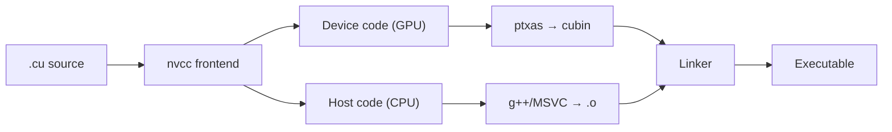

Build a full CUDA development environment from scratch: driver install, Toolkit setup, the compiler toolchain, and IDE integration, so you can write and run your first GPU program in about 10 minutes.

<!-- more -->

## 📑 Table of contents

- [1. How the GPU driver relates to the CUDA Toolkit](#1-how-the-gpu-driver-relates-to-the-cuda-toolkit)
- [2. Installing the NVIDIA driver](#2-installing-the-nvidia-driver)
- [3. Installing the CUDA Toolkit](#3-installing-the-cuda-toolkit)
- [4. Environment variable setup](#4-environment-variable-setup)
- [5. The nvcc compiler toolchain](#5-the-nvcc-compiler-toolchain)
- [6. Integrating CUDA with CMake](#6-integrating-cuda-with-cmake)
- [7. Hello World: your first CUDA program](#7-hello-world-your-first-cuda-program)
- [8. Managing multiple CUDA versions](#8-managing-multiple-cuda-versions)
- [9. IDE setup tips](#9-ide-setup-tips)
- [10. Common install problems](#10-common-install-problems)
- [Summary](#-summary)

---

## 1. How the GPU driver relates to the CUDA Toolkit

A lot of beginners mix up what the "driver" and the "CUDA Toolkit" actually are. Think of it this way: the driver is like your phone's OS firmware — it makes the hardware work. The CUDA Toolkit is the developer kit you install on top of that OS — it gives you the compiler, libraries, and debugger so you can write programs that run on the GPU.

### 1.1 Version compatibility rules

NVIDIA uses **forward compatibility**: a newer driver can run programs built with an older CUDA Toolkit, but not the other way around. The core rules:

- Every CUDA Toolkit version has a **minimum driver version**
- Driver version ≥ what the Toolkit asks for is enough; they do not need to match exactly
- The "CUDA Version" shown by `nvidia-smi` is the **highest** Toolkit version the driver supports, not the Toolkit you currently have installed

| CUDA Toolkit version | Min Linux driver | Min Windows driver |
|----------------------|------------------|--------------------|
| CUDA 12.6 | ≥ 560.28 | ≥ 560.70 |
| CUDA 12.4 | ≥ 550.54 | ≥ 551.61 |
| CUDA 12.2 | ≥ 535.54 | ≥ 536.25 |
| CUDA 11.8 | ≥ 520.61 | ≥ 520.06 |

💡 **Tip**: Prefer upgrading the driver to the latest stable release first. It stays compatible with older Toolkits and leaves room to upgrade the Toolkit later.

### 1.2 What the CUDA Toolkit includes

| 📦 Component | 📝 Role |
|--------------|---------|
| nvcc | CUDA C/C++ compiler |
| cuBLAS | Linear algebra library |
| cuDNN | Deep learning primitives library (download separately) |
| cuFFT | Fast Fourier transform library |
| cuRAND | Random number generation library |
| Nsight Systems | System-level profiling tool |
| Nsight Compute | Kernel-level profiling tool |
| CUDA Runtime (libcudart) | Runtime API library |
| cuda-gdb | GPU debugger |

---

## 2. Installing the NVIDIA driver

### 2.1 Linux (Ubuntu)

```bash
# Method 1: use apt (recommended)
sudo apt update
sudo apt install nvidia-driver-560

# Reboot after install
sudo reboot

# Verify
nvidia-smi
```

```bash
# Method 2: use the official .run installer
# Disable the nouveau open-source driver first
sudo bash -c "echo 'blacklist nouveau' >> /etc/modprobe.d/blacklist.conf"
sudo update-initramfs -u
sudo reboot

# Download and run the installer
chmod +x NVIDIA-Linux-x86_64-560.35.03.run
sudo ./NVIDIA-Linux-x86_64-560.35.03.run
```

⚠️ **Note**: Before using a `.run` installer you must disable the `nouveau` driver and switch to a text console (tty), or the install will fail. On production servers, prefer the package manager so updates stay automatic.

### 2.2 Windows

Windows users can download the matching GPU driver from the [NVIDIA driver download page](https://www.nvidia.com/Download/index.aspx) and install it. After install, run `nvidia-smi` in a command prompt to verify.

### 2.3 Verifying the driver

```bash
$ nvidia-smi
+-----------------------------------------------------------------------------------------+
| NVIDIA-SMI 560.35.03              Driver Version: 560.35.03      CUDA Version: 12.6     |
|-----------------------------------------+------------------------+----------------------+
| GPU  Name                 Persistence-M | Bus-Id          Disp.A | Volatile Uncorr. ECC |
| Fan  Temp   Perf          Pwr:Usage/Cap |           Memory-Usage | GPU-Util  Compute M. |
|=========================================+========================+======================|
|   0  NVIDIA GeForce RTX 4090       Off | 00000000:01:00.0  Off |                  Off |
|  0%   35C    P8              12W / 450W |       1MiB / 24564MiB |      0%      Default |
+-----------------------------------------+------------------------+----------------------+
```

Watch three fields:
- **Driver Version**: current driver version
- **CUDA Version**: highest CUDA version the driver supports
- **Memory-Usage**: how much GPU memory is in use

---

## 3. Installing the CUDA Toolkit

### 3.1 Linux install (runfile recommended)

```bash
# Download the CUDA 12.6 runfile
wget https://developer.download.nvidia.com/compute/cuda/12.6.0/local_installers/cuda_12.6.0_560.28.03_linux.run

# Run the installer (uncheck Driver so you do not overwrite the existing one)
sudo sh cuda_12.6.0_560.28.03_linux.run
```

In the install UI:
- ❌ Uncheck Driver (you already installed it separately)
- ✅ Check CUDA Toolkit
- ✅ Check CUDA Samples (optional, useful for learning)

💡 **Tip**: If you install with `apt`, use `sudo apt install cuda-toolkit-12-6`. That path does not pull in a bundled driver.

### 3.2 Windows install

Download the matching `.exe` from the [CUDA Toolkit Archive](https://developer.nvidia.com/cuda-toolkit-archive), choose Custom install, and pick the components you need.

### 3.3 conda install (for Python developers)

```bash
# Install only the CUDA runtime and compiler (no driver)
conda install -c nvidia cuda-toolkit=12.6
```

This fits when the system already has a driver and you want a separate CUDA version inside a conda env.

---

## 4. Environment variable setup

After install, add the CUDA paths to your environment variables.

### 4.1 Linux

Add to `~/.bashrc` or `~/.zshrc`:

```bash
# CUDA path setup
export CUDA_HOME=/usr/local/cuda-12.6
export PATH=$CUDA_HOME/bin:$PATH
export LD_LIBRARY_PATH=$CUDA_HOME/lib64:$LD_LIBRARY_PATH
```

```bash
# Apply the config
source ~/.bashrc

# Verify
nvcc --version
which nvcc
```

### 4.2 Windows

In system environment variables, set:
- `CUDA_PATH` = `C:\Program Files\NVIDIA GPU Computing Toolkit\CUDA\v12.6`
- Add `%CUDA_PATH%\bin` to `PATH`

### 4.3 Verifying the install

```bash
$ nvcc --version
nvcc: NVIDIA (R) Cuda compiler driver
Copyright (c) 2005-2024 NVIDIA Corporation
Built on ...
Cuda compilation tools, release 12.6, V12.6.20
Build cuda_12.6.r12.6/compiler.34431801_0
```

```bash
# Build and run the official CUDA Samples (download separately from GitHub)
git clone https://github.com/NVIDIA/cuda-samples.git
cd cuda-samples/Samples/1_Utilities/deviceQuery
make
./deviceQuery
```

If `deviceQuery` prints `Result = PASS`, the whole stack (driver + Toolkit + GPU) is working.

⚠️ **Note**: Starting with CUDA 11.6, Samples are no longer bundled with the Toolkit installer. Download them separately from [GitHub](https://github.com/NVIDIA/cuda-samples).

---

## 5. The nvcc compiler toolchain

nvcc is the CUDA program's compiler driver. It is not a standalone compiler so much as a **compilation coordinator**: it splits device and host code in `.cu` files, sends them through the NVIDIA PTX compiler and the system C++ compiler, then links an executable.

### 5.1 Compilation flow



### 5.2 Common compile options

```bash
# Basic compile
nvcc hello.cu -o hello

# Target a GPU architecture (sm_89 for RTX 4090)
nvcc -arch=sm_89 hello.cu -o hello

# Build a multi-architecture fatbinary
nvcc -gencode arch=compute_80,code=sm_80 \
     -gencode arch=compute_89,code=sm_89 \
     hello.cu -o hello

# Emit debug info (for cuda-gdb)
nvcc -g -G hello.cu -o hello_debug

# Turn on optimization
nvcc -O3 hello.cu -o hello_opt

# Show detailed compile steps
nvcc --verbose hello.cu -o hello
```

### 5.3 Key compile options

| Option | Role |
|--------|------|
| `-arch=sm_XX` | Target GPU compute capability |
| `-gencode` | Emit code for multiple architectures |
| `-G` | Device-code debug info |
| `-lineinfo` | Keep line numbers in optimized code (for profiling) |
| `-Xcompiler` | Pass following options to the host compiler |
| `-std=c++17` | C++ standard version |
| `-maxrregcount=N` | Cap registers per thread |
| `--ptxas-options=-v` | Show register and shared memory use per kernel |

### 5.4 GPU architecture quick reference

| Arch code | Example GPUs | Compute capability |
|-----------|--------------|--------------------|
| sm_70 | V100 | 7.0 |
| sm_75 | T4, RTX 2080 | 7.5 |
| sm_80 | A100 | 8.0 |
| sm_86 | RTX 3090 | 8.6 |
| sm_89 | RTX 4090, L40 | 8.9 |
| sm_90 | H100 | 9.0 |

---

## 6. Integrating CUDA with CMake

In real projects you rarely call `nvcc` by hand. You use CMake as the build system. Since CMake 3.8, CUDA is a first-class language.

### 6.1 Minimal CMakeLists.txt

```cmake
cmake_minimum_required(VERSION 3.18)
project(MyCUDAProject LANGUAGES CXX CUDA)

# Set C++ and CUDA standards
set(CMAKE_CXX_STANDARD 17)
set(CMAKE_CUDA_STANDARD 17)

# Target GPU architectures
set(CMAKE_CUDA_ARCHITECTURES 80 89 90)

# Add the executable
add_executable(main src/main.cu)

# Link the CUDA runtime
target_link_libraries(main PRIVATE CUDA::cudart)
```

### 6.2 Mixing C++ and CUDA sources

```cmake
cmake_minimum_required(VERSION 3.18)
project(HybridProject LANGUAGES CXX CUDA)

set(CMAKE_CXX_STANDARD 17)
set(CMAKE_CUDA_STANDARD 17)
set(CMAKE_CUDA_ARCHITECTURES 80 89)

# CUDA sources
add_library(kernels STATIC
    src/kernels/vector_add.cu
    src/kernels/matrix_mul.cu
)

# C++ main links the CUDA library
add_executable(app src/main.cpp)
target_link_libraries(app PRIVATE kernels CUDA::cudart)
```

### 6.3 Build and run

```bash
mkdir build && cd build
cmake .. -DCMAKE_BUILD_TYPE=Release
make -j$(nproc)
./main
```

💡 **Tip**: Prefer `CMAKE_CUDA_ARCHITECTURES` over hard-coding `-arch` in source. Then switching target GPUs means changing one config value.

---

## 7. Hello World: your first CUDA program

Everything is in place. Write a full Hello World to check the whole toolchain.

### 7.1 Source `hello_cuda.cu`

```cpp
#include <cstdio>

// __global__ marks this as a kernel that runs on the GPU
__global__ void helloKernel() {
    // threadIdx.x is this thread's index inside the Block
    printf("Hello from GPU thread %d in block %d!\n",
           threadIdx.x, blockIdx.x);
}

int main() {
    printf("Launching kernel...\n");

    // <<<2, 4>>> launches 2 Blocks with 4 threads each
    helloKernel<<<2, 4>>>();

    // Wait until all GPU work finishes
    cudaDeviceSynchronize();

    printf("Done!\n");
    return 0;
}
```

### 7.2 Compile and run

```bash
$ nvcc hello_cuda.cu -o hello_cuda
$ ./hello_cuda
Launching kernel...
Hello from GPU thread 0 in block 0!
Hello from GPU thread 1 in block 0!
Hello from GPU thread 2 in block 0!
Hello from GPU thread 3 in block 0!
Hello from GPU thread 0 in block 1!
Hello from GPU thread 1 in block 1!
Hello from GPU thread 2 in block 1!
Hello from GPU thread 3 in block 1!
Done!
```

📌 **Key point**: Thread execution order is not fixed — output from the two Blocks may interleave. The GPU hardware scheduler decides the order in parallel programs.

### 7.3 Code breakdown

| Piece | Meaning |
|-------|---------|
| `__global__` | Marks a kernel: called from the CPU, runs on the GPU |
| `<<<2, 4>>>` | Launch config: 2 Blocks, 4 threads per Block |
| `threadIdx.x` | Thread index inside its Block |
| `blockIdx.x` | Block index inside the Grid |
| `cudaDeviceSynchronize()` | CPU blocks until the GPU finishes all work |

---

## 8. Managing multiple CUDA versions

In practice you may need several CUDA versions at once (project A on CUDA 11.8, project B on CUDA 12.6). NVIDIA's layout allows them to coexist.

### 8.1 Installing multiple versions

Install each version into its own directory:
```
/usr/local/cuda-11.8/
/usr/local/cuda-12.4/
/usr/local/cuda-12.6/
```

### 8.2 Switching with a symlink

```bash
# Switch to CUDA 12.6
sudo rm -f /usr/local/cuda
sudo ln -s /usr/local/cuda-12.6 /usr/local/cuda

# Switch to CUDA 11.8
sudo rm -f /usr/local/cuda
sudo ln -s /usr/local/cuda-11.8 /usr/local/cuda
```

Point env vars at `/usr/local/cuda`:
```bash
export CUDA_HOME=/usr/local/cuda
export PATH=$CUDA_HOME/bin:$PATH
export LD_LIBRARY_PATH=$CUDA_HOME/lib64:$LD_LIBRARY_PATH
```

### 8.3 Using Environment Modules (cluster setups)

HPC clusters usually use Environment Modules:
```bash
module avail cuda
module load cuda/12.6
module list
```

### 8.4 A quick switch script

```bash
#!/bin/bash
# Save as ~/bin/switch-cuda.sh
# Usage: source switch-cuda.sh 12.6

CUDA_VERSION=$1
if [ -d "/usr/local/cuda-$CUDA_VERSION" ]; then
    export CUDA_HOME=/usr/local/cuda-$CUDA_VERSION
    export PATH=$CUDA_HOME/bin:$PATH
    export LD_LIBRARY_PATH=$CUDA_HOME/lib64:$LD_LIBRARY_PATH
    echo "Switched to CUDA $CUDA_VERSION"
    nvcc --version
else
    echo "CUDA $CUDA_VERSION not found!"
fi
```

---

## 9. IDE setup tips

### 9.1 VS Code (recommended)

Install these extensions:
- **NVIDIA Nsight Visual Studio Code Edition**: syntax highlighting and debugging
- **C/C++ (Microsoft)**: IntelliSense
- **CMake Tools**: CMake integration

Example `.vscode/settings.json`:
```json
{
    "files.associations": {
        "*.cu": "cuda-cpp",
        "*.cuh": "cuda-cpp"
    },
    "C_Cpp.default.includePath": [
        "/usr/local/cuda/include"
    ]
}
```

### 9.2 CLion

CLion supports CUDA natively through CMake:
- Make sure `CMakeLists.txt` sets `LANGUAGES CXX CUDA`
- CLion will pick up `.cu` files for completion and debugging
- In Settings → Build → CMake, set `-DCMAKE_CUDA_COMPILER=/usr/local/cuda/bin/nvcc`

### 9.3 Nsight Visual Studio Edition (Windows)

On Windows, the CUDA Toolkit ships an Nsight plugin for Visual Studio with GPU debugging and profiling. On Linux, use the Nsight Systems/Compute CLI tools with VS Code or CLion.

💡 **Tip**: Nsight Eclipse Edition was removed starting with CUDA 12.0 and is no longer bundled. On Linux, prefer VS Code plus the Nsight extension.

---

## 10. Common install problems

| ❌ Problem | ✅ Fix |
|-----------|--------|
| `nvidia-smi` says "command not found" | Driver missing or not on PATH |
| `nvidia-smi` says "driver/library version mismatch" | Driver was updated without a reboot; run `sudo reboot` |
| `nvcc` says "command not found" | Toolkit missing or env vars not set |
| Compile says "unsupported gpu architecture sm_XX" | nvcc is too old for your GPU; upgrade the Toolkit |
| Link says "cannot find -lcudart" | `LD_LIBRARY_PATH` does not include the CUDA lib64 directory |
| CMake says "No CUDA toolset found" | Set `CMAKE_CUDA_COMPILER` to the nvcc path explicitly |
| Runtime says "CUDA error: no CUDA-capable device" | Driver issue or GPU not seen by the system; check `lspci \| grep NVIDIA` |

⚠️ **Note**: When install fails, start with the detailed log in `/var/log/nvidia-installer.log` (Linux).

---

## 📝 Summary

This article covered the full CUDA environment setup flow:

1. **The driver is the base**: install it first and confirm `nvidia-smi` works
2. **The Toolkit is the toolbox**: compiler, libraries, and debugger
3. **Env vars are the bridge**: so the system can find nvcc and the CUDA libraries
4. **CMake is the productivity layer**: the build system you want in real projects
5. **Multi-version management**: switch with symlinks across project needs

One-line version of the flow: **install driver → install Toolkit → set env vars → run deviceQuery to verify**.

## 🎯 Self-check list

- Can tell the GPU driver and CUDA Toolkit apart, including version compatibility
- Can install the driver and CUDA Toolkit on Linux without help
- Can configure `CUDA_HOME`, `PATH`, and `LD_LIBRARY_PATH`
- Can compile a `.cu` file with `nvcc` and set a target architecture
- Can write a CMakeLists.txt that includes CUDA and builds successfully
- Can manage and switch multiple CUDA versions on one machine
- Can diagnose common install and compile errors from the message

## 📚 References

- [NVIDIA CUDA Toolkit documentation](https://docs.nvidia.com/cuda/)
- [CUDA Toolkit Archive (historical downloads)](https://developer.nvidia.com/cuda-toolkit-archive)
- [NVIDIA Driver Downloads](https://www.nvidia.com/Download/index.aspx)
- [CMake CUDA support docs](https://cmake.org/cmake/help/latest/manual/cmake-compile-features.7.html#supported-compilers)
- [CUDA Compatibility Guide](https://docs.nvidia.com/deploy/cuda-compatibility/)
