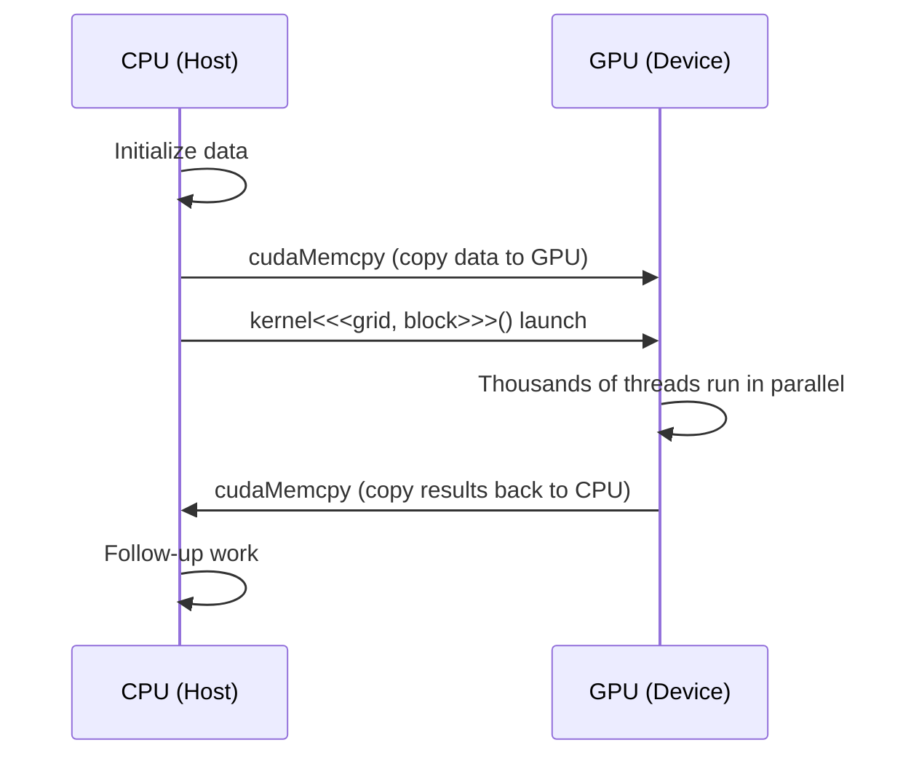

Understand CUDA's three-level Grid/Block/Thread hierarchy, how thread indices are computed, and how to choose Kernel launch configs — the core foundation for writing fast GPU programs.

<!-- more -->

## 📑 Table of contents

- [1. Heterogeneous computing overview](#1-heterogeneous-computing-overview)
- [2. The Grid/Block/Thread hierarchy](#2-the-gridblockthread-hierarchy)
- [3. Computing thread indices](#3-computing-thread-indices)
- [4. Kernel functions and launch syntax](#4-kernel-functions-and-launch-syntax)
- [5. Choosing Block size](#5-choosing-block-size)
- [6. Warp: the hardware scheduling unit](#6-warp-the-hardware-scheduling-unit)
- [7. Multidimensional indexing in practice](#7-multidimensional-indexing-in-practice)
- [8. Occupancy and performance](#8-occupancy-and-performance)
- [Summary](#-summary)

---

## 1. Heterogeneous computing overview

A CUDA program runs on a **heterogeneous system**: the CPU (Host) handles control flow and serial code; the GPU (Device) handles large-scale parallel compute. Picture a factory — the CPU is the plant manager, issuing orders and allocating resources; the GPU is a shop floor with tens of thousands of workers who all start in parallel once a job lands.

### 1.1 Program execution flow



### 1.2 Three function qualifiers

CUDA uses qualifiers to mark where a function runs and who can call it:

| Qualifier | Runs on | Called by | Use |
|-----------|---------|-----------|-----|
| `__global__` | GPU | CPU (or GPU dynamic parallelism) | Kernel entry point |
| `__device__` | GPU | GPU | Helper called from inside a Kernel |
| `__host__` | CPU | CPU | Ordinary CPU function (default) |

```cpp
// Can be combined: compile for both CPU and GPU
__host__ __device__ float square(float x) {
    return x * x;
}
```

---

## 2. The Grid/Block/Thread hierarchy

CUDA's core design idea is **hierarchical parallelism**: organize massive thread counts into three levels that are easy to reason about and map cleanly onto GPU hardware.

### 2.1 Conceptual model

An analogy:
- **Grid** = the whole school — every thread created by one Kernel launch
- **Block** = one class — threads inside a Block can cooperate (shared memory, sync)
- **Thread** = one student — the smallest unit of execution


### 2.2 Dimensions and indices

Grid and Block can each be 1D, 2D, or 3D:

```cpp
// 1D: process a vector
dim3 grid(256);        // 256 Blocks
dim3 block(256);       // 256 threads per Block

// 2D: process an image/matrix
dim3 grid(16, 16);     // 16x16 = 256 Blocks
dim3 block(16, 16);    // 16x16 = 256 threads per Block

// 3D: process volume data
dim3 grid(8, 8, 8);    // 8x8x8 = 512 Blocks
dim3 block(8, 8, 4);   // 8x8x4 = 256 threads per Block
```

### 2.3 Hardware limits

| Limit | Max (Compute Capability ≥ 8.0) |
|-------|--------------------------------|
| Max threads per Block dimension | x:1024, y:1024, z:64 |
| Max threads per Block (total) | 1024 |
| Max Blocks per Grid dimension | x:$2^{31}-1$, y:65535, z:65535 |
| Max active threads per SM | 2048 (sm\_80) / 1536 (sm\_89) |
| Max active Blocks per SM | 16~32 (architecture-dependent) |

⚠️ **Note**: Total threads in a Block cannot exceed 1024, i.e. `blockDim.x * blockDim.y * blockDim.z ≤ 1024`.

---

## 3. Computing thread indices

Every thread can read built-in variables for its place in the hierarchy, then figure out which slice of data it should handle.

### 3.1 Built-in variables

| Variable | Type | Meaning |
|----------|------|---------|
| `threadIdx` | `dim3` | Thread index inside its Block |
| `blockIdx` | `dim3` | Block index inside the Grid |
| `blockDim` | `dim3` | Dimensions of each Block (thread counts) |
| `gridDim` | `dim3` | Dimensions of the Grid (Block counts) |

### 3.2 1D index calculation

The most common pattern — map threads onto a 1D array:

```cpp
// Global thread ID = Block index × Block size + thread index inside the Block
int globalIdx = blockIdx.x * blockDim.x + threadIdx.x;
```

For a `gridDim=4, blockDim=8` launch, global indices look like this:

```
Block 0: [ 0  1  2  3  4  5  6  7]
Block 1: [ 8  9 10 11 12 13 14 15]
Block 2: [16 17 18 19 20 21 22 23]
Block 3: [24 25 26 27 28 29 30 31]
```

### 3.3 2D index calculation

For matrices you usually use a 2D Grid and 2D Block:

```cpp
int col = blockIdx.x * blockDim.x + threadIdx.x;
int row = blockIdx.y * blockDim.y + threadIdx.y;

// Convert to a linear index (row-major)
int linearIdx = row * width + col;
```

### 3.4 Grid-stride loop pattern

When the data is larger than the thread count, loop so each thread handles multiple elements:

```cpp
__global__ void processLargeArray(float* data, int N) {
    int idx = blockIdx.x * blockDim.x + threadIdx.x;
    int stride = blockDim.x * gridDim.x;  // total thread count

    // Each thread walks the array with step = stride
    for (int i = idx; i < N; i += stride) {
        data[i] = data[i] * 2.0f;
    }
}
```

💡 **Tip**: The Grid-stride loop is a CUDA **best practice** — it handles any data size correctly and still lets you pick Grid size for performance.

---

## 4. Kernel functions and launch syntax

### 4.1 Kernel definition rules

```cpp
__global__ void myKernel(float* input, float* output, int N) {
    int idx = blockIdx.x * blockDim.x + threadIdx.x;
    if (idx < N) {
        output[idx] = input[idx] * 2.0f;
    }
}
```

Kernel constraints:
- Return type must be `void`
- No variadic arguments
- Cannot be a class virtual function
- Cannot recurse (Compute Capability < 2.0; modern GPUs all support recursion)
- Arguments pass by value; pointers must point at device memory

### 4.2 Launch syntax `<<<...>>>`

```cpp
kernel<<<gridDim, blockDim, sharedMemBytes, stream>>>(args...);
```

| Argument | Type | Required | Meaning |
|----------|------|----------|---------|
| `gridDim` | `dim3` or `int` | Yes | Number of Blocks in the Grid |
| `blockDim` | `dim3` or `int` | Yes | Number of threads per Block |
| `sharedMemBytes` | `size_t` | No | Dynamic shared memory size (default 0) |
| `stream` | `cudaStream_t` | No | Execution stream (default 0, the default stream) |

### 4.3 Computing the launch config

Given data size N and Block size, compute how many Blocks you need:

```cpp
int N = 1000000;
int blockSize = 256;
int gridSize = (N + blockSize - 1) / blockSize;  // ceiling division

myKernel<<<gridSize, blockSize>>>(input, output, N);
```

📌 **Key point**: `(N + blockSize - 1) / blockSize` is the standard integer ceiling divide. When N is not a multiple of blockSize, some threads in the last Block go "out of range", so the Kernel must guard with `if (idx < N)`.

### 4.4 Error checking

Kernel launch is asynchronous, so errors are not caught immediately:

```cpp
myKernel<<<grid, block>>>(args);

// Check launch errors
cudaError_t err = cudaGetLastError();
if (err != cudaSuccess) {
    printf("Kernel launch error: %s\n", cudaGetErrorString(err));
}

// Wait for completion and check runtime errors
err = cudaDeviceSynchronize();
if (err != cudaSuccess) {
    printf("Kernel execution error: %s\n", cudaGetErrorString(err));
}
```

---

## 5. Choosing Block size

Block size directly affects GPU utilization and performance. There is no single best value for every case, but there are practical rules of thumb.

### 5.1 Basic principles

| ✅ Prefer | ❌ Avoid | 📝 Why |
|-----------|----------|--------|
| Block size multiple of 32 | Non-multiples of 32 | Warps schedule in units of 32 threads |
| 128~512 threads/Block | < 64 or > 1024 | Balance register pressure and parallelism |
| Tune to Kernel register use | Always use 256 | Heavy register use needs smaller Blocks |

### 5.2 Why it must be a multiple of 32

GPU execution schedules at **Warp** granularity (32 consecutive threads). If Block size is not a multiple of 32, some threads in the last Warp are wasted:

```
Block size = 100 → 4 Warps, but only 4 threads active in the 4th Warp
Block size = 128 → 4 Warps, every thread active ✅
```

### 5.3 Occupancy API (automatic choice)

CUDA provides an API to pick a good Block size automatically:

```cpp
int blockSize;
int minGridSize;

// Auto-pick a Block size that maximizes occupancy
cudaOccupancyMaxPotentialBlockSize(
    &minGridSize,
    &blockSize,
    myKernel,       // kernel function pointer
    0,              // dynamic shared memory size
    0               // Block size upper bound (0 = no limit)
);

int gridSize = (N + blockSize - 1) / blockSize;
myKernel<<<gridSize, blockSize>>>(args);
```

### 5.4 Practical selection guide

| Scenario | Suggested Block size | Reason |
|----------|----------------------|--------|
| Simple element-wise ops | 256 or 512 | Few registers; large Blocks are fine |
| Heavy shared memory use | 128 or 256 | Shared memory limits active Blocks |
| High-register Kernels | 128 | Smaller Blocks ease register pressure |
| Needs Block-wide sync | 256 | Balance sync cost and parallelism |

---

## 6. Warp: the hardware scheduling unit

### 6.1 What a Warp is

If a Block is the logical unit of cooperation, a Warp is the **physical unit of execution**. An SM (Streaming Multiprocessor) schedules at Warp granularity — one Warp holds 32 consecutive threads that execute the same instruction in the same cycle (SIMT, Single Instruction Multiple Threads).

### 6.2 Warp divergence

When threads inside a Warp take different branch paths, you get **Warp divergence** — the GPU has to run both branches serially:

```cpp
// ❌ Easy to diverge
if (threadIdx.x % 2 == 0) {
    // Even threads take this path
    result = pathA(data);
} else {
    // Odd threads take this path
    result = pathB(data);
}

// ✅ Branch on Warp boundaries to avoid divergence
if (threadIdx.x / 32 < 2) {
    // First two Warps run pathA
    result = pathA(data);
} else {
    // Later Warps run pathB
    result = pathB(data);
}
```

💡 **Tip**: As long as all 32 threads in a Warp take the same branch, there is no divergence penalty. Divergence is inside a Warp; different Warps taking different branches costs nothing.

### 6.3 Warp-level primitives

Modern CUDA offers Warp-level ops so threads can exchange data inside a Warp:

```cpp
// Broadcast inside the Warp: send lane 0's value to the whole Warp
float val = __shfl_sync(0xffffffff, data, 0);

// Warp-level reduction sum
for (int offset = 16; offset > 0; offset >>= 1) {
    val += __shfl_down_sync(0xffffffff, val, offset);
}
```

---

## 7. Multidimensional indexing in practice

### 7.1 Image processing: 2D Grid + 2D Block

```cpp
__global__ void grayscaleKernel(unsigned char* rgb, unsigned char* gray,
                                 int width, int height) {
    int col = blockIdx.x * blockDim.x + threadIdx.x;
    int row = blockIdx.y * blockDim.y + threadIdx.y;

    if (col < width && row < height) {
        int rgbIdx = (row * width + col) * 3;
        int grayIdx = row * width + col;
        // ITU-R BT.601 grayscale conversion
        gray[grayIdx] = (unsigned char)(
            0.299f * rgb[rgbIdx] +
            0.587f * rgb[rgbIdx + 1] +
            0.114f * rgb[rgbIdx + 2]
        );
    }
}

// Launch config
dim3 block(16, 16);  // 16x16 = 256 threads per Block
dim3 grid((width + 15) / 16, (height + 15) / 16);
grayscaleKernel<<<grid, block>>>(d_rgb, d_gray, width, height);
```

### 7.2 Matrix ops: row/column mapping

```cpp
__global__ void matrixAdd(float* A, float* B, float* C,
                          int rows, int cols) {
    int col = blockIdx.x * blockDim.x + threadIdx.x;
    int row = blockIdx.y * blockDim.y + threadIdx.y;

    if (row < rows && col < cols) {
        int idx = row * cols + col;
        C[idx] = A[idx] + B[idx];
    }
}
```

### 7.3 Batch processing: 3D Grid

```cpp
// Third dimension is the batch
__global__ void batchProcess(float* data, int batchSize,
                             int height, int width) {
    int col = blockIdx.x * blockDim.x + threadIdx.x;
    int row = blockIdx.y * blockDim.y + threadIdx.y;
    int batch = blockIdx.z;

    if (col < width && row < height && batch < batchSize) {
        int idx = batch * height * width + row * width + col;
        data[idx] = data[idx] * 2.0f;
    }
}

dim3 block(16, 16, 1);
dim3 grid((width + 15) / 16, (height + 15) / 16, batchSize);
batchProcess<<<grid, block>>>(d_data, batchSize, height, width);
```

---

## 8. Occupancy and performance

### 8.1 What occupancy is

Occupancy = active Warps on an SM / theoretical max Warps that SM supports.

$$
\text{Occupancy} = \frac{\text{Active Warps per SM}}{\text{Max Warps per SM}}
$$

Higher occupancy is not always faster, but very low occupancy usually means idle GPU resources.

### 8.2 What affects occupancy

| 📊 Factor | 📝 How it affects things |
|-----------|--------------------------|
| Block size | Too-small Blocks mean fewer active Warps |
| Registers per thread | More registers → fewer threads fit on an SM |
| Shared memory per Block | More shared memory → fewer Blocks fit on an SM |
| SM hardware limits | Max Blocks and threads differ by architecture |

### 8.3 Analyzing with the Occupancy Calculator

```bash
# Print register and shared memory use at compile time
nvcc --ptxas-options=-v mykernel.cu -o mykernel
```

Example output:
```
ptxas info    : Used 32 registers, 4096 bytes smem, 368 bytes cmem[0]
```

Then use the [CUDA Occupancy Calculator](https://docs.nvidia.com/cuda/cuda-occupancy-calculator/) or the `cudaOccupancyMaxActiveBlocksPerMultiprocessor` API to compute occupancy.

---

## 📝 Summary

Core points of the CUDA programming model:

1. **Three-level hierarchy**: Grid → Block → Thread, clear logically and friendly to hardware
2. **Index formula**: `globalIdx = blockIdx.x * blockDim.x + threadIdx.x`
3. **Grid-stride loop**: the general data-traversal pattern for any scale
4. **Block size choice**: multiple of 32, usually 128~512; Occupancy API can pick automatically
5. **Warp is the execution unit**: understand Warp divergence and align access patterns
6. **Bounds checks**: Kernels must check whether an index is in range

Once you know the programming model, you have the CUDA "map" — memory models, sync primitives, and optimization tricks all come back to this hierarchy.

## 🎯 Self-check list

- Can sketch the Grid/Block/Thread hierarchy
- Can pick Grid and Block dimensions that match the data shape
- Can hand-compute any thread's global index for a given config
- Can write a Grid-stride loop for oversized arrays
- Can use the Occupancy API to auto-pick Block size
- Can spot Warp divergence and refactor to avoid it
- Can configure 2D Grid/Block for matrix and image work
- Can read `--ptxas-options=-v` output to find occupancy bottlenecks

## 📚 References

- [NVIDIA CUDA C++ Programming Guide - Programming Model](https://docs.nvidia.com/cuda/cuda-c-programming-guide/index.html#programming-model)
- [CUDA C++ Best Practices Guide](https://docs.nvidia.com/cuda/cuda-c-best-practices-guide/)
- [CUDA Occupancy Calculator](https://docs.nvidia.com/cuda/cuda-occupancy-calculator/)
- [Professional CUDA C Programming (Cheng et al.)](https://www.wiley.com/en-us/Professional+CUDA+C+Programming-p-9781118739327)
