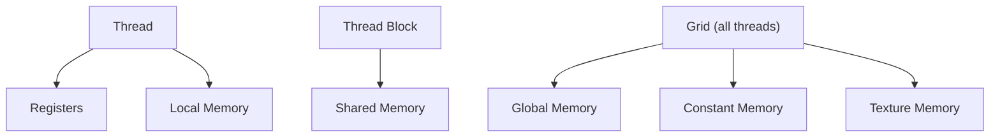
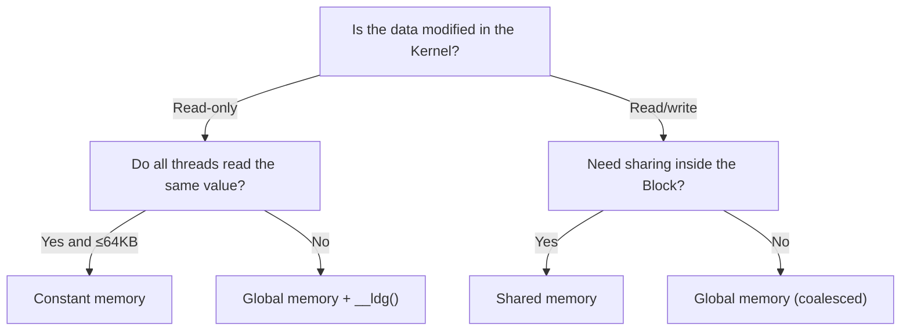

Understanding CUDA's multi-level memory hierarchy is the key to writing high-performance Kernels. This article covers global memory, shared memory, registers, constant memory, and unified memory: their traits, when to use them, and how to optimize.

<!-- more -->

## 📑 Table of contents

- [1. Why the memory model matters so much](#1-why-the-memory-model-matters-so-much)
- [2. Memory hierarchy overview](#2-memory-hierarchy-overview)
- [3. Global memory](#3-global-memory)
- [4. Shared memory](#4-shared-memory)
- [5. Registers and local memory](#5-registers-and-local-memory)
- [6. Constant memory](#6-constant-memory)
- [7. Texture memory](#7-texture-memory)
- [8. Unified memory](#8-unified-memory)
- [9. Memory selection guide](#9-memory-selection-guide)
- [Summary](#-summary)

---

## 1. Why the memory model matters so much

GPUs are extremely strong at compute — an A100 peaks at 312 TFLOPS (FP16, Tensor Core with sparsity) — but its memory bandwidth is only about 2 TB/s. A quick bit of arithmetic: one floating-point multiply-add (FMA) reads 2 floats (8 Bytes) and produces 2 FLOPs, so 2 TB/s of bandwidth can feed at most 500 GFLOPS of compute — under 0.2% of peak.

That means: **most Kernel performance bottlenecks are memory access, not arithmetic**. Learning CUDA's multi-level memory hierarchy, and putting data "as close to the compute as you can", is lesson one for GPU optimization.

---

## 2. Memory hierarchy overview

Think of the GPU memory hierarchy like a city's transport system — registers are files on your desk (fastest, smallest), shared memory is the filing cabinet in the same office (fast and shareable), and global memory is a warehouse outside the city (huge capacity, but the round trip takes time).

### 2.1 Memory hierarchy diagram




### 2.2 Comparing memory levels

| 📊 Memory type | Location | Capacity | Latency | Bandwidth | Scope | Lifetime |
|----------------|----------|----------|---------|-----------|-------|----------|
| Registers | On SM | ~256KB/SM | 1 cycle | Highest | Single thread | Thread lifetime |
| Shared memory | On SM | 48~228KB/SM (varies by arch) | ~20 cycles | ~19 TB/s | Inside Block | Block lifetime |
| L1 Cache | On SM | 128~256KB/SM | ~30 cycles | ~19 TB/s | Automatic | Automatically managed |
| L2 Cache | On GPU | 6~50MB | ~200 cycles | ~5 TB/s | All SMs | Automatically managed |
| Global memory (HBM) | Off-chip | 16~80GB | ~400 cycles | 1~3.4 TB/s | Global | Application lifetime |
| Constant memory | Off-chip + cache | 64KB | 1~400 cycles | Very high when cached | Global read-only | Application lifetime |

---


## 3. Global memory

Global Memory is the GPU's "main memory", physically HBM (High Bandwidth Memory). It has the largest capacity and the highest latency, and it is the hub for CPU–GPU data exchange.

### 3.1 Basic operations

```cpp
// Allocate device memory
float* d_data;
size_t size = N * sizeof(float);
cudaMalloc(&d_data, size);

// Host → Device transfer
cudaMemcpy(d_data, h_data, size, cudaMemcpyHostToDevice);

// Device → Host transfer
cudaMemcpy(h_result, d_data, size, cudaMemcpyDeviceToHost);

// Free device memory
cudaFree(d_data);
```

### 3.2 Coalesced access

Global memory efficiency depends on **whether the 32 threads in a Warp access contiguous, aligned addresses**. The GPU fetches from global memory in 32B/64B/128B granules (one "transaction"). If Warp threads touch consecutive addresses, one transaction serves them all — that is **coalesced access**.

```cpp
// ✅ Coalesced: consecutive threads touch consecutive addresses
// Thread 0 → data[0], Thread 1 → data[1], ...
float val = data[threadIdx.x + blockIdx.x * blockDim.x];

// ❌ Strided: inefficient
// Thread 0 → data[0], Thread 1 → data[stride], ...
float val = data[(threadIdx.x + blockIdx.x * blockDim.x) * stride];
```


### 3.3 How access patterns affect performance

| Access pattern | Transactions (Warp reading 32 floats) | Effective bandwidth use |
|----------------|---------------------------------------|-------------------------|
| Perfect coalesce (contiguous + aligned) | 1 × 128B transaction | 100% |
| Contiguous but misaligned | 2 × 128B transactions | 50% |
| Random scatter | Up to 32 × 32B transactions | ~3% |

💡 **Tip**: When designing data layouts, prefer **Structure of Arrays (SoA)** over **Array of Structures (AoS\)**, because SoA makes coalesced access much easier.

### 3.4 SoA vs AoS example

```cpp
// ❌ AoS (Array of Structures) — neighboring threads do not hit contiguous addresses
struct Particle {
    float x, y, z;
    float vx, vy, vz;
};
Particle particles[N];
// Thread i reads particles[i].x → stride sizeof(Particle) = 24 bytes

// ✅ SoA (Structure of Arrays) — neighboring threads hit contiguous addresses
struct Particles {
    float x[N], y[N], z[N];
    float vx[N], vy[N], vz[N];
};
Particles p;
// Thread i reads p.x[i] → stride sizeof(float) = 4 bytes, perfectly coalesced
```

---

## 4. Shared memory

Shared Memory sits on the SM, 48~228KB/SM (architecture-dependent), and is a fast scratchpad shared by every thread in a Block. Think of it as a team whiteboard — everyone on the team can read and write quickly, but other teams cannot see it.

### 4.1 Declaration and use
Static declaration:

```cpp
__global__ void sharedMemDemo(float* input, float* output, int N) {
    // Static declaration: size fixed at compile time
    __shared__ float tile[256];

    int idx = blockIdx.x * blockDim.x + threadIdx.x;
    if (idx < N) {
        // Load global memory into shared memory
        tile[threadIdx.x] = input[idx];

        // Sync: make sure every thread finished loading
        __syncthreads();

        // Safe to read data other threads loaded into tile
        int partner = blockDim.x - 1 - threadIdx.x;
        output[idx] = tile[partner];
    }
}
```
Dynamic declaration:

```cpp
// Dynamic declaration: size chosen at runtime
__global__ void dynamicSharedMem(float* data, int N) {
    extern __shared__ float sharedData[];  // size set at launch

    int idx = blockIdx.x * blockDim.x + threadIdx.x;
    if (idx < N) {
        sharedData[threadIdx.x] = data[idx];
    }
    __syncthreads();
    // ...
}

// Pass dynamic shared memory size as the third launch argument
int sharedMemSize = blockSize * sizeof(float);
dynamicSharedMem<<<grid, block, sharedMemSize>>>(data, N);
```

### 4.2 Bank conflict

Shared memory is split into 32 **Banks** (matching 32 Warp threads), each 4 bytes wide. When multiple threads in a Warp hit different addresses in the same Bank at once, those accesses serialize — that is a **Bank Conflict**.

```
Bank index = (address / 4 bytes) % 32
```

```cpp
// ✅ No Bank Conflict: each thread hits a different Bank
float val = shared[threadIdx.x];         // thread i → Bank i

// ❌ 2-way Bank Conflict: stride 2; threads 0 and 16 collide
float val = shared[threadIdx.x * 2];     // thread 0 → Bank 0, thread 16 → Bank 0

// ✅ Broadcast, no conflict: every thread reads the same address
float val = shared[0];                   // broadcast, no conflict
```

### 4.3 Avoiding Bank Conflicts

For cases like matrix transpose, the classic fix is padding:

```cpp
// Original: 2D shared memory; column access hits Bank Conflicts
__shared__ float tile[32][32];

// Optimized: add 1 column of padding to shift Bank alignment
__shared__ float tile[32][32 + 1];  // 33 columns
```

### 4.4 Shared memory configuration

On modern GPUs (sm\_80+), L1 Cache and shared memory **share the same physical SRAM**, and you can set the split via API:

```cpp
// Prefer more shared memory (up to 164KB on A100)
cudaFuncSetAttribute(myKernel,
    cudaFuncAttributeMaxDynamicSharedMemorySize, 164 * 1024);

// Set L1/Shared Memory preference
cudaFuncSetCacheConfig(myKernel, cudaFuncCachePreferShared);
```

---

## 5. Registers and local memory

### 5.1 Registers

Registers are the fastest storage private to each thread. Local variables in a Kernel live in registers by default:

```cpp
__global__ void compute(float* data, int N) {
    int idx = blockIdx.x * blockDim.x + threadIdx.x;  // in a register
    float temp = 0.0f;                                  // in a register
    float acc = 0.0f;                                   // in a register

    for (int i = 0; i < 10; i++) {
        temp = data[idx + i * N];
        acc += temp * temp;
    }
    data[idx] = acc;
}
```

### 5.2 Register spilling

Each SM has a limited register file (e.g. A100 has 65536 32-bit registers/SM). When a thread needs more registers than the SM can give it, the overflow spills into **local memory** (really a region of global memory, accelerated by L1/L2 but still high latency).

```bash
# Inspect Kernel register use
nvcc --ptxas-options=-v mykernel.cu
# ptxas info: Used 48 registers, 0 bytes smem

# Cap max registers (may spill, but can raise occupancy)
nvcc --maxrregcount=32 mykernel.cu
```

### 5.3 Register use tips

| ✅ Prefer | ❌ Avoid |
|-----------|----------|
| Reuse temporary variables | Declare many independent variables |
| Moderate loop unrolling (`#pragma unroll`) | Over-unrolling that blows up register use |
| Watch with `--ptxas-options=-v` | Blindly chasing zero spill |

⚠️ **Note**: Register use is a **trade-off** — more registers can cut memory traffic during compute, but also cut how many Warps can reside on an SM (lower occupancy). Balance it per Kernel.

---

## 6. Constant memory

Constant Memory is a 64KB **read-only** global memory region with a dedicated constant cache. When every thread in a Warp reads the same address, one cache read broadcasts to all 32 threads.

### 6.1 Declaration and use

```cpp
// Declare constant memory at global scope
__constant__ float coefficients[256];

// Host copies data into constant memory
float h_coeff[256];
// ... fill h_coeff ...
cudaMemcpyToSymbol(coefficients, h_coeff, sizeof(h_coeff));

// Read directly in the Kernel (like a global variable)
__global__ void applyFilter(float* data, float* output, int N) {
    int idx = blockIdx.x * blockDim.x + threadIdx.x;
    if (idx < N) {
        float result = 0.0f;
        for (int i = 0; i < 256; i++) {
            result += data[idx + i] * coefficients[i];  // every thread reads the same coefficients[i]
        }
        output[idx] = result;
    }
}
```

### 6.2 When to use it

| ✅ Good fit for constant memory | ❌ Poor fit for constant memory |
|--------------------------------|---------------------------------|
| Every thread reads the same value (convolution kernels, coefficient tables) | Each thread reads a different address |
| Data size ≤ 64KB | Data larger than 64KB |
| Data stays fixed for the Kernel | Data must be modified by the GPU |

📌 **Key point**: If different threads in a Warp hit different constant-memory addresses, the accesses serialize into 32 reads and can be slower than global memory.

---

## 7. Texture memory

Texture Memory reaches global memory through a dedicated texture cache optimized for **2D spatial locality**. In the deep learning era it is used less often, but it still helps for image processing and some interpolation cases.

### 7.1 Traits

- Cache policy tuned for 2D spatial locality
- Hardware interpolation (linear/bilinear)
- Automatic boundary handling (Clamp/Wrap)
- Often better than global memory on irregular access patterns

### 7.2 Modern alternatives

In CUDA 12+, L1/L2 cache improvements cover most former texture-memory use cases. For new code, prefer:
- Regular access patterns → global memory + L1 cache directly
- Read-only data → `__ldg()` to take the read-only cache path
- Need hardware interpolation → still use texture

```cpp
// __ldg() takes the read-only cache path; no texture object setup needed
float val = __ldg(&input[idx]);
```

---

## 8. Unified memory

Unified Memory, introduced in CUDA 6.0, is a programming abstraction that gives a **single address space**. CPU and GPU can use the same pointer; the system migrates pages between them automatically.

### 8.1 Basic usage

```cpp
// Allocate unified memory
float* data;
cudaMallocManaged(&data, N * sizeof(float));

// CPU-side init — use the pointer directly
for (int i = 0; i < N; i++) {
    data[i] = (float)i;
}

// GPU-side compute — same pointer
myKernel<<<grid, block>>>(data, N);
cudaDeviceSynchronize();

// CPU-side read — still the same pointer
printf("Result: %f\n", data[0]);

// Free
cudaFree(data);
```

### 8.2 Page migration

The "magic" behind unified memory is OS-level **on-demand page migration**:
1. On first CPU write, pages stay in system memory
2. When a GPU Kernel touches them, a page fault triggers and the driver migrates pages to GPU memory
3. After the Kernel, CPU access migrates pages back to system memory

### 8.3 Performance tip: prefetch

Automatic on-demand migration has latency cost. Prefetch can move pages early:

```cpp
// Before Kernel launch, prefetch data to the GPU
int device;
cudaGetDevice(&device);
cudaMemPrefetchAsync(data, N * sizeof(float), device);

myKernel<<<grid, block>>>(data, N);
cudaDeviceSynchronize();

// After the Kernel, prefetch results to the CPU
cudaMemPrefetchAsync(data, N * sizeof(float), cudaCpuDeviceId);
```

### 8.4 When it fits

| ✅ Good fit for unified memory | ❌ Poor fit for unified memory |
|-------------------------------|--------------------------------|
| Prototyping and fast iteration | Production code that needs peak performance |
| Complex structures with CPU/GPU alternating access | One-way bulk transfers |
| Pointer structures like lists and trees | Simple input → compute → output flows |
| Unclear which data the GPU will touch | Known, fixed data-use patterns |

⚠️ **Note**: Unified memory simplifies coding but can cost performance. For performance-sensitive code, explicit `cudaMemcpy` is usually faster because you control transfer timing and can overlap it with compute.

---

## 9. Memory selection guide

Facing a new Kernel, how do you decide where data lives?



### 9.1 Quick reference card

| Need | First choice | Fallback |
|------|--------------|----------|
| Data exchange among threads in a Block | Shared memory + `__syncthreads()` | Warp Shuffle (same Warp) |
| Global read-only broadcast | Constant memory | `__ldg()` |
| Large array, element-wise work | Global memory (coalesced) | — |
| Local accumulators/counters | Registers | — |
| Fast prototype with complex structures | Unified memory | — |
| Fewer global memory transactions | Tiling + shared memory | L1 cache |

### 9.2 Classic optimization pattern: Tiling

Tiling is the classic memory optimization — load global memory in tiles into shared memory, then do many computes on that shared data, trading a few global accesses for many fast shared-memory accesses:

```cpp
__global__ void matmulTiled(float* A, float* B, float* C,
                            int M, int N, int K) {
    __shared__ float As[TILE][TILE];
    __shared__ float Bs[TILE][TILE];

    int row = blockIdx.y * TILE + threadIdx.y;
    int col = blockIdx.x * TILE + threadIdx.x;
    float sum = 0.0f;

    for (int t = 0; t < (K + TILE - 1) / TILE; t++) {
        // Cooperative load of a tile into shared memory
        if (row < M && t * TILE + threadIdx.x < K)
            As[threadIdx.y][threadIdx.x] = A[row * K + t * TILE + threadIdx.x];
        else
            As[threadIdx.y][threadIdx.x] = 0.0f;

        if (col < N && t * TILE + threadIdx.y < K)
            Bs[threadIdx.y][threadIdx.x] = B[(t * TILE + threadIdx.y) * N + col];
        else
            Bs[threadIdx.y][threadIdx.x] = 0.0f;

        __syncthreads();

        // Compute on shared memory
        for (int k = 0; k < TILE; k++) {
            sum += As[threadIdx.y][k] * Bs[k][threadIdx.x];
        }
        __syncthreads();
    }

    if (row < M && col < N) {
        C[row * N + col] = sum;
    }
}
```

💡 **Tip**: The core idea of Tiling — "move data once, use it many times" — shows up again in FlashAttention, GEMM tuning, and other advanced cases. It is one of the most important GPU optimization patterns.

---

## 📝 Summary

Core takeaways from the CUDA memory model:

1. **Compute far outruns bandwidth**: memory access is the bottleneck for most Kernels
2. **Hierarchical design**: storage closer to compute is faster and smaller
3. **Coalesced access**: the first rule for global memory — consecutive threads hit consecutive addresses
4. **Shared memory**: a fast staging area for Block cooperation; watch Bank Conflicts
5. **Tiling**: the most general optimization pattern — load tiles, compute locally, cut global traffic
6. **Registers**: fastest per-thread storage, but limited; trade off against occupancy
7. **Unified memory**: easier to program, not peak performance; good for prototypes and complex structures

## 🎯 Self-check list

- Can list the five main CUDA memory types with capacity, latency, and scope
- Can explain coalesced-access conditions and judge whether a given pattern coalesces
- Can rewrite an AoS layout into SoA for coalesced access
- Can declare shared memory with `__shared__` and pair it with `__syncthreads()`
- Can explain Bank Conflicts and fix them with padding
- Can optimize a matrix-multiply Kernel with Tiling
- Can pick the right memory type for a scenario (constant/shared/global/unified)
- Can use `cudaMemPrefetchAsync` to speed up unified memory

## 📚 References

- [NVIDIA CUDA C++ Programming Guide - Memory Hierarchy](https://docs.nvidia.com/cuda/cuda-c-programming-guide/index.html#memory-hierarchy)
- [CUDA C++ Best Practices Guide - Memory Optimizations](https://docs.nvidia.com/cuda/cuda-c-best-practices-guide/index.html#memory-optimizations)
- [An Even Easier Introduction to CUDA (NVIDIA Blog)](https://developer.nvidia.com/blog/even-easier-introduction-cuda/)
- [Unified Memory in CUDA 6](https://developer.nvidia.com/blog/unified-memory-in-cuda-6/)
