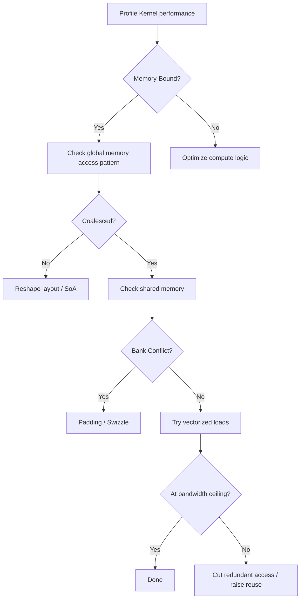

Memory access efficiency is the biggest lever for CUDA Kernel performance. This article digs into coalesced access (how it works and how to judge it), shared-memory Bank Conflicts and the Padding fix, and practical tricks for vectorized loads (float4/int4) that raise bandwidth use.

<!-- more -->

## 📑 Table of contents

- [1. Why memory access is the bottleneck](#1-why-memory-access-is-the-bottleneck)
- [2. Global memory and coalesced access](#2-global-memory-and-coalesced-access)
- [3. Shared memory and Bank Conflict](#3-shared-memory-and-bank-conflict)
- [4. Vectorized loads](#4-vectorized-loads)
- [5. Memory access optimization in practice](#5-memory-access-optimization-in-practice)
- [6. Advanced tips and tools](#6-advanced-tips-and-tools)
- [Summary](#-summary)
- [Self-check list](#-self-check-list)
- [References](#-references)

---

## 1. Why memory access is the bottleneck

A GPU is like a huge factory — thousands of machines (compute cores) run at once on the shop floor, but the raw-material warehouse (device memory) has only one haul route (the memory bus). No matter how fast the machines are, if that route is jammed the whole line waits.

Quick arithmetic: an A100 peaks at 312 TFLOPS (FP16 Tensor Core), while HBM2e bandwidth is about 2 TB/s. For a simple vector add `c[i] = a[i] + b[i]`:

$$
\text{Arithmetic Intensity} = \frac{\text{1 FLOP}}{\text{12 Bytes (read 2, write 1)}} \approx 0.083 \text{ FLOP/Byte}
$$

$$
\text{Compute supported by bandwidth} = 2 \text{ TB/s} \times 0.083 = 166 \text{ GFLOPS}
$$

That is only 0.05% of peak. So **tuning memory access patterns often lifts performance more than tuning the arithmetic**.

### 1.1 Quick Roofline refresher

The Roofline model splits Kernels into two kinds:

- **Memory-Bound**: limited by bandwidth; optimize by cutting memory traffic and raising access efficiency
- **Compute-Bound**: limited by compute; optimize by raising compute parallelism

Most Kernels (especially elementwise, reduction, matrix transpose, and similar) are Memory-Bound. For them, coalesced access and efficient memory use are the performance key.

---

## 2. Global memory and coalesced access

### 2.1 How coalesced access works

Global memory access is merged into transactions at **Warp** granularity. When 32 threads in a Warp issue memory reads or writes together, hardware tries to merge those requests into as few memory transactions as possible.

Each memory transaction is **32 Bytes** (one cache line sector). An L1 cache line is 128 Bytes, made of 4 × 32B sectors.

💡 **Tip**: The core rule for coalesced access is simple — consecutive threads in a Warp should touch consecutive memory addresses.


### 2.2 Coalesced vs non-coalesced performance

```cpp
// ✅ Coalesced: consecutive threads touch consecutive addresses
// 32 threads in 1 Warp touch 128B contiguous, landing in 1 cache line
__global__ void coalesced_read(float* data, float* out, int N) {
    int tid = threadIdx.x + blockIdx.x * blockDim.x;
    if (tid < N) {
        out[tid] = data[tid];  // data[0], data[1], ..., data[31] contiguous
    }
}

// ❌ Non-coalesced (strided): consecutive threads touch spaced addresses
// With stride=32, addresses differ by 128B each → 32 transactions
__global__ void strided_read(float* data, float* out, int N, int stride) {
    int tid = threadIdx.x + blockIdx.x * blockDim.x;
    if (tid < N) {
        out[tid] = data[tid * stride];  // data[0], data[32], data[64], ...
    }
}
```

Performance comparison (A100, reading 1GB):

| 📊 Access pattern | Memory transactions | Effective bandwidth use | Relative time |
|------------|-----------|--------------|---------|
| Contiguous + aligned (stride=1) | 1x | ~95% | 1x |
| stride=2 | 2x | ~50% | 2x |
| stride=4 | 4x | ~25% | 4x |
| stride=32 | 32x | ~3% | 32x |
| Fully random | 32x | ~3% | 32x |

### 2.3 Alignment requirements

Continuity is not enough; alignment matters too:

```cpp
// ✅ Aligned: base address is a multiple of 128B
float* aligned_ptr = data;  // cudaMalloc guarantees 256B alignment
out[tid] = aligned_ptr[tid];

// ⚠️ Offset access: base is misaligned, may add an extra transaction
out[tid] = data[tid + 1];  // base offset by 4B, no longer 128B-aligned
```

The good news: memory from `cudaMalloc` is always 256-byte aligned, so contiguous access from the start usually has no alignment issue. Watch out for manual pointer offsets.

### 2.4 Array of Structures vs Structure of Arrays

The classic AoS vs SoA question:

```cpp
// ❌ AoS (Array of Structures): bad for coalescing
struct Particle {
    float x, y, z, w;
};
Particle particles[N];
// Reading all x: particles[0].x, particles[1].x, ...
// Address jumps: 0, 16, 32, 48, ... (stride=4)

// ✅ SoA (Structure of Arrays): good for coalescing
struct ParticlesSoA {
    float x[N], y[N], z[N], w[N];
};
ParticlesSoA particles;
// Reading all x: particles.x[0], particles.x[1], ...
// Contiguous: 0, 4, 8, 12, ... (stride=1)
```

📌 **Key point**: In GPU programming, **SoA almost always beats AoS**, because Warp-parallel execution naturally wants consecutive threads on consecutive fields.

### 2.5 Row vs column access on 2D arrays

```cpp
// 2D array is row-major; element[row][col] lives at row*cols+col
// ✅ Row-wise traversal: consecutive threads touch consecutive columns in one row
int col = threadIdx.x + blockIdx.x * blockDim.x;
int row = blockIdx.y;
float val = matrix[row * cols + col];  // coalesced

// ❌ Column-wise traversal: consecutive threads touch consecutive rows in one column
int row2 = threadIdx.x + blockIdx.x * blockDim.x;
int col2 = blockIdx.y;
float val2 = matrix[row2 * cols + col2];  // stride = cols, terrible
```

---

## 3. Shared memory and Bank Conflict

### 3.1 Shared memory Bank layout

Shared memory is split into **32 Banks** (same as Warp size), each 4 Bytes (32 bits) wide. Consecutive 4-byte words land in consecutive Banks:

```
Addresses 0~3:   Bank 0
Addresses 4~7:   Bank 1
Addresses 8~11:  Bank 2
...
Addresses 124~127: Bank 31
Addresses 128~131: Bank 0  (wraps)
...
```

Each clock cycle, each Bank can serve one read or write. If multiple threads in the same Warp hit **different addresses in the same Bank**, those accesses serialize — that is a Bank Conflict.

### 3.2 Bank Conflict types and cost

| 📊 Conflict type | Meaning | Performance impact |
|------------|------|---------|
| No Conflict | 32 threads hit 32 different Banks | Done in 1 cycle |
| 2-way Conflict | 2 threads hit the same Bank | 2 cycles (serialized) |
| N-way Conflict | N threads hit the same Bank | N cycles |
| Broadcast | Multiple threads hit the **same address** in one Bank | 1 cycle (free) |

⚠️ **Note**: Broadcast is special — if many threads read the exact same address, hardware broadcasts that value to all requesters and it is not a conflict. Only "same Bank, different addresses" conflicts.

### 3.3 Classic conflict case: matrix transpose

```cpp
// Naive matrix transpose
__shared__ float tile[32][32];

// On write: consecutive threads write different columns of one row → no conflict
tile[threadIdx.y][threadIdx.x] = input[gy * N + gx];

// On read: consecutive threads read different rows of one column
output[gx * N + gy] = tile[threadIdx.x][threadIdx.y];
// threadIdx.x=0 → tile[0][ty], address= (0*32+ty)*4 = ty*4 → Bank = ty%32
// threadIdx.x=1 → tile[1][ty], address= (1*32+ty)*4 → Bank = (32+ty)%32 = ty%32
// threadIdx.x=2 → tile[2][ty], address= (2*32+ty)*4 → Bank = (64+ty)%32 = ty%32
// Every thread hits the same Bank (= ty%32) → 32-way Bank Conflict!
```

### 3.4 Fix one: Padding

Add one extra column in the shared-memory declaration to break the multiple-of-32 mapping:

```cpp
// ✅ Add 1 column of Padding
__shared__ float tile[32][32 + 1];  // 33 columns

// Originally tile[row][col] address = (row * 32 + col) * 4
// Now tile[row][col] address = (row * 33 + col) * 4
// Bank = (row * 33 + col) % 32

// Reading tile[threadIdx.x][ty]:
// threadIdx.x=0 → Bank = (0*33+ty)%32 = ty%32
// threadIdx.x=1 → Bank = (1*33+ty)%32 = (33+ty)%32 = (1+ty)%32
// threadIdx.x=2 → Bank = (2*33+ty)%32 = (66+ty)%32 = (2+ty)%32
// Each thread hits a different Bank → no conflict!
```

Padding wastes 4 Bytes of shared memory per row, but the speedup usually dwarfs that cost.

### 3.5 Fix two: Swizzle (advanced)

For some access patterns, you can remapping addresses (Swizzle) to avoid conflicts:

```cpp
// Swizzle idea: scramble Bank distribution with XOR on the linear index
__device__ int swizzle_index(int row, int col) {
    return row * 32 + (col ^ row);  // XOR remap
}

// Write
tile[row][col ^ row] = input_val;
// Read
float val = tile[col][row ^ col];
```

Swizzle wastes no extra space, but index math gets harder. High-performance GEMM (e.g. CUTLASS) uses it widely.

### 3.6 How to detect Bank Conflicts

Use **Nsight Compute** and watch shared-memory metrics:

```
l1tex__data_bank_conflicts_pipe_lsu_mem_shared_op_ld  # load conflicts
l1tex__data_bank_conflicts_pipe_lsu_mem_shared_op_st  # store conflicts
```

If either counter is non-zero, you have Bank Conflicts and should inspect the shared-memory access pattern.

---

## 4. Vectorized loads

### 4.1 What vectorized loads are

A vectorized load reads several contiguous elements with one instruction (e.g. `float4` reads 4 floats, 16 Bytes). Benefits:

1. **Fewer instructions**: 4 × `LDG.32` → 1 × `LDG.128`
2. **Better bandwidth use**: each transaction carries more useful data
3. **Less scheduling overhead**: fewer memory instructions in the queue

### 4.2 Common vector types

| 📊 Type | Size | Equivalent |
|---------|------|------|
| `float2` | 8 Bytes | 2 floats |
| `float4` | 16 Bytes | 4 floats |
| `int4` | 16 Bytes | 4 ints |
| `double2` | 16 Bytes | 2 doubles |

💡 **Tip**: One GPU cache line is 128 Bytes. A Warp of 32 threads each loading one `float4` (16B) = 512B needs 4 cache lines. Each loading one `float` (4B) = 128B needs 1 cache line. Cache-line requests go up, but each load instruction moves 4× the data, so total instruction count drops 75%.

### 4.3 Basic usage

```cpp
// Scalar version: each thread loads 1 float
__global__ void scalar_copy(float* dst, float* src, int N) {
    int tid = threadIdx.x + blockIdx.x * blockDim.x;
    if (tid < N) {
        dst[tid] = src[tid];
    }
}

// Vectorized version: each thread loads 4 floats
__global__ void vectorized_copy(float* dst, float* src, int N) {
    int tid = threadIdx.x + blockIdx.x * blockDim.x;
    int idx = tid * 4;  // each thread owns 4 elements

    if (idx + 3 < N) {
        // Cast float* to float4*; one instruction reads 16B
        float4 val = reinterpret_cast<float4*>(src)[tid];
        reinterpret_cast<float4*>(dst)[tid] = val;
    }
}
```

### 4.4 Alignment requirements

Vectorized loads need strict alignment:

```cpp
// float4 requires 16B alignment
// Addresses from cudaMalloc are 256B-aligned → OK

// Offsets need special handling
float* base = ...; // 256B-aligned
float* offset_ptr = base + 3;  // offset 12B, not 16B-aligned

// ✅ Safe approach: scalar-handle the unaligned head, then vectorize the body
__global__ void safe_vectorized(float* data, int offset, int N) {
    // Handle unaligned head elements
    int align_offset = (4 - (offset % 4)) % 4;
    // ... scalar process the first align_offset elements

    // Vectorize the body
    float4* aligned_ptr = reinterpret_cast<float4*>(data + offset + align_offset);
    // ...
}
```

### 4.5 Practical pattern: vectorized reduction

```cpp
__global__ void vectorized_sum(float* input, float* output, int N) {
    int tid = threadIdx.x + blockIdx.x * blockDim.x;
    int stride = blockDim.x * gridDim.x;

    float sum = 0.0f;

    // Each iteration handles 4 elements
    int vec_N = N / 4;
    float4* vec_input = reinterpret_cast<float4*>(input);

    for (int i = tid; i < vec_N; i += stride) {
        float4 val = vec_input[i];
        sum += val.x + val.y + val.z + val.w;
    }

    // Tail elements that do not fill a group of 4
    int tail_start = vec_N * 4;
    for (int i = tail_start + tid; i < N; i += stride) {
        sum += input[i];
    }

    // Then do a Block reduction...
    output[blockIdx.x] = sum;  // simplified; real code needs a reduction
}
```

### 4.6 When to use vectorized loads

| ✅ Good fit | ❌ Poor fit |
|------------|-------------|
| Elementwise ops (add/sub/mul/div) | Complex index patterns (gather/scatter) |
| Large copies/initialization | Length not a multiple of 4 and no tail handling |
| Bandwidth-bound Kernels | Compute-bound Kernels (bottleneck is not memory) |
| Addresses can be kept aligned | Base address cannot be aligned |

---

## 5. Memory access optimization in practice

### 5.1 Case study: matrix transpose

Matrix transpose is the textbook memory-access case: no arithmetic, so performance is entirely about access efficiency.

**Naive version**:

```cpp
__global__ void transpose_naive(float* out, float* in, int width, int height) {
    int col = threadIdx.x + blockIdx.x * blockDim.x;
    int row = threadIdx.y + blockIdx.y * blockDim.y;
    if (col < width && row < height) {
        out[col * height + row] = in[row * width + col];
        // Read: coalesced (consecutive threads hit consecutive columns)
        // Write: not coalesced (stride = height)
    }
}
```

**Shared-memory optimized version**:

```cpp
// Each thread handles TILE_DIM / BLOCK_ROWS elements
#define TILE_DIM 32
#define BLOCK_ROWS 8

__global__ void transpose_shared(float* out, float* in, int width, int height) {
    __shared__ float tile[TILE_DIM][TILE_DIM + 1];  // +1 Padding kills Bank Conflict

    int x = blockIdx.x * TILE_DIM + threadIdx.x;
    int y = blockIdx.y * TILE_DIM + threadIdx.y;

    // Coalesced read: each warp reads contiguous elements
    for (int j = 0; j < TILE_DIM; j += BLOCK_ROWS) {
        if (x < width && (y + j) < height) {
            tile[threadIdx.y + j][threadIdx.x] = in[(y + j) * width + x];
        }
    }

    __syncthreads();

    // Coalesced write: after transpose, consecutive threads write consecutive addresses
    x = blockIdx.y * TILE_DIM + threadIdx.x;
    y = blockIdx.x * TILE_DIM + threadIdx.y;

    for (int j = 0; j < TILE_DIM; j += BLOCK_ROWS) {
        if (x < height && (y + j) < width) {
            out[(y + j) * height + x] = tile[threadIdx.x][threadIdx.y + j];
        }
    }
}

// Launch:
// dim3 block(TILE_DIM, BLOCK_ROWS);
// dim3 grid((width + TILE_DIM - 1) / TILE_DIM, (height + TILE_DIM - 1) / TILE_DIM);
```

Core idea: use shared memory as a staging area, turn a non-coalesced global write into a column read from shared memory (Padding removes Bank Conflicts), then write out coalesced.

### 5.2 Case study: memory optimization in reduction

```cpp
// ❌ Naive reduction: interleaved access → Bank Conflict and poor bandwidth use
__global__ void reduce_interleaved(float* input, float* output, int N) {
    int tid = threadIdx.x;
    int idx = blockIdx.x * blockDim.x + tid;
    __shared__ float sdata[256];
    sdata[tid] = (idx < N) ? input[idx] : 0.0f;
    __syncthreads();

    for (int s = 1; s < blockDim.x; s *= 2) {
        if (tid % (2 * s) == 0) {
            sdata[tid] += sdata[tid + s];
        }
        __syncthreads();
    }
    if (tid == 0) output[blockIdx.x] = sdata[0];
}

// ✅ Optimized reduction: consecutive threads operate on consecutive addresses
__global__ void reduce_sequential(float* input, float* output, int N) {
    int tid = threadIdx.x;
    int idx = blockIdx.x * blockDim.x + tid;
    __shared__ float sdata[256];
    sdata[tid] = (idx < N) ? input[idx] : 0.0f;
    __syncthreads();

    for (int s = blockDim.x / 2; s > 0; s >>= 1) {
        if (tid < s) {
            sdata[tid] += sdata[tid + s];
        }
        __syncthreads();
    }
    if (tid == 0) output[blockIdx.x] = sdata[0];
}
```

---

## 6. Advanced tips and tools

### 6.1 Cache hints

CUDA lets you steer cache policy on memory access:

```cpp
// __ldg() loads through the read-only data cache (texture cache)
// Good for read-only data; can avoid polluting L1
float val = __ldg(&input[tid]);

// PTX-level cache control (via inline asm or compiler flags)
// .ca (cache all levels) — default; cache in L1 and L2
// .cg (cache global) — cache only in L2, skip L1
// .cs (cache streaming) — mark as streaming data, lower priority
// .cv (cache volatile) — do not cache; always read from device memory
```

### 6.2 Memory access analysis tools

Key Nsight Compute metrics:

```
# Global memory efficiency
sm__sass_average_data_bytes_per_sector_mem_global_op_ld  # ideal 128B
l1tex__t_sectors_pipe_lsu_mem_global_op_ld  # actual transaction count

# Compute bandwidth utilization
gpu__compute_memory_throughput  # actual throughput
dram__bytes_read + dram__bytes_write  # actual bytes moved
```

### 6.3 Optimization decision flowchart



---

## 📝 Summary

| Technique | Core idea | Payoff |
|---------|---------|------|
| Coalesced access | Consecutive threads, consecutive addresses; SoA over AoS | Up to 32× bandwidth gap |
| Aligned access | Base address aligned to 128B | Avoid extra transactions |
| Padding | Shared memory `[N][N+1]` breaks Bank period | Kill Bank Conflicts |
| Vectorized load | `float4` / `int4` reads 16B at once | ~75% fewer instructions |
| Cache hints | `__ldg()`, cache policy control | Less cache pollution |
| Data layout | AoS → SoA, row/column swap | Structural fix for coalescing |

---

## 🎯 Self-check list

- Can judge whether a given access pattern meets coalesced-access conditions
- Can compute how many 32B transactions a Warp needs for a global access
- Can rewrite an AoS layout into SoA for coalesced access
- Can explain shared-memory Bank addressing and why Bank Conflicts happen
- Can add Padding to fix 32-way Bank Conflict code
- Can use `float4` correctly for vectorized load and store
- Can handle alignment and tail elements in vectorized loads
- Can use shared memory to turn a non-coalesced global write into a coalesced write
- Can use Nsight Compute to spot memory-efficiency metrics
- Can apply a full memory-access optimization chain to a matrix-transpose Kernel

---

## 📚 References

- [NVIDIA CUDA C++ Programming Guide - Memory Hierarchy](https://docs.nvidia.com/cuda/cuda-c-programming-guide/index.html#memory-hierarchy)
- [NVIDIA CUDA C++ Best Practices Guide - Memory Optimizations](https://docs.nvidia.com/cuda/cuda-c-best-practices-guide/index.html#memory-optimizations)
- [An Efficient Matrix Transpose in CUDA C/C++ - NVIDIA Developer Blog](https://developer.nvidia.com/blog/efficient-matrix-transpose-cuda-cc/)
- [How to Access Global Memory Efficiently in CUDA C/C++ Kernels - NVIDIA Developer Blog](https://developer.nvidia.com/blog/how-access-global-memory-efficiently-cuda-c-kernels/)
- [CUTLASS: CUDA Templates for Linear Algebra Subroutines - GitHub](https://github.com/NVIDIA/cutlass)
