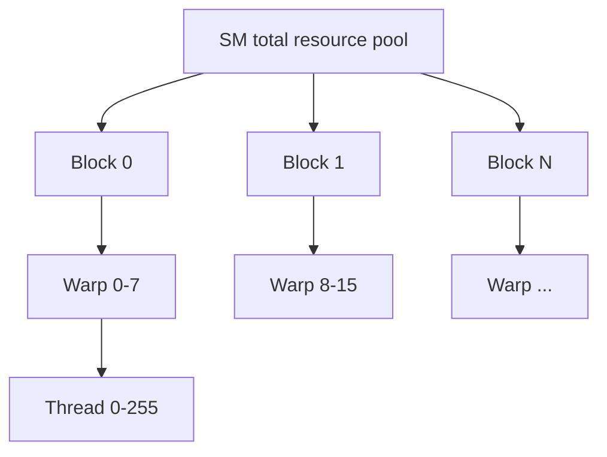
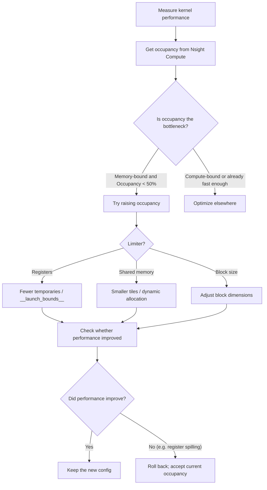

Occupancy is the ratio of active warps on an SM to the theoretical maximum, and one of the core metrics when tuning CUDA kernels. This article covers the definition, how to compute it, the three main limiters (registers / shared memory / block size), and why higher occupancy is not always better — the real goal is a balance between latency hiding and resource use.

<!-- more -->

## 📑 Contents

- [1. What is occupancy](#1-what-is-occupancy)
- [2. SM resource inventory](#2-sm-resource-inventory)
- [3. Three factors that limit occupancy](#3-three-factors-that-limit-occupancy)
- [4. Occupancy calculation walkthrough](#4-occupancy-calculation-walkthrough)
- [5. Higher occupancy is not always better](#5-higher-occupancy-is-not-always-better)
- [6. Tuning strategies and tools](#6-tuning-strategies-and-tools)
- [7. Case studies](#7-case-studies)
- [Summary](#-summary)
- [Self-check list](#-self-check-list)
- [References](#-references)

---

## 1. What is occupancy

Picture a parking lot with 64 spots (the max warps that can reside on an SM). If only 32 cars are parked, utilization is 50%. Occupancy is that "parking lot utilization" for an SM — how much of the hardware capacity you are actually using.

### 1.1 Formal definition

$$
\text{Occupancy} = \frac{\text{active warps per SM}}{\text{max warps supported per SM}}
$$

For example on A100 (Compute Capability 8.0):
- Each SM supports up to 64 warps (2048 threads)
- If your kernel is resource-limited to 32 warps per SM
- Then Occupancy = 32/64 = 50%

### 1.2 Why occupancy matters

The main value of occupancy is **latency hiding**. The GPU execution model relies on switching warps to cover memory access latency:

```
Timeline:
Warp 0: [compute] [wait for memory...400cycles...] [compute]
Warp 1:           [compute] [wait for memory...400cycles...] [compute]
Warp 2:                     [compute] [wait for memory...400cycles...]
...

If enough warps are active, the scheduler can always find a ready warp to fill the wait
```

How many warps do you need to fully hide latency? A rough estimate:

$$
\text{warps needed} \geq \frac{\text{memory latency (cycles)}}{\text{cycles per instruction}} = \frac{400}{4} = 100
$$

But an SM tops out at 64 warps, so you cannot fully hide latency in practice — which is why you push occupancy as high as you can (though that is not the only goal).

---

## 2. SM resource inventory

Each SM has a fixed set of hardware resources shared by every block that resides on it. Knowing the caps is the foundation for computing occupancy.

### 2.1 Main architecture resource comparison

| 📊 Resource | Ampere (A100) | Ada (RTX 4090) | Hopper (H100) |
|---------|---------------|----------------|---------------|
| Max threads per SM | 2048 | 1536 | 2048 |
| Max warps per SM | 64 | 48 | 64 |
| Max blocks per SM | 32 | 16 | 32 |
| Total registers per SM | 65536 | 65536 | 65536 |
| Max registers per thread | 255 | 255 | 255 |
| Shared memory cap per SM | 164 KB | 100 KB | 228 KB |
| Max shared memory per block | 163 KB | 99 KB | 227 KB |
| Max threads per block | 1024 | 1024 | 1024 |

### 2.2 Resource allocation hierarchy



📌 **Key point**: Resources are allocated in **block units**. A block either fully enters an SM or not at all — there is no half-block residency. So if one block needs just a bit more than half of the remaining SM resources, the leftover space is wasted.

---

## 3. Three factors that limit occupancy

### 3.1 Factor one: register usage

Registers per thread are the most common occupancy limiter.

**Computation**:

$$
\text{resident threads per SM} = \lfloor \frac{\text{total SM registers}}{\text{registers per thread}} \rfloor
$$

Actual allocation also has a granularity constraint. Registers are handed to a warp in groups of **256** (allocation granularity). So registers allocated per warp = $\lceil \frac{\text{registers per thread} \times 32}{256} \rceil \times 256$.

**Example** (A100, 65536 registers/SM):

| Registers/thread | Actual alloc per warp | Warps that fit on SM | Occupancy |
|--------------|-----------------|-------------------|-----------|
| 32 | 32×32=1024 | 65536/1024=64 | 100% |
| 48 | 48×32=1536 | 65536/1536=42 | 42/64≈65% |
| 64 | 64×32=2048 | 65536/2048=32 | 50% |
| 128 | 128×32=4096 | 65536/4096=16 | 25% |
| 255 | 255×32=8160 → align to 8192 | 65536/8192=8 | 12.5% |

💡 **Tip**: You can cap register use with `__launch_bounds__` or the `maxrregcount` compile option:

```cpp
// Approach 1: hint the compiler with __launch_bounds__(maxThreadsPerBlock, minBlocksPerMultiprocessor)
Memory-bound (bandwidth bottleneck)  __launch_bounds__(N, large value)  → raise occupancy
Compute-bound (FLOP bottleneck)      __launch_bounds__(N, 1)            → keep registers

__global__ void __launch_bounds__(256, 2)  // max 256 threads/block, target 2 blocks/SM
my_kernel(...) { ... }

// Compiler behavior
SM register total (A100) = 65536 / SM
maxThreadsPerBlock=256, minBlocksPerMultiprocessor=2
↓
Need concurrent residency: 256 threads × 2 blocks = 512 threads
↓
Max registers per thread: 65536 / 512 = 128
↓
Compiler sets the register cap to 128 (often compresses more aggressively)
↓
Overflow variables spill to Local Memory (device memory)

// Approach 2: global compile-time limit
// nvcc -maxrregcount=32 my_kernel.cu
```

⚠️ **Note**: Forcing a lower register count can make the compiler spill variables to local memory (register spilling), which can hurt performance. Check with a profiler.

### 3.2 Factor two: shared memory usage

The total shared memory declared per block (static + dynamic) limits how many blocks fit on an SM.

**Computation**:

$$
\text{resident blocks per SM} = \lfloor \frac{\text{total SM shared memory}}{\text{shared memory per block}} \rfloor
$$

**Example** (A100, 164KB shared memory/SM):

| Shared mem / block | Blocks that fit on SM | Total threads at 256/block | Occupancy |
|-----------------|-------------------|------------------------|-----------|
| 8 KB | 20 (but capped by max blocks 32) | min(20,32)×256=5120→cap at 2048 | 100% |
| 32 KB | 5 | 5×256=1280 | 62.5% |
| 64 KB | 2 | 2×256=512 | 25% |
| 164 KB | 1 | 1×256=256 | 12.5% |

Shared memory allocation is not byte-granular either; it uses units of **128 Bytes** (or 256 Bytes, depending on the architecture).

### 3.3 Factor three: block size

Block size is limited in two ways:
1. Max 1024 threads per block
2. Max blocks per SM (32 on A100)

**An easy-to-miss limit**: if your blocks are tiny (e.g. 32 threads = 1 warp), even with low per-block resource use you can still hit the "max blocks per SM" cap:

| Block size | Max blocks/SM | Total warps | Occupancy |
|-----------|-------------------|-----------|-----------|
| 32 (1 Warp) | 32 (block-count limit) | 32 | 50% |
| 64 (2 Warps) | 32 (block-count limit) | 64 | 100% |
| 128 (4 Warps) | 16 (2048/128) | 64 | 100% |
| 256 (8 Warps) | 8 (2048/256) | 64 | 100% |
| 512 (16 Warps) | 4 (2048/512) | 64 | 100% |
| 1024 (32 Warps) | 2 (2048/1024) | 64 | 100% |

📌 **Key point**: Prefer block sizes of at least 128 or 256 so you avoid the block-count limit and give the compiler more room to optimize. **256** is usually a solid default.

---

## 4. Occupancy calculation walkthrough

### 4.1 Combined example

Given (A100):
- Kernel uses 40 registers per thread
- Block size: 256 threads = 8 warps
- 16 KB shared memory per block

**Step 1: register limit**

$$
\text{registers per warp} = 40 \times 32 = 1280 \rightarrow \text{align to} 1280
$$

$$
\text{warps that fit on SM} = \lfloor \frac{65536}{1280} \rfloor = 51 \text{ Warps}
$$

**Step 2: shared memory limit**

$$
\text{blocks that fit on SM} = \lfloor \frac{164\text{KB}}{16\text{KB}} \rfloor = 10 \text{ Blocks}
$$

$$
\text{corresponding warps} = 10 \times 8 = 80 \text{ Warps}
$$

**Step 3: block-count limit**

Max 32 blocks per SM; 10 blocks do not hit the cap.

**Step 4: thread-count limit**

Max 2048 threads per SM = 64 warps.

**Take the minimum**:

$$
\text{actual warps} = \min(51, 80, 64) = 51 \text{ Warps}
$$

But blocks are allocated whole (8 warps each), so in practice:

$$
\lfloor \frac{51}{8} \rfloor \times 8 = 6 \times 8 = 48 \text{ Warps}
$$

$$
\text{Occupancy} = \frac{48}{64} = 75\%
$$

### 4.2 Using the CUDA Occupancy API

```cpp
#include <cuda_runtime.h>

int main() {
    int blockSize = 256;
    int minGridSize, gridSize;

    // Auto-compute a good block size
    cudaOccupancyMaxPotentialBlockSize(
        &minGridSize, &blockSize,
        my_kernel,  // kernel function pointer
        0,          // dynamic shared memory size
        0           // block size upper bound (0 = no limit)
    );

    // Query occupancy for a given config
    int maxActiveBlocks;
    cudaOccupancyMaxActiveBlocksPerMultiprocessor(
        &maxActiveBlocks,
        my_kernel,
        blockSize,
        0  // dynamic shared memory
    );

    int device;
    cudaGetDevice(&device);
    cudaDeviceProp prop;
    cudaGetDeviceProperties(&prop, device);

    float occupancy = (float)(maxActiveBlocks * blockSize) /
                      prop.maxThreadsPerMultiProcessor;
    printf("Occupancy: %.1f%%\n", occupancy * 100);
    return 0;
}
```

---

## 5. Higher occupancy is not always better

One of the most important ideas in CUDA tuning: **high occupancy ≠ high performance**.

### 5.1 A counterintuitive example

Consider two versions of a matrix-multiply kernel:

| 📊 Version | Registers/thread | Shared mem/block | Occupancy | Actual GFLOPS |
|---------|------------|--------------|-----------|------------|
| Version A | 32 | 8 KB | 100% | 800 |
| Version B | 96 | 48 KB | 33% | 1200 |

Version B has lower occupancy but higher performance. It uses more registers and shared memory to **increase data reuse**: each load from global memory is reused many times, so total memory traffic drops.

### 5.2 The cost of chasing high occupancy

Blindly maximizing occupancy can lead to:

1. **Register spilling**: forcing a lower `maxrregcount` makes the compiler spill variables to local memory (really global memory + L1), which can be tens of times slower

2. **Weak shared-memory reuse**: less shared memory means smaller tiles, lower reuse, and often *more* global memory traffic

3. **Cache thrashing**: too many active warps fight over limited L1/L2, raising the miss rate

### 5.3 When occupancy matters

Occupancy matters most for kernels that are **memory-heavy with little reuse**:

- ✅ Elementwise ops (vector add, activations, etc.): almost no reuse; you rely on latency hiding
- ✅ Reductions: each element is read once
- ✅ Simple stencil ops

### 5.4 When low occupancy is fine

Low occupancy is reasonable when:

- ✅ GEMM / matrix multiply: heavy reuse; registers and shared memory buy compute efficiency
- ✅ FlashAttention: more shared memory cuts HBM traffic
- ✅ Compute-bound kernels: the bottleneck is compute, not memory

### 5.5 Golden rule

$$
\text{performance} = f(\text{Occupancy}, \text{ILP}, \text{data reuse}, \text{memory efficiency}, ...)
$$

💡 **Tip**: Do not lock in a fixed occupancy target (like "must hit 75%"). Measure throughput with a profiler. If lowering occupancy raises data reuse or ILP (Instruction-Level Parallelism), overall performance can improve.

---

## 6. Tuning strategies and tools

### 6.1 CUDA Occupancy Calculator

NVIDIA provides an Excel Occupancy Calculator: enter architecture and resource use to get theoretical occupancy and limiters.

You can also use the command line:

```bash
# Inspect per-kernel resource use at compile time
nvcc -Xptxas -v my_kernel.cu
# Example output:
# ptxas info: Used 40 registers, 16384 bytes smem, 380 bytes cmem[0]
```

### 6.2 Occupancy analysis in Nsight Compute

```
# Key metrics
sm__warps_active.avg.pct_of_peak_sustained_active   # actual active warp ratio
launch__occupancy                                    # theoretical occupancy
launch__registers_per_thread                         # registers per thread
launch__shared_mem_per_block_allocated               # shared memory per block
```

Nsight Compute also shows what limits occupancy:

```
Occupancy Limiters:
  Registers:        50%  ← bottleneck
  Shared Memory:    75%
  Block Size:       100%
  Theoretical:      50%
```

### 6.3 Practical tuning flow



### 6.4 Block size recommendations

| 📊 Scenario | Recommended block size | Why |
|---------|----------------|------|
| Memory-bound kernel | 256 or 512 | Need high occupancy to hide latency |
| Compute-bound kernel | 128 or 256 | Enough occupancy; prefer keeping registers |
| Heavy shared memory use | 128 or 256 | Smaller blocks → more blocks per SM |
| Reduction | 256 or 512 | More threads in the reduce; fewer reduce steps |

---

## 7. Case studies

### 7.1 Case: SGEMM tile-size tradeoff

For a matrix-multiply kernel, tile size directly sets register and shared memory use:

```cpp
// Tile config comparison
// Config A: small tile
// TILE_M=64, TILE_N=64, TILE_K=8
// Each thread computes 4x4 = 16 outputs → ~48 registers
// Shared memory: (64+64)*8*4 = 4 KB
// Occupancy: ~75%

// Config B: large tile
// TILE_M=128, TILE_N=128, TILE_K=8
// Each thread computes 8x8 = 64 outputs → ~128 registers
// Shared memory: (128+128)*8*4 = 8 KB
// Occupancy: ~25%

// Config B has lower occupancy, but:
// - Each load from Global is reused 8 times (vs 4 for Config A)
// - More work per thread, better ILP
// - Actual performance is usually Config B > Config A
```

### 7.2 Case: flexible tuning with dynamic shared memory

```cpp
// Dynamic shared memory: allocate at launch as needed
__global__ void flexible_kernel(float* data, int N) {
    extern __shared__ float smem[];
    // ...
}

// Pick the best config at runtime from device capability
int smem_size;
if (occupancy_at_16kb > 0.5) {
    smem_size = 16 * 1024;
} else {
    smem_size = 8 * 1024;  // fall back
}

// Configurable shared memory vs L1 split (Volta+)
cudaFuncSetAttribute(
    flexible_kernel,
    cudaFuncAttributeMaxDynamicSharedMemorySize,
    smem_size
);

flexible_kernel<<<grid, block, smem_size>>>(data, N);
```

---

## 📝 Summary

| Core idea | Takeaway |
|---------|------|
| Occupancy definition | Active warps / max warps per SM |
| Latency hiding | Higher occupancy → more warp switching to cover memory latency |
| Register limit | More registers/thread → lower occupancy; control with `__launch_bounds__` |
| Shared memory limit | More shared mem/block → fewer blocks/SM → lower occupancy |
| Block size limit | Tiny blocks can hit the "max blocks per SM" cap |
| Not always higher | On compute-bound kernels, low occupancy + high reuse can win |
| Tuning method | Nsight Compute finds the limiter → targeted change → measure |

---

## 🎯 Self-check list

- Can hand-compute occupancy from registers, shared memory, and block size
- Can explain why a 100% occupancy kernel is not necessarily faster than 50%
- Can use `cudaOccupancyMaxPotentialBlockSize` to pick block size automatically
- Can use `__launch_bounds__` to cap registers and understand the side effect (spilling)
- Can explain when register spilling happens and how it hits performance
- Can tell whether a kernel is memory-bound or compute-bound, and set occupancy priority accordingly
- Can read occupancy limiters from an Nsight Compute report
- Can trade tile size vs occupancy sensibly for GEMM-like kernels
- Can use dynamic shared memory and `cudaFuncSetAttribute` to configure shared memory
- Can pick a suitable block size for different kernel types

---

## 📚 References

- [NVIDIA CUDA C++ Programming Guide - Hardware Multithreading](https://docs.nvidia.com/cuda/cuda-c-programming-guide/index.html#hardware-multithreading)
- [NVIDIA CUDA C++ Best Practices Guide - Occupancy](https://docs.nvidia.com/cuda/cuda-c-best-practices-guide/index.html#occupancy)
- [CUDA Occupancy Calculator](https://docs.nvidia.com/cuda/cuda-occupancy-calculator/index.html)
- [Achieved Occupancy - NVIDIA Developer Blog](https://developer.nvidia.com/blog/better-performance-at-lower-occupancy/)
- [CUTLASS: Fast Linear Algebra in CUDA C++ - GitHub](https://github.com/NVIDIA/cutlass)
