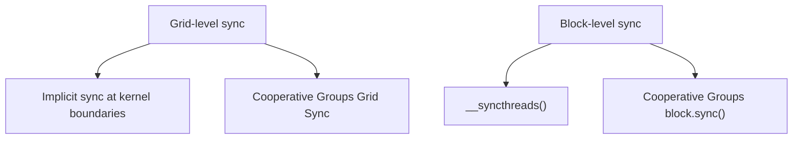
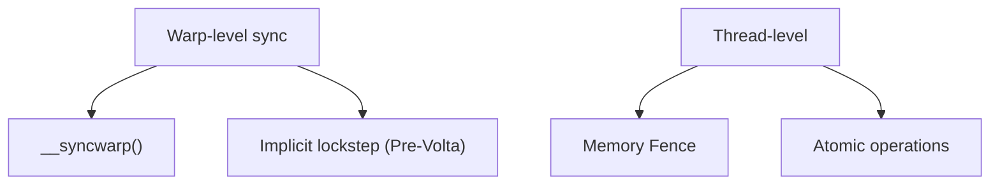

Correct synchronization is the foundation of bug-free parallel programs. This article walks through block-level `__syncthreads()`, warp-level sync, Memory Fence, and atomic operations — when to use them, what they cost, and how to optimize — so you can keep correctness while writing fast parallel code.

<!-- more -->

## 📑 Contents

- [1. Why parallel code needs sync](#1-why-parallel-code-needs-sync)
- [2. Block-level sync: \_\_syncthreads\(\)](#2-block-level-sync-__syncthreads)
- [3. Warp-level sync](#3-warp-level-sync)
- [4. Memory Fence and visibility](#4-memory-fence-and-visibility)
- [5. Atomic operations](#5-atomic-operations)
- [6. Optimizing atomics](#6-optimizing-atomics)
- [7. Cooperative Groups](#7-cooperative-groups)
- [Summary](#-summary)
- [Self-check list](#-self-check-list)
- [References](#-references)

---

## 1. Why parallel code needs sync

In a serial program, statements run in order, so later statements always see earlier results. In the parallel world, thousands of threads run at once. Without control, it is like a crowd writing on the same whiteboard at the same time — the result is chaos.

Synchronization solves two core problems:

1. **Execution order**: make sure thread A's write finishes before thread B reads
2. **Memory visibility**: make sure one thread's write is "visible" to others (not stuck behind a cache)

### 1.1 CUDA sync levels





---

## 2. Block-level sync: \_\_syncthreads()

### 2.1 Basic semantics

`__syncthreads()` is the most common CUDA sync primitive. Its meaning:

> All threads in the block must reach this barrier before any can continue. It also makes all memory writes before the barrier visible to every thread in the block.

Like a group agreeing to meet at an intersection: everyone arrives, then you leave together.

### 2.2 Typical use case

```cpp
__global__ void shared_memory_example(float* input, float* output, int N) {
    __shared__ float smem[256];
    int tid = threadIdx.x;
    int gid = blockIdx.x * blockDim.x + tid;

    // Phase 1: all threads load from global memory into shared memory
    smem[tid] = (gid < N) ? input[gid] : 0.0f;

    // Must sync! Ensure every write finishes before any read
    __syncthreads();

    // Phase 2: each thread reads data written by other threads
    float left = (tid > 0) ? smem[tid - 1] : 0.0f;
    float right = (tid < blockDim.x - 1) ? smem[tid + 1] : 0.0f;
    output[gid] = left + smem[tid] + right;
}
```

⚠️ **Note**: If you remove `__syncthreads()`, a thread may read uninitialized shared memory (other threads have not finished writing). Results are wrong and hard to debug (behavior depends on timing and may occasionally look correct).

### 2.3 Rules and pitfalls

**Rule 1: every thread must reach the same `__syncthreads()`**

```cpp
// ❌ Fatal: __syncthreads() inside a conditional branch
if (threadIdx.x < 128) {
    __syncthreads();  // only the first 128 threads reach here
}
// The other 128 threads never arrive → deadlock or undefined behavior

// ✅ Correct: put the sync outside the condition
if (threadIdx.x < 128) {
    // do some work
}
__syncthreads();  // every thread reaches here
```

**Rule 2: in loops, every thread must take the same trip count**

```cpp
// ❌ Dangerous: different threads loop a different number of times
for (int i = 0; i < array_len[threadIdx.x]; i++) {
    smem[threadIdx.x] = data[i];
    __syncthreads();  // if some threads exit early → deadlock
    // ...
}

// ✅ Correct: same trip count for everyone
int max_len = MAX_ARRAY_LEN;  // compile-time constant or block-wide max
for (int i = 0; i < max_len; i++) {
    if (i < array_len[threadIdx.x]) {
        smem[threadIdx.x] = data[i];
    }
    __syncthreads();
    // ...
}
```

### 2.4 Performance cost of __syncthreads()

The hardware cost of `__syncthreads()` itself is low (usually a few clock cycles). The real cost is:

1. **Waiting for the slowest thread**: if some threads take longer to reach the barrier (branch divergence or uneven memory latency), others sit idle
2. **Pipeline break**: a barrier interrupts the compiler's instruction reordering

💡 **Tip**: Cut the number of `__syncthreads()` calls when you can. If a kernel has several shared-memory read/write phases, see whether you can restructure the algorithm and merge syncs into one.

---

## 3. Warp-level sync

### 3.1 Implicit sync (Pre-Volta)

On pre-Volta architectures (Pascal, Maxwell, etc.), threads in a warp run in lockstep — hardware keeps them on the same instruction. So warp threads are naturally synchronized; no explicit barrier is needed.

```cpp
// Pre-Volta: safe to communicate inside a warp without sync
// (but this is undefined behavior; do not rely on it)
__shared__ float smem[256];
smem[threadIdx.x] = value;
// All threads in the same warp have finished writing by now
float neighbor = smem[threadIdx.x ^ 1];  // safe inside the warp (but non-portable)
```

### 3.2 Explicit warp sync (Volta+)

Volta introduced independent thread scheduling. Threads in the same warp **may** no longer stay in lockstep, so you need explicit sync:

```cpp
__shared__ float smem[256];
smem[threadIdx.x] = value;

// Volta+ must sync explicitly
__syncwarp(0xFFFFFFFF);  // ensure all 32 threads in the warp finished writing

float neighbor = smem[threadIdx.x ^ 1];
```

The argument to `__syncwarp(mask)` is the mask of participating threads. Usually `0xFFFFFFFF` (all 32). If only some threads take part, you can use a tighter mask.

### 3.3 When you need __syncwarp()

| Scenario | Pre-Volta | Volta+ |
|------|-----------|--------|
| Intra-warp communication via shared memory | Implicitly safe (not recommended) | Must `__syncwarp()` |
| Around Warp Shuffle | Not needed | Not needed (Shuffle has sync semantics) |
| Around Warp Vote | Not needed | Not needed |
| Intra-warp reduce loops | No extra sync | Shuffle version needs none |

---

## 4. Memory Fence and visibility

### 4.1 Why you need a Memory Fence

`__syncthreads()` covers sync inside a block. What about cross-block communication? GPUs have no traditional global barrier, but Memory Fence guarantees write visibility.

A Memory Fence does not block thread execution. It only guarantees: **memory writes before the fence become visible to other threads in the target scope after the fence**.

### 4.2 Three fence levels

```cpp
// Block level: writes visible to threads in the same block
__threadfence_block();

// Device level: writes visible to all threads on the same GPU
__threadfence();

// System level: writes visible to all devices in the system (CPU, other GPUs)
__threadfence_system();
```

### 4.3 Classic case: flag bits in a multi-block reduce

```cpp
__device__ unsigned int block_counter = 0;

__global__ void multi_block_reduce(float* input, float* output,
                                    float* partial, int N) {
    // Step 1: each block does a local reduce, writes to partial[blockIdx.x]
    float block_sum = block_level_reduce(input, N);
    if (threadIdx.x == 0) {
        partial[blockIdx.x] = block_sum;

        // Make the partial write visible to other blocks
        __threadfence();

        // Atomically increment; the last finished block does the final reduce
        unsigned int ticket = atomicInc(&block_counter, gridDim.x);

        // Are we the last finished block?
        if (ticket == gridDim.x - 1) {
            // This block is last; safe to read every partial value
            float total = 0.0f;
            for (int i = 0; i < gridDim.x; i++) {
                total += partial[i];
            }
            output[0] = total;
            block_counter = 0;  // reset
        }
    }
}
```

📌 **Key point**: `__threadfence()` makes the write to `partial[blockIdx.x]` globally visible before `atomicInc`. Without that fence, the last block may read stale values from other blocks.

---

## 5. Atomic operations

### 5.1 What is an atomic operation

An atomic operation is an indivisible read-modify-write. Like a bank teller serving one customer at a time — until one thread's atomic finishes, other threads accessing the same address wait in line.

```cpp
// Non-atomic (data race!)
// Thread A: read counter=5, add 1, write back 6
// Thread B: read counter=5, add 1, write back 6  ← lost thread A's update!
counter += 1;

// Atomic (correct)
// Hardware guarantees read→modify→write as one uninterruptible op
atomicAdd(&counter, 1);
```

### 5.2 CUDA atomic checklist

| 📊 Operation | Function | Supported types |
|---------|------|---------|
| Add | `atomicAdd(addr, val)` | int, unsigned, float, double |
| Subtract | `atomicSub(addr, val)` | int, unsigned |
| Min | `atomicMin(addr, val)` | int, unsigned |
| Max | `atomicMax(addr, val)` | int, unsigned |
| Exchange | `atomicExch(addr, val)` | int, unsigned, float |
| CAS | `atomicCAS(addr, compare, val)` | int, unsigned, unsigned long long |
| Bitwise AND | `atomicAnd(addr, val)` | int, unsigned |
| Bitwise OR | `atomicOr(addr, val)` | int, unsigned |
| Bitwise XOR | `atomicXor(addr, val)` | int, unsigned |
| Increment | `atomicInc(addr, val)` | unsigned |
| Decrement | `atomicDec(addr, val)` | unsigned |

### 5.3 Performance cost of atomics

Atomic cost depends on **contention** — how many threads hit the same address at once:

| 📊 Scenario | Performance impact |
|---------|---------|
| Every thread atomics different addresses | Near non-atomic speed |
| Many threads in one warp contend on one address | Serialized; up to ~32× slower |
| Many threads across blocks contend on one address | Extremely slow; can become a severe bottleneck |

**Global-memory atomics** cost about 400\~600 cycles (must go to L2 or DRAM). **Shared-memory atomics** cost about 20~100 cycles (finished inside the SM).

### 5.4 atomicCAS: the universal atomic

`atomicCAS` (Compare-And-Swap) is the lowest-level atomic primitive; every other atomic can be built from it:

```cpp
// atomicCAS semantics:
// old = *addr;
// if (old == compare) *addr = val;
// return old;

// Implement atomicAdd for double with CAS (older archs lack double atomicAdd)
__device__ double atomicAddDouble(double* addr, double val) {
    unsigned long long int* addr_as_ull = (unsigned long long int*)addr;
    unsigned long long int old = *addr_as_ull;
    unsigned long long int assumed;

    do {
        assumed = old;
        old = atomicCAS(addr_as_ull, assumed,
                       __double_as_longlong(
                           __longlong_as_double(assumed) + val));
    } while (assumed != old);
    // CAS failed means another thread changed the value; retry

    return __longlong_as_double(old);
}
```

⚠️ **Note**: Under high contention a CAS loop may retry many times and performance collapses. That is why reducing atomic conflicts matters so much.

---

## 6. Optimizing atomics

### 6.1 Strategy 1: hierarchical reduce to cut conflicts

The classic pattern — do not let every thread `atomicAdd` the same address; aggregate in layers:

```cpp
__global__ void hierarchical_reduce(float* input, float* output, int N) {
    __shared__ float block_sum;
    if (threadIdx.x == 0) block_sum = 0.0f;
    __syncthreads();

    int gid = blockIdx.x * blockDim.x + threadIdx.x;
    float val = (gid < N) ? input[gid] : 0.0f;

    // Layer 1: warp-level reduce (no atomics)
    for (int offset = 16; offset > 0; offset >>= 1) {
        val += __shfl_down_sync(0xFFFFFFFF, val, offset);
    }

    // Layer 2: each warp's lane 0 atomics into shared memory
    // Only blockDim.x/32 threads contend → low conflict
    if (threadIdx.x % 32 == 0) {
        atomicAdd(&block_sum, val);
    }
    __syncthreads();

    // Layer 3: each block's thread 0 atomics into the global result
    // Only gridDim.x threads contend (far fewer than total threads)
    if (threadIdx.x == 0) {
        atomicAdd(output, block_sum);
    }
}
```

Conflict analysis:
- Direct global atomics: N threads contend on 1 address
- After hierarchy: warp reduce has no conflict + 8 threads/block contend on shared memory + gridDim.x threads contend on the global address

### 6.2 Strategy 2: shared-memory atomics instead of global

```cpp
// ❌ Every thread atomicAdds global memory directly
__global__ void histogram_naive(int* data, int* hist, int N) {
    int tid = threadIdx.x + blockIdx.x * blockDim.x;
    if (tid < N) {
        atomicAdd(&hist[data[tid]], 1);  // global atomic, slow
    }
}

// ✅ Aggregate in shared memory first, then write back to global
__global__ void histogram_shared(int* data, int* hist, int N, int numBins) {
    __shared__ int local_hist[256];  // assume bin count <= 256

    // Initialize local histogram
    if (threadIdx.x < numBins) {
        local_hist[threadIdx.x] = 0;
    }
    __syncthreads();

    // Atomic add on shared memory (much faster)
    int tid = threadIdx.x + blockIdx.x * blockDim.x;
    if (tid < N) {
        atomicAdd(&local_hist[data[tid]], 1);
    }
    __syncthreads();

    // Atomic-add local results to global (only numBins global atomics)
    if (threadIdx.x < numBins) {
        atomicAdd(&hist[threadIdx.x], local_hist[threadIdx.x]);
    }
}
```

### 6.3 Strategy 3: privatization

Each thread or warp keeps a private copy, then merges at the end:

```cpp
__global__ void privatized_histogram(int* data, int* hist, int N) {
    // Each thread keeps a private counter (works when bin count is small)
    int private_hist[4] = {0, 0, 0, 0};  // assume only 4 bins

    int tid = threadIdx.x + blockIdx.x * blockDim.x;
    int stride = blockDim.x * gridDim.x;

    for (int i = tid; i < N; i += stride) {
        private_hist[data[i]]++;  // pure register ops, no conflict
    }

    // Final write-back (far fewer atomics)
    for (int bin = 0; bin < 4; bin++) {
        if (private_hist[bin] > 0) {
            atomicAdd(&hist[bin], private_hist[bin]);
        }
    }
}
```

### 6.4 Strategy 4: warp-aggregated atomics (CUDA 9+)

Sometimes many threads in the same warp `atomicAdd` the same address. Reduce inside the warp first, then let one thread do a single atomic:

```cpp
__device__ int atomicAggInc(int* counter) {
    // Find all threads in the warp that want +1
    unsigned int active = __activemask();
    int leader = __ffs(active) - 1;  // pick leader (lowest active lane)
    int lane = threadIdx.x % 32;

    int num_peers = __popc(active);  // active thread count

    int old_val;
    if (lane == leader) {
        old_val = atomicAdd(counter, num_peers);  // one atomic instead of many
    }
    old_val = __shfl_sync(active, old_val, leader);

    // Each thread gets its unique incremented value
    int rank = __popc(active & ((1 << lane) - 1));  // rank among active threads
    return old_val + rank;
}
```

---

## 7. Cooperative Groups

### 7.1 Why Cooperative Groups

Traditional `__syncthreads()` and `__syncwarp()` have fixed granularity — whole block or whole warp. Cooperative Groups (CUDA 9+) give flexible thread grouping and sync:

```cpp
#include <cooperative_groups.h>
namespace cg = cooperative_groups;
```

### 7.2 Common group types

```cpp
__global__ void cg_example() {
    // Get the current block's thread group
    cg::thread_block block = cg::this_thread_block();

    // Get the current warp's coalesced group
    cg::coalesced_group active = cg::coalesced_threads();

    // Partition the block into fixed-size tiles (Size must be a power of 2, up to 1024).
    // 1/2/4/8/16/32 are hardware-native sizes and can be used directly; larger sizes (64/128/256/512…)
    // are also supported but need extra block_tile_memory, and CC 7.5 and below have extra steps; CC 8.0+ has no that overhead.
    cg::thread_block_tile<16> tile16 = cg::tiled_partition<16>(block);

    // Sync on any thread group
    block.sync();    // equivalent to __syncthreads()
    tile16.sync();   // sync only the 16-thread tile
}
```

### 7.3 Cooperative Groups reduce

```cpp
__device__ float cg_reduce_sum(cg::thread_block_tile<32>& warp, float val) {
    // Use cooperative groups shfl_down
    for (int offset = warp.size() / 2; offset > 0; offset >>= 1) {
        val += warp.shfl_down(val, offset);
    }
    return val;
}

__global__ void cg_kernel(float* input, float* output, int N) {
    cg::thread_block block = cg::this_thread_block();
    cg::thread_block_tile<32> warp = cg::tiled_partition<32>(block);

    int gid = block.group_index().x * block.group_dim().x + block.thread_rank();
    float val = (gid < N) ? input[gid] : 0.0f;

    // Warp-level reduce
    float warp_sum = cg_reduce_sum(warp, val);

    // ... then block-level reduce
}
```

### 7.4 Grid-level sync

Cooperative Groups can even sync across all blocks (requires every block to reside on the GPU at once):

```cpp
__global__ void grid_sync_kernel(float* data, int N) {
    cg::grid_group grid = cg::this_grid();

    // Phase 1: every block processes data
    int gid = grid.thread_rank();
    if (gid < N) data[gid] *= 2.0f;

    // Grid sync: wait for every block to finish phase 1
    grid.sync();

    // Phase 2: safe to read data written by other blocks
    if (gid < N && gid > 0) {
        data[gid] += data[gid - 1];
    }
}

// Launch must use cooperative launch
cudaLaunchCooperativeKernel(
    (void*)grid_sync_kernel, grid, block, args, 0, stream);
```

⚠️ **Note**: Grid Sync requires all blocks to reside at once (occupancy must allow it), or you deadlock. So grid size has an upper bound.

---

## 📝 Summary

| Sync mechanism | Scope | Use case | Cost |
|---------|---------|---------|---------|
| `__syncthreads()` | All threads in a block | Between shared-memory reads/writes | Low (wait for slowest thread) |
| `__syncwarp()` | 32 threads in a warp | Intra-warp communication on Volta+ | Extremely low |
| `__threadfence()` | Device-wide | Cross-block flags/signals | Medium (flush caches) |
| Atomics | Specific address | Contending updates to one value | High (depends on contention) |
| Cooperative Groups | Flexible groups | Sync and reduce at any granularity | Depends on group size |

Atomic optimization quick reference:

| Strategy | Method | Gain |
|------|------|------|
| Hierarchical reduce | Aggregate Warp→Block→Grid | Conflict drops from N to gridDim.x |
| Shared-memory atomics | Aggregate in smem, then write global | Latency ~400cy → ~20cy |
| Privatization | Per-thread/warp copies, merge at end | Removes runtime conflicts |
| Warp aggregation | Warp reduce then one atomic | Conflict down ~32× |

---

## 🎯 Self-check list

- Can use `__syncthreads()` correctly and avoid deadlock traps (conditionals, uneven loops)
- Can explain why `__syncwarp()` is necessary on Volta+
- Can distinguish the scopes of `__threadfence_block()`, `__threadfence()`, `__threadfence_system()`
- Can implement a cross-block global reduce with atomics + Memory Fence
- Can build custom atomics with `atomicCAS`
- Can turn "every thread atomicAdds one address" into a hierarchical reduce
- Can build an efficient histogram with shared-memory atomics
- Can explain how atomic performance relates to contention
- Can use Cooperative Groups for flexible-granularity sync
- Can judge when Grid Sync applies and what limits block count

---

## 📚 References

- [NVIDIA CUDA C++ Programming Guide - Synchronization Functions](https://docs.nvidia.com/cuda/cuda-c-programming-guide/index.html#synchronization-functions)
- [NVIDIA CUDA C++ Programming Guide - Atomic Functions](https://docs.nvidia.com/cuda/cuda-c-programming-guide/index.html#atomic-functions)
- [NVIDIA CUDA C++ Programming Guide - Cooperative Groups](https://docs.nvidia.com/cuda/cuda-c-programming-guide/index.html#cooperative-groups)
- [CUDA Pro Tip: Optimized Filtering with Warp-Aggregated Atomics - NVIDIA Developer Blog](https://developer.nvidia.com/blog/cuda-pro-tip-optimized-filtering-warp-aggregated-atomics/)
- [Cooperative Groups: Flexible CUDA Thread Programming - NVIDIA Developer Blog](https://developer.nvidia.com/blog/cooperative-groups/)
