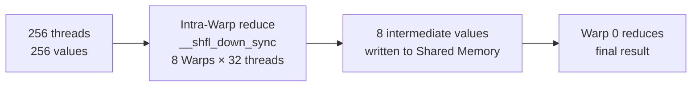
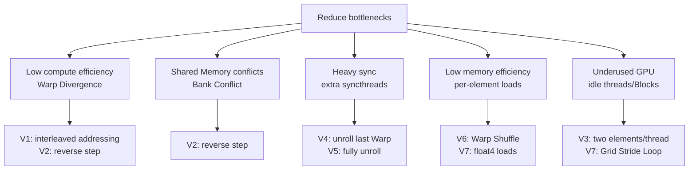

Reduce is one of the most basic GPU operators, and one of the best for learning parallel thinking. This article starts from a naïve implementation and gradually adds Warp-level primitives, vectorized loads, multi-element processing, and related optimizations. Every step has a performance comparison and an explanation of why it works, so you can really learn how to write a fast Kernel.

<!-- more -->

## 📑 Table of contents

- [1. Reduce basics](#1-reduce-basics)
- [2. Version V0: Naïve parallel reduction](#2-version-v0-naïve-parallel-reduction)
- [3. Version V1: Kill Warp Divergence](#3-version-v1-kill-warp-divergence)
- [4. Version V2: Fix Bank Conflict](#4-version-v2-fix-bank-conflict)
- [5. Version V3: Fix idle threads](#5-version-v3-fix-idle-threads)
- [6. Version V4: Unroll the last Warp](#6-version-v4-unroll-the-last-warp)
- [7. Version V5: Fully unroll the loop](#7-version-v5-fully-unroll-the-loop)
- [8. Version V6: Warp Shuffle instead of Shared Memory](#8-version-v6-warp-shuffle-instead-of-shared-memory)
- [9. Version V7: Vectorized load + Grid Stride Loop](#9-version-v7-vectorized-load--grid-stride-loop)
- [10. Performance comparison and when to pick what](#10-performance-comparison-and-when-to-pick-what)
- [Summary](#-summary)
- [Self-check list](#-self-check-list)
- [References](#-references)

---

## 1. Reduce basics

### 1.1 What Reduce is

Imagine you hold a thousand cards with numbers and need their sum. One person adding end to end needs 999 adds. With 500 people pairing up and summing, each round halves the count, and about 10 rounds finish the job. That is the essence of **parallel reduction**.


Reduce is a family of "many inputs → one output" ops. Common forms:

- **Sum Reduce**: $\sum_{i=0}^{N-1} x_i$
- **Max/Min Reduce**: $\max(x_0, x_1, \ldots, x_{N-1})$
- **Dot Product**: $\sum_{i=0}^{N-1} a_i \cdot b_i$

This article uses **Sum Reduce** as the example (other ops share the same idea). Input is a length-$N$ `float` array; output is the sum of all elements.

### 1.2 Bottleneck analysis

A GPU Kernel's performance ceiling is set by both **compute** and **memory traffic**. The Roofline model helps locate the bottleneck. For Sum Reduce:

- Each element is read once (1 load)
- Each read is followed by one add (1 FLOP)
- Arithmetic intensity $= \frac{1 \text{ FLOP}}{4 \text{ Byte}} = 0.25 \text{ FLOP/Byte}$ (each `float` is 4 bytes, one add)

So Reduce is a classic **Memory-Bound** op. The optimization focus is **raising memory bandwidth utilization**, not cutting arithmetic.

### 1.3 Test environment

All code here is CUDA 12.x, measured on an A100 80GB SXM4:

| Metric | Value |
|------|------|
| Theoretical memory bandwidth | 2,039 GB/s |
| L2 Cache capacity | 40 MB |
| SM count | 108 |
| Shared Memory per SM | 164 KB |

Test size: $N = 2^{27}$ (128M `float`, 512 MB total)

---

## 2. Version V0: Naïve parallel reduction

### 2.1 Algorithm idea

The most direct Reduce is a "tree reduction": each round, threads with `tid % (2*step) == 0` add their value to the one at offset `step`, then the step doubles, until everything gathers into element 0.


### 2.2 Kernel implementation

```cuda
// V0: naïve tree reduction (step grows from small to large)
__global__ void reduce_v0(float* input, float* output, int n) {
    extern __shared__ float smem[];

    int tid = threadIdx.x;
    int gid = blockIdx.x * blockDim.x + threadIdx.x;

    // Load global memory into shared memory
    smem[tid] = (gid < n) ? input[gid] : 0.0f;
    __syncthreads();

    // Tree reduction: step starts at 1 and doubles
    for (int step = 1; step < blockDim.x; step *= 2) {
        if (tid % (2 * step) == 0) {
            smem[tid] += smem[tid + step];
        }
        __syncthreads();
    }

    // Each Block writes its result back to global memory
    if (tid == 0) {
        output[blockIdx.x] = smem[0];
    }
}
```

### 2.3 Performance issue: Warp Divergence

⚠️ **Note**: V0's `if (tid % (2 * step) == 0)` is a performance killer.

GPUs schedule in **Warps** of 32 threads; every thread in a Warp must run the same instruction. When some threads take the `if` and some do not, the GPU runs both paths (active first, then inactive), so throughput roughly halves — that is **Warp Divergence**.

In V0, as `step` grows, more Warps diverge:

- `step=1`: only even threads work in each Warp → 50% utilization
- `step=2`: 1 of every 4 threads works → 25% utilization
- ... and it gets worse

**V0 measured bandwidth use: about 15% (~300 GB/s)**

---

## 3. Version V1: Kill Warp Divergence

### 3.1 Improvement idea

V0's Warp Divergence comes from `tid % (2*step) == 0` sending **threads in the same Warp down different branches**. A direct fix: **keep the step direction** (still small → large), but change the thread mapping — let **adjacent threads** own adjacent step adds, instead of "picking every other tid".


Concretely, replace `if (tid % (2*s) == 0)` with a **strided index**: each thread first computes the memory index it should touch, `index = threadIdx.x * 2 * s`, then only checks `index < blockDim.x`.

In round 1 (s=1): for tid 0\~127, index is below blockDim.x (=256); for tid 128\~255, index ≥ 256. The first 4 Warps (128 threads) all enter the if; the last 4 Warps all skip — **no divergence inside a Warp**. As s grows, active threads shrink into a smaller low-tid range. Only at s=8 do fewer than 32 threads stay active and divergence appears inside one Warp. Versus V0 diverging every round, here only the last 5 rounds (s=8, 16, 32, 64, 128) diverge, all inside Warp 0, so the cost is tiny.

### 3.2 Kernel implementation

```cuda
// V1: strided index, less Warp Divergence
__global__ void reduce_v1(float* input, float* output, int n) {
    extern __shared__ float smem[];

    int tid = threadIdx.x;
    int gid = blockIdx.x * blockDim.x + threadIdx.x;

    smem[tid] = (gid < n) ? input[gid] : 0.0f;
    __syncthreads();

    // Step still doubles from 1, but map active threads with a strided index
    for (unsigned int s = 1; s < blockDim.x; s *= 2) {
        int index = threadIdx.x * 2 * s;
        if (index < blockDim.x) {
            smem[index] += smem[index + s];
        }
        __syncthreads();
    }

    if (tid == 0) {
        output[blockIdx.x] = smem[0];
    }
}
```

### 3.3 Why Warp Divergence drops

With blockDim=256, round by round:

- `s=1`: index = 2·tid, active tids 0~127, exactly 4 full Warps → no divergence
- `s=2`: index = 4·tid, active tids 0~63, exactly 2 full Warps → no divergence
- `s=4`: active tids 0~31, exactly 1 full Warp → no divergence
- `s=8`: active tids 0~15, all in Warp 0 → only Warp 0 diverges
- `s=16, 32, 64, 128`: few active threads left in Warp 0 → one divergence per round

💡 **Tip**: Early rounds fully kill divergence; only the last few (when few workers remain) still diverge inside a Warp. Overall cost is far below V0.

**V1 measured bandwidth use: about 32% (~653 GB/s)**, roughly 2.1× V0.

---

## 4. Version V2: Fix Bank Conflict

### 4.1 Shared Memory Banks in brief

Shared Memory is split into 32 **Banks** (default 32-bit mode, each Bank 4 bytes wide). Adjacent 4-byte addresses land in Bank 0, Bank 1, …, Bank 31, then wrap.

Ideally, the 32 threads in a Warp hit 32 different Banks and finish **at once** — conflict-free access. If two or more threads in a Warp hit **different addresses in the same Bank**, the accesses **serialize**. That is a **Bank Conflict**.

⚠️ **Note**: Multiple threads in a Warp hitting the **same address** do not conflict (hardware can broadcast). Only different addresses in the same Bank conflict.

### 4.2 Bank Conflicts in V1

V1 removes most Warp Divergence, but Shared Memory access still has serious Bank Conflicts. With blockDim=256 and Warp 0 (tid 0~31):

- **Round 1 (s=1)**: tid 0 touches smem[0], smem[1]; tid 16 touches smem[32], smem[33]. smem[0] and smem[32] both land in Bank 0 → **2-way Bank Conflict**
- **Round 2 (s=2)**: tid 0 touches smem[0,2]; tid 8 touches smem[32,34]; tid 16 touches smem[64,66]; tid 24 touches smem[96,98]. smem[0], smem[32], smem[64], smem[96] all in Bank 0 → **4-way Bank Conflict**
- **Round 3 (s=4)**: 8-way Bank Conflict
- And so on…

So V1's Shared Memory path stays dragged down by Bank Conflicts.

### 4.3 Fix idea: reverse the step direction

The fix is to **flip the reduction direction**: start from `blockDim.x/2` and halve each round, instead of growing from a small step. Also keep **low-numbered threads always active**:


In this mode, for Warp 0:

- **Round 1 (step=128)**: tid 0 touches smem[0, 128], tid 1 touches smem[1, 129], …, tid 31 touches smem[31, 159]. Those 32 threads hit Banks 0~31 at different addresses → **no Bank Conflict**
- **Round 2 (step=64)** and **Round 3 (step=32)** likewise: 32 threads cover 32 Banks
- When step ≤ 16, fewer threads stay active, and remaining accesses still land on different Banks

Also, because active threads are always a contiguous low-tid range, this **naturally kills Warp Divergence**: each Warp either works as a whole or idles as a whole.

### 4.4 Kernel implementation

```cuda
// V2: step large → small; kills Warp Divergence and Bank Conflict
__global__ void reduce_v2(float* input, float* output, int n) {
    extern __shared__ float smem[];

    int tid = threadIdx.x;
    int gid = blockIdx.x * blockDim.x + threadIdx.x;

    smem[tid] = (gid < n) ? input[gid] : 0.0f;
    __syncthreads();

    // Step starts at blockDim.x/2 and halves each round
    for (unsigned int s = blockDim.x / 2; s > 0; s >>= 1) {
        if (tid < s) {
            smem[tid] += smem[tid + s];
        }
        __syncthreads();
    }

    if (tid == 0) {
        output[blockIdx.x] = smem[0];
    }
}
```

💡 **Tip**: With blockDim=256 and step=128: the 4 full Warps with tid < 128 work; the 4 full Warps with tid ≥ 128 idle. Inside any Warp, **every thread takes the same path**, so no divergence; each Warp's 32 threads also hit 32 different Banks, so no conflict.

**V2 measured bandwidth use: about 40% (~816 GB/s)**, roughly 1.25× V1.

---

## 5. Version V3: Fix idle threads

### 5.1 Problem: half the threads are just ferrying data

V0–V2 load one element per thread, so each Block handles `blockDim.x` elements. With blockDim=256 and $N=2^{27}$, you need $2^{27}/256 = 524288$ Blocks.

In the first reduction round (step = blockDim.x/2), only the first 128 threads keep computing; the last 128 go idle — their only contribution was moving data from global memory into Shared Memory.

Looked another way: if each thread loads 2 elements and adds them up front, the same 256 threads handle 512 elements — half as many Blocks (262144), with the same reduction work later. That means:
- A smaller Grid, less scheduling overhead
- Each thread already does useful work in the load phase, not pure ferrying

### 5.2 Kernel implementation

```cuda
// V3: each thread handles 2 elements; fewer idle threads
__global__ void reduce_v3(float* input, float* output, int n) {
    extern __shared__ float smem[];

    int tid = threadIdx.x;
    int gid = blockIdx.x * (blockDim.x * 2) + threadIdx.x;

    // Each thread loads 2 elements spaced by blockDim.x and sums them
    float val = 0.0f;
    if (gid < n)              val += input[gid];
    if (gid + blockDim.x < n) val += input[gid + blockDim.x];
    smem[tid] = val;
    __syncthreads();

    // Large → small step reduction (same as V2)
    for (unsigned int s = blockDim.x / 2; s > 0; s >>= 1) {
        if (tid < s) {
            smem[tid] += smem[tid + s];
        }
        __syncthreads();
    }

    if (tid == 0) {
        output[blockIdx.x] = smem[0];
    }
}
```

💡 **Tip**: Watch the Grid config change — each Block now covers `blockDim.x * 2` elements, so Block count should be `(n + blockDim.x * 2 - 1) / (blockDim.x * 2)`.

### 5.3 Why it helps

This optimization makes each thread do more work **without adding reduction rounds**:

| Item | V2 (1 element/thread) | V3 (2 elements/thread) |
|--------|-------------------|-------------------|
| Elements per Block | 256 | 512 |
| Blocks needed | 524,288 | 262,144 |
| Load-phase arithmetic | 0 adds | 1 add/thread |
| Reduction rounds | 8 | 8 (unchanged) |

Halving Block count eases scheduler pressure, and global access patterns are cleaner (two contiguous segments handled by one Block).

**V3 measured bandwidth use: about 45% (~918 GB/s)**, roughly 1.12× V2.

---

## 6. Version V4: Unroll the last Warp

### 6.1 V3's hidden cost: extra `__syncthreads()`

V3 still uses a full for-loop in reduction. Once `step <= 32`, only one Warp (tid 0~31) is still working. The `__syncthreads()` in that loop is pure overhead: threads in the same Warp executing the same path are already in lockstep and need no barrier. Those extra `__syncthreads()` calls cost for nothing.

### 6.2 Unroll Last Warp

When `step <= 32`, only one Warp remains. Unroll the loop and drop `__syncthreads()`:

```cuda
// Helper: unrolled reduction for the last 32 threads
__device__ void warpReduce(volatile float* smem, int tid) {
    smem[tid] += smem[tid + 32];
    smem[tid] += smem[tid + 16];
    smem[tid] += smem[tid +  8];
    smem[tid] += smem[tid +  4];
    smem[tid] += smem[tid +  2];
    smem[tid] += smem[tid +  1];
}

// V4: unroll the last Warp (on top of V3)
__global__ void reduce_v4(float* input, float* output, int n) {
    extern __shared__ float smem[];

    int tid = threadIdx.x;
    int gid = blockIdx.x * (blockDim.x * 2) + threadIdx.x;

    // Each thread handles 2 elements (from V3)
    float val = 0.0f;
    if (gid < n)              val += input[gid];
    if (gid + blockDim.x < n) val += input[gid + blockDim.x];
    smem[tid] = val;
    __syncthreads();

    // Reduction loop only while step > 32
    for (unsigned int s = blockDim.x / 2; s > 32; s >>= 1) {
        if (tid < s) {
            smem[tid] += smem[tid + s];
        }
        __syncthreads();
    }

    // Last Warp reduction; no __syncthreads() needed
    if (tid < 32) {
        warpReduce(smem, tid);
    }

    if (tid == 0) {
        output[blockIdx.x] = smem[0];
    }
}
```

⚠️ **Note**: `smem` in `warpReduce` must be `volatile`, or the compiler may keep intermediate results in registers and other threads may read stale values. That is critical for visibility among Warp threads.

### 6.3 Effect

With blockDim=256, V3's reduction has 8 rounds (step = 128, 64, 32, 16, 8, 4, 2, 1), each with `__syncthreads()`. V4 unrolls the last 5 rounds (step ≤ 32) into straight-line code and drops 5 `__syncthreads()` calls.

**V4 measured bandwidth use: about 52% (~1060 GB/s)**, roughly 1.15× V3.

---

## 7. Version V5: Fully unroll the loop

### 7.1 Remaining loop overhead

V4 unrolls the last Warp, but earlier rounds (step = 128, 64) are still a runtime loop. Each iteration still has:
- A bound check (`s > 32`)
- A branch
- A loop-variable update (`s >>= 1`)

When Block size is known at compile time (e.g. fixed at 256), that overhead can go away entirely.

### 7.2 Compile-time unroll via template parameters

Pass Block size as a template parameter so the compiler knows every trip count and emits fully unrolled code:

```cuda
// V5: fully unrolled (template parameter)
template <int BLOCK_SIZE>
__global__ void reduce_v5(float* input, float* output, int n) {
    extern __shared__ float smem[];

    int tid = threadIdx.x;
    int gid = blockIdx.x * (BLOCK_SIZE * 2) + threadIdx.x;

    // Each thread handles 2 elements
    float val = 0.0f;
    if (gid < n)              val += input[gid];
    if (gid + BLOCK_SIZE < n) val += input[gid + BLOCK_SIZE];
    smem[tid] = val;
    __syncthreads();

    // Compile-time unroll: BLOCK_SIZE known; dead branches are deleted
    if (BLOCK_SIZE >= 512) { if (tid < 256) smem[tid] += smem[tid + 256]; __syncthreads(); }
    if (BLOCK_SIZE >= 256) { if (tid < 128) smem[tid] += smem[tid + 128]; __syncthreads(); }
    if (BLOCK_SIZE >= 128) { if (tid <  64) smem[tid] += smem[tid +  64]; __syncthreads(); }

    // Unroll inside the last Warp
    if (tid < 32) {
        volatile float* vsmem = smem;
        if (BLOCK_SIZE >= 64) vsmem[tid] += vsmem[tid + 32];
        vsmem[tid] += vsmem[tid + 16];
        vsmem[tid] += vsmem[tid +  8];
        vsmem[tid] += vsmem[tid +  4];
        vsmem[tid] += vsmem[tid +  2];
        vsmem[tid] += vsmem[tid +  1];
    }

    if (tid == 0) output[blockIdx.x] = smem[0];
}
```

At call sites, pick the matching template instantiation by Block size:

```cuda
switch (block_size) {
    case 512: reduce_v5<512><<<grid, 512, 512*sizeof(float)>>>(d_in, d_out, n); break;
    case 256: reduce_v5<256><<<grid, 256, 256*sizeof(float)>>>(d_in, d_out, n); break;
    case 128: reduce_v5<128><<<grid, 128, 128*sizeof(float)>>>(d_in, d_out, n); break;
}
```

### 7.3 Why templates beat a runtime loop

💡 **Tip**: With `BLOCK_SIZE=256`, the compiler emits the equivalent of:

```cuda
// Actual post-compile instruction stream (no loop, no bound checks):
if (tid < 128) smem[tid] += smem[tid + 128]; __syncthreads();
if (tid <  64) smem[tid] += smem[tid +  64]; __syncthreads();
// then straight-line Warp reduction...
```

`BLOCK_SIZE >= 512` is false at compile time, so that whole `if` is deleted. The machine code is compact straight-line code: no loop jumps, no dead code.

**V5 measured bandwidth use: about 62% (~1265 GB/s)**, roughly 1.19× V4.

---

## 8. Version V6: Warp Shuffle instead of Shared Memory

### 8.1 Warp Shuffle primitives

The 32 threads in a Warp can talk a special way: **register-to-register exchange** (Warp Shuffle), with no Shared Memory in between.

```cuda
// __shfl_down_sync: each thread reads the register value from lane_id+delta (down-shift)
float val = __shfl_down_sync(0xffffffff, var, delta);
```

Parameters:
- `0xffffffff`: all 32 threads in the Warp participate
- `var`: each thread's register value
- `delta`: offset (read from `lane_id + delta`)

This is much faster than Shared Memory because:
1. No address math
2. No Bank Conflicts
3. Lower latency (register interconnect)

### 8.2 Two-level reduction strategy

Warp Shuffle only works inside one Warp (32 threads). For a 256- or 512-thread Block you need a **two-level reduction**:

1. **Intra-Warp**: each Warp reduces 32 values to 1 with `__shfl_down_sync`
2. **Inter-Warp**: write each Warp result into Shared Memory, then reduce once more



### 8.3 Kernel implementation

```cuda
// Intra-Warp reduction helper
__device__ float warpReduceSum(float val) {
    // Each step adds the right half into the left half
    for (int offset = 16; offset > 0; offset >>= 1) {
        val += __shfl_down_sync(0xffffffff, val, offset);
    }
    return val;  // lane 0 holds the final result
}

// V6: Warp Shuffle + two-level reduction
__global__ void reduce_v6(float* input, float* output, int n) {
    int tid  = threadIdx.x;
    int gid  = blockIdx.x * (blockDim.x * 2) + threadIdx.x;
    int lane = tid % 32;      // lane id inside the Warp (0~31)
    int wid  = tid / 32;      // which Warp this thread belongs to

    // Each thread handles 2 elements
    float val = 0.0f;
    if (gid < n)              val += input[gid];
    if (gid + blockDim.x < n) val += input[gid + blockDim.x];

    // Level 1: intra-Warp reduction
    val = warpReduceSum(val);

    // Store each Warp result (only lane 0 is valid) into Shared Memory
    __shared__ float warp_results[32];  // up to 32 Warps (1024/32)
    if (lane == 0) {
        warp_results[wid] = val;
    }
    __syncthreads();

    // Level 2: inter-Warp reduction (Warp 0)
    int num_warps = blockDim.x / 32;
    if (wid == 0) {
        val = (lane < num_warps) ? warp_results[lane] : 0.0f;
        val = warpReduceSum(val);
    }

    if (tid == 0) output[blockIdx.x] = val;
}
```

**V6 measured bandwidth use: about 72% (~1468 GB/s)**, roughly 1.16× V5.

---

## 9. Version V7: Vectorized load + Grid Stride Loop

### 9.1 Vectorized load (float4)

GPU memory moves data in **transactions**, typically 128 bytes each. If every thread loads only 4 bytes (one float) at a time:

- One Warp: 32 threads × 4 bytes = 128 bytes, exactly one transaction
- But each load instruction still has fixed scheduling cost

Switch to `float4` (16 bytes) so each thread loads 4 floats per issue:

- Each `ld.global.v4.f32` moves 4× the data of `ld.global.f32`
- Same loop iteration count covers 4× more data, so fewer iterations effectively
- More instruction-level parallelism (ILP), keeping the memory pipeline fuller

### 9.2 Grid Stride Loop

In V0–V6 each Block handles a fixed amount of data. A more flexible pattern is the **Grid Stride Loop**: fix the Grid size and let each thread loop over multiple segments until the whole array is covered.

Benefits:
- Grid size can be set to fill the GPU (e.g. SM count × 4), avoiding wasted tail Blocks
- Works for huge arrays that exceed max Grid limits
- Each thread handles more data, amortizing Kernel launch and reduction fixed costs

### 9.3 Kernel implementation

```cuda
// V7: float4 vectorized load + Grid Stride Loop + Warp Shuffle
__global__ void reduce_v7(float* input, float* output, int n) {
    int tid  = threadIdx.x;
    int lane = tid % 32;
    int wid  = tid / 32;

    // float4 load: each thread handles 4 floats per step
    float4* input4 = reinterpret_cast<float4*>(input);
    int n4 = n / 4;  // number of float4 elements

    float val = 0.0f;

    // Grid Stride Loop: stride = gridDim.x * blockDim.x
    for (int idx = blockIdx.x * blockDim.x + tid;
         idx < n4;
         idx += gridDim.x * blockDim.x)
    {
        float4 data = input4[idx];
        val += data.x + data.y + data.z + data.w;
    }

    // Tail when n is not a multiple of 4
    int tail_start = n4 * 4;
    for (int idx = tail_start + blockIdx.x * blockDim.x + tid;
         idx < n;
         idx += gridDim.x * blockDim.x)
    {
        val += input[idx];
    }

    // Intra-Warp reduction
    for (int offset = 16; offset > 0; offset >>= 1) {
        val += __shfl_down_sync(0xffffffff, val, offset);
    }

    __shared__ float warp_results[32];
    if (lane == 0) warp_results[wid] = val;
    __syncthreads();

    int num_warps = blockDim.x / 32;
    if (wid == 0) {
        val = (lane < num_warps) ? warp_results[lane] : 0.0f;
        for (int offset = 16; offset > 0; offset >>= 1) {
            val += __shfl_down_sync(0xffffffff, val, offset);
        }
    }

    if (tid == 0) output[blockIdx.x] = val;
}
```

Launch pattern:

```cuda
// Fix Grid size to SM count × 4 (max GPU utilization)
int num_sms;
cudaDeviceGetAttribute(&num_sms, cudaDevAttrMultiProcessorCount, 0);
int grid_size  = num_sms * 4;   // 432 for A100
int block_size = 256;

reduce_v7<<<grid_size, block_size>>>(d_input, d_partial, n);
```

**V7 measured bandwidth use: about 85% (~1733 GB/s)**, roughly 1.18× V6.

---

## 10. Performance comparison and when to pick what

### 10.1 Version summary

| Version | Core optimization | Bandwidth use | Relative speed |
|------|-----------|------------|---------|
| V0 naïve tree | None | ~15% | 1.0x |
| V1 interleaved addressing | Less Warp Divergence | ~32% | 2.1x |
| V2 reverse step | Kill Bank Conflict + Divergence | ~40% | 2.7x |
| V3 two elements/thread | Fewer idle threads; Grid halved | ~45% | 3.0x |
| V4 unroll last Warp | Drop extra syncthreads inside Warp | ~52% | 3.5x |
| V5 fully unroll | Template params; compile-time kill all loops | ~62% | 4.1x |
| V6 Warp Shuffle | Register path; less Shared Memory | ~72% | 4.8x |
| V7 vectorized + Stride Loop | Better loads + fill the GPU | ~85% | 5.7x |

📌 **Key point**: Theoretical peak bandwidth is 2039 GB/s. V7 hits ~1733 GB/s (~85%), close to a practical ceiling (ECC, clock noise, etc.; 85–90% is a reasonable Reduce target).

### 10.2 Where the gains come from



### 10.3 Practical picks

| Scenario | Recommendation |
|------|---------|
| Learning/teaching | V2 or V4; clear and easy to follow |
| General production | V6 Warp Shuffle |
| Huge arrays (>1GB) | V7 Grid Stride Loop |
| Absolute peak | CUB's `cub::DeviceReduce` |

💡 **Tip**: In production, prefer [NVIDIA CUB](https://github.com/NVIDIA/cccl/tree/main/cub) `cub::DeviceReduce::Sum`. It is tuned per GPU architecture, often reaches 90%+ bandwidth use, and costs zero maintenance.

---

## 📝 Summary

From V0 to V7, each step targets one concrete bottleneck:

1. **Warp Divergence (first cut)**: replace `tid % (2*s) == 0` with a strided index so whole Warps enter or skip (V1)
2. **Bank Conflict + Warp Divergence (full fix)**: reverse the step, start from `blockDim/2` and halve (V2)
3. **Idle threads**: 2 elements per thread, fewer Blocks, better thread use (V3)
4. **Extra sync**: Warps are already in lockstep; unroll the last 5 rounds and drop `__syncthreads()` (V4)
5. **Loop overhead**: template params let the compiler delete dead branches into compact straight-line code (V5)
6. **Memory hierarchy**: Warp Shuffle talks register-to-register, faster than Shared Memory (V6)
7. **Bandwidth efficiency**: `float4` cuts instruction count; Grid Stride Loop maxes GPU occupancy (V7)

These ideas matter beyond Reduce — **the same patterns show up in almost every Memory-Bound Kernel**.

---

## 🎯 Self-check list

- Can explain why Warp Divergence happens, and how V1 (interleaved addressing) and V2 (reverse step) reduce/kill it
- Can describe Shared Memory Bank Conflicts, and why V2 also kills them
- Can explain where V3's "2 elements/thread" gains come from versus "1 element/thread"
- Can explain why V4 can drop `__syncthreads()` in the last Warp
- Can explain why `template <int BLOCK_SIZE>` helps performance
- Can write Warp-level reduction with `__shfl_down_sync`
- Can describe the full two-level reduction flow (intra-Warp + inter-Warp)
- Can explain why `float4` vectorized loads beat per-element loads
- Can describe how a Grid Stride Loop works and when to use it
- Can use Nsight Compute Memory Throughput to verify each version's bandwidth use

---

## 📚 References
- [NV official tutorial](https://developer.download.nvidia.com/assets/cuda/files/reduction.pdf)
- [GPU optimization series: reduce](https://zhuanlan.zhihu.com/p/426978026)
- [CUDA performance: reduce operator](https://zhuanlan.zhihu.com/p/17996548596)
- [BBuf CUDA notes III: reduce optimization intro](https://zhuanlan.zhihu.com/p/596012674)
- [CUDA C++ Programming Guide - Warp Shuffle Functions](https://docs.nvidia.com/cuda/cuda-c-programming-guide/index.html#warp-shuffle-functions)
- [Optimizing Parallel Reduction in CUDA - Mark Harris, NVIDIA](https://developer.download.nvidia.com/assets/cuda/files/reduction.pdf)
- [NVIDIA CUB Library - DeviceReduce](https://github.com/NVIDIA/cccl/tree/main/cub)
- [CUDA C++ Best Practices Guide - Memory Optimizations](https://docs.nvidia.com/cuda/cuda-c-best-practices-guide/index.html#memory-optimizations)
- [NVIDIA Nsight Compute Documentation](https://docs.nvidia.com/nsight-compute/NsightComputeCli/index.html)
