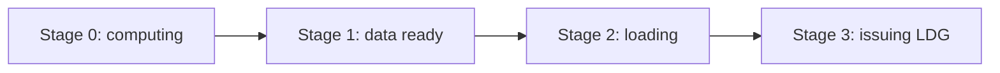

Matrix multiplication (GEMM) is the central compute primitive in deep learning — from fully connected layers to attention, most work bottoms out in matrix multiply. This article starts from a naive implementation and walks through Block–Warp–Thread three-level tiling, vectorized loads, bank-conflict removal, double buffering, and more, so you get the full CUDA GEMM optimization playbook.

<!-- more -->

## 📑 Contents

- [1. Background and problem setup](#1-background-and-problem-setup)
- [2. How we analyze performance](#2-how-we-analyze-performance)
- [3. Naive baseline](#3-naive-baseline)
- [4. Thread-block tiling](#4-thread-block-tiling)
- [5. Thread-level tiling](#5-thread-level-tiling-register-reuse)
- [6. Warp-level tiling](#6-warp-level-tiling)
- [7. Vectorized loads: float4](#7-vectorized-loads-float4)
- [8. Removing bank conflicts](#8-removing-bank-conflicts)
- [9. Double buffering and pipelining](#9-double-buffering-and-pipelining)
- [10. Ampere async-copy pipelines](#10-ampere-async-copy-pipelines)
- [11. SASS-level tuning and register scheduling](#11-sass-level-tuning-and-register-scheduling)
- [12. Parameter selection and tuning](#12-parameter-selection-and-tuning)
- [Summary](#-summary)
- [Self-check list](#-self-check-list)
- [References](#-references)

---

## 1. Background and problem setup

### 1.1 What GEMM computes

GEMM (General Matrix Multiply) computes:

$$
C = A \times B
$$

where $A$ is $M \times K$, $B$ is $K \times N$, and $C$ is $M \times N$. Total FLOPs are $2 \times M \times N \times K$ (each output needs $K$ multiplies and $K-1$ adds).


### 1.2 Why GEMM matters so much

A huge share of deep-learning ops bottom out in GEMM:

- **Fully connected layers**: $Y = XW + b$ is straight matrix multiply
- **Convolution**: im2col turns it into GEMM
- **Attention**: $QK^T$ and $\text{Attention} \cdot V$ are both matrix multiply
- **Batched GEMM**: batched matmul in multi-head attention

Speeding up GEMM pays off across almost every deep-learning workload.

### 1.3 The metric that matters

The main metric for a GEMM kernel is **effective throughput** (TFLOPS):

$$
\text{TFLOPS} = \frac{2 \times M \times N \times K}{\text{kernel time (seconds)} \times 10^{12}}
$$

We usually report that as a fraction of theoretical peak. On large matrices, cuBLAS often hits 90%+ of peak.

---

## 2. How we analyze performance

### 2.1 Roofline and arithmetic intensity

GPU performance has two hard ceilings:

- **Compute ceiling**: SM floating-point throughput (e.g. V100 ≈ 15.7 TFLOPS FP32)
- **Bandwidth ceiling**: device-memory bandwidth (e.g. V100 HBM ≈ 900 GB/s)

Whether a kernel is **compute-bound** or **memory-bound** depends on its **arithmetic intensity**:

$$
\text{arithmetic intensity} = \frac{\text{FLOPs}}{\text{bytes moved}}
$$

When intensity exceeds the **ridge point** (= peak compute / peak bandwidth), the kernel is compute-limited; otherwise it is bandwidth-limited. For V100 that ridge is about $15.7 \times 10^{12} / (900 \times 10^9) \approx 17.4$ FLOPs/Byte.

💡 **Tip**: The point of GEMM optimization is raising arithmetic intensity — reuse data so each byte feeds as much compute as possible.

### 2.2 Bandwidth, not latency

When you analyze a GEMM kernel, use **bandwidth** as the main lens, not **latency**. Massive thread counts hide latency through pipelining; bandwidth is a hard physical limit. An optimization works if it cuts demand on some level of the memory hierarchy.

Reference bandwidths on V100:

| 📊 Level | ⚡ Bandwidth | ⏱️ Latency |
|----------|-------------|------------|
| Registers | ~20 TB/s | 0 cycle |
| Shared memory | ~12 TB/s | 20–30 cycles |
| L2 cache | ~2 TB/s | ~200 cycles |
| HBM (global) | ~900 GB/s | 300–400 cycles |

### 2.3 Waves and L2

A **wave** is the set of thread blocks the GPU can run at once. V100 has 80 SMs and can hold 2 blocks per SM, so one wave is at most 160 blocks.

Matrix C is split into $(M/BM) \times (N/BN)$ block tiles. If a wave spans $W_m$ and $W_n$ tiles in M and N, approximate L2 hit rate is:

$$
\text{L2 hit rate} \approx 1 - \frac{W_m \times W_n}{W_m \times W_n + W_m \times N_{block} + W_n \times M_{block}}
$$

⚠️ **Note**: Block scheduling order (row-major vs column-major vs zigzag) can swing L2 hit rate hard — over 10% on large matrices.

---

## 3. Naive baseline

### 3.1 The obvious kernel

Simplest idea: each thread computes one element of $C$ and walks the $K$ dimension as a dot product.

```cuda
__global__ void sgemm_naive(const float* A, const float* B, float* C,
                            int M, int N, int K) {
    int row = blockIdx.y * blockDim.y + threadIdx.y;
    int col = blockIdx.x * blockDim.x + threadIdx.x;

    if (row < M && col < N) {
        float sum = 0.0f;
        for (int k = 0; k < K; k++) {
            sum += A[row * K + k] * B[k * N + col];
        }
        C[row * N + col] = sum;
    }
}
```

### 3.2 Performance

Arithmetic intensity is tiny. For one $C[i][j]$:
- Compute: $2K$ FLOPs
- Traffic: one row of $A$ ($K$ floats) + one column of $B$ ($K$ floats) = $8K$ bytes

$$
\text{arithmetic intensity} = \frac{2K}{8K} = 0.25 \text{ FLOPs/Byte}
$$

Far below the ridge (~17 FLOPs/Byte), so it is badly bandwidth-bound. Measured results usually land at 6%–11% of peak.

📌 **Key point**: The naive kernel barely reuses data — the same row of $A$ is reread by threads on different columns, the same column of $B$ by threads on different rows, all from global memory.

---

## 4. Thread-block tiling

### 4.1 Core idea

Carve $C$ into $BM \times BN$ tiles; each thread block owns one. Iterate $K$ in steps of $BK$: each step, the block cooperatively moves an $A$ tile $BM \times BK$ and a $B$ tile $BK \times BN$ into shared memory, then does local multiply-accumulate there.

Think of a **small shelf next to the workbench** — instead of fetching from the distant warehouse (global memory) every time, you haul a batch to the shelf (shared memory) and workers reuse it.


### 4.2 Why slice along K

Given a $BM \times BN$ piece of $C$, a natural question: why not load the whole $BM \times K$ strip of $A$ and $K \times BN$ strip of $B$ and finish with one outer product? Why iterate $BK$ steps along $K$?

**Shared memory is too small.** In practice $K$ is thousands to tens of thousands; $BM \times K$ plus $K \times BN$ can be tens of MB, while one SM typically has only 48–228 KB of shared memory. You must cut $K$ into $BK$-sized chunks and accumulate in batches.

Slicing along K also buys reuse: each $A$ sub-tile ($BM \times BK$) and $B$ sub-tile ($BK \times BN$) loaded into SMEM is **shared by every thread in the block** — all $BM \times BN$ outputs need that pair. One Global → SMEM move serves the whole block's compute, cutting global traffic from the naive $O(MNK)$ down to roughly $O(MNK/BK \cdot \text{constant})$.

💡 **Tip**: Slicing along K is the golden rule of GEMM tiling. Deeper stages (thread tiling, warp tiling) keep the same idea — at every level (Global → Shared → Register), iterate along K and maximize reuse before the next move.

### 4.3 Higher arithmetic intensity

After tiling:

$$
\text{arithmetic intensity} = \frac{BM \times BN \times 2 \times BK}{(BM \times BK + BK \times BN) \times 4} = \frac{BM \times BN}{2 \times (BM + BN)} = \frac{1}{2 \times \left(\frac{1}{BM} + \frac{1}{BN}\right)}
$$

Divide numerator and denominator by $BM \times BN$: under a fixed $BM + BN$ (shared-memory budget), the AM–GM inequality says $\frac{1}{BM} + \frac{1}{BN}$ is minimized when $BM = BN$, so **intensity is highest when $BM$ and $BN$ are close**.

With $BM = BN = 128$: intensity = $128 \times 128 / (2 \times 256) = 32$ FLOPs/Byte, well above the ridge.

### 4.4 Cooperative load layout

One important detail: when loading tileA and tileB, thread layout must keep **coalesced global access** — adjacent threads in a warp touch consecutive addresses.

Example with $BM=128, BK=8, \text{Block Size}=256$:

- **Load tileA** ($128 \times 8$): each row has only 8 elements, so 8 adjacent threads own a row. Reshape 256 threads as $32 \times 8$ (32 rows × 8 cols); each round loads 32 rows, 4 rounds cover 128.
- **Load tileB** ($8 \times 128$): each row has 128 elements, so 32 adjacent threads own a contiguous segment. Reshape as $8 \times 32$ (8 rows × 32 cols); each round covers all 8 rows, 4 rounds cover 128 columns.

Index math for the reshape:

```cuda
int tid = threadIdx.x;

// Thread coords when loading tileA (8 cols × 32 rows)
int a_thread_x = tid % 8;       // column
int a_thread_y = tid / 8;       // row

// Thread coords when loading tileB (32 cols × 8 rows)
int b_thread_x = tid % 32;      // column
int b_thread_y = tid / 32;      // row
```

💡 **Tip**: With this layout, one warp (32 consecutive tids) covers 32 consecutive floats in a tileB row — perfect coalescing. For tileA, the warp covers 4 consecutive rows × 8 cols; the 8 elements in each row are still contiguous.

- **Output tileC** ($128 \times 128$): split tileC into `C_BLOCK_Y` $\times$ `C_BLOCK_X` = `BLOCK_SIZE`($256$) `C_BLOCK`s. Here `C_BLOCK_X = C_BLOCK_Y = 16`, so there are `Tn = BN / C_BLOCK_X` `C_BLOCK`s in X and `Tm = BM / C_BLOCK_Y` in Y. Each thread writes one value at the same relative position in every `C_BLOCK`, for `Tm` $\times$ `Tn` values total
```
// Thread layout when computing tileC (16×16)
constexpr int C_BLOCK_X = 16;
constexpr int C_BLOCK_Y = BLOCK_SIZE / C_BLOCK_X;  // = 16
int c_thread_x = tid % C_BLOCK_X;
int c_thread_y = tid / C_BLOCK_X;

// Each thread owns Tm×Tn output elements
constexpr int Tm = BM / C_BLOCK_Y;  // = 8
constexpr int Tn = BN / C_BLOCK_X;  // = 8
float Ct[Tm][Tn] = {0.0f};
```
⚠️ **Note**: The 8×8 outputs per thread are not contiguous — they are **strided** by `C_BLOCK_Y=16` rows and `C_BLOCK_X=16` cols. 256 threads form a $16 \times 16$ grid; each thread "jumps" 8 times in M and N to cover the $128 \times 128$ tileC.


### 4.5 Implementation

```cuda
template <int BM, int BN, int BK, int BLOCK_SIZE>
__global__ void sgemm_block_tiling(float* A, float* B, float* C,
                                   int M, int K, int N) {
    __shared__ float As[BM][BK];
    __shared__ float Bs[BK][BN];

    int r0 = blockIdx.y * BM;
    int c0 = blockIdx.x * BN;
    int tid = threadIdx.x;

    // Thread reshape for loading tileA
    constexpr int A_BLOCK_X = BK;  // = 8
    constexpr int A_BLOCK_Y = BLOCK_SIZE / A_BLOCK_X;  // = 32
    int a_thread_x = tid % A_BLOCK_X;
    int a_thread_y = tid / A_BLOCK_X;

    // Thread reshape for loading tileB
    constexpr int B_BLOCK_X = 32;
    constexpr int B_BLOCK_Y = BLOCK_SIZE / B_BLOCK_X;  // = 8
    int b_thread_x = tid % B_BLOCK_X;
    int b_thread_y = tid / B_BLOCK_X;

    // Thread layout for computing tileC (16×16)
    constexpr int C_BLOCK_X = 16;
    constexpr int C_BLOCK_Y = BLOCK_SIZE / C_BLOCK_X;  // = 16
    int c_thread_x = tid % C_BLOCK_X;
    int c_thread_y = tid / C_BLOCK_X;

    // Each thread owns Tm×Tn outputs
    constexpr int Tm = BM / C_BLOCK_Y;  // = 8
    constexpr int Tn = BN / C_BLOCK_X;  // = 8
    float Ct[Tm][Tn] = {0.0f};

    // K-Loop
    for (int k = 0; k < K; k += BK) {
        // Cooperative load of tileA (strided loop over BM rows)
        #pragma unroll
        for (int i = a_thread_y; i < BM; i += A_BLOCK_Y) {
            int r = r0 + i, c = k + a_thread_x;
            As[i][a_thread_x] = (r < M && c < K) ? A[r * K + c] : 0.0f;
        }

        // Cooperative load of tileB (strided loop over BN cols)
        #pragma unroll
        for (int j = b_thread_x; j < BN; j += B_BLOCK_X) {
            int r = k + b_thread_y, c = c0 + j;
            Bs[b_thread_y][j] = (r < K && c < N) ? B[r * N + c] : 0.0f;
        }

        __syncthreads();

        // Outer-product accumulate As × Bs
        #pragma unroll
        for (int p = 0; p < BK; p++) {
            for (int i = 0; i < Tm; i++) {
                int row = c_thread_y + i * C_BLOCK_Y;
                for (int j = 0; j < Tn; j++) {
                    int col = c_thread_x + j * C_BLOCK_X;
                    Ct[i][j] += As[row][p] * Bs[p][col];
                }
            }
        }

        __syncthreads();
    }

    // Write results back
    for (int i = 0; i < Tm; i++) {
        int r = r0 + c_thread_y + i * C_BLOCK_Y;
        for (int j = 0; j < Tn; j++) {
            int c = c0 + c_thread_x + j * C_BLOCK_X;
            if (r < M && c < N) C[r * N + c] = Ct[i][j];
        }
    }
}
```

### 4.6 Parameter choices

| 📊 Param | 📝 Suggested | 💡 Why |
|----------|--------------|--------|
| BM, BN | 128 | Intensity 32, enough to saturate compute |
| BK | 8 | Shared-memory use stays modest (128×8×4=4KB per matrix) |
| Block size | 16×16=256 | Matches BM/BN split; allows 2 blocks/SM |

⚠️ **Note**: Both `__syncthreads()` calls are required — the first so loads finish before compute, the second so compute finishes before shared memory is overwritten.

---

## 5. Thread-level tiling: register reuse

By now the optimization story is a clear **three-level move chain**:


Every level follows the same rule: iterate along K, move a small chunk, maximize reuse at the current level, then move the next chunk. Focus now is Shared Memory → Register.

### 5.1 Problem: shared memory is still the bottleneck

The previous kernel (Section 4.5) already gives each thread $TM \times TN$ (8×8) outputs, but `As[row][p]` and `Bs[p][col]` sit inside the triple loop — the compiler may hoist some loads, yet structurally every FMA still depends on an implicit shared-memory read. When 256 threads hammer shared memory, you get **MIO Throttle Stall**.

Fix: explicitly separate "read from shared memory" and "do FMA" — batch-load into register arrays (`a_frag`, `b_frag`), then outer-product in registers. Each p-Loop step then needs only $TM + TN$ shared reads for $TM \times TN$ FMAs.

### 5.2 Outer-product decomposition


Loop order is the key. Classic inner-product (K innermost) cannot reuse $A$ and $B$ elements:

```
// Inner product: each thread accumulates one C element -> low reuse
for k: sum += A[row][k] * B[k][col]
```

Switch to **outer product** (K outermost):

```
// Outer product: each thread owns TM×TN C elements
for k:
    load A_frag[TM] from smem  // read TM A elements once
    load B_frag[TN] from smem  // read TN B elements once
    for i in TM:
        for j in TN:
            C_frag[i][j] += A_frag[i] * B_frag[j]  // TM×TN FMAs
```

**Compute-to-traffic analysis**: each K step reads $TM + TN$ floats from shared memory ($4(TM + TN)$ bytes) and does $TM \times TN$ FMAs ($2 \times TM \times TN$ FLOPs):

$$
\text{arithmetic intensity} = \frac{2 \times TM \times TN}{4 \times (TM + TN)} = \frac{TM \times TN}{2 \times (TM + TN)} = \frac{1}{2 \times \left(\frac{1}{TM} + \frac{1}{TN}\right)}
$$

Same form as Section 4.3 — not a coincidence: outer product is block tiling pushed down to the register level. AM–GM again: with $TM + TN$ (register pressure proxy) fixed, **intensity peaks at $TM = TN$**.

**Why $TM = TN = 8$**:

- Registers per thread: $a_{frag}[TM] + b_{frag}[TN] + c_{frag}[TM][TN] = TM + TN + TM \times TN$. At $TM=TN=8$ that is $8 + 8 + 64 = 80$ floats.
- Plus indexes and temps, ~90–120 registers/thread — about half the 255 per-thread cap, so you can still keep occupancy (at least 2 blocks/SM).
- At $TM=TN=16$, $c_{frag}$ alone wants 256 registers → spill to local memory and performance falls.

**Versus inner product**: inner product needs one shared-memory float from $A$ and one from $B$ per FMA, ratio $2/(2 \times 4) = 1/4$ by bytes or $1$ by elements. Outer product at $TM = TN = 8$ is $64/16 = 4$ by elements — **4× better** — compute that used to need 4 shared accesses now needs 1.

### 5.3 Implementation

```cuda
template <int BM, int BN, int BK, int TM, int TN>
__global__ void sgemm_thread_tiling(const float* A, const float* B, float* C,
                                    int M, int N, int K) {
    __shared__ float As[BM][BK];
    __shared__ float Bs[BK][BN];

    // Each thread owns a TM×TN sub-block of C
    const int thread_num = BM / TM * BN / TN;  // = 256
    int tid = threadIdx.x;
    int thread_row = (tid / (BN / TN)) * TM;
    int thread_col = (tid % (BN / TN)) * TN;

    // Register storage
    float a_frag[TM];
    float b_frag[TN];
    float c_frag[TM][TN] = {0.0f};

    int by = blockIdx.y, bx = blockIdx.x;

    for (int bk = 0; bk < K; bk += BK) {
        // Cooperative load A, B into shared memory (bounds checks omitted)
        load_tile_A(A, As, by, bk, tid, M, K);
        load_tile_B(B, Bs, bx, bk, tid, K, N);
        __syncthreads();

        // Outer-product accumulate
        for (int k = 0; k < BK; k++) {
            // Shared memory -> registers
            for (int i = 0; i < TM; i++)
                a_frag[i] = As[thread_row + i][k];
            for (int j = 0; j < TN; j++)
                b_frag[j] = Bs[k][thread_col + j];

            // Outer product in registers
            for (int i = 0; i < TM; i++)
                for (int j = 0; j < TN; j++)
                    c_frag[i][j] += a_frag[i] * b_frag[j];
        }
        __syncthreads();
    }

    // Write back to global memory
    for (int i = 0; i < TM; i++)
        for (int j = 0; j < TN; j++)
            C[(by * BM + thread_row + i) * N + bx * BN + thread_col + j] = c_frag[i][j];
}
```

### 5.4 Register budget

With $TM = TN = 8$:
- `c_frag`: $8 \times 8 = 64$ registers
- `a_frag` + `b_frag`: $8 + 8 = 16$ registers
- Indexes and temps: ~30 registers
- Total: about 110–128 registers/thread

V100 has 65536 registers per SM. 128 regs/thread × 256 threads/block = 32768 regs/block, so 2 blocks/SM (512 threads = 16 warps), occupancy = 25%.

💡 **Tip**: 25% occupancy looks low, but GEMM has huge ILP — each thread has 64 independent FMA chains, enough to hide pipeline latency.

---

## 6. Warp-level tiling

### 6.1 Motivation

On top of thread tiling, ask: how should a warp's 32 threads access shared memory?

If threads are laid out $1 \times 32$ (one row of 32), reading $A$ broadcasts one element to all 32, but reading $B$ needs 32 different elements. $32 \times 1$ flips the preference.

### 6.2 Warp-tile shape and intensity

Suppose a warp has $x$ threads in M and $y$ in N ($x \times y = 32$), each owning $TM \times TN$. In one p-Loop step (one step along K):

- With shared-memory broadcast, the warp really reads $x \times TM$ distinct tileA elements (the $y$ threads at the same M position share the same $TM$ values)
- And $y \times TN$ distinct tileB elements (the $x$ threads at the same N position share the same $TN$ values)
- Each thread does $TM \times TN$ FMAs; the warp does $32 \times TM \times TN \times 2$ FLOPs

Warp-level compute-to-traffic ratio (set $TM = TN$, so the denominator $(x \cdot TM + y \cdot TN) = (x + y) \cdot TM$):

$$
\text{ratio} = \frac{32 \times TM \times TN \times 2}{(x \cdot TM + y \cdot TN) \times 4} \xlongequal{TM=TN} \frac{32 \times TM^2 \times 2}{(x + y) \times TM \times 4} = \frac{16 \times TM}{x + y}
$$

The ratio scales with $1/(x + y)$. Under $x \times y = 32$, minimize $x + y$. AM–GM: $x + y \geq 2\sqrt{xy} = 2\sqrt{32} \approx 11.3$. Among integers, $4 \times 8$ and $8 \times 4$ ($x+y=12$) are best.


### 6.3 Per-thread coordinates inside a warp

With $BM = 128, BN = 128$, a block has 256 / 32 = 8 warps.

Take a $4 \times 8$ warp layout and $TM = TN = 8$: each warp computes a $32 \times 64$ C sub-block.

With that layout, compute each thread's starting coords in the block tile. Let `tid` be the global thread id in the block:

```cuda
int warp_id = tid >> 5;            // tid / 32
int lane_id = tid & 31;           // tid % 32

// Warp position in the block (4×2)
int warp_row = warp_id >> 1;      // M: 0~3
int warp_col = warp_id & 1;       // N: 0~1

// Lane position inside the warp (4×8, row-major)
int lane_row = lane_id >> 3;      // M: 0~3
int lane_col = lane_id & 7;       // N: 0~7

// Start row/col of this thread's TM×TN sub-block in the block tile
int row_c = (warp_row * 4 + lane_row) * TM;  // = (warp_row*4 + lane_row) * 8
int col_c = (warp_col * 8 + lane_col) * TN;  // = (warp_col*8 + lane_col) * 8
```

Example `tid = 18`: `warp_id = 0`, `lane_id = 18`, `warp_row = 0`, `warp_col = 0`, `lane_row = 18 >> 3 = 2`, `lane_col = 18 & 7 = 2`. Start coords `row_c = 16, col_c = 16` — the thread owns the $8 \times 8$ sub-block at rows 16\~23, cols 16\~23 of the block tile.

---

## 7. Vectorized loads: float4

### 7.1 Why vectorize

Moving global → shared one float (32 bit) at a time burns many LDG/STS instructions. The memory system can move 128 bit per transfer (`float4`), cutting instruction count to 1/4 and easing issue pressure.

### 7.2 float4 load macro

```cuda
#define FLOAT4(ptr) (reinterpret_cast<float4*>(&(ptr))[0])
```

Usage:

```cuda
// Load 4 consecutive floats at once
float4 tmp = FLOAT4(A[row * K + col]);
```

### 7.3 Transposed A in shared memory

Problem: $A$ is row-major in global memory. After the load, the inner loop reads by column (different threads on the same row of As read the same column), so `float4` does not apply.

Fix: **store $A$ transposed in shared memory** — `As[BK][BM]` instead of `As[BM][BK]`. Column access becomes row access, and you can `float4`-load 4 consecutive elements.

```cuda
// Load one contiguous row of A from global, store transposed into shared
float4 a_val = FLOAT4(A[global_row * K + bk + load_col]);
As[load_col + 0][local_row] = a_val.x;
As[load_col + 1][local_row] = a_val.y;
As[load_col + 2][local_row] = a_val.z;
As[load_col + 3][local_row] = a_val.w;

// Shared reads can use float4 (contiguous addresses)
float4 a_frag_vec = FLOAT4(As[k][thread_row]);
```

### 7.4 Coordinate mapping after float4

With float4, the 8 elements a thread owns are no longer 8 positions spaced by `C_BLOCK_Y` rows — they become two groups of 4 contiguous elements (float4 reads 4 consecutive floats). That changes how Ct maps back onto $C$.

**Without float4**: row $i$ of Ct lands at `C_THREAD_Y + i * C_BLOCK_Y` in tileC.

**With float4**: Ct's 8 rows split into two contiguous groups of 4; coordinates become:

```
tileC_row = 4 * C_THREAD_Y + (i / 4) * 4 * C_BLOCK_Y + (i % 4)
tileC_col = 4 * C_THREAD_X + (j / 4) * 4 * C_BLOCK_X + (j % 4)
```

Write-back changes accordingly:

```cuda
for (int i = 0; i < Tm; i++) {
    int r = r0 + 4 * C_THREAD_Y + (i / 4) * 4 * C_BLOCK_Y + (i % 4);
    for (int j = 0; j < Tn; j++) {
        int c = c0 + 4 * C_THREAD_X + (j / 4) * 4 * C_BLOCK_X + (j % 4);
        if (r < M && c < N) C[r * N + c] = Ct[i][j];
    }
}
```

### 7.5 Gains

Vectorized loads typically:
- Cut load/store instruction count by 75%
- Ease MIO throttle stalls
- Raise effective Global → Shared bandwidth
- Deliver about 15%–30% measured speedup

---

## 8. Removing bank conflicts

### 8.1 What a bank conflict is

Shared memory is split into 32 banks, each 4 bytes wide. Byte $i$ maps to bank $\lfloor i/4 \rfloor \mod 32$.

**Why 32 banks?** Not an accident — 32 matches warp width. The hardware goal: in the ideal case each of 32 threads hits a different bank and finishes in one cycle at peak bandwidth. Picture each bank as a **single-lane road**: one 4-byte access per cycle. 32 lanes serve one warp.

When several threads in the same warp **hit different addresses in the same bank at once**, those accesses serialize into an N-way bank conflict — many cars in one lane, throughput $1/N$.

If they hit the **same address in the same bank**, hardware **broadcasts**: one read, result delivered to all requesters, no conflict.

⚠️ **Note**: Bank conflict is defined **inside a warp**. Different warps hitting the same bank do not conflict — they are already time-multiplexed.

Typical LDS.32 (1 float per thread) cases:

| 📊 Case | ✅ Conflict? | 📝 Why |
|---------|--------------|--------|
| 32 threads, 32 different banks | None | Ideal, 1 transaction |
| Threads 0–31 hit different banks across layers | None | Banks differ; layer does not matter |
| Many threads, same bank, same address | None | Broadcast |
| 2 threads, same bank, different addresses | 2-way | Needs 2 serialized transactions |

### 8.2 Memory transactions under float4

Bank conflict under float4 needs the **transaction split** story first:

- **float** (32 bit/thread): warp touches 128 bytes → one memory transaction
- **float2** (64 bit/thread): warp touches 256 bytes → 2 transactions, 16 threads each (half-warp)
- **float4** (128 bit/thread): warp touches 512 bytes → 4 transactions, 8 threads each (**quarter-warp**)

Bank conflict is judged **inside one transaction**, so with float4 you only care about conflicts among the 8 quarter-warp threads.

**Broadcast trigger conditions** (float4):

Either of these can merge two quarter-warps into one transaction:
- Condition A: lane $i$ and lane ($i \oplus 1$) touch the same address (or one is inactive)
- Condition B: lane $i$ and lane ($i \oplus 2$) touch the same address (or one is inactive)

### 8.3 How warp shape drives bank conflicts

Warp shape (thread layout in M×N) decides whether shared reads conflict. Take $2 \times 16$ as the bad example.

**$2 \times 16$ reading tileB**:

tileB is $(BK, BN) = (8, 128)$. Row-major storage fills one bank layer every 32 floats. Each thread needs $TN=8$ consecutive floats (two LDS.128 float4 reads).

In the first quarter-warp (lanes 0–7):
- Lane 0 reads banks 0\~3 layer 0 (B elements 0\~3)
- Lane 4 reads banks 0\~3 layer 1 (B elements 32\~35, offset $4 \times TN = 32$ elements = 1 bank layer)

Lanes 0 and 4 hit different addresses in the same banks → 2-way bank conflict. One quarter-warp that should be 1 transaction becomes 2.

**$2 \times 16$ reading tileA**:

Without transpose, `As[BM][BK]` = $(128, 8)$: 8 elements per row, 4 rows fill one bank layer ($4 \times 8 = 32$). Threads read $TM=8$ values along M, spaced by $BK=8$ floats (cross-row), **not contiguous**, so only LDS.32 one-by-one. Conflict is judged across the whole warp.

Lane 0 (M row 0) reads `As[row][k]`; lane 16 (M row 1) reads `As[row+8][k]`. Row spacing of 8 floats means 8 rows span 2 bank layers ($8 \times 8 = 64$ elements = 2 layers) → same bank, different layer → 2-way conflict.

📌 **Key point**: $2 \times 16$ conflicts on **both** A and B — among the worst layouts. The direct fix for A is **transposed storage** (`As[BK][BM]`), so M-direction reads become contiguous, LDS.128 applies, and quarter-warp broadcast can fire.

$4 \times 8$ plus transposed A avoids conflicts on both sides.

### 8.4 Transaction analysis for warp(4×8) with float4

Warp shape $4 \times 8$, float4 access: conflict judged inside a quarter-warp (8 threads). The quarter-warp fills N, shape $1 \times 8$. Analyze both tiles.


**Reading tileA (transposed `As[k][thread_row..thread_row+7]`)**:

Each lane's starting M coord is `lane_row * TM = lane_row * 8`. All 8 lanes in the quarter-warp share `lane_row` (all 0) → **all 8 hit the exact same float4 address**.

One unique float4 in the quarter-warp → 8-way broadcast → 1 transaction inside the quarter-warp.

Cross–quarter-warp uniform-access merge (§8.2):

- Condition A: `lane i` and `lane i⊕1` — xor 1 flips bit 0 only, which sits on `lane_col`; `lane_row` unchanged → same A address → **condition A holds globally** ✅

→ LDS.128 register packing drops requests from 4 to 2 → **2 transactions for the whole warp**.

> 📎 Matches NVIDIA forum hardware notes: on CC 7.0+, uniform access can cut LDS.128 requests/instruction from 4 to 2 ([Greg @NV, 2018](https://forums.developer.nvidia.com/t/unexpected-shared-memory-bank-conflict/77228/2)).

**Reading tileB (`Bs[k][thread_col..thread_col+7]`)**:

Each lane starts at N = `lane_col * TN = lane_col * 8`. The 8 lanes have distinct `lane_col = 0..7`:

| lane | Start N | B elements | Banks |
|------|---------|------------|-------|
| 0    | 0       | B[0:4]     | 0~3 (layer 0) |
| 1    | 8       | B[8:12]    | 8~11 (layer 0) |
| 2    | 16      | B[16:20]   | 16~19 (layer 0) |
| 3    | 24      | B[24:28]   | 24~27 (layer 0) |
| 4    | 32      | B[32:36]   | 0~3 (layer 1) |
| 5    | 40      | B[40:44]   | 8~11 (layer 1) |
| 6    | 48      | B[48:52]   | 16~19 (layer 1) |
| 7    | 56      | B[56:60]   | 24~27 (layer 1) |

8 unique float4s, no broadcast. Worse: adjacent lanes are 8 floats apart (32 bytes = 8 banks); lane 0 starts at bank 0, lane 4 at bank 0 of the next layer ($4 \times 8 = 32$ floats = 1 bank layer) → **2-way bank conflict**.

→ Each quarter-warp splits into 2 transactions → **8 transactions for the whole warp**.

**Summary**:

| tile | Unique float4s in QW | Broadcast / conflict | Warp transactions |
|------|----------------------|----------------------|-------------------|
| tileA | 1 | 8-way broadcast + condition A halving | 2 |
| tileB | 8 | 2-way bank conflict, no halving | 8 |
| **Total** |  |  | **10** |

📌 **Observation**: Under row-major layout, tileA enjoys perfect broadcast + uniform-access halving (only 2 transactions), but tileB's N stride $TN=8$ causes 2-way conflict and fails the halving conditions — overall 10 is still worse than column-major (6 transactions). That **one side strong, one side weak** asymmetry is what §8.5 option three (Z-order thread map) removes — a $2 \times 4$ quarter-warp so xor-1 / xor-2 lane pairs share the same row on tileA and the same col on tileB, merging transactions on both sides without new conflicts.


### 8.5 Fixes

**Option 1: Padding (tileA transposed)**

Add an extra column in the shared declaration:

```cuda
__shared__ float As[BK][BM + 4];  // shift bank mapping
```

Downside: breaks `float4` alignment, so vectorized reads may fail.

**Option 2: XOR swizzle (tileA transposed)**

XOR remaps store addresses so conflicting accesses land in different banks:

```cuda
// Swizzle on write
As[k][row ^ (k * 4)] = value;

// Undo with the same rule on read
float val = As[k][target_row ^ (k * 4)];
```

Upside: no extra space, keeps `float4` alignment.

**Option 3: Split the $8 \times 8$ compute region into $4 \times 4$ sub-blocks**

Another approach keeps warp shape and changes each thread's compute layout. Instead of one contiguous $8 \times 8$, split into four $4 \times 4$ sub-blocks scattered in tileC.


Core idea: when each thread reads float4, the 8 threads in a quarter-warp cover one full bank layer (32 consecutive floats = 8 × float4) with no cross-layer conflict. The split makes quarter-warp reads **pack one bank layer contiguously** instead of jumping layers.

Benefit: no change to thread–warp mapping, only local C layout. Cost: write-back to global is non-contiguous (scatter write).

QW's 8 lanes share one row (`lane_row=0`) and fill 8 columns in N.

**Reading tileA (transposed `As[k][row*4 .. row*4+3]`)**:

Each lane starts at M = `lane_row * 4`. All 8 QW lanes share `lane_row` (0) → **same float4 address**, 8-way broadcast.

Cross-QW merge:
- Condition A: `lane i` and `lane i⊕1` (xor 1 flips bit 0 → only `lane_col` changes, `lane_row` same) → same A address → **condition A holds** ✅

→ 4 QW requests merge to 2 → **2 transactions for tileA across the warp**.

**Reading tileB (`Bs[k][col*4 .. col*4+3]`)**:

Each lane starts at N = `lane_col * 4` (not baseline `lane_col * 8`). Starts and banks for the 8 QW lanes:

| lane | Start N offset | Elements | Banks |
|------|----------------|----------|-------|
| 0 | 0 | B[0:4] | 0\~3 (layer 0) |
| 1 | 4 | B[4:8] | 4\~7 (layer 0) |
| 2 | 8 | B[8:12] | 8\~11 (layer 0) |
| 3 | 12 | B[12:16] | 12\~15 (layer 0) |
| 4 | 16 | B[16:20] | 16\~19 (layer 0) |
| 5 | 20 | B[20:24] | 20\~23 (layer 0) |
| 6 | 24 | B[24:28] | 24\~27 (layer 0) |
| 7 | 28 | B[28:32] | 28\~31 (layer 0) |

Eight float4 addresses pack banks 0\~31 of layer 0 — **different banks, no conflict**.

Versus baseline (`lane_col * 8` spacing): baseline puts lane 0 and lane 4 32 floats = 1 bank layer apart → same bank, different address → 2-way conflict. Option four shrinks spacing from 8 to 4 so the 8 QW lanes fill one layer without spilling into the next.

Cross-QW merge check:
- Condition A: `lane i` and `lane i⊕1` (`lane_col` differs by 1) → B starts differ by 4 → different addresses → **fails** ❌
- Condition B: `lane i` and `lane i⊕2` (`lane_col` differs by 2) → B starts differ by 8 → different addresses → **fails** ❌

No cross-QW merge → 1 transaction per QW → **4 transactions for tileB across the warp**.

**Per-sub-block p-Loop transaction summary**:

| tile | Conflict in QW | Cross-QW merge | Warp transactions |
|------|----------------|----------------|-------------------|
| tileA | None (8-way broadcast) | Condition A | 2 |
| tileB | None (fills one bank layer) | No merge | 4 |
| **Total** | | | **6** |


**Option 4: Z-order thread mapping**

On top of option 3, reshape the quarter-warp from default $1 \times 8$ (row-major) to Z-order so **both** tileA and tileB reads broadcast, cutting memory transactions from 10 to 4.

```cuda
int lane_id = threadIdx.x % 32;
int lane_row = lane_id % 2 + (lane_id / 16) * 2;    // 4 rows
int lane_col = (lane_id % 16) / 2;                  // 8 cols
```

Expanding that map, the 32 lanes sit on a $4 \times 8$ grid as follows:


Each quarter-warp is **2 rows × 4 cols**. Core idea: 8 QW lanes cover only 2 distinct `lane_row` and 4 distinct `lane_col` values, so tileA and tileB both broadcast inside the QW; xor 1 and xor 2 keep `lane_col` / `lane_row` unchanged respectively — exactly conditions A and B for cross-QW merge.

**Reading tileA (transposed `As[k][row*4 .. row*4+3]`)**:

Only 2 distinct A addresses in the QW, each shared by 4 lanes (4-way broadcast); the two addresses hit different banks (0\~3 vs 4\~7) → **no bank conflict**.

Cross-QW merge:
- Condition B: `lane i` and `lane i⊕2` (xor 2 flips bit 1 → only `lane_col` changes, `lane_row` same) → same A address → **condition B holds** ✅

→ 4 QW requests merge to 2 → **2 transactions for tileA across the warp**.

**Reading tileB (`Bs[k][col*4 .. col*4+3]`)**:

Each lane starts at N = `lane_col * 4`. QW0 starts and banks:

| lane | (row, col) | Start N offset | Banks |
|------|------------|----------------|-------|
| 0 | (0, 0) | 0 | 0\~3 (layer 0) |
| 1 | (1, 0) | 0 | 0\~3 (layer 0) |
| 2 | (0, 1) | 4 | 4\~7 (layer 0) |
| 3 | (1, 1) | 4 | 4\~7 (layer 0) |
| 4 | (0, 2) | 8 | 8\~11 (layer 0) |
| 5 | (1, 2) | 8 | 8\~11 (layer 0) |
| 6 | (0, 3) | 12 | 12\~15 (layer 0) |
| 7 | (1, 3) | 12 | 12\~15 (layer 0) |

Only 4 distinct B addresses in the QW, each shared by 2 lanes (2-way broadcast); four groups pack banks 0\~15 of layer 0 → **no bank conflict**.

Cross-QW merge:
- Condition A: `lane i` and `lane i⊕1` (xor 1 flips bit 0 → only `lane_row` changes, `lane_col` same) → same B address → **condition A holds** ✅

→ 4 QW requests merge to 2 → **2 transactions for tileB across the warp**.

**Per-sub-block p-Loop transaction summary**:

| tile | Conflict in QW | Cross-QW merge | Warp transactions |
|------|----------------|----------------|-------------------|
| tileA | None (4-way broadcast) | Condition B | 2 |
| tileB | None (2-way broadcast) | Condition A | 2 |
| **Total** | | | **4** |

Versus default $1 \times 8$ (tileA 2 + tileB 8 = 10 transactions), Z-order (2 + 2 = 4) cuts memory transactions by 60%.

---

## 9. Double buffering and pipelining

### 9.1 Hiding global-memory latency

In the earlier kernels, every K-loop step waits for Global → Shared to finish before compute. Global latency is 300–500 cycles; compute units sit idle the whole time.

Double buffering is like **ping-pong**: two shared-memory buffers — compute from Buffer 0 while loading the next round into Buffer 1.

### 9.2 p-Loop double buffering (Shared → Register)

Each p-Loop step (inner K) needs: (1) read regA/regB from shared memory; (2) outer-product regA × regB. Serially, compute waits on the shared read (20–30 cycle latency).

With double-buffered registers, overlap read and compute:

```cuda
float regA[2][Tm], regB[2][Tn];

#pragma unroll
for (int p = 0; p < BK + 1; p++) {
    // Compute phase: use data prefetched last step
    if (p > 0) {
        for (int i = 0; i < Tm; i++)
            for (int j = 0; j < Tn; j++)
                Ct[i][j] += regA[(p - 1) & 1][i] * regB[(p - 1) & 1][j];
    }

    // Prefetch phase: load this step into the other register set
    if (p < BK) {
        for (int i = 0; i < Tm / 4; i++)
            FLOAT4(regA[p & 1][i * 4]) = FLOAT4(As[p][...]);
        for (int j = 0; j < Tn / 4; j++)
            FLOAT4(regB[p & 1][j * 4]) = FLOAT4(Bs[p][...]);
    }
}
```

Compute (FFMA) and prefetch (LDS) hit different GPU execution units, so hardware can schedule them together and hide shared-memory latency.

### 9.3 K-Loop double buffering (Global → Shared)

**Level 1: Global → Shared double buffer**

```cuda
__shared__ float As[2][BK][BM];  // two buffers
__shared__ float Bs[2][BK][BN];
```

**Level 2: Shared → Register double buffer**

```cuda
float a_frag[2][TM];  // two register sets
float b_frag[2][TN];
```

### 9.4 Pipeline schedule

Instruction order is the key. Each main-loop iteration:

```
┌──────────────────────────────────────────────┐
│ 1. Issue LDG (load next-tile data into staging regs) │
│ 2. Run FFMA (compute with current buffer)            │
│ 3. Run STS (write staging regs into the other buffer)│
│ 4. __syncthreads() and flip buffer                   │
└──────────────────────────────────────────────┘
```

📌 **Key point**: Issue LDG before compute — LDG is async; after issue the thread keeps running FFMA, and by the time FFMA finishes the LDG data is usually ready. That hides 300+ cycles of global latency behind FFMA work.

### 9.5 Code skeleton

```cuda
template <int BM, int BN, int BK, int TM, int TN>
__global__ void sgemm_double_buffer(const float* A, const float* B, float* C,
                                    int M, int N, int K) {
    __shared__ float As[2][BK][BM];
    __shared__ float Bs[2][BK][BN];

    float a_frag[2][TM], b_frag[2][TN];
    float c_frag[TM][TN] = {0.0f};
    float ldg_a[4], ldg_b[4];  // stage global loads

    int buf_idx = 0;

    // Prologue: load the first tile
    load_global_to_shared(A, B, As[0], Bs[0], /*tile_k=*/0);
    __syncthreads();

    // Prefetch first register set
    load_shared_to_reg(As[0], Bs[0], a_frag[0], b_frag[0], /*k=*/0);

    for (int tile_k = BK; tile_k < K + BK; tile_k += BK) {
        int next_buf = 1 - buf_idx;

        #pragma unroll
        for (int k = 0; k < BK; k++) {
            // Prefetch registers for the next k step
            if (k + 1 < BK) {
                load_shared_to_reg(As[buf_idx], Bs[buf_idx],
                                   a_frag[1 - k % 2], b_frag[1 - k % 2], k + 1);
            }

            // On the first k step, issue the next tile's global load
            if (k == 0 && tile_k < K) {
                issue_ldg(A, B, ldg_a, ldg_b, tile_k);
            }

            // TM×TN outer product
            outer_product(a_frag[k % 2], b_frag[k % 2], c_frag);
        }

        // Store LDG results into the next buffer
        if (tile_k < K) {
            store_reg_to_shared(ldg_a, ldg_b, As[next_buf], Bs[next_buf]);
        }
        __syncthreads();

        buf_idx = next_buf;
        load_shared_to_reg(As[buf_idx], Bs[buf_idx], a_frag[0], b_frag[0], 0);
    }

    // Write results
    store_c(c_frag, C);
}
```

### 9.6 Sync savings

A major win of double buffering: the main loop needs only **one** `__syncthreads()` (on buffer flip), not two — less sync overhead.

---

## 10. Ampere async-copy pipelines

### 10.1 cp.async

From SM80 (Ampere), NVIDIA added `cp.async`: **async direct copy** Global → Shared without a register staging hop:

```
cp.async.cg.shared.global [smem_ptr], [gmem_ptr], 16;
```

Benefits:
- Saves staging registers (~8 per thread)
- Deeper hardware pipeline, better latency hiding
- Supports multi-stage pipelines (3–4 stages)

### 10.2 Pipeline sync model

```cuda
// Commit one async-copy group
cp.async.commit_group;

// Wait until at most N groups remain outstanding
cp.async.wait_group N;
__syncthreads();
```

By choosing `wait_group` parameter $N$, you build a multi-stage pipeline: load stage $i+2$ while computing stage $i$.

### 10.3 C++ API

CUDA 11+ adds a higher-level C++ abstraction:

```cuda
#include <cuda/pipeline>
#include <cooperative_groups.h>

auto group = cooperative_groups::this_thread_block();
__shared__ cuda::pipeline_shared_state<cuda::thread_scope_block, 2> pipe_state;
auto pipe = cuda::make_pipeline(group, &pipe_state);

// Issue async copy
pipe.producer_acquire();
cuda::memcpy_async(group, smem_ptr, gmem_ptr, sizeof(float) * BK * BM, pipe);
pipe.producer_commit();

// Wait until data is ready
pipe.consumer_wait();
// ... compute ...
pipe.consumer_release();
```

### 10.4 CUTLASS multi-stage pipelines

On Ampere, CUTLASS defaults to 3–4 shared-memory buffer stages:



More stages hide longer latency but spend more shared memory. Three stages are the usual sweet spot.

### 10.5 Hopper (SM90): TMA and WGMMA

Hopper adds:
- **TMA** (Tensor Memory Accelerator): dedicated hardware for multi-dimensional tensor addressing and moves
- **wgmma.async**: warp-group async matrix-multiply that operates directly on shared memory

These further decouple data movement from compute — the direction GEMM optimization is heading.

---

## 11. SASS-level tuning and register scheduling

### 11.1 Register bank conflicts

The register file also has banks — 4 on all architectures, mapped as `reg_id % 4 = bank_id`.

If any two of an FFMA's three source operands ($a$, $b$, $c$) land in the same bank, you get a register bank conflict and waste a cycle.

### 11.2 Register reuse cache

From Maxwell on, hardware has a Register Reuse Cache. When a SASS operand is marked `.reuse`, that value is kept in a small buffer so the next instruction can read from cache instead of the register file and avoid bank conflicts.

nvcc typically auto-marks reuse around 20%; hand-tuned SASS can reach 49%+, with a 5%–10% performance gap.

### 11.3 Register remapping

Carefully assign physical register numbers for `c_frag` elements so consecutive FFMA operands land in different banks:

```
// Goal: FFMA R_c, R_a, R_b, R_c
// Keep R_a, R_b, R_c on pairwise-different banks
// Strategy: assign register numbers in c_frag access order
```

That needs hand edits at SASS level with tools like CuAssembler or maxas.

### 11.4 Instruction interleaving

Interleave FFMA with LDS (shared-memory load) so FFMA compute latency hides LDS latency:

```sass
LDS R0, [R_addr]      // issue smem read, 20-30 cycle latency
FFMA R10, R4, R5, R10 // compute while waiting (need enough independent FFMAs)
FFMA R11, R4, R6, R11
FFMA R12, R4, R7, R12
FFMA R13, R4, R8, R13
...                    // ~20 independent FFMAs to fully hide LDS latency
FFMA R28, R2, R9, R28
// R0 is ready now
FFMA R14, R0, R5, R14 // use the LDS result
```

---

## 12. Parameter selection and tuning

### 12.1 Suggested parameters

| 📊 Param | ✅ Value | 📝 Notes |
|----------|----------|----------|
| BM | 128 | Too small → weak intensity; too large → shared memory overflows |
| BN | 128 | Same |
| BK | 8 | Trades shared-memory use vs load-instruction count |
| TM | 8 | 8 rows per thread; registers can hold it |
| TN | 8 | 8 cols per thread |
| Block size | 256 | = (128/8) × (128/8) = 16×16 |
| Warp shape | 4×8 | Balances A/B access efficiency |
| Registers/thread | 120–128 | Control with `__launch_bounds__` |
| Shared mem/block | 16–32 KB | Including double buffering |

### 12.2 Optimization stages and expected speed

| 📊 Stage | ⚡ vs cuBLAS | 📝 Main change |
|----------|-------------|----------------|
| Naive | 6%–11% | Unoptimized baseline |
| Shared-memory tiling | 25%–40% | Data reuse |
| Thread tiling (register outer product) | 50%–65% | Fewer smem accesses |
| Vectorized load (float4) | 60%–75% | Fewer instructions |
| Bank-conflict removal | 70%–80% | Higher smem throughput |
| Warp tiling | 80%–87% | Better intra-warp access |
| Double buffering | 90%–97% | Hide latency |
| Hand-tuned SASS | 95%–99% | Register scheduling |

### 12.3 Tuning tools

- **Nsight Compute**: warp-stall reasons
  - `Stall Long Scoreboard`: global latency not hidden
  - `Stall MIO Throttle`: too much shared-memory pressure
  - `Stall Short Scoreboard`: shared-memory latency
  - `Stall Barrier`: waiting on sync
- **cuobjdump / nvdisasm**: inspect compiled SASS
- **Occupancy Calculator**: resource use vs occupancy

### 12.4 Coding-style traps that kill performance

Seemingly equivalent code can differ wildly at SASS. In reference kernels, style-only fixes can lift ~60% → ~93% of cuBLAS:

**Bitwise ops instead of div/mod**

Integer divide and mod compile to long instruction sequences on GPU (especially when the divisor is not a power of two). Bit ops free many instruction slots:

```cuda
// ❌ Slow: compiler emits IMAD + SHR + ... sequences
int row = threadIdx.x / BN_TILE;
int col = threadIdx.x % BN_TILE;

// ✅ Fast: single instruction when BN_TILE is a power of two
int row = threadIdx.x >> 3;  // BN_TILE = 8
int col = threadIdx.x & 7;
```

**`#pragma unroll` traps**

The compiler only unrolls when trip count is known at compile time. If the loop start comes from a runtime value, nvcc often cannot prove a constant trip count and `#pragma unroll` silently does nothing:

```cuda
// ❌ Will not unroll: start is computed at runtime
int start = threadIdx.x * TM;
#pragma unroll
for (int i = start; i < start + TM; i++) { ... }

// ✅ Unrolls: loop variable starts at 0
#pragma unroll
for (int i = 0; i < TM; i++) {
    int idx = threadIdx.x * TM + i;
    ...
}
```

**Eliminate trivial loops**

When the inner loop runs once (e.g. `BK/float4_size = 8/4 = 2` or `= 1`), hand-unrolling removes loop overhead and possible spills:

```cuda
// ❌ Loop runs once, but the compiler may keep the loop structure
for (int k = 0; k < BK / 4; k++) {
    tileA[...] = ldg_ptr[k];
}

// ✅ Fully unrolled
tileA[...] = ldg_ptr[0];  // BK=8, float4 load, only 2 loads needed
tileA[...] = ldg_ptr[1];
```

**Template parameters for constant folding**

Pass tile sizes as template parameters so the compiler folds every dependent value at compile time and drops runtime math:

```cuda
template <int BM, int BN, int BK, int TM, int TN>
__global__ void sgemm_kernel(float* A, float* B, float* C, int M, int N, int K) {
    // BM/TM, BN/TN etc. evaluated at compile time
    constexpr int THREAD_X = BN / TN;
    constexpr int THREAD_Y = BM / TM;
    ...
}
```

📌 **Key point**: These style fixes free instruction-pipeline slots from non-compute work (integer math, branches, address calc) so more slots go to FFMA.

### 12.5 Common pitfalls

❌ **Don't**:
- Chase high occupancy: GEMM rides ILP, not TLP; 25% occupancy is usually enough
- Use `#pragma unroll` when the loop variable does not start at 0 — the compiler will not unroll
- Launch fewer blocks than SMs — GPU underutilized
- Ignore the K-not-divisible-by-BK boundary case

✅ **Do**:
- Prefer bitwise over div/mod: `x / 8` → `x >> 3`, `x % 8` → `x & 7`
- Cap registers with `-maxrregcount=128` or `__launch_bounds__(256, 2)`
- Profile with Nsight Compute first, then optimize the real bottleneck
- Auto-tune across matrix shapes

---

## 📝 Summary

CUDA GEMM optimization is full-stack work from the application down to microarchitecture. The playbook is:

1. **Raise arithmetic intensity**: tiling (Block → Thread → Warp) lifts reuse level by level
2. **Hide memory latency**: double buffering / pipelines overlap compute with data movement
3. **Max out bandwidth**: vectorized loads, kill bank conflicts, use broadcast
4. **Schedule instructions carefully**: register assignment, interleaving, reuse cache

Each layer is a race between "moving data" and "computing" — you keep giving compute more of the clock. Once you have the playbook, you can write a fast GEMM kernel and carry the same thinking to other memory-heavy CUDA ops.

---

## 🎯 Self-check list

- Derive how GEMM tiling lifts arithmetic intensity from 0.25 to 32 FLOPs/Byte
- Name the bottlenecks of naive, shared-memory tiling, and thread tiling
- Implement an SGEMM kernel with shared-memory tiling + thread tiling on your own
- Explain why outer product reuses shared memory better than inner product
- Sketch the LDG / FFMA / STS time overlap in a double-buffer pipeline
- Use Nsight Compute to tell Stall Long Scoreboard from MIO Throttle
- State when shared-memory bank conflicts happen and three ways to fix them
- Explain why a 4×8 warp shape beats 1×32
- Compute register use and occupancy for given TM/TN/BM/BN
- Explain what cp.async buys over classic LDG+STS

---

## 📚 References

- [CUTLASS: CUDA Templates for Linear Algebra Subroutines](https://github.com/NVIDIA/cutlass)
- [Optimizing-SGEMM-on-NVIDIA-Turing-GPUs (yzhaiustc)](https://github.com/yzhaiustc/Optimizing-SGEMM-on-NVIDIA-Turing-GPUs)
- [Hands-on-GEMM (AyakaGEMM)](https://github.com/AyakaGEMM/Hands-on-GEMM)
- [NVIDIA CUDA C++ Programming Guide - Shared Memory](https://docs.nvidia.com/cuda/cuda-c-programming-guide/index.html#shared-memory)
- [maxas - Open Source Maxwell Assembler](https://github.com/NervanaSystems/maxas)
- [How to Optimize a CUDA Matmul Kernel for cuBLAS-like Performance (Simon Boehm)](https://siboehm.com/articles/22/CUDA-MMM)
- [CUDA Matrix Multiply Optimization - Lei Mao's Blog](https://leimao.github.io/article/CUDA-Matrix-Multiplication-Optimization/)
- [CuAssembler - CUDA Assembler](https://github.com/cloudcores/CuAssembler)
- [NVIDIA Nsight Compute Documentation](https://docs.nvidia.com/nsight-compute/)
- [Volta Architecture and Performance Optimization (GTC 2018)](https://on-demand.gputechconf.com/gtc/2018/presentation/s81006-volta-architecture-and-performance-optimization.pdf)
- [NVIDIA Forum: How to understand the bank conflict of shared memory](https://forums.developer.nvidia.com/t/how-to-understand-the-bank-conflict-of-shared-mem/260900/2) — Robert Crovella on LDS.128's 4-transaction split rule
- [NVIDIA Forum: Unexpected shared memory bank conflict](https://forums.developer.nvidia.com/t/unexpected-shared-memory-bank-conflict/77228/2) — Greg @NV on how SM 7.0+ uniform access cuts LDS.128 requests from 4 to 2
- [Official CUTLASS: Fast Linear Algebra in CUDA C++](https://developer.nvidia.com/blog/cutlass-linear-algebra-cuda/)
- [NervanaSystems SGEMM optimization](https://github.com/NervanaSystems/maxas/wiki/SGEMM)
