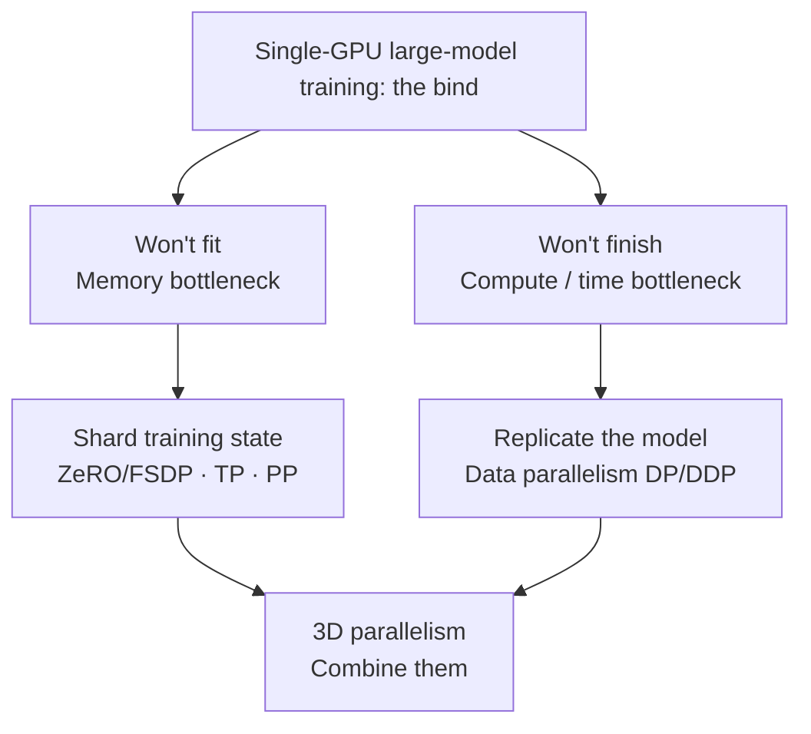
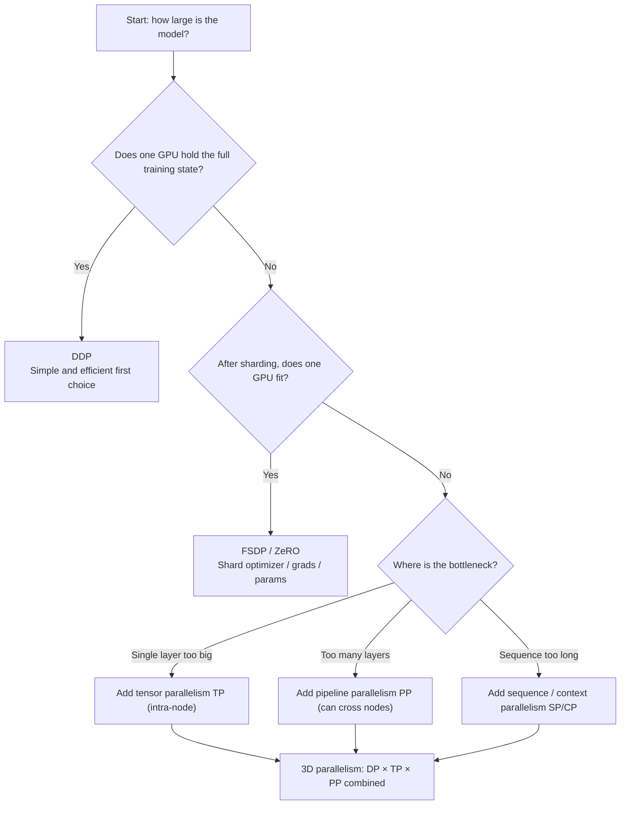

Before diving into DDP, ZeRO, tensor parallelism and the rest, build the mental map first: where a single GPU hits the wall, how much memory training really needs, and what each parallelism strategy is solving. This article hand-calculates the memory ledger with concrete numbers, then surveys the five strategies and the selection principles, so you know what problem every later chapter is tackling.

<!-- more -->

## 📑 Contents

- [1. Why distributed training: won't fit and won't finish](#1-why-distributed-training-wont-fit-and-wont-finish)
- [2. Training memory ledger: calculate it once and it sticks](#2-training-memory-ledger-calculate-it-once-and-it-sticks)
- [3. Five parallelism strategies at a glance](#3-five-parallelism-strategies-at-a-glance)
- [4. How to choose a parallelism strategy](#4-how-to-choose-a-parallelism-strategy)
- [Summary](#-summary)
- [Self-check list](#-self-check-list)
- [References](#-references)

---

## 1. Why distributed training: won't fit and won't finish

Training a neural net is repeatedly doing "forward for loss → backward for gradients → optimizer updates parameters". When the model is small, one GPU holds everything and runs fast enough, so you do not need distributed training. Once the model grows to tens or hundreds of billions of parameters, a single GPU hits the wall on two axes at once.

🔑 **Core concept**: Distributed training never solves one problem; it solves two independent ones: **won't fit in memory** (space) and **won't finish in time** (speed). Seeing that distinction is the premise for understanding every parallelism strategy.

An analogy: training a large model on one GPU is like asking one person to sort a whole library with a tiny desk. **The desk is too small to spread the books** (not enough memory), and **one person would never finish the move** (not enough compute). The two problems need different fixes: the first means "split across several desks", the second means "call more people to help move".

### 1.1 Won't fit: the memory bottleneck

A common intuition is "parameters take as much memory as their count suggests". That underestimates badly. Training memory is far more than the parameters alone (next section does the math). Roughly, under BF16 mixed precision + Adam, **each parameter needs about 16–18 bytes of static memory**. Estimate with the LLaMA family (static memory only, activations excluded for now):

| 📊 Model scale | Parameters $\Psi$ | Static memory $\approx 16\Psi$ | Fits on one H100 80GB? |
|------------|--------------|--------------------------|--------------------------|
| LLaMA 7B | $7 \times 10^9$ | $\approx 112$ GB | ❌ No |
| LLaMA 70B | $70 \times 10^9$ | $\approx 1120$ GB | ❌ Far beyond |
| LLaMA 405B | $405 \times 10^9$ | $\approx 6480$ GB | ❌ Needs dozens of GPUs |

⚠️ **Note**: Even the "small" 7B model needs about 112 GB of static memory alone, **already past a single H100's 80 GB**, and that is before activations piled up in the forward pass. That is the first driver: **model scale exceeds single-GPU memory**.

### 1.2 Won't finish: the compute and time bottleneck

Even with infinite memory, one GPU still hits "too slow". Large-model training compute has a widely cited rule of thumb ($C$ is total FLOPs, $\Psi$ is parameter count, $D$ is training tokens):

$$
C \approx 6 \Psi D
$$

The "6" comes from roughly 2× parameters of multiply-adds in the forward pass and about 4× in the backward. Plug in a 70B model trained on 1T ($10^{12}$) tokens:

$$
C \approx 6 \times (70 \times 10^9) \times 10^{12} = 4.2 \times 10^{23} \text{ FLOPs}
$$

A single H100 peaks around $10^{15}$ FLOP/s in BF16. Optimistically assume 50\% effective utilization (MFU):

$$
T = \frac{4.2 \times 10^{23}}{10^{15} \times 0.5} \approx 8.4 \times 10^8 \text{ seconds} \approx 26.6 \text{ years}
$$

💡 **Tip**: Training 70B on one GPU takes more than twenty years; by the time it finishes, architectures will have turned over several times. With $N$-GPU data parallelism you can in theory cut time near $1/N$; 1024 GPUs brings it to about 9 days. That is the second driver: **single-GPU compute cannot finish training in acceptable time**.

📌 **Key point**: The two bottlenecks need different directions. "Won't fit" is fixed by **sharding state** (split one thing across GPUs). "Won't finish" is fixed by **replicated parallelism** (each GPU does its own share of work). Later strategies fall on one of these two lines.

## 2. Training memory ledger: calculate it once and it sticks

This is the focus of the chapter. We break "how much memory does training actually eat" into items and hand-calculate a 7B model, so you can estimate any scale later with confidence.

Training memory splits into **static memory** (independent of step, always resident) and **activation memory** (varies with batch / sequence length).

### 2.1 Four components of static memory

Take the mainstream case: **BF16 mixed precision + Adam**. Let the parameter count be $\Psi$. Item by item (unit: Bytes):

| Component | Precision | Bytes per param | Notes |
|------|------|-----------|------|
| Model parameters | BF16 | $2\Psi$ | Working copy for forward/backward |
| Gradients | BF16 | $2\Psi$ | Produced by backward; same shape as parameters |
| Optimizer: FP32 parameter copy | FP32 | $4\Psi$ | High-precision master weights Adam keeps |
| Optimizer: first moment $m$ | FP32 | $4\Psi$ | Exponential moving average of gradients |
| Optimizer: second moment $v$ | FP32 | $4\Psi$ | Exponential moving average of squared gradients |

Add the three optimizer rows and you get Adam's well-known $12\Psi$. Total static memory:

$$
M\_{\text{static}} = \underbrace{2\Psi}\_{\text{params}} + \underbrace{2\Psi}\_{\text{grads}} + \underbrace{12\Psi}\_{\text{Adam state}} = 16\Psi \text{ Bytes}
$$

🔑 **Core concept**: The bulk of training memory is **optimizer state** ($12\Psi$, 12 out of the 16), not the parameters themselves. That is why ZeRO's first cut is the optimizer state: it is the highest-leverage place to start.

⚠️ **Note**: Many sources write "16–18 bytes per parameter". The 16–20 swing comes from implementation details (whether you keep an extra FP32 gradient copy, whether you accumulate master gradients in FP32, and so on). This article uses the classic BF16 mixed-precision setup and sticks with $16\Psi$.

### 2.2 Hand-calculate static memory for a 7B model

Plug in $\Psi = 7 \times 10^9$:

$$
M\_{\text{static}} = 16 \times 7 \times 10^9 = 1.12 \times 10^{11} \text{ Bytes} \approx 112 \text{ GB}
$$

Item by item is clearer:

- Parameters: $2 \times 7\text{B} = 14$ GB
- Gradients: $2 \times 7\text{B} = 14$ GB
- Optimizer state: $12 \times 7\text{B} = 84$ GB
- **Total ≈ 112 GB**

An H100 has only 80 GB. **Static memory alone already does not fit.**

### 2.3 Don't forget activations

Activations are intermediate results kept from the forward pass for the backward. They grow **linearly / superlinearly with batch size $b$ and sequence length $s$**, and they are the real "memory assassin" in long-sequence, large-batch training.

For a Transformer, single-layer activation scale is roughly proportional to $b \cdot s \cdot h$ ($h$ is hidden dim); the full model multiplies by layer count $L$. Exact formulas involve attention intermediates, whether Activation Checkpointing is on, and so on. Here you only need the intuition:

📌 **Key point**: Static memory depends only on parameter count; it is a "fixed cost". Activations depend on $b$ and $s$; they are an "adjustable cost". When you OOM, think first about shrinking batch, enabling gradient accumulation, or Activation Checkpointing to cut activations. Those are Chapter 8's topics.

### 2.4 Memory estimate cheat sheet

| 📊 Item | Formula (Bytes) | Depends on |
|---------|--------------|--------|
| Parameters | $2\Psi$ | Parameter count |
| Gradients | $2\Psi$ | Parameter count |
| Adam state | $12\Psi$ | Parameter count |
| **Static total** | $\mathbf{16\Psi}$ | Parameter count |
| Activations | $\propto b \cdot s \cdot h \cdot L$ | batch / sequence / width-depth |

Remember this table and you can estimate a training-memory floor for any parameter count in about 30 seconds.

## 3. Five parallelism strategies at a glance

Once you know where the bottlenecks are and where memory goes, survey the five mainstream strategies. Each one answers two questions: **what do you shard** (does it save memory?) and **how do you communicate** (is it fast?).

| Strategy | ✂️ What it shards | 📡 Main communication | 🎯 Problem it solves |
|------|----------|-----------|--------------|
| Data parallelism DP/DDP | Shards data, not the model | Gradient AllReduce | Won't finish (speedup) |
| ZeRO / FSDP | Shards optimizer / grads / params | ReduceScatter + AllGather | Won't fit (save memory) |
| Tensor parallelism TP | Shards a layer's matrix ops | Intra-layer AllReduce | A single layer is too big |
| Pipeline parallelism PP | Shards network layers (by depth) | Activations between stages (P2P) | Too many layers |
| Sequence parallelism SP / context parallelism CP | Shards along the sequence dim | Sequence-dim AllGather / All-to-All | Sequence too long |

Build intuition one by one:

- **Data parallelism (DP/DDP)**: Each GPU holds a full model, computes on its data shard, and AllReduces gradients on the backward. It **does not save memory** (every GPU still holds the full model), but it can speed up near-linearly. Main attack: "won't finish".
- **ZeRO / FSDP**: The "memory-optimized edition" of DDP. Since every GPU stores identical optimizer state / gradients / parameters, shard the storage and AllGather when needed. Main attack: "won't fit".
- **Tensor parallelism (TP)**: Split one layer's weight matrix (e.g. a large Linear) by row/column across GPUs; each computes a piece then merges. Communication is frequent and heavy, so it **only fits intra-node NVLink**. Solves "a single layer is too big".
- **Pipeline parallelism (PP)**: Cut the model into stages by layer; put each stage on one machine or group; activations flow between stages like a pipeline. Communication volume is small (activations only), so it **can cross nodes**. Solves "too many layers".
- **Sequence parallelism / context parallelism (SP/CP)**: Shard along sequence length so ultra-long context (e.g. 128K) can fit. Solves "sequence too long".

## 4. How to choose a parallelism strategy

With the panorama in hand, how do you choose? One sentence: **communication bandwidth sets a strategy's scope**.

### 4.1 Bandwidth decides "intra-node only" vs "can cross nodes"

Interconnect bandwidths differ by an order of magnitude, which directly decides where communication-heavy strategies can live:

| Interconnect | Bandwidth order | Fits which strategies |
|------|---------|---------|
| NVLink / NVSwitch (intra-node) | Hundreds of GB/s (e.g. NVLink 900 GB/s) | TP (most frequent communication; must stay intra-node) |
| InfiniBand / RoCE (inter-node) | Hundreds of Gbps (e.g. 400 Gbps ≈ 50 GB/s) | PP, DP (sparse communication; can cross nodes) |
| Ethernet | Lower | Only low-frequency communication like DP is barely usable |

📌 **Key point**: TP does an AllReduce every layer on forward and backward. Put it on inter-node bandwidth and communication will choke it, so **TP is almost always limited to 8 GPUs inside one node**. PP only ships activations at stage boundaries; DP syncs gradients once per step. Both can cross nodes. That is the foundation of 3D-parallelism layout.

### 4.2 A practical decision tree

✅ **Recommended path**: Start from the simplest scheme that works, then add dimensions when it does not. Fits on one GPU → DDP. Does not fit → FSDP/ZeRO first. Still not enough → stack TP/PP/CP by bottleneck. Hundred-billion scale is when you need full 3D parallelism.

❌ **Not recommended**: Jumping straight into 3D parallelism. Every extra parallel dimension raises debug complexity and communication cost a lot; early optimization rarely pays off.

## 📝 Summary

- Distributed training solves two independent problems: memory "won't fit" (shard state) and time "won't finish" (replicated parallelism).
- Training static memory $= 16\Psi$ Bytes (params $2\Psi$ + grads $2\Psi$ + Adam state $12\Psi$); the bulk is optimizer state. A 7B model needs about 112 GB static alone, past a single H100.
- Activations grow with batch / sequence length; they are the adjustable cost. On OOM, cut here first (smaller batch, gradient accumulation, Activation Checkpointing).
- The five strategies divide labor: DP/DDP buys time, ZeRO/FSDP saves memory, TP shards a layer, PP shards depth, SP/CP shards sequence.
- Selection hinges on "bandwidth sets scope": TP must stay on intra-node NVLink; PP/DP can cross nodes. Follow the "good enough, then add a dimension" decision tree up to 3D parallelism.

## 🎯 Self-check list

- Can state in one sentence the two independent problems distributed training solves, and the direction of the fix for each
- Can write out the static-memory components of BF16 + Adam training item by item, and explain why it is $16\Psi$
- Can hand-calculate static memory for a given parameter count and judge whether one GPU fits
- Can estimate total training compute with $C \approx 6\Psi D$ and derive single-GPU wall time
- Can draw the five strategies' "what it shards × how it communicates × what it solves" comparison table
- Can explain why TP must stay intra-node while PP/DP can cross nodes
- Can use the decision tree to pick a parallelism combination from model scale and cluster topology

## 📚 References

- [Scaling Laws for Neural Language Models](https://arxiv.org/abs/2001.08361)
- [LLaMA: Open and Efficient Foundation Language Models](https://arxiv.org/abs/2302.13971)
- [ZeRO: Memory Optimizations Toward Training Trillion Parameter Models](https://arxiv.org/abs/1910.02054)
- [Reducing Activation Recomputation in Large Transformer Models](https://arxiv.org/abs/2205.05198)
- [Megatron-LM: Training Multi-Billion Parameter Language Models Using Model Parallelism](https://arxiv.org/abs/1909.08053)
