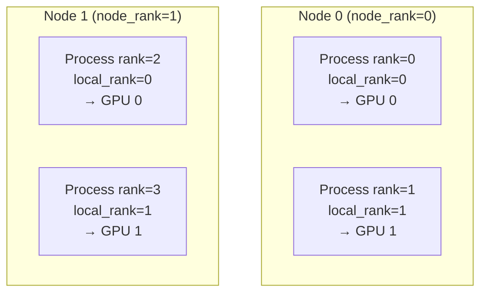
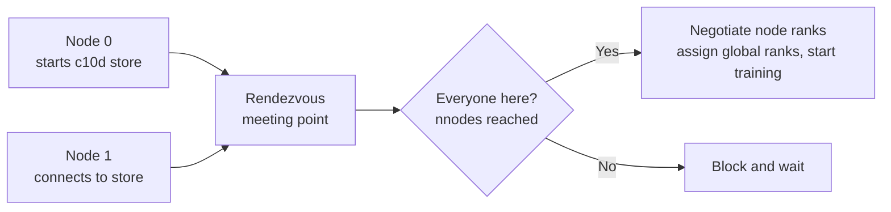
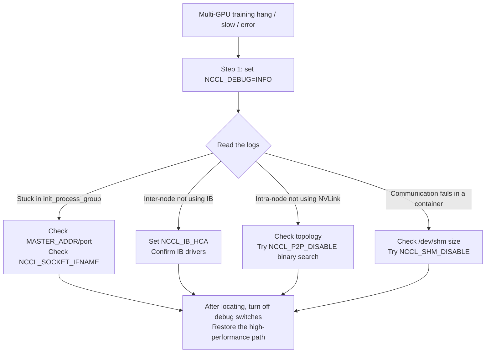
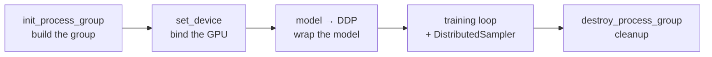

The previous section built the mental map from the memory ledger and the parallelism panorama. This one lands on the engineering foundation: before any parallelism strategy runs, you need the plain facts of how GPUs "form a team" and how one command brings up a pile of processes that know who they are. Starting from the process model, this section digs into rank / local_rank / world_size (concepts that run through every later chapter), explains torchrun's launch and rendezvous, covers NCCL debug environment variables, and assembles a minimal DDP script that actually runs. After reading you can run your first multi-GPU training yourself and understand the runtime every later chapter assumes.

<!-- more -->

## 📑 Contents

- [Part 1: Process groups and core concepts](#part-1-process-groups-and-core-concepts)
  - [1. From one GPU to multi-node: three scales and hardware topology](#1-from-one-gpu-to-multi-node-three-scales-and-hardware-topology)
  - [2. Process model: why "one process per GPU"](#2-process-model-why-one-process-per-gpu)
  - [3. Core concepts: rank / local_rank / world_size](#3-core-concepts-rank--local_rank--world_size)
  - [4. Process group](#4-process-group)
  - [5. Subgroups: paving the way for 3D parallelism](#5-subgroups-paving-the-way-for-3d-parallelism)
- [Part 2: How torchrun launches jobs](#part-2-how-torchrun-launches-jobs)
  - [6. Why you need a dedicated launcher](#6-why-you-need-a-dedicated-launcher)
  - [7. From torch.distributed.launch to torchrun](#7-from-torchdistributedlaunch-to-torchrun)
  - [8. Environment variables torchrun injects](#8-environment-variables-torchrun-injects)
  - [9. Single-node multi-GPU launch](#9-single-node-multi-gpu-launch)
  - [10. Multi-node multi-GPU launch and Rendezvous](#10-multi-node-multi-gpu-launch-and-rendezvous)
  - [11. Elasticity and fault tolerance in torchrun](#11-elasticity-and-fault-tolerance-in-torchrun)
- [Part 3: NCCL environment variables and communication debugging](#part-3-nccl-environment-variables-and-communication-debugging)
  - [12. What NCCL is and why you tune it](#12-what-nccl-is-and-why-you-tune-it)
  - [13. First debugging move: NCCL_DEBUG](#13-first-debugging-move-nccl_debug)
  - [14. Pinning NICs and IB devices](#14-pinning-nics-and-ib-devices)
  - [15. Debug switches: P2P and SHM](#15-debug-switches-p2p-and-shm)
  - [16. CUDA_VISIBLE_DEVICES and device binding](#16-cuda_visible_devices-and-device-binding)
  - [17. A quick troubleshooting flow](#17-a-quick-troubleshooting-flow)
- [Part 4: Write your first multi-GPU training script](#part-4-write-your-first-multi-gpu-training-script)
  - [18. Five-part skeleton of a minimal DDP script](#18-five-part-skeleton-of-a-minimal-ddp-script)
  - [19. Full runnable template](#19-full-runnable-template)
  - [20. Section-by-section breakdown](#20-section-by-section-breakdown)
  - [21. The engineering habit of letting only rank 0 do side work](#21-the-engineering-habit-of-letting-only-rank-0-do-side-work)
  - [22. Common first-run multi-GPU pitfalls](#22-common-first-run-multi-gpu-pitfalls)
- [Summary](#-summary)
- [Self-check list](#-self-check-list)
- [References](#-references)

---

# Part 1: Process groups and core concepts

## 1. From one GPU to multi-node: three scales and hardware topology

Distributed-training hardware usually falls into three tiers. Seeing how they differ tells you why later strategies distinguish "intra-node" from "inter-node".

| 📊 Scale | Typical setup | Interconnect | Typical scenario |
|---------|---------|---------|---------|
| Single-node single-GPU | 1 GPU | — | Debugging, small-model prototypes |
| Single-node multi-GPU | 8 GPUs / node | NVLink / NVSwitch | Mid-size training, tensor parallelism |
| Multi-node multi-GPU | N nodes × 8 GPUs | InfiniBand / RoCE | 10B–100B+ parameter models |

The key idea is **bandwidth layering**: GPUs inside one machine talk over NVLink at hundreds of GB/s; across machines they go over InfiniBand at roughly a fraction to a tenth of that. That gap directly decides which communication-heavy strategies can only live inside a node.

An analogy: coworkers in the same building can walk over and talk face to face (NVLink, intra-node); a cross-city team has to take a video call (InfiniBand, inter-node). Things you can settle in person should not become a remote meeting — that is the basic intuition for parallelism layout.

## 2. Process model: why "one process per GPU"

PyTorch distributed training's recommended model is **one independent OS process per GPU** (one process per GPU). Beginners often ask: why not one process with many threads managing 8 GPUs?

Two reasons:

🔑 **Core concept**: One process per GPU means "use process isolation to bypass Python's concurrency limits and give each GPU its own CUDA context".

- **Bypass the GIL**: Python's Global Interpreter Lock (GIL) stops threads in the same process from truly parallelizing Python bytecode. Drive many GPUs with threads and the scheduling logic gets serialized by the GIL; the GPUs stay underfed. Separate processes each have their own interpreter and do not fight over the lock.
- **Own the CUDA context**: Each process binds one GPU, with a clean CUDA context and memory space. Logic stays clear, processes do not interfere, and a crash only takes down that one process.

📌 **Key point**: Early `DataParallel` (one process, many threads, many GPUs) failed exactly on the GIL and uneven load on the primary GPU. Modern training all moved to "one process per GPU" `DistributedDataParallel`.

## 3. Core concepts: rank / local_rank / world_size

With many processes you need IDs so each knows "who I am, how many of us there are, which GPU I use". Those are the three core concepts.



The figure is a 2-node × 2-GPU example (4 processes). Map the three concepts onto it:

- **`rank` (global rank)**: Unique ID of the process in the whole job, ranging $0 \sim \text{world\_size}-1$. In the figure the four processes are ranks 0, 1, 2, 3. People often use `rank == 0` as the "main process" for logging, saving checkpoints, and so on.
- **`local_rank` (local rank)**: The process's ID **inside its node**. Its main job is **deciding which GPU to bind** — usually `torch.cuda.set_device(local_rank)`. Note the two processes on Node 1: global ranks 2 and 3, but local_rank counts from 0 again.
- **`world_size`**: Total process count in the job; 4 in the example. It equals `nnodes × processes per node`.

💡 **Tip**: Beginners most often confuse this by calling `set_device` with `rank`. On multi-node that goes out of range — `rank=2` on the second machine has no "GPU 2". **GPU binding always uses local_rank, never rank.**

Conversion (processes per node = $G$):

$$
\text{rank} = \text{node\_rank} \times G + \text{local\_rank}
$$

$$
\text{world\_size} = \text{nnodes} \times G
$$

## 4. Process group

IDs alone are not enough. Processes also need an agreed communication channel to send and receive data. That channel is the **process group**. Before any distributed communication, every process must call `init_process_group` to join it.

```python
import os
import torch
import torch.distributed as dist

def setup():
    # torchrun injects these environment variables
    rank = int(os.environ["RANK"])
    local_rank = int(os.environ["LOCAL_RANK"])
    world_size = int(os.environ["WORLD_SIZE"])

    # 1) Bind this process's GPU (use local_rank!)
    torch.cuda.set_device(local_rank)

    # 2) Init the default process group; GPU training uses the nccl backend
    dist.init_process_group(
        backend="nccl",
        rank=rank,
        world_size=world_size,
    )
    return rank, local_rank, world_size

def cleanup():
    dist.destroy_process_group()
```

Two points worth expanding:

**Backend choice**: `backend` picks the underlying communication library. Two common ones:

| 🔧 Backend | Device | Use |
|---------|---------|------|
| `nccl` | GPU | De facto standard for GPU–GPU communication; best performance; default for training |
| `gloo` | CPU (also supports GPU) | CPU tensor communication; debugging when NCCL is inconvenient |

⚠️ **Note**: GPU training almost always picks `nccl`. NCCL is deeply optimized for NVLink / InfiniBand and is what lets later AllReduce and other collectives saturate bandwidth.

**Init blocks until everyone arrives**: `init_process_group` is a sync point — it **waits until all world_size processes reach this line** before returning. If one process never starts (e.g. a machine never ran the command), the others hang here forever. That is one of the most common causes of a "training hang".

## 5. Subgroups: paving the way for 3D parallelism

So far there is only one "default process group" that every process joins. Real large-model training uses several parallelisms at once (data parallelism DP + tensor parallelism TP + pipeline parallelism PP = 3D parallelism), and **each needs its own communication domain**.

Example with 8 GPUs: tensor parallel = 2, data parallel = 4. Then:

- TP groups: every 2 adjacent GPUs form a TP group → `{0,1}`, `{2,3}`, `{4,5}`, `{6,7}`; inside the group they AllReduce to merge matrix shards
- DP groups: GPUs at the same TP position across TP groups form a DP group → `{0,2,4,6}`, `{1,3,5,7}`; inside the group they AllReduce gradients

Subgroups are derived from the global group with `dist.new_group()`:

```python
# 8 GPUs, TP=2, DP=4 subgroup split (simplified sketch)
tp_size, dp_size = 2, 4
rank = dist.get_rank()

# Build the TP group this process belongs to
tp_group_ranks = [
    list(range(i, i + tp_size))
    for i in range(0, tp_size * dp_size, tp_size)
]  # [[0,1],[2,3],[4,5],[6,7]]

tp_group = None
for ranks in tp_group_ranks:
    group = dist.new_group(ranks=ranks)  # every process must make the same new_group calls
    if rank in ranks:
        tp_group = group  # keep only the handle for your own group

# Later TP communication explicitly passes group=tp_group
# dist.all_reduce(tensor, group=tp_group)
```

📌 **Key point**: `new_group` must be called by **every process** (even processes that are not in that group), or you deadlock. Each process ends up holding only the handle for "the subgroup it belongs to", and passes `group=` to say which domain a collective runs in.

This subgroup mechanism is the foundation of Chapter 11 on 3D parallelism. For now the intuition is enough: **the global group is the main stage; subgroups are rehearsal rooms; different parallel dimensions communicate in their own rooms without interfering.**

# Part 2: How torchrun launches jobs

You have a one-process-per-GPU training script. One step remains: how does one command bring all those processes up and tell them who they are? This part covers the evolution from `launch` to `torchrun`, the env vars it injects, and single-node vs multi-node launch plus Rendezvous.

## 6. Why you need a dedicated launcher

Recall: one process per GPU means 8-GPU training starts 8 processes, each needing its `rank`, `local_rank`, `world_size`, and a place to find the "master" for rendezvous.

Doing it by hand means 8 terminals, each with `RANK=0 ... python train.py`, `RANK=1 ... python train.py`, … — tedious on one node and a nightmare across nodes. **A launcher's job is to start those processes in bulk with one command and inject the env vars each process needs.**

An analogy: the launcher is a team lead who calls once and the whole squad lines up by number, instead of you walking around telling each person "you are number 3, report to area B".

## 7. From torch.distributed.launch to torchrun

PyTorch's launcher went through a generation change:

| 🔧 Launcher | Status | Traits |
|-----------|------|------|
| `python -m torch.distributed.launch` | ❌ Deprecated | Old API; passed `--local_rank` on the CLI; no elasticity |
| `torchrun` | ✅ Current recommendation | Env-var injection, built-in Elastic training, auto restart, Rendezvous |

⚠️ **Note**: Old code often has `parser.add_argument("--local_rank")` to receive the flag from launch. After moving to `torchrun`, read `local_rank` from `os.environ["LOCAL_RANK"]` and drop the CLI argument path.

`torchrun` is effectively a console entry for the `torch.distributed.run` module; they are equivalent:

```bash
torchrun --nproc_per_node=8 train.py
# fully equivalent to
python -m torch.distributed.run --nproc_per_node=8 train.py
```

## 8. Environment variables torchrun injects

When `torchrun` starts each child process, it writes a set of key facts into that process's environment. The script only needs to read them; no need to compute them yourself:

| Env var | Meaning | Typical use |
|---------|------|---------|
| `RANK` | Global process ID | `rank` for `dist.init_process_group` |
| `LOCAL_RANK` | In-node process ID | `torch.cuda.set_device(local_rank)` |
| `WORLD_SIZE` | Total process count | Process-group init |
| `LOCAL_WORLD_SIZE` | Processes on this node | Local resource accounting |
| `MASTER_ADDR` | Master IP / hostname | Rendezvous "meeting point" address |
| `MASTER_PORT` | Master port | Rendezvous port (must be free) |

So the standard read in a script is:

```python
import os

rank = int(os.environ["RANK"])
local_rank = int(os.environ["LOCAL_RANK"])
world_size = int(os.environ["WORLD_SIZE"])
```

💡 **Tip**: You usually do not read `MASTER_ADDR` / `MASTER_PORT` yourself in the script — under the default `env://` init method, `init_process_group(backend="nccl")` reads the rendezvous address from those two env vars. `torchrun` already set them for you.

## 9. Single-node multi-GPU launch

Single-node is the simplest case: just say how many processes to start on this machine (usually equal to GPU count):

```bash
torchrun --nproc_per_node=8 train.py --epochs 10 --lr 1e-4
```

- `--nproc_per_node=8`: start 8 processes on this machine, one per GPU
- Arguments after `train.py` are passed through to your script unchanged

Behind that one command, `torchrun` starts 8 `train.py` processes → writes `RANK=0..7`, `LOCAL_RANK=0..7`, `WORLD_SIZE=8` into them → sets `MASTER_ADDR=127.0.0.1` and a free `MASTER_PORT` → lets them rendezvous on this machine.

📌 **Key point**: On single-node multi-GPU, `RANK` and `LOCAL_RANK` happen to be equal (only one node), so either "looks right" during single-node debugging. Once you go multi-node the equality breaks — which is why the earlier sections keep stressing that `set_device` must use `local_rank`.

## 10. Multi-node multi-GPU launch and Rendezvous

Multi-node is where the launcher is really tested. The core question: how do processes on different machines find each other and confirm "everyone is here" before training starts? That meeting is **Rendezvous**.

An analogy: multi-node rendezvous is like a group agreeing to meet at a train station — you need a clear meeting point (who is master, which address and port), count heads when everyone arrives, then leave together.

Every machine runs one `torchrun` command. With c10d elastic rendezvous the commands are almost identical across nodes; rendezvous negotiates node ranks automatically:

```bash
# On Node 0 (the machine hosting the rdzv endpoint; IP assumed 192.168.1.1):
torchrun \
    --nnodes=2 \
    --nproc_per_node=8 \
    --rdzv_id=my_job \
    --rdzv_backend=c10d \
    --rdzv_endpoint=192.168.1.1:29400 \
    train.py

# On Node 1 (command identical):
torchrun \
    --nnodes=2 \
    --nproc_per_node=8 \
    --rdzv_id=my_job \
    --rdzv_backend=c10d \
    --rdzv_endpoint=192.168.1.1:29400 \
    train.py
```

Parameter by parameter:

- `--nnodes=2`: 2 nodes total. Final `WORLD_SIZE = nnodes × nproc_per_node = 16`.
- `--rdzv_id=my_job`: unique ID for this job; every node in the same job must use the same value so different trainings stay distinct.
- `--rdzv_backend=c10d`: rendezvous backend; `c10d` is PyTorch's built-in; the endpoint node starts a TCP store for others to connect.
- `--rdzv_endpoint=192.168.1.1:29400`: rendezvous address; **every node fills in the same address**.

💡 **Tip**: With c10d dynamic rendezvous, node ranks are negotiated automatically, so **every node's command is identical and you do not manually set** `--node_rank`. `--node_rank` is only needed for the older static launch (`--master_addr` / `--master_port`); do not mix it with the elastic style.

Full rendezvous flow:



⚠️ **Note**: Older tutorials often use `--master_addr` / `--master_port` as a static alternative to `--rdzv_endpoint`. New code should standardize on `--rdzv_backend=c10d` + `--rdzv_endpoint` elastic style, which also supports dynamic node join and fault-tolerant restart.

## 11. Elasticity and fault tolerance in torchrun

`torchrun`'s biggest advance over old `launch` is built-in **Elastic** training — the base for long, stable large-scale runs:

- **Auto-restart failed processes**: if a process crashes, `torchrun` can bring it back inside the same group (paired with checkpoint resume)
- **Elastic node scaling**: `--nnodes=MIN:MAX` sets a node-count range; some nodes can join or leave mid-run
- **Unified Rendezvous coordination**: after a failure, surviving processes rendezvous again and reassign ranks

```bash
# Elastic training allowing 2 to 4 nodes
torchrun --nnodes=2:4 --nproc_per_node=8 \
    --rdzv_backend=c10d --rdzv_endpoint=192.168.1.1:29400 \
    train.py
```

💡 **Tip**: The full elasticity story (checkpoint resume, frequent hardware faults at large scale) unfolds in Chapter 14 on training fault tolerance and large-scale stability. For this chapter it is enough to know: choosing `torchrun` over old launch, elasticity is one of the important reasons.

# Part 3: NCCL environment variables and communication debugging

When multi-GPU training will not start, hangs, or is absurdly slow, the communication layer is the culprit nine times out of ten. The workhorse behind GPU–GPU communication is NVIDIA's NCCL library, and the first debugging tool is a set of environment variables. This part collects the most-used NCCL env vars and what they do, so a "black-box hang" becomes "logs you can read".

## 12. What NCCL is and why you tune it

NCCL (NVIDIA Collective Communications Library, pronounced "nickel") is NVIDIA's GPU collective library. When you init the process group with `backend="nccl"`, AllReduce, AllGather, and the rest all run through it underneath. It probes hardware topology (NVLink, PCIe, InfiniBand) and picks algorithms and paths automatically.

The catch: NCCL is a "black box" by default. It probes, it chooses, and it prints nothing. Once probing goes wrong (e.g. it picks a NIC with no cable, or walks slow PCIe instead of NVLink), training **hangs or crawls with no error**.

Environment variables are then the only window into what it decided and how to steer it.

🔑 **Core concept**: NCCL env vars split into two kinds — **diagnostic** (make it print internal decisions) and **intervention** (force a path to isolate the fault).

## 13. First debugging move: NCCL_DEBUG

For any multi-GPU communication problem, the first move is always turning on NCCL logs:

```bash
export NCCL_DEBUG=INFO
torchrun --nproc_per_node=8 train.py
```

`NCCL_DEBUG` has several levels:

| Level | Output |
|------|---------|
| `WARN` | Warnings and errors only (default is near this) |
| `INFO` | Topology probe, chosen algorithm, NIC, channels — the main debugging level |
| `TRACE` | Extremely detailed step-by-step trace; only when the bug is very hard to pin down |

With `INFO`, startup logs show lines like:

```text
NCCL INFO NET/IB : Using [0]mlx5_0:1/IB    # which IB NIC it used
NCCL INFO Channel 00 : 0[0] -> 1[1] via NVLink   # GPU–GPU path is NVLink
NCCL INFO Ring 00 : 0 1 2 3 4 5 6 7        # Ring topology connection order
```

💡 **Tip**: Watch three things — (1) whether inter-node traffic uses IB (not fallen back to Ethernet sockets); (2) whether intra-node GPU traffic uses NVLink (not PCIe); (3) whether Ring/Tree topology matches expectations. Those three decide communication bandwidth.

You can also narrow logs with `NCCL_DEBUG_SUBSYS`, e.g. network only:

```bash
export NCCL_DEBUG=INFO
export NCCL_DEBUG_SUBSYS=NET,GRAPH   # only network and topology subsystems
```

## 14. Pinning NICs and IB devices

The highest-frequency multi-node pitfall: the machine has several NICs (management, storage, compute), and NCCL's auto-probe picks the wrong one — e.g. a 1 Gbps management NIC — so cross-node communication is unusably slow or hangs entirely.

Then you pin by hand:

**Pin Ethernet / socket NIC**:

```bash
# Use only the NIC named eth0 (exact match)
export NCCL_SOCKET_IFNAME=eth0

# Also supports prefix match of several, or ^ to exclude
export NCCL_SOCKET_IFNAME=^docker,lo   # exclude docker and loopback
```

**Pin InfiniBand HCA devices**:

```bash
# Pin which IB NICs (HCAs) to use
export NCCL_IB_HCA=mlx5_0,mlx5_1
```

⚠️ **Note**: `NCCL_SOCKET_IFNAME` takes NIC names (e.g. `eth0`, `bond0`); list them with `ip addr`. In containers / cloud, NIC names are wild; excluding loopback `lo` and docker virtual NICs is common. The wrong NIC will hang cross-node init outright.

## 15. Debug switches: P2P and SHM

The next two switches are **not for normal training**. They are **fault-isolation** tools — force a communication path off, see if the problem vanishes, and locate which layer is broken.

**NCCL_P2P_DISABLE**: disable GPU peer-to-peer (P2P) direct links (NVLink, PCIe P2P) and force host (shared) memory as a bounce buffer.

```bash
export NCCL_P2P_DISABLE=1
```

If training recovers after disabling P2P, the fault may sit in the NVLink/PCIe P2P path or the driver.

**NCCL_SHM_DISABLE**: disable intra-node communication through shared memory (`/dev/shm`) and force the network path.

```bash
export NCCL_SHM_DISABLE=1
```

Often used when `/dev/shm` is too small — containers frequently default `/dev/shm` to 64 MB, which can break multi-GPU communication.

📌 **Key point**: Use these switches as "binary-search debugging" — if the problem disappears after enabling one, you locked the failing layer; after you find it, **turn them off**, because both hurt performance badly (disabling P2P/SHM = giving up the fastest paths).

| ✅ Use | ❌ Misuse |
|---------|---------|
| Temporarily isolate a bad link | Leave them on as a "performance tweak" |
| Emergency workaround for tiny `/dev/shm` in containers | Forget to turn them off and run forever on the slow path |

## 16. CUDA_VISIBLE_DEVICES and device binding

`CUDA_VISIBLE_DEVICES` is not NCCL-specific, but it interacts tightly with multi-GPU binding and beginners trip over it constantly. It controls **which GPUs the current process can "see", and how they are renumbered**.

The key is **remapping**: after you set it, visible GPUs renumber from 0.

```bash
# Process only sees physical GPUs 2 and 3
export CUDA_VISIBLE_DEVICES=2,3
```

Then in the program:

- `torch.cuda.device_count()` returns **2** (not the system total)
- `cuda:0` actually points at **physical GPU 2**, `cuda:1` at physical GPU 3

⚠️ **Note**: That interacts subtly with `local_rank`. `torchrun` gives processes `local_rank` 0, 1, 2, …, and `set_device(local_rank)` picks "the Nth visible GPU". So:

- If you **do not set** `CUDA_VISIBLE_DEVICES` (recommended), `local_rank` maps straight to physical GPU IDs — simplest.
- If you set `CUDA_VISIBLE_DEVICES=2,3` and run `--nproc_per_node=2`, then `local_rank=0` lands on physical 2 and `local_rank=1` on physical 3 — the correct way to train on a subset of GPUs.

💡 **Tip**: A common mistake is setting `CUDA_VISIBLE_DEVICES` and also hard-coding `cuda:2` in the script, which goes out of range (visible indices have no 2). Best practice: **either use `CUDA_VISIBLE_DEVICES` to bound visibility + `set_device(local_rank)`, or leave everything to torchrun; do not mix in manual device IDs.**

## 17. A quick troubleshooting flow

String the tools above into a practical flow:



Remember one main line: **first use `NCCL_DEBUG=INFO` to see what NCCL decided, then binary-search with intervention switches, and after you locate the fault restore defaults for performance.**

# Part 4: Write your first multi-GPU training script

Concepts done; time to assemble process groups, torchrun, and NCCL into a multi-GPU training script that actually runs. This part gives a minimal runnable DDP template, walks its skeleton line by line, covers the "only rank 0 does side work" habit, and lists the pitfalls first multi-GPU runs hit most often.

## 18. Five-part skeleton of a minimal DDP script

Strip the business logic from any DDP training script and you get the same skeleton. Remember this "five-part" shape and you can spot the spine of even complicated training code at a glance:

📥 **init** (build the process group) → ⚙️ **set_device** (bind the GPU) → 🧩 **wrap with DDP** (wrap the model) → 🔁 **training loop** (with Sampler) → 📤 **destroy** (tear down)



Every process walks all five steps — that is "one process per GPU" in action: 8 GPUs means 8 processes each running the same script, differing only in the `rank` / `local_rank` they read.

## 19. Full runnable template

A minimal complete example trained on synthetic data. Run it with `torchrun --nproc_per_node=<GPU count> ddp_demo.py`:

```python
# ddp_demo.py
import os
import torch
import torch.nn as nn
import torch.distributed as dist
from torch.nn.parallel import DistributedDataParallel as DDP
from torch.utils.data import DataLoader, TensorDataset
from torch.utils.data.distributed import DistributedSampler


def setup():
    rank = int(os.environ["RANK"])
    local_rank = int(os.environ["LOCAL_RANK"])
    world_size = int(os.environ["WORLD_SIZE"])
    torch.cuda.set_device(local_rank)          # bind GPU: use local_rank!
    dist.init_process_group(backend="nccl")    # env:// reads rendezvous info from env vars by default
    return rank, local_rank, world_size


def cleanup():
    dist.destroy_process_group()


def is_main_process():
    return dist.get_rank() == 0


def main():
    rank, local_rank, world_size = setup()
    device = torch.device(f"cuda:{local_rank}")

    # ---- Build a synthetic dataset ----
    x = torch.randn(2048, 128)
    y = torch.randint(0, 10, (2048,))
    dataset = TensorDataset(x, y)
    sampler = DistributedSampler(dataset, num_replicas=world_size, rank=rank, shuffle=True)
    loader = DataLoader(dataset, batch_size=32, sampler=sampler)

    # ---- Model → move to this process's GPU → wrap with DDP ----
    model = nn.Sequential(nn.Linear(128, 256), nn.ReLU(), nn.Linear(256, 10)).to(device)
    model = DDP(model, device_ids=[local_rank])

    optimizer = torch.optim.AdamW(model.parameters(), lr=1e-3)
    criterion = nn.CrossEntropyLoss()

    # ---- Training loop ----
    for epoch in range(5):
        sampler.set_epoch(epoch)               # critical: reset seed each epoch so shuffle stays correct
        model.train()
        for xb, yb in loader:
            xb, yb = xb.to(device), yb.to(device)
            optimizer.zero_grad()
            loss = criterion(model(xb), yb)
            loss.backward()                    # DDP AllReduces gradients here automatically
            optimizer.step()

        if is_main_process():                  # only main process prints
            print(f"[epoch {epoch}] loss = {loss.item():.4f}")

    # ---- Only main process saves the model ----
    if is_main_process():
        torch.save(model.module.state_dict(), "model.pt")  # note .module

    cleanup()


if __name__ == "__main__":
    main()
```

Launch:

```bash
torchrun --nproc_per_node=4 ddp_demo.py
```

## 20. Section-by-section breakdown

**① setup — order of building the group and binding the GPU**

```python
torch.cuda.set_device(local_rank)        # bind GPU first
dist.init_process_group(backend="nccl")  # then build the group
```

⚠️ **Note**: `set_device` before `init_process_group` is the recommended order. NCCL init uses the "current GPU" for some device setup; without binding first, several processes may all default to GPU 0 and blow memory or break communication.

**② Wrapping with DDP**

```python
model = model.to(device)                 # must move to this process's GPU first
model = DDP(model, device_ids=[local_rank])
```

`DDP` wrapping does two things: at init it **broadcasts** rank 0's parameters to every process (so initial weights match), and on backward it installs hooks that **AllReduce** gradients automatically. So the code never shows manual communication — gradient sync hides behind `loss.backward()`.

📌 **Key point**: Always `.to(device)` before `DDP(...)`. Wrapping on CPU then moving to GPU will fail.

**③ DistributedSampler — keep per-GPU data non-overlapping**

DDP's semantics are "each GPU runs a different data shard, then syncs gradients". If every GPU reads the same batches, you waste compute. `DistributedSampler` splits the dataset into `world_size` non-overlapping pieces by `rank`.

💡 **Tip**: Once you use `DistributedSampler`, do not also set `shuffle=True` on the `DataLoader` (the sampler already owns shuffling), or you get a conflict error.

## 21. The engineering habit of letting only rank 0 do side work

Since every process runs the same code, logging, checkpointing, and TensorBoard writes without a guard run `world_size` times — 8 GPUs print 8 copies of every log, and 8 processes writing one checkpoint file will corrupt it.

The habit is to guard these "side-effect ops" with `rank == 0`:

```python
def is_main_process():
    return dist.get_rank() == 0

if is_main_process():
    print(...)                 # log once
    torch.save(model.module.state_dict(), path)   # checkpoint once
    writer.add_scalar(...)     # TensorBoard once
```

Two details:

- **Save with `model.module`**: DDP wraps the original model under `.module`. Saving `model.state_dict()` keeps a `module.` prefix; single-GPU load then misses keys. `model.module.state_dict()` is the clean original weights.
- **Do not skip `set_epoch(epoch)`**: `DistributedSampler` shuffle depends on a random seed; by default every epoch uses the same seed — so every epoch sees the same data split and shuffle is a no-op. Call `sampler.set_epoch(epoch)` at the start of each epoch so the seed changes. This is an extremely common silent bug.

| ✅ Recommended | ❌ Common mistake |
|-------------|------------|
| `torch.save(model.module.state_dict())` | `torch.save(model.state_dict())` (keeps `module.` prefix) |
| Call `sampler.set_epoch(epoch)` every epoch | Forget it; every epoch sees the same order |
| Guard logs/saves with `rank==0` | No guard; 8 GPUs spam 8× and corrupt files |

## 22. Common first-run multi-GPU pitfalls

The first multi-GPU run will likely hit several classics below. Knowing them saves hours of frustration:

**Pitfall 1: port in use / Address already in use**

```text
RuntimeError: Address already in use
```

A previous training process did not exit cleanly and still holds the port. Fix: switch `MASTER_PORT`, or `torchrun --rdzv_endpoint=host:new_port`, or `pkill -f train.py` to clear leftovers.

**Pitfall 2: hang in init_process_group (most common)**

No output after launch; permanent hang. Almost always a rendezvous problem:

- Multi-node: wrong `MASTER_ADDR`, or the master port blocked by a firewall
- A process/node never started — `init_process_group` waits forever for `world_size` arrivals
- Wrong NIC (see Part 3): `export NCCL_SOCKET_IFNAME` to the correct NIC

⚠️ **Note**: On a hang, the first reflex is always `export NCCL_DEBUG=INFO` and rerun to see where it stuck.

**Pitfall 3: every process piles onto GPU 0 / OOM**

Forgot `torch.cuda.set_device(local_rank)`, or `.to(device)` hard-coded `cuda:0`. All 8 processes dump model and data onto GPU 0 and blow memory instantly. Check every `to(device)` and `device_ids` uses `local_rank`.

**Pitfall 4: per-GPU losses disagree / model does not converge**

Usually data sharding or gradient sync never took effect: forgot `DistributedSampler` (GPUs run duplicate data), forgot `set_epoch`, or the model has parameters unused in `forward` and DDP raises "unused parameters" (you can set `find_unused_parameters=True`, but prefer fixing the model structure).

**Pitfall 5: NCCL version / driver mismatch**

`NCCL error` or `unhandled cuda error`. Often a mismatched environment: confirm the NCCL bundled with PyTorch matches the CUDA driver; in containers also check `/dev/shm` is large enough (raise `--shm-size`).

## 📝 Summary

**Processes and concepts**

- Distributed training has three tiers — single-GPU, single-node multi-GPU, multi-node multi-GPU. Intra-node (NVLink) vs inter-node (InfiniBand) bandwidth differs by about an order of magnitude; that is the fundamental layout constraint.
- PyTorch uses "one process per GPU" to bypass the GIL and give each GPU its own CUDA context.
- `rank` is the global ID; `local_rank` decides which GPU to bind (on multi-node never `set_device` with rank); `world_size` is total process count.
- `init_process_group` builds the default communication group; GPU training uses the `nccl` backend. It is a sync barrier — missing processes hang. Complex parallelism derives subgroups with `new_group`; that is the foundation of 3D parallelism.

**Launch and debugging**

- A launcher starts processes in bulk and injects env vars; `torch.distributed.launch` is deprecated — use `torchrun`. Single-node multi-GPU only needs `--nproc_per_node`; multi-node uses c10d elastic rendezvous with identical commands per machine (same `--rdzv_id` and `--rdzv_endpoint`); node ranks come from Rendezvous.
- NCCL is the GPU collective backend and a black box by default. `NCCL_DEBUG=INFO` is the first debugging move; `NCCL_SOCKET_IFNAME` / `NCCL_IB_HCA` pin NICs; `NCCL_P2P_DISABLE` / `NCCL_SHM_DISABLE` are binary-search switches — turn them off after use; `CUDA_VISIBLE_DEVICES` remaps GPU IDs — do not mix with hard-coded device numbers.

**Hands-on**

- A DDP script's generic skeleton is five parts: init → set_device → wrap with DDP → training loop (with Sampler) → destroy.
- `set_device(local_rank)` before `init_process_group`; `.to(device)` before `DDP(...)`; `loss.backward()` triggers DDP's automatic gradient AllReduce.
- Use `DistributedSampler` so GPU data does not overlap, and **call `set_epoch` every epoch**; save with `model.module.state_dict()`; guard logs/saves with `rank==0`.
- First-run hotspot pitfalls: port in use, init hang (open `NCCL_DEBUG=INFO` first), processes piled on one GPU, forgotten Sampler/`set_epoch`, NCCL/driver mismatch.

## 🎯 Self-check list

- Can state the two advantages of "one process per GPU" over one process with many threads (GIL, CUDA context)
- Can accurately distinguish rank, local_rank, world_size, and explain why `set_device` must use local_rank
- Can write the conversion `rank = node_rank × G + local_rank`
- Can state when to use nccl vs gloo, and explain why `init_process_group` can hang training
- Can describe how subgroups are split for 8 GPUs with TP=2 / DP=4, and why every process must call `new_group`
- Can write torchrun commands for 8 GPUs on one node and 16 GPUs on 2 nodes, and explain why c10d elastic rendezvous lets every machine use the same command
- Can explain what problem Rendezvous solves, and torchrun's core advantages over deprecated launch
- Can name the first action on a multi-GPU communication problem (turn on `NCCL_DEBUG=INFO`) and what to look for in the logs
- Can explain that `NCCL_P2P_DISABLE` / `NCCL_SHM_DISABLE` are diagnostic tools, not optimizations, and must be turned off after use
- Can explain how `CUDA_VISIBLE_DEVICES` remaps GPU IDs and how that relates to `local_rank`
- Can recite the five-part DDP skeleton from memory and independently write and run a minimal DDP script with torchrun
- Can explain why `set_device` must precede `init_process_group` and `.to(device)` must precede DDP wrapping
- Can explain the roles of `DistributedSampler` + `set_epoch`, and why saving uses `model.module.state_dict()`
- Can list at least 3 common first-run multi-GPU pitfalls and the corresponding debugging moves

## 📚 References

- [PyTorch Distributed Overview](https://pytorch.org/tutorials/beginner/dist_overview.html)
- [PyTorch torch.distributed API](https://pytorch.org/docs/stable/distributed.html)
- [Writing Distributed Applications with PyTorch](https://pytorch.org/tutorials/intermediate/dist_tuto.html)
- [torchrun (Elastic Launch) official docs](https://pytorch.org/docs/stable/elastic/run.html)
- [Torch Distributed Elastic Quickstart](https://pytorch.org/docs/stable/elastic/quickstart.html)
- [Rendezvous mechanism notes](https://pytorch.org/docs/stable/elastic/rendezvous.html)
- [PyTorch DDP official tutorial](https://pytorch.org/tutorials/intermediate/ddp_tutorial.html)
- [DistributedSampler API](https://pytorch.org/docs/stable/data.html#torch.utils.data.distributed.DistributedSampler)
- [DistributedDataParallel API](https://pytorch.org/docs/stable/generated/torch.nn.parallel.DistributedDataParallel.html)
- [NCCL Environment Variables official docs](https://docs.nvidia.com/deeplearning/nccl/user-guide/docs/env.html)
- [NCCL Troubleshooting Guide](https://docs.nvidia.com/deeplearning/nccl/user-guide/docs/troubleshooting.html)
- [NVIDIA Collective Communications Library (NCCL)](https://docs.nvidia.com/deeplearning/nccl/user-guide/docs/index.html)
