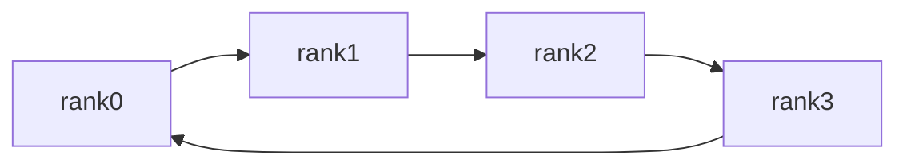

Every parallelism strategy boils down to the same thing: how GPUs exchange data efficiently. DDP syncs gradients with AllReduce, ZeRO uses ReduceScatter, TP uses AllReduce, MoE uses All-to-All. This "communication alphabet" shows up in every later chapter. This article lays them out once: the "input → output" semantics of each primitive, why Ring AllReduce moves a volume independent of GPU count, and how to quantify the cost of any communication.

<!-- more -->

## 📑 Contents

- [1. Why cover communication primitives on their own](#1-why-cover-communication-primitives-on-their-own)
- [2. Point-to-point communication: the foundation of everything](#2-point-to-point-communication-the-foundation-of-everything)
- [3. Collective primitives in detail](#3-collective-primitives-in-detail)
- [4. How Ring AllReduce works](#4-how-ring-allreduce-works)
- [5. How to quantify communication volume](#5-how-to-quantify-communication-volume)
- [6. Hands-on labs](#6-hands-on-labs)
- [Summary](#-summary)
- [Self-check list](#-self-check-list)
- [References](#-references)

---

## 1. Why cover communication primitives on their own

Parallel training compresses to one formula: **parallelism = sharding + communication**. Sharding decides how you save memory and split load; after the split, each GPU only holds a "half-finished" piece and must communicate to assemble the correct result.

🔑 **Core concept**: Sharding decides memory; communication decides speed. Whether a parallelism strategy is fast often depends less on how it shards and more on how much data each step moves and which network it rides. That is what the primitives answer.

An analogy: communication primitives are a team's set plays (cross, back-pass, one-two). Players (GPUs) handle their own patches most of the time, but at key moments they must move the ball (data) on a fixed pattern. Once you know those plays, any formation (parallelism strategy) immediately shows how the ball flows.

Start with a panorama table so you build the "which strategy uses which primitive" intuition before the details:

| 📡 Primitive | Parallelism strategies that typically use it |
|------------|---------------------|
| AllReduce | DDP gradient sync, TP output merge |
| ReduceScatter | ZeRO-2/3, FSDP backward |
| AllGather | ZeRO-3 forward, FSDP parameter reassembly |
| All-to-All | MoE expert parallelism, Ulysses sequence parallelism |
| Broadcast | Sync parameters at init |
| send / recv | Pipeline parallelism shipping activations |

⚠️ **Note**: Communication runs on different hardware tiers, with bandwidth differing by an order of magnitude. Intra-node NVLink can hit hundreds of GB/s; inter-node InfiniBand is about 50 GB/s; PCIe is lower still. **The same AllReduce can take about 10× longer across nodes than inside a node.** That physical fact roots every later "where does this strategy live" decision.

## 2. Point-to-point communication: the foundation of everything

However fancy collectives get, underneath they are built from the plain act of "two processes sending and receiving data". That is point-to-point communication (P2P).

- `send(tensor, dst)`: send a tensor to the destination rank
- `recv(tensor, src)`: receive a tensor from the source rank

Pipeline parallelism (PP) stages pass activations with exactly this.

P2P comes in sync and async forms, and here sits a classic deadlock trap:

```python
import torch.distributed as dist

# ❌ Dangerous: both processes send first then recv; can deadlock
# rank 0 and rank 1 both stick in send waiting for the other to recv
dist.send(tensor, dst=peer)
dist.recv(tensor, src=peer)
```

⚠️ **Note**: If both processes use blocking `send` first-then-recv, and the underlying buffer cannot hold the message, both stick in `send` waiting for the other to `recv`. That is a **deadlock**.

✅ Two fixes:

```python
# Option A: stagger order — one side send-then-recv, the other recv-then-send
if rank == 0:
    dist.send(tensor, dst=1)
    dist.recv(tensor, src=1)
else:
    dist.recv(tensor, src=0)
    dist.send(tensor, dst=0)

# Option B: async isend / irecv; issue both, then wait
reqs = [dist.isend(send_buf, dst=peer), dist.irecv(recv_buf, src=peer)]
for r in reqs:
    r.wait()
```

📌 **Key point**: Real frameworks prefer `dist.batch_isend_irecv()` to submit a batch of send/recv requests at once and let the backend schedule them. That avoids deadlock and overlaps communication. PP implementations lean heavily on this async batch pattern.

## 3. Collective primitives in detail

Collective communication is a **fixed-semantics data exchange that a group of processes join together**. Below, each primitive gets "input → output" semantics and typical uses. Notation: $N$ ranks; each rank's data block is labeled by its content.

### 3.1 Broadcast: copy one piece of data to everyone

One root rank holds the data; every rank gets a copy.


Concrete numbers make it clearer. Root rank (GPU0) holds $[1,2,3]$; the others are empty. After Broadcast every GPU has the same copy:

```
Before:              After Broadcast:
GPU0: [1,2,3]        GPU0: [1,2,3]
GPU1: [ ]            GPU1: [1,2,3]
GPU2: [ ]            GPU2: [1,2,3]
GPU3: [ ]            GPU3: [1,2,3]
```

**Typical use**: At training start, broadcast rank 0's initial parameters to every process so all GPUs start from the same weights (DDP init does exactly this).

### 3.2 Scatter / Gather: distribute and collect

- **Scatter**: Root rank splits a large tensor into $N$ pieces and sends piece $i$ to rank $i$ (distribute)
- **Gather**: Each rank hands its data to the root, which concatenates the full tensor (collect; inverse of Scatter)

With 4 GPUs, root (GPU0) holds a length-4 tensor. Scatter splits it piece by piece; Gather pulls every GPU's data back to the root:

```
Scatter (GPU0 distributes):   Gather (collect back to GPU0):
Before         After          Before       After
GPU0:[a,b,c,d] GPU0:[a]       GPU0:[a]     GPU0:[a,b,c,d]
GPU1:[ ]       GPU1:[b]       GPU1:[b]     GPU1:[b]
GPU2:[ ]       GPU2:[c]       GPU2:[c]     GPU2:[c]
GPU3:[ ]       GPU3:[d]       GPU3:[d]     GPU3:[d]
```

Note the difference from Broadcast: Broadcast copies the **same full data** to every GPU; Scatter **cuts and distributes**, so each GPU gets only one segment.

**Typical use**: Early DataParallel used Scatter to hand out mini-batches and Gather to collect outputs; today it shows up more in data-preprocessing sharding.

### 3.3 Reduce: reduce onto one rank

Every rank's data is reduced by some op (sum, max, …); the result lands only on the root rank.

$$
\text{rank}\_{\text{root}} \leftarrow \sum\_{i=0}^{N-1} x\_i
$$

On vectors: 4 GPUs each hold a length-3 vector. After Reduce(sum), only the root (GPU0) gets the element-wise sum; the others stay unchanged:

```
Before:              Reduce(sum) onto GPU0:
GPU0: [1,2,3]        GPU0: [10,20,30]
GPU1: [2,4,6]        GPU1: [2,4,6]    (unchanged)
GPU2: [3,6,9]        GPU2: [3,6,9]    (unchanged)
GPU3: [4,8,12]       GPU3: [4,8,12]   (unchanged)
```

⚠️ **Note**: Reduce and AllReduce differ only in "who gets the result". Reduce aggregates onto the root; AllReduce gives **every rank** the same result. That is why $\text{AllReduce} = \text{Reduce} + \text{Broadcast}$.

### 3.4 AllReduce: everyone gets the reduced result (focus of this chapter)

The most important primitive. After reducing every rank's data, **broadcast the result back to every rank**. Semantically that is `Reduce` then `Broadcast`, but the implementation is far more efficient than "reduce then broadcast" (see the Ring algorithm next).


Closer to gradients: 4 GPUs each hold a length-3 vector. After AllReduce(sum), every GPU holds the element-wise sum:

```
Before:              After AllReduce(sum):
GPU0: [1,2,3]        GPU0: [10,20,30]
GPU1: [2,4,6]        GPU1: [10,20,30]
GPU2: [3,6,9]        GPU2: [10,20,30]
GPU3: [4,8,12]       GPU3: [10,20,30]
```

Sums are **aligned by element**: first component $1+2+3+4=10$, second $2+4+6+8=20$, third $3+6+9+12=30$. After the op, all four GPUs hold identical content. That is exactly what "sync gradients across GPUs" means in DDP.

**Typical use**: DDP gradient sync — each GPU computes local gradients, AllReduce sums them (then divides by $N$ for the mean) so every GPU gets the same global average; TP also uses it to merge partial sums of sharded matmuls.

### 3.5 ReduceScatter: after reduce, keep only your shard

After the reduce (sum), each rank **keeps only one shard of the result**, not the full result.


With numbers: 4 GPUs each hold a length-4 vector (4 shards). ReduceScatter(sum) first sums element-wise across GPUs, then GPU $i$ keeps only shard $i$:

```
Before:                After ReduceScatter(sum):
GPU0: [1,2,3,4]        GPU0: [4]    (shard 0 sum: 1+1+1+1)
GPU1: [1,2,3,4]        GPU1: [8]    (shard 1 sum: 2+2+2+2)
GPU2: [1,2,3,4]        GPU2: [12]   (shard 2 sum: 3+3+3+3)
GPU3: [1,2,3,4]        GPU3: [16]   (shard 3 sum: 4+4+4+4)
```

Identical vectors on all four GPUs are only so the sums are obvious: each shard is contributed once by each of the 4 GPUs, so shard $i$ becomes $4 \times (i{+}1)$.

**Typical use**: ZeRO-2/3 and FSDP backward — after reducing gradients, each GPU only needs the shard it is responsible for updating, so ReduceScatter does it in one step.

### 3.6 AllGather: stitch shards into the full tensor

Each rank holds a shard; after the op **every rank holds the concatenated full data**. No reduce, only concatenation.


Each GPU holds one shard; after AllGather every GPU has the full sequence (concatenate only, no sum):

```
Before:         After AllGather:
GPU0: [A]       GPU0: [A,B,C,D]
GPU1: [B]       GPU1: [A,B,C,D]
GPU2: [C]       GPU2: [A,B,C,D]
GPU3: [D]       GPU3: [A,B,C,D]
```

💡 **Tip**: Stack this diagram with ReduceScatter's. ReduceScatter shrinks each GPU "from full data to one summed shard"; AllGather expands each GPU "from one shard back to full data". They are exact inverses, and together $\text{AllReduce} = \text{ReduceScatter} + \text{AllGather}$.

**Typical use**: ZeRO-3 / FSDP forward — each GPU stores only a parameter shard, AllGather temporarily reassembles the full layer parameters before compute.

### 3.7 All-to-All: everyone sends different data to everyone

The most "fully connected" primitive: every rank sends a **distinct** piece of data to every other rank. Think of it as a distributed matrix transpose.

With 4 GPUs, let $D_{ij}$ be the block that originally sits on GPU$i$ and must go to GPU$j$. Before the op, each GPU lays out 4 blocks by **destination**; after, each GPU holds everything that was sent to it — the data matrix has been transposed (rows ↔ columns):

```
Before (each GPU ordered by destination):   After All-to-All (each GPU collected what was sent to it):
GPU0: [D00,D01,D02,D03]                     GPU0: [D00,D10,D20,D30]
GPU1: [D10,D11,D12,D13]                     GPU1: [D01,D11,D21,D31]
GPU2: [D20,D21,D22,D23]                     GPU2: [D02,D12,D22,D32]
GPU3: [D30,D31,D32,D33]                     GPU3: [D03,D13,D23,D33]
```

Column $j$ (every GPU's block destined for GPU$j$) becomes GPU$j$'s row after the op. That is the "matrix transpose" meaning.

**Typical use**: MoE expert parallelism — tokens must go to experts on different GPUs according to routing, which is All-to-All; Ulysses sequence parallelism also uses it to switch the shard axis between sequence and attention heads.

### 3.8 An identity that runs through the whole book

These three have a critical relationship that ZeRO and sequence parallelism reuse constantly:

$$
\text{AllReduce} = \text{ReduceScatter} + \text{AllGather}
$$

📌 **Key point**: Intuition — ReduceScatter first gives each GPU "the globally summed result for its own shard", then AllGather stitches those shards back into the full result; together that is AllReduce. The split is not only a theoretical identity; it is the blueprint for Ring AllReduce (next section) and the reason ZeRO can "replace one AllReduce with two half-step communications".

## 4. How Ring AllReduce works

AllReduce is the highest-frequency collective in training; its efficiency directly sets DDP scalability. This section explains the striking property that its communication volume is independent of GPU count.

### 4.1 The problem with a naive AllReduce

The blunt implementation: every GPU sends data to a center rank; the center sums and broadcasts back. The **center becomes a bandwidth bottleneck** — data from $N$ GPUs all squeeze through one network link, and more GPUs make it worse. Communication time grows linearly with $N$; it does not scale.

An analogy: the whole class hands homework to one class rep to tally and hand back. More people means a more overloaded rep and worse efficiency.

### 4.2 Ring: link every GPU into a ring

Ring AllReduce's idea is **decentralization**: link $N$ GPUs into a logical ring; each GPU only talks to left and right neighbors; there is no center. It has two phases, matching the identity $\text{AllReduce} = \text{ReduceScatter} + \text{AllGather}$.

Each GPU holds data of size $\Psi$ (e.g. gradients). First split it into $N$ shards.

**Phase 1: Reduce-Scatter ($N-1$ steps)**

Each step, every GPU sends one of its shards to the next neighbor, receives a shard from the previous neighbor, and accumulates. After $N-1$ steps, **each GPU holds one shard that is fully globally summed** (different GPUs finish different shards).

**Phase 2: All-Gather ($N-1$ steps)**

Now each GPU holds one "already summed" shard. Pass those around the ring for $N-1$ more steps until every GPU has all $N$ summed shards — the full AllReduce result.



### 4.3 Communication-volume derivation: why it is independent of GPU count

This is the essence of Ring. Count how much each GPU sends and receives in total.

Data is split into $N$ pieces of size $\frac{\Psi}{N}$. Two phases of $N-1$ steps each; each step every GPU sends one shard:

$$
\text{bytes sent per GPU} = \underbrace{(N-1)\cdot\frac{\Psi}{N}}\_{\text{Reduce-Scatter}} + \underbrace{(N-1)\cdot\frac{\Psi}{N}}\_{\text{All-Gather}} = 2\cdot\frac{N-1}{N}\Psi
$$

Receive volume equals send volume. Look at the coefficient:

$$
2\cdot\frac{N-1}{N}\Psi = 2\Psi\left(1 - \frac{1}{N}\right) \xrightarrow{N \text{ large}} 2\Psi
$$

🔑 **Core concept**: When $N$ is large, each GPU's send/receive volume approaches $2\Psi$, **independent of $N$**. Whether you run DDP on 8 GPUs or 1024, each GPU's per-step communication stays near $2\Psi$ and does not inflate with scale. That is why Ring AllReduce can underpin large-scale data parallelism.

### 4.4 Bandwidth optimality and other topologies

On **large messages** Ring approaches the network bandwidth limit (bandwidth-optimal), but it takes $2(N-1)$ steps, so **latency grows linearly with $N$**. Therefore:

| ✅ Ring AllReduce | ❌ Its weakness | 📝 Fits |
|------------------|------------|---------|
| Bandwidth-optimal on large messages; volume independent of GPU count | Many steps; latency grows with N | Large chunks such as gradient sync |

- **Tree AllReduce**: tree topology, $O(\log N)$ steps, **low latency**, good for small messages (small tensors, control signals).
- **Double Binary Tree**: tree algorithm introduced in NCCL 2.4; balances bandwidth and latency on large multi-node AllReduce; a common NCCL Tree implementation.
- In practice **NCCL picks Ring / Tree / … automatically from message size, GPU count, and topology**. You do not specify by hand — which is why `NCCL_DEBUG=INFO` shows "which algorithm it picked".

## 5. How to quantify communication volume

With the primitives and the Ring derivation in hand, build a general "communication ledger" so you can estimate any strategy yourself later.

### 5.1 Unified notation

| Symbol | Meaning |
|------|------|
| $\Psi$ | Parameter count (or element count of the tensor to communicate) |
| $N$ | Number of ranks in the collective |
| $\alpha$ | Fixed latency per communication |
| $B$ | Link bandwidth (Bytes/s) |

### 5.2 Per-GPU volume for three primitives

Under a Ring implementation, common per-GPU send/receive totals (large-$N$ approximation):

| 📡 Primitive | Volume per GPU | Memory aid |
|---------|-----------|--------|
| AllReduce | $2\Psi$ | ReduceScatter + AllGather |
| ReduceScatter | $\Psi$ | Half of AllReduce |
| AllGather | $\Psi$ | The other half of AllReduce |

📌 **Key point**: This table explains a common confusion — why FSDP (ZeRO-3) moves $3\Psi$ per step while DDP only moves $2\Psi$. FSDP needs AllGather ($\Psi$) on the forward, then AllGather ($\Psi$) + ReduceScatter ($\Psi$) on the backward, totaling $3\Psi$: 50\% more than DDP. That is the communication price of saving memory. Chapters 4 and 5 reuse this ledger constantly.

### 5.3 Communication-time estimate model

Cost of one communication can be estimated with the classic $\alpha$-$\beta$ model ($\beta = 1/B$ is time per unit of data):

$$
T \approx \alpha + \frac{\text{data volume}}{B}
$$

- **Latency term** $\alpha$: fixed overhead per communication (setup, sync), independent of size. Dominates on small messages — why small tensors prefer low-latency Tree.
- **Bandwidth term** $\frac{\text{data volume}}{B}$: larger volume or lower bandwidth means longer time. Dominates on large messages — why large gradients prefer bandwidth-optimal Ring.

💡 **Tip**: Always plug in the right bandwidth. Intra-node NVLink (hundreds of GB/s) and inter-node IB (~50 GB/s) in the same formula differ by about 10×. That quantitatively explains "why TP must stay intra-node".

### 5.4 Overlapping compute and communication

One last optimization idea: communication does not have to sit idle. Modern frameworks **run communication and compute in parallel** (overlap) — e.g. DDP AllReduces earlier layers' ready gradients while the backward is still computing later layers.

🔑 **Core concept**: Ideally, if communication is fully covered by compute, communication is almost "free". That is the shared goal of DDP's Bucket mechanism, ZeRO prefetch, and similar tricks: hide $T_{\text{comm}}$ from the formula inside compute time. Chapter 4 shows a concrete implementation.

## 6. Hands-on labs

After the theory, verify the primitives' semantics yourself with `torch.distributed`. Run the script below with `torchrun --nproc_per_node=4 collective_demo.py`.

```python
# collective_demo.py
import os
import torch
import torch.distributed as dist


def main():
    dist.init_process_group(backend="nccl")
    rank = dist.get_rank()
    world_size = dist.get_world_size()
    torch.cuda.set_device(rank)
    device = torch.device(f"cuda:{rank}")

    # ---- Experiment 1: AllReduce(sum) ----
    # Each GPU holds its own rank value; after sum every GPU should get 0+1+2+3=6
    x = torch.tensor([float(rank)], device=device)
    dist.all_reduce(x, op=dist.ReduceOp.SUM)
    print(f"[AllReduce] rank{rank} -> {x.item()}")  # all print 6.0

    # ---- Experiment 2: AllGather ----
    # Each GPU holds one shard; after gather every GPU has [0,1,2,3]
    src = torch.tensor([float(rank)], device=device)
    gathered = [torch.zeros(1, device=device) for _ in range(world_size)]
    dist.all_gather(gathered, src)
    print(f"[AllGather] rank{rank} -> {[t.item() for t in gathered]}")

    # ---- Experiment 3: ReduceScatter ----
    # Each GPU provides world_size shards; after reduce each keeps only its own
    inputs = [torch.tensor([float(rank * 10 + i)], device=device)
              for i in range(world_size)]
    out = torch.zeros(1, device=device)
    dist.reduce_scatter(out, inputs, op=dist.ReduceOp.SUM)
    print(f"[ReduceScatter] rank{rank} -> {out.item()}")

    dist.destroy_process_group()


if __name__ == "__main__":
    main()
```

Run with `NCCL_DEBUG=INFO` to see which algorithm NCCL actually picked:

```bash
NCCL_DEBUG=INFO torchrun --nproc_per_node=4 collective_demo.py 2>&1 | grep -i "Ring\|Tree\|Algorithm"
```

✅ **Suggested exercise**: Grow the tensor from 1 element up to a few hundred MB, time with `torch.cuda.Event`, and compare measured AllReduce bandwidth. You will see latency dominate on small messages and approach link bandwidth on large ones — exactly the $T \approx \alpha + \text{data volume}/B$ model.

## 📝 Summary

- Parallelism = sharding + communication; sharding decides memory, communication decides speed. The primitives are the "alphabet" for reading every parallelism strategy.
- Point-to-point send/recv is the base; PP uses it to ship activations. Watch for deadlock with blocking send/recv; fix with staggered order or async isend/irecv.
- Seven collectives each have fixed semantics: Broadcast copies, Scatter/Gather distribute and collect, Reduce aggregates to one place, AllReduce aggregates for everyone, ReduceScatter aggregates and keeps a shard, AllGather concatenates, All-to-All fully exchanges.
- The identity $\text{AllReduce} = \text{ReduceScatter} + \text{AllGather}$ is both Ring's implementation blueprint and the base of ZeRO communication analysis.
- Ring AllReduce moves $\approx 2\Psi$ per GPU, independent of GPU count; it is the foundation of large-scale DDP. Small messages use low-latency Tree instead.
- Estimate cost with $T \approx \alpha + \text{data volume}/B$, and plug in the right bandwidth. Overlap can hide communication inside compute.

## 🎯 Self-check list

- Can sketch the "input → output" semantics of all 7 collective primitives
- Can name which primitive DDP, ZeRO, TP, and MoE mainly rely on
- Can explain why blocking point-to-point send/recv deadlocks, and write two ways to avoid it
- Can derive that Ring AllReduce moves $2\frac{N-1}{N}\Psi \approx 2\Psi$ per GPU and is independent of GPU count
- Can recite $\text{AllReduce} = \text{ReduceScatter} + \text{AllGather}$ and explain what it means for ZeRO
- Can estimate one communication with $T \approx \alpha + \text{data volume}/B$, and say when to use Ring vs Tree
- Can explain why FSDP moves $3\Psi$ per step while DDP moves $2\Psi$

## 📚 References

- [Bringing HPC Techniques to Deep Learning (original Ring AllReduce walkthrough)](https://andrew.gibiansky.com/blog/machine-learning/baidu-allreduce/)
- [NVIDIA NCCL official docs](https://docs.nvidia.com/deeplearning/nccl/user-guide/docs/index.html)
- [PyTorch Distributed Communication Package (torch.distributed)](https://pytorch.org/docs/stable/distributed.html)
- [Massively Scale Your Deep Learning Training with NCCL 2.4 (Double Binary Tree)](https://developer.nvidia.com/blog/massively-scale-deep-learning-training-nccl-2-4/)
- [Horovod: fast and easy distributed deep learning in TensorFlow](https://arxiv.org/abs/1802.05799)
