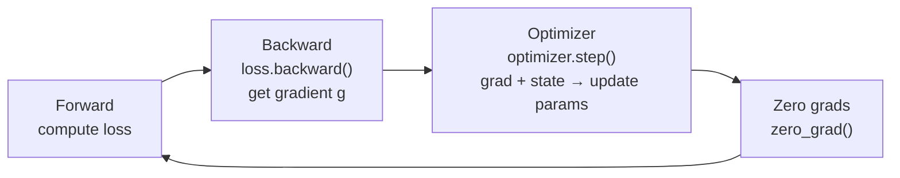

Backprop only tells you which way the parameters should move. How far to step, and how, is entirely up to the optimizer. For people doing AI Infra there is a more concrete issue too: the optimizer quietly eats more than half of training GPU memory. This article starts from how optimizers evolved, then works out exactly how much memory AdamW uses and why FP32 is required, and finally covers where LAMB/LARS fit in large-batch settings. All of that is direct background for ZeRO and mixed precision later.

<!-- more -->

## 📑 Contents

- [1. What the optimizer actually does in training](#1-what-the-optimizer-actually-does-in-training)
- [2. Optimizer evolution: from SGD to AdamW](#2-optimizer-evolution-from-sgd-to-adamw)
- [3. Memory cost of optimizer state](#3-memory-cost-of-optimizer-state)
- [4. Large-batch optimizers: LARS and LAMB](#4-large-batch-optimizers-lars-and-lamb)
- [5. Hands-on: open the optimizer memory ledger](#5-hands-on-open-the-optimizer-memory-ledger)
- [Summary](#-summary)
- [Self-check list](#-self-check-list)
- [References](#-references)

---

## 1. What the optimizer actually does in training

Think of gradients as a "downhill map": they tell you which direction under your feet is steepest. The optimizer is the climber who actually takes the step. The map only answers "which way"; step size, whether to keep momentum from the last step, and whether a slippery stretch needs a smaller step are all optimizer decisions.

In the training loop its place is fixed, between "gradients are ready" and "the next forward":



In code that is this four-line loop:

```python
for batch in dataloader:
    loss = model(batch)          # Forward: predict and compute loss
    loss.backward()              # Backward: get gradient for each parameter
    optimizer.step()             # Optimizer: update params with grad + internal state
    optimizer.zero_grad()        # Clear gradients for the next step
```

That plain-looking `optimizer.step()` does three things: read each parameter's gradient, combine it with the optimizer's own internal state (momentum, second moment, and so on) to get an update, and apply that update to the parameters.

🔑 **Core idea**: the important part is "internal state". That state is **kept across** successive `step()` calls in GPU memory. It is not a temporary that disappears after the math; it sits there for the whole run. That is why the optimizer becomes a memory hog, and it is the ledger section 3 works through.

## 2. Optimizer evolution: from SGD to AdamW

Optimizer history is mostly a story of adding more auxiliary information to the parameter update. Each addition makes training more stable and often faster, at the cost of storing more state per parameter. Follow that line and the memory cost shows up naturally.

- **SGD**: the plain rule $\theta_{t+1} = \theta_t - \eta \cdot g_t$: learning rate times gradient, then subtract. No extra state. Like walking downhill blindfolded, one step along the steepest local direction: simple, but easy to oscillate left and right in a long narrow valley.

- **Momentum SGD**: adds "inertia". It keeps a momentum buffer $m_t = \beta m_{t-1} + g_t$ and uses that instead of the raw gradient. Think of swapping the ball for a heavy one with inertia: small bumps on the way down no longer stop it, and oscillation is smoothed out. Cost: one first-moment buffer per parameter.

- **Adam**: tracks two things at once: first moment $m_t$ (EMA of the gradient; "which way") and second moment $v_t$ (EMA of squared gradients; "how noisy this direction has been"). The core update is:

$$
\begin{aligned}
m_t &= \beta_1 m_{t-1} + (1-\beta_1) g_t
\end{aligned}
$$
$$
\begin{aligned}
v_t &= \beta_2 v_{t-1} + (1-\beta_2) g_t^2
\end{aligned}
$$
$$
\begin{aligned}
\theta_{t+1} &= \theta_t - \eta \cdot \frac{\hat{m}_t}{\sqrt{\hat{v}_t} + \epsilon}
\end{aligned}
$$

Here $\hat{m}_t, \hat{v}_t$ are bias-corrected versions of $m_t, v_t$ (early on $m_0=v_0=0$ makes the estimate too small, so you divide by $1-\beta^t$). The $\sqrt{\hat{v}_t}$ in the denominator is where "adaptive" comes from: parameters with historically large gradients get a larger denominator and smaller steps; parameters that stayed small get a smaller denominator and larger steps. Cost: two state tensors per parameter, $m$ and $v$.

- **AdamW**: an important fix to Adam. Original Adam folded weight decay into the gradient ($g_t \leftarrow g_t + \lambda \theta_t$), so it got tangled with the adaptive learning rate. The denominator $\sqrt{\hat{v}_t}$ then warps regularization strength differently across parameters.

AdamW pulls weight decay out of the gradient and makes it a separate parameter scale $\theta_{t+1} \leftarrow \theta_{t+1} - \eta \lambda \theta_t$, fully decoupled from the gradient update. That one change made it the de facto standard for large-model training today.

One table to close the line:

| ⚙️ Optimizer | Information used in the update | Extra state per parameter | Typical use |
|-----------|--------------|--------------|---------|
| SGD | Current gradient | 0 copies | Simple convex problems, teaching |
| Momentum | Gradient + first moment | 1 copy ($m$) | SGD+Momentum in CV |
| Adam | Gradient + first + second moment | 2 copies ($m, v$) | General default |
| AdamW | Same as Adam, decoupled weight decay | 2 copies ($m, v$) | Standard for large-model training |

💡 **Tip**: along this line, "how many extra state copies" is the key to memory: SGD stores 0, Momentum stores 1, Adam/AdamW store 2. The memory ledger in the next section is basically counting those copies.

## 3. Memory cost of optimizer state

This section is the focus of the article. Once you know how much memory the optimizer uses, ZeRO's choice to "go after optimizer state first" makes sense.

The analysis below assumes **mixed-precision training** (the current mainstream): forward and backward run in BF16/FP16 for speed, but the optimizer internals stay in FP32 for accuracy.

### 3.1 How much memory each parameter pays the optimizer

Count by "how many extra FP32 copies per parameter" (FP32 is 4 bytes per number):

| ⚙️ Optimizer | Extra state | Optimizer memory per parameter | Optimizer cost for a 7B model |
|-----------|---------|-----------------|------------------|
| SGD | None | 4 B (FP32 parameter copy only) | ~28 GB |
| Momentum SGD | First moment | 8 B (FP32 copy + FP32 momentum) | ~56 GB |
| Adam / AdamW | First + second moment | 12 B (FP32 copy + FP32 $m$ + FP32 $v$) | ~84 GB |

📌 **Takeaway**: AdamW needs 12 extra bytes per parameter. A 7B model has 7 billion parameters, so optimizer state alone is $12 \times 7 \times 10^9 \approx 84\ \text{GB}$, already past a single 80GB A100.

### 3.2 Lay out the full training memory ledger

Take AdamW + BF16 training of a 7B model. The full static ledger looks like this:

$$
\begin{aligned}
\text{BF16 参数} &= 2 \times 7 \times 10^9 = 14\ \text{GB} \\
\end{aligned}
$$
$$
\begin{aligned}
\text{BF16 梯度} &= 2 \times 7 \times 10^9 = 14\ \text{GB} \\
\end{aligned}
$$
$$
\begin{aligned}
\text{优化器状态} &= 12 \times 7 \times 10^9 = 84\ \text{GB} \\
\end{aligned}
$$
$$
\begin{aligned}
\text{（FP32 主权重 28 + 一阶动量 28 + 二阶动量 28）} \\
\text{合计} &\approx 112\ \text{GB}
\end{aligned}
$$

So just the three static pieces (model + gradients + optimizer) already need 112 GB, and **optimizer state alone is about 75\%** (activations not counted yet). Split that 112GB and the ratios are obvious:

| 📦 Memory piece | Size | Share |
|------------|------|------|
| Optimizer state (FP32 master weights + $m$ + $v$) | 84 GB | 75\% |
| BF16 gradients | 14 GB | 12.5\% |
| BF16 parameters | 14 GB | 12.5\% |

This ledger is exactly why ZeRO is designed the way it is: ZeRO-1's first cut is optimizer state, because it is the largest share and cutting it has the best payoff. Under DDP every GPU keeps a full copy of that 84GB, which is extreme redundancy, and that is what chapters 4 and 5 address.

⚠️ **Note**: the 112GB above is only **static memory** (parameters + gradients + optimizer state). It does not include **activations** left from the forward pass. Activation size scales with batch, sequence length, and depth, and in real training it is often another memory killer. Chapter 8's Activation Checkpointing covers that; here we only lock in the conclusion that "the optimizer is ~75\% of static memory".

### 3.3 Why optimizer state must stay in FP32

A common question: if forward and backward already use BF16, why not store optimizer state in BF16 too and cut that memory in half?

The answer sits in "the update is tiny":

- Each step's parameter update is roughly learning rate × gradient, often around $10^{-4}$ or smaller. BF16 has only 7 fraction bits, so relative precision is coarse and it cannot represent such a small change. Adding it onto a larger parameter is a no-op (large number eats small number).
- Training runs for thousands or tens of thousands of steps. Rounding error accumulates every step; keeping parameters in low precision eventually makes training diverge.

⚠️ **Note**: so in mixed-precision training the optimizer must keep an FP32 copy of the **master weights**. Each step updates in FP32, then casts the result to BF16 for the next forward. That FP32 copy is exactly the 28GB in the ledger above; you cannot drop it.

## 4. Large-batch optimizers: LARS and LAMB

The earlier sections were about "how much memory the optimizer uses". This one flips the view: **distributed training itself creates optimizer problems**.

A direct side effect of data parallelism is that the effective batch size scales linearly. With $N$ GPUs in data parallel, the global batch is $N$ times the per-GPU batch. At tens or hundreds of GPUs, effective batch easily reaches thousands or tens of thousands, and trouble follows.

### 4.1 Why large batches make training unstable

- Larger batches average more samples, so gradient variance is smaller and the direction looks "cleaner". In theory you can use a larger learning rate and converge faster.
- In practice, linearly scaling the learning rate often causes oscillation or divergence from the start.
- Worse, parameter scales differ a lot across layers (Embedding vs LayerNorm are not even the same order of magnitude). One global learning rate for every layer cannot serve them all well no matter how you tune it.

The core tension is that last point: **you want per-layer adaptive learning rates, not one knife cut**. LARS and LAMB were built for that.

💡 **Tip**: before reaching for LARS/LAMB, try two simpler engineering moves first: the **linear scaling rule** (scale batch by $k$, scale learning rate by $k$), and **learning-rate warmup** (over the first few hundred to few thousand steps, ramp LR linearly from a tiny value to the target, to avoid early violent oscillation). Those two cover most mid-scale setups. Only when the batch is so large that they fail do layer-wise adaptive LARS/LAMB enter.

### 4.2 LARS: a separate step size per layer

LARS (Layer-wise Adaptive Rate Scaling) computes a per-layer scale factor, roughly proportional to "parameter norm / gradient norm":

$$
\lambda_l = \frac{\lVert \theta_l \rVert}{\lVert g_l \rVert}
$$

Intuition: a layer whose parameters are large but gradients are small is updating too cautiously, so you can step farther; a layer whose gradients are large relative to its parameters needs smaller steps so it does not blow up. LARS was first designed for large-batch ResNet training.

### 4.3 LAMB: bring the LARS idea into Adam

LAMB (Layer-wise Adaptive Moments) is roughly **Adam + per-layer trust-region scaling**:

- Each layer's update is first computed as usual by Adam (already with an adaptive learning rate);
- then multiply by a per-layer trust-region factor $\phi(\lVert \theta_l \rVert) / \lVert r_l \rVert$ to keep that layer's update magnitude in a sane range.

Its best-known result is pushing BERT pretraining batch size to 65536 while still converging stably, cutting training from 3 days to 76 minutes.

Side by side the difference is clear:

| 🔧 Optimizer | Base | Scaling grain | Main arena |
|-----------|------|---------|---------|
| LARS | SGD + Momentum | Per layer (param norm / grad norm) | Large-batch CV such as ResNet |
| LAMB | Adam | Per layer (trust region × Adam update) | Large-batch BERT/Transformer |

✅ **When to switch to LAMB**: only when data-parallel GPU count is high (64+), effective batch is huge, and AdamW can no longer keep training stable. For modest GPU counts and mid-size batches, stick with AdamW. Do not use LAMB just because it exists.

## 5. Hands-on: open the optimizer memory ledger

Counting on paper is not enough. Touching optimizer state in PyTorch yourself makes "12 bytes/parameter" concrete. The snippet below builds a small model with a known parameter count, runs one Adam step, then counts how many numbers sit in the optimizer `state`:

```python
import torch
import torch.nn as nn

# Small model with known size: 1000 x 1000 weight + 1000 bias = 1,001,000 parameters
model = nn.Linear(1000, 1000)
n_params = sum(p.numel() for p in model.parameters())
print(f"Parameter count: {n_params:,}")

optimizer = torch.optim.Adam(model.parameters(), lr=1e-3)

# Run one step so Adam actually allocates m and v
x = torch.randn(8, 1000)
loss = model(x).sum()
loss.backward()
optimizer.step()

# Count how many elements the optimizer internal state stores
state_elems = 0
for p, st in optimizer.state.items():
    for k, v in st.items():
        if torch.is_tensor(v):
            state_elems += v.numel()
            print(f"  state '{k}': {v.numel():,} elements, dtype={v.dtype}")

print(f"Optimizer state total elements: {state_elems:,}  (≈ 2 × parameter count)")
```


Running it, you will see Adam store `exp_avg` (first moment $m$) and `exp_avg_sq` (second moment $v$), each with element count equal to the parameter count, which confirms "Adam stores 2 state copies per parameter". Swap the optimizer for `torch.optim.SGD` (no momentum) and `state` is almost empty: that is why SGD is cheap on memory.

Once you know "how many copies", you can turn it into a small tool for any model size. The function below applies the section 3 ledger formula directly:

```python
def estimate_memory_gb(n_params_billion, optimizer="adamw", dtype_bytes=2):
    """Estimate static memory (GB) for mixed-precision training, excluding activations"""
    P = n_params_billion * 1e9
    param = P * dtype_bytes            # BF16 parameters
    grad = P * dtype_bytes             # BF16 gradients
    # Optimizer state: FP32 master weights (4B) + each state copy (4B)
    state_copies = {"sgd": 0, "momentum": 1, "adamw": 2}[optimizer]
    optim = P * 4 * (1 + state_copies)
    total = (param + grad + optim) / 1e9
    print(f"{optimizer} @ {n_params_billion}B: "
          f"params {param/1e9:.0f} + grads {grad/1e9:.0f} + optim {optim/1e9:.0f} "
          f"= {total:.0f} GB, optimizer share {optim/(param+grad+optim):.0%}")
    return total

estimate_memory_gb(7, "adamw")    # → 7B: params 14 + grads 14 + optim 84 = 112 GB, optimizer 75%
estimate_memory_gb(70, "adamw")   # → 70B: params 140 + grads 140 + optim 840 = 1120 GB
```

📌 **Takeaway**: a 70B model needs 1120 GB of static memory alone, which is 14× 80GB A100s, and that still ignores activations. That number is the most direct reason distributed parallelism (especially ZeRO and tensor parallelism) exists.

💡 **Tip**: a small tweak to `estimate_memory_gb` compares memory before and after ZeRO sharding: divide `optim` by parallel degree $N$ and you have ZeRO-1's effect. That is the basic move for analyzing ZeRO sharding gains next.

## 📝 Summary

- The optimizer decides "how to step and how far". Its internal state stays in GPU memory between steps, which is why it becomes a memory hog.
- The evolution line trades more state for stability: SGD stores 0 copies, Momentum 1, Adam/AdamW 2. AdamW decouples weight decay and is today's large-model training standard.
- Under mixed precision AdamW costs 12 bytes per parameter; for a 7B model optimizer state is ~84GB, about 75\% of static "parameters + gradients + optimizer" memory. That is why ZeRO-1 shards it first.
- Optimizer state must use FP32 master weights; otherwise tiny updates are eaten by low precision and accumulated error diverges training.
- Under large batches (multi-GPU data parallel), a single global learning rate becomes unstable; LARS/LAMB fix that with per-layer adaptive scaling. Only switch from AdamW to LAMB when GPU count is high and batch is huge.

📌 **Bridge**: the memory ledger in this article connects straight to later chapters. Chapter 4 shows the redundancy of every GPU under DDP keeping a full optimizer state; chapter 5's ZeRO cuts that 75\% redundancy down to $\frac{1}{N}$; chapter 8's mixed precision folds FP32 master weights into the full memory ledger.

## 🎯 Self-check list

- Explain what each step SGD → Momentum → Adam → AdamW fixed, and how many state copies it added
- Hand-compute optimizer-state memory for any model size under AdamW + mixed precision, and explain why it is ~75\% of static memory
- Explain why mixed-precision training must keep FP32 master weights instead of storing everything in BF16
- Write code that counts PyTorch optimizer `state` elements and verify Adam stores 2 copies per parameter while SGD stores 0
- Answer "data parallel scaled the batch 10×; what should happen to the learning rate?", and say when LARS/LAMB are actually needed

## 📚 References

- [Adam: A Method for Stochastic Optimization](https://arxiv.org/abs/1412.6980)
- [Decoupled Weight Decay Regularization (AdamW)](https://arxiv.org/abs/1711.05101)
- [Large Batch Training of Convolutional Networks (LARS)](https://arxiv.org/abs/1708.03888)
- [Large Batch Optimization for Deep Learning: Training BERT in 76 minutes (LAMB)](https://arxiv.org/abs/1904.00962)
- [Mixed Precision Training](https://arxiv.org/abs/1710.03740)
- [PyTorch torch.optim official docs](https://pytorch.org/docs/stable/optim.html)
- [ZeRO: Memory Optimizations Toward Training Trillion Parameter Models](https://arxiv.org/abs/1910.02054)
