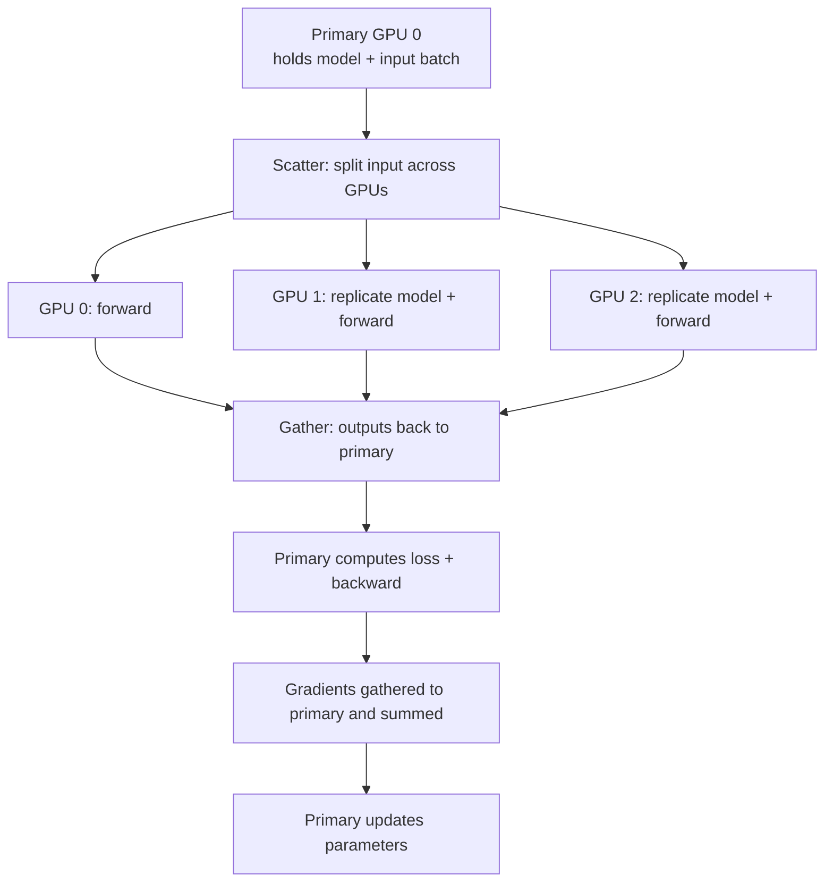
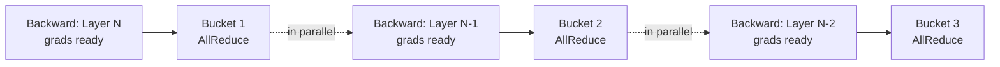
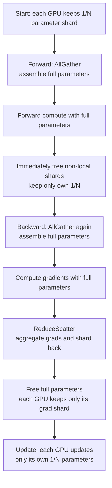
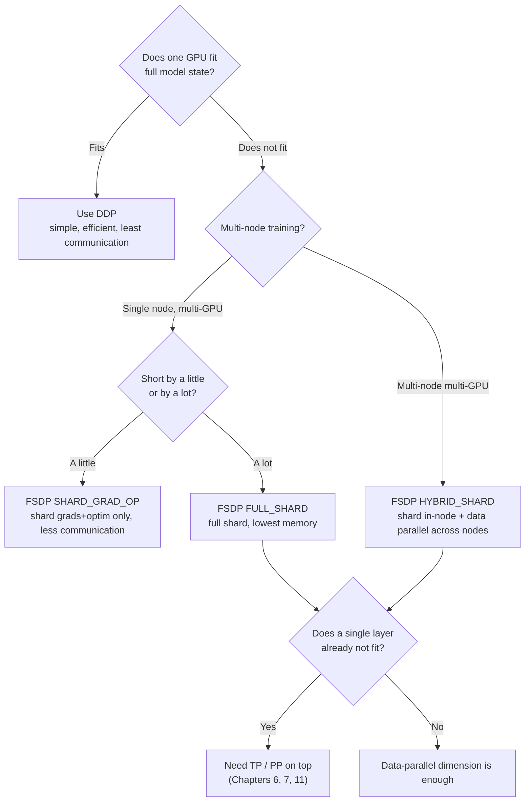

Data parallelism is the first distributed-training move most people meet, and the one they use most: each GPU computes on a slice of the data, then everyone aligns the results. It sounds simple, but from early `DataParallel` to today's `FSDP` there were three generations, each answering the same question: how do you keep the math equivalent while running more GPUs and larger models. This article skips code (see **4.2** for that) and works through the **principles, gradient-sync mechanisms, communication volume, and memory ledgers** of all three, so you know not only what to do but why.

<!-- more -->

## 📑 Contents

- [1. What problem data parallelism solves](#1-what-problem-data-parallelism-solves)
- [2. Mathematical foundation of data parallelism](#2-mathematical-foundation-of-data-parallelism)
- [3. Generation 1: DataParallel (DP)](#3-generation-1-dataparalleldp)
- [4. Generation 2: DistributedDataParallel (DDP)](#4-generation-2-distributeddataparallelddp)
- [5. Deriving AllReduce communication volume](#5-deriving-allreduce-communication-volume)
- [6. Generation 3: FullyShardedDataParallel (FSDP)](#6-generation-3-fullyshardeddataparallelfsdp)
- [7. Memory ledger: quantitative comparison of three generations](#7-memory-ledger-quantitative-comparison-of-three-generations)
- [8. Communication comparison: DDP vs FSDP](#8-communication-comparison-ddp-vs-fsdp)
- [9. Selection guide](#9-selection-guide)
- [Summary](#-summary)
- [Self-check list](#-self-check-list)
- [References](#-references)

---

## 1. What problem data parallelism solves

First clarify: distributed training has many kinds of "parallelism", and they fix different pains. Data parallelism targets **training that is too slow**: the dataset is huge and one epoch on one GPU takes forever.

Analogy: a class has 6000 papers to grade; one teacher needs a week. Data parallelism brings in 6 teachers, 1000 papers each, done in a day. The catch: **every teacher needs a full copy of the grading rubric** (a full model replica), and after grading they must **align the grading scale** (sync gradients) so you do not get "Teacher A is lenient, Teacher B is harsh".

In technical terms:

1. Each GPU holds a **full model replica** (identical parameters)
2. A large batch is **evenly split** across GPUs; each GPU only computes its own slice (the local batch)
3. Each GPU runs forward and backward **independently** and gets its own gradients
4. Communication **averages** gradients across GPUs so every GPU gets the same gradient
5. Each GPU updates with that shared gradient; after the update all replicas stay identical

📌 **Takeaway**: the core constraint of data parallelism is that **every GPU must fit the full model**. It speeds up training but does not cut per-GPU memory. That is exactly where FSDP later breaks through: when the model is too large for one GPU, pure data parallelism cannot help and you need parameter sharding.

💡 **Tip**: distributed training solves two orthogonal problems: **cannot finish** (too slow; data parallelism's home turf) and **cannot fit** (out of memory; needs ZeRO/FSDP, tensor parallelism, pipeline parallelism). This article focuses on the data-parallel axis, and on how that axis gradually gained the ability to ease the memory problem too.

---

## 2. Mathematical foundation of data parallelism

Data parallelism is not a "close enough" approximation. Under synchronous SGD it is **strictly equivalent** to single-GPU training. That is why gradients must be averaged, not summed.

Consider a batch loss, usually defined as the mean of per-sample losses. Let global batch size be $B$ and the loss:

$$
L = \frac{1}{B} \sum_{i=1}^{B} \ell(x_i; \theta)
$$

where $\ell(x_i; \theta)$ is the loss on sample $i$ and $\theta$ are the model parameters. The gradient w.r.t. parameters:

$$
g = \nabla_\theta L = \frac{1}{B} \sum_{i=1}^{B} \nabla_\theta \ell(x_i; \theta)
$$

Now split the $B$ samples evenly across $N$ GPUs, $\frac{B}{N}$ each. The **local gradient** on GPU $k$ (already averaged inside that shard) is:

$$
g_k = \frac{N}{B} \sum_{i \in \mathcal{D}\_k} \nabla_\theta \ell(x_i; \theta)
$$

where $\mathcal{D}\_k$ is the sample set on GPU $k$. Average the local gradients across GPUs:

$$
\bar{g} = \frac{1}{N} \sum_{k=1}^{N} g_k = \frac{1}{N} \sum_{k=1}^{N} \frac{N}{B} \sum_{i \in \mathcal{D}\_k} \nabla_\theta \ell(x_i; \theta) = \frac{1}{B} \sum_{i=1}^{B} \nabla_\theta \ell(x_i; \theta) = g
$$

🔑 **Core idea**: the averaged gradient $\bar{g}$ under $N$-GPU data parallelism **exactly equals** the single-GPU gradient $g$ on the global batch. So data parallelism = spread compute across more GPUs, while each parameter update stays mathematically identical to "one GPU running a batch of size $B$".

Two practical conclusions follow:

- **Why AllReduce averages gradients instead of summing**: each GPU's local loss already averaged inside the local batch (divided by $\frac{B}{N}$). Averaging the $N$ local gradients across GPUs recovers the global-batch mean gradient. Summing would be equivalent to scaling the learning rate by $N$.
- **Effective batch size grew**: effective batch size under data parallelism = per-GPU local batch × $N$. That is why you usually adjust the learning rate when you add GPUs (see the learning-rate scaling section in 4.2).

⚠️ **Note**: this "strict equivalence" holds only under synchronous gradients and equal local batch sizes. Uneven sample counts (a short last batch) or asynchronous updates break the equivalence.

---

## 3. Generation 1: DataParallel (DP)

`torch.nn.DataParallel` (DP) was PyTorch's earliest multi-GPU option. The pitch was "change one line for multi-GPU": `model = nn.DataParallel(model)`. It is a **single-process multi-thread** design, now officially discouraged. Understanding it mainly shows why DDP is shaped the way it is.

### 3.1 How DP works

One process owns all GPUs and each step does scatter–gather:

The key: **every iteration** the primary replicates model parameters to the other GPUs, gathers forward outputs back to compute loss, then gathers gradients back to update. The primary is both scheduler and worker, so it is clearly more loaded.

### 3.2 DP's three fatal flaws

| ❌ Flaw | 📝 Why |
|---|---|
| **GIL limit** | Single process, many threads; Python's global interpreter lock blocks real parallel scheduling on the CPU side |
| **Uneven load** | Primary also does Scatter/Gather, loss, and gradient aggregation; memory and compute pressure exceed the other GPUs |
| **Inefficient communication** | Model is re-copied every step; traffic hubs through the primary, often stuck on PCIe instead of fast NVLink |

⚠️ **Note**: a classic DP failure mode is "primary OOM while other GPUs still have free memory", because output gather and loss sit on the primary. In production use DDP. DP is only for a quick single-node check that multi-GPU can run at all.

📌 **Takeaway**: DP's root problems are **single process + primary-centric design**. Every DDP improvement essentially removes those two premises: many processes, no center.

---

## 4. Generation 2: DistributedDataParallel (DDP)

DDP (DistributedDataParallel) is the **de facto standard** for data parallelism in production. The core change: **one independent process per GPU**, each with its own full model replica, all peers equal. There is no "primary GPU"; gradient sync uses **decentralized AllReduce**.

### 4.1 From centralized to decentralized

Compare with DP and the gains are clear:

| 📊 Dimension | DataParallel (DP) | DistributedDataParallel (DDP) |
|---|---|---|
| Process model | Single process, many threads | One process per GPU, no GIL contention |
| Model replica | Replicate every step | Broadcast once at init |
| Gradient sync | Gather to primary and sum | Decentralized AllReduce, peers equal |
| Load | Primary heavier | Balanced across GPUs |
| Communication path | Hub through primary | Point-to-point Ring, uses NVLink well |

DDP's life cycle is "broadcast once, sync many times":

1. **Init**: when constructing DDP, **Broadcast** rank 0's parameters to every process so all replicas start identical
2. **Forward + backward**: each process computes **independently** on its data shard; no communication
3. **Gradient sync**: during backward, **AllReduce** averages gradients across processes so every GPU's gradients match
4. **Parameter update**: each process updates independently with the shared gradient. Same start, same gradients → same result after the update

🔑 **Core idea**: DDP communicates only at **init Broadcast** and **backward AllReduce**. Forward has no communication; that is the root reason it beats DP.

### 4.2 The Bucket mechanism: hide communication inside compute

This is the heart of DDP's performance work. The naive approach waits until the full backward finishes all gradients, then launches one AllReduce. The problem: **the GPU idles during communication**, wasting compute.

DDP's trick uses a property of backward: it walks **from the last layer forward**, so later layers' gradients are ready first. Why wait for everything? A layer's gradients can be collected and synced while earlier layers are still computing. As soon as the last layer's backward finishes, that slice of gradients can AllReduce immediately while backward keeps walking earlier layers.

So DDP packs parameter gradients into **Buckets** in reverse-compute order (default ~25 MB each). Rules:

- When every gradient in a Bucket is ready, **immediately** AllReduce that Bucket
- Meanwhile earlier layers keep running backward

Communication and compute then **overlap**:

💡 **Tip**: Bucket size is tunable (`bucket_cap_mb`). Too small → many launches, fixed AllReduce overhead dominates; too large → worse overlap (you wait longer to fill a bucket). Defaults work for most models; retune only under extreme networks.

⚠️ **Note**: if some parameters **never participate in the forward** (for example a conditional branch skips a layer), their gradients never become ready, the matching Bucket never fills, and AllReduce hangs into a deadlock. Set `find_unused_parameters=True` so DDP marks unused parameters. That option has extra cost; avoid it when you can.

Compute–communication overlap lets DDP scale almost linearly at mid size, but that dividend **fails at very large scale**. With hundreds or thousands of GPUs, coordination and network demand grow; communication can no longer hide behind compute, and each added GPU helps less. One benchmark set shows throughput dropping past a ceiling while per-GPU memory stays flat as DP rank grows (which matches the earlier point: adding GPUs spreads compute, not memory).

💡 **Tip**: at 512+ GPUs, communication also starts to hit **ring latency** (time for a signal to travel once around the Ring). DP communication can no longer be fully overlapped. At that point turn to other parallel dimensions (TP/PP/ZeRO) instead of stacking more DP.

### 4.3 DDP's fundamental limit

DDP is simple, efficient, and mathematically strict, but it inherits data parallelism's built-in constraint: **every GPU must hold the full "parameters + gradients + optimizer state"**.

For a model with $\Psi$ parameters, under mixed precision + Adam, each GPU must hold (classic ZeRO-paper estimate, bytes per parameter):

- FP16 parameters: $2\Psi$
- FP16 gradients: $2\Psi$
- FP32 optimizer state (master weights + first moment + second moment): $12\Psi$

Total about $16\Psi$. For a 7B model that is ~112 GB: **a single 80 GB H100 cannot fit it**. No matter how many GPUs you add, DDP cannot change that number, because every GPU's copy of this ledger is fully redundant.

📌 **Takeaway**: adding GPUs under DDP only **spreads compute time** (faster); it does not **spread per-GPU memory** (cheaper). To break the single-GPU memory wall, ask: can this $16\Psi$ redundancy also be sliced across GPUs? That is FSDP's starting point.

---

## 5. Deriving AllReduce communication volume

Many tutorials state "DDP communicates $2\Psi$ per step" without showing where it comes from. Work the derivation and you see why Ring AllReduce is **bandwidth-optimal**, and how FSDP's $3\Psi$ is counted later.

### 5.1 AllReduce = ReduceScatter + AllGather

Remember the key equality: **one AllReduce equals one ReduceScatter plus one AllGather**.

- **ReduceScatter**: split each GPU's data into $N$ chunks, aggregate (sum) matching chunks across GPUs; each GPU ends with **one** fully aggregated chunk
- **AllGather**: each GPU broadcasts its chunk; every GPU ends with the **full** aggregated result

Library inventory analogy: $N$ librarians each hold a full inventory sheet. In ReduceScatter, shelves are split into $N$ zones; librarian 1 aggregates everyone's zone A, librarian 2 aggregates zone B, and so on; afterward each holds only their zone's final total. In AllGather they exchange those zone totals so everyone has the full library total.

### 5.2 Ring AllReduce communication volume

Ring AllReduce arranges $N$ GPUs in a ring, splits data into $N$ pieces, and pipelines them around the ring. Let total gradient size be $\Psi$ (parameter count as a stand-in for data volume; real bytes still multiply by dtype size).

**ReduceScatter phase**: $N-1$ steps; each step each GPU sends $\frac{\Psi}{N}$ to the next neighbor. Send volume per GPU:

$$
(N-1) \times \frac{\Psi}{N}
$$

**AllGather phase**: also $N-1$ steps, each sending $\frac{\Psi}{N}$; send volume per GPU is again $(N-1) \times \frac{\Psi}{N}$.

Add both phases; total **send** volume per GPU:

$$
2 \times (N-1) \times \frac{\Psi}{N} = 2\Psi \cdot \frac{N-1}{N}
$$

🔑 **Core idea**: when $N$ is large, $\frac{N-1}{N} \to 1$, so per-GPU communication approaches $2\Psi$ and is **independent of $N$**. That is Ring AllReduce's elegance: adding GPUs does not inflate each GPU's communication load. That is where "DDP communicates $2\Psi$ per step" comes from.

### 5.3 Why not the naive "gather to one GPU" approach

If you use DP-style centralization (every GPU sends gradients to the primary to sum, primary broadcasts back), the primary's send+recv is $2(N-1)\Psi$, linear in $N$. Primary bandwidth becomes the bottleneck immediately.

| 📊 Scheme | Per-GPU communication | Grows with N? |
|---|---|---|
| Centralized gather (DP-style) | Primary: $2(N-1)\Psi$ | ❌ Primary grows linearly and bottlenecks |
| Ring AllReduce (DDP) | $2\Psi \cdot \frac{N-1}{N} \approx 2\Psi$ | ✅ Constant, independent of N |

💡 **Tip**: that is the value of collective primitives: not "just send a message", but a designed pattern that spreads bandwidth pressure across all nodes. For finer analysis of Ring AllReduce, Halving-Doubling, and related algorithms, see **Chapter 2: Collective communication primitives**.

⚠️ **Note**: $2\Psi$ is the bandwidth lower bound under an **ideal Ring**. Real volume also depends on topology (NVLink vs PCIe vs cross-node InfiniBand), message size, and NCCL's algorithm choice. In multi-node training, inter-node bandwidth is usually far below intra-node and often becomes the overall bottleneck.

---

## 6. Generation 3: FullyShardedDataParallel (FSDP)

Back to DDP's pain: every GPU redundantly stores a full $16\Psi$ of state. FSDP's answer is simple and thorough: **stop the redundancy; shard parameters, gradients, and optimizer state into $N$ pieces, keep only $\frac{1}{N}$ per GPU, and temporarily assemble when needed**. It is PyTorch's native take on DeepSpeed ZeRO.

### 6.1 How FSDP executes

Under DDP each GPU always holds full parameters, gradients, and optimizer state, fully redundant across GPUs. FSDP shards all three evenly by $N$; each GPU persistently keeps only its $\frac{1}{N}$. To compute a layer it AllGathers shards into full parameters, then immediately frees non-local pieces so memory falls back to the shard size. After backward, ReduceScatter aggregates gradients so each GPU keeps only its shard's gradients; optimizer updates run on that shard alone.

In ZeRO language, redundancy is removed in three stages:

| 📊 ZeRO stage | What is sharded | Per-GPU memory ($\Psi$ params, $N$ GPUs) | Matching FSDP strategy |
|---|---|---|---|
| **Stage 1** | Optimizer state | $2\Psi + 2\Psi + \frac{12\Psi}{N}$ | (included in `SHARD_GRAD_OP`) |
| **Stage 2** | + gradients | $2\Psi + \frac{14\Psi}{N}$ | `SHARD_GRAD_OP` |
| **Stage 3** | + parameters | $\frac{16\Psi}{N}$ | `FULL_SHARD` |

🔑 **Core idea**: Stage 3 (`FULL_SHARD`) shards all $16\Psi$, so per-GPU memory falls to $\frac{16\Psi}{N}$. Example: 7B model, 8 GPUs: DDP ~112 GB per GPU (does not fit), FSDP `FULL_SHARD` ~$\frac{112}{8} = 14$ GB per GPU (fits easily). That is how FSDP trains models that do not fit on one GPU.

### 6.2 FSDP flow: AllGather + ReduceScatter

FSDP is more complex than DDP. Around each shard unit (usually a Transformer block) it "assemble on demand, discard when done". One unit's forward + backward:

Two key communications:

- **Forward AllGather**: before computing a unit, collect parameter shards from all GPUs into temporary full parameters. After compute, drop non-local pieces immediately.
- **Backward AllGather + ReduceScatter**: backward must assemble full parameters again (they were freed after forward) to compute full gradients; then **ReduceScatter** finishes "aggregate gradients" and "shard back to GPUs" in one step. Each GPU ends with only the aggregated gradient for its own shard.

📌 **Takeaway**: backward gradient sync uses **ReduceScatter**, not DDP's AllReduce. FSDP only needs to update its own shard, so it only needs "its slice" of aggregated gradients; every GPU does not need the full gradient the way DDP does. That difference drives the communication-volume gap (next section).

### 6.3 Four FSDP sharding strategies

FSDP's `sharding_strategy` controls how far you shard: a memory-vs-communication knob:

| 📊 Strategy | What is sharded | Memory saved | Communication cost | When to use |
|---|---|---|---|---|
| `FULL_SHARD` | Parameters + gradients + optimizer (ZeRO-3) | Highest | Highest | Large models, tight memory |
| `SHARD_GRAD_OP` | Gradients + optimizer state (ZeRO-2; parameters unsharded) | Medium | Medium | Mid-size models, want less communication |
| `HYBRID_SHARD` | `FULL_SHARD` inside a node + data parallel across nodes | High | Lower across nodes | Preferred for multi-node |
| `NO_SHARD` | No shard (equivalent to DDP) | None | Lowest | Debug baseline |

💡 **Tip**: `HYBRID_SHARD` is the recommended multi-node large-model strategy. Insight: inside a node you have high-bandwidth NVLink, good for communication-heavy `FULL_SHARD`; across nodes you only have slower InfiniBand, so fall back to low-volume data parallel (AllReduce). Keep high-frequency communication inside the node; only low-frequency traffic crosses nodes. Best memory/communication compromise.

### 6.4 FSDP2: next-generation API

PyTorch is pushing a new API `fully_shard` (often called FSDP2). Unlike FSDP1's whole-module wrapper, FSDP2 uses **per-parameter sharding** on the `DTensor` (Distributed Tensor) abstraction. Main gains:

- Shard grain down to a single parameter; more flexible, less waste from packing whole modules
- Built on DTensor, so combining with tensor parallelism (TP), sequence parallelism, and similar shares a more unified interface; foundation for 2D/3D parallelism
- Clearer init and checkpoint semantics

💡 **Tip**: as of PyTorch 2.x, FSDP2 is usable and officially preferred, but still iterating fast. New projects are worth trying FSDP2 (especially with TP); stable production fleets can stay on FSDP1. Code in 4.2.

---

## 7. Memory ledger: quantitative comparison of three generations

Clear memory numbers make selection confident. Keep the classic mixed-precision + Adam estimate. For $\Psi$ parameters, "model state" (no activations) has four parts:

$$
\underbrace{2\Psi}\_{\text{FP16 参数}} + \underbrace{2\Psi}\_{\text{FP16 梯度}} + \underbrace{4\Psi}\_{\text{FP32 master 权重}} + \underbrace{4\Psi + 4\Psi}\_{\text{Adam 动量}} = 16\Psi
$$

The last three (master weights + first moment + second moment, $12\Psi$ total) are **optimizer state**. From that $16\Psi$, per-GPU model-state memory for the three generations ($N$ = GPU count):

| 📊 Scheme | Parameters | Gradients | Optimizer state | Per-GPU total | $N=8$ (7B model) |
|---|---|---|---|---|---|
| **DDP** | $2\Psi$ | $2\Psi$ | $12\Psi$ | $16\Psi$ | ~112 GB |
| **FSDP SHARD_GRAD_OP** (ZeRO-2) | $2\Psi$ | $\frac{2\Psi}{N}$ | $\frac{12\Psi}{N}$ | $2\Psi + \frac{14\Psi}{N}$ | ~26 GB |
| **FSDP FULL_SHARD** (ZeRO-3) | $\frac{2\Psi}{N}$ | $\frac{2\Psi}{N}$ | $\frac{12\Psi}{N}$ | $\frac{16\Psi}{N}$ | ~14 GB |

(7B means $\Psi = 7\times10^9$, $16\Psi \approx 112$ GB; $N=8$.)

From the table:

- **DDP memory is independent of GPU count**: adding GPUs does not lighten the load; $16\Psi$ is fixed. That is its ceiling.
- **Optimizer state is the largest piece** ($12\Psi$, 75\%): so ZeRO-1/2 sharding only optimizer state and gradients already saves most of the cost at good payoff.
- **`FULL_SHARD` falls linearly with GPU count**: more GPUs, less per GPU; in theory any model size if you have enough GPUs.

⚠️ **Note**: this table is only **model state**, not **activations**. Activations grow with batch size, sequence length, and depth; on long sequences they are often the real memory hog. FSDP shards model state and cannot touch activations; that needs Activation Checkpointing, sequence parallelism, and similar (see **Chapters 8 and 9**).

💡 **Tip**: when choosing, first estimate model-state size with this formula, then leave headroom for activations and fragmentation (rule of thumb: multiply peak by 1.2–1.5). If DDP's $16\Psi$ plus activations exceeds one GPU, move to FSDP; try `SHARD_GRAD_OP` first (less communication), then `FULL_SHARD` if still short.

---

## 8. Communication comparison: DDP vs FSDP

Saving memory is not free. FSDP buys **less memory** with **more communication**. Clear that ledger and you see why you should not force FSDP when one GPU already fits.

### 8.1 DDP: $2\Psi$ per step

Section 5 already derived it: DDP does one AllReduce of gradients per step; per-GPU volume ≈ $2\Psi$. That is the data-parallel communication baseline.

### 8.2 FSDP: $3\Psi$ per step

FSDP's per-step communication splits into three pieces (recall 6.2):

- **Forward AllGather**: assemble full parameters. AllGather ≈ $\Psi$ per GPU
- **Backward AllGather**: assemble parameters again before backward (freed after forward). ≈ $\Psi$
- **Backward ReduceScatter**: sync and shard gradients. ReduceScatter ≈ $\Psi$ per GPU

Total ≈ $3\Psi$, **50\% more** than DDP's $2\Psi$.

📌 **Takeaway**: why is AllReduce $2\Psi$ while AllGather or ReduceScatter alone is $\Psi$? Because AllReduce = ReduceScatter + AllGather (section 5.1), itself two $\Psi$ operations. FSDP uses those halves separately and adds one extra forward AllGather, so $\Psi + \Psi + \Psi = 3\Psi$.

### 8.3 Side-by-side

| 📊 Dimension | DDP | FSDP (`FULL_SHARD`) |
|---|---|---|
| Core idea | Full model per GPU, AllReduce gradients | Shard parameters, AllGather on demand |
| Per-GPU volume / step | $2\Psi$ | $3\Psi$ (50\% more) |
| When communication runs | One AllReduce during backward | Per unit: forward AllGather + backward AllGather + ReduceScatter |
| Per-GPU memory | $16\Psi$ | $\frac{16\Psi}{N}$ |
| Compute–communication overlap | Bucket mechanism | Prefetch next-layer parameters |

🔑 **Core idea**: DDP and FSDP are a clear **trade-off pair**. DDP saves communication ($2\Psi$) but spends memory ($16\Psi$); FSDP saves memory ($\frac{16\Psi}{N}$) but spends communication ($3\Psi$). No free lunch; pick by whether your bottleneck is memory or communication/throughput.

⚠️ **Note**: whether FSDP's extra communication can be hidden behind compute depends heavily on network bandwidth and prefetch. On high-bandwidth intra-node links (NVLink/NVSwitch), the extra $3\Psi$ mostly overlaps and throughput loss is small; on low-bandwidth multi-node links, FSDP communication can surface as the bottleneck. That is why `HYBRID_SHARD` exists.

---

## 9. Selection guide

Combine the memory and communication ledgers into one decision path. The only core question: **do parameters + gradients + optimizer state + activations fit on one GPU?**

As one-line rules:

- ✅ **Fits on one GPU** → DDP. Do not pick FSDP to look advanced and pay 50\% extra communication for nothing.
- ✅ **Almost fits** → prefer FSDP `SHARD_GRAD_OP` (ZeRO-2); less communication than `FULL_SHARD`.
- ✅ **Far from fitting** → FSDP `FULL_SHARD` (ZeRO-3); lowest memory.
- ✅ **Multi-node + large model** → FSDP `HYBRID_SHARD`; avoid high-frequency traffic on slow cross-node links.
- ✅ **Even one layer does not fit** (huge Embedding or FFN) → the data-parallel axis is exhausted; add tensor parallelism (TP) and pipeline parallelism (PP) toward 3D parallelism (Chapters 6, 7, 11).

💡 **Tip**: data parallelism is the "first dimension" of parallel strategy and the base layer of almost all large-model training. Real ultra-scale training (100B+ parameters) never relies on data parallelism alone; it is DP + TP + PP. No matter how complex the mix, the two threads in this chapter (gradient sync and parameter sharding) are the premise for stacking other strategies.

---

## 📝 Summary

Along a "why it evolved" line, this article worked through three generations of data parallelism:

- **Essence of data parallelism**: spread data across GPUs to speed training; mathematically strictly equivalent to single-GPU training (averaged gradients = global-batch gradients). Core constraint: every GPU must fit the full model.
- **DP → DDP**: DP is single-process + primary-centric, dragged by GIL, uneven load, and inefficient communication; DDP switches to one process per GPU and decentralized AllReduce, and uses the **Bucket mechanism** to hide communication inside backward compute.
- **AllReduce = ReduceScatter + AllGather**: Ring AllReduce per-GPU volume ≈ $2\Psi$ and independent of GPU count; the key to the DDP vs FSDP communication gap.
- **DDP → FSDP**: DDP's redundant $16\Psi$ per GPU hits the single-GPU memory wall; FSDP borrows ZeRO, shards parameters/gradients/optimizer and AllGathers on demand, dropping per-GPU memory to $\frac{16\Psi}{N}$.
- **Two ledgers**: memory: DDP fixed at $16\Psi$, FSDP `FULL_SHARD` at $\frac{16\Psi}{N}$; communication: DDP $2\Psi$, FSDP $3\Psi$. A memory-vs-communication trade-off pair.
- **Selection**: if one GPU fits, use DDP; if not, pick `SHARD_GRAD_OP` / `FULL_SHARD` by how short you are; multi-node use `HYBRID_SHARD`; if even one layer does not fit, add TP/PP.

With the principles in hand, move to **4.2 PyTorch data parallelism from principles to practice** for runnable DDP/FSDP code, multi-node launch scripts, and pitfall debugging.

---

## 🎯 Self-check list

- Derive why averaged data-parallel gradients strictly equal single-GPU global-batch gradients, and explain why gradients are averaged rather than summed
- State DP's three fatal flaws and how DDP addresses each
- Explain how DDP's Bucket mechanism overlaps compute and communication, and what `find_unused_parameters` does
- Write the AllReduce = ReduceScatter + AllGather equality and derive Ring AllReduce per-GPU volume ≈ $2\Psi$
- Say what each of ZeRO's three stages shards, and which FSDP `sharding_strategy` matches
- Sketch one FSDP unit's forward + backward communication flow (where AllGather / ReduceScatter appear)
- Explain why FSDP backward uses ReduceScatter instead of AllReduce
- Compute per-GPU memory under DDP and each FSDP strategy, and explain why optimizer state is the largest piece
- Explain why FSDP's $3\Psi$ per step is 50\% more than DDP's $2\Psi$
- Given "does one GPU fit / is it multi-node", choose among DDP, `SHARD_GRAD_OP`, `FULL_SHARD`, `HYBRID_SHARD`

---

## 📚 References

- [PyTorch DistributedDataParallel — API docs](https://docs.pytorch.org/docs/stable/generated/torch.nn.parallel.DistributedDataParallel.html)
- [PyTorch DDP Design Note (Bucket and gradient sync)](https://docs.pytorch.org/docs/stable/notes/ddp.html)
- [PyTorch FSDP — FullyShardedDataParallel](https://docs.pytorch.org/docs/stable/fsdp.html)
- [Getting Started with Fully Sharded Data Parallel (FSDP2)](https://docs.pytorch.org/tutorials/intermediate/FSDP_tutorial.html)
- [ZeRO: Memory Optimizations Toward Training Trillion Parameter Models](https://arxiv.org/abs/1910.02054)
- [PyTorch FSDP: Experiences on Scaling Fully Sharded Data Parallel](https://arxiv.org/abs/2304.11277)
- [Bringing HPC Techniques to Deep Learning (Ring AllReduce)](https://andrew.gibiansky.com/blog/machine-learning/baidu-allreduce/)
- [NCCL Documentation](https://docs.nvidia.com/deeplearning/nccl/user-guide/docs/)
