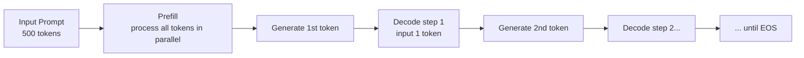
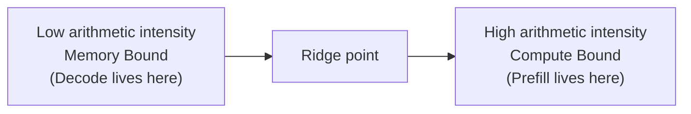
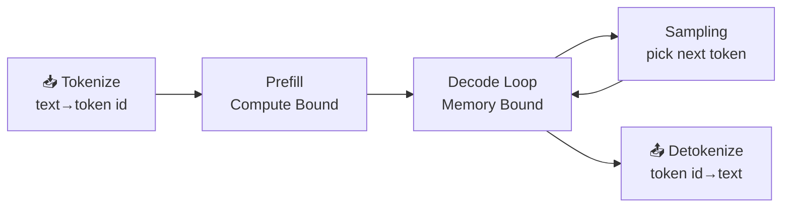

Taking a trained large model and putting it online as a service is a different job from training it. Training feeds in massive data and drives the Loss down; inference aims to **generate as many Tokens as possible, as fast as possible, under latency and cost constraints**. This section skips optimization tricks and does one thing: explain the underlying logic of LLM inference clearly — which two phases it has, why we cache KV, where GPU memory goes, which metrics measure speed, and the question that keeps coming back: **why does a GPU that cost tens of thousands sit mostly idle while generating text?**

When you finish this section you have a coordinate system. Every later inference optimization (PagedAttention, Continuous Batching, quantization, speculative decoding…) is a cut somewhere in that system. Understand the foundation and you can see what each one is actually fixing.

<!-- more -->

## 📑 Contents

- [1. Autoregressive generation: Prefill and Decode](#1-autoregressive-generation-prefill-and-decode)
- [2. KV Cache: trading memory for compute](#2-kv-cache-trading-memory-for-compute)
- [3. Key performance metrics: how to measure "fast"](#3-key-performance-metrics-how-to-measure-fast)
- [4. Bottleneck analysis: why Decode cannot fill the compute](#4-bottleneck-analysis-why-decode-cannot-fill-the-compute)
- [5. Walking the full inference path](#5-walking-the-full-inference-path)
- [Summary](#-summary)
- [Self-check list](#-self-check-list)
- [References](#-references)

---

## 1. Autoregressive generation: Prefill and Decode

### 1.1 Autoregression as "continue the story"

Mainstream large language models (GPT, Llama, Qwen, and so on) are **Decoder-only autoregressive models**. "Autoregressive" sounds abstract; in practice it means **predict only the next word, append that prediction to the input, then predict again** — like a word chain, where the word you just said becomes the clue for the next one.

In one sentence: given the existing Token sequence $x_1, x_2, \dots, x_t$, the model outputs a probability distribution over the next Token, samples $x_{t+1}$, and appends it to continue.

$$
x_{t+1} \sim P(x \mid x_1, x_2, \dots, x_t)
$$

This chain keeps going until the model emits an end-of-sequence token (EOS) or hits the configured max length.

📌 **Key point**: Autoregression is inherently **serial** — Token $t+1$ cannot start until Token $t$ is done. That serial dependency is the root of almost every latency problem later on.

### 1.2 Two phases: Prefill and Decode

Both phases "run the model once," but inference splits into two stages with very different compute profiles.

**Prefill**: Process the whole Prompt you typed. If the Prompt is 500 Tokens, the model feeds those 500 Tokens into the network **once, in parallel**, computes the intermediate results for every layer, and produces the first output Token. Because hundreds or thousands of Tokens are handled together, the matmuls are large and dense, and the GPU's compute is well fed.

**Decode**: From the second output Token onward, generation is a loop that produces one Token at a time. Each step **feeds only the single Token just generated**, runs the full network, and emits the next Token. Generating 200 Tokens means 200 serial Decode steps.

Analogy: Prefill is **reading the exam question** — skim the whole problem at once and understand it. Decode is **writing the answer** — one character at a time, and every character has to look back at everything already written. Reading can be fast; writing has to go stroke by stroke.

### 1.3 Comparing the two phases

| 📊 Dimension | Prefill | Decode |
|---|---|---|
| Input Token count | Whole Prompt (tens to thousands) | 1 per step |
| Parallelism | High; Tokens can run in parallel | Low; steps are serial |
| Compute bottleneck | Compute Bound | Memory Bound |
| Metric it drives | Time to first Token (TTFT) | Time per output Token (TPOT) |
| How many times it runs | Once | Output length − 1 |

The most counterintuitive row is **compute bottleneck**: why is Decode, which only computes 1 Token per step, "memory bound" and less efficient? We answer that head-on with the Roofline model in section 4. For now, keep the conclusion — it is the watershed for understanding inference optimization.

---

## 2. KV Cache: trading memory for compute

### 2.1 What happens without a cache

Back to the serial nature of autoregression. At Decode step $t$, Attention needs the current Token's Query against **the Keys and Values of every previous Token**. Those Keys and Values were already computed in earlier steps.

With no cache, every new Token would re-run all previous Tokens through the network to recompute their K and V — at Token 100 you recompute 99, at Token 200 you recompute 199, and compute grows quadratically with sequence length. That is an obvious waste.

💡 **Tip**: **The core idea of the KV Cache is to store Keys and Values that were already computed and reuse them on the next step, never recompute.** Classic space-for-time: spend GPU memory to buy back repeated compute.

One asymmetry: Query does not need caching, because each step only uses the current Token's Query. Keys and Values accumulate over history and every step needs the full set, so what we cache is K and V — hence the name "KV Cache."

### 2.2 Lifecycle of a KV Cache

A request's KV Cache goes through four stages. Understanding this lifecycle is what makes later PagedAttention make sense:

📥 **Allocate** → ✍️ **Fill** → 🔁 **Use** → 🗑️ **Free**

- **Allocate**: The request arrives; the engine reserves GPU memory for its KV Cache
- **Fill**: Prefill writes the whole Prompt's K and V in one shot; each Decode step appends 1 Token's K and V
- **Use**: Every Decode step reads the full history of KV to compute Attention
- **Free**: Generation ends (EOS or max length); the memory is returned

### 2.3 Memory ledger: how much does the KV Cache take

This is a calculation you should be able to do by hand. Bytes per Token in the KV Cache:

$$
\text{per\_token\_bytes} = 2 \times L \times H_{kv} \times d_{head} \times \text{bytes}
$$

What each term means:

- $2$: store Key and Value separately
- $L$: number of Transformer layers (each layer has its own KV Cache)
- $H_{kv}$: number of KV heads (KV heads, not Query heads)
- $d_{head}$: dimension per head
- $\text{bytes}$: bytes per element; FP16/BF16 is 2, FP8/INT8 is 1

Total for a request multiplies by sequence length and concurrent request count:

$$
\text{total\_bytes} = \text{per\_token\_bytes} \times \text{seq\_len} \times \text{batch\_size}
$$

**A concrete example** (32 layers, standard multi-head attention with 32 KV heads, $d_{head}=128$, FP16):

$$
\text{per\_token\_bytes} = 2 \times 32 \times 32 \times 128 \times 2 = 524288 \text{ bytes} \approx 0.5\ \text{MB}
$$

So **every new Token costs about another 0.5 MB of GPU memory**. At a context of 4096 Tokens, one request's KV Cache alone is about 2 GB. Fifty concurrent requests like that are 100 GB of KV Cache — a single 80 GB GPU blows up. That is why KV Cache memory management is the front line of inference optimization.

📌 **Key point**: $H_{kv}$ is a linear factor in the formula, which is exactly why **GQA (Grouped-Query Attention) / MQA (Multi-Query Attention)** save so much memory — multiple Query heads share one set of KV heads. For example, 32 Query heads sharing 8 KV heads (GQA) cuts the KV Cache to $1/4$ with almost no loss of model capacity. Nearly every modern large model uses GQA because this ledger says so.

### 2.4 Fragmentation

The KV Cache has a quieter trap: **you do not know how long a request will generate**. The traditional approach reserves one contiguous chunk for the "maximum possible length," like a restaurant holding the biggest table no matter how many people show up. Result: the request only generates 100 Tokens but reserved 2048, and the leftover seats sit empty — **internal fragmentation**. Gaps between reserved chunks cannot form one usable block — **external fragmentation**.

⚠️ **Note**: Fragmentation can crush the real utilization of KV Cache memory; large amounts are reserved and never used. That is the core problem vLLM's PagedAttention solves — contiguous big slabs become OS-style paging (covered in the next chapter).

---

## 3. Key performance metrics: how to measure "fast"

"Fast" for an inference service is not one number. User experience, cluster cost, and SLA promises map to different metrics. Mix them up and optimization goes sideways.

### 3.1 Latency metrics: how long the user waits

**TTFT (Time To First Token)**: Time from submit to the first Token. It is mostly **queue time + Prefill time + network latency**. Longer Prompts mean longer Prefill and larger TTFT. For chat and streaming, TTFT is the first impression of "is this responsive?"

**TPOT (Time Per Output Token)**, also called **ITL (Inter-Token Latency)**: Average time per output Token in the generation phase. It sets how fast text "spits out" — at 50 ms TPOT, the user sees about 20 characters per second.

💡 **Tip**: In most contexts TPOT and ITL are synonyms for the average gap between Decode Tokens. The small difference is **whether the first-Token segment is included** — NVIDIA GenAI-Perf excludes it: $\text{ITL} = (\text{e2e\_latency} - \text{TTFT}) / (\text{output Token count} - 1)$.

**End-to-end latency (E2E Latency)**: Total time from submit to the full response. It decomposes as:

$$
\text{E2E} = \text{TTFT} + \text{TPOT} \times (\text{output Token count} - 1)
$$

This formula is practical: **short outputs are TTFT-dominated; long outputs are TPOT-dominated**. Optimize for the side your workload sits on.

**Two scenarios** (TTFT $=500\ \text{ms}$, TPOT $=40\ \text{ms}$):

- Short output (20 Tokens): $\text{E2E} = 500 + 40 \times 19 = 1260\ \text{ms}$, TTFT is about $40\%$ — a slow first Token already angers the user.
- Long output (800 Tokens): $\text{E2E} = 500 + 40 \times 799 \approx 32460\ \text{ms}$, TTFT is only about $1.5\%$ — optimizing TPOT is the real job.

Same system, different product shape, totally different optimization focus. That is why "measure your input/output length distribution first, then talk about optimization" is a hard rule.

### 3.2 Throughput metrics: how much the machine can carry

**Throughput** usually has two readings:

| 📊 Metric | 📝 Meaning | Useful for |
|---|---|---|
| Token/s (system) | Total Tokens generated per second across the system | Cluster capacity and cost |
| Token/s (per user) | Generation speed one user feels | Roughly $1 / \text{TPOT}$ |
| RPS (Requests/s) | Completed requests per second | Concurrent capacity |

System throughput rises with concurrency until GPU resources saturate, then flattens or falls. **Throughput and latency usually trade off**: packing more requests into a Batch raises system throughput, but each request waits and computes longer, so per-user latency gets worse.

### 3.3 Tail latency and Goodput: do not trust the average

Average latency is the easiest metric to lie with. Under real traffic a few requests can be outrageously slow, and the average hides them. Production looks at **tail latency**:

- **P50**: Median; half of requests are faster
- **P95 / P99**: 95% / 99% of requests are faster — this is where user complaints come from

📌 **Key point**: **Goodput** is closer to real value than raw QPS. It only counts throughput for requests that **meet the SLO** (for example TTFT < 1s and TPOT < 50ms). A system with high QPS but most requests timing out has low Goodput — users hate it. Chapter 7's P/D disaggregation and SLO-aware scheduling optimize for Goodput.

---

## 4. Bottleneck analysis: why Decode cannot fill the compute

Now the question from section 1. This is the most important first-principles idea in inference optimization, so it gets its own section.

### 4.1 Arithmetic intensity: compute vs memory traffic

A GPU does two things at once: **moves data** from GPU memory (HBM) and **computes** on it with the ALUs. Whichever is slower is the bottleneck. Whether a task leans compute or memory is measured by **arithmetic intensity**:

$$
\text{arithmetic intensity} = \frac{\text{FLOPs}}{\text{bytes moved}}
$$

Plainly: **for every byte you pull from memory, how many FLOPs do you get to do?** High ratio means the data is reused well and compute stays busy; low ratio means the ALUs wait on data and most time is spent moving.

### 4.2 Roofline model: one picture of the bottleneck

The Roofline model plots this: x-axis arithmetic intensity, y-axis achieved performance. The "roofline" has a left slope capped by memory bandwidth (Memory Bound) and a right plateau capped by peak compute (Compute Bound). Their intersection is that GPU's "ridge point" arithmetic intensity.

A task on the slope (intensity below the ridge point) is bandwidth-bound; more FLOPs on the GPU do not help. Only on the plateau are you compute-bound and actually wringing the GPU dry.

How do you get the ridge point? Peak compute divided by memory bandwidth. For an NVIDIA H100 SXM, dense BF16 is about $990\ \text{TFLOPS}$ (the official $1979\ \text{TFLOPS}$ is with sparsity; dense is about half), HBM3 bandwidth $3.35\ \text{TB/s}$:

$$
\text{ridge point} = \frac{990 \times 10^{12}\ \text{FLOP/s}}{3.35 \times 10^{12}\ \text{Byte/s}} \approx 295\ \text{FLOP/Byte}
$$

So on an H100, every byte moved from memory needs about **295 FLOPs** to keep compute and bandwidth both saturated. Below that you sit on the slope — remember this number; the next subsection uses it as a ruler.

💡 **Tip**: Ridge points differ across GPUs but stay in the same order of magnitude (hundreds of FLOP/Byte). Bandwidth upgrades often "buy more" than compute upgrades because most Decode loads sit stuck on the left side of that bandwidth wall.

### 4.3 Place Prefill and Decode on the chart

- **Prefill**: Hundreds or thousands of Tokens in parallel; weights move once from memory (shared across Tokens in the batch) while you do a huge amount of matmul — arithmetic intensity is **high**, Compute Bound, GPU compute stays fed.
- **Decode**: Each step handles **1 Token**, but to compute that Token you move **the entire model weights** from memory once. Tens or hundreds of GB of weights for one Token's worth of math — arithmetic intensity is **extremely low**, stuck in Memory Bound.

Feel the gap with numbers. The core of each Decode step is "weight matrix × single-Token vector." For a model whose weights weigh $W$ bytes, FP16 each step: move about $W$ bytes of weights, which is $W/2$ weight elements, each participating in about one multiply-add, i.e. about $W/2$ multiply-adds (counting a multiply-add as 2 FLOPs gives about $2 \times W/2 = W$ FLOP). So single-request Decode intensity is about:

$$
\text{arithmetic intensity}_{\text{decode}} \approx \frac{W\ \text{FLOP}}{W\ \text{Byte}} \approx 1\ \text{FLOP/Byte}
$$

Against the H100 ridge point of about $295\ \text{FLOP/Byte}$, single-request Decode is **two orders of magnitude** lower — theoretical compute utilization under $1\%$. That is the naked numerical proof that "Decode cannot fill the compute." Batch $B$ requests together and the weights still move once while serving $B$ Tokens, so intensity scales by $B$ and approaches the ridge point — that is where Batching gets its power.

🔑 **Core idea**: **Decode is slow not because we cannot compute, but because we cannot move data fast enough.** Most of the time the ALUs wait for weights to load from memory. That explains two important facts:

1. **Why Batch raises throughput a lot with almost no latency cost**: Packing multiple requests' Decode into one Batch moves weights once for every Token in the Batch, multiplies arithmetic intensity, and puts idle compute to work — the theoretical basis for Continuous Batching.
2. **Why quantization (especially Weight-only) speeds Decode a lot**: Decode is bottlenecked on moving weights; compressing FP16 to INT4 cuts bytes moved to $1/4$ and latency drops with it.

Once you have this, you have an X-ray for almost every inference optimization technique.

---

## 5. Walking the full inference path

Finally walk a request from entry to exit, mark each stage's compute profile, and make it easier later to find where the bottleneck actually is.

| Stage | What it does | Compute profile | Likely bottleneck |
|---|---|---|---|
| Tokenize | Split input text into Token ID sequences | CPU work | Long text or high concurrency can bottleneck the CPU |
| Prefill | Process all Prompt Tokens in parallel; produce first Token and initial KV Cache | GPU, Compute Bound | Very long Prompts inflate TTFT |
| Decode Loop | Generate Token by Token; each step reads full KV and appends new KV | GPU, Memory Bound | Memory bandwidth; drives TPOT |
| Sampling | Sample the next Token from the output distribution (Temperature/Top-p, etc.) | GPU, lightweight | Complex sampling or constrained decoding adds a bit of overhead |
| Detokenize | Join Token IDs back into readable text; stream the response | CPU work | Contends with the main loop for CPU |

💡 **Tip**: Tokenize / Detokenize are **CPU tasks** and easy to overlook. Once the GPU side is optimized, these CPU stages can become the new bottleneck — which is why the vLLM V1 engine overlaps them with the GPU core loop via multiple processes (covered in Chapter 3).

---

## 📝 Summary

This section skipped optimization tricks and laid the foundation of LLM inference:

- **Two phases**: Prefill reads the question in parallel (Compute Bound, drives TTFT); Decode writes the answer in series (Memory Bound, drives TPOT).
- **KV Cache**: Trade memory for compute so historical K/V are not recomputed; memory cost $= 2 \times L \times H_{kv} \times d_{head} \times \text{bytes} \times \text{seq\_len}$. GQA saves memory by shrinking $H_{kv}$; fragmentation led to PagedAttention.
- **Metrics**: TTFT / TPOT describe first-Token and per-Token speed; E2E $=$ TTFT $+$ TPOT $\times$ (output length $-1$). Production watches P95/P99 tail latency and Goodput under SLO.
- **Bottleneck**: Decode is Memory Bound — the GPU waits on weight movement, not on compute. That is why Batching raises throughput and quantization speeds Decode.

With this coordinate system, every later optimization can be placed: does it attack TTFT or TPOT? Save memory or raise throughput? Cut on the slope or on the plateau?

## 🎯 Self-check list

- Explain how Prefill and Decode differ in input size, parallelism, and compute bottleneck
- Explain why we need a KV Cache, and why we cache K and V but not Q
- Hand-compute per-Token KV Cache memory for a given model config
- Explain why GQA/MQA save KV Cache, and roughly how much
- Accurately distinguish TTFT, TPOT/ITL, Throughput, tail latency, and Goodput, and when each applies
- Use the E2E latency formula to decide whether a workload is TTFT- or TPOT-dominated
- Use arithmetic intensity and Roofline to explain why Decode is Memory Bound
- From "Decode is stuck moving weights," derive why Batching raises throughput and Weight-only quantization speeds Decode
- Sketch the full inference path and name each stage's compute profile and likely bottleneck

## 📚 References

- [Attention Is All You Need (original Transformer paper)](https://arxiv.org/abs/1706.03762)
- [Efficient Memory Management for Large Language Model Serving with PagedAttention (vLLM paper)](https://arxiv.org/abs/2309.06180)
- [GQA: Training Generalized Multi-Query Transformer Models from Multi-Head Checkpoints](https://arxiv.org/abs/2305.13245)
- [NVIDIA NIM LLM Benchmarking — Metrics](https://docs.nvidia.com/nim/benchmarking/llm/latest/metrics.html)
- [vLLM Documentation](https://docs.vllm.ai/en/latest/)
- [Roofline: An Insightful Visual Performance Model for Multicore Architectures](https://dl.acm.org/doi/10.1145/1498765.1498785)
