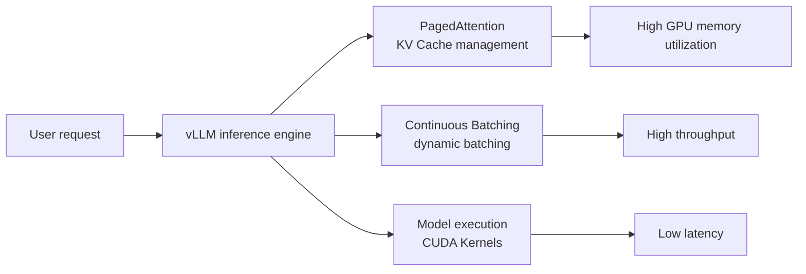

## 📑 Contents

- [1. What is vLLM](#1-what-is-vllm)
- [2. Core idea: PagedAttention](#2-core-idea-pagedattention)
- [3. Install and environment setup](#3-install-and-environment-setup)
- [4. Offline batch inference](#4-offline-batch-inference)
- [5. Online serving](#5-online-serving)
- [6. Key parameter tuning](#6-key-parameter-tuning)
- [7. Multi-GPU inference and tensor parallelism](#7-multi-gpu-inference-and-tensor-parallelism)
- [8. Common issues and troubleshooting](#8-common-issues-and-troubleshooting)
- [Summary](#-summary)
- [Self-check list](#-self-check-list)
- [References](#-references)

---

## 1. What is vLLM

When you put a large language model online as a service, what hurts most? — **Not enough GPU memory, and throughput that will not climb.** Traditional inference is like a restaurant that gives every table its own private room: no matter how many people show up, the room is fully occupied, and everyone else waits. vLLM exists to fix that "private room waste."

vLLM is a **high-throughput, low-latency LLM inference and serving engine** from UC Berkeley Sky Computing Lab. As of v0.19.0 (April 2026), the project has more than 76,000 GitHub stars and 2,000+ contributors, and is one of the mainstream open-source LLM inference frameworks today.

### 1.1 Core strengths of vLLM

| 🏷️ Feature | 📝 Notes |
|---------|---------|
| **PagedAttention** | Manages the KV Cache with OS-style virtual memory paging; GPU memory utilization approaches optimal |
| **Continuous Batching** | Dynamically inserts new requests into the batch that is already running, instead of waiting for a whole batch to finish |
| **OpenAI-compatible API** | Point the OpenAI client `base_url` at vLLM; no business-code changes |
| **200+ models** | Covers Llama, Qwen, Mistral, DeepSeek and other mainstream architectures, including MoE and multimodal models |
| **Multi-hardware** | NVIDIA GPU, AMD GPU, Google TPU, Intel Gaudi, CPU, and more |
| **Quantization options** | FP8, INT8, INT4, GPTQ, AWQ, GGUF ready out of the box |

### 1.2 Where vLLM sits in the inference stack



## 2. Core idea: PagedAttention

Before you dig into usage, understand why vLLM is fast — that helps you make better tuning decisions later.

### 2.1 Problems with a traditional KV Cache

In the Decode phase of LLM inference you cache Key and Value vectors for every previous token (the KV Cache) to avoid recomputation. The traditional approach **pre-allocates one contiguous GPU memory region per request**, sized to the model's maximum sequence length.

That creates three problems:

- **Internal fragmentation**: Most requests never reach max length; reserved space is largely wasted
- **External fragmentation**: Freed regions after requests finish have uneven sizes and are hard for new requests to reuse
- **No sharing**: In Beam Search and similar cases, candidate sequences share a prefix KV Cache, but a contiguous layout cannot share it

💡 **Tip**: For a 13B model, one request's KV Cache at max sequence length can take several GB. With dozens of concurrent requests, the KV Cache bottleneck can be worse than the model weights themselves.

### 2.2 How PagedAttention fixes it

The idea behind PagedAttention is direct — bring OS memory management over to KV Cache management:

| 🖥️ OS concept | 🤖 PagedAttention counterpart |
|----------------|----------------------|
| Virtual memory page | KV Block (fixed-size KV Cache block) |
| Page Table | Block Table (logical block → physical block map) |
| Demand paging | Allocate a new KV Block only as tokens are generated |
| Copy-on-Write | Share prefix KV Blocks in Beam Search |

How it works in practice:

1. **Blocked storage**: The KV Cache no longer needs contiguous memory; it is split into fixed-size Blocks (for example 16 tokens per Block)
2. **Allocate on demand**: Each new token appends into the current Block while it has room; only when full do you allocate a new Block
3. **Mapping table**: Each request keeps a Block Table that maps its logical Blocks to physical Blocks
4. **Memory sharing**: Requests with the same prefix (for example a System Prompt) can share the same physical Blocks and save a lot of GPU memory

⚠️ **Note**: Because PagedAttention stores the KV Cache in non-contiguous physical Blocks, vLLM needs specialized CUDA Kernels to read scattered Blocks efficiently for Attention.

## 3. Install and environment setup

### 3.1 System requirements

| 📊 Item | 📝 Requirement |
|---------|---------|
| OS | Linux (Ubuntu 20.04+ recommended) |
| Python | 3.10 ~ 3.13 |
| CUDA | 12.x (NVIDIA GPU) |
| GPU | Compute Capability 7.0+ (Volta and newer) |

### 3.2 Install with uv (recommended)

`uv` is a fast Python package manager written in Rust. The vLLM docs recommend it; it can detect the CUDA version and pick a matching PyTorch:

```bash
# Create a virtual environment
uv venv --python 3.12 --seed
source .venv/bin/activate

# Install vLLM (auto-detect CUDA version)
uv pip install vllm --torch-backend=auto
```

`--torch-backend=auto` picks a suitable PyTorch build from the system CUDA driver. You can also pin a backend, for example `--torch-backend=cu126`.

### 3.3 Install with conda + pip

```bash
conda create -n vllm-env python=3.12 -y
conda activate vllm-env
pip install --upgrade uv
uv pip install vllm --torch-backend=auto
```

### 3.4 AMD ROCm environment

```bash
uv venv --python 3.12 --seed
source .venv/bin/activate
uv pip install vllm --extra-index-url https://wheels.vllm.ai/rocm/
```

ROCm currently supports Python 3.12 and ROCm 7.0, and requires `glibc >= 2.35`.

### 3.5 Verify the install

```bash
python -c "import vllm; print(vllm.__version__)"
```

## 4. Offline batch inference

Offline inference fits **non-interactive** work such as batch text generation, data labeling, and evaluation runs. vLLM exposes the `LLM` class as the main offline entry point.

### 4.1 Basic usage

```python
from vllm import LLM, SamplingParams

# Define sampling parameters
sampling_params = SamplingParams(
    temperature=0.8,
    top_p=0.95,
    max_tokens=256,
)

# Load the model (downloads from HuggingFace automatically)
llm = LLM(model="Qwen/Qwen2.5-7B-Instruct")

# Batch generation
prompts = [
    "Explain what a Transformer is in one sentence:",
    "What are the main differences between Python and C++?",
    "Recommend three introductory deep learning books:",
]

outputs = llm.generate(prompts, sampling_params)

for output in outputs:
    prompt = output.prompt
    generated = output.outputs[0].text
    print(f"Prompt: {prompt}")
    print(f"Generated: {generated}\n")
```

📌 **Key point**: Constructing `LLM` loads the model into GPU memory in one shot. By default vLLM uses 90% of available GPU memory (model weights + KV Cache); tune it with `gpu_memory_utilization`.

### 4.2 Chat-mode inference

For Instruct/Chat models you must apply the Chat Template correctly. vLLM offers two ways:

**Option 1: use `llm.chat` (recommended)**

```python
from vllm import LLM, SamplingParams

llm = LLM(model="Qwen/Qwen2.5-7B-Instruct")
sampling_params = SamplingParams(temperature=0.7, max_tokens=512)

messages_list = [
    [
        {"role": "system", "content": "You are an AI Infra expert."},
        {"role": "user", "content": "Explain what tensor parallelism is."},
    ],
    [
        {"role": "user", "content": "What is the difference between vLLM and TensorRT-LLM?"},
    ],
]

outputs = llm.chat(messages_list, sampling_params)

for output in outputs:
    print(output.outputs[0].text)
```

**Option 2: apply the template yourself**

```python
from transformers import AutoTokenizer
from vllm import LLM, SamplingParams

model_name = "Qwen/Qwen2.5-7B-Instruct"
tokenizer = AutoTokenizer.from_pretrained(model_name)
llm = LLM(model=model_name)

messages_list = [
    [{"role": "user", "content": "What is a KV Cache?"}],
]

# Apply the chat template manually
texts = tokenizer.apply_chat_template(
    messages_list,
    tokenize=False,
    add_generation_prompt=True,
)

outputs = llm.generate(texts, SamplingParams(temperature=0.7))
```

⚠️ **Note**: `llm.generate` does not apply a Chat Template automatically. Feeding raw text to a Chat model can produce poor or garbled output. Use `llm.chat` or call `apply_chat_template` yourself.

### 4.3 Effect of HuggingFace generation_config

By default vLLM reads `generation_config.json` from the model repo (if present) and overrides vLLM's defaults with those values. To keep vLLM's own default sampling config, set it explicitly:

```python
llm = LLM(model="Qwen/Qwen2.5-7B-Instruct", generation_config="vllm")
```

## 5. Online serving

Online serving is the most common vLLM deployment: start an HTTP server that exposes an **OpenAI-compatible API**, and the client only needs to change `base_url`.

### 5.1 Start the server

```bash
vllm serve Qwen/Qwen2.5-7B-Instruct
```

It listens on `http://localhost:8000` by default. Customize with `--host` and `--port`:

```bash
vllm serve Qwen/Qwen2.5-7B-Instruct \
    --host 0.0.0.0 \
    --port 8080 \
    --tensor-parallel-size 2
```

💡 **Tip**: You can also pass `--generation-config vllm` to ignore HuggingFace's default generation_config.

### 5.2 Chat Completions API

This is the most used endpoint, matching OpenAI's `v1/chat/completions`:

**With curl:**

```bash
curl http://localhost:8000/v1/chat/completions \
    -H "Content-Type: application/json" \
    -d '{
        "model": "Qwen/Qwen2.5-7B-Instruct",
        "messages": [
            {"role": "system", "content": "You are a helpful assistant."},
            {"role": "user", "content": "What is PagedAttention?"}
        ],
        "temperature": 0.7,
        "max_tokens": 512
    }'
```

**With the Python openai client:**

```python
from openai import OpenAI

# Only change base_url; the rest of the code stays the same
client = OpenAI(
    api_key="EMPTY",  # vLLM does not require auth by default
    base_url="http://localhost:8000/v1",
)

response = client.chat.completions.create(
    model="Qwen/Qwen2.5-7B-Instruct",
    messages=[
        {"role": "system", "content": "You are an AI infrastructure expert."},
        {"role": "user", "content": "Explain how Continuous Batching works."},
    ],
    temperature=0.7,
    max_tokens=512,
)

print(response.choices[0].message.content)
```

### 5.3 Completions API

Matches OpenAI's `v1/completions`, for text completion:

```python
from openai import OpenAI

client = OpenAI(api_key="EMPTY", base_url="http://localhost:8000/v1")

completion = client.completions.create(
    model="Qwen/Qwen2.5-7B-Instruct",
    prompt="The three core directions of LLM inference optimization are",
    max_tokens=256,
    temperature=0.8,
)

print(completion.choices[0].text)
```

### 5.4 API authentication

In production, turn on API Key auth:

```bash
vllm serve Qwen/Qwen2.5-7B-Instruct --api-key my-secret-key
```

Or set it via environment variable:

```bash
export VLLM_API_KEY=my-secret-key
vllm serve Qwen/Qwen2.5-7B-Instruct
```

Pass the matching `api_key` from the client:

```python
client = OpenAI(api_key="my-secret-key", base_url="http://localhost:8000/v1")
```

### 5.5 Supported API endpoints

| 📡 Endpoint | 📝 Notes |
|---------|---------|
| `GET /v1/models` | List available models |
| `POST /v1/completions` | Text completion |
| `POST /v1/chat/completions` | Chat completion |
| `GET /health` | Health check |

## 6. Key parameter tuning

### 6.1 Sampling parameters (SamplingParams)

| 📊 Parameter | 📝 Notes | Default |
|---------|---------|--------|
| `temperature` | Controls randomness; higher is more random | 1.0 |
| `top_p` | Nucleus sampling; sample from tokens whose cumulative probability is within p | 1.0 |
| `top_k` | Sample only from the top-k tokens by probability | -1 (no limit) |
| `max_tokens` | Max tokens to generate | 16 |
| `repetition_penalty` | Repetition penalty; >1 reduces repeats | 1.0 |
| `stop` | Stop when this string is hit | None |
| `n` | Number of sequences to generate per prompt | 1 |
| `seed` | Random seed for reproducible results | None |

💡 **Tip**: For most production work, start with `temperature=0.7, top_p=0.9`. For deterministic output set `temperature=0`.

### 6.2 Key engine parameters

| ⚙️ Parameter | 📝 Notes | Recommended |
|---------|---------|--------|
| `--model` | HuggingFace model id | - |
| `--tensor-parallel-size` | Number of GPUs for tensor parallelism | Depends on model size |
| `--gpu-memory-utilization` | Fraction of GPU memory to use | 0.9 (default) |
| `--max-model-len` | Max model sequence length | Set as needed |
| `--dtype` | Weight precision | auto |
| `--quantization` | Quantization method | None |
| `--max-num-seqs` | Max concurrent sequences | 256 |
| `--enforce-eager` | Disable CUDA Graph | Use while debugging |

### 6.3 Memory estimate and gpu-memory-utilization

At startup vLLM partitions GPU memory roughly like this:

```
Total GPU memory × gpu_memory_utilization = model weights + KV Cache + temporary buffers
```

KV Cache free space = total quota − model weights − fixed overhead. A larger KV Cache means more concurrent requests and higher throughput.

```bash
# If memory is tight, lower utilization a bit
vllm serve Qwen/Qwen2.5-7B-Instruct --gpu-memory-utilization 0.85

# Or cap max sequence length to free KV Cache space
vllm serve Qwen/Qwen2.5-7B-Instruct --max-model-len 4096
```

⚠️ **Note**: If you OOM right after load, usually lower `--gpu-memory-utilization` or `--max-model-len`, or raise `--tensor-parallel-size` to spread across more GPUs.

### 6.4 Choosing an Attention Backend

vLLM picks the fastest Attention backend for the current platform automatically; you can also set it by hand:

```bash
# Use FlashAttention
vllm serve Qwen/Qwen2.5-7B-Instruct --attention-backend FLASH_ATTN

# Use FlashInfer
vllm serve Qwen/Qwen2.5-7B-Instruct --attention-backend FLASHINFER
```

| 🖥️ Platform | 📝 Available backends |
|---------|------------|
| NVIDIA CUDA | `FLASH_ATTN`, `FLASHINFER` |
| AMD ROCm | `TRITON_ATTN`, `ROCM_ATTN`, and others |

## 7. Multi-GPU inference and tensor parallelism

When one GPU cannot hold the model, use Tensor Parallelism to shard it across multiple GPUs.

### 7.1 Basic usage

```bash
# 2-GPU tensor parallelism
vllm serve Qwen/Qwen2.5-72B-Instruct --tensor-parallel-size 2

# 4-GPU tensor parallelism (fits 70B+ models)
vllm serve Qwen/Qwen2.5-72B-Instruct --tensor-parallel-size 4
```

Offline inference supports the same option:

```python
from vllm import LLM, SamplingParams

llm = LLM(
    model="Qwen/Qwen2.5-72B-Instruct",
    tensor_parallel_size=4,
)

outputs = llm.generate(["Explain the architecture of vLLM"], SamplingParams(max_tokens=256))
```

### 7.2 Model size vs GPU count reference

Rough FP16 memory needs for common model sizes:

| 🤖 Model size | 💾 Weight size (FP16) | 📝 Suggested minimum GPU setup |
|------------|-------------------|---------------------|
| 7B | ~14 GB | 1× A100 80G / 1× L40S 48G |
| 13B | ~26 GB | 1× A100 80G |
| 34B | ~68 GB | 1× A100 80G (lower max_model_len) or 2× A100 |
| 70B | ~140 GB | 2× A100 80G |
| 405B | ~810 GB | 16× A100 80G or 8× H100 80G |

💡 **Tip**: Real memory needed = model weights + KV Cache + runtime overhead. Quantization (for example AWQ INT4) can shrink weights by about 4×, so fewer GPUs can serve larger models.

### 7.3 Parallelism modes vLLM supports

vLLM supports five parallelism strategies:

- **Tensor Parallelism**: Shard each layer's weight matrices by column/row across GPUs
- **Pipeline Parallelism**: Place different layers on different GPUs
- **Data Parallelism**: Independent replicas handle different requests
- **Expert Parallelism**: In MoE models, place different experts on different GPUs
- **Context Parallelism**: Spread a long sequence's context across GPUs

For most cases **tensor parallelism is the first choice**: simplest to configure and usually the most effective.

## 8. Common issues and troubleshooting

### 8.1 OOM at startup

```
torch.cuda.OutOfMemoryError: CUDA out of memory.
```

✅ **Fixes**:

```bash
# Option 1: lower memory utilization
vllm serve model_name --gpu-memory-utilization 0.8

# Option 2: shorten max sequence length
vllm serve model_name --max-model-len 2048

# Option 3: add tensor parallelism
vllm serve model_name --tensor-parallel-size 2

# Option 4: use a quantized model
vllm serve model_name --quantization awq
```

### 8.2 Garbled output from a Chat model

If you pass raw text to a Chat model through `llm.generate`, the output may not match expectations.

✅ **Fix**: Switch to `llm.chat` or call `tokenizer.apply_chat_template` yourself so the input matches the model's Chat Template.

### 8.3 Download models from ModelScope

HuggingFace downloads can be slow in China; switch to ModelScope:

```bash
export VLLM_USE_MODELSCOPE=True
vllm serve Qwen/Qwen2.5-7B-Instruct
```

### 8.4 Trust remote code

Some models need custom code:

```bash
vllm serve model_name --trust-remote-code
```

## 📝 Summary

With **PagedAttention** and **Continuous Batching**, vLLM raises LLM inference GPU-memory utilization and throughput to a new level. This article covers the full path from zero:

1. **Understand the idea**: PagedAttention manages the KV Cache in blocks, borrowing OS virtual-memory paging to fix fragmentation
2. **Offline inference**: Use `LLM` and `SamplingParams` for quick batch text generation
3. **Online serving**: One command starts an OpenAI-compatible API server; clients migrate with near-zero cost
4. **Tuning practice**: Master `gpu-memory-utilization`, `max-model-len`, `tensor-parallel-size`, and related knobs
5. **Multi-GPU scale-out**: Serve 70B+ models with tensor parallelism

## 🎯 Self-check list

- Explain the core idea of PagedAttention and the fragmentation problem it solves
- Run offline batch inference with `LLM` and `SamplingParams`
- Use `llm.chat` for Chat-mode inference and understand why the Chat Template matters
- Start an OpenAI-compatible online service with `vllm serve`
- Call a vLLM service with the Python openai client
- Pick a suitable `tensor-parallel-size` from model size and GPU memory
- Fix OOM by tuning `gpu-memory-utilization` and `max-model-len`
- State the core difference between vLLM and traditional inference in GPU-memory management

## 📚 References

- [vLLM docs — Quickstart](https://docs.vllm.ai/en/stable/getting_started/quickstart.html)
- [vLLM GitHub repository](https://github.com/vllm-project/vllm)
- [Efficient Memory Management for Large Language Model Serving with PagedAttention (Kwon et al., 2023)](https://arxiv.org/abs/2309.06180)
- [vLLM architecture overview](https://docs.vllm.ai/en/stable/design/arch_overview.html)
- [vLLM feature compatibility matrix](https://docs.vllm.ai/en/stable/features/index.html)
