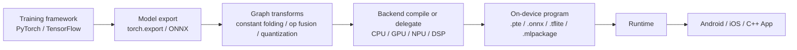
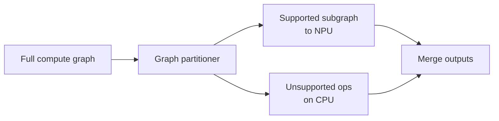
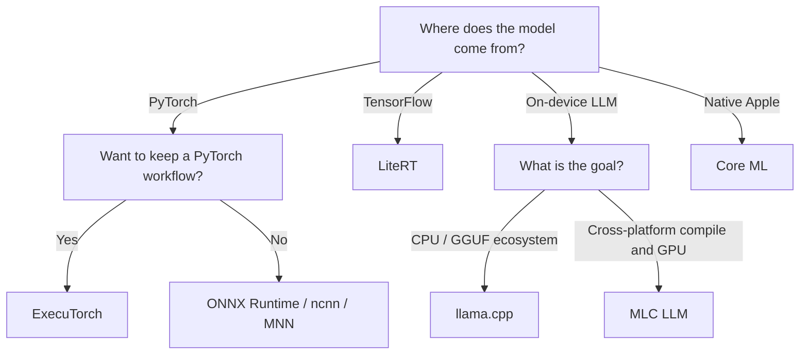

When we deploy a model in a data center, we usually ask first: **how many requests can one GPU handle?**

On phones, cars, cameras, and embedded devices, the questions change: will the model fit in memory? How long is first startup? After ten minutes of continuous run, does thermal throttling kick in? If an op is not supported by the NPU, does the system error out, or quietly fall back to the CPU?

Together these questions define **on-device inference**. It is not "cross-compile the server binary." You redesign the inference path around limited resources, heterogeneous hardware, and fragmented platforms.

By the end of this article you will have a full map of on-device inference: how a model becomes a program the device can run, what CPU/GPU/NPU/DSP each own, how runtimes relate to hardware backends, and how to run reproducible experiments that tell you whether an optimization actually helped.

<!-- more -->

## 📑 Contents

- [1. What on-device inference is](#1-what-on-device-inference-is)
- [2. Four constraints on edge devices](#2-four-constraints-on-edge-devices)
- [3. The full path from model to app](#3-the-full-path-from-model-to-app)
- [4. CPU, GPU, NPU, and DSP](#4-cpu-gpu-npu-and-dsp)
- [5. How to choose an on-device runtime](#5-how-to-choose-an-on-device-runtime)
- [6. Four levers for on-device optimization](#6-four-levers-for-on-device-optimization)
- [7. How to run a trustworthy on-device benchmark](#7-how-to-run-a-trustworthy-on-device-benchmark)
- [8. A minimal ExecuTorch + XNNPACK example](#8-a-minimal-executorch--xnnpack-example)
- [9. Common issues and a debugging order](#9-common-issues-and-a-debugging-order)
- [10. Selection guidance](#10-selection-guidance)
- [Summary](#-summary)
- [Self-check list](#-self-check-list)
- [References](#-references)

---

## 1. What on-device inference is

On-device inference means the model runs on a device the user holds or that sits near the data source: phones, tablets, PCs, cars, robots, cameras, wearables, and IoT endpoints.

People often mix it with edge inference, but the scopes are not the same:

- **Device** stresses the end device, where resource limits are usually the tightest;
- **Edge** can also include base stations, store servers, and edge gateways;
- **Cloud** usually has more compute, memory, and thermal headroom.

Why put the model on device? Four common reasons:

1. **Low latency**: camera detection, voice wake-up, and driver assist cannot wait for a network round trip;
2. **Offline**: the feature still works on weak or no network;
3. **Privacy**: raw images, audio, and text can stay local;
4. **Cost**: frequent, light requests finished locally cut cloud compute and bandwidth.

The tradeoff is that engineering constraints expand from "mostly throughput and cost" to "latency, memory, package size, power, temperature, accuracy, and compatibility at once."

---

## 2. Four constraints on edge devices

### 2.1 Memory and storage

An on-device model occupies model files, weights, activations, temporary workspace, and the runtime itself. The OS also caps how much memory one app can use, so "8 GB of physical RAM" does not mean the model can take all 8 GB.

For weights alone, a first estimate is:

$$
M_{weights} \approx P \times \frac{b}{8}
$$

where $P$ is parameter count and $b$ is bits per parameter. A 3B model needs about this much for weights only:

| Precision | Theoretical weight size |
|---|---:|
| FP16/BF16 | 6 GB |
| INT8 | 3 GB |
| INT4 | 1.5 GB |

That is only a theoretical lower bound. In practice you still add quantization scales, file alignment, KV Cache, activations, and workspace.

For a decoder-only LLM, KV Cache can be approximated as:

$$
M_{KV} \approx 2 \times L \times B \times T \times H_{kv} \times D \times s
$$

where $L$ is layers, $B$ is batch size, $T$ is cached tokens, $H_{kv}$ is KV head count, $D$ is per-head dim, and $s$ is bytes per element. The leading 2 is Key and Value.

That is why a common failure mode shows up: the weights load fine, but long context still does not run stably.

### 2.2 Power and thermals

On-device work is not only about peak speed of one inference. CPU or GPU can be fast for a short burst, then throttle under temperature and power limits. A reliable realtime app should care about steady-state performance, not only the best run right after launch.

### 2.3 Hardware fragmentation

Two Android phones can have different CPU ISAs, GPU drivers, and NPU toolchains. The same graph may fully delegate to the NPU on device A, while on device B some ops fall back to the CPU.

### 2.4 App lifecycle

On-device inference is tied to the app lifecycle. Does model load block the UI? Do you free memory when the app goes to the background? Can you roll back after a failed model update? These questions are not about model structure, but they decide whether the feature can ship.

---

## 3. The full path from model to app

On-device inference usually goes through these stages:



Three ideas are easy to mix up:

- **Model format or intermediate representation (IR)** describes the graph and weights, for example ONNX;
- **Runtime** loads the model, manages memory, and kicks off execution, for example ExecuTorch, ONNX Runtime, or ncnn;
- **Backend/Delegate** actually runs part of the compute, for example XNNPACK, Core ML, Vulkan, or Qualcomm QNN.

The runtime does not have to compute every op itself. It can hand supported subgraphs to a hardware backend and leave the rest to the default CPU kernels. That mechanism is called **partitioning** or **delegation**.



So "NPU enabled" does not mean "the whole model runs on the NPU." The first step of on-device optimization is to check the actual partition result.

---

## 4. CPU, GPU, NPU, and DSP

### 4.1 CPU: the most reliable baseline

CPU usually has the best op coverage and debugging experience, and it is the strongest compatibility fallback. Optimization focus includes:

- SIMD such as ARM NEON and SVE;
- thread count and big.LITTLE scheduling;
- cache hit rate and memory layout;
- optimized kernels such as XNNPACK and oneDNN;
- avoiding too many threads, which causes contention and higher power.

### 4.2 GPU: high parallelism, with transfer cost

Mobile GPUs fit tasks with high parallelism and larger compute. Common interfaces are Vulkan, Metal, and OpenCL. Watch for:

- small ops that cannot amortize scheduling overhead;
- data conversion and sync between CPU and GPU, which cost time;
- driver quality and supported precisions that differ across devices;
- GPU acceleration that is not guaranteed to beat a well-tuned ARM CPU.

### 4.3 NPU: high energy efficiency, strict op boundaries

NPUs are optimized for matrix math, convolution, and low-precision inference, and often have strong energy efficiency. The main limits are op coverage, tensor layout, dynamic shapes, and quantization rules. Any unsupported node in the graph can trigger a split and a backend switch.

### 4.4 DSP: good for always-on signal work

DSPs are common for audio, sensors, and low-power always-on tasks. Peak compute may not be the highest, but they can keep processing regular data streams at low power.

There is no "always fastest" answer for on-device hardware. The right approach is to build an accuracy baseline on CPU first, then measure GPU/NPU/DSP coverage, end-to-end latency, and steady-state power separately.

---

## 5. How to choose an on-device runtime

| Runtime | Main entry | Common targets | Good fit |
|---|---|---|---|
| ExecuTorch | PyTorch / `torch.export` | XNNPACK, Vulkan, Core ML, QNN, and others | Keep a PyTorch workflow, or need multiple hardware backends |
| ONNX Runtime Mobile | ONNX | Android, iOS, many Execution Providers | Many model sources, cross-framework interop matters |
| LiteRT | TFLite/LiteRT | Android, iOS, GPU/NPU delegates | TensorFlow / Google AI Edge ecosystem |
| Core ML | Core ML Model | Apple CPU, GPU, Neural Engine | Native iOS/macOS apps |
| ncnn | pnnx / ONNX conversion | ARM CPU, Vulkan | Light C++ dependency, mobile vision and embedded deploy |
| MNN | ONNX/TFLite and other conversions | CPU, GPU, on-device LLM | Mobile in China, classic models and LLM together |
| llama.cpp | GGUF | CPU, Metal, Vulkan, and others | Local and on-device LLM inference |
| MLC LLM | Compile to a target model library | Android, iOS, WebGPU, Vulkan, and others | Cross-platform, compiler-driven LLM deploy |

This table is for orientation, not a performance ranking. Runtime results depend on model structure, device, precision, backend coverage, and version. Fix the model and the test protocol first, then measure on the target device.

---

## 6. Four levers for on-device optimization

### 6.1 Model compression

Common methods include structured pruning, distillation, low-rank factorization, and choosing a smaller architecture. Compression cuts compute, and it can also change the op structure, so evaluate it against the target hardware's kernel support.

### 6.2 Quantization

Quantization converts weights or activations from FP32/FP16 to lower precision such as INT8 or INT4. Know these distinctions:

- **PTQ (post-training quantization)**: low cost, good for fast deploy;
- **QAT (quantization-aware training)**: simulates quantization error during training, usually better accuracy;
- **Weight-only**: quantize weights only, common for LLMs;
- **Weight and activation quantization**: stronger compression, more dependent on hardware support;
- **Per-tensor / Per-channel**: one set of scale params for the whole tensor, or one per channel.

Quantization does not always mean speedup. If the hardware has no matching low-precision kernel, or the graph keeps doing quantize/dequantize, latency can go up. When you evaluate quantization, report model size, latency, memory, and accuracy together.

### 6.3 Graph and op optimization

Common graph opts include:

- constant folding;
- fusions such as Conv-BN and Linear-Activation;
- removing redundant Cast, Transpose, and Reshape;
- NCHW/NHWC layout conversion;
- static shape specialization;
- custom ops or replacing unsupported ops.

The goal is not fewer nodes at any cost. It is less memory traffic, less scheduling overhead, and fewer backend switches.

### 6.4 Memory planning

On-device memory work includes:

- reusing activation buffers whose lifetimes do not overlap;
- memory-mapping large weight files and loading on demand;
- controlling LLM context length and KV Cache precision;
- avoiding duplicate tensor copies across preprocess, runtime, and UI;
- loading in shards with a clear fallback when memory allocation fails.

---

## 7. How to run a trustworthy on-device benchmark

Reporting one "average latency" almost never means anything. A reproducible on-device benchmark should at least record:

### 7.1 Environment

- device model, SoC, memory, and OS version;
- runtime, model, and driver versions;
- model precision and quantization method;
- actual execution backends and graph partition results;
- thread count, input size, batch size, and dynamic shape range.

### 7.2 Performance metrics

- cold start and model load time;
- P50, P90, P99 latency after warmup;
- throughput;
- peak memory and steady-run memory;
- model file and runtime package size;
- power, temperature, and performance after sustained run;
- task accuracy and error vs the original model.

For LLMs, also add:

- **TTFT**: time to first token;
- **TPOT**: average time between adjacent output tokens;
- Prefill and Decode tokens/s separately;
- max stable context length;
- peak memory and whether the OS starts reclaiming memory.

### 7.3 Recommended experiment protocol

1. Fix the input samples and random seed;
2. Run the original framework first and save an accuracy baseline;
3. Time model load and inference separately;
4. Warm up several times, then collect at least tens of inference runs;
5. Report median and tail latency together;
6. Run continuously for a while and watch temperature and throttling;
7. Check which backend each subgraph actually used;
8. Save scripts, configs, and raw results, not only the final conclusion.

📌 **Key point**: on-device benchmark comparisons must control variables. Numbers from different input sizes, thread counts, quantization precisions, or backend coverage cannot be compared sideways.

Save the critical conditions and results of each run together. At minimum include fields like these:

```yaml
device: "device model / SoC / memory"
os: "OS and version"
model: "model name, version, and file hash"
runtime: "runtime, version, and execution backend"
precision: "FP16 / INT8 / INT4 ..."
input: "input size, batch size, context length"
threads: 4
warmup_runs: 10
measured_runs: 100
delegate_coverage: "delegated subgraph ratio or unsupported ops"
latency_ms: "P50 / P90 / P99"
peak_memory_mb: 0
power_and_temperature: "measurement tool, initial values, steady-state values"
accuracy: "task metric or max error vs baseline"
```

Model file hash, runtime version, and backend coverage matter especially: they prevent two common mistakes — "same model name, different file" and "claimed NPU use, mostly CPU fallback."

---

## 8. A minimal ExecuTorch + XNNPACK example

ExecuTorch exports a PyTorch model to a light `.pte` program and uses delegates to hand compute to backends such as XNNPACK, Core ML, Vulkan, and Qualcomm QNN. Below we walk a minimal export path with the cross-platform CPU backend XNNPACK.

> APIs evolve across versions. The example below follows the export interface shown in the ExecuTorch 1.3 docs; in practice pin PyTorch, ExecuTorch, and the target backend versions.

Install in a separate Python environment and record the versions:

```bash
python -m pip install executorch
python -m pip show torch executorch
```

For a first exercise, start with XNNPACK as a CPU baseline. It needs no extra chip-vendor SDK, which makes it easier to separate "model export problems" from "NPU toolchain problems."

### 8.1 Define a small model

```python
import torch


class TinyClassifier(torch.nn.Module):
    def __init__(self) -> None:
        super().__init__()
        self.features = torch.nn.Sequential(
            torch.nn.Conv2d(3, 8, kernel_size=3, stride=2, padding=1),
            torch.nn.ReLU(),
            torch.nn.Conv2d(8, 16, kernel_size=3, stride=2, padding=1),
            torch.nn.ReLU(),
            torch.nn.AdaptiveAvgPool2d((1, 1)),
        )
        self.classifier = torch.nn.Linear(16, 10)

    def forward(self, x: torch.Tensor) -> torch.Tensor:
        x = self.features(x)
        x = torch.flatten(x, 1)
        return self.classifier(x)


model = TinyClassifier().eval()
example_inputs = (torch.randn(1, 3, 224, 224),)
```

Call `eval()` before on-device export so Dropout and BatchNorm are not still in training behavior. The example inputs also fix the graph's input shapes and types.

### 8.2 Export and delegate to XNNPACK

```python
import torch
from executorch.backends.xnnpack.partition.xnnpack_partitioner import (
    XnnpackPartitioner,
)
from executorch.exir import to_edge_transform_and_lower


exported_program = torch.export.export(model, example_inputs)

edge_program = to_edge_transform_and_lower(
    exported_program,
    partitioner=[XnnpackPartitioner()],
)

executorch_program = edge_program.to_executorch()

with open("tiny_classifier_xnnpack.pte", "wb") as file:
    file.write(executorch_program.buffer)
```

This program does three things:

1. `torch.export.export` captures the PyTorch graph;
2. `XnnpackPartitioner` marks and lowers subgraphs XNNPACK supports;
3. `to_executorch` produces a `.pte` file for the on-device runtime to load.

### 8.3 What to verify

Writing the file is not the end of deploy. At least also check:

- whether export-before/after output error is within tolerance;
- which ops were delegated to XNNPACK and which still use default kernels;
- final package size of the `.pte` file and the runtime;
- load time, latency, and memory on a real Android/iOS device;
- stability across repeated and sustained runs.

If the target is Qualcomm NPU, Apple Neural Engine, or Vulkan GPU, the overall flow stays the same, but you swap the partitioner and prepare the SDK, build options, and device environment per that backend's docs.

---

## 9. Common issues and a debugging order

### 9.1 Export fails

First find unsupported Python control flow, dynamic shapes, or custom ops, then try rewriting the model or registering a custom op. Do not keep swapping opset or runtime versions when you do not know which node failed.

### 9.2 Output accuracy mismatches

Narrow the problem in this order:

1. Align preprocess and postprocess;
2. Compare FP32 outputs before and after export;
3. Then compare before and after quantization;
4. Finally compare across hardware backends;
5. If needed, save intermediate tensors and find the first op with a clear error.

Many "runtime accuracy bugs" are actually RGB/BGR, normalization, Resize, or NCHW/NHWC mismatches.

### 9.3 NPU slower than CPU

Check these first:

- how many ops the NPU actually covers;
- whether CPU↔NPU data conversion is frequent;
- whether the input is too small to amortize compile and scheduling overhead;
- whether the benchmark folds model load, first compile, or warmup into inference time;
- whether the quantization type actually hits an NPU kernel.

### 9.4 First run is especially slow

Likely causes include model deserialization, weight rearranging, graph compile, and GPU pipeline creation. Measure cold start and warm start separately, and cache reusable compile results when the runtime allows it.

### 9.5 Gets slower over continuous run

Watch temperature, CPU/GPU frequency, thread scheduling, and power mode. If latency worsens as temperature rises, shift the optimization goal from peak speed to energy efficiency and steady-state speed.

---

## 10. Selection guidance

You can start from model source and target platform:



This only shrinks the candidate set. Final choice still depends on correctness, backend coverage, latency, memory, power, and package size on the target device.

---

## 🎯 Summary

On-device inference is about turning a model into a reliable product feature on limited, heterogeneous hardware:

1. On-device care is not only speed — also memory, power, temperature, package size, and compatibility;
2. Model format, runtime, and backend are three different layers;
3. Delegates partition the graph; unsupported ops may fall back to CPU;
4. Whether quantization speeds things up depends on hardware kernels and whole-graph execution;
5. On-device performance must be measured on real devices under a fixed protocol;
6. Build a CPU correctness baseline, then gradually enable GPU/NPU — that is the more reliable optimization path.

---

## ✅ Self-check list

- [ ] Can explain the difference among on-device, edge, and cloud inference
- [ ] Can tell apart model format, runtime, and backend/delegate
- [ ] Can state the main traits of CPU, GPU, NPU, and DSP
- [ ] Can estimate memory for model weights and LLM KV Cache
- [ ] Can explain why quantized models are not always faster
- [ ] Can spot backend fallback and data-transfer issues in heterogeneous execution
- [ ] Can design a benchmark that covers cold start, tail latency, memory, power, and accuracy
- [ ] Can describe the basic flow of exporting a PyTorch model to an ExecuTorch `.pte`

---

## 📚 References

1. [ExecuTorch Documentation](https://docs.pytorch.org/executorch/stable/)
2. [ExecuTorch Architecture and Components](https://docs.pytorch.org/executorch/stable/getting-started-architecture)
3. [ExecuTorch Quick Start Pathway](https://docs.pytorch.org/executorch/stable/pathway-quickstart.html)
4. [ONNX Runtime Mobile](https://onnxruntime.ai/docs/tutorials/mobile/)
5. [Google AI Edge LiteRT](https://ai.google.dev/edge/litert)
6. [Apple Core ML](https://developer.apple.com/documentation/coreml)
7. [Tencent ncnn](https://github.com/Tencent/ncnn)
8. [Alibaba MNN](https://github.com/alibaba/MNN)
9. [llama.cpp Android Guide](https://github.com/ggml-org/llama.cpp/blob/master/docs/android.md)
10. [MLC LLM Documentation](https://llm.mlc.ai/docs/)
11. [Qualcomm AI Engine Direct SDK](https://www.qualcomm.com/developer/software/qualcomm-ai-engine-direct-sdk)
12. [MLPerf Inference: Mobile](https://mlcommons.org/benchmarks/inference-mobile/)
