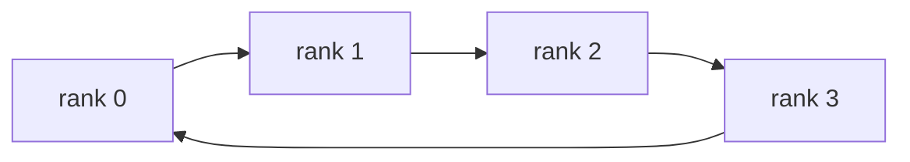
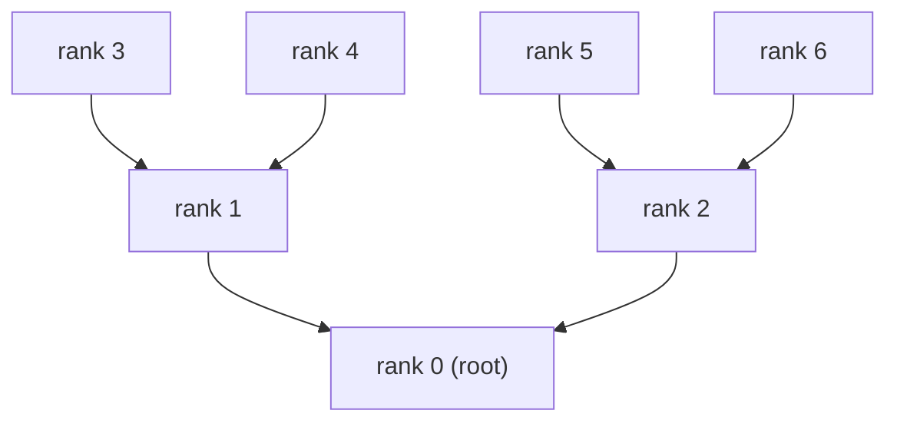
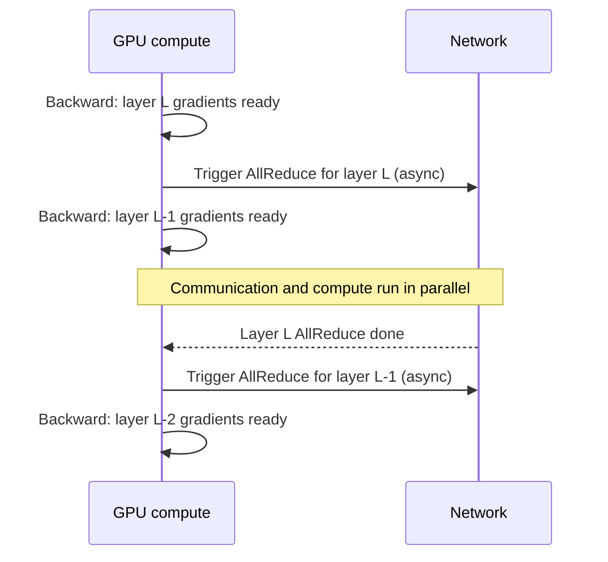

Even the strongest single GPU has a ceiling. Large-model training and inference inevitably need multi-GPU and multi-node collaboration. How GPUs talk to each other, and how fast, becomes a main factor in overall efficiency. This article goes from NVLink inside a node to InfiniBand across nodes, then through collective primitives, Ring/Tree AllReduce, communication-compute overlap, and the NCCL library, to map out the full knowledge chain of AI cluster communication.

<!-- more -->

## Table of contents

- [1. Intra-node GPU communication: NVLink and NVSwitch](#1-intra-node-gpu-communication-nvlink-and-nvswitch)
- [2. Inter-node communication: InfiniBand and RoCE](#2-inter-node-communication-infiniband-and-roce)
- [3. Point-to-point communication: the basic building block](#3-point-to-point-communication-the-basic-building-block)
- [4. Collective communication primitives](#4-collective-communication-primitives)
- [5. Ring AllReduce: a bandwidth-optimal implementation](#5-ring-allreduce-a-bandwidth-optimal-implementation)
- [6. Tree AllReduce: another approach for low latency](#6-tree-allreduce-another-approach-for-low-latency)
- [7. Communication and compute overlap](#7-communication-and-compute-overlap)
- [8. NCCL: the GPU collective communication library](#8-nccl-the-gpu-collective-communication-library)
- [9. Understanding distributed parallelism from a communication view](#9-understanding-distributed-parallelism-from-a-communication-view)
- [Summary](#-summary)
- [Self-check list](#-self-check-list)
- [References](#-references)


## 1. Intra-node GPU communication: NVLink and NVSwitch

When a model needs multiple GPUs working together, how fast data moves between cards directly sets the efficiency of parallelism.

### 1.1 PCIe: a starting point that is not enough

PCIe is the most basic interconnect between GPU and CPU, and between GPUs. Think of it as an ordinary city road between two buildings: any car can use it, but the lanes are narrow and there are plenty of traffic lights.

| PCIe version | Unidirectional bandwidth (x16) | Bidirectional bandwidth (x16) |
|-----------|:-------------:|:-------------:|
| PCIe 4.0 | 32 GB/s | 64 GB/s |
| PCIe 5.0 | 64 GB/s | 128 GB/s |

For large-model tensor parallelism, every layer's forward and backward pass needs AllReduce. Even the newest PCIe 5.0, at 128 GB/s bidirectional, is far from enough: rush hour with every car jammed on the same road.

### 1.2 NVLink: a dedicated highway between GPUs

NVLink is NVIDIA's high-speed interconnect built for GPU-to-GPU communication. It bypasses the PCIe bus and puts a direct private link between GPUs. If PCIe is a city road with a 60 speed limit, NVLink is an intercity highway with no traffic lights: more lanes, higher speed, no intersections.

**NVLink generation timeline**:

| NVLink version | Architecture | Bandwidth per link (bidirectional) | Links per GPU | Total bandwidth per GPU (bidirectional) |
|------------|---------|:---------:|:-----------:|:------------:|
| NVLink 3.0 | Ampere (A100) | 50 GB/s | 12 | 600 GB/s |
| NVLink 4.0 | Hopper (H100) | 50 GB/s | 18 | 900 GB/s |
| NVLink 5.0 | Blackwell (B200) | 100 GB/s | 18 | 1,800 GB/s |

Compared with PCIe 5.0 x16 (same bidirectional numbers; PCIe 5.0 x16 bidirectional is 128 GB/s; the multiple is the same if you compare unidirectional):
- NVLink 4.0 (H100): 900 vs 128 GB/s, about **\~7×** PCIe 5.0
- NVLink 5.0 (B200): 1,800 vs 128 GB/s, about **\~14×** PCIe 5.0

That gap leads to a hard engineering rule: **parallelism strategies that need frequent communication (such as tensor parallelism) must stay inside the NVLink domain**.

### 1.3 NVSwitch: a full-mesh switching hub

On an 8-GPU server, wiring NVLink between every pair of GPUs would explode in complexity. NVSwitch is the switching chip that solves this: a highway interchange where every GPU connects through it, so any pair can run at full bandwidth without a dedicated cable for every pair.

The main value of NVSwitch is **removing topology bottlenecks**: whichever two cards talk, bandwidth is full speed. That matters for tensor parallelism. TP does AllReduce on every layer; if some pairs have lower bandwidth than others, overall performance is dragged down by the slowest link.

### 1.4 Inspecting the real topology

On a GPU server, run:

```bash
nvidia-smi topo -m
```

Example output:

```
        GPU0  GPU1  GPU2  GPU3  GPU4  GPU5  GPU6  GPU7
GPU0     X    NV18  NV18  NV18  NV18  NV18  NV18  NV18
GPU1    NV18   X    NV18  NV18  NV18  NV18  NV18  NV18
GPU2    NV18  NV18   X    NV18  NV18  NV18  NV18  NV18
...
```

Common markers:
- `NV18`: connected by 18 NVLink links (full NVLink 4.0)
- `PHB`: connected through a PCIe Host Bridge
- `SYS`: across NUMA nodes, via the system bus
- `NODE`: same NUMA node, connected over PCIe

When you plan a parallelism strategy, put GPUs in a TP group on NVLink-connected cards, and give lower-traffic PP or DP to cross-PCIe or cross-node links.

---

## 2. Inter-node communication: InfiniBand and RoCE

A single 8-GPU node is the basic unit of AI training, but training models with tens or hundreds of billions of parameters usually needs dozens or hundreds of machines. The network between machines then becomes the critical piece.

### 2.1 Limits of ordinary Ethernet

Plain Ethernet (TCP/IP) is cheap and everywhere, but for large-model training it has hard problems:

- **High latency**: data goes through the OS kernel protocol stack; end-to-end latency is about 50-100 microseconds
- **High CPU overhead**: copies and protocol work eat a lot of CPU, stealing cycles from data preprocessing
- **Effective bandwidth capped**: protocol overhead means even 100GbE hardware often cannot be fully used

Gradient sync in large-model training is high frequency (every training step). High latency and low bandwidth drag training speed hard.

### 2.2 RDMA: skip the CPU and go straight to memory

RDMA (Remote Direct Memory Access) is the core fix. It lets one machine **read and write another machine's memory directly, with no OS kernel or CPU in the path**.

Analogy: classic TCP/IP is like shipping a package between two companies: front desk intake, logging, security screening, sorting, queues at every step. RDMA is a dedicated conveyor between two buildings: goods go from warehouse A straight to warehouse B, and nobody has to handle them.

Three advantages of RDMA:
- **Zero-Copy**: data does not bounce between user space and kernel space
- **Kernel Bypass**: skips the OS kernel and removes context-switch cost
- **Microsecond latency**: end-to-end latency drops to 1-2 microseconds, 50-100× faster than TCP/IP

### 2.3 InfiniBand: the mainstream choice for AI clusters

InfiniBand (IB) is the mainstream high-performance network for large AI training clusters today, with native RDMA support.

**Rate generation timeline**:

| Standard | Per-link rate | 4x bandwidth (common config) | Equivalent byte bandwidth |
|------|:---------:|:------------------:|:-----------:|
| HDR | 50 Gb/s | 200 Gb/s | 25 GB/s |
| NDR | 100 Gb/s | 400 Gb/s | 50 GB/s |
| XDR | 200 Gb/s | 800 Gb/s | 100 GB/s |

Large AI clusters today commonly use **NDR 400Gb/s** or newer **XDR 800Gb/s**.

Key traits of InfiniBand:
- Native RDMA, very efficient protocol stack
- Congestion control in hardware; stable under large-scale collective communication
- Needs dedicated switches and HCAs; cost is higher
- NVIDIA (after acquiring Mellanox) is the main vendor and is tightly tied to the GPU ecosystem

### 2.4 RoCE: RDMA on Ethernet

RoCE (RDMA over Converged Ethernet) lets standard Ethernet hardware support RDMA. It is the other option beside InfiniBand.

| Version | Protocol layer | Routing |
|------|--------|---------|
| RoCE v1 | Ethernet L2 | Not routable across subnets |
| RoCE v2 | UDP/IP L3 | Routable, more general |

**InfiniBand vs RoCE v2**:

| Dimension | InfiniBand | RoCE v2 |
|------|-----------|---------|
| Latency | \~1 μs | \~2-5 μs |
| Bandwidth | 400-800 Gb/s | 100-400 Gb/s |
| Congestion control | Native in hardware | Depends on ECN/PFC software config |
| Cost | High (dedicated gear) | Medium (reuse Ethernet infrastructure) |
| Large-scale stability | Mature | Needs careful tuning |
| Typical users | Large AI labs, 10k-GPU clusters | Cloud providers, mid-size clusters |

Selection tips:
- Extreme performance and large-scale stability (10k-GPU training) → **InfiniBand**
- Tight budget or need to reuse existing network → **RoCE v2**
- Both are fully transparent to upper training code (PyTorch / DeepSpeed); NCCL picks an available transport automatically

---

## 3. Point-to-point communication: the basic building block

Before collective primitives, start with the simplest pattern: **Send / Recv**. One process sends, another receives. Like a phone call: one-to-one, directed.

```python
import torch
import torch.distributed as dist

# Assume dist.init_process_group(backend="nccl") is already done
if dist.get_rank() == 0:
    tensor = torch.tensor([1.0, 2.0, 3.0]).cuda()
    dist.send(tensor, dst=1)          # rank 0 sends to rank 1
else:
    tensor = torch.zeros(3).cuda()
    dist.recv(tensor, src=0)          # rank 1 receives from rank 0
    print(f"rank 1 received: {tensor}")
```

Point-to-point is flexible enough: pipeline parallelism (PP) moves micro-batch activations across machines with it. When many parties need to cooperate at once, calling Send/Recv one by one is tedious and slow. That is when collective primitives show up.

---

## 4. Collective communication primitives

Distributed training is multiple GPUs cooperating on one large job. Data exchange between GPUs is not free-form; it follows a standard set of **collective communication primitives**. Once you know them, you can see how data actually flows in each parallelism strategy.

### 4.1 Five core primitives

**Broadcast**: one-to-many send

One GPU sends its data to every other GPU. A typical use is distributing initial model parameters.

```
Before:              After Broadcast:
GPU0: [ABCD]         GPU0: [ABCD]
GPU1: [    ]         GPU1: [ABCD]
GPU2: [    ]         GPU2: [ABCD]
GPU3: [    ]         GPU3: [ABCD]
```

**Reduce**: many-to-one aggregation

Every GPU's data is aggregated element-wise (usually a sum), and the result lands on one GPU.

```
Before:              Reduce(sum) to GPU0:
GPU0: [1,2,3]        GPU0: [10,20,30]
GPU1: [2,4,6]        GPU1: [2,4,6]    (unchanged)
GPU2: [3,6,9]        GPU2: [3,6,9]    (unchanged)
GPU3: [4,8,12]       GPU3: [4,8,12]   (unchanged)
```

**AllReduce**: everyone aggregates, everyone gets the result

Equivalent to Reduce + Broadcast, but real implementations are more efficient than that. In plain language: the whole class averages everyone's answers, then every student gets the final answer.

```
Before:              After AllReduce(sum):
GPU0: [1,2,3]        GPU0: [10,20,30]
GPU1: [2,4,6]        GPU1: [10,20,30]
GPU2: [3,6,9]        GPU2: [10,20,30]
GPU3: [4,8,12]       GPU3: [10,20,30]
```

Main use: **syncing gradients in data-parallel training**. Each card computes its own gradients; after AllReduce every card has the same mean gradients.

**AllGather**: each holds a shard; everyone ends up with the full set

```
Before:           After AllGather:
GPU0: [A]         GPU0: [A,B,C,D]
GPU1: [B]         GPU1: [A,B,C,D]
GPU2: [C]         GPU2: [A,B,C,D]
GPU3: [D]         GPU3: [A,B,C,D]
```

Main use: ZeRO-3 uses AllGather before the forward pass to collect full model parameters.

**ReduceScatter**: each rank gets one shard of the aggregated result

```
Before:                After ReduceScatter(sum):
GPU0: [1,2,3,4]        GPU0: [4]    (reduced shard 0)
GPU1: [1,2,3,4]        GPU1: [8]    (reduced shard 1)
GPU2: [1,2,3,4]        GPU2: [12]   (reduced shard 2)
GPU3: [1,2,3,4]        GPU3: [16]   (reduced shard 3)
```

Main use: in the ZeRO family, store reduced gradient shards across cards.

💡 **Tip**: `AllReduce = ReduceScatter + AllGather`. That decomposition is the core idea behind Ring AllReduce.

### 4.2 Communication volume at a glance

| 🔧 Primitive | 📤 Bytes sent per rank | 📥 Bytes received per rank | Typical use |
|--------|----------------|----------------|---------|
| Broadcast | $M$（root）/ 0 | 0（root）/ $M$ | Broadcast parameters at init |
| Reduce | 0（root）/ $M$ | $M$（root）/ 0 | Aggregate loss |
| AllReduce | $\approx 2M$ | $\approx 2M$ | DDP gradient sync |
| AllGather | $(N-1)M/N$ | $(N-1)M/N$ | ZeRO-3 parameter gather |
| ReduceScatter | $(N-1)M/N$ | $(N-1)M/N$ | ZeRO gradient sharding |

Here $M$ is the total data size and $N$ is the number of participating ranks.

### 4.3 Mapping collectives to parallelism strategies

Different parallelism strategies lean on different primitives. Knowing the mapping helps you analyze communication cost:

| Parallelism strategy | Main primitives | Frequency | Data volume |
|---------|------------|---------|-----------|
| Data parallel (DDP) | AllReduce | After each layer's backward | Gradient size |
| ZeRO-1/2 | ReduceScatter + AllGather | After backward + after param update | Gradient size |
| ZeRO-3 | AllGather + ReduceScatter | Every layer forward + backward | Parameter size |
| Tensor parallel (TP) | AllReduce / AllGather | Every layer forward + backward | Activation size |
| Pipeline parallel (PP) | Point-to-point Send/Recv | Every micro-batch | Activation size |

📌 **Key point**: TP has the highest communication frequency (every layer), and volume tracks activation size. That is why TP must sit on NVLink-connected GPUs. PP can cross nodes, but frequency and volume are both smaller, so IB can carry it.

---

## 5. Ring AllReduce: a bandwidth-optimal implementation

### 5.1 The bottleneck in the naive approach

The most intuitive AllReduce is a centralized reduce: every GPU sends gradients to rank 0, rank 0 sums, then broadcasts back. Like routing every package through one warehouse first. As node count grows, rank 0 becomes the bottleneck, other links sit idle, and bandwidth use is terrible.

### 5.2 Ring topology: keep every link busy

Ring AllReduce puts every node on a **logical ring**. Each node sends to the next and receives from the previous, so every link works at once.



The whole process has two phases. Example with 4 nodes, each holding $[a, b, c, d]$ (one shard each):

**Step 1: ReduceScatter (N-1 rounds)**

Split each rank's data into $N$ chunks and run $N-1$ ring passes. Each round, every rank sends one chunk to the next rank and receives a chunk from the previous rank, then adds it into the matching local chunk. After $N-1$ rounds, each rank holds a fully reduced $\frac{1}{N}$ chunk.

**Step 2: AllGather (N-1 rounds)**

Another $N-1$ passes: each rank ships its already-reduced chunk around the ring until every rank has the full reduced result.

### 5.3 Communication volume formula

In ReduceScatter each rank sends $N-1$ times, $M/N$ bytes each time; AllGather is the same. So total volume per rank is:

$$
\text{通信量} = 2 \times (N-1) \times \frac{M}{N} = \frac{2(N-1)}{N} \times M
$$

When $N$ is large, $\frac{N-1}{N} \to 1$, so volume approaches $2M$ and is **basically independent of node count**. Ring AllReduce is **bandwidth-optimal**, with excellent linear scaling.


⚠️ **Note**: Ring AllReduce is bandwidth-optimal, not latency-optimal. $2(N-1)$ rounds means latency grows linearly with node count. With many nodes and tiny messages, that becomes the bottleneck.

---

## 6. Tree AllReduce: another approach for low latency

Ring AllReduce latency is $O(N)$. When the payload is tiny (syncing a scalar loss), latency matters more than bandwidth. Tree AllReduce organizes communication as a tree and brings latency down to $O(\log N)$.



**Reduce phase** (leaves → root): reduce up the tree for $\lceil \log_2 N \rceil$ steps.
**Broadcast phase** (root → leaves): broadcast down the tree for another $\lceil \log_2 N \rceil$ steps.

| 📊 Comparison | Ring AllReduce | Tree AllReduce |
|---------|--------------|--------------|
| End-to-end latency | $O(N)$ | $O(\log N)$ |
| Bandwidth use | Near 100\% (large payloads) | Lower (root is a bottleneck) |
| Best fit | Gradient sync (large tensors) | Scalar metric sync (loss, step) |

💡 **Tip**: NCCL switches between Ring and Tree automatically based on data size (or force it with `NCCL_ALGO=Ring` / `NCCL_ALGO=Tree`). The choice is transparent to upper frameworks.

---

## 7. Communication and compute overlap

The theoretical upper bound on training performance is full parallelism between compute and communication, with communication latency "hidden" inside compute time. The idea: **while the GPU computes gradients for later layers in backward, ship gradients that are already ready for earlier layers in parallel**.



In PyTorch DDP this overlap is automatic via the **bucket** mechanism: parameters are grouped into buckets; once every parameter in a bucket has its gradient, AllReduce fires asynchronously without waiting for the whole model.

```python
from torch.nn.parallel import DistributedDataParallel as DDP

model = DDP(
    model,
    device_ids=[local_rank],
    bucket_cap_mb=25,    # default 25MB; controls overlap granularity
)
```

⚠️ **Note**: `bucket_cap_mb` is a tradeoff. Too large means longer waits (more gradients must accumulate before fire). Too small means more communication calls (each has fixed startup cost). 25MB is usually a decent starting point; tune to your layer sizes.

---

## 8. NCCL: the GPU collective communication library

### 8.1 What NCCL is

NCCL (NVIDIA Collective Communications Library, pronounced "Nickel") is NVIDIA's GPU collective library. Multi-GPU communication under PyTorch, DeepSpeed, Megatron-LM, and other major frameworks is driven by NCCL. Think of it as a smart dispatcher: you say "do an AllReduce," and NCCL probes hardware topology and picks the best algorithm and path.

Core capabilities:
- **Automatic topology awareness**: detect NVLink, PCIe, and IB connectivity and pick the best path
- **Full collective set**: AllReduce, AllGather, ReduceScatter, Broadcast, Reduce, and more
- **Single-node and multi-node**: transparent; upper code does not need to distinguish
- **Communication-compute overlap**: works with CUDA streams so compute can run while communication hides latency

### 8.2 Transport backend selection

NCCL picks the underlying transport from the hardware environment:

| Transport | When | Notes |
|---------|---------|------|
| NVLink / NVSwitch | Intra-node | Highest bandwidth; preferred |
| PCIe P2P | Intra-node (no NVLink) | Lower bandwidth |
| InfiniBand Verbs | Inter-node | RDMA; low latency, high bandwidth |
| RoCE | Inter-node | RDMA over Ethernet |
| Socket (TCP) | Fallback | Worst performance; compatibility only |

### 8.3 Using NCCL from PyTorch

NCCL is the default backend for PyTorch distributed training, and the API is short:

```python
import os
import torch
import torch.distributed as dist

def setup(rank, world_size):
    os.environ["MASTER_ADDR"] = "localhost"
    os.environ["MASTER_PORT"] = "12355"
    dist.init_process_group(backend="nccl", rank=rank, world_size=world_size)
    torch.cuda.set_device(rank)

def cleanup():
    dist.destroy_process_group()

# AllReduce: sum tensors across cards; every card gets the result
tensor = torch.ones(1024, 1024, device=f"cuda:{dist.get_rank()}")
dist.all_reduce(tensor, op=dist.ReduceOp.SUM)

# AllGather: collect every card's tensor into the full data
world_size = dist.get_world_size()
local_chunk = torch.randn(256, device=f"cuda:{dist.get_rank()}")
gathered = [torch.zeros(256, device=f"cuda:{dist.get_rank()}") for _ in range(world_size)]
dist.all_gather(gathered, local_chunk)

# ReduceScatter: reduce then shard; each card keeps only its portion of the reduced result
chunk_size = 1024 // world_size
output = torch.zeros(chunk_size, 1024, device=f"cuda:{dist.get_rank()}")
input_chunks = list(tensor.chunk(world_size))
dist.reduce_scatter(output, input_chunks, op=dist.ReduceOp.SUM)
```

### 8.4 Important environment variables

When debugging and tuning multi-GPU communication, these variables matter:

**Debug and diagnostics**

| Variable | Meaning | Common values |
|------|------|--------|
| `NCCL_DEBUG` | Debug log level | `VERSION` / `WARN` / `INFO` / `TRACE` |
| `NCCL_DEBUG_SUBSYS` | Filter subsystem logs | `ALL` / `NET` / `INIT` |
| `NCCL_TOPO_DUMP_FILE` | Dump detected topology as XML | `/tmp/nccl_topo.xml` |

**Algorithm and protocol**

| Variable | Meaning | Options |
|------|------|--------|
| `NCCL_ALGO` | Force communication algorithm | `Ring` / `Tree` |
| `NCCL_PROTO` | Force transport protocol | `LL` / `LL128` / `Simple` |

**Network config**

| Variable | Meaning | Example |
|------|------|------|
| `NCCL_SOCKET_IFNAME` | TCP/IP network interface | `eth0` / `^lo` (exclude loopback) |
| `NCCL_IB_HCA` | InfiniBand HCA device | `mlx5_0` |
| `NCCL_NET_GDR_LEVEL` | GPUDirect RDMA topology level | `0` (disable) ~ `5` |
| `NCCL_P2P_DISABLE` | Disable P2P (NVLink/PCIe) | `1` |
| `NCCL_SHM_DISABLE` | Disable shared-memory transport | `1` |
| `NCCL_BUFFSIZE` | Communication buffer size (default 4MB) | `16777216` (16MB) |

```bash
# Inspect NCCL topology awareness and algorithm choice
NCCL_DEBUG=INFO python train.py

# On an InfiniBand cluster, pin the NIC and enable GPUDirect
NCCL_IB_HCA=mlx5_0 NCCL_NET_GDR_LEVEL=2 python train.py

# Force Ring (for A/B tests)
NCCL_ALGO=Ring NCCL_DEBUG=INFO python train.py
```

### 8.5 Measuring real communication bandwidth with nccl-tests

NVIDIA ships `nccl-tests` to measure real multi-GPU communication bandwidth. It is the standard way to validate cluster network performance:

```bash
# Fetch and build
git clone https://github.com/NVIDIA/nccl-tests.git
cd nccl-tests
make MPI=1 MPI_HOME=/usr/local/mpi CUDA_HOME=/usr/local/cuda NCCL_HOME=/usr/local/nccl

# Single-node 8-GPU AllReduce bandwidth test
./build/all_reduce_perf -b 8 -e 256M -f 2 -g 8

# Multi-node test (launched via MPI)
mpirun -np 16 --hostfile hosts \
  -x NCCL_DEBUG=INFO \
  -x NCCL_IB_HCA=mlx5_0 \
  ./build/all_reduce_perf -b 8 -e 256M -f 2 -g 8
```

Key metrics in the output:

```
#  size(B)    count   type    redop    time(us)  algbw(GB/s)  busbw(GB/s)
   8388608  2097152   float     sum      285.4       29.4         51.5
  67108864 16777216   float     sum     1823.0       36.8         64.4
 268435456 67108864   float     sum     5210.0       51.5         90.1
```

- **algbw** (algorithm bandwidth) = data size / time; throughput as the application sees it
- **busbw** (bus bandwidth) = algbw $\times \frac{2(N-1)}{N}$; corrects for the algorithm's transfer multiple and reflects real hardware link utilization

💡 **Tip**: Compare against theoretical hardware bandwidth with `busbw`, not `algbw`. **Rule of thumb** (8× H100 SXM single-node AllReduce): compare busbw to NVLink 4.0 **unidirectional** 450 GB/s (not bidirectional 900 GB/s). Measured values usually land around \~360–480 GB/s (slightly above 450 GB/s is possible with NVLS on). If you measure far below that, the NVLink topology or NCCL config has a problem.

---

## 9. Understanding distributed parallelism from a communication view

With hardware and collectives in hand, several common architecture choices in distributed training make sense as "data movement" decisions.

### 9.1 Why tensor parallelism stays inside a node

Tensor parallelism runs AllReduce inside every Transformer layer:

```
One forward layer: input → Linear1 → AllReduce → activation → Linear2 → AllReduce → output
One backward layer: gradient → AllReduce → ... → AllReduce → ...
```

Each Transformer layer has Attention and MLP. Each does one forward and one backward AllReduce, so 4 AllReduces per layer. An 80-layer model means 320 AllReduces.

A rough timing estimate, assuming each AllReduce moves 1GB (unidirectional bandwidth):
- Over NVLink 4.0 (unidirectional 450 GB/s): ~2.2 ms each, 320 times ≈ \~0.71 s
- Over IB NDR (400 Gb/s, unidirectional 50 GB/s): ~20 ms each, 320 times ≈ \~6.4 s

About a **9×** gap; training speed falls off a cliff. That is the physical reason "TP does not cross nodes."

### 9.2 Communication cost of data parallelism

In data parallelism, AllReduce volume equals gradient size:

| Model params | FP16 gradient size | Per-rank Ring AllReduce volume (8 GPUs) | Time on NVLink 4.0 |
|---------|:------------:|:----------------------------:|:--------------:|
| 7B | 14 GB | \~28 GB | \~31 ms |
| 70B | 140 GB | \~280 GB | \~311 ms |

Across nodes on IB (50 GB/s), AllReduce for a 70B model takes about **5.6 s**. That is why ZeRO shards gradients and parameters: many small communications instead of one huge one.

### 9.3 Pipeline bubbles

Pipeline parallelism splits the model by layer across machines and moves activations with point-to-point Send/Recv. Volume is far smaller than TP and DP, so IB is fine, but you pay **pipeline bubbles** (idle GPU wait time).

Bubble fraction:

$$
\text{气泡占比} = \frac{P-1}{P-1+M}
$$

$P$ is pipeline stages, $M$ is micro-batch count. Larger $M$ shrinks bubbles but raises memory use.

### 9.4 Common communication bottleneck checklist

| Symptom | Likely cause | How to check |
|------|---------|---------|
| Training step time far above expectation | Not enough communication bandwidth | Measure with `nccl-tests` |
| GPU utilization chronically low | Data loading or CPU preprocessing lagging | Nsight Systems for CPU-GPU interaction |
| Cards running at different speeds | Asymmetric NVLink topology | `nvidia-smi topo -m` |
| Poor multi-node scaling | IB network misconfig | `NCCL_DEBUG=INFO` for the transport path |
| Bandwidth far below theory | Bad algorithm choice or tiny buffers | Force algorithms with `NCCL_ALGO` |
| OOM | KV Cache / activations / optimizer state over limit | Compute memory use item by item |

---

## 📝 Summary

Cluster communication is the "vascular system" of distributed training. Strong GPU compute is wasted if data cannot arrive. Core points from this article:

1. **NVLink inside a node, IB/RoCE across nodes**: NVLink bandwidth is 14-28× PCIe; high-frequency communication like TP must stay in the NVLink domain
2. **Point-to-point vs collectives**: Send/Recv for directed traffic (PP activations); the five collectives each serve different parallelism strategies
3. **Ring AllReduce is bandwidth-optimal**: per-rank volume $\frac{2(N-1)}{N} \times M$; as node count grows, bandwidth use approaches 100\%. Tree AllReduce latency is $O(\log N)$, better for tiny messages
4. **Communication-compute overlap is a key optimization**: DDP buckets let gradient communication run with backward compute and hide latency
5. **NCCL is automatic**: it detects topology and picks algorithms, but you still need to read debug logs, validate with nccl-tests, and distinguish algbw from busbw

---

## 🎯 Self-check list

- Can state the NVLink 4.0 vs PCIe 5.0 x16 bandwidth comparison (bidirectional 900 GB/s vs 128 GB/s, or unidirectional 450 GB/s vs 64 GB/s, about 7×), and explain the impact on tensor parallelism
- Can read `nvidia-smi topo -m` on an 8-GPU machine and tell which cards use NVLink vs PCIe
- Can sketch data flow for AllReduce, AllGather, and ReduceScatter, and state typical uses plus volume formulas
- Can write AllReduce / AllGather / Send/Recv with PyTorch `torch.distributed`
- Can write the Ring AllReduce volume formula $\frac{2(N-1)}{N} \times M$ and explain why it is mostly independent of GPU count
- Can compare Ring vs Tree AllReduce on latency and bandwidth use, and name when each fits
- Can explain how DDP buckets implement communication-compute overlap, and the tradeoffs in `bucket_cap_mb`
- Can explain InfiniBand vs RoCE and when each fits
- Can measure 8-GPU AllReduce bandwidth with `nccl-tests`, distinguish `algbw` vs `busbw`, and judge whether the result looks healthy
- Can debug multi-GPU communication issues with `NCCL_DEBUG=INFO` and `NCCL_ALGO`
- Can explain from a communication view why TP stays inside a node while PP can cross nodes

## 📚 References

- [NVIDIA NCCL Documentation](https://docs.nvidia.com/deeplearning/nccl/user-guide/docs/)
- [NCCL Collective Operations API](https://docs.nvidia.com/deeplearning/nccl/user-guide/docs/api/colls.html)
- [NCCL Tests - GitHub](https://github.com/NVIDIA/nccl-tests)
- [NVIDIA H100 Tensor Core GPU Architecture Whitepaper](https://resources.nvidia.com/en-us-tensor-core/gtc22-whitepaper-hopper)
- [NVIDIA Deep Learning Performance Guide](https://docs.nvidia.com/deeplearning/performance/index.html)
- [Bringing HPC Techniques to Deep Learning - Baidu Research (Ring AllReduce)](https://andrew.gibiansky.com/blog/machine-learning/baidu-allreduce/)
- [PyTorch Distributed Overview](https://pytorch.org/docs/stable/distributed.html)
- [PyTorch torch.distributed API](https://pytorch.org/docs/stable/distributed.html)
- [InfiniBand Trade Association](https://www.infinibandta.org/)
