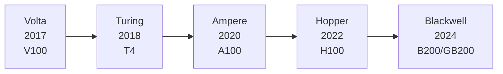
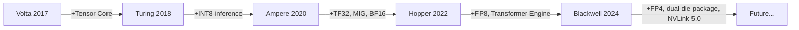

## Table of contents

- [1. Why GPU architecture evolution matters](#1-why-gpu-architecture-evolution-matters)
- [2. Architecture evolution overview](#2-architecture-evolution-overview)
- [3. Volta (2017): the start of AI acceleration](#3-volta-2017-the-start-of-ai-acceleration)
- [4. Turing (2018): RT Core and inference acceleration](#4-turing-2018-rt-core-and-inference-acceleration)
- [5. Ampere (2020): a watershed for datacenter AI](#5-ampere-2020-a-watershed-for-datacenter-ai)
- [6. Hopper (2022): built for large models](#6-hopper-2022-built-for-large-models)
- [7. Blackwell (2024): foundation for the trillion-parameter era](#7-blackwell-2024-foundation-for-the-trillion-parameter-era)
- [8. Core technologies compared over time](#8-core-technologies-compared-over-time)
- [9. How to pick the right GPU](#9-how-to-pick-the-right-gpu)
- [Summary](#summary)
- [Self-check list](#self-check-list)
- [References](#references)

---

## 1. Why GPU architecture evolution matters

Working on AI Infra, you keep running into questions like: which card should I upgrade to when training stalls? Where is the high inference latency stuck? Should I pick FP8 or BF16? The answers often sit in the GPU architecture's own design choices.

Understanding how NVIDIA GPUs evolved generation by generation is really about understanding how **AI hardware and AI algorithms co-evolved**. Each generation answers bottlenecks exposed by the last one, and every new feature targets a specific workload. Once you see that arc, hardware selection, performance tuning, and system design get a lot easier to judge.

## 2. Architecture evolution overview

Start with the big picture. Since 2017 NVIDIA has shipped five AI-oriented GPU architectures. Think of them as a highway that keeps getting wider and faster: each generation adds lanes (compute), improves the road surface (precision support), and builds better interchanges (interconnect bandwidth).



| Architecture | Year | Flagship product | Core breakthrough |
|---------|---------|-------------|------------|
| Volta | 2017 | V100 | First Tensor Core |
| Turing | 2018 | T4 | INT8/INT4 inference acceleration, RT Core |
| Ampere | 2020 | A100 | 3rd-gen Tensor Core, MIG, TF32, BF16 |
| Hopper | 2022 | H100 | FP8, Transformer Engine, NVLink 4.0 |
| Blackwell | 2024 | B200 / GB200 | 5th-gen Tensor Core, NVLink 5.0, dual-die package |

Below we go generation by generation, focusing on **what problem each one solved** and **which key technologies it introduced**.

## 3. Volta (2017): the start of AI acceleration

### 3.1 Background: why GPUs for AI?

Before Volta, deep learning training mostly used the GPU's CUDA Cores for general floating-point math. CUDA Cores are a jack of all trades: they can compute anything, but they are not specialized for the core deep learning op (matrix multiply). It's like slicing bread with a chef's knife: it works, but a bread knife is much better.

### 3.2 Key innovation: Tensor Core

Volta's most important contribution was the **Tensor Core**, a hardware unit built specifically for matrix multiply-accumulate (MMA).

A traditional CUDA Core does one scalar fused multiply-add (FMA) per clock. One Tensor Core can finish a $4 \times 4 \times 4$ mixed-precision matrix multiply-accumulate per clock:

$$
D = A \times B + C
$$

where $A$ and $B$ are FP16 matrices, and $C$ and $D$ are FP16 or FP32. That is 64 multiply-adds in one op, roughly an order of magnitude more efficient than element-wise CUDA Core math.

### 3.3 V100 key specs

| Parameter | Spec |
|------|------|
| Tensor Core count | 640 |
| FP16 Tensor compute | 125 TFLOPS |
| FP32 CUDA compute | 15.7 TFLOPS |
| Memory | 16 GB / 32 GB HBM2 |
| Memory bandwidth | 900 GB/s |
| NVLink | NVLink 2.0, 300 GB/s (bidirectional) |

💡 **Tip**: V100 was the first true "AI training card." Even today, understanding its Tensor Core design is the foundation for later architectures.

### 3.4 Practical takeaway

Volta kicked off a programming shift: to use Tensor Cores well, matrix dimensions needed to be multiples of 8 (later architectures relaxed this), and you needed mixed precision (FP16 compute + FP32 accumulate). That is also the hardware basis for NVIDIA's automatic mixed precision (AMP) training.

```python
# Mixed-precision training in PyTorch (benefits start in the Volta era)
import torch
from torch.cuda.amp import autocast, GradScaler

scaler = GradScaler()
for data, target in dataloader:
    optimizer.zero_grad()
    with autocast():  # automatically choose FP16/FP32
        output = model(data)
        loss = criterion(output, target)
    scaler.scale(loss).backward()
    scaler.step(optimizer)
    scaler.update()
```

## 4. Turing (2018): RT Core and inference acceleration

### 4.1 Problem it solved

Volta mainly targeted training. At deployment time, inference cares more about latency and throughput, and often does not need FP16-level precision. Many models keep enough accuracy with INT8. Volta's Tensor Cores only supported FP16, so compute was underused for inference.

### 4.2 Key innovations

- **INT8 / INT4 Tensor Core support**: 2nd-gen Tensor Cores added integer math; inference throughput can roughly double again vs FP16
- **RT Core**: ray-tracing acceleration (mainly for graphics; rarely relevant in AI Infra)
- **More efficient inference positioning**: T4's TDP is only 70W, so it fits well in inference servers

### 4.3 T4 key specs

| Parameter | Spec |
|------|------|
| Tensor Core count | 320 |
| FP16 Tensor compute | 65 TFLOPS |
| INT8 Tensor compute | 130 TOPS |
| Memory | 16 GB GDDR6 |
| Memory bandwidth | 320 GB/s |
| TDP | 70W |

📌 **Key point**: T4's absolute compute is lower than V100, but low power plus high INT8 throughput made it a classic inference choice. Many cloud vendors still use T4 for inference instances.

### 4.4 Practical takeaway

Turing pushed **quantization** into wider industrial use. TensorRT's INT8 quantization pipeline was designed with Turing as the target:

```bash
# Typical TensorRT INT8 quantization inference flow
# 1. Export an ONNX model
python export_onnx.py --model resnet50 --output model.onnx

# 2. Build an INT8 engine with trtexec (needs a calibration dataset)
trtexec --onnx=model.onnx --int8 --calib=calibration_cache.bin --saveEngine=model_int8.engine
```

## 5. Ampere (2020): a watershed for datacenter AI

### 5.1 Problem it solved

By 2020, model scale exploded (GPT-3 has 175 billion parameters), and both compute and memory demand grew with it. Two pain points from the Volta/Turing era became sharp:

1. **Precision formats were not flexible enough**: FP16 overflows on some models; FP32 is too slow
2. **Poor single-GPU utilization**: one GPU could only run one job; multi-tenant setups wasted a lot of capacity

### 5.2 Key innovations

#### TF32: acceleration without code changes

Ampere introduced **TF32 (TensorFloat-32)**. TF32 keeps FP32's 8-bit exponent (same numeric range) and uses FP16's 10-bit mantissa. For FP32 ops it speeds things up automatically with no code changes:

| Format | Sign | Exponent | Mantissa | Total bits |
|------|--------|--------|--------|--------|
| FP32 | 1 | 8 | 23 | 32 |
| TF32 | 1 | 8 | 10 | 19 |
| FP16 | 1 | 5 | 10 | 16 |
| BF16 | 1 | 8 | 7 | 16 |

💡 **Tip**: TF32 is on by default on Ampere. When you run `torch.matmul` on an A100 with FP32 inputs, Tensor Cores automatically use TF32. You do not need to turn on mixed precision yourself.

#### MIG: one card, many tenants

**MIG (Multi-Instance GPU)** can physically partition one A100 into up to 7 independent GPU instances, each with its own memory, cache, and compute. Think of splitting a large house into apartments with separate utility meters.

```bash
# List MIG profiles supported by A100
nvidia-smi mig -lgip

# Create MIG instances (example: 3g.20gb = 3 compute slices + 20GB memory)
sudo nvidia-smi mig -cgi 9,9 -C

# List created instances
nvidia-smi mig -lgi
```

Typical MIG use cases:
- ✅ Multiple inference services share one A100, isolated from each other
- ✅ During development/debugging, several people share one card
- ❌ Not a fit for large-model training that needs the full GPU

#### 3rd-generation Tensor Core

Supported precisions expanded a lot: FP16, **BF16**, TF32, INT8, INT4, Binary (1-bit), covering training through inference.

### 5.3 A100 key specs

| Parameter | Spec |
|------|------|
| Tensor Core count | 432 (3rd gen) |
| FP16 / BF16 Tensor compute | 312 TFLOPS |
| TF32 Tensor compute | 156 TFLOPS |
| FP32 CUDA compute | 19.5 TFLOPS |
| Memory | 40 GB / 80 GB HBM2e |
| Memory bandwidth | 2.0 TB/s |
| NVLink | NVLink 3.0, 600 GB/s (bidirectional) |

### 5.4 Practical takeaway

Ampere made **BF16 mixed-precision training** mainstream. BF16 shares FP32's numeric range (8-bit exponent), so it avoids common FP16 overflows while cutting memory and communication in half. Most LLM training since Ampere uses BF16 as the default training precision:

```python
# BF16 training on A100 (native PyTorch support)
model = model.to(dtype=torch.bfloat16, device="cuda")

# or use PyTorch autocast
with torch.autocast(device_type="cuda", dtype=torch.bfloat16):
    output = model(input_ids)
    loss = criterion(output, labels)
```

## 6. Hopper (2022): built for large models

### 6.1 Problem it solved

Once the LLM era arrived, training faced pressure on two fronts:

1. **Compute hunger**: training 10B–100B+ parameter models needs hundreds or thousands of GPUs in parallel
2. **Communication bottleneck**: in multi-GPU training, sync across GPUs (All-Reduce, All-to-All) becomes a major bottleneck

Almost every important Hopper feature answers one of those two challenges.

### 6.2 Key innovations

#### FP8 training: one more squeeze on precision

Hopper's 4th-gen Tensor Core supports **FP8** (E4M3 and E5M2), compressing training precision from BF16's 16 bits down to 8.

| Format | Sign | Exponent | Mantissa | Best for |
|------|--------|--------|--------|----------|
| E4M3 | 1 | 4 | 3 | Forward pass (precision first) |
| E5M2 | 1 | 5 | 2 | Backward pass (range first) |

FP8's theoretical compute is 2× BF16. But if precision drops, does model quality suffer? That leads to Hopper's other core technology.

#### Transformer Engine: automatic precision management

**Transformer Engine** is a hardware–software co-design: before each layer's compute, it looks at the tensor's value distribution and decides whether that layer should use FP8 or BF16/FP16. Think of it as an automatic transmission: on a straight road (numerically stable layers) it stays in high gear (FP8); on curves (numerically sensitive layers) it downshifts (BF16).

```python
# FP8 training with Transformer Engine
import transformer_engine.pytorch as te

# Replace a standard Linear with TE's FP8 version
model.layer = te.Linear(hidden_size, hidden_size)

# Enable FP8 automatic mixed precision
with te.fp8_autocast(enabled=True):
    output = model(input_data)
```

#### NVLink 4.0 and NVSwitch

| Metric | Ampere (A100) | Hopper (H100) | Speedup |
|---------|---------------|---------------|------|
| NVLink bandwidth (bidirectional) | 600 GB/s | 900 GB/s | 1.5x |
| All-Reduce bandwidth | 600 GB/s | 900 GB/s | 1.5x |
| NVSwitch support | 8 GPUs in a node | 8 GPUs in a node + cross-node NVLink Network | New |

⚠️ **Note**: H100 has two versions, PCIe and SXM. The SXM version supports full 8-GPU interconnect through NVSwitch, with 900 GB/s total NVLink 4.0 bandwidth. The PCIe version also has NVLink 4.0, but only 2-GPU bridge interconnect. Check this carefully when you choose hardware.

#### Other important features

- **Thread Block Cluster**: a new level in the CUDA programming model that lets multiple Thread Blocks cooperate and better use shared memory across SMs
- **TMA (Tensor Memory Accelerator)**: a hardware async memory-copy unit that pulls data movement out of the compute pipeline and cuts SM idle wait

### 6.3 H100 key specs

| Parameter | Spec |
|------|------|
| Tensor Core count | 528 (4th gen) |
| FP8 Tensor compute | 1,979 TFLOPS (Dense) / 3,958 TFLOPS (sparse) |
| FP16 / BF16 Tensor compute | 989 TFLOPS (Dense) / 1,979 TFLOPS (sparse) |
| TF32 Tensor compute | 495 TFLOPS (Dense) / 989 TFLOPS (sparse) |
| Memory | 80 GB HBM3 |
| Memory bandwidth | 3.35 TB/s |
| NVLink | NVLink 4.0, 900 GB/s (bidirectional, SXM) |

💡 **Tip**: From Ampere onward NVIDIA supports 2:4 structured sparsity, which can double Tensor Core throughput. Enabling it requires specially pruned weights, so most real workloads quote Dense compute.

### 6.4 Practical takeaway

Hopper is the workhorse architecture for large-model training today. In thousand-GPU clusters, these features matter most:

1. **FP8 + Transformer Engine** raises training throughput by 30%–60% (depends on model structure)
2. **NVLink 4.0** cuts multi-GPU All-Reduce communication latency a lot
3. **HBM3's 3.35 TB/s bandwidth** eases Attention's memory-access bottleneck

```bash
# Inspect H100 NVLink topology
nvidia-smi topo -m

# Inspect current GPU NVLink status
nvidia-smi nvlink -s
```

## 7. Blackwell (2024): foundation for the trillion-parameter era

### 7.1 Problem it solved

In the trillion-parameter era, single-GPU compute growth can no longer keep up with model growth. Blackwell's design bet: instead of only stacking transistors for one die, make a leap at chip interconnect.

### 7.2 Key innovations

#### Dual-die package

B200's core is **two dies packaged as one chip with a 10 TB/s die-to-die interconnect**. Externally it looks like one GPU; internally you get two dies of compute. Like hitching two horses to one cart: the driver controls it the same way, but pull force doubles.

#### 5th-generation Tensor Core

FP8 Dense compute is about 14% higher than H100 (with dual-die help); with sparsity it reaches 4,500 TFLOPS. **FP4 gets first-class hardware support**: 4,500 TOPS Dense, 9,000 TOPS with sparsity. FP4 gives inference even denser compute.

#### NVLink 5.0

| Metric | Hopper (H100) | Blackwell (B200) | Speedup |
|---------|---------------|------------------|------|
| NVLink bandwidth (bidirectional) | 900 GB/s | 1,800 GB/s | 2x |
| GPUs connected by NVLink | 8 | 72 (via NVLink Switch) | 9x |

1.8 TB/s interconnect means GPU-to-GPU communication is already close to one GPU's memory bandwidth. That reshapes distributed-training communication: bottlenecks you once had to dodge with careful topology can often be overrun with raw bandwidth.

#### Other highlights

- **HBM3e memory**: up to 192 GB per card, 8 TB/s memory bandwidth
- **2nd-gen Transformer Engine**: smarter dynamic FP8/FP4 scheduling
- **Confidential Computing**: hardware GPU TEE to protect training-data privacy

### 7.3 B200 / GB200 key specs

| Parameter | B200 | GB200 (Grace-Blackwell) |
|------|------|--------------------------|
| FP8 Tensor compute | 2,250 TFLOPS (Dense) / 4,500 TFLOPS (sparse) | Same as left (GPU part) |
| FP4 Tensor compute | 4,500 TOPS (Dense) / 9,000 TOPS (sparse) | Same as left (GPU part) |
| Memory | 192 GB HBM3e | 192 GB HBM3e + 480 GB LPDDR5x (CPU) |
| Memory bandwidth | 8 TB/s | 8 TB/s (GPU part) |
| NVLink | NVLink 5.0, 1,800 GB/s | NVLink 5.0, 1,800 GB/s |
| Chip design | Dual-die package | Grace CPU + Blackwell GPU tightly coupled |

📌 **Key point**: GB200 is a **CPU–GPU superchip** that packages NVIDIA's Grace ARM CPU with a Blackwell GPU over high-speed NVLink-C2C. That design removes the traditional PCIe CPU–GPU communication bottleneck.

## 8. Core technologies compared over time

### 8.1 Tensor Core compute evolution

The table below uses **Dense (non-sparse)** compute throughout. Ampere and later support 2:4 structured sparsity, which can double throughput when enabled. V100 / T4 do not support sparsity.

| Precision | V100 | T4 | A100 | H100 | B200 |
|------|------|----|------|------|------|
| FP16 / BF16 | 125 TFLOPS | 65 TFLOPS | 312 TFLOPS | 989 TFLOPS | ~1,125 TFLOPS |
| TF32 | — | — | 156 TFLOPS | 495 TFLOPS | ~563 TFLOPS |
| FP8 | — | — | — | 1,979 TFLOPS | ~2,250 TFLOPS |
| INT8 | — | 130 TOPS | 624 TOPS | 1,979 TOPS | ~2,250 TOPS |
| FP4 | — | — | — | — | ~4,500 TOPS |

### 8.2 Memory and bandwidth evolution

| Metric | V100 | A100 | H100 | B200 |
|---------|------|------|------|------|
| Memory capacity | 32 GB | 80 GB | 80 GB | 192 GB |
| Memory type | HBM2 | HBM2e | HBM3 | HBM3e |
| Memory bandwidth | 900 GB/s | 2.0 TB/s | 3.35 TB/s | 8 TB/s |
| NVLink bandwidth | 300 GB/s | 600 GB/s | 900 GB/s | 1,800 GB/s |

One clear trend: **memory bandwidth grows slower than compute**. That matches the **memory-bound** nature of AI workloads (especially LLM inference): once the model is large enough, the bottleneck is memory access, not math.

### 8.3 Timeline of key features



## 9. How to pick the right GPU

Picking a GPU is not "newest and most expensive wins." Match the workload:

### Training

| Scenario | Recommendation | Why |
|------|------|------|
| Small/medium model training (< 10B) | A100 80GB | Good cost/performance, mature ecosystem |
| Large-model training (10B–100B) | H100 SXM | FP8 + NVLink 4.0 improves multi-GPU training a lot |
| Ultra-large model training (> 100B) | B200 / GB200 | 192GB memory + 1.8TB/s NVLink for trillion-parameter scale |

### Inference

| Scenario | Recommendation | Why |
|------|------|------|
| Low-cost online inference | T4 | 70W, INT8 is enough |
| Mid-scale LLM inference | A100 / L40S | Enough memory, solid ecosystem support |
| Large-scale LLM inference | H100 / H200 | High FP8 throughput, enough HBM3 bandwidth |
| Peak inference performance | B200 | FP4 support, 192GB memory for larger models |

⚠️ **Note**: Beyond single-card performance, also weigh cluster network topology (NVLink vs PCIe vs InfiniBand), power and cooling, and supply lead time. Hardware selection is never a pure tech problem.

## Summary

Looking back across five generations, three threads stand out:

1. **Precision keeps going lower**: FP32 → FP16 → BF16/TF32 → FP8 → FP4. Each step roughly doubles theoretical compute, and needs matching numerical-stability tooling (AMP, Transformer Engine)
2. **Interconnect bandwidth keeps doubling**: NVLink climbed from 300 GB/s to 1,800 GB/s, and the connected set grew from 8 GPUs in a node to 72 across nodes. That is the hardware base for better distributed-training efficiency
3. **Hardware–software co-design goes deeper**: from Tensor Core hardware acceleration, to Transformer Engine's automatic precision scheduling, to MIG virtualization. Stacking raw FLOPS alone is less of a moat; system-level co-design is where the edge is

Knowing these trends helps with hardware decisions, and it also gives you the hardware mental model you need for CUDA programming, distributed training, and inference optimization later.

## Self-check list

- Can name NVIDIA's five AI GPU architectures, their years, and flagship products
- Can explain the real difference between Tensor Core and CUDA Core
- Can state the bit widths and use cases of FP32, TF32, BF16, FP16, and FP8
- Can explain what MIG does and when to use it, and can list/create MIG instances with `nvidia-smi`
- Can explain how Transformer Engine works (dynamic FP8/BF16 switching)
- Can compare NVLink bandwidth across generations and why it matters for distributed training
- Can recommend a GPU for different training/inference needs
- Can explain the value of Blackwell dual-die packaging and GB200's CPU–GPU tight coupling

## References

- [NVIDIA V100 Tensor Core GPU Architecture Whitepaper](https://images.nvidia.com/content/volta-architecture/pdf/volta-architecture-whitepaper.pdf)
- [NVIDIA A100 Tensor Core GPU Architecture Whitepaper](https://images.nvidia.com/aem-dam/en-zz/Solutions/data-center/nvidia-ampere-architecture-whitepaper.pdf)
- [NVIDIA H100 Tensor Core GPU Architecture Whitepaper](https://resources.nvidia.com/en-us-tensor-core/gtc22-whitepaper-hopper)
- [NVIDIA Blackwell Architecture Technical Brief](https://www.nvidia.com/en-us/data-center/technologies/blackwell-architecture/)
- [NVIDIA Transformer Engine Documentation](https://docs.nvidia.com/deeplearning/transformer-engine/user-guide/index.html)
- [NVIDIA Multi-Instance GPU User Guide](https://docs.nvidia.com/datacenter/tesla/mig-user-guide/)
- [NVIDIA NVLink and NVSwitch](https://www.nvidia.com/en-us/data-center/nvlink/)
