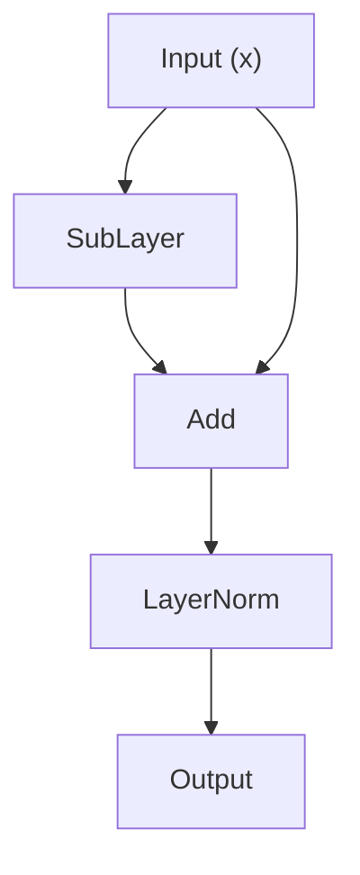
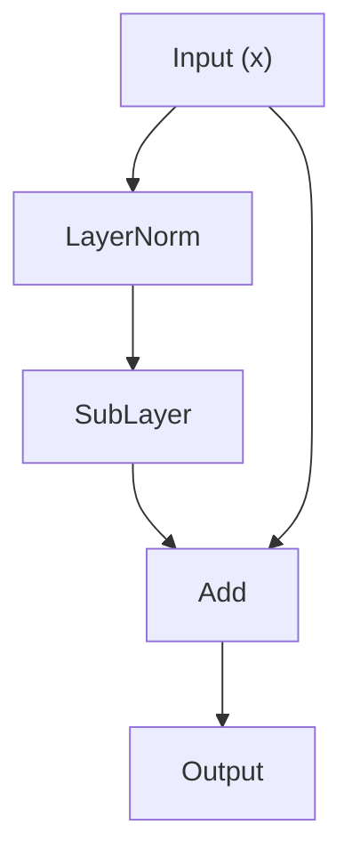

In the Transformer architecture, Self-Attention and the FFN decide "what to learn", while LayerNorm and residual connections decide "whether learning can happen at all". A 100-layer network without residual connections is almost untrainable. A deep network without normalization is like a truck with no brakes -- it either flies off the road (gradient explosion) or stalls halfway (gradient vanishing). This article starts from the fundamental difficulty of training deep nets, then unpacks the ideas, implementations, and engineering optimizations of residual connections and normalization, so you can build a systematic picture of these two "behind-the-scenes" pieces.

<!-- more -->

## 📑 Contents

- [1. The fundamental challenge of training deep networks](#1-the-fundamental-challenge-of-training-deep-networks)
- [2. Residual connections: a highway for gradients](#2-residual-connections-a-highway-for-gradients)
- [3. A panorama of normalization methods](#3-a-panorama-of-normalization-methods)
- [4. Pre-Norm vs Post-Norm: a design choice with lasting impact](#4-pre-norm-vs-post-norm-a-design-choice-with-lasting-impact)
- [5. A CUDA optimization view: what matters in production](#5-a-cuda-optimization-view-what-matters-in-production)
- [6. A survey of normalization choices in large models](#6-a-survey-of-normalization-choices-in-large-models)
- [Self-check list](#-self-check-list)
- [References](#-references)

---

## 1. The fundamental challenge of training deep networks

Before residual connections and normalization, we have to understand the core problem they solve: **why are deep networks hard to train?**

### 1.1 Vanishing and exploding gradients

Neural net training relies on backpropagation, which is recursive application of the chain rule. For an $L$-layer network where each layer transform is $f_l$, the gradient of Loss w.r.t. layer-1 parameters is a product of partial derivatives from layer $L$ down to layer 1:

$$
\frac{\partial \text{Loss}}{\partial W_1} = \frac{\partial \text{Loss}}{\partial f_L} \cdot \frac{\partial f_L}{\partial f_{L-1}} \cdots \frac{\partial f_2}{\partial f_1} \cdot \frac{\partial f_1}{\partial W_1}
$$

That is a long chain of multiplications. Imagine a "telephone game": the message goes from the back of the line to the front, and each person scales it before passing it on. If everyone turns the volume down 10%, after 50 people the message is almost inaudible -- that is **vanishing gradients**. If everyone turns it up 10%, after 50 people it becomes deafening noise -- that is **exploding gradients**.

In math terms, suppose each layer's Jacobian has spectral norm (largest singular value) $\sigma$. After $L$ layers of multiplication:

- If $\sigma < 1$, gradients decay as $\sigma^L$, and deep parameters barely get a useful update signal
- If $\sigma > 1$, gradients grow as $\sigma^L$, updates thrash or become NaN
- Only in the ideal case $\sigma = 1$ do gradients propagate stably -- and that almost never happens naturally in real training

The problem gets sharply worse as depth grows. Before Transformers, LSTMs eased vanishing gradients somewhat with gating; for Transformers with dozens or hundreds of layers, we need a more fundamental, more direct fix.

### 1.2 The degradation problem

In 2015, Kaiming He and colleagues found a counterintuitive result while training deep CNNs: **deeper nets performed worse than shallower ones** -- not from overfitting (training error was also higher), but because optimization itself failed. In theory a 56-layer net should not be worse than a 20-layer net, because the extra 36 layers only need to learn identity mappings to keep the 20-layer result. In practice, teaching a network to "do nothing" is much harder than it sounds.

That observation directly led to residual connections.

---

## 2. Residual connections: a highway for gradients

### 2.1 From ResNet to Transformer: a short history

In late 2015, Kaiming He et al. proposed ResNet (Residual Network), fixing degradation with a very simple structure:

$$
\text{output} = x + F(x)
$$

Here $x$ is the layer input and $F(x)$ is the transform to learn (the "residual function"). That plus sign looks ordinary, yet it changed deep learning: ResNet pushed networks from dozens of layers to 152 and even a thousand-plus, and won the 2015 ImageNet competition.

**Why is learning a "residual" easier than learning a full mapping?**

Try another metaphor. You are an architect. The client gives you a draft and asks for a final plan. Two ways to work:

- **Way A** (no residual): redraw the whole final plan from scratch. Every detail is on you; the pressure is huge.
- **Way B** (with residual): mark edits on the draft in red. You only care about "what needs to change"; everything else stays automatically.

Way B clearly costs less cognition. When a layer truly needs little change, $F(x)$ only has to approach zero -- and learning a near-zero function is much easier than learning an identity. At initialization weights are usually small near zero, so $F(x)$ starts near zero, output starts near $x$, and the network already has a "do nothing" baseline before it slowly learns useful transforms.

In 2017, Vaswani et al. used residual connections directly when designing the Transformer. In each Decoder Block, the Attention sublayer and FFN sublayer each have a residual path:

$$
\begin{aligned}
h &= x + \text{Attention}(x)
\end{aligned}
$$
$$
\begin{aligned}
\text{output} &= h + \text{FFN}(h)
\end{aligned}
$$

For a LLaMA-7B with 32 Blocks, the signal from layer 1 to layer 32 crosses 64 sublayers. Without residuals, gradients almost cannot survive that many layers without vanishing.

### 2.2 Math: why residual connections keep gradient flow

From a backprop view, here is why residuals work.

**Without residuals:**

If each layer is $x_{l+1} = f_l(x_l)$, the gradient of loss $L$ w.r.t. some intermediate $x_l$ is:

$$
\frac{\partial L}{\partial x_l} = \frac{\partial L}{\partial x_L} \cdot \frac{\partial f_{L-1}}{\partial x_{L-1}} \cdot \frac{\partial f_{L-2}}{\partial x_{L-2}} \cdots \frac{\partial f_l}{\partial x_l}
$$

That is a **product** of Jacobians. If any factor's spectral norm drifts from 1, multi-layer multiplication drives vanishing or exploding gradients.

**With residuals:**

Each layer becomes $x_{l+1} = x_l + F_l(x_l)$. Differentiating w.r.t. $x_l$:

$$
\frac{\partial x_{l+1}}{\partial x_l} = I + \frac{\partial F_l}{\partial x_l}
$$

where $I$ is the identity. Expanding the gradient from layer $L$ to layer $l$:

$$
\frac{\partial L}{\partial x_l} = \frac{\partial L}{\partial x_L} \cdot \left(I + \frac{\partial F_{L-1}}{\partial x_{L-1}}\right) \cdot \left(I + \frac{\partial F_{L-2}}{\partial x_{L-2}}\right) \cdots \left(I + \frac{\partial F_l}{\partial x_l}\right)
$$

After expanding the product, there is **necessarily a term that is always $I^{(L-l)} = I$** (picking $I$ from every parenthesis). That means:

$$
\frac{\partial L}{\partial x_l} = \frac{\partial L}{\partial x_L} \cdot (I + \text{other cross terms})
$$

The key is that $I$. No matter how small $\partial F_l / \partial x_l$ is, even if it approaches zero, $\partial L / \partial x_L$ can still pass **unchanged** to layer $l$ along this identity path. That is why residual connections are called a "gradient highway" -- they open a short path in the backprop graph, so gradients do not have to climb the rough road through every nonlinear transform; they can go straight to the destination.

Another view: residuals turn a pure "multiplication chain" in backprop into a mix of "addition + multiplication". Pure multiplication is numerically brittle (think of multiplying by 0.9 fifty times); adding gives gradients a floor and greatly improves numerical stability.

### 2.3 PyTorch: a Transformer sublayer with residuals

Here is a Transformer sublayer with residual connections (Pre-Norm style: normalize first, then the sublayer, with the residual wrapping the outside):

```python
import torch
import torch.nn as nn

class ResidualSubLayer(nn.Module):
    """
    Generic residual sublayer wrapper.
    Wraps any sublayer (Attention or FFN) as: output = x + SubLayer(LayerNorm(x))
    """

    def __init__(self, d_model: int, sublayer: nn.Module, dropout: float = 0.1):
        super().__init__()
        self.norm = nn.LayerNorm(d_model)
        self.sublayer = sublayer
        self.dropout = nn.Dropout(dropout)

    def forward(self, x: torch.Tensor) -> torch.Tensor:
        # Pre-Norm: normalize first, then send into the sublayer
        normed = self.norm(x)
        # Sublayer compute
        sub_output = self.sublayer(normed)
        # Dropout regularization
        sub_output = self.dropout(sub_output)
        # Residual: add the original input directly
        return x + sub_output

class SimpleFeedForward(nn.Module):
    """Simple two-layer FFN for demonstration"""

    def __init__(self, d_model: int, d_ff: int):
        super().__init__()
        self.w1 = nn.Linear(d_model, d_ff)
        self.w2 = nn.Linear(d_ff, d_model)
        self.activation = nn.GELU()

    def forward(self, x: torch.Tensor) -> torch.Tensor:
        return self.w2(self.activation(self.w1(x)))

# Usage example
d_model = 512
d_ff = 2048
ffn = SimpleFeedForward(d_model, d_ff)
residual_ffn = ResidualSubLayer(d_model, ffn)

# Fake input: batch_size=2, seq_len=10, d_model=512
x = torch.randn(2, 10, d_model)
output = residual_ffn(x)
print(output.shape)  # torch.Size([2, 10, 512])

# Check: output minus input is the "residual" the sublayer learned
residual = output - x
print(f"residual mean: {residual.mean().item():.6f}")
print(f"residual std: {residual.std().item():.6f}")
```

The code shows the residual pattern clearly: `return x + sub_output`. No matter how complex `sublayer` is inside, the outer add keeps a direct gradient path to the input.

---

## 3. A panorama of normalization methods

Residual connections fix whether gradients can return. There is another equally hard challenge: **feature distribution drift (Internal Covariate Shift)**. As training goes on, each layer's input distribution keeps changing, so later layers must keep adapting to earlier layers' "new moods", which makes training unstable and slow to converge. Normalization pulls each layer's input back into a stable range so layers can learn their own parameters calmly.

### 3.1 BatchNorm: the pioneer, but a poor fit for NLP

$$\text{BatchNorm}(x) = \gamma \cdot \frac{x - \mu}{\sqrt{\sigma^2 + \epsilon}} + \beta$$

**✳️ Idea:**

BatchNorm (Batch Normalization, proposed by Ioffe and Szegedy in 2015) normalizes each feature along the batch dimension. For an input of shape $(B, d)$ ($B$ is batch size, $d$ is feature dim), for each feature dimension $j$:

$$
\begin{aligned}
\mu_j &= \frac{1}{B} \sum\_{i=1}^{B} x_{i,j}
\end{aligned}
$$
$$
\begin{aligned}
\sigma_j^2 &= \frac{1}{B} \sum\_{i=1}^{B} (x\_{i,j} - \mu_j)^2
\end{aligned}
$$
$$
\begin{aligned}
y\_{i,j} &= \gamma_j \cdot \frac{x\_{i,j} - \mu_j}{\sqrt{\sigma_j^2 + \epsilon}} + \beta_j
\end{aligned}
$$

In short: for each feature channel, compute mean and variance across all samples in the batch on that channel, then standardize. $\gamma$ and $\beta$ are learnable and restore expressive power.

BatchNorm was a huge success in CV -- it made CNN training much faster and more stable. Moving it into NLP and Transformers hits several fundamental problems:

**❓ Why is BatchNorm a poor fit for NLP?**

1. **Unequal sequence lengths**: sentences in one NLP batch usually differ in length. Even with padding, padded positions on short sentences are meaningless, and including them in mean/variance adds noise.
2. **Unstable batch statistics**: in large-model training, micro batch size per GPU can be tiny (e.g. 1–4) under memory limits. Estimating batch stats from so few samples is itself high-variance, so normalization is unreliable.
3. **Train/inference mismatch**: training uses batch stats; inference uses exponential moving averages (running mean/variance). The two distributions may not match, causing train-inference inconsistency.
4. **Bad for autoregressive generation**: Decoder models generate token by token at inference with batch size 1; batch stats are meaningless.

### 3.2 LayerNorm: the Transformer default

$$\text{LayerNorm}(x) = \gamma \cdot \frac{x - \mu}{\sqrt{\sigma^2 + \epsilon}} + \beta$$

**✳️ Idea:**

LayerNorm (Layer Normalization, proposed by Jimmy Ba et al. in 2016) flips the normalization axis: not along batch, but along the **feature dimension**, independently per sample. For an input of shape $(B, N, d)$ ($B$ batch size, $N$ sequence length, $d$ feature dim), each token's $d$-dim feature vector is normalized on its own. For the token at $(b, n)$, with feature vector $x$ of dim $d$:

$$
\begin{aligned}
\mu &= \frac{1}{d} \sum_{j=1}^{d} x_j
\end{aligned}
$$
$$
\begin{aligned}
\sigma^2 &= \frac{1}{d} \sum_{j=1}^{d} (x_j - \mu)^2
\end{aligned}
$$
$$
\begin{aligned}
y_j &= \gamma_j \cdot \frac{x_j - \mu}{\sqrt{\sigma^2 + \epsilon}} + \beta_j
\end{aligned}
$$

**❓ Why does LayerNorm fit Transformers?**

1. **Fully batch-independent**: each token's norm depends only on its own $d$ features, not on other samples in the batch, avoiding all of BatchNorm's issues.
2. **Unaffected by sequence length**: tokens in sentences of different lengths normalize independently; unequal lengths are fine.
3. **Same behavior in train and inference**: no running mean/variance; the compute path is identical.
4. **Autoregressive-friendly**: when generating token by token, each token can normalize alone without depending on others.

**Manual LayerNorm in PyTorch**

```python
import torch
import torch.nn as nn

class ManualLayerNorm(nn.Module):
    """
    Manual LayerNorm, matching nn.LayerNorm behavior.
    The point is to make every step obvious.
    """

    def __init__(self, normalized_shape: int, eps: float = 1e-5):
        super().__init__()
        self.eps = eps
        # Learnable scale gamma, init to 1
        self.gamma = nn.Parameter(torch.ones(normalized_shape))
        # Learnable shift beta, init to 0
        self.beta = nn.Parameter(torch.zeros(normalized_shape))

    def forward(self, x: torch.Tensor) -> torch.Tensor:
        # x shape: (..., normalized_shape)
        # Mean over the last dimension
        mean = x.mean(dim=-1, keepdim=True)
        # Variance over the last dimension (unbiased estimate does not matter; use biased here)
        var = x.var(dim=-1, keepdim=True, unbiased=False)
        # Standardize: subtract mean, divide by std
        x_norm = (x - mean) / torch.sqrt(var + self.eps)
        # Affine: restore capacity with learnable params
        return self.gamma * x_norm + self.beta

# Check against the official PyTorch implementation
d_model = 768
manual_ln = ManualLayerNorm(d_model)
official_ln = nn.LayerNorm(d_model)

# Use the same parameters
with torch.no_grad():
    manual_ln.gamma.copy_(official_ln.weight)
    manual_ln.beta.copy_(official_ln.bias)

x = torch.randn(2, 10, d_model)
out_manual = manual_ln(x)
out_official = official_ln(x)
print(f"max diff: {(out_manual - out_official).abs().max().item():.2e}")
# Output is about 1e-7, from floating-point differences
```

### 3.3 RMSNorm: the new favorite in the large-model era

$$\text{RMSNorm}(x) = \gamma \cdot \frac{x}{\text{RMS}(x)}$$

**✳️ Motivation and idea**

In 2019, Biao Zhang and Rico Sennrich proposed RMSNorm (Root Mean Square Layer Normalization). Their bold hypothesis: **LayerNorm's benefit comes mainly from "re-scaling", not "re-centering"**. In other words, subtracting the mean may not be necessary.

RMSNorm drops the mean and keeps only Root Mean Square scaling:

$$
\begin{aligned}
\text{RMS}(x) &= \sqrt{\frac{1}{d} \sum_{j=1}^{d} x_j^2}
\end{aligned}
$$
$$
\begin{aligned}
y_j &= \gamma_j \cdot \frac{x_j}{\text{RMS}(x)}
\end{aligned}
$$

Two important simplifications:

1. **No mean**: no re-centering; normalize directly by RMS
2. **Usually no $\beta$**: without re-centering you do not need a shift term

Mathematically, $\text{RMS}(x)$ and $\text{std}(x)$ relate by:

$$
\text{RMS}(x)^2 = \text{mean}(x^2) = \text{Var}(x) + \text{mean}(x)^2
$$

When $\text{mean}(x)$ is near 0, $\text{RMS}(x)$ is approximately $\text{std}(x)$, so RMSNorm and LayerNorm behave almost the same. Experiments show that in deep Transformers, feature-vector means usually are near zero (especially in Pre-Norm architectures, because residual adds keep accumulating and the relative weight of the mean shrinks), which gives an intuitive reason RMSNorm works.

**❓ Why is the effect comparable?**

The core reason: normalization's main job is to **control activation scale**, preventing some dims from getting too large or too small and destabilizing gradients. Dividing by RMS already mostly achieves that. The "remove DC component" effect of re-centering is not indispensable in deep nets -- each layer's learnable params can already handle mean shifts implicitly.

**Compute advantage**

RMSNorm saves what looks like little compute versus LayerNorm (one fewer mean and one fewer subtract), but in real systems the difference matters:

- LayerNorm needs **two passes** over the feature vector: first for the mean, second to get variance from the mean, third to normalize (in practice usually merged into two: first pass accumulates $\sum x$ and $\sum x^2$, second normalizes)
- RMSNorm naturally needs **one pass** for $\sum x^2$, then one pass to normalize

On GPUs these ops are memory-bound (bottlenecked by memory bandwidth, not compute). One fewer global pass means one fewer HBM read, a real performance win.

**Manual RMSNorm in PyTorch**

```python
import torch
import torch.nn as nn

class ManualRMSNorm(nn.Module):
    """
    Manual RMSNorm.
    Versus LayerNorm: drops the mean and the beta parameter.
    """

    def __init__(self, normalized_shape: int, eps: float = 1e-6):
        super().__init__()
        self.eps = eps
        # Only scale gamma (usually called weight), no shift beta
        self.weight = nn.Parameter(torch.ones(normalized_shape))

    def forward(self, x: torch.Tensor) -> torch.Tensor:
        # RMS(x) = sqrt(mean(x^2))
        rms = torch.sqrt(x.pow(2).mean(dim=-1, keepdim=True) + self.eps)
        # Normalize
        x_norm = x / rms
        # Scale
        return self.weight * x_norm

# Usage example
d_model = 4096
rms_norm = ManualRMSNorm(d_model)

x = torch.randn(2, 128, d_model)
output = rms_norm(x)
print(output.shape)  # torch.Size([2, 128, 4096])

# Check: output RMS should be near 1 (affected by weight)
rms_after = torch.sqrt(output.pow(2).mean(dim=-1))
print(f"mean RMS after norm: {rms_after.mean().item():.4f}")
# At init weight is all ones, so RMS is about 1.0
```

### 3.4 Comparing the three normalization methods

| Dimension | BatchNorm | LayerNorm | RMSNorm |
|---------|-----------|-----------|---------|
| **Norm axis** | Batch (per feature channel across samples) | Feature (per sample independently) | Feature (per sample independently) |
| **Mean shift (centering)** | Yes | Yes | No |
| **Learnable params** | $\gamma$ + $\beta$ | $\gamma$ + $\beta$ | $\gamma$ only |
| **Batch dependence** | Strong; unstable on small batches | None | None |
| **Train/inference consistency** | Inconsistent (needs running stats) | Fully consistent | Fully consistent |
| **Relative compute** | Higher (needs cross-batch communication) | Medium (two passes) | Lower (can be one pass) |
| **Main use case** | CV (CNN + large batch) | NLP / Transformer | Large-scale LLM |
| **Representative users** | ResNet, EfficientNet | GPT-2, GPT-3, BERT | LLaMA, Mistral, Qwen |

---

## 4. Pre-Norm vs Post-Norm: a design choice with lasting impact

Whether LayerNorm sits before or after the sublayer looks like a tiny ordering tweak, but it has a decisive effect on large-model training stability.

### 4.1 Data-flow comparison of the two architectures

**Post-Norm (original Transformer paper, Vaswani et al. 2017)**


Formula: `output = LayerNorm(x + SubLayer(x))`

**Pre-Norm (adopted from GPT-2 onward; now the mainstream)**



Formula: `output = x + SubLayer(LayerNorm(x))`

### 4.2 Gradient-flow analysis: why Pre-Norm is more stable

The fundamental difference is whether the **residual path stays "clean"**.

**🍎 Post-Norm gradient flow**

In Post-Norm, the residual sum goes through another LayerNorm. From a backprop view, when gradients go from layer $L$ back to layer $l$, every Block modulates them once with LayerNorm's Jacobian:

$$
\frac{\partial L}{\partial x_l} = \frac{\partial L}{\partial x_L} \prod_{k=l}^{L-1} \left[\frac{\partial \text{LN}_k}{\partial(x_k + F_k)} \cdot \left(I + \frac{\partial F_k}{\partial x_k}\right)\right]
$$

LayerNorm's Jacobian is not the identity -- it involves gradients of mean and variance and applies a nontrivial linear transform to the returning gradient. Those transforms multiply over depth and can change gradient direction and magnitude a lot. In deep nets (e.g. 96-layer GPT-3), that accumulation can trigger exploding gradients and needs carefully designed learning-rate warmup to contain.

**🍎 Pre-Norm gradient flow**

In Pre-Norm, after the residual add there is **no** further op; the output goes straight into the next layer. Gradient flow from layer $L$ to layer $l$ is:

$$
\frac{\partial L}{\partial x_l} = \frac{\partial L}{\partial x_L} \prod_{k=l}^{L-1} \left[I + \frac{\partial\big(F_k(\text{LN}_k(x_k))\big)}{\partial x_k}\right]
$$

Note every factor is of the form "$I$ + something". As in §2.2, expanding the product necessarily includes an $I$ term -- gradients can reach any shallow layer along the identity path without going through any LayerNorm. LayerNorm's Jacobian only appears in cross terms and does not block the main gradient path.

✳️ One-line summary: **Pre-Norm keeps the residual path "pure"**, so gradients can cross any number of layers without loss and training is naturally more stable.

### 4.3 Training stability: experimental evidence

Results across papers point the same way:

1. **Pre-Norm is more robust to learning rate**: Xiong et al. (2020, "On Layer Normalization in the Transformer Architecture") showed theoretically that under Post-Norm, per-layer output variance grows linearly with depth at init, so you need a small learning rate and a long warmup; under Pre-Norm, per-layer variance stays stable naturally, so you can skip warmup and use a larger learning rate.
2. **Post-Norm's theoretical edge is hard to realize in practice**: some work finds Post-Norm slightly better when training fully converges (about 0.1–0.5 BLEU), but that needs very careful hyperparameter tuning. Once models grow to billions of parameters, Post-Norm often hits loss spikes or diverges, while Pre-Norm stays solid.
3. **Large-scale training has zero tolerance for instability**: training a 175B model can cost millions of dollars in compute. One divergent run means starting over. Under that constraint, Pre-Norm's stability is worth more engineering value than any tiny quality gain Post-Norm might offer.

### 4.4 Why Pre-Norm became the default in the large-model era

Putting the analysis together, the chain that made Pre-Norm win is:

```
Large models → many layers (64-128) → long gradient paths
→ need extremely stable gradient flow → residual path must stay clean
→ Pre-Norm puts no LayerNorm on the residual path → gradients go straight through
→ more stable training, easier hyperparameters → engineering-friendly → default choice
```

From GPT-2 (2019) through GPT-3, PaLM, LLaMA, Mistral, Qwen, and almost every mainstream large model, Pre-Norm is the standard.

### 4.5 DeepNorm: a hybrid scheme

Even though Pre-Norm is mainstream, researchers still look for ways to get both sides' strengths. In 2022 Microsoft proposed DeepNorm, a hybrid worth noting:

$$
\text{output} = \text{LayerNorm}(\alpha \cdot x + \text{SubLayer}(x))
$$

Here $\alpha$ is a depth-dependent constant (greater than 1) that amplifies the residual path. The key design:

- Scale the residual path by $\alpha$
- Initialize SubLayer params smaller by a rule (multiply by $\beta$, $\beta < 1$)
- $\alpha$ and $\beta$ are set from model depth $L$

The effect: the form is Post-Norm (possibly better final quality), but amplifying the residual and shrinking the sublayer output gives Pre-Norm-like gradient stability. Microsoft trained 1000-layer Transformers with DeepNorm.

In open-source large models, though, DeepNorm is far less used than Pre-Norm. The reason is simple: Pre-Norm is good enough, easy to implement, well validated by the community, and does not need extra hyperparameters.

---

## 5. A CUDA optimization view: what matters in production

For AI Infra engineers, understanding LayerNorm and residuals means knowing not only "what to do" but "how to do it efficiently on a GPU".

### 5.1 Challenges of implementing a LayerNorm kernel

LayerNorm is mathematically simple, but efficient GPU implementation takes care. The core challenge is that it is a **reduction** -- you must sum over the whole feature dimension (mean and variance), while GPUs excel at large-scale element-wise parallelism.

**🔴 The two-pass problem**

The naive LayerNorm reads the input twice:

```
Pass 1: walk d elements, compute sum(x) and sum(x²), then mean and variance
Pass 2: walk d elements again, normalize each element with mean and variance
```

So the feature vector must be read from HBM (high-bandwidth memory) **twice**. For large models with $d_{model} = 4096$ or even 8192, each token's feature vector has 4096–8192 float16 elements. Absolute size is not huge (8–16 KB), but LayerNorm is called twice per Transformer Block (once before Attention, once before FFN), models have dozens of Blocks, and with batch and sequence length the cumulative HBM traffic is substantial.

**🔵 Welford's algorithm and online computation**

One optimization is Welford's online algorithm: compute mean and variance in one pass, avoiding the numerically unstable $\frac{1}{N}\sum x_i^2 - \left(\frac{1}{N}\sum x_i\right)^2$ formula (*mean of squares minus square of the mean*). But the accumulations are sequential, so implementing this carefully inside a GPU parallel reduction framework takes work.


**✳️ Where RMSNorm's advantage shows**

RMSNorm drops the mean and only needs $\sum x^2$. That **cuts compute**, and more importantly simplifies the reduction -- one reduction (sum of squares) instead of two (sum and sum of squares). The kernel is simpler and **has fewer numerical stability issues**.

### 5.2 Fusing Residual Add + LayerNorm

In Pre-Norm, residual add and LayerNorm sit next to each other in the data flow:

```
h = x + SubLayer_output    # Residual Add
next_input = LayerNorm(h)  # next sublayer input must be normalized first
```

If implemented separately, `h` is written back to HBM, then the LayerNorm kernel reads `h` from HBM again. That is one write and one read for `h` -- two HBM accesses that can be avoided.

**Fused-kernel idea:**

Merge Residual Add and LayerNorm into one kernel. Finish the add in registers or shared memory, then normalize immediately, skipping the intermediate write to HBM:

```
Inside one fused kernel:
1. Read x and SubLayer_output from HBM
2. Compute h = x + SubLayer_output in registers
3. Reduce h in registers/shared memory (mean and var)
4. Normalize h to get LayerNorm(h)
5. Write h (for later residuals) and LayerNorm(h) (for the next sublayer) back to HBM
```

This fusion is a standard optimization in NVIDIA Apex, Megatron-LM, and similar frameworks. In practice, Residual Add + LayerNorm fusion can give about 5–10% end-to-end inference speedup for a full Transformer.

### 5.3 Numerical precision under FP16/BF16

Large-model training and inference widely use half precision (FP16 or BF16) to save memory and raise throughput. Normalization is especially sensitive to numerical precision:

**FP16 precision traps**

FP16 has about 3.3 decimal digits of precision (11 mantissa bits), smallest positive around 6e-8, max around 65504. In normalization:

1. **Precision loss when summing**: at $d_{model} = 4096$, $\sum x$ accumulates 4096 numbers. If they are similar in magnitude and same sign, the sum can be much larger than any single element and precision suffers. Worse, squaring in $\sum x^2$ expands the range and can overflow FP16's max (65504).
2. **Catastrophic cancellation in variance**: $\text{Var}(x) = \text{mean}(x^2) - \text{mean}(x)^2$. When variance is small, this is a large-minus-large operation and loses precision catastrophically.

**Engineering fixes**

The mainstream approach is to **promote to FP32** for reductions (mean and variance), then cast back to FP16/BF16 for the normalize step. In a CUDA kernel that usually looks like:

```cpp
// Pseudocode
float sum = 0.0f;      // FP32 accumulator
float sum_sq = 0.0f;   // FP32 accumulator
for (int i = 0; i < d; i++) {
    float val = (float)input[i];   // FP16 → FP32
    sum += val;
    sum_sq += val * val;
}
float mean = sum / d;
float var = sum_sq / d - mean * mean;
float inv_std = rsqrtf(var + eps);
for (int i = 0; i < d; i++) {
    float val = (float)input[i];
    output[i] = (half)((val - mean) * inv_std * gamma[i] + beta[i]);  // FP32 → FP16
}
```

This mixed-precision strategy -- half-precision I/O, full-precision intermediates -- is standard across mainstream frameworks.

**BF16 vs FP16**

BF16 (Brain Floating Point 16) has more exponent bits (8 vs FP16's 5), matching FP32's dynamic range and greatly cutting overflow risk. The tradeoff is fewer mantissa bits (7 vs FP16's 10), so per-value precision is a bit lower. For normalization, BF16's advantage is clear -- less overflow, less need for an FP32 fallback. That is one reason more large-model training chooses BF16 over FP16.

---

## 6. A survey of normalization choices in large models

Different large models make different normalization choices, reflecting different engineering tradeoffs. Mainstream configurations:

| Model | Normalization | Norm placement | Notes |
|------|-----------|----------|------|
| **Original Transformer** (2017) | LayerNorm | Post-Norm | Original paper design |
| **BERT** (2018) | LayerNorm | Post-Norm | Followed the original design |
| **GPT-2** (2019) | LayerNorm | Pre-Norm | First large model to switch to Pre-Norm |
| **GPT-3** (2020) | LayerNorm | Pre-Norm | Followed GPT-2 |
| **PaLM** (2022) | LayerNorm | Pre-Norm | Parallel Attention + FFN |
| **LLaMA / LLaMA-2** (2023) | RMSNorm | Pre-Norm | Open-source benchmark; established RMSNorm as mainstream |
| **Mistral** (2023) | RMSNorm | Pre-Norm | Followed LLaMA architecture |
| **Qwen** (2023) | RMSNorm | Pre-Norm | Followed LLaMA architecture |
| **DeepSeek** (2024) | RMSNorm | Pre-Norm | Followed LLaMA architecture |
| **Gemma** (2024) | RMSNorm | Pre-Norm | Google's open-source model |

A clear evolution shows up:

1. **2017–2018**: Post-Norm + LayerNorm (original design)
2. **2019–2022**: Pre-Norm + LayerNorm (shift driven by training stability)
3. **2023 onward**: Pre-Norm + RMSNorm (further simplification driven by efficiency)

The LLaMA series played a key role. Meta systematically validated RMSNorm on large-scale models in the LLaMA paper, and with the open-source demonstration effect, RMSNorm + Pre-Norm quickly became the de facto standard.

Also worth noting: some models add an extra LayerNorm/RMSNorm after the last Decoder Block and before the language-model head (Final Norm). Final Norm stabilizes the distribution one last time before the final output, keeping logits in a reasonable numeric range before softmax.

---

## 🎯 Self-check list

### Checklist

After this article, you should be able to answer:

- **Basics**: What causes vanishing and exploding gradients? Why does depth make the problem worse?
- **Residuals**: Write the backprop formula for residual connections and explain the "identity shortcut".
- **Norm comparison**: How do BatchNorm and LayerNorm differ in normalization axis? Why is BatchNorm a poor fit for Transformers?
- **RMSNorm**: What does RMSNorm drop versus LayerNorm? Why does quality hold up in large models?
- **Pre-Norm vs Post-Norm**: Sketch both data flows and explain why Pre-Norm gradient flow is more stable.
- **Engineering**: Why are Residual Add and LayerNorm usually fused into one kernel? What should you watch under FP16?

### Hands-on exercises

1. Using the `ManualLayerNorm` and `ManualRMSNorm` code in this article, compare their outputs on the same input and see how close they get when the input mean is near 0.
2. Implement a full Pre-Norm Transformer Block (Attention + FFN + two residual connections), run one forward and backward pass on random data, and print per-layer gradient norms.
3. Change exercise 2 to Post-Norm and compare how gradient norms evolve when stacking a deep net (e.g. 48 layers).

## 📚 References

- **Deep Residual Learning for Image Recognition** (He et al., 2016)：[https://arxiv.org/abs/1512.03385](https://arxiv.org/abs/1512.03385) -- original ResNet paper
- **Layer Normalization** (Ba et al., 2016)：[https://arxiv.org/abs/1607.06450](https://arxiv.org/abs/1607.06450) -- original LayerNorm paper
- **Root Mean Square Layer Normalization** (Zhang & Sennrich, 2019)：[https://arxiv.org/abs/1910.07467](https://arxiv.org/abs/1910.07467) -- original RMSNorm paper
- **On Layer Normalization in the Transformer Architecture** (Xiong et al., 2020)：[https://arxiv.org/abs/2002.04745](https://arxiv.org/abs/2002.04745) -- Pre-Norm vs Post-Norm theory
- **DeepNet: Scaling Transformers to 1,000 Layers** (Wang et al., 2022)：[https://arxiv.org/abs/2203.00555](https://arxiv.org/abs/2203.00555) -- DeepNorm scheme
- **LLaMA: Open and Efficient Foundation Language Models** (Touvron et al., 2023)：[https://arxiv.org/abs/2302.13971](https://arxiv.org/abs/2302.13971) -- LLaMA architecture choices
- **Batch Normalization: Accelerating Deep Network Training** (Ioffe & Szegedy, 2015)：[https://arxiv.org/abs/1502.03167](https://arxiv.org/abs/1502.03167) -- original BatchNorm paper
- **Attention Is All You Need** (Vaswani et al., 2017)：[https://arxiv.org/abs/1706.03762](https://arxiv.org/abs/1706.03762) -- original Transformer paper
