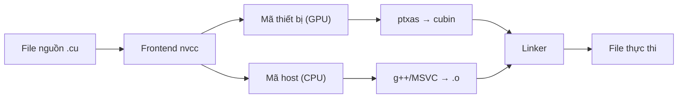

Dựng môi trường phát triển CUDA đầy đủ từ đầu: cài driver, cấu hình Toolkit, toolchain biên dịch và tích hợp IDE, để bạn viết và chạy chương trình GPU đầu tiên trong khoảng 10 phút.

<!-- more -->

## 📑 Mục lục

- [1. Quan hệ giữa GPU driver và CUDA Toolkit](#1-quan-hệ-giữa-gpu-driver-và-cuda-toolkit)
- [2. Cài NVIDIA driver](#2-cài-nvidia-driver)
- [3. Cài CUDA Toolkit](#3-cài-cuda-toolkit)
- [4. Cấu hình biến môi trường](#4-cấu-hình-biến-môi-trường)
- [5. Toolchain biên dịch nvcc](#5-toolchain-biên-dịch-nvcc)
- [6. Tích hợp CUDA với CMake](#6-tích-hợp-cuda-với-cmake)
- [7. Hello World: chương trình CUDA đầu tiên](#7-hello-world-chương-trình-cuda-đầu-tiên)
- [8. Quản lý nhiều phiên bản CUDA](#8-quản-lý-nhiều-phiên-bản-cuda)
- [9. Gợi ý cấu hình IDE](#9-gợi-ý-cấu-hình-ide)
- [10. Xử lý lỗi cài đặt thường gặp](#10-xử-lý-lỗi-cài-đặt-thường-gặp)
- [Tóm tắt](#-tóm-tắt)

---

## 1. Quan hệ giữa GPU driver và CUDA Toolkit

Nhiều người mới học không rõ "driver" và "CUDA Toolkit" khác nhau thế nào. Có thể nghĩ thế này: driver giống firmware hệ điều hành trên điện thoại — nó làm phần cứng chạy được; còn CUDA Toolkit là bộ công cụ phát triển bạn cài lên hệ điều hành đó — cung cấp compiler, thư viện và debugger để bạn viết chương trình chạy trên GPU.

### 1.1 Quy tắc tương thích phiên bản

NVIDIA dùng thiết kế **tương thích tiến (forward compatibility)**: driver mới hơn có thể chạy chương trình biên dịch bằng CUDA Toolkit cũ hơn, nhưng chiều ngược lại thì không. Quy tắc chính:

- Mỗi phiên bản CUDA Toolkit đều có **yêu cầu driver tối thiểu**
- Driver ≥ mức Toolkit yêu cầu là đủ, không cần khớp chính xác
- "CUDA Version" mà `nvidia-smi` hiển thị là phiên bản Toolkit **cao nhất** mà driver hỗ trợ, không phải Toolkit đang cài

| Phiên bản CUDA Toolkit | Driver Linux tối thiểu | Driver Windows tối thiểu |
|------------------------|------------------------|--------------------------|
| CUDA 12.6 | ≥ 560.28 | ≥ 560.70 |
| CUDA 12.4 | ≥ 550.54 | ≥ 551.61 |
| CUDA 12.2 | ≥ 535.54 | ≥ 536.25 |
| CUDA 11.8 | ≥ 520.61 | ≥ 520.06 |

💡 **Gợi ý**: Ưu tiên nâng driver lên bản ổn định mới nhất. Nó vừa tương thích ngược với Toolkit cũ, vừa chừa chỗ để nâng Toolkit sau.

### 1.2 Các thành phần trong CUDA Toolkit

| 📦 Thành phần | 📝 Vai trò |
|---------------|------------|
| nvcc | Compiler CUDA C/C++ |
| cuBLAS | Thư viện đại số tuyến tính |
| cuDNN | Thư viện primitive deep learning (tải riêng) |
| cuFFT | Thư viện biến đổi Fourier nhanh |
| cuRAND | Thư viện sinh số ngẫu nhiên |
| Nsight Systems | Công cụ phân tích hiệu năng cấp hệ thống |
| Nsight Compute | Công cụ phân tích hiệu năng cấp Kernel |
| CUDA Runtime (libcudart) | Thư viện Runtime API |
| cuda-gdb | Debugger GPU |

---

## 2. Cài NVIDIA driver

### 2.1 Linux (Ubuntu)

```bash
# Cách 1: dùng apt (khuyến nghị)
sudo apt update
sudo apt install nvidia-driver-560

# Sau khi cài, khởi động lại
sudo reboot

# Kiểm tra
nvidia-smi
```

```bash
# Cách 2: dùng gói .run chính thức
# Tắt driver mã nguồn mở nouveau trước
sudo bash -c "echo 'blacklist nouveau' >> /etc/modprobe.d/blacklist.conf"
sudo update-initramfs -u
sudo reboot

# Tải và chạy script cài
chmod +x NVIDIA-Linux-x86_64-560.35.03.run
sudo ./NVIDIA-Linux-x86_64-560.35.03.run
```

⚠️ **Lưu ý**: Trước khi dùng gói `.run` phải tắt driver `nouveau` và chuyển sang chế độ văn bản (tty), không thì cài sẽ thất bại. Với máy chủ production, nên dùng trình quản lý gói để cập nhật tự động sau này.

### 2.2 Windows

Người dùng Windows tải driver đúng mẫu GPU từ [trang tải driver NVIDIA](https://www.nvidia.com/Download/index.aspx) rồi cài. Sau khi cài, chạy `nvidia-smi` trên dòng lệnh để kiểm tra.

### 2.3 Kiểm tra driver

```bash
$ nvidia-smi
+-----------------------------------------------------------------------------------------+
| NVIDIA-SMI 560.35.03              Driver Version: 560.35.03      CUDA Version: 12.6     |
|-----------------------------------------+------------------------+----------------------+
| GPU  Name                 Persistence-M | Bus-Id          Disp.A | Volatile Uncorr. ECC |
| Fan  Temp   Perf          Pwr:Usage/Cap |           Memory-Usage | GPU-Util  Compute M. |
|=========================================+========================+======================|
|   0  NVIDIA GeForce RTX 4090       Off | 00000000:01:00.0  Off |                  Off |
|  0%   35C    P8              12W / 450W |       1MiB / 24564MiB |      0%      Default |
+-----------------------------------------+------------------------+----------------------+
```

Chú ý ba thông tin:
- **Driver Version**: phiên bản driver hiện tại
- **CUDA Version**: phiên bản CUDA cao nhất mà driver hỗ trợ
- **Memory-Usage**: mức dùng VRAM

---

## 3. Cài CUDA Toolkit

### 3.1 Cài trên Linux (khuyến nghị runfile)

```bash
# Tải runfile CUDA 12.6
wget https://developer.download.nvidia.com/compute/cuda/12.6.0/local_installers/cuda_12.6.0_560.28.03_linux.run

# Chạy cài (bỏ chọn Driver để tránh ghi đè driver đã có)
sudo sh cuda_12.6.0_560.28.03_linux.run
```

Trên giao diện cài:
- ❌ Bỏ chọn Driver (đã cài riêng rồi)
- ✅ Chọn CUDA Toolkit
- ✅ Chọn CUDA Samples (tùy chọn, hữu ích khi học)

💡 **Gợi ý**: Nếu cài bằng `apt`, dùng `sudo apt install cuda-toolkit-12-6`. Cách này không kéo theo cài driver kèm theo.

### 3.2 Cài trên Windows

Tải gói `.exe` đúng phiên bản từ [CUDA Toolkit Archive](https://developer.nvidia.com/cuda-toolkit-archive), chọn chế độ Custom, rồi chọn thành phần cần thiết.

### 3.3 Cài bằng conda (cho lập trình viên Python)

```bash
# Chỉ cài CUDA runtime và compiler (không gồm driver)
conda install -c nvidia cuda-toolkit=12.6
```

Cách này phù hợp khi hệ thống đã có driver, và bạn muốn gắn một phiên bản CUDA riêng cho môi trường conda.

---

## 4. Cấu hình biến môi trường

Sau khi cài xong, cần thêm đường dẫn CUDA vào biến môi trường hệ thống.

### 4.1 Linux

Thêm vào `~/.bashrc` hoặc `~/.zshrc`:

```bash
# Cấu hình đường dẫn CUDA
export CUDA_HOME=/usr/local/cuda-12.6
export PATH=$CUDA_HOME/bin:$PATH
export LD_LIBRARY_PATH=$CUDA_HOME/lib64:$LD_LIBRARY_PATH
```

```bash
# Áp dụng cấu hình
source ~/.bashrc

# Kiểm tra
nvcc --version
which nvcc
```

### 4.2 Windows

Trong biến môi trường hệ thống, thêm:
- `CUDA_PATH` = `C:\Program Files\NVIDIA GPU Computing Toolkit\CUDA\v12.6`
- Thêm `%CUDA_PATH%\bin` vào `PATH`

### 4.3 Kiểm tra cài đặt

```bash
$ nvcc --version
nvcc: NVIDIA (R) Cuda compiler driver
Copyright (c) 2005-2024 NVIDIA Corporation
Built on ...
Cuda compilation tools, release 12.6, V12.6.20
Build cuda_12.6.r12.6/compiler.34431801_0
```

```bash
# Biên dịch và chạy CUDA Samples chính thức (tải riêng từ GitHub)
git clone https://github.com/NVIDIA/cuda-samples.git
cd cuda-samples/Samples/1_Utilities/deviceQuery
make
./deviceQuery
```

Nếu `deviceQuery` in ra `Result = PASS`, cả môi trường (driver + Toolkit + GPU) đang hoạt động bình thường.

⚠️ **Lưu ý**: Từ CUDA 11.6 trở đi, Samples không còn đi kèm gói Toolkit. Cần tải riêng từ [GitHub](https://github.com/NVIDIA/cuda-samples).

---

## 5. Toolchain biên dịch nvcc

nvcc là trình điều khiển biên dịch cho chương trình CUDA. Nó không phải một compiler độc lập, mà là một **bộ điều phối biên dịch**: tách mã thiết bị và mã host trong file `.cu`, lần lượt đưa qua compiler PTX của NVIDIA và compiler C++ hệ thống, rồi liên kết thành file thực thi.

### 5.1 Luồng biên dịch



### 5.2 Các tùy chọn biên dịch thường dùng

```bash
# Biên dịch cơ bản
nvcc hello.cu -o hello

# Chỉ định kiến trúc GPU (sm_89 cho RTX 4090)
nvcc -arch=sm_89 hello.cu -o hello

# Sinh fatbinary tương thích nhiều kiến trúc
nvcc -gencode arch=compute_80,code=sm_80 \
     -gencode arch=compute_89,code=sm_89 \
     hello.cu -o hello

# Bật thông tin debug (cho cuda-gdb)
nvcc -g -G hello.cu -o hello_debug

# Bật tối ưu
nvcc -O3 hello.cu -o hello_opt

# Hiện chi tiết quá trình biên dịch
nvcc --verbose hello.cu -o hello
```

### 5.3 Giải thích các tùy chọn quan trọng

| Tùy chọn | Vai trò |
|----------|---------|
| `-arch=sm_XX` | Chỉ định compute capability của GPU đích |
| `-gencode` | Sinh mã cho nhiều kiến trúc, chạy được trên nhiều GPU |
| `-G` | Sinh thông tin debug cho mã thiết bị |
| `-lineinfo` | Giữ số dòng trong mã đã tối ưu (dùng khi phân tích hiệu năng) |
| `-Xcompiler` | Truyền tùy chọn tiếp theo cho compiler host |
| `-std=c++17` | Chỉ định chuẩn C++ |
| `-maxrregcount=N` | Giới hạn số thanh ghi mỗi thread |
| `--ptxas-options=-v` | Hiện mức dùng register và shared memory của từng kernel |

### 5.4 Tra cứu nhanh mã kiến trúc GPU

| Mã kiến trúc | GPU đại diện | Compute capability |
|--------------|--------------|--------------------|
| sm_70 | V100 | 7.0 |
| sm_75 | T4, RTX 2080 | 7.5 |
| sm_80 | A100 | 8.0 |
| sm_86 | RTX 3090 | 8.6 |
| sm_89 | RTX 4090, L40 | 8.9 |
| sm_90 | H100 | 9.0 |

---

## 6. Tích hợp CUDA với CMake

Trong dự án thực tế, hiếm khi gọi `nvcc` thủ công; thường dùng CMake làm hệ thống build. Từ CMake 3.8, CUDA được hỗ trợ như ngôn ngữ hạng nhất.

### 6.1 CMakeLists.txt tối thiểu

```cmake
cmake_minimum_required(VERSION 3.18)
project(MyCUDAProject LANGUAGES CXX CUDA)

# Đặt chuẩn C++ và CUDA
set(CMAKE_CXX_STANDARD 17)
set(CMAKE_CUDA_STANDARD 17)

# Chỉ định kiến trúc GPU đích
set(CMAKE_CUDA_ARCHITECTURES 80 89 90)

# Thêm file thực thi
add_executable(main src/main.cu)

# Liên kết thư viện CUDA runtime
target_link_libraries(main PRIVATE CUDA::cudart)
```

### 6.2 Trộn mã nguồn C++ và CUDA

```cmake
cmake_minimum_required(VERSION 3.18)
project(HybridProject LANGUAGES CXX CUDA)

set(CMAKE_CXX_STANDARD 17)
set(CMAKE_CUDA_STANDARD 17)
set(CMAKE_CUDA_ARCHITECTURES 80 89)

# File nguồn CUDA
add_library(kernels STATIC
    src/kernels/vector_add.cu
    src/kernels/matrix_mul.cu
)

# Chương trình C++ chính liên kết thư viện CUDA
add_executable(app src/main.cpp)
target_link_libraries(app PRIVATE kernels CUDA::cudart)
```

### 6.3 Build và chạy

```bash
mkdir build && cd build
cmake .. -DCMAKE_BUILD_TYPE=Release
make -j$(nproc)
./main
```

💡 **Gợi ý**: Dùng biến `CMAKE_CUDA_ARCHITECTURES` thay vì hard-code `-arch` trong mã. Đổi GPU đích chỉ cần sửa một chỗ cấu hình.

---

## 7. Hello World: chương trình CUDA đầu tiên

Mọi thứ đã sẵn. Viết một Hello World đầy đủ để kiểm tra cả toolchain.

### 7.1 Mã nguồn `hello_cuda.cu`

```cpp
#include <cstdio>

// Bộ điều biến __global__ cho biết đây là hàm kernel chạy trên GPU
__global__ void helloKernel() {
    // threadIdx.x là chỉ số của thread hiện tại trong Block
    printf("Hello from GPU thread %d in block %d!\n",
           threadIdx.x, blockIdx.x);
}

int main() {
    printf("Launching kernel...\n");

    // <<<2, 4>>> nghĩa là khởi chạy 2 Block, mỗi Block 4 thread
    helloKernel<<<2, 4>>>();

    // Đợi mọi thao tác trên GPU hoàn tất
    cudaDeviceSynchronize();

    printf("Done!\n");
    return 0;
}
```

### 7.2 Biên dịch và chạy

```bash
$ nvcc hello_cuda.cu -o hello_cuda
$ ./hello_cuda
Launching kernel...
Hello from GPU thread 0 in block 0!
Hello from GPU thread 1 in block 0!
Hello from GPU thread 2 in block 0!
Hello from GPU thread 3 in block 0!
Hello from GPU thread 0 in block 1!
Hello from GPU thread 1 in block 1!
Hello from GPU thread 2 in block 1!
Hello from GPU thread 3 in block 1!
Done!
```

📌 **Điểm quan trọng**: Thứ tự thực thi thật của các thread không cố định — output của hai Block có thể xen kẽ. Bộ lập lịch phần cứng GPU quyết định thứ tự trong chương trình song song.

### 7.3 Phân tích mã

| Thành phần | Ý nghĩa |
|------------|---------|
| `__global__` | Đánh dấu hàm là kernel: CPU gọi, GPU chạy |
| `<<<2, 4>>>` | Cấu hình khởi chạy: 2 Block, mỗi Block 4 thread |
| `threadIdx.x` | Chỉ số thread trong Block chứa nó |
| `blockIdx.x` | Chỉ số Block trong Grid |
| `cudaDeviceSynchronize()` | CPU chặn đợi GPU hoàn tất mọi việc |

---

## 8. Quản lý nhiều phiên bản CUDA

Trong thực tế bạn có thể cần giữ nhiều phiên bản CUDA cùng lúc (ví dụ dự án A dùng CUDA 11.8, dự án B dùng CUDA 12.6). Thiết kế của NVIDIA cho phép nhiều phiên bản cùng tồn tại.

### 8.1 Cài nhiều phiên bản

Mỗi phiên bản cài vào thư mục riêng:
```
/usr/local/cuda-11.8/
/usr/local/cuda-12.4/
/usr/local/cuda-12.6/
```

### 8.2 Đổi phiên bản bằng symbolic link

```bash
# Chuyển sang CUDA 12.6
sudo rm -f /usr/local/cuda
sudo ln -s /usr/local/cuda-12.6 /usr/local/cuda

# Chuyển sang CUDA 11.8
sudo rm -f /usr/local/cuda
sudo ln -s /usr/local/cuda-11.8 /usr/local/cuda
```

Biến môi trường cùng trỏ tới `/usr/local/cuda`:
```bash
export CUDA_HOME=/usr/local/cuda
export PATH=$CUDA_HOME/bin:$PATH
export LD_LIBRARY_PATH=$CUDA_HOME/lib64:$LD_LIBRARY_PATH
```

### 8.3 Dùng hệ module (môi trường cluster)

Trên cluster HPC thường dùng Environment Modules:
```bash
module avail cuda
module load cuda/12.6
module list
```

### 8.4 Viết script chuyển nhanh

```bash
#!/bin/bash
# Lưu thành ~/bin/switch-cuda.sh
# Cách dùng: source switch-cuda.sh 12.6

CUDA_VERSION=$1
if [ -d "/usr/local/cuda-$CUDA_VERSION" ]; then
    export CUDA_HOME=/usr/local/cuda-$CUDA_VERSION
    export PATH=$CUDA_HOME/bin:$PATH
    export LD_LIBRARY_PATH=$CUDA_HOME/lib64:$LD_LIBRARY_PATH
    echo "Switched to CUDA $CUDA_VERSION"
    nvcc --version
else
    echo "CUDA $CUDA_VERSION not found!"
fi
```

---

## 9. Gợi ý cấu hình IDE

### 9.1 VS Code (khuyến nghị)

Cài các extension sau:
- **NVIDIA Nsight Visual Studio Code Edition**: tô sáng cú pháp, hỗ trợ debug
- **C/C++ (Microsoft)**: IntelliSense
- **CMake Tools**: tích hợp CMake

Ví dụ cấu hình `.vscode/settings.json`:
```json
{
    "files.associations": {
        "*.cu": "cuda-cpp",
        "*.cuh": "cuda-cpp"
    },
    "C_Cpp.default.includePath": [
        "/usr/local/cuda/include"
    ]
}
```

### 9.2 CLion

CLion hỗ trợ CUDA sẵn (qua CMake):
- Đảm bảo CMakeLists.txt cấu hình đúng `LANGUAGES CXX CUDA`
- CLion sẽ nhận file `.cu` và cung cấp hoàn thành mã cùng debug
- Trong Settings → Build → CMake, cấu hình `-DCMAKE_CUDA_COMPILER=/usr/local/cuda/bin/nvcc`

### 9.3 Nsight Visual Studio Edition (Windows)

Trên Windows, CUDA Toolkit kèm plugin Nsight tích hợp vào Visual Studio, cung cấp debug GPU và phân tích hiệu năng. Trên Linux nên dùng công cụ dòng lệnh Nsight Systems/Compute kèm VS Code hoặc CLion.

💡 **Gợi ý**: Nsight Eclipse Edition đã bị gỡ từ CUDA 12.0 và không còn đi kèm Toolkit. Lập trình viên Linux nên dùng VS Code + extension Nsight.

---

## 10. Xử lý lỗi cài đặt thường gặp

| ❌ Vấn đề | ✅ Cách xử lý |
|----------|---------------|
| `nvidia-smi` báo "command not found" | Chưa cài driver hoặc chưa thêm vào PATH |
| `nvidia-smi` báo "driver/library version mismatch" | Driver đã cập nhật nhưng chưa reboot; chạy `sudo reboot` |
| `nvcc` báo "command not found" | Chưa cài CUDA Toolkit hoặc chưa cấu hình biến môi trường |
| Biên dịch báo "unsupported gpu architecture sm_XX" | nvcc quá cũ, không hỗ trợ GPU của bạn; nâng Toolkit |
| Liên kết báo "cannot find -lcudart" | `LD_LIBRARY_PATH` chưa gồm thư mục CUDA lib64 |
| CMake báo "No CUDA toolset found" | Đặt `CMAKE_CUDA_COMPILER` trỏ tường minh tới đường dẫn nvcc |
| Runtime báo "CUDA error: no CUDA-capable device" | Lỗi driver hoặc hệ thống không nhận GPU; kiểm tra `lspci \| grep NVIDIA` |

⚠️ **Lưu ý**: Khi gặp lỗi lúc cài, ưu tiên xem log chi tiết trong `/var/log/nvidia-installer.log` (Linux).

---

## 📝 Tóm tắt

Bài này đi qua toàn bộ quy trình dựng môi trường phát triển CUDA:

1. **Driver là nền**: cài driver trước, đảm bảo `nvidia-smi` chạy được
2. **Toolkit là hộp công cụ**: cung cấp compiler, thư viện và debugger
3. **Biến môi trường là cầu nối**: để hệ thống tìm thấy nvcc và thư viện CUDA
4. **CMake là lớp năng suất**: hệ thống build cần dùng trong dự án thực tế
5. **Quản lý nhiều phiên bản**: chuyển bằng symbolic link theo nhu cầu dự án

Tóm một câu: **cài driver → cài Toolkit → cấu hình biến môi trường → chạy deviceQuery để kiểm tra**.

## 🎯 Checklist tự kiểm

- Phân biệt được vai trò của GPU driver và CUDA Toolkit cũng như quan hệ tương thích phiên bản
- Tự cài được driver và CUDA Toolkit trên Linux
- Cấu hình đúng các biến `CUDA_HOME`, `PATH`, `LD_LIBRARY_PATH`
- Dùng `nvcc` biên dịch một file `.cu` và chỉ định kiến trúc đích
- Viết được CMakeLists.txt có CUDA và build dự án thành công
- Quản lý và chuyển được nhiều phiên bản CUDA trên cùng một máy
- Định vị được lỗi cài đặt và biên dịch thường gặp từ thông báo lỗi

## 📚 Tài liệu tham khảo

- [Tài liệu chính thức NVIDIA CUDA Toolkit](https://docs.nvidia.com/cuda/)
- [CUDA Toolkit Archive (tải phiên bản cũ)](https://developer.nvidia.com/cuda-toolkit-archive)
- [NVIDIA Driver Downloads](https://www.nvidia.com/Download/index.aspx)
- [Tài liệu hỗ trợ CUDA của CMake](https://cmake.org/cmake/help/latest/manual/cmake-compile-features.7.html#supported-compilers)
- [CUDA Compatibility Guide](https://docs.nvidia.com/deploy/cuda-compatibility/)
