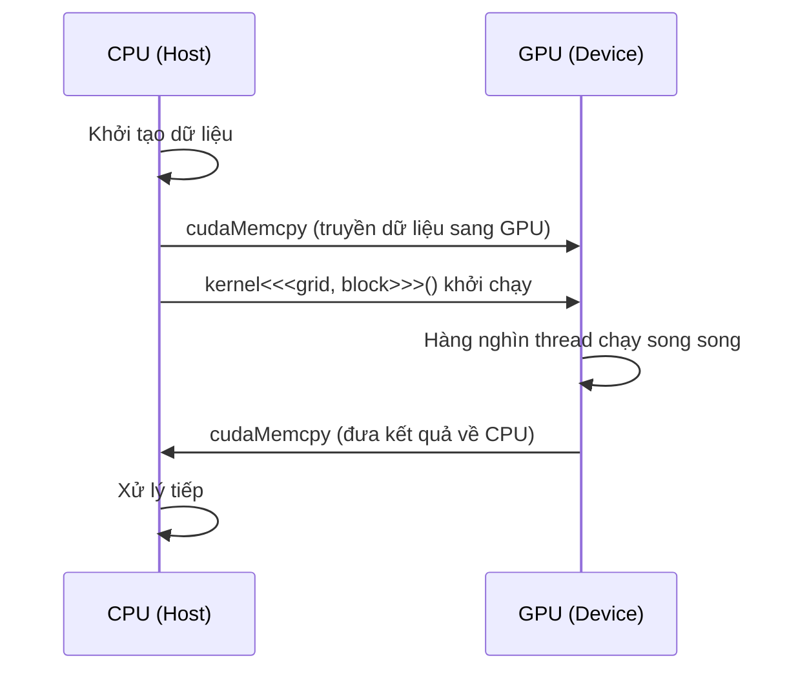

Hiểu cấu trúc phân cấp ba tầng Grid/Block/Thread của CUDA, cách tính chỉ số thread và chiến lược cấu hình khởi chạy Kernel — nền tảng cốt lõi để viết chương trình GPU hiệu quả.

<!-- more -->

## 📑 Mục lục

- [1. Tổng quan mô hình tính toán dị thể](#1-tổng-quan-mô-hình-tính-toán-dị-thể)
- [2. Phân cấp ba tầng Grid/Block/Thread](#2-phân-cấp-ba-tầng-gridblockthread)
- [3. Tính chỉ số thread](#3-tính-chỉ-số-thread)
- [4. Hàm Kernel và cú pháp khởi chạy](#4-hàm-kernel-và-cú-pháp-khởi-chạy)
- [5. Chiến lược chọn kích thước Block](#5-chiến-lược-chọn-kích-thước-block)
- [6. Warp: đơn vị lập lịch phần cứng](#6-warp-đơn-vị-lập-lịch-phần-cứng)
- [7. Chỉ số đa chiều và ứng dụng thực tế](#7-chỉ-số-đa-chiều-và-ứng-dụng-thực-tế)
- [8. Occupancy và hiệu năng](#8-occupancy-và-hiệu-năng)
- [Tóm tắt](#-tóm-tắt)

---

## 1. Tổng quan mô hình tính toán dị thể

Chương trình CUDA chạy trên một **hệ dị thể (heterogeneous system)**: CPU (Host) lo logic điều khiển và mã tuần tự; GPU (Device) lo tính toán song song quy mô lớn. Hình dung một nhà máy — CPU là giám đốc, ra lệnh và phân bổ tài nguyên; GPU là xưởng với hàng vạn công nhân, một khi nhận việc là cùng làm song song.

### 1.1 Luồng thực thi chương trình



### 1.2 Ba bộ điều biến hàm

CUDA dùng bộ điều biến để đánh dấu hàm chạy ở đâu và ai gọi được:

| Bộ điều biến | Nơi chạy | Bên gọi | Công dụng |
|--------------|----------|---------|-----------|
| `__global__` | GPU | CPU (hoặc dynamic parallelism trên GPU) | Hàm vào Kernel |
| `__device__` | GPU | GPU | Hàm phụ gọi từ trong Kernel |
| `__host__` | CPU | CPU | Hàm CPU thông thường (mặc định) |

```cpp
// Có thể kết hợp: biên dịch cho cả CPU và GPU
__host__ __device__ float square(float x) {
    return x * x;
}
```

---

## 2. Phân cấp ba tầng Grid/Block/Thread

Triết lý thiết kế cốt lõi của CUDA là **song song phân cấp (hierarchical parallelism)**: tổ chức lượng thread khổng lồ thành ba tầng, vừa dễ nghĩ cho lập trình viên, vừa khớp với bố cục phần cứng GPU.

### 2.1 Mô hình khái niệm

Ví dụ gần gũi:
- **Grid (lưới)** = cả trường — tập mọi thread sinh ra từ một lần khởi chạy Kernel
- **Block (khối thread)** = một lớp — các thread trong Block có thể cộng tác (shared memory, đồng bộ)
- **Thread (luồng)** = một học sinh — đơn vị thực thi nhỏ nhất


### 2.2 Chiều và chỉ số

Grid và Block đều có thể là 1D, 2D hoặc 3D:

```cpp
// 1D: xử lý vector
dim3 grid(256);        // 256 Block
dim3 block(256);       // mỗi Block 256 thread

// 2D: xử lý ảnh/ma trận
dim3 grid(16, 16);     // 16x16 = 256 Block
dim3 block(16, 16);    // mỗi Block 16x16 = 256 thread

// 3D: xử lý dữ liệu khối
dim3 grid(8, 8, 8);    // 8x8x8 = 512 Block
dim3 block(8, 8, 4);   // mỗi Block 8x8x4 = 256 thread
```

### 2.3 Giới hạn phần cứng

| Hạng mục | Giá trị tối đa (Compute Capability ≥ 8.0) |
|----------|-------------------------------------------|
| Số thread tối đa mỗi chiều của Block | x:1024, y:1024, z:64 |
| Tổng thread tối đa trong Block | 1024 |
| Số Block tối đa mỗi chiều của Grid | x:$2^{31}-1$, y:65535, z:65535 |
| Số thread active tối đa mỗi SM | 2048 (sm\_80) / 1536 (sm\_89) |
| Số Block active tối đa mỗi SM | 16~32 (tùy kiến trúc) |

⚠️ **Lưu ý**: Tổng số thread trong Block không được vượt 1024, tức `blockDim.x * blockDim.y * blockDim.z ≤ 1024`.

---

## 3. Tính chỉ số thread

Mỗi thread đều lấy được vị trí của mình trong cấu trúc phân cấp qua biến dựng sẵn, rồi suy ra phần dữ liệu mình cần xử lý.

### 3.1 Biến dựng sẵn

| Biến | Kiểu | Ý nghĩa |
|------|------|---------|
| `threadIdx` | `dim3` | Chỉ số thread trong Block chứa nó |
| `blockIdx` | `dim3` | Chỉ số Block trong Grid |
| `blockDim` | `dim3` | Kích thước mỗi Block (số thread) |
| `gridDim` | `dim3` | Kích thước Grid (số Block) |

### 3.2 Tính chỉ số một chiều

Mẫu dùng nhiều nhất — ánh xạ thread lên mảng một chiều:

```cpp
// ID thread toàn cục = số Block × kích thước Block + chỉ số thread trong Block
int globalIdx = blockIdx.x * blockDim.x + threadIdx.x;
```

Với cấu hình `gridDim=4, blockDim=8`, chỉ số toàn cục phân bố như sau:

```
Block 0: [ 0  1  2  3  4  5  6  7]
Block 1: [ 8  9 10 11 12 13 14 15]
Block 2: [16 17 18 19 20 21 22 23]
Block 3: [24 25 26 27 28 29 30 31]
```

### 3.3 Tính chỉ số hai chiều

Khi xử lý ma trận, thường dùng Grid 2D và Block 2D:

```cpp
int col = blockIdx.x * blockDim.x + threadIdx.x;
int row = blockIdx.y * blockDim.y + threadIdx.y;

// Đổi sang chỉ số tuyến tính một chiều (row-major)
int linearIdx = row * width + col;
```

### 3.4 Mẫu Grid-stride Loop

Khi lượng dữ liệu lớn hơn tổng số thread, dùng vòng lặp để mỗi thread xử lý nhiều phần tử:

```cpp
__global__ void processLargeArray(float* data, int N) {
    int idx = blockIdx.x * blockDim.x + threadIdx.x;
    int stride = blockDim.x * gridDim.x;  // tổng số thread

    // Mỗi thread duyệt với bước = stride
    for (int i = idx; i < N; i += stride) {
        data[i] = data[i] * 2.0f;
    }
}
```

💡 **Gợi ý**: Grid-stride loop là **best practice** trong lập trình CUDA — vừa xử lý đúng dữ liệu kích thước bất kỳ, vừa để bạn tự chọn kích thước Grid nhằm tối ưu hiệu năng.

---

## 4. Hàm Kernel và cú pháp khởi chạy

### 4.1 Quy tắc định nghĩa Kernel

```cpp
__global__ void myKernel(float* input, float* output, int N) {
    int idx = blockIdx.x * blockDim.x + threadIdx.x;
    if (idx < N) {
        output[idx] = input[idx] * 2.0f;
    }
}
```

Ràng buộc của hàm Kernel:
- Kiểu trả về phải là `void`
- Không dùng tham số biến thiên (variadic)
- Không thể là hàm ảo của class
- Không đệ quy (Compute Capability < 2.0; GPU hiện đại đều đã hỗ trợ)
- Tham số truyền theo giá trị; con trỏ phải trỏ bộ nhớ thiết bị

### 4.2 Cú pháp khởi chạy `<<<...>>>`

```cpp
kernel<<<gridDim, blockDim, sharedMemBytes, stream>>>(args...);
```

| Tham số | Kiểu | Bắt buộc | Giải thích |
|---------|------|----------|------------|
| `gridDim` | `dim3` hoặc `int` | Có | Số Block trong Grid |
| `blockDim` | `dim3` hoặc `int` | Có | Số thread trong mỗi Block |
| `sharedMemBytes` | `size_t` | Không | Kích thước shared memory động (mặc định 0) |
| `stream` | `cudaStream_t` | Không | Stream thực thi (mặc định 0, tức default stream) |

### 4.3 Tính cấu hình khởi chạy

Cho kích thước dữ liệu N và kích thước Block, tính số Block cần:

```cpp
int N = 1000000;
int blockSize = 256;
int gridSize = (N + blockSize - 1) / blockSize;  // làm tròn lên

myKernel<<<gridSize, blockSize>>>(input, output, N);
```

📌 **Điểm quan trọng**: `(N + blockSize - 1) / blockSize` là cách chuẩn để làm tròn lên bằng phép chia số nguyên. Khi N không chia hết cho blockSize, một số thread ở Block cuối sẽ "vượt biên", nên trong Kernel phải kiểm tra `if (idx < N)`.

### 4.4 Kiểm tra lỗi

Khởi chạy Kernel là bất đồng bộ, lỗi không bị bắt ngay:

```cpp
myKernel<<<grid, block>>>(args);

// Kiểm tra lỗi khởi chạy
cudaError_t err = cudaGetLastError();
if (err != cudaSuccess) {
    printf("Kernel launch error: %s\n", cudaGetErrorString(err));
}

// Đợi chạy xong và kiểm tra lỗi runtime
err = cudaDeviceSynchronize();
if (err != cudaSuccess) {
    printf("Kernel execution error: %s\n", cudaGetErrorString(err));
}
```

---

## 5. Chiến lược chọn kích thước Block

Kích thước Block ảnh hưởng trực tiếp tới mức tận dụng GPU và hiệu năng. Không có giá trị tối ưu cho mọi trường hợp, nhưng có vài quy tắc thực dụng.

### 5.1 Nguyên tắc cơ bản

| ✅ Nên làm | ❌ Không nên | 📝 Lý do |
|------------|--------------|----------|
| Kích thước Block là bội của 32 | Dùng kích thước không phải bội 32 | Warp lập lịch theo đơn vị 32 thread |
| 128~512 thread/Block | < 64 hoặc > 1024 | Cân bằng áp lực register và độ song song |
| Điều chỉnh theo lượng register của Kernel | Luôn dùng 256 | Nhiều register thì cần Block nhỏ hơn |

### 5.2 Vì sao phải là bội của 32

GPU thực thi theo đơn vị lập lịch nhỏ nhất là **Warp** (32 thread liên tiếp). Nếu kích thước Block không phải bội của 32, một phần thread ở Warp cuối bị lãng phí:

```
Kích thước Block = 100 → 4 Warp, nhưng Warp thứ 4 chỉ có 4 thread active
Kích thước Block = 128 → 4 Warp, mọi thread đều active ✅
```

### 5.3 Occupancy API (chọn tự động)

CUDA cung cấp API để tự tính kích thước Block tối ưu:

```cpp
int blockSize;
int minGridSize;

// Tự tính kích thước Block làm tối đa occupancy
cudaOccupancyMaxPotentialBlockSize(
    &minGridSize,
    &blockSize,
    myKernel,       // con trỏ hàm kernel
    0,              // kích thước shared memory động
    0               // trần kích thước Block (0 = không giới hạn)
);

int gridSize = (N + blockSize - 1) / blockSize;
myKernel<<<gridSize, blockSize>>>(args);
```

### 5.4 Hướng dẫn chọn thực dụng

| Tình huống | Kích thước Block gợi ý | Lý do |
|------------|------------------------|-------|
| Phép toán từng phần tử đơn giản | 256 hoặc 512 | Ít register, chịu được Block lớn |
| Dùng nhiều shared memory | 128 hoặc 256 | Shared memory giới hạn số Block active |
| Kernel dùng nhiều register | 128 | Giảm kích thước Block để giảm áp lực register |
| Cần đồng bộ trong Block | 256 | Cân bằng chi phí đồng bộ và độ song song |

---

## 6. Warp: đơn vị lập lịch phần cứng

### 6.1 Warp là gì

Nếu Block là đơn vị cộng tác về mặt logic, thì Warp là **đơn vị thực thi về mặt vật lý**. SM (Streaming Multiprocessor) lập lịch thực thi theo độ hạt Warp — một Warp gồm 32 thread liên tiếp, cùng thực thi cùng một lệnh trong cùng một chu kỳ đồng hồ (SIMT, Single Instruction Multiple Threads).

### 6.2 Phân nhánh Warp (Warp Divergence)

Khi các thread trong cùng Warp đi theo nhánh khác nhau, xảy ra **Warp divergence** — GPU buộc phải chạy tuần tự hai nhánh:

```cpp
// ❌ Dễ gây divergence
if (threadIdx.x % 2 == 0) {
    // Thread chẵn chạy nhánh này
    result = pathA(data);
} else {
    // Thread lẻ chạy nhánh này
    result = pathB(data);
}

// ✅ Phân nhánh theo biên Warp, tránh divergence
if (threadIdx.x / 32 < 2) {
    // Hai Warp đầu chạy pathA
    result = pathA(data);
} else {
    // Các Warp sau chạy pathB
    result = pathB(data);
}
```

💡 **Gợi ý**: Chỉ cần 32 thread trong cùng Warp đi cùng một nhánh thì không có phạt divergence. Divergence xảy ra bên trong Warp; các Warp khác nhau đi nhánh khác nhau thì không tốn gì.

### 6.3 Primitive cấp Warp

CUDA hiện đại cung cấp thao tác cấp Warp, cho phép thread trao đổi dữ liệu trực tiếp trong Warp:

```cpp
// Broadcast trong Warp: phát giá trị của lane 0 cho cả Warp
float val = __shfl_sync(0xffffffff, data, 0);

// Reduce tổng trong Warp
for (int offset = 16; offset > 0; offset >>= 1) {
    val += __shfl_down_sync(0xffffffff, val, offset);
}
```

---

## 7. Chỉ số đa chiều và ứng dụng thực tế

### 7.1 Xử lý ảnh: Grid 2D + Block 2D

```cpp
__global__ void grayscaleKernel(unsigned char* rgb, unsigned char* gray,
                                 int width, int height) {
    int col = blockIdx.x * blockDim.x + threadIdx.x;
    int row = blockIdx.y * blockDim.y + threadIdx.y;

    if (col < width && row < height) {
        int rgbIdx = (row * width + col) * 3;
        int grayIdx = row * width + col;
        // Chuyển xám theo chuẩn ITU-R BT.601
        gray[grayIdx] = (unsigned char)(
            0.299f * rgb[rgbIdx] +
            0.587f * rgb[rgbIdx + 1] +
            0.114f * rgb[rgbIdx + 2]
        );
    }
}

// Cấu hình khởi chạy
dim3 block(16, 16);  // mỗi Block 16x16 = 256 thread
dim3 grid((width + 15) / 16, (height + 15) / 16);
grayscaleKernel<<<grid, block>>>(d_rgb, d_gray, width, height);
```

### 7.2 Phép toán ma trận: ánh xạ hàng/cột

```cpp
__global__ void matrixAdd(float* A, float* B, float* C,
                          int rows, int cols) {
    int col = blockIdx.x * blockDim.x + threadIdx.x;
    int row = blockIdx.y * blockDim.y + threadIdx.y;

    if (row < rows && col < cols) {
        int idx = row * cols + col;
        C[idx] = A[idx] + B[idx];
    }
}
```

### 7.3 Xử lý theo batch: Grid 3D

```cpp
// Chiều thứ ba biểu diễn batch
__global__ void batchProcess(float* data, int batchSize,
                             int height, int width) {
    int col = blockIdx.x * blockDim.x + threadIdx.x;
    int row = blockIdx.y * blockDim.y + threadIdx.y;
    int batch = blockIdx.z;

    if (col < width && row < height && batch < batchSize) {
        int idx = batch * height * width + row * width + col;
        data[idx] = data[idx] * 2.0f;
    }
}

dim3 block(16, 16, 1);
dim3 grid((width + 15) / 16, (height + 15) / 16, batchSize);
batchProcess<<<grid, block>>>(d_data, batchSize, height, width);
```

---

## 8. Occupancy và hiệu năng

### 8.1 Occupancy là gì

Occupancy = số Warp thực sự active trên SM / số Warp tối đa mà SM hỗ trợ theo lý thuyết.

$$
\text{Occupancy} = \frac{\text{Active Warps per SM}}{\text{Max Warps per SM}}
$$

Occupancy cao hơn không nhất thiết hiệu năng tốt hơn, nhưng occupancy quá thấp thường nghĩa là tài nguyên GPU đang nhàn rỗi.

### 8.2 Các yếu tố ảnh hưởng occupancy

| 📊 Yếu tố | 📝 Cách ảnh hưởng |
|-----------|-------------------|
| Kích thước Block | Block quá nhỏ thì ít Warp active |
| Lượng register/thread | Nhiều register thì SM chứa được ít thread hơn |
| Lượng shared memory/Block | Nhiều shared memory thì SM chứa được ít Block hơn |
| Giới hạn phần cứng của SM | Số Block và thread tối đa khác nhau theo kiến trúc |

### 8.3 Phân tích bằng Occupancy Calculator

```bash
# Khi biên dịch, in mức dùng register và shared memory
nvcc --ptxas-options=-v mykernel.cu -o mykernel
```

Ví dụ output:
```
ptxas info    : Used 32 registers, 4096 bytes smem, 368 bytes cmem[0]
```

Sau đó dùng [CUDA Occupancy Calculator](https://docs.nvidia.com/cuda/cuda-occupancy-calculator/) hoặc API `cudaOccupancyMaxActiveBlocksPerMultiprocessor` để tính occupancy.

---

## 📝 Tóm tắt

Các điểm cốt lõi của mô hình lập trình CUDA:

1. **Cấu trúc ba tầng**: Grid → Block → Thread, logic rõ, thân thiện với phần cứng
2. **Công thức chỉ số**: `globalIdx = blockIdx.x * blockDim.x + threadIdx.x`
3. **Grid-stride loop**: mẫu duyệt dữ liệu tổng quát, xử lý mọi quy mô
4. **Chọn kích thước Block**: bội của 32, thường 128~512, có thể để Occupancy API chọn tự động
5. **Warp là đơn vị thực thi**: hiểu Warp divergence, căn chỉnh mẫu truy cập
6. **Kiểm tra biên**: trong Kernel phải kiểm tra chỉ số có vượt biên không

Nắm mô hình lập trình là nắm được "bản đồ" của lập trình song song CUDA — sau này học mô hình bộ nhớ, primitive đồng bộ và kỹ thuật tối ưu đều phải quay lại cấu trúc phân cấp này để suy nghĩ.

## 🎯 Checklist tự kiểm

- Vẽ được sơ đồ phân cấp Grid/Block/Thread
- Chọn được chiều Grid và Block phù hợp với chiều dữ liệu
- Tự tính được chỉ số toàn cục của bất kỳ thread nào với cấu hình cho trước
- Viết được Grid-stride loop xử lý mảng rất lớn
- Dùng Occupancy API tự tính kích thước Block tối ưu
- Nhận diện Warp divergence và refactor mã để tránh
- Cấu hình được Grid/Block 2D cho phép toán ma trận và xử lý ảnh
- Phân tích được nút thắt occupancy từ output của `--ptxas-options=-v`

## 📚 Tài liệu tham khảo

- [NVIDIA CUDA C++ Programming Guide - Programming Model](https://docs.nvidia.com/cuda/cuda-c-programming-guide/index.html#programming-model)
- [CUDA C++ Best Practices Guide](https://docs.nvidia.com/cuda/cuda-c-best-practices-guide/)
- [CUDA Occupancy Calculator](https://docs.nvidia.com/cuda/cuda-occupancy-calculator/)
- [Professional CUDA C Programming (Cheng et al.)](https://www.wiley.com/en-us/Professional+CUDA+C+Programming-p-9781118739327)
