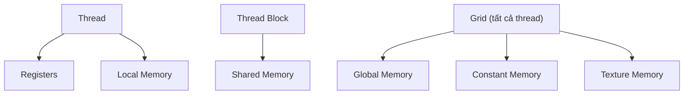
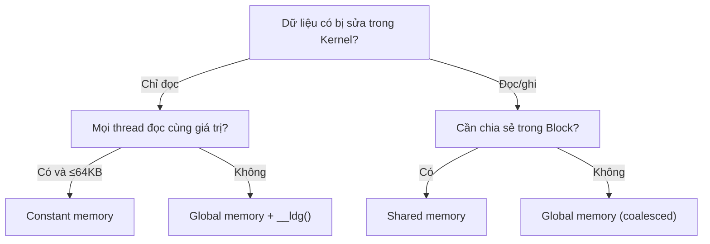

Hiểu phân cấp bộ nhớ nhiều tầng của CUDA là chìa khóa để viết Kernel hiệu năng cao. Bài này đi sâu global memory, shared memory, register, constant memory và unified memory: đặc điểm, khi nào dùng, và cách tối ưu.

<!-- more -->

## 📑 Mục lục

- [1. Vì sao mô hình bộ nhớ lại quan trọng](#1-vì-sao-mô-hình-bộ-nhớ-lại-quan-trọng)
- [2. Tổng quan phân cấp bộ nhớ](#2-tổng-quan-phân-cấp-bộ-nhớ)
- [3. Global memory](#3-global-memory)
- [4. Shared memory](#4-shared-memory)
- [5. Register và local memory](#5-register-và-local-memory)
- [6. Constant memory](#6-constant-memory)
- [7. Texture memory](#7-texture-memory)
- [8. Unified memory](#8-unified-memory)
- [9. Hướng dẫn chọn loại bộ nhớ](#9-hướng-dẫn-chọn-loại-bộ-nhớ)
- [Tóm tắt](#-tóm-tắt)

---

## 1. Vì sao mô hình bộ nhớ lại quan trọng

GPU cực mạnh về tính toán — A100 đạt đỉnh 312 TFLOPS (FP16, Tensor Core có sparse) — nhưng băng thông bộ nhớ chỉ khoảng 2 TB/s. Một phép tính nhanh: một phép nhân-cộng số thực (FMA) đọc 2 float (8 Bytes) và tạo ra 2 FLOP, vậy 2 TB/s băng thông tối đa nuôi được 500 GFLOPS tính toán — chưa tới 0.2% đỉnh.

Điều đó nghĩa là: **hầu hết nút thắt hiệu năng của Kernel không phải tính toán, mà là truy cập bộ nhớ**. Học phân cấp bộ nhớ CUDA và đặt dữ liệu "gần đơn vị tính toán nhất có thể" là bài học đầu tiên khi tối ưu GPU.

---

## 2. Tổng quan phân cấp bộ nhớ

Hãy nghĩ phân cấp bộ nhớ GPU như hệ thống giao thông của một thành phố — register là hồ sơ trên bàn làm việc (nhanh nhất nhưng nhỏ nhất), shared memory là tủ hồ sơ trong cùng văn phòng (nhanh và chia sẻ được), global memory là kho lớn ngoài thành (dung lượng lớn nhưng đi lại mất thời gian).

### 2.1 Sơ đồ phân cấp bộ nhớ




### 2.2 So sánh các tầng bộ nhớ

| 📊 Loại bộ nhớ | Vị trí | Dung lượng | Độ trễ | Băng thông | Phạm vi | Vòng đời |
|------------|------|------|------|------|--------|---------|
| Register | Trên SM | ~256KB/SM | 1 cycle | Cao nhất | Một thread | Vòng đời thread |
| Shared memory | Trên SM | 48~228KB/SM (tùy kiến trúc) | ~20 cycles | ~19 TB/s | Trong Block | Vòng đời Block |
| L1 Cache | Trên SM | 128~256KB/SM | ~30 cycles | ~19 TB/s | Tự động | Quản lý tự động |
| L2 Cache | Trên GPU | 6~50MB | ~200 cycles | ~5 TB/s | Mọi SM | Quản lý tự động |
| Global memory (HBM) | Ngoài chip | 16~80GB | ~400 cycles | 1~3.4 TB/s | Toàn cục | Vòng đời ứng dụng |
| Constant memory | Ngoài chip + cache | 64KB | 1~400 cycles | Rất cao khi có cache | Toàn cục chỉ đọc | Vòng đời ứng dụng |

---


## 3. Global memory

Global Memory là "bộ nhớ chính" của GPU, về vật lý là HBM (High Bandwidth Memory). Dung lượng lớn nhất nhưng độ trễ cũng cao nhất, và là trung tâm trao đổi dữ liệu CPU–GPU.

### 3.1 Thao tác cơ bản

```cpp
// Cấp phát bộ nhớ device
float* d_data;
size_t size = N * sizeof(float);
cudaMalloc(&d_data, size);

// Truyền Host → Device
cudaMemcpy(d_data, h_data, size, cudaMemcpyHostToDevice);

// Truyền Device → Host
cudaMemcpy(h_result, d_data, size, cudaMemcpyDeviceToHost);

// Giải phóng bộ nhớ device
cudaFree(d_data);
```

### 3.2 Truy cập hợp nhất (Coalesced Access)

Hiệu quả truy cập global memory phụ thuộc vào **liệu 32 thread trong một Warp có truy cập địa chỉ liên tục và căn chỉnh hay không**. GPU lấy dữ liệu từ global memory theo hạt 32B/64B/128B (một "transaction"). Nếu các thread trong Warp chạm địa chỉ liên tiếp, một transaction phục vụ hết — đó là **coalesced access**.

```cpp
// ✅ Coalesced: thread liên tiếp chạm địa chỉ liên tiếp
// Thread 0 → data[0], Thread 1 → data[1], ...
float val = data[threadIdx.x + blockIdx.x * blockDim.x];

// ❌ Strided: kém hiệu quả
// Thread 0 → data[0], Thread 1 → data[stride], ...
float val = data[(threadIdx.x + blockIdx.x * blockDim.x) * stride];
```


### 3.3 Ảnh hưởng của mẫu truy cập tới hiệu năng

| Mẫu truy cập | Số transaction (Warp đọc 32 float) | Tỷ lệ băng thông hữu hiệu |
|---------|-------------------------------|--------------|
| Coalesce hoàn hảo (liên tục + căn chỉnh) | 1 × transaction 128B | 100% |
| Liên tục nhưng lệch căn | 2 × transaction 128B | 50% |
| Phân tán ngẫu nhiên | Tối đa 32 × transaction 32B | ~3% |

💡 **Gợi ý**: Khi thiết kế cấu trúc dữ liệu, ưu tiên **Structure of Arrays (SoA)** hơn **Array of Structures (AoS\)**, vì SoA dễ đạt coalesced access hơn nhiều.

### 3.4 Ví dụ SoA vs AoS

```cpp
// ❌ AoS (Array of Structures) — thread lân cận không chạm địa chỉ liên tục
struct Particle {
    float x, y, z;
    float vx, vy, vz;
};
Particle particles[N];
// Thread i đọc particles[i].x → bước nhảy sizeof(Particle) = 24 bytes

// ✅ SoA (Structure of Arrays) — thread lân cận chạm địa chỉ liên tục
struct Particles {
    float x[N], y[N], z[N];
    float vx[N], vy[N], vz[N];
};
Particles p;
// Thread i đọc p.x[i] → bước nhảy sizeof(float) = 4 bytes, coalesce hoàn hảo
```

---

## 4. Shared memory

Shared Memory nằm trên SM, 48~228KB/SM (tùy kiến trúc), là vùng scratchpad nhanh dùng chung bởi mọi thread trong Block. Hãy nghĩ nó như bảng trắng của một nhóm — mọi người trong nhóm đọc/ghi nhanh được, nhưng nhóm khác không thấy.

### 4.1 Khai báo và sử dụng
Khai báo tĩnh:

```cpp
__global__ void sharedMemDemo(float* input, float* output, int N) {
    // Khai báo tĩnh: kích thước cố định lúc biên dịch
    __shared__ float tile[256];

    int idx = blockIdx.x * blockDim.x + threadIdx.x;
    if (idx < N) {
        // Nạp dữ liệu từ global memory vào shared memory
        tile[threadIdx.x] = input[idx];

        // Đồng bộ: đảm bảo mọi thread đã nạp xong
        __syncthreads();

        // An toàn để đọc dữ liệu thread khác đã nạp vào tile
        int partner = blockDim.x - 1 - threadIdx.x;
        output[idx] = tile[partner];
    }
}
```
Khai báo động:

```cpp
// Khai báo động: kích thước chọn lúc chạy
__global__ void dynamicSharedMem(float* data, int N) {
    extern __shared__ float sharedData[];  // kích thước đặt lúc launch

    int idx = blockIdx.x * blockDim.x + threadIdx.x;
    if (idx < N) {
        sharedData[threadIdx.x] = data[idx];
    }
    __syncthreads();
    // ...
}

// Truyền kích thước shared memory động qua tham số launch thứ ba
int sharedMemSize = blockSize * sizeof(float);
dynamicSharedMem<<<grid, block, sharedMemSize>>>(data, N);
```

### 4.2 Bank Conflict

Shared memory được chia thành 32 **Bank** (khớp 32 thread của Warp), mỗi bank rộng 4 bytes. Khi nhiều thread trong Warp cùng lúc chạm địa chỉ khác nhau trong cùng một Bank, các truy cập phải tuần tự hóa — đó là **Bank Conflict**.

```
Chỉ số Bank = (địa chỉ / 4 bytes) % 32
```

```cpp
// ✅ Không Bank Conflict: mỗi thread chạm Bank khác nhau
float val = shared[threadIdx.x];         // thread i → Bank i

// ❌ 2-way Bank Conflict: bước nhảy 2; thread 0 và 16 đụng nhau
float val = shared[threadIdx.x * 2];     // thread 0 → Bank 0, thread 16 → Bank 0

// ✅ Broadcast, không xung đột: mọi thread đọc cùng địa chỉ
float val = shared[0];                   // broadcast, không xung đột
```

### 4.3 Cách tránh Bank Conflict

Với các tình huống như transpose ma trận, cách cổ điển là thêm padding:

```cpp
// Gốc: shared memory 2D; truy cập theo cột gây Bank Conflict
__shared__ float tile[32][32];

// Tối ưu: thêm 1 cột padding để lệch căn Bank
__shared__ float tile[32][32 + 1];  // 33 cột
```

### 4.4 Cấu hình shared memory

Trên GPU hiện đại (sm\_80+), L1 Cache và shared memory **chia chung một khối SRAM vật lý**, và bạn có thể chỉnh tỉ lệ qua API:

```cpp
// Ưu tiên nhiều shared memory hơn (tối đa 164KB trên A100)
cudaFuncSetAttribute(myKernel,
    cudaFuncAttributeMaxDynamicSharedMemorySize, 164 * 1024);

// Đặt preference L1/Shared Memory
cudaFuncSetCacheConfig(myKernel, cudaFuncCachePreferShared);
```

---

## 5. Register và local memory

### 5.1 Register

Register là bộ nhớ nhanh nhất, riêng cho từng thread. Biến cục bộ trong Kernel mặc định nằm trong register:

```cpp
__global__ void compute(float* data, int N) {
    int idx = blockIdx.x * blockDim.x + threadIdx.x;  // nằm trong register
    float temp = 0.0f;                                  // nằm trong register
    float acc = 0.0f;                                   // nằm trong register

    for (int i = 0; i < 10; i++) {
        temp = data[idx + i * N];
        acc += temp * temp;
    }
    data[idx] = acc;
}
```

### 5.2 Register spilling

Mỗi SM có số lượng register hữu hạn (ví dụ A100 có 65536 register 32-bit/SM). Khi một thread cần nhiều register hơn SM có thể cấp, phần dư sẽ "tràn" sang **local memory** (thực ra là một vùng của global memory, có L1/L2 tăng tốc nhưng độ trễ vẫn cao).

```bash
# Xem mức dùng register của Kernel
nvcc --ptxas-options=-v mykernel.cu
# ptxas info: Used 48 registers, 0 bytes smem

# Giới hạn số register tối đa (có thể spill, nhưng có thể tăng occupancy)
nvcc --maxrregcount=32 mykernel.cu
```

### 5.3 Gợi ý dùng register

| ✅ Nên làm | ❌ Không nên |
|-------------|--------------|
| Tái sử dụng biến tạm | Khai báo nhiều biến độc lập |
| Unroll vòng lặp vừa phải (`#pragma unroll`) | Unroll quá mức làm nổ register |
| Theo dõi bằng `--ptxas-options=-v` | Mù quáng đuổi zero spill |

⚠️ **Lưu ý**: Dùng register là một **thỏa hiệp** — nhiều register hơn có thể giảm truy cập bộ nhớ khi tính, nhưng cũng giảm số Warp có thể trú trên SM (giảm occupancy). Cần cân bằng theo từng Kernel.

---

## 6. Constant memory

Constant Memory là vùng global memory **chỉ đọc** 64KB, kèm cache constant riêng. Khi mọi thread trong Warp đọc cùng một địa chỉ, một lần đọc cache được broadcast cho cả 32 thread.

### 6.1 Khai báo và sử dụng

```cpp
// Khai báo constant memory ở phạm vi toàn cục
__constant__ float coefficients[256];

// Host copy dữ liệu vào constant memory
float h_coeff[256];
// ... điền h_coeff ...
cudaMemcpyToSymbol(coefficients, h_coeff, sizeof(h_coeff));

// Đọc trực tiếp trong Kernel (như biến toàn cục)
__global__ void applyFilter(float* data, float* output, int N) {
    int idx = blockIdx.x * blockDim.x + threadIdx.x;
    if (idx < N) {
        float result = 0.0f;
        for (int i = 0; i < 256; i++) {
            result += data[idx + i] * coefficients[i];  // mọi thread đọc cùng coefficients[i]
        }
        output[idx] = result;
    }
}
```

### 6.2 Khi nào nên dùng

| ✅ Phù hợp constant memory | ❌ Không phù hợp constant memory |
|----------------|-----------------|
| Mọi thread đọc cùng giá trị (kernel tích chập, bảng hệ số) | Mỗi thread đọc địa chỉ khác nhau |
| Dữ liệu ≤ 64KB | Dữ liệu lớn hơn 64KB |
| Dữ liệu không đổi trong lúc Kernel chạy | GPU cần sửa dữ liệu |

📌 **Điểm then chốt**: Nếu các thread khác nhau trong Warp chạm địa chỉ constant memory khác nhau, truy cập sẽ bị tuần tự hóa thành 32 lần đọc và có thể chậm hơn global memory.

---

## 7. Texture memory

Texture Memory truy cập global memory qua texture cache riêng, tối ưu cho **tính cục bộ không gian 2D**. Thời đại deep learning ít dùng hơn, nhưng vẫn hữu ích cho xử lý ảnh và một số tình huống nội suy.

### 7.1 Đặc điểm

- Chiến lược cache tối ưu cho tính cục bộ không gian 2D
- Hỗ trợ nội suy phần cứng (linear/bilinear)
- Xử lý biên tự động (Clamp/Wrap)
- Thường tốt hơn global memory trên mẫu truy cập không đều

### 7.2 Thay thế hiện đại

Trong CUDA 12+, tối ưu L1/L2 đã phủ hầu hết tình huống từng dùng texture memory. Với mã mới, nên:
- Mẫu truy cập đều → dùng trực tiếp global memory + L1 cache
- Dữ liệu chỉ đọc → dùng `__ldg()` đi đường cache chỉ đọc
- Cần nội suy phần cứng → vẫn dùng texture

```cpp
// __ldg() đi đường cache chỉ đọc; không cần cấu hình texture object
float val = __ldg(&input[idx]);
```

---

## 8. Unified memory

Unified Memory, đưa vào từ CUDA 6.0, là abstraction lập trình cung cấp **một không gian địa chỉ duy nhất**. CPU và GPU dùng cùng một pointer; hệ thống tự migrate trang giữa hai bên.

### 8.1 Cách dùng cơ bản

```cpp
// Cấp phát unified memory
float* data;
cudaMallocManaged(&data, N * sizeof(float));

// Khởi tạo phía CPU — dùng pointer trực tiếp
for (int i = 0; i < N; i++) {
    data[i] = (float)i;
}

// Tính phía GPU — cùng pointer
myKernel<<<grid, block>>>(data, N);
cudaDeviceSynchronize();

// Đọc kết quả phía CPU — vẫn cùng pointer
printf("Result: %f\n", data[0]);

// Giải phóng
cudaFree(data);
```

### 8.2 Cơ chế migrate trang

"Phép màu" sau unified memory là **on-demand page migration** ở mức hệ điều hành:
1. Lần đầu CPU ghi, trang nằm ở bộ nhớ hệ thống
2. Khi GPU Kernel chạm vào, page fault kích hoạt và driver migrate trang sang bộ nhớ GPU
3. Sau Kernel, CPU truy cập lại thì trang migrate về bộ nhớ hệ thống

### 8.3 Tối ưu hiệu năng: prefetch

Migrate tự động theo nhu cầu có chi phí độ trễ. Prefetch có thể chuyển trang sớm hơn:

```cpp
// Trước khi launch Kernel, prefetch dữ liệu sang GPU
int device;
cudaGetDevice(&device);
cudaMemPrefetchAsync(data, N * sizeof(float), device);

myKernel<<<grid, block>>>(data, N);
cudaDeviceSynchronize();

// Sau Kernel, prefetch kết quả về CPU
cudaMemPrefetchAsync(data, N * sizeof(float), cudaCpuDeviceId);
```

### 8.4 Khi nào phù hợp

| ✅ Phù hợp unified memory | ❌ Không phù hợp unified memory |
|----------------|-----------------|
| Prototype và iterate nhanh | Mã production cần hiệu năng đỉnh |
| Cấu trúc phức tạp CPU/GPU xen kẽ truy cập | Truyền khối lớn một chiều |
| Cấu trúc con trỏ như list, cây | Luồng đơn giản input → tính → output |
| Chưa rõ GPU sẽ chạm dữ liệu nào | Đã biết rõ mẫu dùng dữ liệu |

⚠️ **Lưu ý**: Unified memory đơn giản hóa lập trình nhưng có thể đánh đổi hiệu năng. Với mã nhạy hiệu năng, `cudaMemcpy` tường minh thường nhanh hơn vì bạn kiểm soát thời điểm truyền và có thể chồng với tính toán.

---

## 9. Hướng dẫn chọn loại bộ nhớ

Trước một Kernel mới, làm sao quyết định đặt dữ liệu ở đâu?



### 9.1 Thẻ tham chiếu nhanh

| Nhu cầu | Lựa chọn đầu | Phương án dự phòng |
|------|---------|---------|
| Trao đổi dữ liệu giữa thread trong Block | Shared memory + `__syncthreads()` | Warp Shuffle (cùng Warp) |
| Broadcast chỉ đọc toàn cục | Constant memory | `__ldg()` |
| Mảng lớn xử lý từng phần tử | Global memory (coalesced) | — |
| Accumulator/counter cục bộ | Register | — |
| Prototype nhanh cấu trúc phức tạp | Unified memory | — |
| Giảm transaction global memory | Tiling + shared memory | L1 cache |

### 9.2 Mẫu tối ưu kinh điển: Tiling

Tiling là mẫu tối ưu bộ nhớ kinh điển — nạp dữ liệu global memory theo khối vào shared memory, rồi tính nhiều lần trên shared data, đổi vài lần truy cập global lấy nhiều lần truy cập shared nhanh:

```cpp
__global__ void matmulTiled(float* A, float* B, float* C,
                            int M, int N, int K) {
    __shared__ float As[TILE][TILE];
    __shared__ float Bs[TILE][TILE];

    int row = blockIdx.y * TILE + threadIdx.y;
    int col = blockIdx.x * TILE + threadIdx.x;
    float sum = 0.0f;

    for (int t = 0; t < (K + TILE - 1) / TILE; t++) {
        // Nạp tile cộng tác vào shared memory
        if (row < M && t * TILE + threadIdx.x < K)
            As[threadIdx.y][threadIdx.x] = A[row * K + t * TILE + threadIdx.x];
        else
            As[threadIdx.y][threadIdx.x] = 0.0f;

        if (col < N && t * TILE + threadIdx.y < K)
            Bs[threadIdx.y][threadIdx.x] = B[(t * TILE + threadIdx.y) * N + col];
        else
            Bs[threadIdx.y][threadIdx.x] = 0.0f;

        __syncthreads();

        // Tính trên shared memory
        for (int k = 0; k < TILE; k++) {
            sum += As[threadIdx.y][k] * Bs[k][threadIdx.x];
        }
        __syncthreads();
    }

    if (row < M && col < N) {
        C[row * N + col] = sum;
    }
}
```

💡 **Gợi ý**: Ý tưởng cốt lõi của Tiling — "chuyển dữ liệu một lần, dùng nhiều lần" — xuất hiện lại trong FlashAttention, tối ưu GEMM và nhiều tình huống nâng cao. Đây là một trong những mẫu tối ưu GPU quan trọng nhất.

---

## 📝 Tóm tắt

Nhận thức cốt lõi về mô hình bộ nhớ CUDA:

1. **Tính toán vượt xa băng thông**: truy cập bộ nhớ là nút thắt của hầu hết Kernel
2. **Thiết kế phân tầng**: bộ nhớ càng gần đơn vị tính càng nhanh và càng nhỏ
3. **Coalesced access**: nguyên tắc tối ưu đầu tiên của global memory — thread liên tiếp chạm địa chỉ liên tiếp
4. **Shared memory**: trạm trung chuyển nhanh cho cộng tác trong Block; chú ý Bank Conflict
5. **Tiling**: mẫu tối ưu phổ quát nhất — nạp theo khối, tính cục bộ, giảm truy cập global
6. **Register**: bộ nhớ nhanh nhất theo thread, nhưng hữu hạn; cân với occupancy
7. **Unified memory**: lập trình dễ hơn nhưng không phải đỉnh hiệu năng; hợp prototype và cấu trúc phức tạp

## 🎯 Danh sách tự kiểm

- Liệt kê được năm loại bộ nhớ CUDA chính kèm dung lượng, độ trễ, phạm vi
- Giải thích được điều kiện coalesced access và phán đoán mẫu truy cập có coalesce hay không
- Viết lại được layout AoS thành SoA để đạt coalesced access
- Dùng đúng `__shared__` khai báo shared memory kèm `__syncthreads()`
- Nhận diện được nguyên nhân Bank Conflict và dùng padding để xử lý
- Tối ưu được Kernel nhân ma trận bằng Tiling
- Chọn đúng loại bộ nhớ theo tình huống (constant/shared/global/unified)
- Dùng được `cudaMemPrefetchAsync` để tối ưu hiệu năng unified memory

## 📚 Tài liệu tham khảo

- [NVIDIA CUDA C++ Programming Guide - Memory Hierarchy](https://docs.nvidia.com/cuda/cuda-c-programming-guide/index.html#memory-hierarchy)
- [CUDA C++ Best Practices Guide - Memory Optimizations](https://docs.nvidia.com/cuda/cuda-c-best-practices-guide/index.html#memory-optimizations)
- [An Even Easier Introduction to CUDA (NVIDIA Blog)](https://developer.nvidia.com/blog/even-easier-introduction-cuda/)
- [Unified Memory in CUDA 6](https://developer.nvidia.com/blog/unified-memory-in-cuda-6/)
