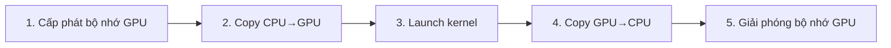

Một ví dụ cộng vector hoàn chỉnh để đi hết quy trình CUDA: cấp phát bộ nhớ, truyền dữ liệu, viết kernel, kiểm tra lỗi và đo thời gian, rồi so sánh CPU với GPU.

<!-- more -->

## Mục lục

- [1. Từ CPU sang GPU: một quy trình phát triển đầy đủ](#1-từ-cpu-sang-gpu-một-quy-trình-phát-triển-đầy-đủ)
- [2. Cài đặt kernel cộng vector](#2-cài-đặt-kernel-cộng-vector)
- [3. Mã phía host đầy đủ](#3-mã-phía-host-đầy-đủ)
- [4. Kiểm tra lỗi CUDA](#4-kiểm-tra-lỗi-cuda)
- [5. Đo thời gian: CPU vs GPU](#5-đo-thời-gian-cpu-vs-gpu)
- [6. Mã chạy được đầy đủ](#6-mã-chạy-được-đầy-đủ)
- [7. Phân tích hiệu năng và thảo luận](#7-phân-tích-hiệu-năng-và-thảo-luận)
- [8. Bài tập nâng cao](#8-bài-tập-nâng-cao)
- [Tóm tắt](#tóm-tắt)

---

## 1. Từ CPU sang GPU: một quy trình phát triển đầy đủ

Chuyển một bài toán tính toán từ CPU sang GPU giống như giao việc từ một nhân viên giỏi cho một đội nghìn người: bạn chuẩn bị nguyên liệu, phân việc, chờ xong, rồi thu kết quả. Trong CUDA, quy trình đó là:



Mỗi bước có API CUDA tương ứng:

| Bước | API | Ghi chú |
|------|-----|------|
| Cấp phát bộ nhớ GPU | `cudaMalloc()` | Giống `malloc()` trên CPU |
| Copy Host→Device | `cudaMemcpy(..., HostToDevice)` | Copy dữ liệu CPU sang GPU |
| Launch kernel | `kernel<<<grid, block>>>(args)` | GPU chạy song song |
| Copy Device→Host | `cudaMemcpy(..., DeviceToHost)` | Copy kết quả về CPU |
| Giải phóng bộ nhớ GPU | `cudaFree()` | Giống `free()` trên CPU |

---

## 2. Cài đặt kernel cộng vector

Cộng vector là bài toán song song đơn giản nhất: mỗi phần tử độc lập hoàn toàn, nên rất hợp GPU. Cho hai vector A và B dài N, tính:

$$
C[i] = A[i] + B[i], \quad i = 0, 1, \ldots, N-1
$$

### 2.1 Hàm kernel

```cpp
__global__ void vectorAdd(const float* A, const float* B, float* C, int N) {
    // Tính chỉ số thread toàn cục
    int idx = blockIdx.x * blockDim.x + threadIdx.x;

    // Kiểm tra biên: tránh truy cập ngoài phạm vi
    if (idx < N) {
        C[idx] = A[idx] + B[idx];
    }
}
```

Giải thích mã:
- `const float*`: A và B là đầu vào chỉ đọc
- `int idx`: mỗi thread tính một chỉ số toàn cục duy nhất
- `if (idx < N)`: block cuối có thể thừa thread; phải kiểm tra biên
- `C[idx] = A[idx] + B[idx]`: mỗi thread độc lập cộng một phần tử

### 2.2 Vì sao cần kiểm tra biên

Giả sử N = 1000, kích thước block = 256:
- Số block cần = $\lceil 1000/256 \rceil = 4$
- Tổng số thread = 4 × 256 = 1024
- 24 thread thừa có chỉ số 1000~1023, vượt khỏi mảng

Không có `if (idx < N)`, các thread đó chạm địa chỉ bất hợp pháp và gây hành vi không xác định hoặc crash.

---

## 3. Mã phía host đầy đủ

### 3.1 Quản lý bộ nhớ

```cpp
#include <cstdio>
#include <cstdlib>
#include <cuda_runtime.h>

int main() {
    int N = 1 << 20;  // khoảng 1 triệu phần tử
    size_t size = N * sizeof(float);

    // 1. Cấp phát bộ nhớ host
    float* h_A = (float*)malloc(size);
    float* h_B = (float*)malloc(size);
    float* h_C = (float*)malloc(size);

    // Khởi tạo dữ liệu đầu vào
    for (int i = 0; i < N; i++) {
        h_A[i] = (float)i;
        h_B[i] = (float)(i * 2);
    }

    // 2. Cấp phát bộ nhớ device
    float *d_A, *d_B, *d_C;
    cudaMalloc(&d_A, size);
    cudaMalloc(&d_B, size);
    cudaMalloc(&d_C, size);

    // 3. Copy đầu vào từ host sang device
    cudaMemcpy(d_A, h_A, size, cudaMemcpyHostToDevice);
    cudaMemcpy(d_B, h_B, size, cudaMemcpyHostToDevice);

    // 4. Cấu hình và launch kernel
    int blockSize = 256;
    int gridSize = (N + blockSize - 1) / blockSize;
    vectorAdd<<<gridSize, blockSize>>>(d_A, d_B, d_C, N);

    // 5. Copy kết quả từ device về host
    cudaMemcpy(h_C, d_C, size, cudaMemcpyDeviceToHost);

    // 6. Kiểm tra kết quả
    for (int i = 0; i < N; i++) {
        if (fabsf(h_C[i] - (h_A[i] + h_B[i])) > 1e-5f) {
            printf("Verification FAILED at index %d!\n", i);
            break;
        }
    }
    printf("Verification PASSED!\n");

    // 7. Giải phóng bộ nhớ
    cudaFree(d_A);
    cudaFree(d_B);
    cudaFree(d_C);
    free(h_A);
    free(h_B);
    free(h_C);

    return 0;
}
```

### 3.2 Biên dịch và chạy

```bash
$ nvcc vectorAdd.cu -o vectorAdd
$ ./vectorAdd
Verification PASSED!
```

---

## 4. Kiểm tra lỗi CUDA

Các lời gọi API CUDA có thể thất bại (hết bộ nhớ, tham số sai, v.v.). Mã production phải kiểm tra giá trị trả về của mọi lời gọi.

### 4.1 Macro

```cpp
#define CUDA_CHECK(call)                                                      \
    do {                                                                       \
        cudaError_t err = call;                                                \
        if (err != cudaSuccess) {                                              \
            fprintf(stderr, "CUDA error at %s:%d - %s\n",                     \
                    __FILE__, __LINE__, cudaGetErrorString(err));              \
            exit(EXIT_FAILURE);                                                \
        }                                                                      \
    } while (0)
```

### 4.2 Cách dùng

```cpp
CUDA_CHECK(cudaMalloc(&d_A, size));
CUDA_CHECK(cudaMemcpy(d_A, h_A, size, cudaMemcpyHostToDevice));

// Kiểm tra lỗi khi launch kernel cần hai bước
vectorAdd<<<gridSize, blockSize>>>(d_A, d_B, d_C, N);
CUDA_CHECK(cudaGetLastError());          // kiểm tra tham số launch
CUDA_CHECK(cudaDeviceSynchronize());     // kiểm tra lỗi trong lúc thực thi
```

### 4.3 Mã lỗi thường gặp

| Mã lỗi | Ý nghĩa | Nguyên nhân thường gặp |
|--------|------|---------|
| `cudaErrorMemoryAllocation` | Cấp phát bộ nhớ thất bại | Không đủ VRAM |
| `cudaErrorInvalidValue` | Tham số không hợp lệ | size=0 hoặc con trỏ null |
| `cudaErrorInvalidConfiguration` | Cấu hình launch không hợp lệ | Block vượt 1024 thread |
| `cudaErrorIllegalAddress` | Truy cập bộ nhớ bất hợp pháp | Vượt biên / con trỏ hoang |
| `cudaErrorLaunchTimeout` | Kernel chạy quá thời gian | Vòng lặp vô hạn hoặc khối lượng tính quá lớn |

**Gợi ý**: Giai đoạn phát triển nên gắn kiểm tra lỗi sau mỗi API CUDA. Khi phát hành có thể dùng macro biên dịch để tắt kiểm tra ở chế độ Release và bỏ chi phí đó.

---

## 5. Đo thời gian: CPU vs GPU

### 5.1 Baseline trên CPU

```cpp
void vectorAddCPU(const float* A, const float* B, float* C, int N) {
    for (int i = 0; i < N; i++) {
        C[i] = A[i] + B[i];
    }
}
```

### 5.2 Đo thời gian bằng CUDA Event

CUDA Event là cách chuẩn để đo thời gian phía GPU, độ chính xác tới micro giây:

```cpp
cudaEvent_t start, stop;
cudaEventCreate(&start);
cudaEventCreate(&stop);

// Bắt đầu đo
cudaEventRecord(start);

// Phần cần đo
vectorAdd<<<gridSize, blockSize>>>(d_A, d_B, d_C, N);

// Kết thúc đo
cudaEventRecord(stop);
cudaEventSynchronize(stop);

// Tính thời gian
float milliseconds = 0;
cudaEventElapsedTime(&milliseconds, start, stop);
printf("GPU Kernel time: %.4f ms\n", milliseconds);

// Dọn dẹp
cudaEventDestroy(start);
cudaEventDestroy(stop);
```

### 5.3 Đo end-to-end kể cả truyền dữ liệu

```cpp
cudaEventRecord(start);

cudaMemcpy(d_A, h_A, size, cudaMemcpyHostToDevice);
cudaMemcpy(d_B, h_B, size, cudaMemcpyHostToDevice);
vectorAdd<<<gridSize, blockSize>>>(d_A, d_B, d_C, N);
cudaMemcpy(h_C, d_C, size, cudaMemcpyDeviceToHost);

cudaEventRecord(stop);
cudaEventSynchronize(stop);

float totalTime = 0;
cudaEventElapsedTime(&totalTime, start, stop);
printf("GPU total (with memcpy): %.4f ms\n", totalTime);
```

### 5.4 So sánh kết quả hiệu năng (giá trị tham khảo)

Trên RTX 4090, với N = $2^{24}$ (khoảng 16 triệu phần tử), kết quả điển hình:

| Chỉ số | CPU (đơn nhân) | GPU (chỉ kernel) | GPU (kèm truyền) |
|---------|-----------|-----------------|-------------|
| Thời gian | ~25 ms | ~0.3 ms | ~8 ms |
| Băng thông hiệu dụng | ~5 GB/s | ~400 GB/s | ~15 GB/s |

**Lưu ý**: Cộng vector là thao tác **memory-bound** (mỗi phần tử chỉ cộng 1 lần nhưng phải đọc 2 float, ghi 1 float). Khi tính cả truyền dữ liệu, băng thông PCIe trở thành nút thắt. Lợi thế của GPU rõ nhất khi dữ liệu đã nằm trên VRAM.

---

## 6. Mã chạy được đầy đủ

Gộp các phần trên thành một chương trình biên dịch và chạy trực tiếp:

```cpp
#include <cstdio>
#include <cstdlib>
#include <cmath>
#include <chrono>
#include <cuda_runtime.h>

// Macro kiểm tra lỗi
#define CUDA_CHECK(call)                                                      \
    do {                                                                       \
        cudaError_t err = call;                                                \
        if (err != cudaSuccess) {                                              \
            fprintf(stderr, "CUDA error at %s:%d - %s\n",                     \
                    __FILE__, __LINE__, cudaGetErrorString(err));              \
            exit(EXIT_FAILURE);                                                \
        }                                                                      \
    } while (0)

// GPU kernel
__global__ void vectorAdd(const float* A, const float* B, float* C, int N) {
    int idx = blockIdx.x * blockDim.x + threadIdx.x;
    if (idx < N) {
        C[idx] = A[idx] + B[idx];
    }
}

// Baseline CPU
void vectorAddCPU(const float* A, const float* B, float* C, int N) {
    for (int i = 0; i < N; i++) {
        C[i] = A[i] + B[i];
    }
}

int main() {
    const int N = 1 << 24;  // khoảng 16 triệu phần tử
    const size_t size = N * sizeof(float);
    printf("Vector size: %d elements (%.1f MB)\n", N, size / (1024.0 * 1024.0));

    // ========== Cấp phát bộ nhớ host ==========
    float* h_A = (float*)malloc(size);
    float* h_B = (float*)malloc(size);
    float* h_C_cpu = (float*)malloc(size);
    float* h_C_gpu = (float*)malloc(size);

    // Khởi tạo dữ liệu
    for (int i = 0; i < N; i++) {
        h_A[i] = sinf(i * 0.001f);
        h_B[i] = cosf(i * 0.001f);
    }

    // ========== Tính trên CPU ==========
    auto cpu_start = std::chrono::high_resolution_clock::now();
    vectorAddCPU(h_A, h_B, h_C_cpu, N);
    auto cpu_end = std::chrono::high_resolution_clock::now();
    float cpu_ms = std::chrono::duration<float, std::milli>(cpu_end - cpu_start).count();
    printf("CPU time: %.4f ms\n", cpu_ms);

    // ========== Tính trên GPU ==========
    float *d_A, *d_B, *d_C;
    CUDA_CHECK(cudaMalloc(&d_A, size));
    CUDA_CHECK(cudaMalloc(&d_B, size));
    CUDA_CHECK(cudaMalloc(&d_C, size));

    // Tạo bộ đếm CUDA Event
    cudaEvent_t start, stop, kernel_start, kernel_stop;
    cudaEventCreate(&start);
    cudaEventCreate(&stop);
    cudaEventCreate(&kernel_start);
    cudaEventCreate(&kernel_stop);

    // Đo end-to-end (kèm truyền)
    cudaEventRecord(start);

    CUDA_CHECK(cudaMemcpy(d_A, h_A, size, cudaMemcpyHostToDevice));
    CUDA_CHECK(cudaMemcpy(d_B, h_B, size, cudaMemcpyHostToDevice));

    int blockSize = 256;
    int gridSize = (N + blockSize - 1) / blockSize;

    // Chỉ đo kernel
    cudaEventRecord(kernel_start);
    vectorAdd<<<gridSize, blockSize>>>(d_A, d_B, d_C, N);
    cudaEventRecord(kernel_stop);

    CUDA_CHECK(cudaGetLastError());
    CUDA_CHECK(cudaMemcpy(h_C_gpu, d_C, size, cudaMemcpyDeviceToHost));

    cudaEventRecord(stop);
    cudaEventSynchronize(stop);

    float gpu_total_ms = 0, kernel_ms = 0;
    cudaEventElapsedTime(&gpu_total_ms, start, stop);
    cudaEventElapsedTime(&kernel_ms, kernel_start, kernel_stop);

    printf("GPU kernel time: %.4f ms\n", kernel_ms);
    printf("GPU total time (with memcpy): %.4f ms\n", gpu_total_ms);
    printf("Speedup (kernel only): %.1fx\n", cpu_ms / kernel_ms);
    printf("Speedup (end-to-end): %.1fx\n", cpu_ms / gpu_total_ms);

    // ========== Kiểm tra kết quả ==========
    int errors = 0;
    for (int i = 0; i < N; i++) {
        if (fabsf(h_C_gpu[i] - h_C_cpu[i]) > 1e-5f) {
            if (errors < 5) {
                printf("Mismatch at %d: CPU=%.6f, GPU=%.6f\n",
                       i, h_C_cpu[i], h_C_gpu[i]);
            }
            errors++;
        }
    }
    if (errors == 0) {
        printf("Verification PASSED!\n");
    } else {
        printf("Verification FAILED: %d mismatches\n", errors);
    }

    // ========== Tính băng thông hiệu dụng ==========
    // Cộng vector đọc 2 float, ghi 1 float = 12 bytes/element
    float bandwidth_gb = (3.0f * size) / (kernel_ms * 1e-3f) / 1e9f;
    printf("Effective bandwidth: %.1f GB/s\n", bandwidth_gb);

    // ========== Dọn dẹp ==========
    cudaEventDestroy(start);
    cudaEventDestroy(stop);
    cudaEventDestroy(kernel_start);
    cudaEventDestroy(kernel_stop);
    CUDA_CHECK(cudaFree(d_A));
    CUDA_CHECK(cudaFree(d_B));
    CUDA_CHECK(cudaFree(d_C));
    free(h_A);
    free(h_B);
    free(h_C_cpu);
    free(h_C_gpu);

    return 0;
}
```

```bash
# Biên dịch
nvcc -O3 -arch=sm_89 vectorAdd.cu -o vectorAdd

# Chạy
./vectorAdd
```

---

## 7. Phân tích hiệu năng và thảo luận

### 7.1 Cường độ số học của cộng vector

**Arithmetic intensity** (cường độ số học) = lượng tính toán / lượng truy cập bộ nhớ:

$$
\text{AI} = \frac{\text{FLOPs}}{\text{Bytes}} = \frac{1 \text{ FLOP}}{12 \text{ Bytes}} \approx 0.083 \text{ FLOP/Byte}
$$

Giá trị này rất thấp, nên cộng vector là thao tác **memory-bound điển hình**: hiệu năng bị giới hạn bởi băng thông bộ nhớ chứ không phải khả năng tính toán.

### 7.2 Phân tích mức dùng băng thông

Nếu kernel chạy 0.3 ms và xử lý $3 \times 2^{24} \times 4$ Bytes = 201 MB dữ liệu:

$$
\text{Effective bandwidth} = \frac{201 \text{ MB}}{0.3 \text{ ms}} \approx 670 \text{ GB/s}
$$

So với đỉnh lý thuyết của RTX 4090 là 1008 GB/s, mức dùng khoảng 66%, đã khá tốt với một kernel đơn giản như vậy.

### 7.3 Chi phí truyền PCIe

| Khâu | Thời gian điển hình | Tỷ lệ |
|---------|---------|------|
| Truyền H2D (64MB × 2) | ~5 ms | ~60% |
| Thực thi kernel | ~0.3 ms | ~4% |
| Truyền D2H (64MB) | ~3 ms | ~36% |

**Điểm then chốt**: Với các thao tác elementwise đơn giản, truyền dữ liệu thường là nút thắt chính. Trong ứng dụng thực tế nên giữ dữ liệu "ở lại trên GPU": nối nhiều kernel xử lý cùng một batch, tránh chuyển đi chuyển lại.

### 7.4 Khi nào đáng dùng GPU

| Tình huống | CPU tốt hơn | GPU tốt hơn |
|------|---------|---------|
| Dữ liệu nhỏ (< 10K phần tử) | Có | Không |
| Một thao tác đơn giản + dữ liệu chưa trên GPU | Có | Không |
| Dữ liệu lớn + đã nằm trên GPU | Không | Có |
| Dữ liệu lớn + nhiều bước tính nối tiếp | Không | Có |
| Compute-bound (ví dụ nhân ma trận) | Không | Có |

---

## 8. Bài tập nâng cao

Sau cộng vector, thử các bài sau để củng cố:

### 8.1 Bài 1: Tích vô hướng

Cài đặt tích vô hướng $\text{result} = \sum_{i=0}^{N-1} A[i] \times B[i]$.

Gợi ý: cần **reduction** (quy ước). Mỗi thread tính một tích riêng phần, rồi cộng dồn trong block bằng shared memory.

### 8.2 Bài 2: SAXPY

Cài đặt SAXPY: $Y[i] = \alpha \times X[i] + Y[i]$

Đây là thao tác cơ bản của BLAS; so với cộng vector chỉ thêm một phép nhân vô hướng.

### 8.3 Bài 3: Phiên bản grid-stride loop

Đổi cộng vector sang dạng grid-stride loop, launch số thread cố định để xử lý mảng kích thước bất kỳ:

```cpp
__global__ void vectorAddStride(const float* A, const float* B,
                                float* C, int N) {
    int idx = blockIdx.x * blockDim.x + threadIdx.x;
    int stride = blockDim.x * gridDim.x;
    for (int i = idx; i < N; i += stride) {
        C[i] = A[i] + B[i];
    }
}

// Khi launch không còn cần gridSize = (N + 255) / 256
// Có thể chọn bất kỳ kích thước grid hợp lý
vectorAddStride<<<128, 256>>>(d_A, d_B, d_C, N);
```

### 8.4 Bài 4: Overlap truyền bất đồng bộ với tính toán

Dùng CUDA Stream để truyền dữ liệu và tính toán chạy song song:

```cpp
cudaStream_t stream;
cudaStreamCreate(&stream);

// Truyền bất đồng bộ và tính toán có thể chồng lên nhau
cudaMemcpyAsync(d_A, h_A, size, cudaMemcpyHostToDevice, stream);
cudaMemcpyAsync(d_B, h_B, size, cudaMemcpyHostToDevice, stream);
vectorAdd<<<gridSize, blockSize, 0, stream>>>(d_A, d_B, d_C, N);
cudaMemcpyAsync(h_C, d_C, size, cudaMemcpyDeviceToHost, stream);

cudaStreamSynchronize(stream);
cudaStreamDestroy(stream);
```

**Gợi ý**: Để overlap thật sự, bộ nhớ phía host phải cấp phát bằng `cudaMallocHost()` (pinned memory).

---

## Tóm tắt

Qua ví dụ cộng vector này, bạn nắm được quy trình cốt lõi của CUDA:

1. **Năm bước chuẩn**: cudaMalloc → cudaMemcpy(H2D) → kernel launch → cudaMemcpy(D2H) → cudaFree
2. **Ba yếu tố khi viết kernel**: tính chỉ số toàn cục + kiểm tra biên + tính toán song song
3. **Kiểm tra lỗi**: bọc mỗi lời gọi API bằng macro `CUDA_CHECK`
4. **Đo hiệu năng**: CUDA Event + tính băng thông hiệu dụng
5. **Nhận thức hiệu năng**: nút thắt của thao tác đơn giản nằm ở truyền bộ nhớ; GPU thắng khi dữ liệu nằm sẵn trên device và ở các bài compute-bound

Cộng vector tuy đơn giản nhưng dựng sẵn khung CUDA đầy đủ. Các kernel nâng cao sau này (nhân ma trận, convolution, reduction, ...) chỉ thêm độ phức tạp trên cùng khung đó.

## Danh sách tự kiểm

- Tự viết được mã CUDA cộng vector đầy đủ (kèm quản lý bộ nhớ và kiểm tra lỗi)
- Giải thích được vì sao kernel cần `if (idx < N)`
- Dùng CUDA Event để đo chính xác thời gian chạy kernel
- Tính băng thông bộ nhớ hiệu dụng của một kernel và so với đỉnh lý thuyết
- Phân biệt một thao tác là compute-bound hay memory-bound
- Giải thích vì sao thời gian end-to-end kèm truyền dữ liệu lớn hơn nhiều so với chỉ kernel
- Dùng grid-stride loop để xử lý dữ liệu kích thước bất kỳ
- Viết mã CUDA vững bằng macro `CUDA_CHECK`

## Tài liệu tham khảo

- [NVIDIA CUDA Samples - vectorAdd](https://github.com/NVIDIA/cuda-samples/tree/master/Samples/0_Introduction/vectorAdd)
- [An Even Easier Introduction to CUDA (NVIDIA Blog)](https://developer.nvidia.com/blog/even-easier-introduction-cuda/)
- [CUDA C++ Programming Guide - Performance Guidelines](https://docs.nvidia.com/cuda/cuda-c-programming-guide/index.html#performance-guidelines)
- [CUDA C++ Best Practices Guide - Bandwidth](https://docs.nvidia.com/cuda/cuda-c-best-practices-guide/index.html#memory-optimizations)
