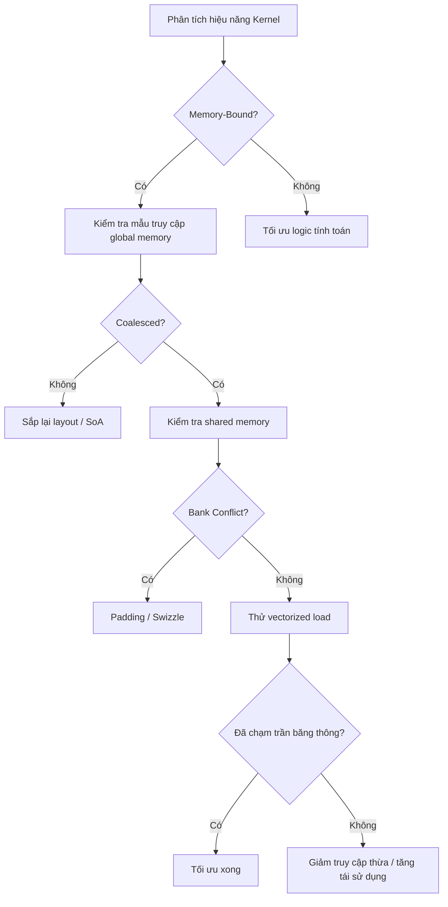

Hiệu quả truy cập bộ nhớ là đòn bẩy lớn nhất cho hiệu năng Kernel CUDA. Bài này đi sâu coalesced access (nguyên lý và cách phán đoán), Bank Conflict của shared memory cùng cách xử lý bằng Padding, và kỹ thuật thực chiến vectorized load (float4/int4) để nâng tỷ lệ dùng băng thông.

<!-- more -->

## 📑 Mục lục

- [1. Vì sao truy cập bộ nhớ là nút thắt](#1-vì-sao-truy-cập-bộ-nhớ-là-nút-thắt)
- [2. Global memory và coalesced access](#2-global-memory-và-coalesced-access)
- [3. Shared memory và Bank Conflict](#3-shared-memory-và-bank-conflict)
- [4. Vectorized load](#4-vectorized-load)
- [5. Thực chiến tối ưu truy cập bộ nhớ](#5-thực-chiến-tối-ưu-truy-cập-bộ-nhớ)
- [6. Mẹo nâng cao và công cụ](#6-mẹo-nâng-cao-và-công-cụ)
- [Tóm tắt](#-tóm-tắt)
- [Danh sách tự kiểm](#-danh-sách-tự-kiểm)
- [Tài liệu tham khảo](#-tài-liệu-tham-khảo)

---

## 1. Vì sao truy cập bộ nhớ là nút thắt

GPU giống một nhà máy khổng lồ — hàng nghìn máy (lõi tính toán) chạy cùng lúc trên xưởng, nhưng kho nguyên liệu (bộ nhớ GPU) chỉ có một đường vận chuyển (bus bộ nhớ). Máy nhanh đến đâu, đường vận chuyển tắc thì cả dây chuyền cũng phải chờ.

Một phép tính nhanh: A100 đạt đỉnh 312 TFLOPS (FP16 Tensor Core), còn băng thông HBM2e khoảng 2 TB/s. Với phép cộng vector đơn giản `c[i] = a[i] + b[i]`:

$$
\text{Arithmetic Intensity} = \frac{\text{1 FLOP}}{\text{12 Bytes (đọc 2, ghi 1)}} \approx 0.083 \text{ FLOP/Byte}
$$

$$
\text{Tính toán băng thông nuôi được} = 2 \text{ TB/s} \times 0.083 = 166 \text{ GFLOPS}
$$

Chỉ bằng 0.05% đỉnh. Vì vậy **tối ưu mẫu truy cập bộ nhớ thường nâng hiệu năng nhiều hơn tối ưu logic tính toán**.

### 1.1 Nhắc nhanh mô hình Roofline

Mô hình Roofline chia Kernel thành hai loại:

- **Memory-Bound**: bị giới hạn bởi băng thông; hướng tối ưu là giảm truy cập bộ nhớ và nâng hiệu quả truy cập
- **Compute-Bound**: bị giới hạn bởi tính toán; hướng tối ưu là tăng độ song song tính toán

Hầu hết Kernel (đặc biệt Elementwise, quy giản, transpose ma trận, ...) đều Memory-Bound. Với chúng, coalesced access và mẫu dùng bộ nhớ hiệu quả mới là then chốt hiệu năng.

---

## 2. Global memory và coalesced access

### 2.1 Nguyên lý coalesced access

Truy cập global memory được gộp transaction theo đơn vị **Warp**. Khi 32 thread của một Warp cùng phát lệnh đọc/ghi, phần cứng cố gộp các yêu cầu thành ít memory transaction nhất có thể.

Mỗi memory transaction có hạt **32 Bytes** (một sector của cache line). L1 cache line dài 128 Bytes, gồm 4 sector 32B.

💡 **Gợi ý**: Nguyên tắc cốt lõi của coalesced access rất đơn giản — để các thread liên tiếp trong Warp truy cập địa chỉ bộ nhớ liên tiếp.


### 2.2 Chênh lệch hiệu năng coalesced vs không coalesced

```cpp
// ✅ Coalesced: thread liên tiếp chạm địa chỉ liên tiếp
// 32 thread của 1 Warp chạm 128B liên tục, vừa khít 1 cache line
__global__ void coalesced_read(float* data, float* out, int N) {
    int tid = threadIdx.x + blockIdx.x * blockDim.x;
    if (tid < N) {
        out[tid] = data[tid];  // data[0], data[1], ..., data[31] liên tục
    }
}

// ❌ Không coalesced (truy cập nhảy): thread liên tiếp chạm địa chỉ cách quãng
// stride=32 thì địa chỉ mỗi thread lệch 128B → cần 32 transaction
__global__ void strided_read(float* data, float* out, int N, int stride) {
    int tid = threadIdx.x + blockIdx.x * blockDim.x;
    if (tid < N) {
        out[tid] = data[tid * stride];  // data[0], data[32], data[64], ...
    }
}
```

So sánh hiệu năng (A100, đọc 1GB dữ liệu):

| 📊 Mẫu truy cập | Số memory transaction | Tỷ lệ băng thông hữu hiệu | Thời gian tương đối |
|------------|-----------|--------------|---------|
| Liên tục + căn chỉnh (stride=1) | 1x | ~95% | 1x |
| stride=2 | 2x | ~50% | 2x |
| stride=4 | 4x | ~25% | 4x |
| stride=32 | 32x | ~3% | 32x |
| Hoàn toàn ngẫu nhiên | 32x | ~3% | 32x |

### 2.3 Yêu cầu căn chỉnh

Ngoài tính liên tục, căn chỉnh cũng quan trọng:

```cpp
// ✅ Truy cập căn chỉnh: địa chỉ gốc là bội số của 128B
float* aligned_ptr = data;  // cudaMalloc đảm bảo căn 256B
out[tid] = aligned_ptr[tid];

// ⚠️ Truy cập lệch: địa chỉ gốc không căn, có thể thêm một transaction
out[tid] = data[tid + 1];  // gốc lệch 4B, không còn căn 128B
```

Tin vui: bộ nhớ từ `cudaMalloc` luôn căn 256 Bytes, nên truy cập liên tục từ đầu thường không gặp vấn đề căn chỉnh. Cần chú ý khi tự offset con trỏ.

### 2.4 Array of Structures vs Structure of Arrays

Đây là bài toán AoS vs SoA kinh điển:

```cpp
// ❌ AoS (Array of Structures): bất lợi cho coalescing
struct Particle {
    float x, y, z, w;
};
Particle particles[N];
// Đọc mọi x: particles[0].x, particles[1].x, ...
// Địa chỉ nhảy: 0, 16, 32, 48, ... (stride=4)

// ✅ SoA (Structure of Arrays): có lợi cho coalescing
struct ParticlesSoA {
    float x[N], y[N], z[N], w[N];
};
ParticlesSoA particles;
// Đọc mọi x: particles.x[0], particles.x[1], ...
// Địa chỉ liên tục: 0, 4, 8, 12, ... (stride=1)
```

📌 **Điểm then chốt**: Trong lập trình GPU, **SoA hầu như luôn tốt hơn AoS**, vì chế độ song song theo Warp vốn hợp với việc thread liên tiếp truy cập trường liên tiếp.

### 2.5 Truy cập hàng vs cột trên mảng 2D

```cpp
// Mảng 2D lưu theo hàng (Row-Major); element[row][col] ở địa chỉ row*cols+col
// ✅ Duyệt theo hàng: thread liên tiếp chạm các cột liên tiếp cùng một hàng
int col = threadIdx.x + blockIdx.x * blockDim.x;
int row = blockIdx.y;
float val = matrix[row * cols + col];  // coalesced

// ❌ Duyệt theo cột: thread liên tiếp chạm các hàng liên tiếp cùng một cột
int row2 = threadIdx.x + blockIdx.x * blockDim.x;
int col2 = blockIdx.y;
float val2 = matrix[row2 * cols + col2];  // stride = cols, rất tệ
```

---

## 3. Shared memory và Bank Conflict

### 3.1 Cấu trúc Bank của shared memory

Shared memory được chia thành **32 Bank** (khớp kích thước Warp), mỗi Bank rộng 4 Bytes (32 bits). Các từ 4 Byte liên tiếp được gán vào các Bank liên tiếp:

```
Địa chỉ 0~3:   Bank 0
Địa chỉ 4~7:   Bank 1
Địa chỉ 8~11:  Bank 2
...
Địa chỉ 124~127: Bank 31
Địa chỉ 128~131: Bank 0  (lặp lại)
...
```

Mỗi chu kỳ đồng hồ, mỗi Bank chỉ phục vụ một yêu cầu đọc hoặc ghi. Nếu nhiều thread trong cùng Warp truy cập **các địa chỉ khác nhau của cùng một Bank**, các truy cập phải tuần tự hóa — đó là Bank Conflict.

### 3.2 Các loại Bank Conflict và cái giá

| 📊 Loại xung đột | Ý nghĩa | Ảnh hưởng hiệu năng |
|------------|------|---------|
| Không xung đột (No Conflict) | 32 thread chạm 32 Bank khác nhau | Xong trong 1 chu kỳ |
| 2-way Conflict | 2 thread chạm cùng một Bank | 2 chu kỳ (tuần tự hóa) |
| N-way Conflict | N thread chạm cùng một Bank | N chu kỳ |
| Broadcast | Nhiều thread chạm **cùng địa chỉ** trong một Bank | 1 chu kỳ (miễn phí) |

⚠️ **Lưu ý**: Broadcast là trường hợp đặc biệt — nếu nhiều thread đọc đúng cùng một địa chỉ, phần cứng broadcast giá trị đó cho mọi thread yêu cầu, không tính là xung đột. Chỉ "cùng Bank, khác địa chỉ" mới xung đột.

### 3.3 Tình huống xung đột kinh điển: transpose ma trận

```cpp
// Transpose ma trận naïve
__shared__ float tile[32][32];

// Khi ghi: thread liên tiếp ghi các cột khác nhau cùng một hàng → không xung đột
tile[threadIdx.y][threadIdx.x] = input[gy * N + gx];

// Khi đọc: thread liên tiếp đọc các hàng khác nhau cùng một cột
output[gx * N + gy] = tile[threadIdx.x][threadIdx.y];
// threadIdx.x=0 → tile[0][ty], địa chỉ= (0*32+ty)*4 = ty*4 → Bank = ty%32
// threadIdx.x=1 → tile[1][ty], địa chỉ= (1*32+ty)*4 → Bank = (32+ty)%32 = ty%32
// threadIdx.x=2 → tile[2][ty], địa chỉ= (2*32+ty)*4 → Bank = (64+ty)%32 = ty%32
// Mọi thread cùng Bank (= ty%32) → 32-way Bank Conflict!
```

### 3.4 Cách giải một: Padding

Thêm một cột trong khai báo shared memory để phá ánh xạ bội số của 32:

```cpp
// ✅ Thêm 1 cột Padding
__shared__ float tile[32][32 + 1];  // 33 cột

// Ban đầu tile[row][col] địa chỉ = (row * 32 + col) * 4
// Bây giờ tile[row][col] địa chỉ = (row * 33 + col) * 4
// Bank = (row * 33 + col) % 32

// Đọc tile[threadIdx.x][ty]:
// threadIdx.x=0 → Bank = (0*33+ty)%32 = ty%32
// threadIdx.x=1 → Bank = (1*33+ty)%32 = (33+ty)%32 = (1+ty)%32
// threadIdx.x=2 → Bank = (2*33+ty)%32 = (66+ty)%32 = (2+ty)%32
// Mỗi thread chạm Bank khác nhau → không xung đột!
```

Padding lãng phí thêm 4 Bytes shared memory mỗi hàng, nhưng mức tăng hiệu năng thường lớn hơn nhiều so với chi phí đó.

### 3.5 Cách giải hai: Swizzle (nâng cao)

Với một số mẫu truy cập, có thể biến đổi địa chỉ (Swizzle) để tránh xung đột:

```cpp
// Ý tưởng Swizzle: dùng XOR xáo trộn phân bố Bank trên chỉ số tuyến tính
__device__ int swizzle_index(int row, int col) {
    return row * 32 + (col ^ row);  // biến đổi XOR
}

// Ghi
tile[row][col ^ row] = input_val;
// Đọc
float val = tile[col][row ^ col];
```

Swizzle không tốn thêm không gian, nhưng tính chỉ số phức tạp hơn. Các triển khai GEMM hiệu năng cao (như CUTLASS) dùng rộng rãi.

### 3.6 Cách phát hiện Bank Conflict

Dùng **Nsight Compute** quan sát các chỉ số shared memory:

```
l1tex__data_bank_conflicts_pipe_lsu_mem_shared_op_ld  # xung đột load
l1tex__data_bank_conflicts_pipe_lsu_mem_shared_op_st  # xung đột store
```

Nếu hai bộ đếm này khác không, nghĩa là có Bank Conflict, cần kiểm tra mẫu truy cập shared memory.

---

## 4. Vectorized load

### 4.1 Vectorized load là gì

Vectorized load nghĩa là dùng một lệnh đọc nhiều phần tử liên tiếp (ví dụ `float4` đọc một lần 4 float, 16 Bytes). Lợi ích:

1. **Giảm số lệnh**: 4 lần `LDG.32` → 1 lần `LDG.128`
2. **Nâng tỷ lệ dùng băng thông**: mỗi transaction mang nhiều dữ liệu hữu ích hơn
3. **Giảm chi phí lập lịch**: ít lệnh bộ nhớ hơn trong hàng đợi

### 4.2 Các kiểu vector thường dùng

| 📊 Kiểu | Kích thước | Tương đương |
|---------|------|------|
| `float2` | 8 Bytes | 2 float |
| `float4` | 16 Bytes | 4 float |
| `int4` | 16 Bytes | 4 int |
| `double2` | 16 Bytes | 2 double |

💡 **Gợi ý**: Một cache line của GPU dài 128 Bytes. Một Warp 32 thread, mỗi thread nạp một `float4` (16B) = 512B, cần 4 cache line. Mỗi thread nạp một `float` (4B) = 128B chỉ cần 1 cache line. Số yêu cầu cache line tăng, nhưng mỗi lệnh load xử lý gấp 4 lần dữ liệu, tổng số lệnh giảm 75%.

### 4.3 Cách dùng cơ bản

```cpp
// Bản scalar: mỗi thread nạp 1 float
__global__ void scalar_copy(float* dst, float* src, int N) {
    int tid = threadIdx.x + blockIdx.x * blockDim.x;
    if (tid < N) {
        dst[tid] = src[tid];
    }
}

// Bản vector hóa: mỗi thread nạp 4 float
__global__ void vectorized_copy(float* dst, float* src, int N) {
    int tid = threadIdx.x + blockIdx.x * blockDim.x;
    int idx = tid * 4;  // mỗi thread phụ trách 4 phần tử

    if (idx + 3 < N) {
        // Ép float* thành float4*; một lệnh đọc 16B
        float4 val = reinterpret_cast<float4*>(src)[tid];
        reinterpret_cast<float4*>(dst)[tid] = val;
    }
}
```

### 4.4 Yêu cầu căn chỉnh

Vectorized load có yêu cầu căn chỉnh nghiêm:

```cpp
// float4 yêu cầu căn 16B
// Địa chỉ từ cudaMalloc căn 256B → thỏa

// Nhưng nếu có offset thì cần xử lý riêng
float* base = ...; // căn 256B
float* offset_ptr = base + 3;  // lệch 12B, không thỏa căn 16B

// ✅ Cách an toàn: xử lý scalar phần đầu chưa căn, rồi vector hóa phần thân
__global__ void safe_vectorized(float* data, int offset, int N) {
    // Xử lý các phần tử đầu chưa căn
    int align_offset = (4 - (offset % 4)) % 4;
    // ... xử lý scalar align_offset phần tử đầu

    // Phần thân vector hóa
    float4* aligned_ptr = reinterpret_cast<float4*>(data + offset + align_offset);
    // ...
}
```

### 4.5 Mẫu thực dụng: quy giản vector hóa

```cpp
__global__ void vectorized_sum(float* input, float* output, int N) {
    int tid = threadIdx.x + blockIdx.x * blockDim.x;
    int stride = blockDim.x * gridDim.x;

    float sum = 0.0f;

    // Mỗi vòng xử lý 4 phần tử
    int vec_N = N / 4;
    float4* vec_input = reinterpret_cast<float4*>(input);

    for (int i = tid; i < vec_N; i += stride) {
        float4 val = vec_input[i];
        sum += val.x + val.y + val.z + val.w;
    }

    // Xử lý phần đuôi không đủ 4 phần tử
    int tail_start = vec_N * 4;
    for (int i = tail_start + tid; i < N; i += stride) {
        sum += input[i];
    }

    // Tiếp theo làm quy giản Block...
    output[blockIdx.x] = sum;  // đơn giản hóa; thực tế cần quy giản
}
```

### 4.6 Khi nào dùng vectorized load

| ✅ Phù hợp | ❌ Không phù hợp |
|------------|-------------|
| Phép Elementwise (cộng/trừ/nhân/chia) | Mẫu chỉ số phức tạp (gather/scatter) |
| Copy/khởi tạo dữ liệu quy mô lớn | Độ dài không chia hết cho 4 và không xử lý đuôi được |
| Kernel bị giới hạn băng thông | Kernel tính nặng (nút thắt không phải truy cập bộ nhớ) |
| Địa chỉ dữ liệu đảm bảo căn được | Địa chỉ gốc không căn được |

---

## 5. Thực chiến tối ưu truy cập bộ nhớ

### 5.1 Case: tối ưu transpose ma trận

Transpose ma trận là case sách giáo khoa về tối ưu truy cập bộ nhớ, vì không có tính toán nào — hiệu năng hoàn toàn phụ thuộc hiệu quả truy cập.

**Bản naïve**:

```cpp
__global__ void transpose_naive(float* out, float* in, int width, int height) {
    int col = threadIdx.x + blockIdx.x * blockDim.x;
    int row = threadIdx.y + blockIdx.y * blockDim.y;
    if (col < width && row < height) {
        out[col * height + row] = in[row * width + col];
        // Đọc: coalesced (thread liên tiếp chạm cột liên tiếp)
        // Ghi: không coalesced (stride = height)
    }
}
```

**Bản tối ưu bằng shared memory**:

```cpp
// Mỗi thread xử lý TILE_DIM / BLOCK_ROWS phần tử
#define TILE_DIM 32
#define BLOCK_ROWS 8

__global__ void transpose_shared(float* out, float* in, int width, int height) {
    __shared__ float tile[TILE_DIM][TILE_DIM + 1];  // +1 Padding xóa Bank Conflict

    int x = blockIdx.x * TILE_DIM + threadIdx.x;
    int y = blockIdx.y * TILE_DIM + threadIdx.y;

    // Đọc coalesced: mỗi warp đọc phần tử liên tiếp
    for (int j = 0; j < TILE_DIM; j += BLOCK_ROWS) {
        if (x < width && (y + j) < height) {
            tile[threadIdx.y + j][threadIdx.x] = in[(y + j) * width + x];
        }
    }

    __syncthreads();

    // Ghi coalesced: sau transpose, thread liên tiếp ghi địa chỉ liên tiếp
    x = blockIdx.y * TILE_DIM + threadIdx.x;
    y = blockIdx.x * TILE_DIM + threadIdx.y;

    for (int j = 0; j < TILE_DIM; j += BLOCK_ROWS) {
        if (x < height && (y + j) < width) {
            out[(y + j) * height + x] = tile[threadIdx.x][threadIdx.y + j];
        }
    }
}

// Cách gọi:
// dim3 block(TILE_DIM, BLOCK_ROWS);
// dim3 grid((width + TILE_DIM - 1) / TILE_DIM, (height + TILE_DIM - 1) / TILE_DIM);
```

Ý tưởng cốt lõi: dùng shared memory làm "trạm trung chuyển", biến ghi global không coalesced thành đọc theo cột từ shared memory (Padding xóa Bank Conflict), rồi ghi ra theo kiểu coalesced.

### 5.2 Case: tối ưu bộ nhớ trong phép quy giản

```cpp
// ❌ Quy giản naïve: truy cập xen kẽ gây Bank Conflict và dùng băng thông kém
__global__ void reduce_interleaved(float* input, float* output, int N) {
    int tid = threadIdx.x;
    int idx = blockIdx.x * blockDim.x + tid;
    __shared__ float sdata[256];
    sdata[tid] = (idx < N) ? input[idx] : 0.0f;
    __syncthreads();

    for (int s = 1; s < blockDim.x; s *= 2) {
        if (tid % (2 * s) == 0) {
            sdata[tid] += sdata[tid + s];
        }
        __syncthreads();
    }
    if (tid == 0) output[blockIdx.x] = sdata[0];
}

// ✅ Quy giản tối ưu: thread liên tiếp thao tác địa chỉ liên tiếp
__global__ void reduce_sequential(float* input, float* output, int N) {
    int tid = threadIdx.x;
    int idx = blockIdx.x * blockDim.x + tid;
    __shared__ float sdata[256];
    sdata[tid] = (idx < N) ? input[idx] : 0.0f;
    __syncthreads();

    for (int s = blockDim.x / 2; s > 0; s >>= 1) {
        if (tid < s) {
            sdata[tid] += sdata[tid + s];
        }
        __syncthreads();
    }
    if (tid == 0) output[blockIdx.x] = sdata[0];
}
```

---

## 6. Mẹo nâng cao và công cụ

### 6.1 Cache hints

CUDA cho phép điều khiển chiến lược cache khi truy cập bộ nhớ:

```cpp
// Dùng __ldg() nạp qua cache dữ liệu chỉ đọc (texture cache)
// Hợp dữ liệu chỉ đọc; có thể tránh làm bẩn L1
float val = __ldg(&input[tid]);

// Điều khiển cache ở mức PTX (qua inline asm hoặc cờ biên dịch)
// .ca (cache all levels) — mặc định; cache vào L1 và L2
// .cg (cache global) — chỉ cache vào L2, bỏ qua L1
// .cs (cache streaming) — đánh dấu dữ liệu streaming, ưu tiên thấp
// .cv (cache volatile) — không cache; mỗi lần đọc từ bộ nhớ GPU
```

### 6.2 Công cụ phân tích truy cập bộ nhớ

Các chỉ số then chốt của Nsight Compute:

```
# Hiệu quả global memory
sm__sass_average_data_bytes_per_sector_mem_global_op_ld  # lý tưởng 128B
l1tex__t_sectors_pipe_lsu_mem_global_op_ld  # số transaction thực tế

# Tính tỷ lệ dùng băng thông
gpu__compute_memory_throughput  # thông lượng thực tế
dram__bytes_read + dram__bytes_write  # lượng truyền thực tế
```

### 6.3 Sơ đồ quyết định tối ưu



---

## 📝 Tóm tắt

| Kỹ thuật tối ưu | Điểm cốt lõi | Lợi ích |
|---------|---------|------|
| Coalesced access | Thread liên tiếp chạm địa chỉ liên tiếp; SoA hơn AoS | Chênh băng thông tối đa 32x |
| Truy cập căn chỉnh | Địa chỉ gốc căn biên 128B | Tránh transaction thừa |
| Padding | Shared memory `[N][N+1]` phá chu kỳ Bank | Xóa Bank Conflict |
| Vectorized load | `float4` / `int4` đọc một lần 16B | Giảm ~75% số lệnh |
| Cache hints | `__ldg()`, điều khiển cache policy | Giảm làm bẩn cache |
| Layout dữ liệu | AoS → SoA, đổi hàng/cột | Giải quyết coalescing về cấu trúc |

---

## 🎯 Danh sách tự kiểm

- Phán đoán được mẫu truy cập bộ nhớ đã thỏa điều kiện coalesced hay chưa
- Tính được một Warp truy cập global memory cần bao nhiêu transaction 32B
- Viết lại được cấu trúc AoS thành SoA để đạt coalesced access
- Giải thích được cách đánh địa chỉ Bank của shared memory và nguyên nhân Bank Conflict
- Thêm được Padding để xử lý mã có 32-way Bank Conflict
- Dùng đúng kiểu `float4` để load/store vector hóa
- Xử lý được vấn đề căn chỉnh và phần tử đuôi khi vectorized load
- Dùng shared memory biến ghi global không coalesced thành ghi coalesced
- Dùng Nsight Compute nhận diện các chỉ số liên quan hiệu quả bộ nhớ
- Áp dụng được chuỗi tối ưu truy cập bộ nhớ đầy đủ cho Kernel transpose ma trận

---

## 📚 Tài liệu tham khảo

- [NVIDIA CUDA C++ Programming Guide - Memory Hierarchy](https://docs.nvidia.com/cuda/cuda-c-programming-guide/index.html#memory-hierarchy)
- [NVIDIA CUDA C++ Best Practices Guide - Memory Optimizations](https://docs.nvidia.com/cuda/cuda-c-best-practices-guide/index.html#memory-optimizations)
- [An Efficient Matrix Transpose in CUDA C/C++ - NVIDIA Developer Blog](https://developer.nvidia.com/blog/efficient-matrix-transpose-cuda-cc/)
- [How to Access Global Memory Efficiently in CUDA C/C++ Kernels - NVIDIA Developer Blog](https://developer.nvidia.com/blog/how-access-global-memory-efficiently-cuda-c-kernels/)
- [CUTLASS: CUDA Templates for Linear Algebra Subroutines - GitHub](https://github.com/NVIDIA/cutlass)
