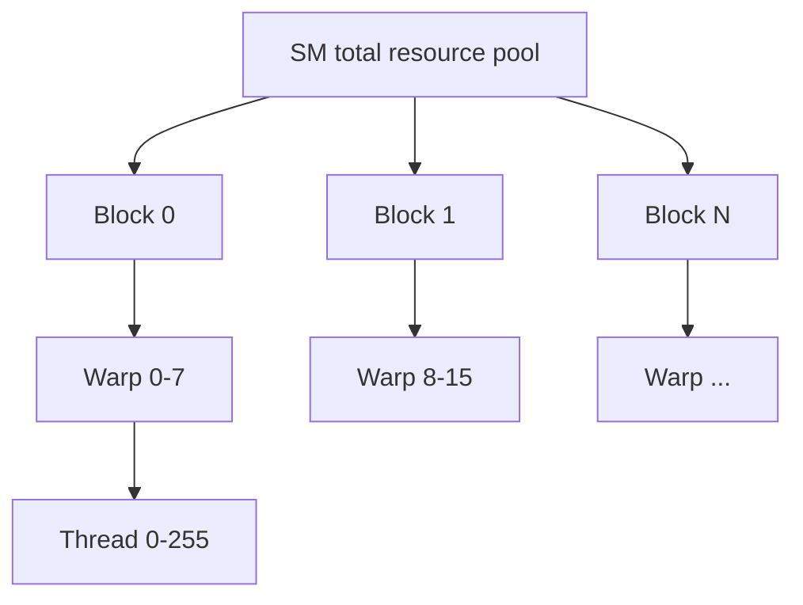
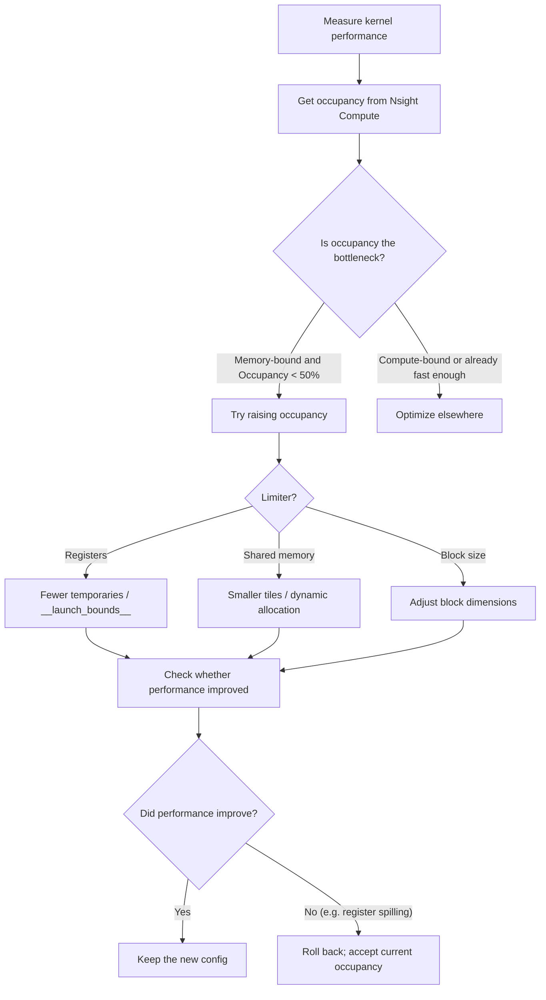

Occupancy (mức chiếm chỗ) là tỉ lệ số Warp đang hoạt động trên SM so với mức tối đa lý thuyết, một trong những chỉ số cốt lõi khi tinh chỉnh CUDA Kernel. Bài này giải thích định nghĩa, cách tính, ba yếu tố giới hạn chính (thanh ghi / shared memory / kích thước Block), và vì sao Occupancy cao hơn không phải lúc nào cũng tốt — mục tiêu thật sự là cân bằng giữa che độ trễ (latency hiding) và dùng tài nguyên.

<!-- more -->

## 📑 Mục lục

- [1. Occupancy là gì](#1-occupancy-là-gì)
- [2. Danh sách tài nguyên của SM](#2-danh-sách-tài-nguyên-của-sm)
- [3. Ba yếu tố ảnh hưởng Occupancy](#3-ba-yếu-tố-ảnh-hưởng-occupancy)
- [4. Ví dụ tính Occupancy](#4-ví-dụ-tính-occupancy)
- [5. Occupancy không phải càng cao càng tốt](#5-occupancy-không-phải-càng-cao-càng-tốt)
- [6. Chiến lược tinh chỉnh và công cụ](#6-chiến-lược-tinh-chỉnh-và-công-cụ)
- [7. Phân tích tình huống thực tế](#7-phân-tích-tình-huống-thực-tế)
- [Tóm tắt](#-tóm-tắt)
- [Danh sách tự kiểm](#-danh-sách-tự-kiểm)
- [Tài liệu tham khảo](#-tài-liệu-tham-khảo)

---

## 1. Occupancy là gì

Hãy tưởng tượng một bãi đỗ xe có 64 chỗ (số Warp tối đa có thể cư trú trên SM). Nếu hiện chỉ có 32 xe, tỉ lệ sử dụng là 50%. Occupancy chính là "tỉ lệ sử dụng bãi đỗ" của SM trên GPU — nó cho biết phần cứng đang được dùng bao nhiêu.

### 1.1 Định nghĩa chính thức

$$
\text{Occupancy} = \frac{\text{số Warp đang hoạt động trên mỗi SM}}{\text{số Warp tối đa mỗi SM hỗ trợ}}
$$

Ví dụ trên A100 (Compute Capability 8.0):
- Mỗi SM hỗ trợ tối đa 64 Warp (2048 thread)
- Nếu Kernel của bạn bị giới hạn tài nguyên nên mỗi SM chỉ chạy được 32 Warp
- Thì Occupancy = 32/64 = 50%

### 1.2 Vì sao Occupancy quan trọng

Giá trị cốt lõi của Occupancy nằm ở **che độ trễ** (Latency Hiding). Mô hình thực thi của GPU dựa vào việc chuyển Warp để che độ trễ truy cập bộ nhớ:

```
Timeline:
Warp 0: [compute] [wait for memory...400cycles...] [compute]
Warp 1:           [compute] [wait for memory...400cycles...] [compute]
Warp 2:                     [compute] [wait for memory...400cycles...]
...

If enough warps are active, the scheduler can always find a ready warp to fill the wait
```

Cần bao nhiêu Warp để che hết độ trễ? Ước lượng thô:

$$
\text{warps needed} \geq \frac{\text{memory latency (cycles)}}{\text{cycles per instruction}} = \frac{400}{4} = 100
$$

Nhưng một SM tối đa chỉ có 64 Warp, nên thực tế không che hết được độ trễ — đó là lý do nên đẩy Occupancy càng cao càng tốt (dù đó không phải mục tiêu duy nhất).

---

## 2. Danh sách tài nguyên của SM

Mỗi SM có một bộ tài nguyên phần cứng cố định, mọi Block cư trú trên đó đều chia sẻ. Hiểu các giới hạn này là nền tảng để tính Occupancy.

### 2.1 So sánh tài nguyên kiến trúc chính

| 📊 Tài nguyên | Ampere (A100) | Ada (RTX 4090) | Hopper (H100) |
|---------|---------------|----------------|---------------|
| Số thread tối đa / SM | 2048 | 1536 | 2048 |
| Số Warp tối đa / SM | 64 | 48 | 64 |
| Số Block tối đa / SM | 32 | 16 | 32 |
| Tổng thanh ghi / SM | 65536 | 65536 | 65536 |
| Số thanh ghi tối đa / thread | 255 | 255 | 255 |
| Giới hạn shared memory / SM | 164 KB | 100 KB | 228 KB |
| Shared memory tối đa / Block | 163 KB | 99 KB | 227 KB |
| Số thread tối đa / Block | 1024 | 1024 | 1024 |

### 2.2 Quan hệ phân cấp phân bổ tài nguyên



📌 **Điểm then chốt**: Tài nguyên được phân theo **đơn vị Block**. Một Block hoặc vào hết SM, hoặc không vào — không có chuyện nửa Block cư trú. Vì vậy, nếu một Block chiếm vừa hơi hơn một nửa tài nguyên SM còn lại, phần còn lại bị lãng phí.

---

## 3. Ba yếu tố ảnh hưởng Occupancy

### 3.1 Yếu tố một: lượng thanh ghi dùng

Số thanh ghi mỗi thread dùng là yếu tố giới hạn Occupancy phổ biến nhất.

**Logic tính**:

$$
\text{resident threads per SM} = \lfloor \frac{\text{total SM registers}}{\text{registers per thread}} \rfloor
$$

Phân bổ thực tế còn phải thỏa ràng buộc độ hạt. Thanh ghi được cấp cho một Warp theo nhóm **256** (Allocation Granularity). Tức lượng thanh ghi cấp cho mỗi Warp = $\lceil \frac{\text{registers per thread} \times 32}{256} \rceil \times 256$.

**Ví dụ** (A100, 65536 thanh ghi/SM):

| Thanh ghi/thread | Thực cấp / Warp | Số Warp vừa trên SM | Occupancy |
|--------------|-----------------|-------------------|-----------|
| 32 | 32×32=1024 | 65536/1024=64 | 100% |
| 48 | 48×32=1536 | 65536/1536=42 | 42/64≈65% |
| 64 | 64×32=2048 | 65536/2048=32 | 50% |
| 128 | 128×32=4096 | 65536/4096=16 | 25% |
| 255 | 255×32=8160 → căn chỉnh 8192 | 65536/8192=8 | 12.5% |

💡 **Gợi ý**: Có thể giới hạn lượng thanh ghi bằng `__launch_bounds__` hoặc tùy chọn biên dịch `maxrregcount`:

```cpp
// Approach 1: hint the compiler with __launch_bounds__(maxThreadsPerBlock, minBlocksPerMultiprocessor)
Memory-bound (bandwidth bottleneck)  __launch_bounds__(N, large value)  → raise occupancy
Compute-bound (FLOP bottleneck)      __launch_bounds__(N, 1)            → keep registers

__global__ void __launch_bounds__(256, 2)  // max 256 threads/block, target 2 blocks/SM
my_kernel(...) { ... }

// Compiler behavior
SM register total (A100) = 65536 / SM
maxThreadsPerBlock=256, minBlocksPerMultiprocessor=2
↓
Need concurrent residency: 256 threads × 2 blocks = 512 threads
↓
Max registers per thread: 65536 / 512 = 128
↓
Compiler sets the register cap to 128 (often compresses more aggressively)
↓
Overflow variables spill to Local Memory (device memory)

// Approach 2: global compile-time limit
// nvcc -maxrregcount=32 my_kernel.cu
```

⚠️ **Lưu ý**: Ép giới hạn số thanh ghi có thể khiến trình biên dịch spill biến ra local memory (register spilling), ngược lại làm chậm. Cần dùng profiler để kiểm chứng thực tế.

### 3.2 Yếu tố hai: lượng shared memory dùng

Tổng shared memory mỗi Block khai báo (tĩnh + động) giới hạn số Block mà SM chứa được.

**Logic tính**:

$$
\text{resident blocks per SM} = \lfloor \frac{\text{total SM shared memory}}{\text{shared memory per block}} \rfloor
$$

**Ví dụ** (A100, 164KB shared memory/SM):

| Shared mem / Block | Số Block vừa trên SM | Tổng thread khi 256/Block | Occupancy |
|-----------------|-------------------|------------------------|-----------|
| 8 KB | 20 (nhưng bị giới hạn max Block 32) | min(20,32)×256=5120→cap at 2048 | 100% |
| 32 KB | 5 | 5×256=1280 | 62.5% |
| 64 KB | 2 | 2×256=512 | 25% |
| 164 KB | 1 | 1×256=256 | 12.5% |

Độ hạt phân bổ shared memory cũng không theo từng byte, mà theo đơn vị **128 Bytes** (hoặc 256 Bytes, tùy kiến trúc).

### 3.3 Yếu tố ba: kích thước Block

Kích thước Block bị giới hạn bởi hai điều:
1. Tối đa 1024 thread mỗi Block
2. Số Block tối đa mỗi SM (A100 là 32)

**Một giới hạn dễ bỏ qua**: nếu Block của bạn rất nhỏ (ví dụ 32 thread = 1 Warp), dù mỗi Block tiêu tốn tài nguyên thấp, vẫn có thể bị "số Block tối đa / SM" chặn:

| Kích thước Block | Max Block/SM | Tổng Warp | Occupancy |
|-----------|-------------------|-----------|-----------|
| 32 (1 Warp) | 32 (giới hạn số Block) | 32 | 50% |
| 64 (2 Warps) | 32 (giới hạn số Block) | 64 | 100% |
| 128 (4 Warps) | 16 (2048/128) | 64 | 100% |
| 256 (8 Warps) | 8 (2048/256) | 64 | 100% |
| 512 (16 Warps) | 4 (2048/512) | 64 | 100% |
| 1024 (32 Warps) | 2 (2048/1024) | 64 | 100% |

📌 **Điểm then chốt**: Nên chọn Block ít nhất 128 hoặc 256, vừa tránh bị giới hạn số Block, vừa cho trình biên dịch nhiều không gian tối ưu hơn. Thường **256** là lựa chọn mặc định ổn.

---

## 4. Ví dụ tính Occupancy

### 4.1 Ví dụ tổng hợp

Điều kiện biết trước (kiến trúc A100):
- Kernel mỗi thread dùng 40 thanh ghi
- Kích thước Block: 256 thread = 8 Warp
- Mỗi Block dùng 16 KB shared memory

**Bước một: giới hạn thanh ghi**

$$
\text{registers per warp} = 40 \times 32 = 1280 \rightarrow \text{align to} 1280
$$

$$
\text{warps that fit on SM} = \lfloor \frac{65536}{1280} \rfloor = 51 \text{ Warps}
$$

**Bước hai: giới hạn shared memory**

$$
\text{blocks that fit on SM} = \lfloor \frac{164\text{KB}}{16\text{KB}} \rfloor = 10 \text{ Blocks}
$$

$$
\text{corresponding warps} = 10 \times 8 = 80 \text{ Warps}
$$

**Bước ba: giới hạn số Block**

Mỗi SM tối đa 32 Block; 10 Block chưa chạm trần.

**Bước bốn: giới hạn số thread**

Mỗi SM tối đa 2048 thread = 64 Warp.

**Lấy giá trị nhỏ nhất**:

$$
\text{actual warps} = \min(51, 80, 64) = 51 \text{ Warps}
$$

Nhưng Block được phân nguyên khối (mỗi Block 8 Warp), nên thực tế:

$$
\lfloor \frac{51}{8} \rfloor \times 8 = 6 \times 8 = 48 \text{ Warps}
$$

$$
\text{Occupancy} = \frac{48}{64} = 75\%
$$

### 4.2 Dùng CUDA Occupancy API

```cpp
#include <cuda_runtime.h>

int main() {
    int blockSize = 256;
    int minGridSize, gridSize;

    // Auto-compute a good block size
    cudaOccupancyMaxPotentialBlockSize(
        &minGridSize, &blockSize,
        my_kernel,  // kernel function pointer
        0,          // dynamic shared memory size
        0           // block size upper bound (0 = no limit)
    );

    // Query occupancy for a given config
    int maxActiveBlocks;
    cudaOccupancyMaxActiveBlocksPerMultiprocessor(
        &maxActiveBlocks,
        my_kernel,
        blockSize,
        0  // dynamic shared memory
    );

    int device;
    cudaGetDevice(&device);
    cudaDeviceProp prop;
    cudaGetDeviceProperties(&prop, device);

    float occupancy = (float)(maxActiveBlocks * blockSize) /
                      prop.maxThreadsPerMultiProcessor;
    printf("Occupancy: %.1f%%\n", occupancy * 100);
    return 0;
}
```

---

## 5. Occupancy không phải càng cao càng tốt

Đây là một trong những nhận thức quan trọng nhất khi tối ưu CUDA: **Occupancy cao không đồng nghĩa hiệu năng cao**.

### 5.1 Ví dụ phản trực giác

Xét hai phiên bản Kernel nhân ma trận:

| 📊 Phiên bản | Thanh ghi/thread | Shared mem/Block | Occupancy | GFLOPS thực tế |
|---------|------------|--------------|-----------|------------|
| Version A | 32 | 8 KB | 100% | 800 |
| Version B | 96 | 48 KB | 33% | 1200 |

Version B Occupancy thấp hơn nhưng hiệu năng cao hơn! Lý do là nó dùng nhiều thanh ghi và shared memory hơn để **tăng tái sử dụng dữ liệu**: mỗi lần nạp từ global memory được dùng lại nhiều lần, tổng lượng truy cập bộ nhớ giảm.

### 5.2 Cái giá của Occupancy cao

Mù quáng đuổi Occupancy cao có thể dẫn tới:

1. **Register Spilling**: để giảm lượng thanh ghi mà ép `maxrregcount`, trình biên dịch spill biến ra local memory (thực chất là global memory + L1), chậm gấp hàng chục lần

2. **Tái sử dụng shared memory kém**: dùng ít shared memory hơn nghĩa là Tile nhỏ hơn, tỉ lệ tái sử dụng giảm, tổng truy cập global memory ngược lại tăng

3. **Cache thrashing**: quá nhiều Warp hoạt động tranh giành L1/L2 hữu hạn, tỉ lệ cache miss tăng

### 5.3 Khi nào Occupancy then chốt

Occupancy quan trọng nhất với Kernel **truy cập bộ nhớ dày và ít tái sử dụng**:

- ✅ Phép elementwise (cộng vector, hàm kích hoạt, v.v.): gần như không tái sử dụng dữ liệu, hoàn toàn dựa vào che độ trễ
- ✅ Phép quy ước (reduction): mỗi phần tử chỉ đọc một lần
- ✅ Stencil đơn giản

### 5.4 Khi nào chấp nhận Occupancy thấp

Occupancy thấp hợp lý trong các tình huống sau:

- ✅ GEMM / nhân ma trận: tái sử dụng dữ liệu nhiều; thanh ghi và shared memory đổi lấy hiệu suất tính toán
- ✅ FlashAttention: dùng nhiều shared memory hơn để giảm truy cập HBM
- ✅ Kernel compute-bound: nút thắt nằm ở tính toán chứ không phải truy cập bộ nhớ

### 5.5 Quy tắc vàng

$$
\text{performance} = f(\text{Occupancy}, \text{ILP}, \text{data reuse}, \text{memory efficiency}, ...)
$$

💡 **Gợi ý**: Đừng đặt một mục tiêu Occupancy cố định (như "phải đạt 75%"), mà dùng profiler đo throughput thực tế. Nếu giảm Occupancy nhưng tăng tái sử dụng dữ liệu hoặc ILP (Instruction-Level Parallelism), hiệu năng tổng thể có thể tốt hơn.

---

## 6. Chiến lược tinh chỉnh và công cụ

### 6.1 CUDA Occupancy Calculator

NVIDIA cung cấp Occupancy Calculator dạng Excel: nhập kiến trúc và lượng tài nguyên dùng là ra Occupancy lý thuyết cùng yếu tố giới hạn.

Cũng có thể dùng công cụ dòng lệnh:

```bash
# Inspect per-kernel resource use at compile time
nvcc -Xptxas -v my_kernel.cu
# Example output:
# ptxas info: Used 40 registers, 16384 bytes smem, 380 bytes cmem[0]
```

### 6.2 Phân tích Occupancy trong Nsight Compute

```
# Key metrics
sm__warps_active.avg.pct_of_peak_sustained_active   # actual active warp ratio
launch__occupancy                                    # theoretical occupancy
launch__registers_per_thread                         # registers per thread
launch__shared_mem_per_block_allocated               # shared memory per block
```

Nsight Compute cũng hiện nguồn nghẽn Occupancy:

```
Occupancy Limiters:
  Registers:        50%  ← bottleneck
  Shared Memory:    75%
  Block Size:       100%
  Theoretical:      50%
```

### 6.3 Quy trình tinh chỉnh thực dụng



### 6.4 Gợi ý chọn kích thước Block

| 📊 Tình huống | Block size khuyến nghị | Lý do |
|---------|----------------|------|
| Kernel memory-bound | 256 hoặc 512 | Cần Occupancy cao để che độ trễ |
| Kernel compute-bound | 128 hoặc 256 | Occupancy vừa đủ; ưu tiên giữ thanh ghi |
| Dùng nhiều shared memory | 128 hoặc 256 | Block nhỏ → SM chứa nhiều Block hơn |
| Phép quy ước | 256 hoặc 512 | Nhiều thread tham gia quy ước, ít bước hơn |

---

## 7. Phân tích tình huống thực tế

### 7.1 Tình huống: cân bằng kích thước Tile SGEMM

Với Kernel nhân ma trận, kích thước Tile quyết định trực tiếp lượng thanh ghi và shared memory:

```cpp
// Tile config comparison
// Config A: small tile
// TILE_M=64, TILE_N=64, TILE_K=8
// Each thread computes 4x4 = 16 outputs → ~48 registers
// Shared memory: (64+64)*8*4 = 4 KB
// Occupancy: ~75%

// Config B: large tile
// TILE_M=128, TILE_N=128, TILE_K=8
// Each thread computes 8x8 = 64 outputs → ~128 registers
// Shared memory: (128+128)*8*4 = 8 KB
// Occupancy: ~25%

// Config B has lower occupancy, but:
// - Each load from Global is reused 8 times (vs 4 for Config A)
// - More work per thread, better ILP
// - Actual performance is usually Config B > Config A
```

### 7.2 Tình huống: tinh chỉnh linh hoạt bằng dynamic shared memory

```cpp
// Dynamic shared memory: allocate at launch as needed
__global__ void flexible_kernel(float* data, int N) {
    extern __shared__ float smem[];
    // ...
}

// Pick the best config at runtime from device capability
int smem_size;
if (occupancy_at_16kb > 0.5) {
    smem_size = 16 * 1024;
} else {
    smem_size = 8 * 1024;  // fall back
}

// Configurable shared memory vs L1 split (Volta+)
cudaFuncSetAttribute(
    flexible_kernel,
    cudaFuncAttributeMaxDynamicSharedMemorySize,
    smem_size
);

flexible_kernel<<<grid, block, smem_size>>>(data, N);
```

---

## 📝 Tóm tắt

| Khái niệm cốt lõi | Điểm chính |
|---------|------|
| Định nghĩa Occupancy | Số Warp đang hoạt động / số Warp tối đa trên SM |
| Che độ trễ | Occupancy càng cao càng dễ chuyển Warp để che độ trễ bộ nhớ |
| Giới hạn thanh ghi | Nhiều thanh ghi/thread hơn → Occupancy thấp hơn; dùng `__launch_bounds__` để kiểm soát |
| Giới hạn shared memory | Shared mem/Block càng lớn → SM chứa ít Block hơn → Occupancy thấp hơn |
| Giới hạn kích thước Block | Block quá nhỏ có thể bị "số Block tối đa / SM" chặn |
| Không phải càng cao càng tốt | Kernel compute-bound: Occupancy thấp + tái sử dụng dữ liệu cao có thể nhanh hơn |
| Cách tinh chỉnh | Nsight Compute tìm nghẽn → điều chỉnh có chủ đích → đo thực tế |

---

## 🎯 Danh sách tự kiểm

- Tự tính Occupancy từ số thanh ghi, kích thước shared memory và kích thước Block
- Giải thích vì sao Kernel Occupancy 100% không nhất thiết nhanh hơn 50%
- Dùng `cudaOccupancyMaxPotentialBlockSize` để tự chọn kích thước Block
- Dùng `__launch_bounds__` giới hạn thanh ghi và hiểu tác dụng phụ (spilling)
- Giải thích điều kiện xảy ra Register Spilling và ảnh hưởng tới hiệu năng
- Phân biệt Kernel memory-bound hay compute-bound, rồi quyết định độ ưu tiên Occupancy
- Đọc được yếu tố giới hạn Occupancy từ báo cáo Nsight Compute
- Cân bằng hợp lý kích thước Tile với Occupancy cho Kernel kiểu GEMM
- Dùng dynamic shared memory và `cudaFuncSetAttribute` để cấu hình shared memory linh hoạt
- Chọn kích thước Block phù hợp cho các loại Kernel khác nhau

---

## 📚 Tài liệu tham khảo

- [NVIDIA CUDA C++ Programming Guide - Hardware Multithreading](https://docs.nvidia.com/cuda/cuda-c-programming-guide/index.html#hardware-multithreading)
- [NVIDIA CUDA C++ Best Practices Guide - Occupancy](https://docs.nvidia.com/cuda/cuda-c-best-practices-guide/index.html#occupancy)
- [CUDA Occupancy Calculator](https://docs.nvidia.com/cuda/cuda-occupancy-calculator/index.html)
- [Achieved Occupancy - NVIDIA Developer Blog](https://developer.nvidia.com/blog/better-performance-at-lower-occupancy/)
- [CUTLASS: Fast Linear Algebra in CUDA C++ - GitHub](https://github.com/NVIDIA/cutlass)
