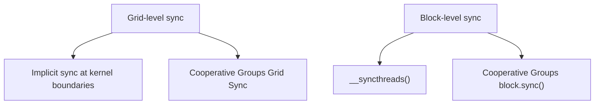
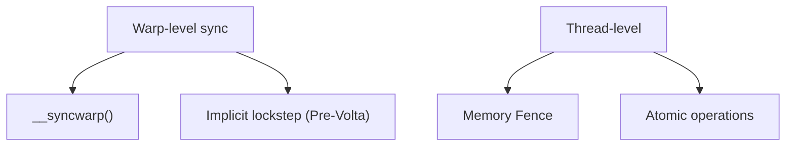

Cơ chế đồng bộ đúng là nền tảng để viết chương trình song song không bug. Bài này đi sâu vào đồng bộ trong Block `__syncthreads()`, đồng bộ cấp Warp, Memory Fence, cùng các thao tác nguyên tử (atomic) — khi nào dùng, chi phí hiệu năng và mẹo tối ưu — để bạn giữ đúng kết quả mà vẫn viết được mã song song nhanh.

<!-- more -->

## 📑 Mục lục

- [1. Vì sao song song cần đồng bộ](#1-vì-sao-song-song-cần-đồng-bộ)
- [2. Đồng bộ trong Block: \_\_syncthreads\(\)](#2-đồng-bộ-trong-block-__syncthreads)
- [3. Đồng bộ cấp Warp](#3-đồng-bộ-cấp-warp)
- [4. Memory Fence và tính nhìn thấy của bộ nhớ](#4-memory-fence-và-tính-nhìn-thấy-của-bộ-nhớ)
- [5. Thao tác nguyên tử](#5-thao-tác-nguyên-tử)
- [6. Tối ưu hiệu năng atomic](#6-tối-ưu-hiệu-năng-atomic)
- [7. Cooperative Groups](#7-cooperative-groups)
- [Tóm tắt](#-tóm-tắt)
- [Danh sách tự kiểm](#-danh-sách-tự-kiểm)
- [Tài liệu tham khảo](#-tài-liệu-tham-khảo)

---

## 1. Vì sao song song cần đồng bộ

Trong chương trình tuần tự, câu lệnh chạy theo thứ tự, câu sau luôn thấy kết quả của câu trước. Trong thế giới song song, hàng nghìn thread chạy cùng lúc. Nếu không kiểm soát, giống như một đám người cùng tranh viết lên một tấm bảng trắng — kết quả tất nhiên hỗn loạn.

Đồng bộ giải quyết hai vấn đề cốt lõi:

1. **Thứ tự thực thi**: đảm bảo dữ liệu thread A ghi xong trước khi thread B đọc
2. **Tính nhìn thấy của bộ nhớ**: đảm bảo ghi của một thread "nhìn thấy được" với các thread khác (không bị cache che)

### 1.1 Các tầng đồng bộ CUDA





---

## 2. Đồng bộ trong Block: \_\_syncthreads()

### 2.1 Ngữ nghĩa cơ bản

`__syncthreads()` là primitive đồng bộ dùng nhiều nhất trong CUDA. Ngữ nghĩa:

> Mọi thread trong Block phải tới điểm barrier này rồi mới được tiếp tục. Đồng thời đảm bảo mọi ghi bộ nhớ trước barrier đều nhìn thấy được với mọi thread trong Block.

Giống như một nhóm hẹn tập hợp ở ngã tư: đủ người rồi mới cùng lên đường.

### 2.2 Tình huống dùng điển hình

```cpp
__global__ void shared_memory_example(float* input, float* output, int N) {
    __shared__ float smem[256];
    int tid = threadIdx.x;
    int gid = blockIdx.x * blockDim.x + tid;

    // Phase 1: all threads load from global memory into shared memory
    smem[tid] = (gid < N) ? input[gid] : 0.0f;

    // Must sync! Ensure every write finishes before any read
    __syncthreads();

    // Phase 2: each thread reads data written by other threads
    float left = (tid > 0) ? smem[tid - 1] : 0.0f;
    float right = (tid < blockDim.x - 1) ? smem[tid + 1] : 0.0f;
    output[gid] = left + smem[tid] + right;
}
```

⚠️ **Lưu ý**: Nếu bỏ `__syncthreads()`, thread có thể đọc giá trị shared memory chưa khởi tạo (các thread khác chưa ghi xong), kết quả sai và khó debug (hành vi phụ thuộc thời điểm, đôi khi vẫn đúng).

### 2.3 Quy tắc và bẫy

**Quy tắc một: mọi thread phải tới cùng một `__syncthreads()`**

```cpp
// ❌ Fatal: __syncthreads() inside a conditional branch
if (threadIdx.x < 128) {
    __syncthreads();  // only the first 128 threads reach here
}
// The other 128 threads never arrive → deadlock or undefined behavior

// ✅ Correct: put the sync outside the condition
if (threadIdx.x < 128) {
    // do some work
}
__syncthreads();  // every thread reaches here
```

**Quy tắc hai: khi dùng trong vòng lặp, mọi thread phải lặp cùng số lần**

```cpp
// ❌ Dangerous: different threads loop a different number of times
for (int i = 0; i < array_len[threadIdx.x]; i++) {
    smem[threadIdx.x] = data[i];
    __syncthreads();  // if some threads exit early → deadlock
    // ...
}

// ✅ Correct: same trip count for everyone
int max_len = MAX_ARRAY_LEN;  // compile-time constant or block-wide max
for (int i = 0; i < max_len; i++) {
    if (i < array_len[threadIdx.x]) {
        smem[threadIdx.x] = data[i];
    }
    __syncthreads();
    // ...
}
```

### 2.4 Chi phí hiệu năng của __syncthreads()

Chi phí phần cứng của bản thân `__syncthreads()` rất thấp (thường vài chu kỳ đồng hồ). Chi phí thật sự nằm ở:

1. **Chờ thread chậm nhất**: nếu một số thread mất nhiều thời gian hơn mới tới barrier (phân nhánh lệch hoặc độ trễ bộ nhớ không đều), các thread khác chỉ biết ngồi chờ
2. **Gãy pipeline**: điểm barrier làm đứt tối ưu sắp xếp lại lệnh của trình biên dịch

💡 **Gợi ý**: Cố giảm số lần gọi `__syncthreads()`. Nếu Kernel có nhiều giai đoạn đọc/ghi shared memory, hãy xem có thể tổ chức lại thuật toán để gộp nhiều lần đồng bộ thành một không.

---

## 3. Đồng bộ cấp Warp

### 3.1 Đồng bộ ngầm (Pre-Volta)

Trên kiến trúc trước Volta (Pascal, Maxwell, v.v.), các thread trong cùng Warp chạy theo kiểu lockstep — phần cứng đảm bảo chúng luôn ở cùng một lệnh. Vì vậy thread trong Warp đồng bộ sẵn, không cần barrier tường minh.

```cpp
// Pre-Volta: safe to communicate inside a warp without sync
// (but this is undefined behavior; do not rely on it)
__shared__ float smem[256];
smem[threadIdx.x] = value;
// All threads in the same warp have finished writing by now
float neighbor = smem[threadIdx.x ^ 1];  // safe inside the warp (but non-portable)
```

### 3.2 Đồng bộ Warp tường minh (Volta+)

Từ Volta trở đi có independent thread scheduling. Thread trong cùng Warp **có thể** không còn cùng nhịp. Vì vậy cần đồng bộ tường minh:

```cpp
__shared__ float smem[256];
smem[threadIdx.x] = value;

// Volta+ must sync explicitly
__syncwarp(0xFFFFFFFF);  // ensure all 32 threads in the warp finished writing

float neighbor = smem[threadIdx.x ^ 1];
```

Tham số của `__syncwarp(mask)` là mặt nạ các thread tham gia đồng bộ. Thường dùng `0xFFFFFFFF` (cả 32 thread), nhưng nếu chỉ một phần thread tham gia thì có thể dùng mask chính xác hơn.

### 3.3 Khi nào cần __syncwarp()

| Tình huống | Pre-Volta | Volta+ |
|------|-----------|--------|
| Giao tiếp trong Warp qua shared memory | An toàn ngầm (không khuyến nghị) | Phải `__syncwarp()` |
| Trước/sau Warp Shuffle | Không cần | Không cần (Shuffle đã có ngữ nghĩa đồng bộ) |
| Trước/sau Warp Vote | Không cần | Không cần |
| Vòng quy ước trong Warp | Không cần đồng bộ thêm | Bản Shuffle không cần |

---

## 4. Memory Fence và tính nhìn thấy của bộ nhớ

### 4.1 Vì sao cần Memory Fence

`__syncthreads()` giải quyết đồng bộ trong Block, còn giao tiếp giữa các Block thì sao? GPU không có barrier toàn cục theo nghĩa truyền thống, nhưng cung cấp Memory Fence để đảm bảo tính nhìn thấy của ghi bộ nhớ.

Memory Fence không chặn thực thi thread. Nó chỉ đảm bảo: **các ghi bộ nhớ trước Fence trở nên nhìn thấy được với các thread khác trong phạm vi đích sau Fence**.

### 4.2 Ba tầng Fence

```cpp
// Block level: writes visible to threads in the same block
__threadfence_block();

// Device level: writes visible to all threads on the same GPU
__threadfence();

// System level: writes visible to all devices in the system (CPU, other GPUs)
__threadfence_system();
```

### 4.3 Use case kinh điển: cờ trong quy ước nhiều Block

```cpp
__device__ unsigned int block_counter = 0;

__global__ void multi_block_reduce(float* input, float* output,
                                    float* partial, int N) {
    // Step 1: each block does a local reduce, writes to partial[blockIdx.x]
    float block_sum = block_level_reduce(input, N);
    if (threadIdx.x == 0) {
        partial[blockIdx.x] = block_sum;

        // Make the partial write visible to other blocks
        __threadfence();

        // Atomically increment; the last finished block does the final reduce
        unsigned int ticket = atomicInc(&block_counter, gridDim.x);

        // Are we the last finished block?
        if (ticket == gridDim.x - 1) {
            // This block is last; safe to read every partial value
            float total = 0.0f;
            for (int i = 0; i < gridDim.x; i++) {
                total += partial[i];
            }
            output[0] = total;
            block_counter = 0;  // reset
        }
    }
}
```

📌 **Điểm then chốt**: `__threadfence()` đảm bảo ghi vào `partial[blockIdx.x]` nhìn thấy được toàn cục trước `atomicInc`. Không có Fence này, Block cuối có thể đọc giá trị cũ của các Block khác.

---

## 5. Thao tác nguyên tử

### 5.1 Atomic là gì

Thao tác nguyên tử (Atomic Operation) là thao tác đọc-sửa-ghi không thể tách. Giống quầy ngân hàng một lúc chỉ phục vụ một khách — trước khi atomic của một thread xong, các thread khác truy cập cùng địa chỉ phải xếp hàng.

```cpp
// Non-atomic (data race!)
// Thread A: read counter=5, add 1, write back 6
// Thread B: read counter=5, add 1, write back 6  ← lost thread A's update!
counter += 1;

// Atomic (correct)
// Hardware guarantees read→modify→write as one uninterruptible op
atomicAdd(&counter, 1);
```

### 5.2 Danh sách atomic CUDA

| 📊 Thao tác | Hàm | Kiểu hỗ trợ |
|---------|------|---------|
| Cộng | `atomicAdd(addr, val)` | int, unsigned, float, double |
| Trừ | `atomicSub(addr, val)` | int, unsigned |
| Min | `atomicMin(addr, val)` | int, unsigned |
| Max | `atomicMax(addr, val)` | int, unsigned |
| Đổi | `atomicExch(addr, val)` | int, unsigned, float |
| CAS | `atomicCAS(addr, compare, val)` | int, unsigned, unsigned long long |
| AND bit | `atomicAnd(addr, val)` | int, unsigned |
| OR bit | `atomicOr(addr, val)` | int, unsigned |
| XOR bit | `atomicXor(addr, val)` | int, unsigned |
| Tăng | `atomicInc(addr, val)` | unsigned |
| Giảm | `atomicDec(addr, val)` | unsigned |

### 5.3 Chi phí hiệu năng của atomic

Chi phí atomic phụ thuộc **mức xung đột** — bao nhiêu thread cùng tranh một địa chỉ:

| 📊 Tình huống | Ảnh hưởng hiệu năng |
|---------|---------|
| Mọi thread atomic địa chỉ khác nhau | Gần tốc độ thao tác không atomic |
| Nhiều thread trong cùng Warp tranh một địa chỉ | Tuần tự hóa, chậm nhất khoảng 32× |
| Nhiều thread xuyên Block tranh một địa chỉ | Cực chậm, có thể thành nút thắt nghiêm trọng |

**Atomic trên global memory** độ trễ khoảng 400\~600 cycles (phải đi tới L2 hoặc DRAM). **Atomic trên shared memory** độ trễ khoảng 20~100 cycles (xong bên trong SM).

### 5.4 atomicCAS: atomic vạn năng

`atomicCAS` (Compare-And-Swap) là primitive atomic tầng thấp nhất; mọi atomic khác đều có thể dựng từ nó:

```cpp
// atomicCAS semantics:
// old = *addr;
// if (old == compare) *addr = val;
// return old;

// Implement atomicAdd for double with CAS (older archs lack double atomicAdd)
__device__ double atomicAddDouble(double* addr, double val) {
    unsigned long long int* addr_as_ull = (unsigned long long int*)addr;
    unsigned long long int old = *addr_as_ull;
    unsigned long long int assumed;

    do {
        assumed = old;
        old = atomicCAS(addr_as_ull, assumed,
                       __double_as_longlong(
                           __longlong_as_double(assumed) + val));
    } while (assumed != old);
    // CAS failed means another thread changed the value; retry

    return __longlong_as_double(old);
}
```

⚠️ **Lưu ý**: Vòng CAS dưới xung đột cao có thể thử lại nhiều lần, hiệu năng tụt mạnh. Đó là lý do gốc nên giảm xung đột atomic càng nhiều càng tốt.

---

## 6. Tối ưu hiệu năng atomic

### 6.1 Chiến lược một: quy ước phân tầng để giảm xung đột

Mẫu tối ưu kinh điển — đừng để mọi thread `atomicAdd` thẳng vào cùng địa chỉ, mà gom theo tầng:

```cpp
__global__ void hierarchical_reduce(float* input, float* output, int N) {
    __shared__ float block_sum;
    if (threadIdx.x == 0) block_sum = 0.0f;
    __syncthreads();

    int gid = blockIdx.x * blockDim.x + threadIdx.x;
    float val = (gid < N) ? input[gid] : 0.0f;

    // Layer 1: warp-level reduce (no atomics)
    for (int offset = 16; offset > 0; offset >>= 1) {
        val += __shfl_down_sync(0xFFFFFFFF, val, offset);
    }

    // Layer 2: each warp's lane 0 atomics into shared memory
    // Only blockDim.x/32 threads contend → low conflict
    if (threadIdx.x % 32 == 0) {
        atomicAdd(&block_sum, val);
    }
    __syncthreads();

    // Layer 3: each block's thread 0 atomics into the global result
    // Only gridDim.x threads contend (far fewer than total threads)
    if (threadIdx.x == 0) {
        atomicAdd(output, block_sum);
    }
}
```

Phân tích xung đột:
- Atomic toàn cục trực tiếp: N thread tranh 1 địa chỉ
- Sau phân tầng: quy ước Warp không xung đột + 8 thread/Block tranh shared memory + gridDim.x thread tranh địa chỉ toàn cục

### 6.2 Chiến lược hai: atomic shared memory thay atomic global

```cpp
// ❌ Every thread atomicAdds global memory directly
__global__ void histogram_naive(int* data, int* hist, int N) {
    int tid = threadIdx.x + blockIdx.x * blockDim.x;
    if (tid < N) {
        atomicAdd(&hist[data[tid]], 1);  // global atomic, slow
    }
}

// ✅ Aggregate in shared memory first, then write back to global
__global__ void histogram_shared(int* data, int* hist, int N, int numBins) {
    __shared__ int local_hist[256];  // assume bin count <= 256

    // Initialize local histogram
    if (threadIdx.x < numBins) {
        local_hist[threadIdx.x] = 0;
    }
    __syncthreads();

    // Atomic add on shared memory (much faster)
    int tid = threadIdx.x + blockIdx.x * blockDim.x;
    if (tid < N) {
        atomicAdd(&local_hist[data[tid]], 1);
    }
    __syncthreads();

    // Atomic-add local results to global (only numBins global atomics)
    if (threadIdx.x < numBins) {
        atomicAdd(&hist[threadIdx.x], local_hist[threadIdx.x]);
    }
}
```

### 6.3 Chiến lược ba: tư nhân hóa (Privatization)

Mỗi thread hoặc mỗi Warp giữ bản sao riêng, cuối cùng mới gộp:

```cpp
__global__ void privatized_histogram(int* data, int* hist, int N) {
    // Each thread keeps a private counter (works when bin count is small)
    int private_hist[4] = {0, 0, 0, 0};  // assume only 4 bins

    int tid = threadIdx.x + blockIdx.x * blockDim.x;
    int stride = blockDim.x * gridDim.x;

    for (int i = tid; i < N; i += stride) {
        private_hist[data[i]]++;  // pure register ops, no conflict
    }

    // Final write-back (far fewer atomics)
    for (int bin = 0; bin < 4; bin++) {
        if (private_hist[bin] > 0) {
            atomicAdd(&hist[bin], private_hist[bin]);
        }
    }
}
```

### 6.4 Chiến lược bốn: Warp-aggregated atomics (CUDA 9+)

Trong một số tình huống, nhiều thread cùng Warp cần `atomicAdd` cùng địa chỉ. Có thể quy ước trong Warp trước, rồi một thread thực hiện một lần atomic:

```cpp
__device__ int atomicAggInc(int* counter) {
    // Find all threads in the warp that want +1
    unsigned int active = __activemask();
    int leader = __ffs(active) - 1;  // pick leader (lowest active lane)
    int lane = threadIdx.x % 32;

    int num_peers = __popc(active);  // active thread count

    int old_val;
    if (lane == leader) {
        old_val = atomicAdd(counter, num_peers);  // one atomic instead of many
    }
    old_val = __shfl_sync(active, old_val, leader);

    // Each thread gets its unique incremented value
    int rank = __popc(active & ((1 << lane) - 1));  // rank among active threads
    return old_val + rank;
}
```

---

## 7. Cooperative Groups

### 7.1 Vì sao cần Cooperative Groups

`__syncthreads()` và `__syncwarp()` truyền thống là đồng bộ độ hạt cố định — hoặc cả Block, hoặc cả Warp. Cooperative Groups (CUDA 9+) cung cấp cơ chế nhóm thread và đồng bộ linh hoạt:

```cpp
#include <cooperative_groups.h>
namespace cg = cooperative_groups;
```

### 7.2 Các kiểu nhóm thread thường dùng

```cpp
__global__ void cg_example() {
    // Get the current block's thread group
    cg::thread_block block = cg::this_thread_block();

    // Get the current warp's coalesced group
    cg::coalesced_group active = cg::coalesced_threads();

    // Partition the block into fixed-size tiles (Size must be a power of 2, up to 1024).
    // 1/2/4/8/16/32 are hardware-native sizes and can be used directly; larger sizes (64/128/256/512…)
    // are also supported but need extra block_tile_memory, and CC 7.5 and below have extra steps; CC 8.0+ has no that overhead.
    cg::thread_block_tile<16> tile16 = cg::tiled_partition<16>(block);

    // Sync on any thread group
    block.sync();    // equivalent to __syncthreads()
    tile16.sync();   // sync only the 16-thread tile
}
```

### 7.3 Quy ước bằng Cooperative Groups

```cpp
__device__ float cg_reduce_sum(cg::thread_block_tile<32>& warp, float val) {
    // Use cooperative groups shfl_down
    for (int offset = warp.size() / 2; offset > 0; offset >>= 1) {
        val += warp.shfl_down(val, offset);
    }
    return val;
}

__global__ void cg_kernel(float* input, float* output, int N) {
    cg::thread_block block = cg::this_thread_block();
    cg::thread_block_tile<32> warp = cg::tiled_partition<32>(block);

    int gid = block.group_index().x * block.group_dim().x + block.thread_rank();
    float val = (gid < N) ? input[gid] : 0.0f;

    // Warp-level reduce
    float warp_sum = cg_reduce_sum(warp, val);

    // ... then block-level reduce
}
```

### 7.4 Đồng bộ cấp Grid

Cooperative Groups thậm chí hỗ trợ đồng bộ xuyên mọi Block ở cấp Grid (yêu cầu mọi Block cùng cư trú trên GPU):

```cpp
__global__ void grid_sync_kernel(float* data, int N) {
    cg::grid_group grid = cg::this_grid();

    // Phase 1: every block processes data
    int gid = grid.thread_rank();
    if (gid < N) data[gid] *= 2.0f;

    // Grid sync: wait for every block to finish phase 1
    grid.sync();

    // Phase 2: safe to read data written by other blocks
    if (gid < N && gid > 0) {
        data[gid] += data[gid - 1];
    }
}

// Launch must use cooperative launch
cudaLaunchCooperativeKernel(
    (void*)grid_sync_kernel, grid, block, args, 0, stream);
```

⚠️ **Lưu ý**: Grid Sync yêu cầu mọi Block có thể cư trú cùng lúc (Occupancy cho phép), nếu không sẽ deadlock. Vì vậy kích thước Grid có trần.

---

## 📝 Tóm tắt

| Cơ chế đồng bộ | Phạm vi | Tình huống dùng | Chi phí hiệu năng |
|---------|---------|---------|---------|
| `__syncthreads()` | Mọi thread trong Block | Giữa các lần đọc/ghi shared memory | Thấp (chờ thread chậm nhất) |
| `__syncwarp()` | 32 thread trong Warp | Giao tiếp trong Warp trên Volta+ | Cực thấp |
| `__threadfence()` | Toàn Device | Cờ/tín hiệu xuyên Block | Trung bình (xả cache) |
| Atomic | Địa chỉ cụ thể | Nhiều thread tranh cập nhật cùng giá trị | Cao (phụ thuộc mức xung đột) |
| Cooperative Groups | Nhóm linh hoạt | Đồng bộ và quy ước độ hạt tùy ý | Phụ thuộc kích thước nhóm |

Tra cứu nhanh chiến lược tối ưu atomic:

| Chiến lược | Cách làm | Lợi ích |
|------|------|------|
| Quy ước phân tầng | Gom Warp→Block→Grid từng tầng | Xung đột từ N xuống gridDim.x |
| Atomic shared memory | Gom trên smem rồi ghi global | Độ trễ từ ~400cy xuống ~20cy |
| Tư nhân hóa | Mỗi thread/Warp giữ bản sao, cuối cùng gộp | Loại xung đột lúc chạy |
| Warp aggregation | Quy ước trong Warp rồi một lần atomic | Xung đột giảm ~32× |

---

## 🎯 Danh sách tự kiểm

- Dùng đúng `__syncthreads()` và tránh bẫy deadlock (nhánh điều kiện, vòng lặp không đều)
- Giải thích vì sao `__syncwarp()` cần thiết trên kiến trúc Volta+
- Phân biệt phạm vi của `__threadfence_block()`, `__threadfence()`, `__threadfence_system()`
- Dùng atomic + Memory Fence để làm quy ước toàn cục xuyên Block
- Dùng đúng `atomicCAS` để dựng atomic tùy chỉnh
- Biến "mọi thread atomicAdd cùng địa chỉ" thành phương án quy ước phân tầng
- Dùng atomic shared memory để làm histogram hiệu quả
- Giải thích quan hệ giữa hiệu năng atomic và mức xung đột
- Dùng Cooperative Groups để đồng bộ độ hạt linh hoạt
- Đánh giá được điều kiện áp dụng Grid Sync và giới hạn số Block

---

## 📚 Tài liệu tham khảo

- [NVIDIA CUDA C++ Programming Guide - Synchronization Functions](https://docs.nvidia.com/cuda/cuda-c-programming-guide/index.html#synchronization-functions)
- [NVIDIA CUDA C++ Programming Guide - Atomic Functions](https://docs.nvidia.com/cuda/cuda-c-programming-guide/index.html#atomic-functions)
- [NVIDIA CUDA C++ Programming Guide - Cooperative Groups](https://docs.nvidia.com/cuda/cuda-c-programming-guide/index.html#cooperative-groups)
- [CUDA Pro Tip: Optimized Filtering with Warp-Aggregated Atomics - NVIDIA Developer Blog](https://developer.nvidia.com/blog/cuda-pro-tip-optimized-filtering-warp-aggregated-atomics/)
- [Cooperative Groups: Flexible CUDA Thread Programming - NVIDIA Developer Blog](https://developer.nvidia.com/blog/cooperative-groups/)
