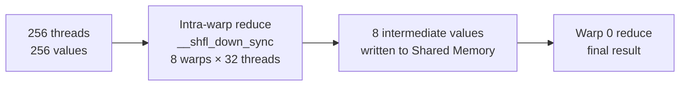
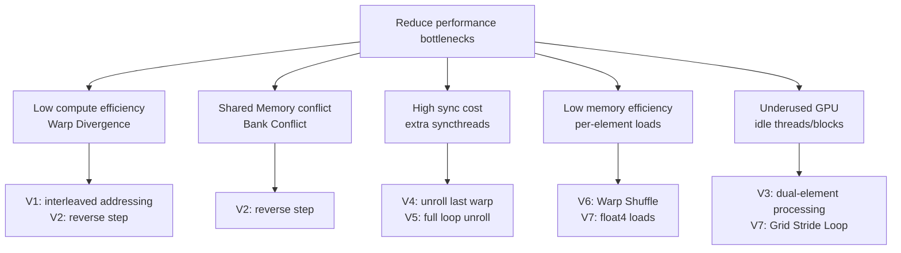

Reduce (quy giản) là một trong những toán tử cơ bản nhất trong lập trình GPU, cũng thể hiện rõ tư duy song song nhất. Bài này bắt đầu từ hiện thực mộc nhất, rồi dần đưa vào primitive cấp Warp, tải vector hóa, xử lý nhiều phần tử mỗi thread và các kỹ thuật khác. Mỗi bước đều có so sánh hiệu năng và giải thích nguyên lý, giúp bạn thật sự hiểu cách viết Kernel nhanh.

<!-- more -->

## 📑 Mục lục

- [1. Cơ bản về toán tử Reduce](#1-cơ-bản-về-toán-tử-reduce)
- [2. Phiên bản V0: quy giản song song mộc](#2-phiên-bản-v0-quy-giản-song-song-mộc)
- [3. Phiên bản V1: loại Warp Divergence](#3-phiên-bản-v1-loại-warp-divergence)
- [4. Phiên bản V2: giải Bank Conflict](#4-phiên-bản-v2-giải-bank-conflict)
- [5. Phiên bản V3: giải thread nhàn rỗi](#5-phiên-bản-v3-giải-thread-nhàn-rỗi)
- [6. Phiên bản V4: bung Warp cuối](#6-phiên-bản-v4-bung-warp-cuối)
- [7. Phiên bản V5: bung vòng lặp hoàn toàn](#7-phiên-bản-v5-bung-vòng-lặp-hoàn-toàn)
- [8. Phiên bản V6: Warp Shuffle thay Shared Memory](#8-phiên-bản-v6-warp-shuffle-thay-shared-memory)
- [9. Phiên bản V7: tải vector hóa + Grid Stride Loop](#9-phiên-bản-v7-tải-vector-hóa--grid-stride-loop)
- [10. So sánh hiệu năng và gợi ý chọn](#10-so-sánh-hiệu-năng-và-gợi-ý-chọn)
- [Tóm tắt](#-tóm-tắt)
- [Danh sách tự kiểm](#-danh-sách-tự-kiểm)
- [Tài liệu tham khảo](#-tài-liệu-tham-khảo)

---

## 1. Cơ bản về toán tử Reduce

### 1.1 Reduce là gì

Hãy tưởng tượng bạn cầm một nghìn tấm thẻ ghi số và cần tính tổng. Một người cộng từ đầu tới cuối cần 999 phép cộng. Nếu có 500 người cùng tham gia — từng cặp cộng với nhau, mỗi vòng số người giảm một nửa — chỉ khoảng 10 vòng là ra kết quả. Đó chính là bản chất của **quy giản song song** (parallel reduction).


Reduce là một họ thao tác "nhiều đầu vào → một đầu ra". Các dạng thường gặp:

- **Sum Reduce**: $\sum_{i=0}^{N-1} x_i$
- **Max/Min Reduce**: $\max(x_0, x_1, \ldots, x_{N-1})$
- **Dot Product**: $\sum_{i=0}^{N-1} a_i \cdot b_i$

Bài này lấy **Sum Reduce** làm ví dụ (các thao tác khác cùng nguyên lý). Đầu vào là mảng `float` độ dài $N$; đầu ra là tổng mọi phần tử.

### 1.2 Phân tích nút thắt hiệu năng

Trần hiệu năng của GPU Kernel do **lượng tính toán** và **lượng truy cập bộ nhớ** cùng quyết định; mô hình Roofline giúp định vị nút thắt. Với Sum Reduce:

- Mỗi phần tử đọc một lần (1 load)
- Mỗi lần đọc xong làm một phép cộng (1 FLOP)
- Cường độ số học $= \frac{1 \text{ FLOP}}{4 \text{ Byte}} = 0.25 \text{ FLOP/Byte}$ (mỗi `float` 4 byte, tương ứng 1 phép cộng)

Điều này cho thấy Reduce là thao tác **memory-bound** điển hình. Tối ưu tập trung vào **nâng tỉ lệ dùng băng thông bộ nhớ**, chứ không phải giảm số phép tính.

### 1.3 Môi trường đo

Toàn bộ mã trong bài viết bằng CUDA 12.x, đo trên A100 80GB SXM4:

| Chỉ số | Giá trị |
|------|------|
| Băng thông bộ nhớ lý thuyết | 2,039 GB/s |
| Dung lượng L2 Cache | 40 MB |
| Số SM | 108 |
| Shared Memory mỗi SM | 164 KB |

Quy mô dữ liệu đo: $N = 2^{27}$ (128M `float`, tổng 512 MB)

---

## 2. Phiên bản V0: quy giản song song mộc

### 2.1 Ý tưởng thuật toán

Reduce trực quan nhất là "quy giản dạng cây": mỗi vòng, các thread thỏa `tid % (2*step) == 0` cộng giá trị của mình với giá trị tại offset `step`. Bước nhảy mỗi vòng nhân đôi, cho tới khi mọi giá trị đổ về phần tử số 0.


### 2.2 Hiện thực Kernel

```cuda
// V0: naive tree reduce (step grows from small to large)
__global__ void reduce_v0(float* input, float* output, int n) {
    extern __shared__ float smem[];

    int tid = threadIdx.x;
    int gid = blockIdx.x * blockDim.x + threadIdx.x;

    // Load global memory into shared memory
    smem[tid] = (gid < n) ? input[gid] : 0.0f;
    __syncthreads();

    // Tree reduce: step starts at 1 and doubles each round
    for (int step = 1; step < blockDim.x; step *= 2) {
        if (tid % (2 * step) == 0) {
            smem[tid] += smem[tid + step];
        }
        __syncthreads();
    }

    // Write each block's result back to global memory
    if (tid == 0) {
        output[blockIdx.x] = smem[0];
    }
}
```

### 2.3 Vấn đề hiệu năng: Warp Divergence

⚠️ **Lưu ý**: Điều kiện `if (tid % (2 * step) == 0)` của V0 là sát thủ hiệu năng.

GPU lập lịch theo **Warp** (32 thread). Mọi thread trong Warp phải thực thi cùng lệnh. Khi một phần thread thỏa `if`, phần còn lại không, GPU phải chạy hai lần (nhánh thỏa rồi nhánh không), thông lượng thực tế giảm một nửa — đó là **Warp Divergence** (phân hóa Warp).

Trong V0, khi `step` tăng, ngày càng nhiều Warp phân hóa:

- `step=1`: trong mỗi Warp chỉ thread chẵn làm việc → tận dụng 50%
- `step=2`: cứ 4 thread chỉ 1 làm việc → tận dụng 25%
- ...ngày càng tệ

**Tỉ lệ dùng băng thông đo được của V0: khoảng 15% (~300 GB/s)**

---

## 3. Phiên bản V1: loại Warp Divergence

### 3.1 Ý tưởng cải tiến

Gốc của Warp Divergence ở V0 là `tid % (2*step) == 0` khiến **thread trong cùng Warp đi nhánh khác nhau**. Một hướng tối ưu trực tiếp: **không đổi hướng bước nhảy** (vẫn từ nhỏ tới lớn), nhưng đổi ánh xạ thread — để **các thread liền kề** chịu các phép cộng tương ứng bước nhảy liền kề, thay vì "chọn thread theo khoảng tid".


Cụ thể, đổi `if (tid % (2*s) == 0)` thành dạng **strided index**: mỗi thread tính trước chỉ số bộ nhớ `index = threadIdx.x * 2 * s`, rồi chỉ kiểm `index < blockDim.x`.

Vậy ở vòng 1 (s=1): tid 0\~127 đều có index < blockDim.x (=256), tid 128\~255 đều ≥ 256. Bốn Warp đầu (128 thread) vào nhánh if nguyên khối; bốn Warp sau bỏ qua nguyên khối — **trong Warp không phân hóa**. Khi s tăng, vùng thread hoạt động co về tid nhỏ hơn, tới s=8 thì dưới 32 thread còn hoạt động và mới phân hóa trong Warp 0. So với V0 phân hóa mỗi vòng, ở đây chỉ 5 vòng cuối (s=8, 16, 32, 64, 128) phân hóa, và đều nằm trong Warp 0, chi phí rất nhỏ.

### 3.2 Hiện thực Kernel

```cuda
// V1: strided index to cut Warp Divergence
__global__ void reduce_v1(float* input, float* output, int n) {
    extern __shared__ float smem[];

    int tid = threadIdx.x;
    int gid = blockIdx.x * blockDim.x + threadIdx.x;

    smem[tid] = (gid < n) ? input[gid] : 0.0f;
    __syncthreads();

    // Step still grows from 1, but active threads use a strided index
    for (unsigned int s = 1; s < blockDim.x; s *= 2) {
        int index = threadIdx.x * 2 * s;
        if (index < blockDim.x) {
            smem[index] += smem[index + s];
        }
        __syncthreads();
    }

    if (tid == 0) {
        output[blockIdx.x] = smem[0];
    }
}
```

### 3.3 Vì sao giảm được Warp Divergence

Lấy blockDim=256, phân tích từng vòng số thread hoạt động:

- `s=1`: index = 2·tid, tid hoạt động 0~127, đúng 4 Warp đầy đủ → không phân hóa
- `s=2`: index = 4·tid, tid hoạt động 0~63, đúng 2 Warp đầy đủ → không phân hóa
- `s=4`: tid hoạt động 0~31, đúng 1 Warp đầy đủ → không phân hóa
- `s=8`: tid hoạt động 0~15, cùng thuộc Warp 0 → chỉ phân hóa trong Warp 0
- `s=16, 32, 64, 128`: chỉ còn ít thread trong Warp 0 → mỗi vòng 1 lần phân hóa

💡 **Gợi ý**: Các vòng đầu loại hết phân hóa; chỉ vài vòng cuối (khi còn ít thread làm việc) còn phân hóa trong Warp. Chi phí tổng thể nhỏ hơn V0 rất nhiều.

**Tỉ lệ dùng băng thông đo được của V1: khoảng 32% (~653 GB/s)**, khoảng 2.1× so với V0.

---

## 4. Phiên bản V2: giải Bank Conflict

### 4.1 Shared Memory Bank vắn tắt

Shared Memory được chia thành 32 **Bank** (chế độ 32-bit mặc định, mỗi Bank rộng 4 byte). Các địa chỉ 4 byte liền kề lần lượt rơi vào Bank 0, Bank 1, …, Bank 31, Bank 0, Bank 1, … rồi lặp lại.

Lý tưởng thì 32 thread trong một Warp truy cập 32 Bank khác nhau và hoàn tất **cùng lúc** — gọi là **truy cập không xung đột**. Nếu hai hay nhiều thread trong Warp truy cập **các địa chỉ khác nhau trong cùng một Bank**, truy cập bị **tuần tự hóa**. Đó là **Bank Conflict**.

⚠️ **Lưu ý**: Nhiều thread trong Warp truy cập **cùng một địa chỉ** không tạo xung đột (phần cứng có thể broadcast). Chỉ truy cập **địa chỉ khác nhau** trong cùng Bank mới xung đột.

### 4.2 Phân tích Bank Conflict trong V1

Kernel V1 tưởng đã loại phần lớn Warp Divergence, nhưng truy cập Shared Memory vẫn có Bank Conflict nặng. Vẫn lấy blockDim=256, Warp 0 (tid 0~31):

- **Vòng 1 (s=1)**: tid 0 chạm smem[0], smem[1]; tid 16 chạm smem[32], smem[33]. smem[0] và smem[32] đều thuộc Bank 0 → **Bank Conflict 2 đường**
- **Vòng 2 (s=2)**: tid 0 chạm smem[0,2]; tid 8 chạm smem[32,34]; tid 16 chạm smem[64,66]; tid 24 chạm smem[96,98]. smem[0], smem[32], smem[64], smem[96] đều ở Bank 0 → **Bank Conflict 4 đường**
- **Vòng 3 (s=4)**: Bank Conflict 8 đường
- Cứ thế…

Vì vậy truy cập Shared Memory của V1 luôn bị Bank Conflict kéo chậm.

### 4.3 Ý tưởng cải tiến: đảo hướng bước nhảy

Giải pháp là **đảo chiều quy giản**: không còn bắt đầu từ bước nhỏ rồi nhân đôi, mà bắt đầu từ `blockDim.x/2` rồi mỗi vòng giảm một nửa. Đồng thời để **thread số thấp luôn là thread hoạt động**:


Trong chế độ này, lấy Warp 0 làm ví dụ:

- **Vòng 1 (step=128)**: tid 0 chạm smem[0, 128], tid 1 chạm smem[1, 129], …, tid 31 chạm smem[31, 159]. 32 thread này lần lượt chạm địa chỉ khác nhau trên Bank 0~31 → **không Bank Conflict**
- **Vòng 2 (step=64)** và **Vòng 3 (step=32)** tương tự: 32 thread phủ đúng 32 Bank
- Khi step ≤ 16, số thread hoạt động giảm, các truy cập còn lại vẫn nằm trên các Bank khác nhau

Ngoài ra, vì thread hoạt động luôn là dải tid thấp liền nhau, cách này cũng **tự nhiên loại Warp Divergence**: mỗi Warp hoặc làm việc nguyên khối, hoặc nhàn nguyên khối.

### 4.4 Hiện thực Kernel

```cuda
// V2: step from large to small; remove Warp Divergence and Bank Conflict together
__global__ void reduce_v2(float* input, float* output, int n) {
    extern __shared__ float smem[];

    int tid = threadIdx.x;
    int gid = blockIdx.x * blockDim.x + threadIdx.x;

    smem[tid] = (gid < n) ? input[gid] : 0.0f;
    __syncthreads();

    // Step starts at blockDim.x/2 and halves each round
    for (unsigned int s = blockDim.x / 2; s > 0; s >>= 1) {
        if (tid < s) {
            smem[tid] += smem[tid + s];
        }
        __syncthreads();
    }

    if (tid == 0) {
        output[blockIdx.x] = smem[0];
    }
}
```

💡 **Gợi ý**: Với blockDim=256, step=128: 4 Warp đầy đủ tid < 128 làm việc; 4 Warp đầy đủ tid ≥ 128 nhàn. Trong cùng Warp **mọi thread đi cùng đường**, không phân hóa; đồng thời 32 thread của mỗi Warp chạm 32 Bank khác nhau, không xung đột.

**Tỉ lệ dùng băng thông đo được của V2: khoảng 40% (~816 GB/s)**, khoảng 1.25× so với V1.

---

## 5. Phiên bản V3: giải thread nhàn rỗi

### 5.1 Vấn đề: nửa số thread chỉ "chuyển hàng"

Nhìn lại cách V0–V2 tải dữ liệu: mỗi thread chỉ chịu 1 phần tử, tức mỗi Block xử lý `blockDim.x` phần tử. Với blockDim=256, $N=2^{27}$, cần $2^{27}/256 = 524288$ Block.

Vấn đề: ở vòng quy giản đầu (step = blockDim.x/2), chỉ 128 thread đầu tham gia tính tiếp; 128 thread sau nhàn hẳn — đóng góp duy nhất của chúng là chuyển dữ liệu từ global memory sang Shared Memory.

Nhìn cách khác: nếu mỗi thread ở giai đoạn tải đã chịu 2 phần tử và cộng trước, thì cùng 256 thread xử lý được 512 phần tử — số Block giảm một nửa (262144), trong khi khối lượng giai đoạn quy giản không đổi. Nghĩa là:
- Grid nhỏ hơn, chi phí lập lịch giảm
- Mỗi thread ở giai đoạn tải đã làm "việc hữu ích", không còn chỉ chuyển hàng

### 5.2 Hiện thực Kernel

```cuda
// V3: each thread handles 2 elements; fewer idle threads
__global__ void reduce_v3(float* input, float* output, int n) {
    extern __shared__ float smem[];

    int tid = threadIdx.x;
    int gid = blockIdx.x * (blockDim.x * 2) + threadIdx.x;

    // Each thread loads 2 elements spaced blockDim.x apart and sums them
    float val = 0.0f;
    if (gid < n)              val += input[gid];
    if (gid + blockDim.x < n) val += input[gid + blockDim.x];
    smem[tid] = val;
    __syncthreads();

    // Large-to-small step reduce (same as V2)
    for (unsigned int s = blockDim.x / 2; s > 0; s >>= 1) {
        if (tid < s) {
            smem[tid] += smem[tid + s];
        }
        __syncthreads();
    }

    if (tid == 0) {
        output[blockIdx.x] = smem[0];
    }
}
```

💡 **Gợi ý**: Chú ý thay đổi cấu hình Grid — vì mỗi Block giờ xử lý `blockDim.x * 2` phần tử, số Block nên đặt `(n + blockDim.x * 2 - 1) / (blockDim.x * 2)`.

### 5.3 Vì sao hiệu quả

Tối ưu này về bản chất là, **không tăng số vòng quy giản**, để mỗi thread gánh nhiều việc hơn:

| So sánh | V2 (1 phần tử/thread) | V3 (2 phần tử/thread) |
|--------|-------------------|-------------------|
| Số phần tử mỗi Block | 256 | 512 |
| Số Block cần | 524,288 | 262,144 |
| Tính toán ở giai đoạn tải | 0 phép cộng | 1 phép cộng/thread |
| Số vòng quy giản | 8 | 8 (không đổi) |

Số Block giảm một nửa nghĩa là áp lực lên bộ lập lịch GPU giảm, đồng thời mẫu truy cập global memory gọn hơn (hai đoạn dữ liệu liền nhau do cùng một Block xử lý).

**Tỉ lệ dùng băng thông đo được của V3: khoảng 45% (~918 GB/s)**, khoảng 1.12× so với V2.

---

## 6. Phiên bản V4: bung Warp cuối

### 6.1 Nút thắt ẩn của V3: `__syncthreads()` thừa

V3 ở giai đoạn quy giản vẫn dùng vòng for đầy đủ. Khi `step <= 32`, chỉ còn 1 Warp (tid 0~31) làm việc. Lúc đó `__syncthreads()` trong vòng hoàn toàn thừa, vì các thread cùng Warp đi cùng đường lệnh vốn đã đồng bộ, không cần barrier thêm. Những `__syncthreads()` thừa đó tạo chi phí không cần thiết.

### 6.2 Unroll Last Warp (bung Warp cuối)

Khi `step <= 32` chỉ còn 1 Warp làm việc, có thể bung vòng lặp thẳng, bỏ chi phí đồng bộ `__syncthreads()`:

```cuda
// Helper: unrolled reduce for the last 32 threads
__device__ void warpReduce(volatile float* smem, int tid) {
    smem[tid] += smem[tid + 32];
    smem[tid] += smem[tid + 16];
    smem[tid] += smem[tid +  8];
    smem[tid] += smem[tid +  4];
    smem[tid] += smem[tid +  2];
    smem[tid] += smem[tid +  1];
}

// V4: unroll the last warp (on top of V3)
__global__ void reduce_v4(float* input, float* output, int n) {
    extern __shared__ float smem[];

    int tid = threadIdx.x;
    int gid = blockIdx.x * (blockDim.x * 2) + threadIdx.x;

    // Each thread handles 2 elements (from V3)
    float val = 0.0f;
    if (gid < n)              val += input[gid];
    if (gid + blockDim.x < n) val += input[gid + blockDim.x];
    smem[tid] = val;
    __syncthreads();

    // Reduce loop only while step > 32
    for (unsigned int s = blockDim.x / 2; s > 32; s >>= 1) {
        if (tid < s) {
            smem[tid] += smem[tid + s];
        }
        __syncthreads();
    }

    // Last-warp reduce; no __syncthreads() needed
    if (tid < 32) {
        warpReduce(smem, tid);
    }

    if (tid == 0) {
        output[blockIdx.x] = smem[0];
    }
}
```

⚠️ **Lưu ý**: `smem` trong `warpReduce` phải khai báo `volatile`, nếu không trình biên dịch có thể cache kết quả trung gian vào thanh ghi khiến thread khác đọc giá trị cũ. Đây là điểm then chốt để đảm bảo tính nhìn thấy dữ liệu giữa các thread trong Warp.

### 6.3 Phân tích hiệu quả

Với blockDim=256, vòng quy giản của V3 có 8 vòng (step = 128, 64, 32, 16, 8, 4, 2, 1), mỗi vòng đều gọi `__syncthreads()`. V4 bung 5 vòng sau (step ≤ 32) thành mã thẳng, bỏ 5 lần gọi `__syncthreads()`.

**Tỉ lệ dùng băng thông đo được của V4: khoảng 52% (~1060 GB/s)**, khoảng 1.15× so với V3.

---

## 7. Phiên bản V5: bung vòng lặp hoàn toàn

### 7.1 Chi phí vòng lặp còn lại

V4 đã bung Warp cuối, nhưng vài vòng trước (step = 128, 64) vẫn là vòng lặp lúc chạy. Mỗi lần lặp vẫn gồm:
- Kiểm biên (`s > 32`)
- Nhảy nhánh
- Cập nhật biến vòng (`s >>= 1`)

Khi kích thước Block biết sẵn lúc biên dịch (ví dụ cố định 256), toàn bộ chi phí đó có thể loại bỏ.

### 7.2 Dùng tham số template để bung lúc biên dịch

Đưa kích thước Block vào làm tham số template, trình biên dịch biết số vòng lặp lúc biên dịch và sinh thẳng mã đã bung:

```cuda
// V5: fully unrolled loop (template parameter)
template <int BLOCK_SIZE>
__global__ void reduce_v5(float* input, float* output, int n) {
    extern __shared__ float smem[];

    int tid = threadIdx.x;
    int gid = blockIdx.x * (BLOCK_SIZE * 2) + threadIdx.x;

    // Each thread handles 2 elements
    float val = 0.0f;
    if (gid < n)              val += input[gid];
    if (gid + BLOCK_SIZE < n) val += input[gid + BLOCK_SIZE];
    smem[tid] = val;
    __syncthreads();

    // Compile-time unroll: BLOCK_SIZE is known; dead branches are deleted
    if (BLOCK_SIZE >= 512) { if (tid < 256) smem[tid] += smem[tid + 256]; __syncthreads(); }
    if (BLOCK_SIZE >= 256) { if (tid < 128) smem[tid] += smem[tid + 128]; __syncthreads(); }
    if (BLOCK_SIZE >= 128) { if (tid <  64) smem[tid] += smem[tid +  64]; __syncthreads(); }

    // Unroll inside the last warp
    if (tid < 32) {
        volatile float* vsmem = smem;
        if (BLOCK_SIZE >= 64) vsmem[tid] += vsmem[tid + 32];
        vsmem[tid] += vsmem[tid + 16];
        vsmem[tid] += vsmem[tid +  8];
        vsmem[tid] += vsmem[tid +  4];
        vsmem[tid] += vsmem[tid +  2];
        vsmem[tid] += vsmem[tid +  1];
    }

    if (tid == 0) output[blockIdx.x] = smem[0];
}
```

Khi gọi cần chọn instance template theo kích thước Block:

```cuda
switch (block_size) {
    case 512: reduce_v5<512><<<grid, 512, 512*sizeof(float)>>>(d_in, d_out, n); break;
    case 256: reduce_v5<256><<<grid, 256, 256*sizeof(float)>>>(d_in, d_out, n); break;
    case 128: reduce_v5<128><<<grid, 128, 128*sizeof(float)>>>(d_in, d_out, n); break;
}
```

### 7.3 Vì sao bung bằng template nhanh hơn vòng lặp lúc chạy

💡 **Gợi ý**: Với `BLOCK_SIZE=256`, mã trình biên dịch sinh ra tương đương:

```cuda
// Instruction sequence after compile (no loop, no bound-check branches):
if (tid < 128) smem[tid] += smem[tid + 128]; __syncthreads();
if (tid <  64) smem[tid] += smem[tid +  64]; __syncthreads();
// then straight-line warp reduce...
```

Điều kiện `BLOCK_SIZE >= 512` sai lúc biên dịch, cả khối `if` bị xóa, không sinh lệnh nào. Mã máy cuối cùng là đoạn thẳng gọn: không nhảy vòng, không mã chết.

**Tỉ lệ dùng băng thông đo được của V5: khoảng 62% (~1265 GB/s)**, khoảng 1.19× so với V4.

---

## 8. Phiên bản V6: Warp Shuffle thay Shared Memory

### 8.1 Primitive Warp Shuffle

32 thread trong Warp có cách giao tiếp đặc biệt: **đổi trực tiếp qua thanh ghi** (Warp Shuffle), không cần qua Shared Memory.

```cuda
// __shfl_down_sync: each thread reads the register value from lane_id+delta (shift down)
float val = __shfl_down_sync(0xffffffff, var, delta);
```

Giải thích tham số:
- `0xffffffff`: cả 32 thread trong Warp tham gia
- `var`: giá trị thanh ghi của mỗi thread
- `delta`: độ lệch (đọc giá trị của `lane_id + delta`)

Nhanh hơn Shared Memory nhiều vì:
1. Không cần tính địa chỉ
2. Không có Bank Conflict
3. Độ trễ thấp hơn (liên kết cấp thanh ghi)

### 8.2 Chiến lược quy giản hai tầng

Warp Shuffle chỉ làm được trong một Warp (32 thread). Với Block 256 hoặc 512 thread cần **quy giản hai tầng**:

1. **Quy giản trong Warp**: mỗi Warp dùng `__shfl_down_sync` gom 32 giá trị thành 1
2. **Quy giản giữa các Warp**: ghi kết quả từng Warp vào Shared Memory, rồi quy giản thêm một vòng



### 8.3 Hiện thực Kernel

```cuda
// Intra-warp reduce helper
__device__ float warpReduceSum(float val) {
    // Each step adds the right half into the left half
    for (int offset = 16; offset > 0; offset >>= 1) {
        val += __shfl_down_sync(0xffffffff, val, offset);
    }
    return val;  // lane 0 holds the final result
}

// V6: Warp Shuffle + two-level reduce
__global__ void reduce_v6(float* input, float* output, int n) {
    int tid  = threadIdx.x;
    int gid  = blockIdx.x * (blockDim.x * 2) + threadIdx.x;
    int lane = tid % 32;      // lane within the warp (0~31)
    int wid  = tid / 32;      // which warp this thread belongs to

    // Each thread handles 2 elements
    float val = 0.0f;
    if (gid < n)              val += input[gid];
    if (gid + blockDim.x < n) val += input[gid + blockDim.x];

    // Level 1: intra-warp reduce
    val = warpReduceSum(val);

    // Store each warp's result (only lane 0 is valid) in Shared Memory
    __shared__ float warp_results[32];  // up to 32 warps (1024/32)
    if (lane == 0) {
        warp_results[wid] = val;
    }
    __syncthreads();

    // Level 2: inter-warp reduce (handled by Warp 0)
    int num_warps = blockDim.x / 32;
    if (wid == 0) {
        val = (lane < num_warps) ? warp_results[lane] : 0.0f;
        val = warpReduceSum(val);
    }

    if (tid == 0) output[blockIdx.x] = val;
}
```

**Tỉ lệ dùng băng thông đo được của V6: khoảng 72% (~1468 GB/s)**, khoảng 1.16× so với V5.

---

## 9. Phiên bản V7: tải vector hóa + Grid Stride Loop

### 9.1 Tải vector hóa (float4)

Hệ thống bộ nhớ GPU truyền dữ liệu theo **transaction**, thường 128 byte mỗi lần. Nếu mỗi thread mỗi lần chỉ tải 4 byte (1 float) thì:

- Một Warp 32 thread × 4 byte = 128 byte, đúng một transaction
- Nhưng chi phí lập lịch mỗi lệnh tải là cố định

Đổi sang `float4` (16 byte), mỗi thread mỗi lần tải 4 float:

- Mỗi lệnh `ld.global.v4.f32` thông lượng dữ liệu gấp 4 lần `ld.global.f32`
- Với cùng số vòng lặp, lượng dữ liệu xử lý gấp 4, tương đương giảm số vòng
- Tăng ILP, làm đường ống truy cập bộ nhớ no hơn

### 9.2 Grid Stride Loop

Ở V0–V6 mỗi Block xử lý lượng dữ liệu cố định. Mẫu linh hoạt hơn là **Grid Stride Loop**: cố định kích thước Grid, mỗi thread lặp xử lý nhiều đoạn dữ liệu tới khi phủ hết mảng.

Lợi ích:
- Có thể đặt kích thước Grid vừa lấp đầy GPU, tránh Block đuôi lãng phí; cố định Grid = số SM × 4 (tối đa hóa mức dùng GPU)
- Cũng áp dụng được cho mảng siêu lớn (vượt giới hạn Grid tối đa)
- Mỗi thread xử lý nhiều dữ liệu hơn, phân bổ tốt chi phí khởi động Kernel và quy giản cố định

### 9.3 Hiện thực Kernel

```cuda
// V7: float4 vectorized loads + Grid Stride Loop + Warp Shuffle
__global__ void reduce_v7(float* input, float* output, int n) {
    int tid  = threadIdx.x;
    int lane = tid % 32;
    int wid  = tid / 32;

    // float4 loads: each thread handles 4 floats per iteration
    float4* input4 = reinterpret_cast<float4*>(input);
    int n4 = n / 4;  // number of float4 elements

    float val = 0.0f;

    // Grid Stride Loop: each thread strides by gridDim.x * blockDim.x
    for (int idx = blockIdx.x * blockDim.x + tid;
         idx < n4;
         idx += gridDim.x * blockDim.x)
    {
        float4 data = input4[idx];
        val += data.x + data.y + data.z + data.w;
    }

    // Handle tail elements when n is not a multiple of 4
    int tail_start = n4 * 4;
    for (int idx = tail_start + blockIdx.x * blockDim.x + tid;
         idx < n;
         idx += gridDim.x * blockDim.x)
    {
        val += input[idx];
    }

    // Intra-warp reduce
    for (int offset = 16; offset > 0; offset >>= 1) {
        val += __shfl_down_sync(0xffffffff, val, offset);
    }

    __shared__ float warp_results[32];
    if (lane == 0) warp_results[wid] = val;
    __syncthreads();

    int num_warps = blockDim.x / 32;
    if (wid == 0) {
        val = (lane < num_warps) ? warp_results[lane] : 0.0f;
        for (int offset = 16; offset > 0; offset >>= 1) {
            val += __shfl_down_sync(0xffffffff, val, offset);
        }
    }

    if (tid == 0) output[blockIdx.x] = val;
}
```

Cách gọi:

```cuda
// Fix grid size to SM count × 4 (maximize GPU utilization)
int num_sms;
cudaDeviceGetAttribute(&num_sms, cudaDevAttrMultiProcessorCount, 0);
int grid_size  = num_sms * 4;   // 432 for A100
int block_size = 256;

reduce_v7<<<grid_size, block_size>>>(d_input, d_partial, n);
```

**Tỉ lệ dùng băng thông đo được của V7: khoảng 85% (~1733 GB/s)**, khoảng 1.18× so với V6.

---

## 10. So sánh hiệu năng và gợi ý chọn

### 10.1 Tổng hợp các phiên bản

| Phiên bản | Điểm tối ưu chính | Tỉ lệ băng thông | Tốc độ tương đối |
|------|-----------|------------|---------|
| V0 cây mộc | Không | ~15% | 1.0x |
| V1 địa chỉ xen kẽ | Giảm Warp Divergence | ~32% | 2.1x |
| V2 đảo bước nhảy | Loại Bank Conflict + Divergence | ~40% | 2.7x |
| V3 xử lý hai phần tử | Giảm thread nhàn, Grid giảm nửa | ~45% | 3.0x |
| V4 bung Warp cuối | Bỏ syncthreads thừa trong Warp | ~52% | 3.5x |
| V5 bung vòng hoàn toàn | Tham số template, biên dịch xóa hết vòng | ~62% | 4.1x |
| V6 Warp Shuffle | Đi thẳng thanh ghi, bỏ Shared Memory | ~72% | 4.8x |
| V7 vector hóa + Stride Loop | Nâng hiệu quả truy cập + phủ đầy GPU | ~85% | 5.7x |

📌 **Điểm then chốt**: Băng thông đỉnh lý thuyết 2039 GB/s; V7 đạt ~1733 GB/s (khoảng 85%), đã gần trần thực tế đạt được (do ECC, dao động xung nhịp, v.v., 85–90% là mục tiêu hợp lý cho Reduce).

### 10.2 Phân tích nguồn lợi ích tối ưu



### 10.3 Gợi ý chọn trong kỹ thuật thực tế

| Tình huống | Phương án khuyến nghị |
|------|---------|
| Học / giảng dạy | V2 hoặc V4, logic rõ dễ hiểu |
| Production dùng chung | Bản V6 Warp Shuffle |
| Mảng siêu lớn (>1GB) | V7 Grid Stride Loop |
| Đuổi hiệu năng tối đa | Dùng `cub::DeviceReduce` của CUB |

💡 **Gợi ý**: Trong môi trường production ưu tiên dùng `cub::DeviceReduce::Sum` trong thư viện [NVIDIA CUB](https://github.com/NVIDIA/cccl/tree/main/cub). Nó được tối ưu theo từng kiến trúc GPU, thường đạt trên 90% băng thông, và chi phí bảo trì bằng không.

---

## 📝 Tóm tắt

Từ V0 tới V7, mỗi bước tối ưu nhắm một nút thắt cụ thể:

1. **Warp Divergence (bước đầu)**: thay điều kiện `tid % (2*s) == 0` bằng strided index, để Warp nguyên khối vào/bỏ qua nhánh (V1)
2. **Bank Conflict + Warp Divergence (triệt để)**: đảo hướng bước nhảy, giảm dần từ `blockDim/2`, giải cả hai cùng lúc (V2)
3. **Thread nhàn**: mỗi thread xử lý 2 phần tử, giảm số Block, nâng mức dùng thread (V3)
4. **Đồng bộ thừa**: trong Warp vốn đã đồng bộ; bung 5 vòng cuối để bỏ `__syncthreads()` (V4)
5. **Chi phí vòng lặp**: tham số template để trình biên dịch xóa nhánh thừa, sinh mã thẳng gọn (V5)
6. **Tầng truy cập bộ nhớ**: Warp Shuffle giao tiếp thẳng giữa thanh ghi, nhanh hơn Shared Memory (V6)
7. **Hiệu quả băng thông**: `float4` giảm số lệnh; Grid Stride Loop tối đa hóa mức chiếm GPU (V7)

Hiểu các hướng tối ưu này không chỉ hữu ích với Reduce — **trong gần như mọi thiết kế Kernel memory-bound, cùng những ý tưởng này sẽ lặp lại**.

---

## 🎯 Danh sách tự kiểm

- Giải thích được vì sao Warp Divergence xuất hiện, và V1 (địa chỉ xen kẽ) / V2 (đảo bước nhảy) giảm/loại nó thế nào
- Mô tả được khái niệm Shared Memory Bank Conflict, và vì sao V2 cũng loại được Bank Conflict
- Giải thích được nguồn lợi hiệu năng của V3 "2 phần tử/thread" so với "1 phần tử/thread"
- Giải thích được vì sao V4 có thể bỏ `__syncthreads()` trong Warp cuối
- Giải thích được vì sao dùng tham số template (`template <int BLOCK_SIZE>`) nâng hiệu năng
- Viết được mã quy giản trong Warp bằng `__shfl_down_sync`
- Giải thích được toàn bộ quy trình quy giản hai tầng (trong Warp + giữa Warp)
- Nói được lợi thế của tải vector hóa `float4` so với tải từng phần tử
- Mô tả được cách Grid Stride Loop hoạt động và khi nào dùng
- Dùng được chỉ số Memory Throughput của Nsight Compute để kiểm tỉ lệ băng thông từng phiên bản

---

## 📚 Tài liệu tham khảo
- [Hướng dẫn chính thức NV](https://developer.download.nvidia.com/assets/cuda/files/reduction.pdf)
- [Chuỗi tối ưu GPU sâu: tối ưu reduce](https://zhuanlan.zhihu.com/p/426978026)
- [Tối ưu hiệu năng CUDA — toán tử reduce](https://zhuanlan.zhihu.com/p/17996548596)
- [Ghi chú CUDA của BBuf III: học tối ưu reduce nhập môn](https://zhuanlan.zhihu.com/p/596012674)
- [CUDA C++ Programming Guide - Warp Shuffle Functions](https://docs.nvidia.com/cuda/cuda-c-programming-guide/index.html#warp-shuffle-functions)
- [Optimizing Parallel Reduction in CUDA - Mark Harris, NVIDIA](https://developer.download.nvidia.com/assets/cuda/files/reduction.pdf)
- [NVIDIA CUB Library - DeviceReduce](https://github.com/NVIDIA/cccl/tree/main/cub)
- [CUDA C++ Best Practices Guide - Memory Optimizations](https://docs.nvidia.com/cuda/cuda-c-best-practices-guide/index.html#memory-optimizations)
- [NVIDIA Nsight Compute Documentation](https://docs.nvidia.com/nsight-compute/NsightComputeCli/index.html)
