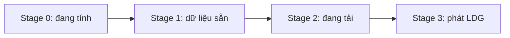

Nhân ma trận (GEMM) là nguyên thủy tính toán trung tâm trong deep learning — từ fully connected đến attention, phần lớn phép toán cuối cùng đều quy về nhân ma trận. Bài này bắt đầu từ bản naive, lần lượt đi qua tiling ba cấp Block–Warp–Thread, tải vector hóa, loại bỏ Bank Conflict, double buffering và các kỹ thuật khác, để bạn nắm trọn phương pháp tối ưu CUDA GEMM.

<!-- more -->

## 📑 Mục lục

- [1. Bối cảnh và định nghĩa bài toán](#1-bối-cảnh-và-định-nghĩa-bài-toán)
- [2. Phương pháp phân tích hiệu năng](#2-phương-pháp-phân-tích-hiệu-năng)
- [3. Bản naive: dựng baseline](#3-bản-naive-dựng-baseline)
- [4. Tối ưu tiling cấp Thread Block](#4-tối-ưu-tiling-cấp-thread-block)
- [5. Tối ưu tiling cấp Thread](#5-tối-ưu-tiling-cấp-thread-tái-sử-dụng-ở-register)
- [6. Tối ưu tiling cấp Warp](#6-tối-ưu-tiling-cấp-warp)
- [7. Tải vector hóa: float4](#7-tải-vector-hóa-float4)
- [8. Loại bỏ Bank Conflict](#8-loại-bỏ-bank-conflict)
- [9. Double buffering và pipeline](#9-double-buffering-và-pipeline)
- [10. Pipeline sao chép bất đồng bộ trên Ampere](#10-pipeline-sao-chép-bất-đồng-bộ-trên-ampere)
- [11. Tối ưu cấp SASS và lập lịch register](#11-tối-ưu-cấp-sass-và-lập-lịch-register)
- [12. Chọn tham số và hướng dẫn tinh chỉnh](#12-chọn-tham-số-và-hướng-dẫn-tinh-chỉnh)
- [Tóm tắt](#-tóm-tắt)
- [Danh sách tự kiểm](#-danh-sách-tự-kiểm)
- [Tài liệu tham khảo](#-tài-liệu-tham-khảo)

---

## 1. Bối cảnh và định nghĩa bài toán

### 1.1 Định nghĩa GEMM

GEMM (General Matrix Multiply) tính:

$$
C = A \times B
$$

trong đó $A$ có kích thước $M \times K$, $B$ là $K \times N$, $C$ là $M \times N$. Tổng số phép toán thực là $2 \times M \times N \times K$ FLOPs (mỗi phần tử đầu ra cần $K$ phép nhân và $K-1$ phép cộng).


### 1.2 Vì sao GEMM quan trọng đến vậy

Phần lớn phép toán trong mô hình deep learning cuối cùng dựa vào GEMM:

- **Fully connected**: $Y = XW + b$ chính là nhân ma trận
- **Convolution**: qua im2col trở thành GEMM
- **Attention**: $QK^T$ và $\text{Attention} \cdot V$ đều là nhân ma trận
- **Batched GEMM**: nhân ma trận theo batch trong multi-head attention

Tối ưu GEMM mang lợi ích trực tiếp tới gần như mọi workload deep learning.

### 1.3 Chỉ số hiệu năng

Chỉ số lõi để đo GEMM kernel là **công suất tính toán hiệu dụng** (TFLOPS):

$$
\text{TFLOPS} = \frac{2 \times M \times N \times K}{\text{thời gian chạy kernel (giây)} \times 10^{12}}
$$

Thường đánh giá theo phần trăm so với đỉnh lý thuyết. Trên ma trận lớn, cuBLAS thường đạt 90%+ đỉnh.

---

## 2. Phương pháp phân tích hiệu năng

### 2.1 Mô hình Roofline và tỷ lệ tính toán / truy cập

Hiệu năng GPU bị chặn bởi hai trần vật lý:

- **Trần tính toán**: thông lượng số thực của SM (ví dụ V100 khoảng 15.7 TFLOPS FP32)
- **Trần băng thông**: băng thông bộ nhớ thiết bị (ví dụ V100 HBM khoảng 900 GB/s)

Kernel là **compute-bound** hay **memory-bound** phụ thuộc **cường độ số học** (Arithmetic Intensity):

$$
\text{cường độ số học} = \frac{\text{số FLOPs}}{\text{số byte di chuyển}}
$$

Khi cường độ vượt **điểm cân bằng** (= đỉnh tính toán / đỉnh băng thông), kernel bị giới hạn bởi tính toán; ngược lại bị giới hạn bởi băng thông. Với V100, điểm cân bằng khoảng $15.7 \times 10^{12} / (900 \times 10^9) \approx 17.4$ FLOPs/Byte.

💡 **Gợi ý**: Mục tiêu lõi của tối ưu GEMM là nâng cường độ số học — tái sử dụng dữ liệu để mỗi byte tham gia càng nhiều phép tính càng tốt.

### 2.2 Phân tích theo góc nhìn băng thông

Khi phân tích GEMM kernel, dùng **băng thông** làm chỉ số chính, không phải **latency**. Hàng loạt thread của GPU che latency bằng pipeline, nhưng băng thông là giới hạn cứng. Một tối ưu có hiệu quả khi nó giảm nhu cầu băng thông ở một tầng lưu trữ nào đó.

Băng thông tham chiếu của các tầng lưu trữ GPU (lấy V100 làm ví dụ):

| 📊 Tầng lưu trữ | ⚡ Băng thông | ⏱️ Latency |
|-----------------|---------------|------------|
| Register | ~20 TB/s | 0 cycle |
| Shared Memory | ~12 TB/s | 20–30 cycles |
| L2 Cache | ~2 TB/s | ~200 cycles |
| HBM (Global) | ~900 GB/s | 300–400 cycles |

### 2.3 Mô hình Wave và phân tích L2 Cache

**Wave** (sóng thực thi) là tập Thread Block mà GPU có thể chạy song song cùng lúc. Ví dụ V100 có 80 SM, mỗi SM chứa được 2 Block, thì một Wave tối đa 160 Block.

Ma trận C được chia thành $(M/BM) \times (N/BN)$ Block Tile. Nếu các Block trong một Wave trải $W_m$ và $W_n$ tile theo M và N, công thức xấp xỉ hit rate L2 là:

$$
\text{L2 hit rate} \approx 1 - \frac{W_m \times W_n}{W_m \times W_n + W_m \times N_{block} + W_n \times M_{block}}
$$

⚠️ **Lưu ý**: Thứ tự lập lịch Thread Block (hàng trước / cột trước / zigzag) ảnh hưởng mạnh tới L2 hit rate — trên ma trận lớn có thể lệch hơn 10% hiệu năng.

---

## 3. Bản naive: dựng baseline

### 3.1 Triển khai thẳng nhất

Ý tưởng đơn giản nhất: mỗi thread tính một phần tử của $C$, duyệt chiều $K$ làm tích vô hướng.

```cuda
__global__ void sgemm_naive(const float* A, const float* B, float* C,
                            int M, int N, int K) {
    int row = blockIdx.y * blockDim.y + threadIdx.y;
    int col = blockIdx.x * blockDim.x + threadIdx.x;

    if (row < M && col < N) {
        float sum = 0.0f;
        for (int k = 0; k < K; k++) {
            sum += A[row * K + k] * B[k * N + col];
        }
        C[row * N + col] = sum;
    }
}
```

### 3.2 Phân tích hiệu năng

Cường độ số học của kernel này cực thấp. Với một $C[i][j]$:
- Tính toán: $2K$ FLOPs
- Di chuyển dữ liệu: đọc một hàng $A$ ($K$ float) + một cột $B$ ($K$ float) = $8K$ Bytes

$$
\text{cường độ số học} = \frac{2K}{8K} = 0.25 \text{ FLOPs/Byte}
$$

Xa dưới điểm cân bằng (~17 FLOPs/Byte), bị băng thông siết chặt. Thực đo thường chỉ đạt 6%~11% đỉnh lý thuyết.

📌 **Điểm then chốt**: Vấn đề gốc của bản naive là **tỷ lệ tái sử dụng gần như bằng không** — cùng một hàng $A$ bị các thread ở cột khác đọc lại, cùng một cột $B$ bị các thread ở hàng khác đọc lại, tất cả đều đi Global Memory.

---

## 4. Tối ưu tiling cấp Thread Block

### 4.1 Ý tưởng lõi

Chia ma trận $C$ thành các khối $BM \times BN$; mỗi Thread Block phụ trách một khối. Duyệt chiều $K$ với bước $BK$: mỗi lần, Block hợp tác chuyển khối con $BM \times BK$ của $A$ và $BK \times BN$ của $B$ vào Shared Memory, rồi nhân-cộng dồn trên Shared Memory.

Giống một **kho nhỏ cạnh dây chuyền** — thay vì mỗi lần lấy hàng từ kho tổng xa (Global Memory), ta chuyển từng đợt nhỏ lên kệ cạnh xưởng (Shared Memory) để công nhân lấy đi lấy lại.


### 4.2 Vì sao cắt theo chiều K

Đã tính một khối $BM \times BN$ của $C$, câu hỏi tự nhiên: vì sao không lấy luôn cả dải $BM \times K$ của $A$ và $K \times BN$ của $B$, nhân outer product một lần xong? Vì sao còn phải cắt $K$ thành các bước $BK$?

**Nguyên nhân gốc là Shared Memory hữu hạn**. Trong thực tế $K$ thường hàng nghìn đến hàng chục nghìn; $BM \times K$ cộng $K \times BN$ dễ lên vài chục MB, vượt xa Shared Memory trên một SM (thường chỉ 48~228 KB). Vì vậy phải cắt theo $K$ thành các khối kích thước $BK$, nạp từng đợt vào SMEM và cộng dồn.

Cắt theo K còn mang lại tái sử dụng quan trọng: mỗi lần nạp vào SMEM một khối con $A$ ($BM \times BK$) và $B$ ($BK \times BN$), **mọi thread trong block cùng tái sử dụng** — cả $BM \times BN$ phần tử đầu ra đều cần cặp khối đó tham gia cộng dồn. Nói cách khác, một lần chuyển Global → SMEM phục vụ tính toán của cả block, giảm lượng truy cập Global Memory từ mức Naive $O(MNK)$ xuống khoảng $O(MNK/BK \cdot \text{hằng số})$.

💡 **Gợi ý**: Cắt theo chiều K là quy tắc vàng của tối ưu phân khối GEMM. Các tầng sâu hơn (tiling thread, tiling warp) cũng giữ nguyên nguyên tắc này — ở mỗi tầng lưu trữ (Global → Shared → Register), đều duyệt theo K để cộng dồn từng bước, để mỗi phần dữ liệu được càng nhiều phép tính phía sau tái sử dụng càng tốt.

### 4.3 Nâng tỷ lệ tính toán / truy cập

Cường độ số học sau khi phân khối:

$$
\text{cường độ số học} = \frac{BM \times BN \times 2 \times BK}{(BM \times BK + BK \times BN) \times 4} = \frac{BM \times BN}{2 \times (BM + BN)} = \frac{1}{2 \times \left(\frac{1}{BM} + \frac{1}{BN}\right)}
$$

Chia tử và mẫu cho $BM \times BN$: dưới ràng buộc $BM + BN$ cố định (ngân sách Shared Memory), bất đẳng thức trung bình cho thấy $\frac{1}{BM} + \frac{1}{BN}$ nhỏ nhất khi $BM = BN$, tức **khi $BM$ và $BN$ càng gần nhau thì tỷ lệ tính toán / truy cập càng lớn**.

Lấy $BM = BN = 128$: cường độ = $128 \times 128 / (2 \times 256) = 32$ FLOPs/Byte, vượt xa điểm cân bằng.

### 4.4 Bố trí thread khi tải hợp tác

Một chi tiết quan trọng: khi tải tileA và tileB, cách xếp thread phải đảm bảo **truy cập Global Memory coalesced** — các thread kề nhau trong cùng warp chạm địa chỉ liên tiếp.

Ví dụ $BM=128, BK=8, \text{Block Size}=256$:

- **Tải tileA** ($128 \times 8$): mỗi hàng chỉ 8 phần tử, nên 8 thread kề nhau phụ trách một hàng. 256 thread xếp lại thành $32 \times 8$ (32 hàng × 8 cột); mỗi vòng tải 32 hàng, lặp 4 lần phủ 128 hàng.
- **Tải tileB** ($8 \times 128$): mỗi hàng có 128 phần tử, nên 32 thread kề nhau phụ trách một đoạn liên tiếp. 256 thread xếp thành $8 \times 32$ (8 hàng × 32 cột); mỗi vòng phủ cả 8 hàng, mỗi hàng lặp 4 lần phủ 128 cột.

Công thức chỉ số khi xếp lại thread:

```cuda
int tid = threadIdx.x;

// Tọa độ thread khi tải tileA (8 cột × 32 hàng)
int a_thread_x = tid % 8;       // chiều cột
int a_thread_y = tid / 8;       // chiều hàng

// Tọa độ thread khi tải tileB (32 cột × 8 hàng)
int b_thread_x = tid % 32;      // chiều cột
int b_thread_y = tid / 32;      // chiều hàng
```

💡 **Gợi ý**: Cách xếp này khiến một warp (32 tid liên tiếp) khi tải tileB đúng phủ 32 float liên tiếp trên một hàng — coalesced hoàn hảo. Khi tải tileA, 32 thread trong warp phủ 4 hàng liên tiếp × 8 cột; 8 phần tử mỗi hàng vẫn liên tiếp.

- **Ghi tileC** ($128 \times 128$): chia tileC thành các `C_BLOCK` kích thước `C_BLOCK_Y` $\times$ `C_BLOCK_X` = `BLOCK_SIZE`($256$). Ở đây lấy `C_BLOCK_X = C_BLOCK_Y = 16`, nên hướng X có `Tn = BN / C_BLOCK_X` `C_BLOCK`, hướng Y có `Tm = BM / C_BLOCK_Y` `C_BLOCK`. Mỗi thread ghi một giá trị ở cùng vị trí tương đối trong mọi `C_BLOCK`, tổng cộng `Tm` $\times$ `Tn` giá trị
```
// Bố trí thread khi tính tileC (16×16)
constexpr int C_BLOCK_X = 16;
constexpr int C_BLOCK_Y = BLOCK_SIZE / C_BLOCK_X;  // = 16
int c_thread_x = tid % C_BLOCK_X;
int c_thread_y = tid / C_BLOCK_X;

// Mỗi thread phụ trách Tm×Tn phần tử đầu ra
constexpr int Tm = BM / C_BLOCK_Y;  // = 8
constexpr int Tn = BN / C_BLOCK_X;  // = 8
float Ct[Tm][Tn] = {0.0f};
```
⚠️ **Lưu ý**: 8×8 phần tử mỗi thread phụ trách không liên tiếp, mà **bước nhảy** theo `C_BLOCK_Y=16` hàng và `C_BLOCK_X=16` cột. Vì 256 thread xếp thành lưới $16 \times 16$; mỗi thread "nhảy" 8 lần theo M và N để phủ tileC $128 \times 128$.


### 4.5 Triển khai code

```cuda
template <int BM, int BN, int BK, int BLOCK_SIZE>
__global__ void sgemm_block_tiling(float* A, float* B, float* C,
                                   int M, int K, int N) {
    __shared__ float As[BM][BK];
    __shared__ float Bs[BK][BN];

    int r0 = blockIdx.y * BM;
    int c0 = blockIdx.x * BN;
    int tid = threadIdx.x;

    // Xếp lại thread khi tải tileA
    constexpr int A_BLOCK_X = BK;  // = 8
    constexpr int A_BLOCK_Y = BLOCK_SIZE / A_BLOCK_X;  // = 32
    int a_thread_x = tid % A_BLOCK_X;
    int a_thread_y = tid / A_BLOCK_X;

    // Xếp lại thread khi tải tileB
    constexpr int B_BLOCK_X = 32;
    constexpr int B_BLOCK_Y = BLOCK_SIZE / B_BLOCK_X;  // = 8
    int b_thread_x = tid % B_BLOCK_X;
    int b_thread_y = tid / B_BLOCK_X;

    // Bố trí thread khi tính tileC (16×16)
    constexpr int C_BLOCK_X = 16;
    constexpr int C_BLOCK_Y = BLOCK_SIZE / C_BLOCK_X;  // = 16
    int c_thread_x = tid % C_BLOCK_X;
    int c_thread_y = tid / C_BLOCK_X;

    // Mỗi thread phụ trách Tm×Tn phần tử đầu ra
    constexpr int Tm = BM / C_BLOCK_Y;  // = 8
    constexpr int Tn = BN / C_BLOCK_X;  // = 8
    float Ct[Tm][Tn] = {0.0f};

    // K-Loop
    for (int k = 0; k < K; k += BK) {
        // Tải hợp tác tileA (vòng bước nhảy phủ BM hàng)
        #pragma unroll
        for (int i = a_thread_y; i < BM; i += A_BLOCK_Y) {
            int r = r0 + i, c = k + a_thread_x;
            As[i][a_thread_x] = (r < M && c < K) ? A[r * K + c] : 0.0f;
        }

        // Tải hợp tác tileB (vòng bước nhảy phủ BN cột)
        #pragma unroll
        for (int j = b_thread_x; j < BN; j += B_BLOCK_X) {
            int r = k + b_thread_y, c = c0 + j;
            Bs[b_thread_y][j] = (r < K && c < N) ? B[r * N + c] : 0.0f;
        }

        __syncthreads();

        // Cộng dồn kiểu outer product As × Bs
        #pragma unroll
        for (int p = 0; p < BK; p++) {
            for (int i = 0; i < Tm; i++) {
                int row = c_thread_y + i * C_BLOCK_Y;
                for (int j = 0; j < Tn; j++) {
                    int col = c_thread_x + j * C_BLOCK_X;
                    Ct[i][j] += As[row][p] * Bs[p][col];
                }
            }
        }

        __syncthreads();
    }

    // Ghi kết quả
    for (int i = 0; i < Tm; i++) {
        int r = r0 + c_thread_y + i * C_BLOCK_Y;
        for (int j = 0; j < Tn; j++) {
            int c = c0 + c_thread_x + j * C_BLOCK_X;
            if (r < M && c < N) C[r * N + c] = Ct[i][j];
        }
    }
}
```

### 4.6 Chọn tham số

| 📊 Tham số | 📝 Giá trị gợi ý | 💡 Lý do |
|------------|------------------|---------|
| BM, BN | 128 | Cường độ 32, đủ bão hòa đơn vị tính toán |
| BK | 8 | Shared Memory kiểm soát được (128×8×4=4KB/ma trận) |
| Block size | 16×16=256 | Khớp chia BM/BN, hỗ trợ 2 blocks/SM |

⚠️ **Lưu ý**: Hai lần `__syncthreads()` là bắt buộc — lần một đảm bảo tải xong mới tính, lần hai đảm bảo tính xong mới ghi đè Shared Memory.

---

## 5. Tối ưu tiling cấp Thread: tái sử dụng ở register

Tới đây, chuỗi tối ưu đã thành một **chuỗi chuyển dữ liệu ba tầng** rõ ràng:


Mỗi tầng chuyển dữ liệu theo cùng nguyên tắc: duyệt theo K, mỗi lần chuyển một khối nhỏ, tối đa hóa tái sử dụng ở tầng hiện tại rồi mới chuyển khối tiếp. Bây giờ tập trung vào tầng Shared Memory → Register.

### 5.1 Vấn đề: Shared Memory vẫn là nút thắt

Kernel bước trước (Section 4.5) đã cho mỗi thread phụ trách $TM \times TN$ (8×8) đầu ra, nhưng truy cập `As[row][p]` và `Bs[p][col]` nằm ngay trong ba vòng lồng nhau — trình biên dịch có thể tối ưu, nhưng về cấu trúc code mỗi FMA vẫn kèm phụ thuộc đọc Shared Memory ngầm. Khi 256 thread cùng truy cập Shared Memory dày đặc sẽ xuất hiện **MIO Throttle Stall**.

Hướng xử lý: tách rõ "đọc từ Shared Memory" và "tính FMA" — tải theo lô vào mảng register (`a_frag`, `b_frag`), rồi làm outer product trên register. Như vậy mỗi bước p-Loop chỉ cần $TM + TN$ lần đọc Shared Memory để hoàn thành $TM \times TN$ FMA.

### 5.2 Phân rã Outer Product


Thứ tự vòng lặp là then chốt. Cách viết inner product truyền thống (K trong cùng) khiến phần tử $A$ và $B$ không tái sử dụng được:

```
// Inner product: mỗi thread cộng dồn một phần tử C -> tái sử dụng thấp
for k: sum += A[row][k] * B[k][col]
```

Đổi sang **outer product** (K ở vòng ngoài cùng):

```
// Outer product: mỗi thread phụ trách TM×TN phần tử C
for k:
    load A_frag[TM] from smem  // đọc một lần TM phần tử A
    load B_frag[TN] from smem  // đọc một lần TN phần tử B
    for i in TM:
        for j in TN:
            C_frag[i][j] += A_frag[i] * B_frag[j]  // TM×TN FMA
```

**Phân tích tỷ lệ tính toán / truy cập**: mỗi bước K, đọc từ Shared Memory $TM + TN$ float (tức $4(TM + TN)$ byte), hoàn thành $TM \times TN$ FMA (tức $2 \times TM \times TN$ FLOPs). Vậy:

$$
\text{cường độ số học} = \frac{2 \times TM \times TN}{4 \times (TM + TN)} = \frac{TM \times TN}{2 \times (TM + TN)} = \frac{1}{2 \times \left(\frac{1}{TM} + \frac{1}{TN}\right)}
$$

Dạng thức trùng Section 4.3 — không phải ngẫu nhiên: outer product về bản chất là đẩy ý tưởng phân khối Block xuống tầng Register. Cũng theo bất đẳng thức trung bình: khi $TM + TN$ (proxy áp lực register) cố định, **$TM = TN$ cho tỷ lệ tính toán / truy cập lớn nhất**.

**Vì sao lấy** $TM = TN = 8$:

- Register mỗi thread: $a_{frag}[TM] + b_{frag}[TN] + c_{frag}[TM][TN] = TM + TN + TM \times TN$. Khi $TM=TN=8$ là $8 + 8 + 64 = 80$ float.
- Cộng chỉ số, biến vòng lặp… khoảng 90~120 register/thread — khoảng nửa trần 255 register/thread, vẫn giữ được occupancy (mỗi SM ít nhất 2 Block).
- Nếu $TM=TN=16$, chỉ $c_{frag}$ đã chiếm 256 register → spill sang Local Memory, hiệu năng tụt.

**So với inner product**: mỗi FMA của inner product phải đọc từ Shared Memory một float $A$ và một float $B$, tỷ lệ $2/(2 \times 4) = 1/4$ theo byte hoặc $1$ theo phần tử. Outer product với $TM = TN = 8$ theo phần tử là $64/16 = 4$ — **tăng 4 lần** — tính toán từng cần 4 lần đọc Shared Memory nay chỉ cần 1.

### 5.3 Triển khai code

```cuda
template <int BM, int BN, int BK, int TM, int TN>
__global__ void sgemm_thread_tiling(const float* A, const float* B, float* C,
                                    int M, int N, int K) {
    __shared__ float As[BM][BK];
    __shared__ float Bs[BK][BN];

    // Mỗi thread phụ trách khối con TM×TN trong C
    const int thread_num = BM / TM * BN / TN;  // = 256
    int tid = threadIdx.x;
    int thread_row = (tid / (BN / TN)) * TM;
    int thread_col = (tid % (BN / TN)) * TN;

    // Lưu trên register
    float a_frag[TM];
    float b_frag[TN];
    float c_frag[TM][TN] = {0.0f};

    int by = blockIdx.y, bx = blockIdx.x;

    for (int bk = 0; bk < K; bk += BK) {
        // Tải hợp tác A, B vào Shared Memory (bỏ kiểm tra biên)
        load_tile_A(A, As, by, bk, tid, M, K);
        load_tile_B(B, Bs, bx, bk, tid, K, N);
        __syncthreads();

        // Cộng dồn outer product
        for (int k = 0; k < BK; k++) {
            // Shared Memory -> register
            for (int i = 0; i < TM; i++)
                a_frag[i] = As[thread_row + i][k];
            for (int j = 0; j < TN; j++)
                b_frag[j] = Bs[k][thread_col + j];

            // Outer product trên register
            for (int i = 0; i < TM; i++)
                for (int j = 0; j < TN; j++)
                    c_frag[i][j] += a_frag[i] * b_frag[j];
        }
        __syncthreads();
    }

    // Ghi lại Global Memory
    for (int i = 0; i < TM; i++)
        for (int j = 0; j < TN; j++)
            C[(by * BM + thread_row + i) * N + bx * BN + thread_col + j] = c_frag[i][j];
}
```

### 5.4 Ngân sách register

Với $TM = TN = 8$:
- `c_frag`: $8 \times 8 = 64$ register
- `a_frag` + `b_frag`: $8 + 8 = 16$ register
- Chỉ số, biến tạm…: ~30 register
- Tổng: khoảng 110–128 register/thread

V100 mỗi SM có 65536 register. 128 register/thread × 256 thread/Block = 32768 register/Block, mỗi SM chứa được 2 Block (512 thread = 16 warp), occupancy = 25%.

💡 **Gợi ý**: Occupancy 25% trông thấp, nhưng GEMM có ILP rất cao — mỗi thread có 64 chuỗi FMA độc lập, đủ để che latency pipeline.

---

## 6. Tối ưu tiling cấp Warp

### 6.1 Động cơ

Trên nền tiling thread, hỏi tiếp: 32 thread của một warp nên truy cập Shared Memory theo kiểu nào để tối ưu nhất?

Nếu xếp $1 \times 32$ (một hàng 32), khi đọc $A$ cả 32 thread cần cùng một phần tử (có thể Broadcast), nhưng đọc $B$ cần 32 phần tử khác nhau. Ngược lại $32 \times 1$ thân thiện với $B$ nhưng bất lợi với $A$.

### 6.2 Hình dạng Warp Tile và suy ra tỷ lệ tính toán / truy cập

Giả sử warp có $x$ thread theo M, $y$ thread theo N ($x \times y = 32$), mỗi thread phụ trách khối $TM \times TN$. Trong một bước p-Loop (một bước theo K):

- Nhờ broadcast Shared Memory, warp thực tế đọc từ tileA $x \times TM$ phần tử khác nhau ($y$ thread cùng vị trí M chia sẻ cùng $TM$ giá trị)
- Từ tileB đọc $y \times TN$ phần tử khác nhau ($x$ thread cùng vị trí N chia sẻ cùng $TN$ giá trị)
- Mỗi thread tính $TM \times TN$ FMA; cả warp tính $32 \times TM \times TN \times 2$ FLOPs

Tỷ lệ tính toán / truy cập cấp Warp (cho $TM = TN$, khi đó mẫu $(x \cdot TM + y \cdot TN) = (x + y) \cdot TM$):

$$
\text{ratio} = \frac{32 \times TM \times TN \times 2}{(x \cdot TM + y \cdot TN) \times 4} \xlongequal{TM=TN} \frac{32 \times TM^2 \times 2}{(x + y) \times TM \times 4} = \frac{16 \times TM}{x + y}
$$

Tỷ lệ tỷ lệ thuận với $1/(x + y)$. Dưới ràng buộc $x \times y = 32$, $x + y$ nhỏ nhất thì tỷ lệ lớn nhất. Theo bất đẳng thức trung bình, $x + y \geq 2\sqrt{xy} = 2\sqrt{32} \approx 11.3$. Trong nghiệm nguyên, $4 \times 8$ và $8 \times 4$ ($x+y=12$) là lựa chọn tối ưu.


### 6.3 Tính vị trí thread trong Warp

$BM = 128, BN = 128$, một Block có 256 / 32 = 8 warp.

Lấy bố cục warp $4 \times 8$, $TM = TN = 8$: mỗi warp tính khối con C kích thước $32 \times 64$.

Sau khi chọn bố cục $4 \times 8$ trong warp, cần tính chính xác tọa độ bắt đầu của mỗi thread trong Block Tile. Gọi `tid` là ID toàn cục của thread trong Block:

```cuda
int warp_id = tid >> 5;            // tid / 32
int lane_id = tid & 31;           // tid % 32

// Vị trí warp trong Block (xếp 4×2)
int warp_row = warp_id >> 1;      // hướng M: 0~3
int warp_col = warp_id & 1;       // hướng N: 0~1

// Vị trí lane trong warp (xếp 4×8, hàng trước)
int lane_row = lane_id >> 3;      // hướng M: 0~3
int lane_col = lane_id & 7;       // hướng N: 0~7

// Hàng/cột bắt đầu của khối TM×TN mà thread phụ trách trong Block Tile
int row_c = (warp_row * 4 + lane_row) * TM;  // = (warp_row*4 + lane_row) * 8
int col_c = (warp_col * 8 + lane_col) * TN;  // = (warp_col*8 + lane_col) * 8
```

Ví dụ `tid = 18`: `warp_id = 0`, `lane_id = 18`, `warp_row = 0`, `warp_col = 0`, `lane_row = 18 >> 3 = 2`, `lane_col = 18 & 7 = 2`. Tọa độ bắt đầu `row_c = 16, col_c = 16` — thread phụ trách khối $8 \times 8$ hàng 16\~23, cột 16\~23 trong Block Tile.

---

## 7. Tải vector hóa: float4

### 7.1 Vì sao cần vector hóa

Khi chuyển Global Memory → Shared Memory, nếu mỗi lần chỉ mang một float (32 bit) thì phải phát rất nhiều lệnh LDG/STS. Hệ thống bộ nhớ GPU hỗ trợ chuyển 128 bit một lần (`float4`), giảm số lệnh xuống còn 1/4, giảm áp lực phát lệnh rõ rệt.

### 7.2 Macro tải float4

```cuda
#define FLOAT4(ptr) (reinterpret_cast<float4*>(&(ptr))[0])
```

Cách dùng:

```cuda
// Tải một lần 4 float liên tiếp
float4 tmp = FLOAT4(A[row * K + col]);
```

### 7.3 Chiến lược lưu A đã chuyển vị

Vấn đề: ma trận $A$ trong Global Memory lưu theo hàng; sau khi nạp vào Shared Memory, vòng trong cần đọc theo cột (các thread khác nhau trên cùng hàng đọc cùng một cột của As), không dùng được `float4`.

Giải pháp: **lưu $A$ đã chuyển vị trong Shared Memory**, tức `As[BK][BM]` thay vì `As[BM][BK]`. Truy cập theo cột trở thành theo hàng, có thể dùng `float4` đọc 4 phần tử liên tiếp một lần.

```cuda
// Tải một hàng liên tiếp của A từ Global, lưu chuyển vị vào Shared Memory
float4 a_val = FLOAT4(A[global_row * K + bk + load_col]);
As[load_col + 0][local_row] = a_val.x;
As[load_col + 1][local_row] = a_val.y;
As[load_col + 2][local_row] = a_val.z;
As[load_col + 3][local_row] = a_val.w;

// Đọc từ Shared Memory có thể dùng float4 (địa chỉ liên tiếp)
float4 a_frag_vec = FLOAT4(As[k][thread_row]);
```

### 7.4 Thay đổi ánh xạ tọa độ sau khi dùng float4

Với float4, 8 phần tử mỗi thread phụ trách không còn là 8 vị trí cách nhau `C_BLOCK_Y` hàng, mà thành hai nhóm mỗi nhóm 4 phần tử liên tiếp (float4 đọc 4 float liên tiếp). Việc này đổi cách tính tọa độ khi ghi Ct về ma trận $C$.

**Khi chưa dùng float4**: hàng thứ $i$ của Ct có tọa độ hàng trong tileC là `C_THREAD_Y + i * C_BLOCK_Y`.

**Khi dùng float4**: 8 hàng của Ct tách thành hai nhóm (4 hàng đầu liên tiếp, 4 hàng sau liên tiếp), tọa độ thành:

```
tileC_row = 4 * C_THREAD_Y + (i / 4) * 4 * C_BLOCK_Y + (i % 4)
tileC_col = 4 * C_THREAD_X + (j / 4) * 4 * C_BLOCK_X + (j % 4)
```

Code ghi lại đổi tương ứng:

```cuda
for (int i = 0; i < Tm; i++) {
    int r = r0 + 4 * C_THREAD_Y + (i / 4) * 4 * C_BLOCK_Y + (i % 4);
    for (int j = 0; j < Tn; j++) {
        int c = c0 + 4 * C_THREAD_X + (j / 4) * 4 * C_BLOCK_X + (j % 4);
        if (r < M && c < N) C[r * N + c] = Ct[i][j];
    }
}
```

### 7.5 Cải thiện hiệu năng

Hiệu quả của tải vector hóa:
- Giảm 75% số lệnh load/store
- Giảm MIO Throttle stall
- Tăng băng thông hiệu dụng Global Memory → Shared Memory
- Thực đo thường mang lại 15%~30% tăng tốc

---

## 8. Loại bỏ Bank Conflict

### 8.1 Bank Conflict là gì

Shared Memory được chia thành 32 bank, mỗi bank rộng 4 byte. Quy tắc ánh xạ: byte thứ $i$ thuộc bank $\lfloor i/4 \rfloor \mod 32$.

**Vì sao 32 bank?** Không phải ngẫu nhiên — 32 đúng bằng số thread trong một warp. Ý đồ thiết kế phần cứng: trong trường hợp lý tưởng, 32 thread của warp mỗi thread chạm một bank khác nhau, hoàn thành trong một chu kỳ đồng hồ, đạt đỉnh băng thông. Hãy hình dung mỗi bank như một **làn đường đơn**: mỗi chu kỳ chỉ cho qua một xe (một lần truy cập 4 byte). 32 làn chạy song song, vừa phục vụ 32 thread của một warp.

Khi nhiều thread trong cùng warp **đồng thời truy cập các địa chỉ khác nhau của cùng một bank**, các truy cập phải tuần tự hóa, tạo N-way Bank Conflict — nhiều xe chen một làn, thông lượng còn $1/N$.

Ngược lại, nếu nhiều thread truy cập **cùng địa chỉ của cùng một bank**, phần cứng sẽ **broadcast**: chỉ đọc một lần, kết quả phát cho mọi thread yêu cầu, không tạo conflict.

⚠️ **Lưu ý**: Bank conflict chỉ được định nghĩa **trong một warp**. Các warp khác nhau truy cập cùng bank không tạo bank conflict — chúng vốn đã được lập lịch theo thời gian.

Một số tình huống điển hình với LDS.32 (mỗi thread lấy 1 float):

| 📊 Tình huống | ✅ Có conflict? | 📝 Lý do |
|---------------|-----------------|----------|
| 32 thread mỗi cái một bank khác | Không | Lý tưởng, 1 transaction |
| Thread 0~31 chạm bank khác nhau ở các layer | Không | Bank khác là đủ; layer không ảnh hưởng |
| Nhiều thread cùng bank cùng địa chỉ | Không | Kích hoạt broadcast |
| 2 thread cùng bank khác địa chỉ | Conflict 2-way | Cần 2 transaction tuần tự |

### 8.2 Cơ chế Memory Transaction với float4

Hiểu bank conflict dưới float4 cần nắm **cách tách Memory Transaction** trước:

- **float** (32 bit/thread): một warp chạm 128 bytes → đúng một memory transaction
- **float2** (64 bit/thread): một warp chạm 256 bytes → tách thành 2 transaction, mỗi nhóm 16 thread (half-warp)
- **float4** (128 bit/thread): một warp chạm 512 bytes → tách thành 4 transaction, mỗi nhóm 8 thread (**quarter-warp**)

Bank conflict được xét **trong một memory transaction**, nên với float4 chỉ cần quan tâm conflict giữa 8 thread của quarter-warp.

**Điều kiện kích hoạt Broadcast** (với float4):

Khi một trong các điều kiện sau thỏa, hai quarter-warp có thể gộp thành một memory transaction:
- Điều kiện A: thread thứ $i$ và thread thứ ($i \oplus 1$) trong warp truy cập cùng địa chỉ (hoặc một trong hai không active)
- Điều kiện B: thread thứ $i$ và thread thứ ($i \oplus 2$) truy cập cùng địa chỉ (hoặc một trong hai không active)

### 8.3 Ảnh hưởng của hình dạng Warp tới Bank Conflict

Hình dạng warp khác nhau (cách xếp thread trên M×N) quyết định trực tiếp việc đọc Shared Memory có bank conflict hay không. Ta lấy hình $2 \times 16$ làm phản ví dụ.

**Phân tích conflict khi warp $2 \times 16$ đọc tileB**:

tileB có dạng $(BK, BN) = (8, 128)$; lưu theo hàng thì mỗi 32 float đầy một layer bank. Mỗi thread cần đọc $TN=8$ float liên tiếp (dùng LDS.128 đọc float4 hai lần).

Trong quarter-warp đầu (thread 0~7):
- Thread 0 đọc bank 0\~3 layer 0 (phần tử B thứ 0\~3)
- Thread 4 đọc bank 0\~3 layer 1 (phần tử B thứ 32\~35, lệch $4 \times TN = 32$ phần tử = 1 bank layer)

Thread 0 và thread 4 chạm cùng bank nhưng khác địa chỉ → bank conflict 2-way! Quarter-warp lẽ ra chỉ cần 1 transaction nay thành 2.

**Phân tích conflict khi warp $2 \times 16$ đọc tileA**:

Nếu tileA chưa chuyển vị, dạng `As[BM][BK]` = $(128, 8)$, mỗi hàng 8 phần tử, 4 hàng đầy một layer bank ($4 \times 8 = 32$ phần tử). Thread cần đọc $TM=8$ giá trị theo chiều M; các giá trị cách nhau $BK=8$ float (qua hàng), **không liên tiếp**, chỉ dùng được LDS.32 từng cái. Khi đó bank conflict xét trên cả warp.

Thread 0 (hàng M thứ 0) đọc `As[row][k]`; thread 16 (hàng M thứ 1) đọc `As[row+8][k]`. Khoảng cách hàng 8 float khiến 8 hàng đúng vượt 2 layer bank ($8 \times 8 = 64$ phần tử = 2 layer) → hai thread rơi vào cùng bank khác layer → conflict 2-way.

📌 **Điểm then chốt**: Bố cục $2 \times 16$ conflict ở **cả** hướng A và B — thuộc nhóm xấu nhất. Cách trực tiếp nhất để hết conflict hướng A là **lưu chuyển vị** (`As[BK][BM]`), biến đọc theo M thành địa chỉ liên tiếp, dùng được LDS.128 và kích hoạt broadcast trong quarter-warp.

Bố cục $4 \times 8$ kèm lưu A chuyển vị tránh được conflict ở cả hai hướng.

### 8.4 Phân tích Transaction của warp(4x8) với float4

Hình dạng warp $4 \times 8$, truy cập bằng `float4`: bank conflict xét trong quarter-warp (8 thread). Quarter-warp phủ kín hướng N, hình dạng $1 \times 8$. Phân tích lần lượt hai kiểu tile.


**Đọc tileA (lưu chuyển vị `As[k][thread_row..thread_row+7]`)**:

Tọa độ M bắt đầu mỗi lane là `lane_row * TM = lane_row * 8`. 8 lane trong quarter-warp có cùng `lane_row` (đều 0) → **cả 8 lane chạm đúng cùng một địa chỉ float4**.

Trong quarter-warp có **1 float4 duy nhất**, kích hoạt broadcast 8 đường → chỉ cần 1 transaction trong quarter-warp.

Kiểm tra điều kiện gộp uniform-access xuyên quarter-warp (xem §8.2):

- Điều kiện A: `lane i` và `lane i⊕1` — xor 1 chỉ lật bit 0, nằm trên `lane_col`; `lane_row` không đổi → cùng địa chỉ A → **thỏa điều kiện A toàn cục** ✅

→ LDS.128 kích hoạt register packing, số request từ 4 xuống 2 → **cả warp chỉ 2 transaction**.

> 📎 Khớp mô tả phần cứng trên diễn đàn NVIDIA: trên CC 7.0+, truy cập uniform có thể giảm requests/instruction của LDS.128 từ 4 xuống 2 ([Greg @NV, 2018](https://forums.developer.nvidia.com/t/unexpected-shared-memory-bank-conflict/77228/2)).

**Đọc tileB (`Bs[k][thread_col..thread_col+7]`)**:

Tọa độ N bắt đầu mỗi lane là `lane_col * TN = lane_col * 8`. 8 lane trong quarter-warp có `lane_col = 0..7` khác nhau:

| lane | N bắt đầu | Phần tử B | Banks |
|------|-----------|-----------|-------|
| 0    | 0         | B[0:4]    | 0~3 (layer 0) |
| 1    | 8         | B[8:12]   | 8~11 (layer 0) |
| 2    | 16        | B[16:20]  | 16~19 (layer 0) |
| 3    | 24        | B[24:28]  | 24~27 (layer 0) |
| 4    | 32        | B[32:36]  | 0~3 (layer 1) |
| 5    | 40        | B[40:44]  | 8~11 (layer 1) |
| 6    | 48        | B[48:52]  | 16~19 (layer 1) |
| 7    | 56        | B[56:60]  | 24~27 (layer 1) |

Trong quarter-warp có **8 float4 duy nhất**, không broadcast. Tệ hơn: các lane kề lệch nhau 8 float (32 byte = 8 bank); lane 0 bắt đầu ở bank 0, lane 4 bắt đầu ở bank 0 của layer kế ($4 \times 8 = 32$ float = 1 bank layer) → **bank conflict 2-way**.

→ Mỗi quarter-warp vì bank conflict tách thành 2 transaction → **cả warp 8 transaction**.

**Tổng hợp**:

| tile | Số float4 duy nhất trong QW | Broadcast / conflict | Số transaction trong warp |
|------|-----------------------------|----------------------|---------------------------|
| tileA | 1 | Broadcast 8 đường + condition A halving | 2 |
| tileB | 8 | Bank conflict 2-way, không halving | 8 |
| **Tổng** |  |  | **10** |

📌 **Quan sát**: Với bố cục hàng trước, tileA hưởng broadcast hoàn hảo + uniform-access halving (chỉ 2 transaction), nhưng tileB với bước N = $TN=8$ gây conflict 2-way và không thỏa điều kiện halving — tổng 10 vẫn kém hơn cột trước (6 transaction). Sự **một bên quá mạnh, một bên quá yếu** này chính là điều phương án ba ở §8.5 (ánh xạ thread Z-order) muốn loại bỏ — bằng quarter-warp hình $2 \times 4$, để các cặp lane xor 1 / xor 2 **đồng thời** cùng row trên tileA và cùng col trên tileB, hai phía đều gộp được transaction mà không tạo conflict mới.


### 8.5 Các giải pháp

**Phương án một: Padding (tileA lưu chuyển vị)**

Khi khai báo Shared Memory thêm một cột:

```cuda
__shared__ float As[BK][BM + 4];  // lệch ánh xạ bank
```

Nhược điểm: phá căn `float4`, có thể không dùng được đọc vector hóa.

**Phương án hai: XOR Swizzle (tileA lưu chuyển vị)**

Dùng phép XOR xáo địa chỉ lưu, khiến các truy cập vốn conflict phân tán sang bank khác:

```cuda
// Swizzle khi ghi
As[k][row ^ (k * 4)] = value;

// Đọc bằng cùng quy tắc để suy ngược địa chỉ
float val = As[k][target_row ^ (k * 4)];
```

Ưu điểm: không tốn thêm không gian, giữ căn `float4`.

**Phương án ba: Tách vùng tính $8 \times 8$ thành các khối con $4 \times 4$**

Hướng khác không đổi hình dạng warp, mà đổi bố cục vùng tính mỗi thread phụ trách. Thay vì mỗi thread tính vùng $8 \times 8$ liên tiếp, tách thành 4 khối $4 \times 4$ (rải trong tileC).


Nguyên lý lõi: khi mỗi thread đọc float4, đúng 8 thread trong một quarter-warp phủ kín một layer bank (32 float liên tiếp = 8 × float4), không conflict xuyên layer. Điểm then chốt của việc tách là để các thread trong quarter-warp đọc địa chỉ **liên tiếp phủ kín một layer bank**, thay vì nhảy sang layer khác.

Ưu điểm: không cần sửa logic ánh xạ thread–warp, chỉ chỉnh bố cục cục bộ của ma trận C. Cái giá là ghi lại Global Memory không liên tiếp, phải scatter write.

8 lane trong QW chia sẻ cùng một hàng (`lane_row=0`), phủ 8 cột theo N.

**Đọc tileA (lưu chuyển vị `As[k][row*4 .. row*4+3]`)**:

Mỗi lane đọc bắt đầu ở M = `lane_row * 4`. 8 lane trong QW cùng `lane_row` (đều 0) → **cùng địa chỉ float4**, kích hoạt broadcast 8 đường.

Kiểm tra điều kiện gộp xuyên QW:
- Điều kiện A: `lane i` và `lane i⊕1` (xor 1 lật bit 0, chỉ đổi `lane_col`, `lane_row` giữ nguyên) → cùng địa chỉ A → **thỏa điều kiện A** ✅

→ 4 request QW gộp thành 2 → **đọc tileA của cả warp: 2 transaction**.

**Đọc tileB (`Bs[k][col*4 .. col*4+3]`)**:

Mỗi lane đọc bắt đầu ở N = `lane_col * 4` (không phải baseline `lane_col * 8`). Địa chỉ bắt đầu và bank của 8 lane trong QW:

| lane | Offset N bắt đầu | Phần tử | Banks |
|------|------------------|---------|-------|
| 0 | 0 | B[0:4] | 0\~3 (layer 0) |
| 1 | 4 | B[4:8] | 4\~7 (layer 0) |
| 2 | 8 | B[8:12] | 8\~11 (layer 0) |
| 3 | 12 | B[12:16] | 12\~15 (layer 0) |
| 4 | 16 | B[16:20] | 16\~19 (layer 0) |
| 5 | 20 | B[20:24] | 20\~23 (layer 0) |
| 6 | 24 | B[24:28] | 24\~27 (layer 0) |
| 7 | 28 | B[28:32] | 28\~31 (layer 0) |

8 địa chỉ float4 liên tiếp phủ bank 0\~31 của layer 0 — **mỗi lane một bank khác, không bank conflict**.

Khác biệt then chốt so với baseline (khoảng cách `lane_col * 8`): ở baseline, lane 0 và lane 4 lệch offset bắt đầu 32 float = 1 bank layer, rơi vào cùng bank khác địa chỉ → conflict 2-way. Phương án bốn thu khoảng cách từ 8 xuống 4, để 8 lane trong QW đúng phủ kín một layer bank mà không tràn sang layer kế.

Nhưng kiểm tra điều kiện gộp xuyên QW:
- Điều kiện A: `lane i` và `lane i⊕1` (`lane_col` lệch 1) → offset B lệch 4 → khác địa chỉ → **không thỏa** ❌
- Điều kiện B: `lane i` và `lane i⊕2` (`lane_col` lệch 2) → offset B lệch 8 → khác địa chỉ → **không thỏa** ❌

Không kích hoạt gộp xuyên QW → mỗi QW độc lập 1 transaction → **đọc tileB của cả warp: 4 transaction**.

**Tổng hợp transaction mỗi khối con trong một p-Loop**:

| tile | Conflict trong QW | Gộp xuyên QW | Số transaction trong warp |
|------|-------------------|--------------|---------------------------|
| tileA | Không (broadcast 8 đường) | Điều kiện A | 2 |
| tileB | Không (phủ kín một layer bank) | Không thỏa gộp | 4 |
| **Tổng** | | | **6** |


**Phương án bốn: Ánh xạ thread Z-order**

Trên nền phương án ba, đổi hình quarter-warp từ mặc định $1 \times 8$ (hàng trước) sang bố cục Z-order, để **cả** đọc tileA và tileB đều kích hoạt broadcast, giảm memory transaction từ 10 xuống 4.

```cuda
int lane_id = threadIdx.x % 32;
int lane_row = lane_id % 2 + (lane_id / 16) * 2;    // 4 hàng
int lane_col = (lane_id % 16) / 2;                  // 8 cột
```

Mở ánh xạ trên, vị trí 32 lane trên lưới $4 \times 8$ như sau:


Mỗi quarter-warp hình **2 hàng × 4 cột**. Nguyên lý lõi: 8 lane trong QW chỉ phủ 2 `lane_row` khác nhau và 4 `lane_col` khác nhau, nên cả đọc tileA lẫn tileB đều broadcast trong QW; đồng thời xor 1 và xor 2 lần lượt giữ nguyên `lane_col` / `lane_row`, đúng khớp điều kiện A và B để gộp xuyên QW.

**Đọc tileA (lưu chuyển vị `As[k][row*4 .. row*4+3]`)**:

Trong QW chỉ 2 địa chỉ A độc lập, mỗi địa chỉ được 4 lane chia sẻ (broadcast 4 đường); hai địa chỉ rơi vào bank khác nhau (0\~3 vs 4\~7) → **không bank conflict**.

Kiểm tra điều kiện gộp xuyên QW:
- Điều kiện B: `lane i` và `lane i⊕2` (xor 2 lật bit 1, chỉ đổi `lane_col`, `lane_row` giữ nguyên) → cùng địa chỉ A → **thỏa điều kiện B** ✅

→ 4 request QW gộp thành 2 → **đọc tileA của cả warp: 2 transaction**.

**Đọc tileB (`Bs[k][col*4 .. col*4+3]`)**:

Mỗi lane đọc bắt đầu ở N = `lane_col * 4`. Địa chỉ bắt đầu và bank của 8 lane trong QW0:

| lane | (row, col) | Offset N bắt đầu | Banks |
|------|------------|------------------|-------|
| 0 | (0, 0) | 0 | 0\~3 (layer 0) |
| 1 | (1, 0) | 0 | 0\~3 (layer 0) |
| 2 | (0, 1) | 4 | 4\~7 (layer 0) |
| 3 | (1, 1) | 4 | 4\~7 (layer 0) |
| 4 | (0, 2) | 8 | 8\~11 (layer 0) |
| 5 | (1, 2) | 8 | 8\~11 (layer 0) |
| 6 | (0, 3) | 12 | 12\~15 (layer 0) |
| 7 | (1, 3) | 12 | 12\~15 (layer 0) |

Trong QW chỉ 4 địa chỉ B độc lập, mỗi địa chỉ được 2 lane chia sẻ (broadcast 2 đường); 4 nhóm phủ bank 0\~15 của layer 0 → **không bank conflict**.

Kiểm tra điều kiện gộp xuyên QW:
- Điều kiện A: `lane i` và `lane i⊕1` (xor 1 lật bit 0, chỉ đổi `lane_row`, `lane_col` giữ nguyên) → cùng địa chỉ B → **thỏa điều kiện A** ✅

→ 4 request QW gộp thành 2 → **đọc tileB của cả warp: 2 transaction**.

**Tổng hợp transaction mỗi khối con trong một p-Loop**:

| tile | Conflict trong QW | Gộp xuyên QW | Số transaction trong warp |
|------|-------------------|--------------|---------------------------|
| tileA | Không (broadcast 4 đường) | Điều kiện B | 2 |
| tileB | Không (broadcast 2 đường) | Điều kiện A | 2 |
| **Tổng** | | | **4** |

So với bố cục $1 \times 8$ mặc định (tileA 2 + tileB 8 = 10 transaction), bố cục Z-order (mỗi bên 2 = 4 transaction) giảm 60% memory transaction.

---

## 9. Double buffering và pipeline

### 9.1 Che latency Global Memory

Trong các bản trước, mỗi bước vòng K đều phải chờ chuyển Global → Shared Memory xong mới tính. Latency Global Memory lên tới 300~500 chu kỳ đồng hồ; suốt khoảng đó đơn vị tính toán ngồi không.

Ý tưởng double buffering giống **bóng bàn**: chuẩn bị hai bộ đệm Shared Memory — vừa tính trên Buffer 0 vừa nạp vòng kế vào Buffer 1.

### 9.2 Double buffering cấp p-Loop (Shared → Register)

Trong p-Loop (vòng trong theo K), mỗi bước cần: (1) đọc regA/regB từ Shared Memory; (2) tính outer product regA × regB. Nếu tuần tự, tính toán phải chờ đọc Shared Memory xong (latency 20–30 cycle).

Dùng register double buffer để chồng đọc và tính:

```cuda
float regA[2][Tm], regB[2][Tn];

#pragma unroll
for (int p = 0; p < BK + 1; p++) {
    // Giai đoạn tính: dùng dữ liệu đã đọc ở bước trước
    if (p > 0) {
        for (int i = 0; i < Tm; i++)
            for (int j = 0; j < Tn; j++)
                Ct[i][j] += regA[(p - 1) & 1][i] * regB[(p - 1) & 1][j];
    }

    // Giai đoạn prefetch: đọc dữ liệu bước này vào bộ register kia
    if (p < BK) {
        for (int i = 0; i < Tm / 4; i++)
            FLOAT4(regA[p & 1][i * 4]) = FLOAT4(As[p][...]);
        for (int j = 0; j < Tn / 4; j++)
            FLOAT4(regB[p & 1][j * 4]) = FLOAT4(Bs[p][...]);
    }
}
```

Vì giai đoạn tính (lệnh FFMA) và giai đoạn prefetch (lệnh LDS) thuộc các đơn vị thực thi GPU khác nhau, phần cứng có thể lập lịch song song cả hai, che được latency Shared Memory.

### 9.3 Double buffering cấp K-Loop (Global → Shared)

**Tầng một: Double buffer Global → Shared**

```cuda
__shared__ float As[2][BK][BM];  // hai buffer
__shared__ float Bs[2][BK][BN];
```

**Tầng hai: Double buffer Shared → Register**

```cuda
float a_frag[2][TM];  // hai bộ register
float b_frag[2][TN];
```

### 9.4 Sắp xếp pipeline

Then chốt của pipeline là thứ tự lệnh. Trong mỗi vòng của vòng chính:

```
┌──────────────────────────────────────────────┐
│ 1. Phát lệnh LDG (tải dữ liệu vòng sau vào register tạm) │
│ 2. Chạy FFMA (tính bằng dữ liệu buffer hiện tại)         │
│ 3. Chạy STS (ghi register tạm vào buffer kia)            │
│ 4. __syncthreads() rồi đổi buffer                        │
└──────────────────────────────────────────────┘
```

📌 **Điểm then chốt**: Phát LDG trước rồi mới tính là then chốt — LDG bất đồng bộ; sau khi phát, thread tiếp tục chạy FFMA, và khi FFMA xong thì dữ liệu LDG thường đã sẵn. Như vậy latency Global Memory 300+ cycle bị FFMA che hoàn toàn.

### 9.5 Khung code

```cuda
template <int BM, int BN, int BK, int TM, int TN>
__global__ void sgemm_double_buffer(const float* A, const float* B, float* C,
                                    int M, int N, int K) {
    __shared__ float As[2][BK][BM];
    __shared__ float Bs[2][BK][BN];

    float a_frag[2][TM], b_frag[2][TN];
    float c_frag[TM][TN] = {0.0f};
    float ldg_a[4], ldg_b[4];  // tạm lưu kết quả tải Global Memory

    int buf_idx = 0;

    // Prologue: tải tile đầu tiên
    load_global_to_shared(A, B, As[0], Bs[0], /*tile_k=*/0);
    __syncthreads();

    // Prefetch bộ register đầu tiên
    load_shared_to_reg(As[0], Bs[0], a_frag[0], b_frag[0], /*k=*/0);

    for (int tile_k = BK; tile_k < K + BK; tile_k += BK) {
        int next_buf = 1 - buf_idx;

        #pragma unroll
        for (int k = 0; k < BK; k++) {
            // Prefetch dữ liệu register cho bước k tiếp theo
            if (k + 1 < BK) {
                load_shared_to_reg(As[buf_idx], Bs[buf_idx],
                                   a_frag[1 - k % 2], b_frag[1 - k % 2], k + 1);
            }

            // Ở bước k đầu tiên, phát tải Global Memory cho tile tiếp
            if (k == 0 && tile_k < K) {
                issue_ldg(A, B, ldg_a, ldg_b, tile_k);
            }

            // Outer product TM×TN
            outer_product(a_frag[k % 2], b_frag[k % 2], c_frag);
        }

        // Ghi kết quả LDG vào buffer kế
        if (tile_k < K) {
            store_reg_to_shared(ldg_a, ldg_b, As[next_buf], Bs[next_buf]);
        }
        __syncthreads();

        buf_idx = next_buf;
        load_shared_to_reg(As[buf_idx], Bs[buf_idx], a_frag[0], b_frag[0], 0);
    }

    // Ghi kết quả
    store_c(c_frag, C);
}
```

### 9.6 Tối ưu đồng bộ

Một lợi ích lớn của double buffering: vòng chính chỉ cần **một** `__syncthreads()` (khi đổi buffer), không phải hai — giảm chi phí sync.

---

## 10. Pipeline sao chép bất đồng bộ trên Ampere

### 10.1 Lệnh cp.async

Từ SM80 (Ampere), NVIDIA đưa vào lệnh `cp.async`, hỗ trợ **sao chép trực tiếp bất đồng bộ** từ Global Memory sang Shared Memory, không cần qua register trung gian:

```
cp.async.cg.shared.global [smem_ptr], [gmem_ptr], 16;
```

Lợi ích:
- Tiết kiệm register dùng để trung chuyển (khoảng 8/thread)
- Pipeline phần cứng sâu hơn, che latency tốt hơn
- Hỗ trợ pipeline nhiều tầng (3–4 stage)

### 10.2 Mô hình đồng bộ Pipeline

```cuda
// Commit một nhóm sao chép bất đồng bộ
cp.async.commit_group;

// Chờ còn tối đa N nhóm chưa xong
cp.async.wait_group N;
__syncthreads();
```

Bằng cách chọn tham số $N$ của `wait_group`, có thể dựng pipeline nhiều tầng: đang tải dữ liệu stage $i+2$ đồng thời tính stage $i$.

### 10.3 API C++

CUDA 11+ cung cấp abstraction C++ cao hơn:

```cuda
#include <cuda/pipeline>
#include <cooperative_groups.h>

auto group = cooperative_groups::this_thread_block();
__shared__ cuda::pipeline_shared_state<cuda::thread_scope_block, 2> pipe_state;
auto pipe = cuda::make_pipeline(group, &pipe_state);

// Phát sao chép bất đồng bộ
pipe.producer_acquire();
cuda::memcpy_async(group, smem_ptr, gmem_ptr, sizeof(float) * BK * BM, pipe);
pipe.producer_commit();

// Chờ dữ liệu sẵn sàng
pipe.consumer_wait();
// ... tính toán ...
pipe.consumer_release();
```

### 10.4 Pipeline nhiều tầng của CUTLASS

Thư viện CUTLASS trên Ampere mặc định dùng 3~4 tầng buffer Shared Memory:



Nhiều stage hơn che được latency dài hơn, nhưng cũng tốn nhiều Shared Memory hơn. 3 stage thường là điểm cân bằng tốt nhất ở hầu hết tình huống.

### 10.5 Hopper (SM90): TMA và WGMMA

Kiến trúc Hopper thế hệ mới hơn đưa thêm:
- **TMA** (Tensor Memory Accelerator): đơn vị phần cứng chuyên xử lý tính địa chỉ và chuyển tensor nhiều chiều
- **wgmma.async**: lệnh nhân ma trận bất đồng bộ cấp Warp Group, thao tác trực tiếp trên Shared Memory

Các đặc tính này tách tiếp dữ liệu và tính toán — hướng tương lai của tối ưu GEMM.

---

## 11. Tối ưu cấp SASS và lập lịch register

### 11.1 Register Bank Conflict

File register của GPU cũng có cấu trúc bank — mọi kiến trúc đều 4 bank, ánh xạ `reg_id % 4 = bank_id`.

Khi trong 3 toán hạng nguồn của một lệnh FFMA ($a$, $b$, $c$) **bất kỳ hai cái nào** rơi cùng bank, sẽ sinh register bank conflict, lãng phí 1 chu kỳ.

### 11.2 Register Reuse Cache

Từ Maxwell trở đi, phần cứng có Register Reuse Cache. Khi toán hạng lệnh SASS được gắn cờ `.reuse`, giá trị register đó được cache trong buffer nhỏ; lệnh kế có thể đọc từ cache thay vì file register, tránh bank conflict.

Tỷ lệ đánh dấu reuse tự động của trình biên dịch (nvcc) thường khoảng 20%; SASS tối ưu tay có thể đạt 49%+, khoảng cách hiệu năng lên tới 5%~10%.

### 11.3 Ánh xạ lại register

Bằng cách sắp xếp cẩn thận số register vật lý tương ứng từng phần tử `c_frag`, để toán hạng của các FFMA liên tiếp càng khác bank càng tốt:

```
// Mục tiêu: FFMA R_c, R_a, R_b, R_c
// Đảm bảo R_a, R_b, R_c đôi một khác bank
// Chiến lược: cấp số register theo thứ tự truy cập c_frag
```

Việc này cần chỉnh tay ở tầng SASS, dùng công cụ như CuAssembler, maxas…

### 11.4 Xen kẽ lệnh

Xen kẽ lệnh FFMA với LDS (Shared Memory Load), dùng latency tính toán của FFMA để che latency truy cập của LDS:

```sass
LDS R0, [R_addr]      // phát đọc smem, latency 20-30 cycle
FFMA R10, R4, R5, R10 // tính trong lúc chờ (cần đủ nhiều FFMA độc lập)
FFMA R11, R4, R6, R11
FFMA R12, R4, R7, R12
FFMA R13, R4, R8, R13
...                    // thực tế cần ~20 FFMA độc lập mới che hết latency LDS
FFMA R28, R2, R9, R28
// R0 lúc này đã sẵn
FFMA R14, R0, R5, R14 // dùng kết quả LDS
```

---

## 12. Chọn tham số và hướng dẫn tinh chỉnh

### 12.1 Bảng tham số gợi ý

| 📊 Tham số | ✅ Giá trị gợi ý | 📝 Giải thích |
|------------|------------------|---------------|
| BM | 128 | Quá nhỏ thì cường độ không đủ; quá lớn thì Shared Memory không chứa nổi |
| BN | 128 | Như trên |
| BK | 8 | Ảnh hưởng lượng Shared Memory và số lệnh tải |
| TM | 8 | Mỗi thread phụ trách 8 hàng; register chịu được |
| TN | 8 | Mỗi thread phụ trách 8 cột |
| Block Size | 256 | = (128/8) × (128/8) = 16×16 |
| Hình dạng Warp | 4×8 | Cân bằng hiệu quả truy cập A/B |
| Registers/Thread | 120–128 | Điều khiển bằng `__launch_bounds__` |
| Shared Mem/Block | 16–32 KB | Gồm double buffering |

### 12.2 Các cấp tối ưu và hiệu năng kỳ vọng

| 📊 Giai đoạn tối ưu | ⚡ So với cuBLAS | 📝 Cải tiến chính |
|---------------------|------------------|-------------------|
| Naive | 6%~11% | Baseline chưa tối ưu |
| Shared Memory Tiling | 25%~40% | Tái sử dụng dữ liệu |
| Thread Tiling (outer product trên register) | 50%~65% | Giảm truy cập smem |
| Vectorized Load (float4) | 60%~75% | Giảm số lệnh |
| Loại bỏ Bank Conflict | 70%~80% | Tăng thông lượng smem |
| Warp Tiling | 80%~87% | Tối ưu truy cập trong warp |
| Double Buffering | 90%~97% | Che latency |
| Chỉnh tay SASS | 95%~99% | Lập lịch register |

### 12.3 Công cụ tinh chỉnh

- **Nsight Compute**: phân tích nguyên nhân warp stall
  - `Stall Long Scoreboard`: latency Global Memory chưa được che
  - `Stall MIO Throttle`: áp lực lệnh Shared Memory quá lớn
  - `Stall Short Scoreboard`: latency Shared Memory
  - `Stall Barrier`: chờ đồng bộ
- **cuobjdump / nvdisasm**: xem lệnh SASS sau biên dịch
- **Occupancy Calculator**: đánh giá dùng tài nguyên và occupancy

### 12.4 Tối ưu cách viết: những kẻ giết hiệu năng bị bỏ quên

Những cách viết trông tương đương có thể khác nhau rất lớn ở tầng SASS. Trong các bản tham chiếu, chỉ tối ưu cách viết đã nâng hiệu năng từ ~60% lên ~93% cuBLAS:

**Thay chia/lấy dư bằng phép bit**

Chia và lấy dư số nguyên trên GPU biên dịch thành chuỗi nhiều lệnh (đặc biệt khi số chia không phải lũy thừa của 2). Đổi sang phép bit tiết kiệm rất nhiều slot lệnh:

```cuda
// ❌ Chậm: trình biên dịch sinh chuỗi IMAD + SHR + ...
int row = threadIdx.x / BN_TILE;
int col = threadIdx.x % BN_TILE;

// ✅ Nhanh: một lệnh (khi BN_TILE là lũy thừa của 2)
int row = threadIdx.x >> 3;  // BN_TILE = 8
int col = threadIdx.x & 7;
```

**Bẫy `#pragma unroll`**

Trình biên dịch chỉ unroll khi biết số vòng (trip count) lúc biên dịch. Nếu giá trị bắt đầu vòng đến từ biến runtime, nvcc thường không suy ra được trip count là hằng, và `#pragma unroll` lặng lẽ mất tác dụng:

```cuda
// ❌ Không unroll: start tính lúc runtime
int start = threadIdx.x * TM;
#pragma unroll
for (int i = start; i < start + TM; i++) { ... }

// ✅ Unroll đúng: biến vòng bắt đầu từ 0
#pragma unroll
for (int i = 0; i < TM; i++) {
    int idx = threadIdx.x * TM + i;
    ...
}
```

**Loại bỏ vòng thừa**

Khi vòng trong chỉ lặp một lần (ví dụ `BK/float4_size = 8/4 = 2` hoặc `= 1`), unroll tay loại bỏ chi phí vòng và khả năng spill register:

```cuda
// ❌ Vòng chỉ chạy 1 lần, nhưng trình biên dịch có thể giữ cấu trúc vòng
for (int k = 0; k < BK / 4; k++) {
    tileA[...] = ldg_ptr[k];
}

// ✅ Unroll trực tiếp
tileA[...] = ldg_ptr[0];  // BK=8, tải float4, chỉ cần 2 lần
tileA[...] = ldg_ptr[1];
```

**Tham số template để constant folding**

Truyền tham số phân khối dưới dạng template parameter, trình biên dịch tính mọi giá trị phụ thuộc lúc biên dịch, loại bỏ tính toán runtime:

```cuda
template <int BM, int BN, int BK, int TM, int TN>
__global__ void sgemm_kernel(float* A, float* B, float* C, int M, int N, int K) {
    // BM/TM, BN/TN… được tính lúc biên dịch
    constexpr int THREAD_X = BN / TN;
    constexpr int THREAD_Y = BM / TM;
    ...
}
```

📌 **Điểm then chốt**: Bản chất của các tối ưu cách viết này là giảm lệnh không tính toán (số nguyên, nhánh, tính địa chỉ) chiếm pipeline, để nhiều slot hơn dành cho FFMA.

### 12.5 Bẫy thường gặp

❌ **Không nên**:
- Đuổi occupancy cao: GEMM dựa vào ILP chứ không phải TLP; occupancy 25% thường đủ
- Dùng `#pragma unroll` nhưng biến vòng không bắt đầu từ 0: trình biên dịch không unroll
- Số Block ít hơn số SM: GPU không dùng hết
- Bỏ qua xử lý biên khi K không chia hết cho BK

✅ **Nên**:
- Dùng phép bit thay chia/lấy dư: `x / 8` → `x >> 3`, `x % 8` → `x & 7`
- Giới hạn register bằng `-maxrregcount=128` hoặc `__launch_bounds__(256, 2)`
- Chạy Nsight Compute trước để tìm nút thắt rồi mới tối ưu có mục tiêu
- Auto-tuning theo các kích thước ma trận khác nhau

---

## 📝 Tóm tắt

Tối ưu CUDA GEMM là công việc full-stack từ tầng ứng dụng xuống microarchitecture phần cứng. Phương pháp lõi có thể gom thành:

1. **Nâng cường độ số học**: phân khối (Block Tile → Thread Tile → Warp Tile) nâng tỷ lệ tái sử dụng từng tầng
2. **Che latency truy cập**: double buffering / pipeline chồng tính toán với chuyển dữ liệu
3. **Tận dụng tối đa băng thông**: tải vector hóa, loại bỏ Bank Conflict, dùng Broadcast
4. **Lập lịch lệnh tinh**: phân bổ register, xen kẽ lệnh, Reuse Cache

Mỗi tầng tối ưu đều đang tranh giành lợi thế cho tính toán trong cuộc đua giữa "chuyển dữ liệu" và "tính toán". Hiểu bộ phương pháp này, bạn không chỉ viết được GEMM kernel hiệu quả mà còn chuyển cùng tư duy sang tối ưu các toán tử CUDA nặng truy cập bộ nhớ khác.

---

## 🎯 Danh sách tự kiểm

- Giải thích được cách suy ra cường độ số học GEMM sau phân khối tăng từ 0.25 lên 32 FLOPs/Byte
- Nói được nút thắt hiệu năng của bản naive, phân khối Shared Memory và tiling thread
- Tự viết được SGEMM kernel gồm Shared Memory Tiling + Thread Tiling
- Giải thích vì sao Outer Product tái sử dụng Shared Memory tốt hơn Inner Product
- Vẽ được quan hệ chồng thời gian LDG / FFMA / STS trong pipeline double buffer
- Dùng Nsight Compute phân biệt ý nghĩa Stall Long Scoreboard và MIO Throttle
- Giải thích điều kiện sinh Shared Memory Bank Conflict và 3 cách xử lý
- Nói được vì sao hình dạng Warp 4×8 tốt hơn 1×32
- Tính được lượng register và occupancy với tham số TM/TN/BM/BN cho trước
- Giải thích lợi thế của cp.async so với LDG+STS truyền thống

---

## 📚 Tài liệu tham khảo

- [CUTLASS: CUDA Templates for Linear Algebra Subroutines](https://github.com/NVIDIA/cutlass)
- [Optimizing-SGEMM-on-NVIDIA-Turing-GPUs (yzhaiustc)](https://github.com/yzhaiustc/Optimizing-SGEMM-on-NVIDIA-Turing-GPUs)
- [Hands-on-GEMM (AyakaGEMM)](https://github.com/AyakaGEMM/Hands-on-GEMM)
- [NVIDIA CUDA C++ Programming Guide - Shared Memory](https://docs.nvidia.com/cuda/cuda-c-programming-guide/index.html#shared-memory)
- [maxas - Open Source Maxwell Assembler](https://github.com/NervanaSystems/maxas)
- [How to Optimize a CUDA Matmul Kernel for cuBLAS-like Performance (Simon Boehm)](https://siboehm.com/articles/22/CUDA-MMM)
- [CUDA Matrix Multiply Optimization - Lei Mao's Blog](https://leimao.github.io/article/CUDA-Matrix-Multiplication-Optimization/)
- [CuAssembler - CUDA Assembler](https://github.com/cloudcores/CuAssembler)
- [NVIDIA Nsight Compute Documentation](https://docs.nvidia.com/nsight-compute/)
- [Volta Architecture and Performance Optimization (GTC 2018)](https://on-demand.gputechconf.com/gtc/2018/presentation/s81006-volta-architecture-and-performance-optimization.pdf)
- [NVIDIA Forum: How to understand the bank conflict of shared memory](https://forums.developer.nvidia.com/t/how-to-understand-the-bank-conflict-of-shared-mem/260900/2) — Robert Crovella giải thích quy tắc tách 4-transaction của LDS.128
- [NVIDIA Forum: Unexpected shared memory bank conflict](https://forums.developer.nvidia.com/t/unexpected-shared-memory-bank-conflict/77228/2) — Greg @NV giải thích cơ chế SM 7.0+ uniform-access giảm request LDS.128 từ 4 xuống 2
- [Official CUTLASS: Fast Linear Algebra in CUDA C++](https://developer.nvidia.com/blog/cutlass-linear-algebra-cuda/)
- [NervanaSystems tối ưu SGEMM](https://github.com/NervanaSystems/maxas/wiki/SGEMM)
