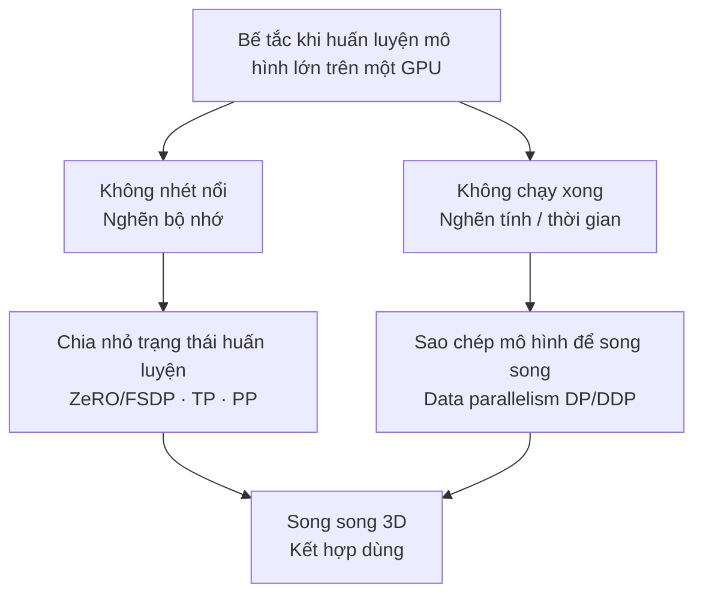
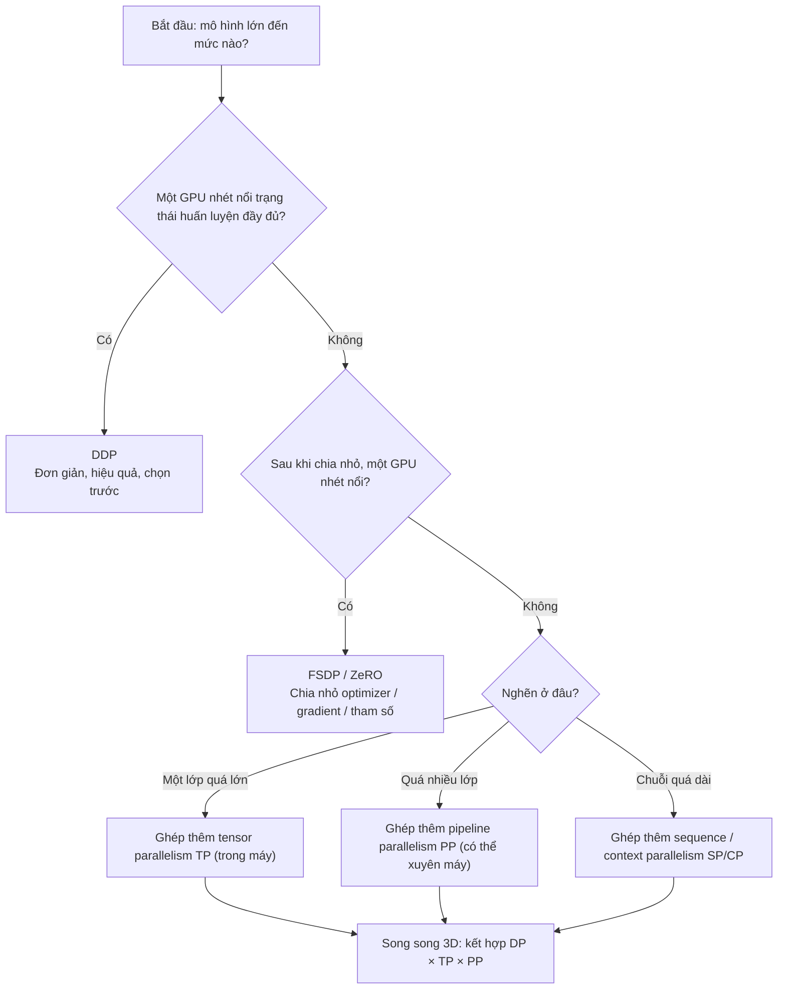

Trước khi lao vào DDP, ZeRO, tensor parallelism và các kỹ thuật cụ thể khác, hãy dựng bản đồ nhận thức trước: một GPU đơn kẹt ở đâu, huấn luyện thực sự nuốt bao nhiêu bộ nhớ, mỗi chiến lược song song đang giải quyết gì. Bài này dùng số cụ thể để tính tay sổ cái bộ nhớ, rồi khảo sát năm chiến lược và nguyên tắc chọn, để bạn biết rõ mỗi chương sau "đang giải quyết vấn đề gì".

<!-- more -->

## 📑 Mục lục

- [1. Vì sao cần huấn luyện phân tán: không nhét nổi và không chạy xong](#1-vì-sao-cần-huấn-luyện-phân-tán-không-nhét-nổi-và-không-chạy-xong)
- [2. Sổ cái bộ nhớ huấn luyện: tính một lần là hiểu](#2-sổ-cái-bộ-nhớ-huấn-luyện-tính-một-lần-là-hiểu)
- [3. Toàn cảnh năm chiến lược song song](#3-toàn-cảnh-năm-chiến-lược-song-song)
- [4. Nguyên tắc chọn chiến lược song song](#4-nguyên-tắc-chọn-chiến-lược-song-song)
- [Tóm tắt](#-tóm-tắt)
- [Checklist tự kiểm](#-checklist-tự-kiểm)
- [Tài liệu tham khảo](#-tài-liệu-tham-khảo)

---

## 1. Vì sao cần huấn luyện phân tán: không nhét nổi và không chạy xong

Huấn luyện mạng nơ-ron về bản chất là lặp lại "forward tính loss → backward tính gradient → optimizer cập nhật tham số". Khi mô hình nhỏ, một GPU chứa hết và chạy nhanh, chẳng cần phân tán. Nhưng khi mô hình phình tới hàng trăm tỷ, hàng nghìn tỷ tham số, một GPU đụng tường cùng lúc trên hai trục.

🔑 **Khái niệm cốt lõi**: Huấn luyện phân tán chưa bao giờ chỉ giải một vấn đề, mà là hai vấn đề độc lập: **bộ nhớ không nhét nổi** (không gian) và **thời gian không chạy xong** (tốc độ). Thấy rõ sự khác biệt này là tiền đề để hiểu mọi chiến lược song song.

Ví dụ: huấn luyện mô hình lớn trên một GPU giống nhờ một người dùng chiếc bàn làm việc nhỏ để sắp cả một thư viện. **Bàn quá nhỏ, trải sách không nổi** (thiếu bộ nhớ), và **một người chuyển cả đời cũng không hết** (thiếu sức tính). Hai cảnh kẹt giải khác nhau: cái trước cần "tách ra nhiều bàn", cái sau cần "gọi thêm người cùng chuyển".

### 1.1 Không nhét nổi: nghẽn bộ nhớ

Nhiều người trực giác rằng "bao nhiêu tham số thì chiếm bấy nhiêu bộ nhớ". Đó là đánh giá thấp nghiêm trọng. Bộ nhớ khi huấn luyện còn xa hơn bản thân tham số (mục sau tính chi tiết). Nói thô: với BF16 mixed precision + Adam, **mỗi tham số cần khoảng 16–18 byte bộ nhớ tĩnh**. Ước với dòng LLaMA (chỉ bộ nhớ tĩnh, chưa kể activation):

| 📊 Quy mô mô hình | Số tham số $\Psi$ | Bộ nhớ tĩnh $\approx 16\Psi$ | Một H100 80GB có nhét nổi không |
|------------|--------------|--------------------------|--------------------------|
| LLaMA 7B | $7 \times 10^9$ | $\approx 112$ GB | ❌ Không nhét nổi |
| LLaMA 70B | $70 \times 10^9$ | $\approx 1120$ GB | ❌ Vượt xa |
| LLaMA 405B | $405 \times 10^9$ | $\approx 6480$ GB | ❌ Cần hàng chục GPU |

⚠️ **Lưu ý**: Ngay cả 7B "nhỏ", riêng bộ nhớ tĩnh đã khoảng 112 GB, **đã vượt 80 GB của một H100**, chưa kể activation chất đống trong forward. Đó là động lực thứ nhất: **quy mô mô hình vượt dung lượng bộ nhớ một GPU**.

### 1.2 Không chạy xong: nghẽn tính toán và thời gian

Dù bộ nhớ vô hạn, một GPU vẫn còn cửa "tính quá chậm". Lượng tính của huấn luyện mô hình lớn có công thức kinh nghiệm được trích dẫn rộng ($C$ là tổng số phép toán dấu phẩy động, $\Psi$ là số tham số, $D$ là số token huấn luyện):

$$
C \approx 6 \Psi D
$$

Con số "6" đến từ forward khoảng 2 lần, backward khoảng 4 lần lượng nhân-cộng theo số tham số. Thế vào mô hình 70B huấn luyện 1T ($10^{12}$) token:

$$
C \approx 6 \times (70 \times 10^9) \times 10^{12} = 4.2 \times 10^{23} \text{ FLOPs}
$$

Peak BF16 của một H100 khoảng $10^{15}$ FLOP/s. Giả sử lạc quan MFU 50\%:

$$
T = \frac{4.2 \times 10^{23}}{10^{15} \times 0.5} \approx 8.4 \times 10^8 \text{ giây} \approx 26.6 \text{ năm}
$$

💡 **Gợi ý**: Một GPU huấn luyện 70B mất hơn hai mươi năm; chờ xong thì kiến trúc mô hình đã đổi vài thế hệ. Với data parallelism $N$ GPU, về lý thuyết có thể nén thời gian gần $1/N$; 1024 GPU đưa về khoảng 9 ngày. Đó là động lực thứ hai: **sức tính một GPU không đủ để hoàn thành huấn luyện trong thời gian chấp nhận được**.

📌 **Điểm quan trọng**: Hai nghẽn giải theo hướng khác nhau. "Không nhét nổi" dựa vào **chia nhỏ trạng thái** (tách một thứ ra nhiều GPU). "Không chạy xong" dựa vào **sao chép để song song** (mỗi GPU làm một phần việc). Các chiến lược sau cũng thuộc một trong hai nhánh này.

## 2. Sổ cái bộ nhớ huấn luyện: tính một lần là hiểu

Đây là trọng tâm chương. Ta tách "huấn luyện thực sự nuốt bao nhiêu bộ nhớ" từng mục, tự tính sổ cho mô hình 7B, sau này ước bất kỳ quy mô nào cũng có số trong đầu.

Bộ nhớ huấn luyện chia **bộ nhớ tĩnh** (không phụ thuộc bước huấn luyện, luôn trú) và **bộ nhớ activation** (biến theo batch / độ dài chuỗi).

### 2.1 Bốn thành phần bộ nhớ tĩnh

Lấy cấu hình phổ biến nhất: **BF16 mixed precision + Adam**. Gọi số tham số là $\Psi$, phân tích từng mục (đơn vị: Bytes):

| Thành phần | Độ chính xác | Byte mỗi tham số | Giải thích |
|------|------|-----------|------|
| Tham số mô hình | BF16 | $2\Psi$ | Bản làm việc cho forward/backward |
| Gradient | BF16 | $2\Psi$ | Sinh ra từ backward, cùng shape với tham số |
| Optimizer: bản sao tham số FP32 | FP32 | $4\Psi$ | Master weight độ chính xác cao mà Adam giữ |
| Optimizer: mô-men bậc nhất $m$ | FP32 | $4\Psi$ | Trung bình trượt mũ của gradient |
| Optimizer: mô-men bậc hai $v$ | FP32 | $4\Psi$ | Trung bình trượt mũ của bình phương gradient |

Cộng ba mục optimizer được $12\Psi$ nổi tiếng của Adam. Tổng bộ nhớ tĩnh:

$$
M\_{\text{static}} = \underbrace{2\Psi}\_{\text{params}} + \underbrace{2\Psi}\_{\text{grads}} + \underbrace{12\Psi}\_{\text{Adam state}} = 16\Psi \text{ Bytes}
$$

🔑 **Khái niệm cốt lõi**: "Phần lớn" bộ nhớ huấn luyện thực ra là **trạng thái optimizer** ($12\Psi$, chiếm 12 trong 16), chứ không phải bản thân tham số. Đó là lý do ZeRO cắt trạng thái optimizer ngay nhát đầu: đó là chỗ đáng cắt nhất về tỷ lệ lợi ích.

⚠️ **Lưu ý**: Nhiều tài liệu viết "16–18 byte mỗi tham số"; khoảng 16–20 đến từ khác biệt triển khai (có giữ thêm bản gradient FP32 không, có tích lũy master gradient FP32 không, v.v.). Bài này dùng cấu hình BF16 mixed precision kinh điển, ghi $16\Psi$ là đủ.

### 2.2 Tính tay bộ nhớ tĩnh mô hình 7B

Thế $\Psi = 7 \times 10^9$:

$$
M\_{\text{static}} = 16 \times 7 \times 10^9 = 1.12 \times 10^{11} \text{ Bytes} \approx 112 \text{ GB}
$$

Nhìn từng mục trực quan hơn:

- Tham số: $2 \times 7\text{B} = 14$ GB
- Gradient: $2 \times 7\text{B} = 14$ GB
- Trạng thái optimizer: $12 \times 7\text{B} = 84$ GB
- **Tổng ≈ 112 GB**

Một H100 chỉ có 80 GB; **riêng bộ nhớ tĩnh đã không nhét nổi**.

### 2.3 Đừng quên activation

Activation là kết quả trung gian giữ lại từ forward để phục vụ backward. Chúng **tăng tuyến tính / siêu tuyến tính theo batch size $b$ và độ dài chuỗi $s$**, và là "sát thủ bộ nhớ" thật sự trong huấn luyện chuỗi dài, batch lớn.

Với Transformer, bậc kích thước activation một lớp thô khoảng tỷ lệ với $b \cdot s \cdot h$ ($h$ là hidden dim); cả mô hình nhân thêm số lớp $L$. Công thức chính xác còn liên quan lượng trung gian attention, có bật Activation Checkpointing hay không, v.v. Ở đây chỉ cần dựng trực giác:

📌 **Điểm quan trọng**: Bộ nhớ tĩnh chỉ phụ thuộc số tham số, là "chi phí cố định"; activation phụ thuộc $b$, $s$, là "chi phí điều chỉnh được". Khi OOM, nghĩ trước đến giảm batch, bật gradient accumulation hoặc Activation Checkpointing để nén activation; đó là chủ đề Chương 8.

### 2.4 Bảng tra nhanh ước lượng bộ nhớ

| 📊 Hạng mục | Công thức (Bytes) | Phụ thuộc |
|---------|--------------|--------|
| Tham số | $2\Psi$ | Số tham số |
| Gradient | $2\Psi$ | Số tham số |
| Trạng thái Adam | $12\Psi$ | Số tham số |
| **Tổng tĩnh** | $\mathbf{16\Psi}$ | Số tham số |
| Activation | $\propto b \cdot s \cdot h \cdot L$ | batch / chuỗi / rộng-sâu mô hình |

Nhớ bảng này, với bất kỳ số tham số nào cũng ước được cận dưới bộ nhớ huấn luyện trong khoảng 30 giây.

## 3. Toàn cảnh năm chiến lược song song

Đã biết nghẽn ở đâu, bộ nhớ tiêu ở đâu, tiếp theo khảo sát năm chiến lược song song phổ biến. Bản chất mỗi chiến lược đều trả lời hai câu: **cắt cái gì** (có tiết kiệm bộ nhớ không) và **giao tiếp thế nào** (có nhanh không).

| Chiến lược | ✂️ Cắt gì | 📡 Giao tiếp chính | 🎯 Vấn đề giải quyết |
|------|----------|-----------|--------------|
| Data parallelism DP/DDP | Cắt dữ liệu, không cắt mô hình | Gradient AllReduce | Không chạy xong (tăng tốc) |
| ZeRO / FSDP | Cắt optimizer / gradient / tham số | ReduceScatter + AllGather | Không nhét nổi (tiết kiệm bộ nhớ) |
| Tensor parallelism TP | Cắt phép nhân ma trận trong một lớp | AllReduce trong lớp | Một lớp quá lớn |
| Pipeline parallelism PP | Cắt lớp mạng (theo chiều sâu) | Truyền activation giữa các đoạn (P2P) | Quá nhiều lớp |
| Sequence parallelism SP / context parallelism CP | Cắt theo chiều chuỗi | AllGather / All-to-All trên chiều chuỗi | Chuỗi quá dài |

Dựng trực giác từng cái:

- **Data parallelism (DP/DDP)**: Mỗi GPU một bản mô hình đầy đủ, mỗi cái tính trên shard dữ liệu của mình, backward thì AllReduce đồng bộ gradient. Nó **không tiết kiệm bộ nhớ** (mỗi GPU vẫn chứa mô hình đầy đủ), nhưng tăng tốc gần tuyến tính; chủ công "không chạy xong".
- **ZeRO / FSDP**: Bản "tối ưu bộ nhớ" của DDP. Đã vậy mỗi GPU đều lưu cùng một bản optimizer state / gradient / tham số y hệt, thì chia nhỏ lưu trữ, lúc cần mới AllGather ghép lại; chủ công "không nhét nổi".
- **Tensor parallelism (TP)**: Cắt ma trận trọng số của một lớp (ví dụ một Linear lớn) theo hàng/cột ra nhiều GPU, mỗi GPU tính một phần rồi gộp. Giao tiếp dày và lượng lớn, nên **chỉ hợp NVLink trong máy**; giải "một lớp quá lớn".
- **Pipeline parallelism (PP)**: Cắt mô hình theo lớp thành vài đoạn, mỗi đoạn đặt một máy / một nhóm máy, activation chảy giữa các đoạn như dây chuyền. Lượng giao tiếp nhỏ (chỉ truyền activation), **có thể xuyên máy**; giải "quá nhiều lớp".
- **Sequence parallelism / context parallelism (SP/CP)**: Cắt theo chiều độ dài chuỗi để nhét được context siêu dài (ví dụ 128K); giải "chuỗi quá dài".

## 4. Nguyên tắc chọn chiến lược song song

Có toàn cảnh rồi, chọn thế nào? Cốt lõi chỉ một câu: **băng thông giao tiếp quyết định phạm vi tác dụng của chiến lược**.

### 4.1 Băng thông quyết định "ai phải ở trong máy, ai có thể xuyên máy"

Băng thông các loại liên kết chênh khoảng một bậc độ lớn, trực tiếp quyết định chiến lược giao tiếp dày chỉ đặt được ở đâu:

| Liên kết | Bậc băng thông | Chiến lược phù hợp |
|------|---------|---------|
| NVLink / NVSwitch (trong máy) | Hàng trăm GB/s (ví dụ NVLink 900 GB/s) | TP (giao tiếp dày nhất, phải trong máy) |
| InfiniBand / RoCE (giữa máy) | Hàng trăm Gbps (ví dụ 400 Gbps ≈ 50 GB/s) | PP, DP (giao tiếp thưa, có thể xuyên máy) |
| Ethernet | Thấp hơn | Chỉ DP kiểu giao tiếp tần suất thấp là tạm dùng được |

📌 **Điểm quan trọng**: TP mỗi lớp forward/backward đều phải AllReduce, giao tiếp cực dày; đặt lên băng thông xuyên máy sẽ bị giao tiếp kéo chậm, nên **TP gần như luôn bị giới hạn trong 8 GPU một máy**. PP chỉ truyền activation ở biên đoạn; DP mỗi bước chỉ đồng bộ gradient một lần; cả hai đều có thể xuyên máy. Đó là căn cứ gốc của bố cục song song 3D.

### 4.2 Một cây quyết định thực dụng

✅ **Đường đi khuyến nghị**: Bắt đầu từ phương án đơn giản nhất mà đủ dùng, thiếu mới thêm chiều. Một GPU nhét nổi thì DDP; không nhét nổi thì lên FSDP/ZeRO trước; vẫn không được thì theo nghẽn chồng TP/PP/CP; tầm trăm tỷ mới cần bộ song song 3D đầy đủ.

❌ **Không khuyến nghị**: Lao vào chồng song song 3D ngay từ đầu. Mỗi thêm một chiều song song đều tăng rõ độ phức tạp debug và chi phí giao tiếp; tối ưu sớm thường không đáng.

## 📝 Tóm tắt

- Huấn luyện phân tán giải hai vấn đề độc lập: bộ nhớ "không nhét nổi" (chia nhỏ trạng thái) và thời gian "không chạy xong" (sao chép để song song).
- Bộ nhớ tĩnh khi huấn luyện $= 16\Psi$ Bytes (tham số $2\Psi$ + gradient $2\Psi$ + trạng thái Adam $12\Psi$); phần lớn là trạng thái optimizer. Mô hình 7B chỉ riêng tĩnh đã khoảng 112 GB, vượt một H100.
- Activation tăng theo batch / độ dài chuỗi, là chi phí điều chỉnh được; khi OOM ưu tiên nén từ đây (giảm batch, gradient accumulation, Activation Checkpointing).
- Năm chiến lược mỗi cái một việc: DP/DDP tranh thời gian, ZeRO/FSDP tiết kiệm bộ nhớ, TP cắt một lớp, PP cắt số lớp, SP/CP cắt chuỗi.
- Chọn chiến lược cốt ở "băng thông quyết định phạm vi": TP phải NVLink trong máy, PP/DP có thể xuyên máy; theo cây "đủ dùng thì thôi, thiếu mới thêm chiều" nâng dần lên song song 3D.

## 🎯 Checklist tự kiểm

- Nói được trong một câu hai vấn đề độc lập mà huấn luyện phân tán giải, và hướng giải của từng cái
- Viết được từng thành phần bộ nhớ tĩnh của BF16 + Adam, và giải thích vì sao là $16\Psi$
- Tính tay được bộ nhớ tĩnh cho một số tham số cho trước, và phán đoán một GPU có nhét nổi không
- Dùng $C \approx 6\Psi D$ ước tổng lượng tính và suy ra thời gian một GPU
- Vẽ được bảng so sánh năm chiến lược theo "cắt gì × giao tiếp thế nào × giải gì"
- Giải thích được vì sao TP phải ở trong máy còn PP/DP có thể xuyên máy
- Theo cây quyết định, từ quy mô mô hình và topology cluster chọn được tổ hợp song song phù hợp

## 📚 Tài liệu tham khảo

- [Scaling Laws for Neural Language Models](https://arxiv.org/abs/2001.08361)
- [LLaMA: Open and Efficient Foundation Language Models](https://arxiv.org/abs/2302.13971)
- [ZeRO: Memory Optimizations Toward Training Trillion Parameter Models](https://arxiv.org/abs/1910.02054)
- [Reducing Activation Recomputation in Large Transformer Models](https://arxiv.org/abs/2205.05198)
- [Megatron-LM: Training Multi-Billion Parameter Language Models Using Model Parallelism](https://arxiv.org/abs/1909.08053)
