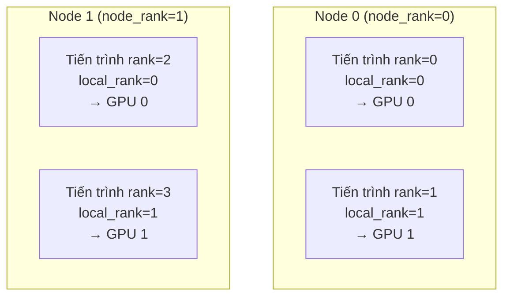
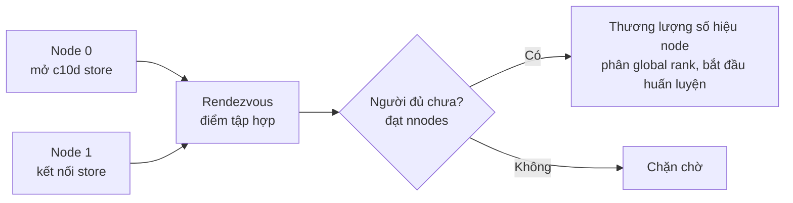
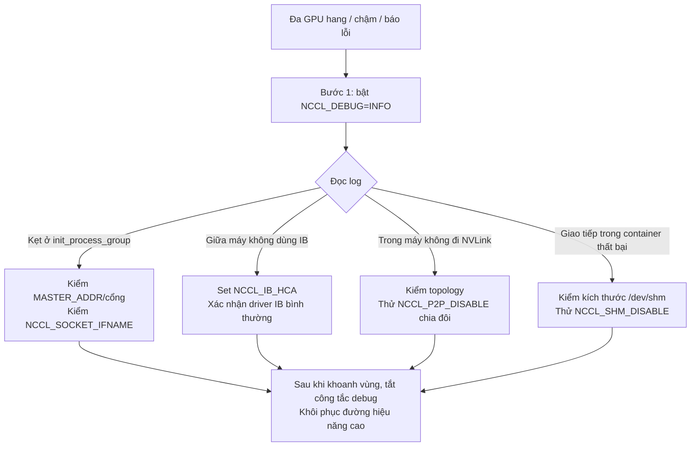
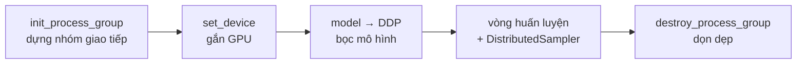

Mục trước dựng bản đồ nhận thức từ sổ cái bộ nhớ và toàn cảnh song song; mục này hạ xuống nền móng kỹ thuật: trước khi chạy bất kỳ chiến lược song song nào, phải làm rõ chuyện giản dị nhất — nhiều GPU "lập đội" thế nào, và làm sao bằng một lệnh kéo cả đống tiến trình lên, để chúng biết nhau là ai? Mục này bắt đầu từ mô hình tiến trình, giảng thấu rank / local_rank / world_size (bộ khái niệm xuyên suốt mọi chương sau), nói rõ cơ chế khởi chạy và rendezvous của torchrun, biến môi trường debug NCCL, cuối cùng ghép thành một script DDP tối thiểu thật sự chạy được. Đọc xong bạn có thể tự chạy thông lần huấn luyện đa GPU đầu tiên, và hiểu môi trường chạy mặc định của mọi chương sau.

<!-- more -->

## 📑 Mục lục

- [Phần 1: Process group và khái niệm cốt lõi](#phần-1-process-group-và-khái-niệm-cốt-lõi)
  - [1. Từ một GPU đến đa máy: ba quy mô và topology phần cứng](#1-từ-một-gpu-đến-đa-máy-ba-quy-mô-và-topology-phần-cứng)
  - [2. Mô hình tiến trình: vì sao "một GPU một tiến trình"](#2-mô-hình-tiến-trình-vì-sao-một-gpu-một-tiến-trình)
  - [3. Khái niệm cốt lõi: rank / local_rank / world_size](#3-khái-niệm-cốt-lõi-rank--local_rank--world_size)
  - [4. Process group](#4-process-group)
  - [5. Nhóm giao tiếp con: mở đường cho song song 3D](#5-nhóm-giao-tiếp-con-mở-đường-cho-song-song-3d)
- [Phần 2: Cơ chế khởi chạy torchrun](#phần-2-cơ-chế-khởi-chạy-torchrun)
  - [6. Vì sao cần launcher riêng](#6-vì-sao-cần-launcher-riêng)
  - [7. Từ torch.distributed.launch đến torchrun](#7-từ-torchdistributedlaunch-đến-torchrun)
  - [8. Các biến môi trường torchrun tiêm vào](#8-các-biến-môi-trường-torchrun-tiêm-vào)
  - [9. Khởi chạy đa GPU một máy](#9-khởi-chạy-đa-gpu-một-máy)
  - [10. Khởi chạy đa máy đa GPU và Rendezvous](#10-khởi-chạy-đa-máy-đa-gpu-và-rendezvous)
  - [11. Khả năng đàn hồi và chịu lỗi của torchrun](#11-khả-năng-đàn-hồi-và-chịu-lỗi-của-torchrun)
- [Phần 3: Biến môi trường NCCL và debug giao tiếp](#phần-3-biến-môi-trường-nccl-và-debug-giao-tiếp)
  - [12. NCCL là gì và vì sao phải chỉnh nó](#12-nccl-là-gì-và-vì-sao-phải-chỉnh-nó)
  - [13. Chiêu debug đầu tiên: NCCL_DEBUG](#13-chiêu-debug-đầu-tiên-nccl_debug)
  - [14. Chỉ định NIC và thiết bị IB](#14-chỉ-định-nic-và-thiết-bị-ib)
  - [15. Công tắc debug: P2P và SHM](#15-công-tắc-debug-p2p-và-shm)
  - [16. CUDA_VISIBLE_DEVICES và gắn thiết bị](#16-cuda_visible_devices-và-gắn-thiết-bị)
  - [17. Một quy trình tra cứu sự cố nhanh](#17-một-quy-trình-tra-cứu-sự-cố-nhanh)
- [Phần 4: Viết script huấn luyện đa GPU đầu tiên](#phần-4-viết-script-huấn-luyện-đa-gpu-đầu-tiên)
  - [18. Khung năm đoạn của script DDP tối thiểu](#18-khung-năm-đoạn-của-script-ddp-tối-thiểu)
  - [19. Mẫu đầy đủ chạy được](#19-mẫu-đầy-đủ-chạy-được)
  - [20. Tách từng đoạn](#20-tách-từng-đoạn)
  - [21. Thói quen kỹ thuật: chỉ rank 0 làm việc phụ](#21-thói-quen-kỹ-thuật-chỉ-rank-0-làm-việc-phụ)
  - [22. Các hố thường gặp lần đầu chạy đa GPU](#22-các-hố-thường-gặp-lần-đầu-chạy-đa-gpu)
- [Tóm tắt](#-tóm-tắt)
- [Checklist tự kiểm](#-checklist-tự-kiểm)
- [Tài liệu tham khảo](#-tài-liệu-tham-khảo)

---

# Phần 1: Process group và khái niệm cốt lõi

## 1. Từ một GPU đến đa máy: ba quy mô và topology phần cứng

Quy mô phần cứng huấn luyện phân tán thường chia ba bậc. Hiểu khác biệt giữa chúng mới biết vì sao các chiến lược sau phải phân "trong máy" và "giữa máy".

| 📊 Quy mô | Cấu hình điển hình | Cách liên kết | Kịch bản điển hình |
|---------|---------|---------|---------|
| Một máy một GPU | 1 GPU | — | Debug, prototype mô hình nhỏ |
| Một máy đa GPU | 8 GPU / node | NVLink / NVSwitch | Huấn luyện mô hình vừa, tensor parallelism |
| Đa máy đa GPU | N node × 8 GPU | InfiniBand / RoCE | Mô hình lớn hàng chục–hàng trăm tỷ tham số |

Nhận thức then chốt nhất là **phân tầng băng thông**: GPU trong cùng một máy nối bằng NVLink, băng thông có thể hàng trăm GB/s; xuyên máy đi InfiniBand, băng thông chỉ còn khoảng vài phần đến một phần mười so với trong máy. Chênh lệch này trực tiếp quyết định "chiến lược giao tiếp dày nào chỉ được đặt trong máy".

Ví dụ: đồng nghiệp trong cùng tòa có thể đi sang nói trực tiếp (NVLink, trong máy); đội ở khác thành phố chỉ họp video (InfiniBand, giữa máy) — việc nói trực tiếp được thì đừng họp từ xa; đó cũng là trực giác cơ bản khi bố cục chiến lược song song.

## 2. Mô hình tiến trình: vì sao "một GPU một tiến trình"

Mô hình khuyến nghị của PyTorch distributed là **một GPU tương ứng một tiến trình hệ điều hành độc lập** (one process per GPU). Nhiều người mới học thắc mắc: vì sao không dùng một tiến trình đa luồng, để một tiến trình quản 8 GPU?

Có hai lý do:

🔑 **Khái niệm cốt lõi**: Bản chất một GPU một tiến trình là "dùng cách ly tiến trình để né hạn chế đồng thời của Python, và để mỗi GPU độc chiếm CUDA context của mình".

- **Né GIL**: Global Interpreter Lock (GIL) của Python khiến nhiều luồng trong cùng một tiến trình không thể thực sự song song hóa bytecode Python. Nếu dùng đa luồng lái đa GPU, logic lập lịch bị GIL tuần tự hóa, khó nuôi no các GPU. Đa tiến trình thì mỗi cái một interpreter, không tranh khóa.
- **Độc chiếm CUDA context**: Mỗi tiến trình gắn một GPU, có CUDA context và không gian bộ nhớ sạch của riêng mình; logic rõ, không can thiệp lẫn nhau, crash cũng chỉ ảnh hưởng một tiến trình.

📌 **Điểm quan trọng**: `DataParallel` thời đầu (một tiến trình, đa luồng, đa GPU) đúng là vấp ở GIL và tải không đều trên GPU chính, nên huấn luyện hiện đại toàn chuyển sang `DistributedDataParallel` kiểu "một GPU một tiến trình".

## 3. Khái niệm cốt lõi: rank / local_rank / world_size

Đã là đa tiến trình thì cần đánh số mỗi tiến trình, để chúng biết "tôi là ai, tổng cộng bao nhiêu, tôi dùng GPU nào". Đó là ba khái niệm cốt lõi nhất.



Hình trên là ví dụ 2 máy × 2 GPU (tổng 4 tiến trình). Đối chiếu ba khái niệm:

- **`rank` (global rank)**: Số hiệu toàn cục duy nhất của tiến trình trong cả job huấn luyện, khoảng $0 \sim \text{world\_size}-1$. Trong hình bốn tiến trình lần lượt là rank 0, 1, 2, 3. Thường dùng `rank == 0` để chỉ định "tiến trình chính", chịu in log, lưu mô hình, v.v.
- **`local_rank` (local rank)**: Số hiệu của tiến trình **bên trong node mà nó đứng**. Vai trò cốt lõi là **quyết định gắn GPU nào** — thường `torch.cuda.set_device(local_rank)` trực tiếp. Chú ý hai tiến trình trên Node 1: global rank là 2, 3 nhưng local_rank đếm lại từ 0.
- **`world_size`**: Tổng số tiến trình tham gia huấn luyện; ví dụ trên là 4. Nó bằng `số node × số tiến trình mỗi node`.

💡 **Gợi ý**: Người mới dễ lẫn nhất là dùng `rank` để `set_device`. Trong kịch bản đa máy sẽ vượt chỉ số — `rank=2` trên máy thứ hai chẳng có "GPU số 2". **Thứ quyết định gắn GPU luôn là local_rank, không phải rank**.

Quan hệ quy đổi (số tiến trình mỗi node ký hiệu $G$):

$$
\text{rank} = \text{node\_rank} \times G + \text{local\_rank}
$$

$$
\text{world\_size} = \text{nnodes} \times G
$$

## 4. Process group

Có số hiệu rồi, tiến trình còn cần một "kênh giao tiếp đã thỏa thuận" mới gửi-nhận dữ liệu với nhau được. Kênh đó gọi là **process group (nhóm tiến trình)**. Trước mọi giao tiếp phân tán, mỗi tiến trình phải gọi `init_process_group` để gia nhập nhóm.

```python
import os
import torch
import torch.distributed as dist

def setup():
    # torchrun sẽ tiêm các biến môi trường này vào
    rank = int(os.environ["RANK"])
    local_rank = int(os.environ["LOCAL_RANK"])
    world_size = int(os.environ["WORLD_SIZE"])

    # 1) Gắn GPU mà tiến trình này dùng (dùng local_rank!)
    torch.cuda.set_device(local_rank)

    # 2) Khởi tạo process group mặc định; huấn luyện GPU dùng backend nccl
    dist.init_process_group(
        backend="nccl",
        rank=rank,
        world_size=world_size,
    )
    return rank, local_rank, world_size

def cleanup():
    dist.destroy_process_group()
```

Hai điểm đáng mở rộng:

**Chọn backend**: `backend` quyết định thư viện giao tiếp tầng dưới; hai loại phổ biến:

| 🔧 Backend | Thiết bị phù hợp | Công dụng |
|---------|---------|------|
| `nccl` | GPU | Chuẩn thực tế cho giao tiếp giữa GPU, hiệu năng tốt nhất, lựa chọn đầu cho huấn luyện |
| `gloo` | CPU (cũng hỗ trợ GPU) | Giao tiếp tensor CPU, hoặc debug khi bất tiện dùng NCCL |

⚠️ **Lưu ý**: Huấn luyện GPU gần như luôn chọn `nccl`. NCCL được tối ưu sâu cho NVLink / InfiniBand, là then chốt để AllReduce và các collective sau chạy đầy băng thông.

**Khởi tạo sẽ "chặn chờ"**: `init_process_group` là một điểm đồng bộ — nó **đợi đủ world_size tiến trình đều tới dòng này** rồi mới trả về. Nếu một tiến trình không lên (ví dụ một máy chưa chạy lệnh), các tiến trình còn lại sẽ kẹt mãi ở đây. Đó cũng là một trong những nguyên nhân "huấn luyện hang" phổ biến nhất.

## 5. Nhóm giao tiếp con: mở đường cho song song 3D

Đến giờ ta chỉ có một "process group mặc định", mọi tiến trình đều ở trong đó. Nhưng huấn luyện mô hình lớn thật sự dùng đồng thời nhiều kiểu song song (data parallelism DP + tensor parallelism TP + pipeline parallelism PP, tức song song 3D), và **mỗi kiểu song song cần miền giao tiếp độc lập của riêng nó**.

Ví dụ 8 GPU: giả sử tensor parallel = 2, data parallel = 4. Khi đó:

- Nhóm TP: mỗi 2 GPU kề nhau thành một nhóm TP → `{0,1}`, `{2,3}`, `{4,5}`, `{6,7}`; trong nhóm AllReduce để gộp các lát ma trận
- Nhóm DP: các GPU cùng vị trí TP xuyên các nhóm TP thành nhóm DP → `{0,2,4,6}`, `{1,3,5,7}`; trong nhóm AllReduce gradient

Các nhóm con được sinh từ nhóm toàn cục bằng `dist.new_group()`:

```python
# 8 GPU, TP=2, DP=4 chia nhóm con (phác thảo đơn giản)
tp_size, dp_size = 2, 4
rank = dist.get_rank()

# Dựng nhóm TP mà tiến trình này thuộc về
tp_group_ranks = [
    list(range(i, i + tp_size))
    for i in range(0, tp_size * dp_size, tp_size)
]  # [[0,1],[2,3],[4,5],[6,7]]

tp_group = None
for ranks in tp_group_ranks:
    group = dist.new_group(ranks=ranks)  # mọi tiến trình phải thực hiện cùng các lời gọi new_group
    if rank in ranks:
        tp_group = group  # chỉ giữ handle của nhóm mình thuộc về

# Sau này giao tiếp trong TP truyền tường minh group=tp_group
# dist.all_reduce(tensor, group=tp_group)
```

📌 **Điểm quan trọng**: `new_group` phải được **mọi tiến trình** gọi (kể cả tiến trình không thuộc nhóm đó), nếu không sẽ deadlock. Mỗi tiến trình cuối cùng chỉ giữ handle của "nhóm con mình thuộc về", và khi giao tiếp dùng tham số `group=` để chỉ định miền nào.

Cơ chế nhóm giao tiếp con này là nền của Chương 11 «Song song 3D». Giờ chỉ cần dựng trực giác: **nhóm toàn cục là sân khấu lớn, nhóm con là các phòng tập; các chiều song song khác nhau giao tiếp trong phòng của mình mà không đụng nhau.**

# Phần 2: Cơ chế khởi chạy torchrun

Đã viết xong script kiểu một GPU một tiến trình, còn thiếu bước cuối: làm sao bằng một lệnh kéo cả đống tiến trình lên, và để chúng biết nhau là ai? Phần này giảng rõ sự tiến hóa launcher của PyTorch từ `launch` sang `torchrun`, các biến môi trường nó tiêm vào, cùng cách khởi chạy và cơ chế rendezvous ở hai kịch bản một máy đa GPU và đa máy đa GPU.

## 6. Vì sao cần launcher riêng

Nhắc lại: một GPU một tiến trình nghĩa là huấn luyện 8 GPU phải khởi 8 tiến trình; mỗi tiến trình phải biết `rank`, `local_rank`, `world_size` của mình, và biết đi đâu để tìm "node chính" mà hội.

Nếu khởi tay, bạn phải mở 8 terminal, mỗi cái `RANK=0 ... python train.py`, `RANK=1 ... python train.py`… — đã phiền trên một máy, đa máy còn là ác mộng. **Vai trò của launcher là dùng một lệnh kéo hàng loạt tiến trình lên, và tự nhét vào mỗi tiến trình các biến môi trường mà nó cần biết.**

Ví dụ: launcher giống một trưởng đoàn, hét một tiếng là cả đội xếp hàng theo số, thay vì bạn đi từng người thông báo "bạn là số 3, báo cáo khu B".

## 7. Từ torch.distributed.launch đến torchrun

Launcher của PyTorch trải qua một lần đổi thế hệ:

| 🔧 Launcher | Trạng thái | Đặc điểm |
|-----------|------|------|
| `python -m torch.distributed.launch` | ❌ Đã deprecated | API cũ, truyền bằng tham số CLI `--local_rank`, không có đàn hồi |
| `torchrun` | ✅ Khuyến nghị hiện tại | Tiêm biến môi trường, có Elastic training sẵn, tự restart, Rendezvous |

⚠️ **Lưu ý**: Code cũ thường có `parser.add_argument("--local_rank")` để nhận tham số từ launch. Sau khi chuyển sang `torchrun`, `local_rank` đọc từ biến môi trường `os.environ["LOCAL_RANK"]`, và bỏ hẳn đường tham số CLI đó.

`torchrun` về bản chất là entry console của module `torch.distributed.run`; hai cách tương đương:

```bash
torchrun --nproc_per_node=8 train.py
# hoàn toàn tương đương
python -m torch.distributed.run --nproc_per_node=8 train.py
```

## 8. Các biến môi trường torchrun tiêm vào

Khi `torchrun` kéo mỗi tiến trình con lên, nó ghi một bộ thông tin then chốt vào biến môi trường của tiến trình đó. Script chỉ cần đọc, không cần tự tính:

| Biến môi trường | Ý nghĩa | Cách dùng điển hình |
|---------|------|---------|
| `RANK` | Số hiệu tiến trình toàn cục | `rank` của `dist.init_process_group` |
| `LOCAL_RANK` | Số hiệu tiến trình trong node | `torch.cuda.set_device(local_rank)` |
| `WORLD_SIZE` | Tổng số tiến trình | Khởi tạo process group |
| `LOCAL_WORLD_SIZE` | Số tiến trình trên node này | Tính mức chiếm tài nguyên máy |
| `MASTER_ADDR` | IP / hostname node chính | Địa chỉ "điểm tập hợp" để rendezvous |
| `MASTER_PORT` | Cổng node chính | Cổng rendezvous (phải trống) |

Vì vậy cách đọc chuẩn trong script là:

```python
import os

rank = int(os.environ["RANK"])
local_rank = int(os.environ["LOCAL_RANK"])
world_size = int(os.environ["WORLD_SIZE"])
```

💡 **Gợi ý**: `MASTER_ADDR` / `MASTER_PORT` thường bạn không cần đọc tay trong script — với cách khởi tạo `env://` (mặc định), `init_process_group(backend="nccl")` tự đọc địa chỉ rendezvous từ hai biến môi trường đó. `torchrun` đã set sẵn cho bạn.

## 9. Khởi chạy đa GPU một máy

Kịch bản một máy đơn giản nhất: chỉ cần chỉ định máy này khởi bao nhiêu tiến trình (thường bằng số GPU):

```bash
torchrun --nproc_per_node=8 train.py --epochs 10 --lr 1e-4
```

- `--nproc_per_node=8`: máy này khởi 8 tiến trình, tương ứng 8 GPU
- Tham số sau `train.py` được truyền nguyên xi vào script của bạn

Đằng sau một lệnh đó, `torchrun` làm: khởi 8 tiến trình `train.py` → lần lượt ghi `RANK=0..7`, `LOCAL_RANK=0..7`, `WORLD_SIZE=8` → set `MASTER_ADDR=127.0.0.1` và một `MASTER_PORT` trống → để chúng rendezvous trên máy này.

📌 **Điểm quan trọng**: Trên một máy đa GPU, `RANK` và `LOCAL_RANK` tình cờ bằng nhau (chỉ một node), nên lúc debug một máy dùng cái nào cũng "trông đúng". Một khi lên đa máy, đẳng thức đó không còn — đó cũng là lý do các mục trước nhấn đi nhấn lại rằng `set_device` phải dùng `local_rank`.

## 10. Khởi chạy đa máy đa GPU và Rendezvous

Đa máy mới thật sự thử launcher. Vấn đề cốt lõi: các tiến trình phân tán trên máy khác nhau tìm nhau thế nào, xác nhận "người đã đủ" rồi mới bắt đầu huấn luyện? Quá trình "họp mặt" đó gọi là **Rendezvous**.

Ví dụ: rendezvous đa máy giống một nhóm hẹn gặp ở nhà ga — phải thỏa thuận trước một điểm tập hợp rõ (ai là node chính, địa chỉ cổng nào), mọi người tới đủ rồi điểm danh, xác nhận không sai mới cùng lên đường.

Mỗi máy đều chạy một lệnh `torchrun`. Khi dùng rendezvous đàn hồi c10d, lệnh các máy gần như hoàn toàn giống nhau; quá trình rendezvous tự thương lượng số hiệu từng node:

```bash
# Trên Node 0 (máy chứa điểm rdzv; giả sử IP 192.168.1.1):
torchrun \
    --nnodes=2 \
    --nproc_per_node=8 \
    --rdzv_id=my_job \
    --rdzv_backend=c10d \
    --rdzv_endpoint=192.168.1.1:29400 \
    train.py

# Trên Node 1 (lệnh hoàn toàn giống):
torchrun \
    --nnodes=2 \
    --nproc_per_node=8 \
    --rdzv_id=my_job \
    --rdzv_backend=c10d \
    --rdzv_endpoint=192.168.1.1:29400 \
    train.py
```

Giải thích từng tham số:

- `--nnodes=2`: tổng 2 node. Cuối cùng `WORLD_SIZE = nnodes × nproc_per_node = 16`.
- `--rdzv_id=my_job`: định danh duy nhất của job này; mọi node cùng một job phải điền cùng giá trị để phân biệt các job huấn luyện khác nhau.
- `--rdzv_backend=c10d`: backend rendezvous; `c10d` là triển khai có sẵn của PyTorch; node chứa điểm tập hợp sẽ mở một TCP store cho các node khác kết nối.
- `--rdzv_endpoint=192.168.1.1:29400`: địa chỉ điểm rendezvous; **mọi node đều điền cùng một địa chỉ**.

💡 **Gợi ý**: Với rendezvous động c10d, số hiệu node (node rank) do quá trình rendezvous tự thương lượng phân, nên **lệnh các node hoàn toàn giống nhau, không cần chỉ định tay** `--node_rank`. `--node_rank` chỉ cần khi khởi chạy tĩnh kiểu cũ (`--master_addr` / `--master_port`); đừng trộn với cách viết đàn hồi.

Toàn bộ luồng rendezvous:



⚠️ **Lưu ý**: Tutorial cũ thường dùng `--master_addr` / `--master_port` thay cho `--rdzv_endpoint` (rendezvous tĩnh). Code mới nên thống nhất dùng cách viết đàn hồi `--rdzv_backend=c10d` + `--rdzv_endpoint`; nó còn hỗ trợ node tham gia động và restart chịu lỗi.

## 11. Khả năng đàn hồi và chịu lỗi của torchrun

Bước tiến lớn nhất của `torchrun` so với `launch` cũ là có sẵn khả năng **Elastic training** — đúng là nền để huấn luyện quy mô lớn chạy ổn định lâu:

- **Tự restart tiến trình lỗi**: một tiến trình sập, `torchrun` có thể kéo lại trong cùng nhóm (kết hợp checkpoint để tiếp tục)
- **Co giãn số node đàn hồi**: `--nnodes=MIN:MAX` chỉ định khoảng số node, cho phép một phần node tham gia / rút giữa chừng
- **Điều phối Rendezvous thống nhất**: sau lỗi, mọi tiến trình còn sống rendezvous lại và phân lại rank

```bash
# Huấn luyện đàn hồi cho phép 2 đến 4 node
torchrun --nnodes=2:4 --nproc_per_node=8 \
    --rdzv_backend=c10d --rdzv_endpoint=192.168.1.1:29400 \
    train.py
```

💡 **Gợi ý**: Câu chuyện đầy đủ về đàn hồi (cách kết hợp checkpoint để tiếp tục từ điểm dừng, cách đối phó lỗi phần cứng dày đặc ở quy mô lớn) sẽ mở ở Chương 14 «Chịu lỗi huấn luyện và ổn định quy mô lớn». Chương này chỉ cần biết: chọn `torchrun` thay launch cũ, đàn hồi là một lý do quan trọng.

# Phần 3: Biến môi trường NCCL và debug giao tiếp

Huấn luyện đa GPU không lên được, bị kẹt, hoặc chậm bất thường — mười lần thì chín lần là tầng giao tiếp có vấn đề. Lực lượng chính phía sau giao tiếp giữa GPU là thư viện NCCL của NVIDIA, và chiêu debug đầu tiên chính là một nhóm biến môi trường. Phần này sắp xếp các biến môi trường NCCL dùng nhiều nhất và công dụng của chúng, giúp biến "hộp đen bị kẹt" thành "có log để xem".

## 12. NCCL là gì và vì sao phải chỉnh nó

NCCL (NVIDIA Collective Communications Library, đọc "nickel") là thư viện giao tiếp tập thể GPU do NVIDIA cung cấp. Khi bạn khởi tạo process group bằng `backend="nccl"`, AllReduce, AllGather và các thao tác khác phía dưới đều do nó thực thi. Nó tự dò topology phần cứng (NVLink, PCIe, InfiniBand) và chọn thuật toán cùng đường đi tối ưu.

Vấn đề: NCCL mặc định là "hộp đen". Nó tự dò, tự chọn, thường không in gì. Một khi dò sai (ví dụ chọn NIC chưa cắm dây, đi PCIe chậm thay vì NVLink), huấn luyện sẽ **kẹt chết hoặc chậm bất thường mà không báo lỗi**.

Lúc đó, biến môi trường là cửa sổ duy nhất để mở hộp đen và thấy hành vi của nó.

🔑 **Khái niệm cốt lõi**: Biến môi trường NCCL chia hai loại — **chẩn đoán** (bắt nó in các quyết định nội bộ) và **can thiệp** (ép nó đi một đường cụ thể để cô lập vấn đề).

## 13. Chiêu debug đầu tiên: NCCL_DEBUG

Gặp bất kỳ vấn đề giao tiếp đa GPU nào, việc đầu tiên luôn là bật log NCCL:

```bash
export NCCL_DEBUG=INFO
torchrun --nproc_per_node=8 train.py
```

`NCCL_DEBUG` có vài mức:

| Mức | Nội dung in |
|------|---------|
| `WARN` | Chỉ cảnh báo và lỗi (mặc định gần mức này) |
| `INFO` | Dò topology, thuật toán được chọn, NIC, kênh giao tiếp — lực lượng chính khi debug |
| `TRACE` | Theo dõi từng bước cực chi tiết; chỉ dùng khi vấn đề rất khó khoanh vùng |

Sau khi set `INFO`, log khởi động sẽ xuất hiện thông tin then chốt dạng:

```text
NCCL INFO NET/IB : Using [0]mlx5_0:1/IB    # dùng NIC IB nào
NCCL INFO Channel 00 : 0[0] -> 1[1] via NVLink   # giữa GPU đi NVLink
NCCL INFO Ring 00 : 0 1 2 3 4 5 6 7        # thứ tự nối của topology Ring
```

💡 **Gợi ý**: Tập trung nhìn ba việc — (1) giữa máy có dùng IB không (hay đã thoái về socket Ethernet); (2) trong máy giữa các GPU có đi NVLink không (hay PCIe); (3) topology Ring/Tree có đúng kỳ vọng không. Ba điểm đó quyết định băng thông giao tiếp.

Cũng có thể kết hợp `NCCL_DEBUG_SUBSYS` để thu hẹp phạm vi log, ví dụ chỉ xem mạng:

```bash
export NCCL_DEBUG=INFO
export NCCL_DEBUG_SUBSYS=NET,GRAPH   # chỉ xem subsystem mạng và topology
```

## 14. Chỉ định NIC và thiết bị IB

Hố tần suất cao nhất trong huấn luyện đa máy: máy có nhiều NIC (quản trị, lưu trữ, tính toán), NCCL tự dò lại chọn nhầm — ví dụ chọn NIC quản trị chỉ 1 Gbps — khiến giao tiếp xuyên máy chậm đến mức không chấp nhận được, hoặc không nối được mà hang.

Lúc đó cần chỉ định tay:

**Chỉ định NIC Ethernet / socket**:

```bash
# Chỉ dùng NIC tên eth0 (khớp chính xác)
export NCCL_SOCKET_IFNAME=eth0

# Cũng hỗ trợ khớp tiền tố nhiều NIC, hoặc dùng ^ để loại trừ
export NCCL_SOCKET_IFNAME=^docker,lo   # loại trừ docker và loopback
```

**Chỉ định thiết bị InfiniBand HCA**:

```bash
# Chỉ định NIC IB (HCA) dùng
export NCCL_IB_HCA=mlx5_0,mlx5_1
```

⚠️ **Lưu ý**: `NCCL_SOCKET_IFNAME` dùng tên NIC (ví dụ `eth0`, `bond0`); xem máy có những NIC nào bằng `ip addr`. Trong container / cloud tên NIC rất lạ; loại trừ loopback `lo` và NIC ảo docker là cách làm phổ biến. Chỉ định sai NIC sẽ khiến xuyên máy hang ngay ở giai đoạn khởi tạo.

## 15. Công tắc debug: P2P và SHM

Hai công tắc dưới đây **không bật khi huấn luyện bình thường**; chúng là công cụ **cô lập sự cố** — buộc tắt một đường giao tiếp, xem vấn đề có biến mất không, từ đó khoanh lớp lỗi.

**NCCL_P2P_DISABLE**: tắt kết nối peer-to-peer (P2P) trực tiếp giữa GPU (NVLink, PCIe P2P), buộc dùng bộ nhớ host (chia sẻ) làm đệm trung gian.

```bash
export NCCL_P2P_DISABLE=1
```

Nếu tắt P2P rồi huấn luyện lại bình thường, vấn đề có thể nằm ở đường P2P NVLink/PCIe hoặc driver.

**NCCL_SHM_DISABLE**: tắt giao tiếp trong máy qua shared memory (`/dev/shm`), buộc đi mạng.

```bash
export NCCL_SHM_DISABLE=1
```

Thường dùng để điều tra vấn đề do `/dev/shm` thiếu chỗ — trong container `/dev/shm` mặc định thường rất nhỏ (64 MB), giao tiếp đa GPU có thể vì thế thất bại.

📌 **Điểm quan trọng**: Cách dùng đúng của hai công tắc là "debug chia đôi" — bật lên mà vấn đề biến mất thì đã khóa được lớp lỗi; sau khi khoanh vùng **phải tắt**, vì cả hai đều hạ hiệu năng rõ (tắt P2P/SHM = bỏ đường giao tiếp nhanh nhất).

| ✅ Công dụng | ❌ Hiểu nhầm |
|---------|---------|
| Tạm cô lập đường lỗi | Coi như tối ưu hiệu năng rồi để bật mãi |
| Vòng tránh hạn chế `/dev/shm` trong container (khẩn cấp) | Quên tắt, chạy lâu dài trên đường chậm |

## 16. CUDA_VISIBLE_DEVICES và gắn thiết bị

`CUDA_VISIBLE_DEVICES` tuy không riêng của NCCL, nhưng gắn chặt với binding đa GPU, người mới cực dễ vấp. Nó điều khiển **tiến trình hiện tại "nhìn thấy" những GPU nào, và chúng được đánh số lại ra sao**.

Then chốt là **ánh xạ lại**: sau khi set, các GPU nhìn thấy được đánh số lại từ 0.

```bash
# Tiến trình chỉ thấy GPU vật lý số 2, 3
export CUDA_VISIBLE_DEVICES=2,3
```

Khi đó trong chương trình:

- `torch.cuda.device_count()` trả về **2** (không phải tổng số GPU hệ thống)
- `cuda:0` thực tế trỏ **GPU vật lý số 2**, `cuda:1` trỏ GPU vật lý số 3

⚠️ **Lưu ý**: Điều này tương tác tinh tế với `local_rank`. `torchrun` cho mỗi tiến trình `local_rank` 0, 1, 2…, còn `set_device(local_rank)` set "GPU thứ mấy trong số GPU nhìn thấy được". Vì vậy:

- Nếu **không set** `CUDA_VISIBLE_DEVICES` (khuyến nghị), `local_rank` tương ứng trực tiếp số GPU vật lý — đơn giản rõ nhất.
- Nếu set `CUDA_VISIBLE_DEVICES=2,3` rồi chạy `--nproc_per_node=2`, thì `local_rank=0` rơi vào GPU vật lý 2, `local_rank=1` rơi vào GPU vật lý 3 — đúng là cách "huấn luyện bằng một phần GPU".

💡 **Gợi ý**: Lỗi phổ biến là vừa set `CUDA_VISIBLE_DEVICES` vừa hard-code `cuda:2` trong script, dẫn tới vượt chỉ số (trong phạm vi nhìn thấy chẳng có index=2). Best practice: **hoặc dùng `CUDA_VISIBLE_DEVICES` khoanh GPU nhìn thấy + `set_device(local_rank)`, hoặc giao hết cho torchrun; đừng trộn tay chỉ định số thiết bị.**

## 17. Một quy trình tra cứu sự cố nhanh

Xâu các công cụ trên thành một luồng thực chiến:



Nhớ một đường chính: **trước hết dùng `NCCL_DEBUG=INFO` xem NCCL đã quyết gì, rồi dùng công tắc can thiệp chia đôi để cô lập, cuối cùng sau khi khoanh vùng nhớ khôi phục mặc định để giữ hiệu năng.**

# Phần 4: Viết script huấn luyện đa GPU đầu tiên

Khái niệm đã xong; lúc ghép process group, torchrun và NCCL thành một script huấn luyện đa GPU thật sự chạy được. Phần này đưa mẫu DDP tối thiểu chạy được, giảng khung từng dòng, giới thiệu thói quen "chỉ rank 0 làm việc phụ", và liệt một lần các hố lần đầu chạy đa GPU dễ đụng nhất.

## 18. Khung năm đoạn của script DDP tối thiểu

Bất kỳ script huấn luyện DDP nào, lột logic nghiệp vụ ra đều cùng một khung xương. Nhớ "năm đoạn" này, sau nhìn code huấn luyện phức tạp đến đâu cũng tìm ra trục chính ngay:

📥 **init** (dựng process group) → ⚙️ **set_device** (gắn GPU) → 🧩 **bọc DDP** (bọc mô hình) → 🔁 **vòng huấn luyện** (kèm Sampler) → 📤 **destroy** (dọn dẹp)



Mỗi tiến trình đều đi đủ năm bước — đúng là hiện thân của "một GPU một tiến trình": 8 GPU là 8 tiến trình mỗi cái chạy cùng một script, khác nhau chỉ ở `rank` / `local_rank` mà chúng đọc được.

## 19. Mẫu đầy đủ chạy được

Dưới đây là ví dụ đầy đủ tối thiểu huấn luyện trên dữ liệu tổng hợp, chạy trực tiếp bằng `torchrun --nproc_per_node=<số GPU> ddp_demo.py`:

```python
# ddp_demo.py
import os
import torch
import torch.nn as nn
import torch.distributed as dist
from torch.nn.parallel import DistributedDataParallel as DDP
from torch.utils.data import DataLoader, TensorDataset
from torch.utils.data.distributed import DistributedSampler


def setup():
    rank = int(os.environ["RANK"])
    local_rank = int(os.environ["LOCAL_RANK"])
    world_size = int(os.environ["WORLD_SIZE"])
    torch.cuda.set_device(local_rank)          # gắn GPU: dùng local_rank!
    dist.init_process_group(backend="nccl")    # env:// mặc định đọc thông tin rendezvous từ biến môi trường
    return rank, local_rank, world_size


def cleanup():
    dist.destroy_process_group()


def is_main_process():
    return dist.get_rank() == 0


def main():
    rank, local_rank, world_size = setup()
    device = torch.device(f"cuda:{local_rank}")

    # ---- Dựng dataset tổng hợp ----
    x = torch.randn(2048, 128)
    y = torch.randint(0, 10, (2048,))
    dataset = TensorDataset(x, y)
    sampler = DistributedSampler(dataset, num_replicas=world_size, rank=rank, shuffle=True)
    loader = DataLoader(dataset, batch_size=32, sampler=sampler)

    # ---- Mô hình → chuyển lên GPU tương ứng → bọc DDP ----
    model = nn.Sequential(nn.Linear(128, 256), nn.ReLU(), nn.Linear(256, 10)).to(device)
    model = DDP(model, device_ids=[local_rank])

    optimizer = torch.optim.AdamW(model.parameters(), lr=1e-3)
    criterion = nn.CrossEntropyLoss()

    # ---- Vòng huấn luyện ----
    for epoch in range(5):
        sampler.set_epoch(epoch)               # then chốt: mỗi epoch reset seed để shuffle đúng
        model.train()
        for xb, yb in loader:
            xb, yb = xb.to(device), yb.to(device)
            optimizer.zero_grad()
            loss = criterion(model(xb), yb)
            loss.backward()                    # DDP tự AllReduce gradient tại đây
            optimizer.step()

        if is_main_process():                  # chỉ tiến trình chính in
            print(f"[epoch {epoch}] loss = {loss.item():.4f}")

    # ---- Chỉ tiến trình chính lưu mô hình ----
    if is_main_process():
        torch.save(model.module.state_dict(), "model.pt")  # chú ý .module

    cleanup()


if __name__ == "__main__":
    main()
```

Khởi chạy:

```bash
torchrun --nproc_per_node=4 ddp_demo.py
```

## 20. Tách từng đoạn

**① setup — thứ tự dựng nhóm + gắn GPU**

```python
torch.cuda.set_device(local_rank)        # gắn GPU trước
dist.init_process_group(backend="nccl")  # rồi dựng nhóm
```

⚠️ **Lưu ý**: `set_device` rồi mới `init_process_group` là thứ tự khuyến nghị. Khi NCCL khởi tạo sẽ dùng "GPU hiện tại" cho một số thiết lập liên quan thiết bị; nếu không gắn trước, nhiều tiến trình có thể cùng mặc định rơi vào GPU 0, gây nổ bộ nhớ hoặc giao tiếp bất thường.

**② Bọc DDP**

```python
model = model.to(device)                 # phải chuyển lên GPU của tiến trình này trước
model = DDP(model, device_ids=[local_rank])
```

Bọc `DDP` làm hai việc: lúc khởi tạo **broadcast** tham số mô hình của rank 0 cho mọi tiến trình (bảo đảm trọng số khởi tạo giống nhau), và gắn hook khi backward để tự **AllReduce** gradient. Vì vậy trong code không thấy giao tiếp tay nào — phía sau `loss.backward()` đã giấu đồng bộ gradient.

📌 **Điểm quan trọng**: Phải `.to(device)` rồi mới `DDP(...)`. Bọc DDP trên CPU rồi mới chuyển GPU sẽ lỗi.

**③ DistributedSampler — để dữ liệu các GPU không chồng**

Ngữ nghĩa DDP là "mỗi GPU chạy shard dữ liệu khác nhau, rồi đồng bộ gradient". Nếu mọi GPU đọc cùng một batch thì phí sức tính. `DistributedSampler` chịu trách nhiệm cắt dataset theo `rank` thành `world_size` phần không chồng lên nhau.

💡 **Gợi ý**: Đã dùng `DistributedSampler` thì trong `DataLoader` đừng set thêm `shuffle=True` (sampler đã đảm nhận xáo), nếu không sẽ xung đột báo lỗi.

## 21. Thói quen kỹ thuật: chỉ rank 0 làm việc phụ

Đã vậy mỗi tiến trình chạy cùng một bản code, thì in log, lưu checkpoint, ghi TensorBoard nếu không có điều kiện sẽ bị thực thi `world_size` lần — huấn luyện 8 GPU log in 8 lần, 8 tiến trình cùng ghi một file checkpoint thì hỏng ngay.

Thói quen là canh các thao tác "có side effect" bằng `rank == 0`:

```python
def is_main_process():
    return dist.get_rank() == 0

if is_main_process():
    print(...)                 # log chỉ in một lần
    torch.save(model.module.state_dict(), path)   # checkpoint chỉ lưu một lần
    writer.add_scalar(...)     # TensorBoard chỉ ghi một lần
```

Hai chi tiết:

- **Lưu bằng `model.module`**: DDP bọc mô hình gốc trong thuộc tính `.module`. Lưu thẳng `model.state_dict()` sẽ mang tiền tố `module.`; load một GPU sẽ lệch key. Lưu `model.module.state_dict()` mới là trọng số gốc sạch.
- **Không được quên `set_epoch(epoch)`**: Xáo của `DistributedSampler` phụ thuộc một seed ngẫu nhiên; mặc định mỗi epoch cùng seed — nghĩa là mỗi vòng thấy cùng một cách cắt dữ liệu, shuffle bằng không. Đầu mỗi epoch gọi `sampler.set_epoch(epoch)` thì seed mới đổi theo epoch. Đây là bug ẩn tần suất cực cao.

| ✅ Cách làm khuyến nghị | ❌ Lỗi phổ biến |
|-------------|------------|
| `torch.save(model.module.state_dict())` | `torch.save(model.state_dict())` (mang tiền tố `module.`) |
| Mỗi epoch gọi `sampler.set_epoch(epoch)` | Quên gọi, mỗi vòng thứ tự dữ liệu không đổi |
| Log/lưu canh bằng `rank==0` | Không canh, 8 GPU spam 8 lần, ghi hỏng file |

## 22. Các hố thường gặp lần đầu chạy đa GPU

Lần đầu chạy đa GPU, rất có thể đụng vài vấn đề kinh điển dưới đây. Biết trước sẽ tiết vài giờ bứt tóc:

**Hố 1: cổng bị chiếm / Address already in use**

```text
RuntimeError: Address already in use
```

Lần huấn luyện trước tiến trình chưa thoát sạch, cổng còn bị chiếm. Cách xử lý: đổi `MASTER_PORT`, hoặc `torchrun --rdzv_endpoint=máy:cổng_mới`, hoặc `pkill -f train.py` dọn tiến trình sót.

**Hố 2: kẹt chết ở init_process_group (phổ biến nhất)**

Khởi chạy rồi không có output, hang vĩnh viễn. Gần như luôn là rendezvous có vấn đề:

- Đa máy: `MASTER_ADDR` sai, hoặc cổng node chính bị firewall chặn
- Một tiến trình/node vốn không lên — `init_process_group` sẽ đợi mãi đến khi đủ `world_size` tiến trình
- Chọn nhầm NIC (xem Phần 3): `export NCCL_SOCKET_IFNAME` chỉ định NIC đúng

⚠️ **Lưu ý**: Gặp hang, phản xạ đầu tiên luôn là `export NCCL_DEBUG=INFO` rồi chạy lại, xem nó kẹt ở bước nào.

**Hố 3: mọi tiến trình chen vào GPU 0 / OOM bộ nhớ**

Quên `torch.cuda.set_device(local_rank)`, hoặc `.to(device)` hard-code `cuda:0`. Kết quả mô hình và dữ liệu của 8 tiến trình toàn đổ lên GPU 0, nổ bộ nhớ ngay. Kiểm mọi `to(device)` và `device_ids` đều dùng `local_rank`.

**Hố 4: loss các GPU không khớp / mô hình không hội tụ**

Thường là cắt dữ liệu hoặc đồng bộ gradient chưa có hiệu lực: quên `DistributedSampler` (các GPU chạy dữ liệu trùng), quên `set_epoch`, hoặc mô hình có tham số không tham gia `forward` khiến DDP báo "unused parameters" (có thể set `find_unused_parameters=True`, nhưng ưu tiên kiểm cấu trúc mô hình).

**Hố 5: phiên bản NCCL / driver không khớp**

Báo `NCCL error` hoặc `unhandled cuda error`. Thường gặp khi môi trường lắp sai; xác nhận NCCL đi kèm PyTorch tương thích với CUDA driver; trong container còn phải kiểm `/dev/shm` có đủ lớn không (tăng `--shm-size`).

## 📝 Tóm tắt

**Tiến trình và khái niệm**

- Huấn luyện phân tán chia ba bậc một máy một GPU / một máy đa GPU / đa máy đa GPU; băng thông trong máy (NVLink) và giữa máy (InfiniBand) chênh khoảng một bậc độ lớn, là ràng buộc gốc của bố cục chiến lược.
- PyTorch dùng mô hình "một GPU một tiến trình" để né GIL và để mỗi GPU độc chiếm CUDA context.
- `rank` là số hiệu toàn cục; `local_rank` quyết định gắn GPU nào (đa máy tuyệt đối đừng dùng rank để set_device); `world_size` là tổng số tiến trình.
- `init_process_group` dựng nhóm giao tiếp mặc định; huấn luyện GPU dùng backend `nccl`; nó là điểm chặn đồng bộ, tiến trình chưa đủ sẽ hang. Song song phức tạp sinh nhóm giao tiếp con bằng `new_group`; đó là nền của song song 3D.

**Khởi chạy và debug**

- Launcher dùng một lệnh kéo hàng loạt tiến trình và tiêm biến môi trường; `torch.distributed.launch` đã deprecated, thống nhất dùng `torchrun`. Một máy đa GPU chỉ cần `--nproc_per_node`; đa máy đa GPU dùng rendezvous đàn hồi c10d, lệnh các máy giống nhau (cùng `--rdzv_id` và `--rdzv_endpoint`), số hiệu node do Rendezvous tự phân.
- NCCL là thư viện tầng dưới của giao tiếp tập thể GPU, mặc định là hộp đen. `NCCL_DEBUG=INFO` là chiêu debug đầu tiên; `NCCL_SOCKET_IFNAME` / `NCCL_IB_HCA` chỉ định tay NIC; `NCCL_P2P_DISABLE` / `NCCL_SHM_DISABLE` là công tắc chia đôi, dùng xong phải tắt; `CUDA_VISIBLE_DEVICES` ánh xạ lại số GPU, đừng trộn với số thiết bị hard-code.

**Thực chiến**

- Khung chung của script DDP là năm đoạn: init → set_device → bọc DDP → vòng huấn luyện (kèm Sampler) → destroy.
- `set_device(local_rank)` phải trước `init_process_group`; mô hình phải `.to(device)` rồi mới `DDP(...)`; phía sau `loss.backward()` DDP tự AllReduce gradient.
- Dùng `DistributedSampler` bảo đảm dữ liệu các GPU không chồng, và **mỗi epoch phải `set_epoch`**; lưu mô hình dùng `model.module.state_dict()`; log/lưu canh bằng `rank==0`.
- Vùng hố lần đầu: cổng bị chiếm, init hang (trước hết bật `NCCL_DEBUG=INFO`), tiến trình chen cùng một GPU, quên Sampler/`set_epoch`, NCCL/driver không khớp.

## 🎯 Checklist tự kiểm

- Nói được hai ưu điểm của "một GPU một tiến trình" so với một tiến trình đa luồng (GIL, CUDA context)
- Phân biệt chính xác rank, local_rank, world_size, và giải thích vì sao `set_device` phải dùng local_rank
- Viết được quan hệ quy đổi `rank = node_rank × G + local_rank`
- Nói được khi nào dùng backend nccl và gloo, và giải thích vì sao `init_process_group` có thể làm huấn luyện hang
- Mô tả được cách chia nhóm giao tiếp con trong kịch bản 8 GPU TP=2/DP=4, và vì sao mọi tiến trình đều phải gọi `new_group`
- Viết được lệnh torchrun cho 8 GPU một máy và 16 GPU hai máy, và giải thích vì sao rendezvous đàn hồi c10d cho phép lệnh các máy giống nhau
- Giải thích được Rendezvous giải vấn đề gì, và ưu thế cốt lõi của torchrun so với launch đã deprecated
- Nói được hành động đầu tiên khi gặp vấn đề giao tiếp đa GPU (bật `NCCL_DEBUG=INFO`) và nên nhìn những điểm nào trong log
- Giải thích được `NCCL_P2P_DISABLE` / `NCCL_SHM_DISABLE` là công cụ chẩn đoán chứ không phải tối ưu, dùng xong phải tắt
- Nói rõ `CUDA_VISIBLE_DEVICES` ánh xạ lại số GPU thế nào, và quan hệ với `local_rank`
- Thuộc khung năm đoạn của script DDP, và tự viết rồi dùng torchrun chạy thông một script DDP tối thiểu
- Giải thích được vì sao `set_device` phải trước `init_process_group`, `.to(device)` phải trước khi bọc DDP
- Nói rõ vai trò của `DistributedSampler` + `set_epoch`, và vì sao lưu mô hình phải dùng `model.module.state_dict()`
- Liệt kê được ít nhất 3 hố lần đầu chạy đa GPU và cách điều tra tương ứng

## 📚 Tài liệu tham khảo

- [PyTorch Distributed Overview](https://pytorch.org/tutorials/beginner/dist_overview.html)
- [PyTorch torch.distributed API](https://pytorch.org/docs/stable/distributed.html)
- [Writing Distributed Applications with PyTorch](https://pytorch.org/tutorials/intermediate/dist_tuto.html)
- [Tài liệu chính thức torchrun (Elastic Launch)](https://pytorch.org/docs/stable/elastic/run.html)
- [Torch Distributed Elastic Quickstart](https://pytorch.org/docs/stable/elastic/quickstart.html)
- [Giải thích cơ chế Rendezvous](https://pytorch.org/docs/stable/elastic/rendezvous.html)
- [Tutorial chính thức PyTorch DDP](https://pytorch.org/tutorials/intermediate/ddp_tutorial.html)
- [DistributedSampler API](https://pytorch.org/docs/stable/data.html#torch.utils.data.distributed.DistributedSampler)
- [DistributedDataParallel API](https://pytorch.org/docs/stable/generated/torch.nn.parallel.DistributedDataParallel.html)
- [Tài liệu chính thức NCCL Environment Variables](https://docs.nvidia.com/deeplearning/nccl/user-guide/docs/env.html)
- [NCCL Troubleshooting Guide](https://docs.nvidia.com/deeplearning/nccl/user-guide/docs/troubleshooting.html)
- [NVIDIA Collective Communications Library (NCCL)](https://docs.nvidia.com/deeplearning/nccl/user-guide/docs/index.html)
