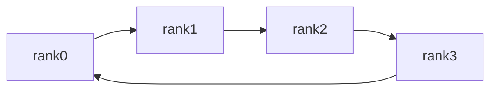

Mọi chiến lược song song cuối cùng đều rơi vào cùng một việc: các GPU trao đổi dữ liệu hiệu quả như thế nào. DDP dựa vào AllReduce để đồng bộ gradient, ZeRO dùng ReduceScatter, TP dùng AllReduce, MoE dùng All-to-All — bộ "bảng chữ cái giao tiếp" này sẽ xuất hiện lại ở mọi chương sau. Bài này giảng một lần cho rõ: ngữ nghĩa "đầu vào → đầu ra" của từng primitive, vì sao Ring AllReduce có lượng giao tiếp không phụ thuộc số GPU, và cách định lượng thời gian của bất kỳ lần giao tiếp nào.

<!-- more -->

## 📑 Mục lục

- [1. Vì sao phải giảng riêng các primitive giao tiếp](#1-vì-sao-phải-giảng-riêng-các-primitive-giao-tiếp)
- [2. Giao tiếp điểm-điểm: nền tảng của mọi thứ](#2-giao-tiếp-điểm-điểm-nền-tảng-của-mọi-thứ)
- [3. Chi tiết các primitive giao tiếp tập thể](#3-chi-tiết-các-primitive-giao-tiếp-tập-thể)
- [4. Nguyên lý thuật toán Ring AllReduce](#4-nguyên-lý-thuật-toán-ring-allreduce)
- [5. Cách định lượng lượng giao tiếp](#5-cách-định-lượng-lượng-giao-tiếp)
- [6. Thực hành](#6-thực-hành)
- [Tóm tắt](#-tóm-tắt)
- [Checklist tự kiểm](#-checklist-tự-kiểm)
- [Tài liệu tham khảo](#-tài-liệu-tham-khảo)

---

## 1. Vì sao phải giảng riêng các primitive giao tiếp

Bản chất huấn luyện song song có thể cô đọng thành một công thức: **song song = chia nhỏ + giao tiếp**. Chia nhỏ quyết định bộ nhớ tiết kiệm thế nào, tải phân thế nào; sau khi chia, mỗi GPU chỉ còn "bán thành phẩm", phải dựa vào giao tiếp để ghép thành kết quả đúng.

🔑 **Khái niệm cốt lõi**: Chia nhỏ quyết định bộ nhớ; giao tiếp quyết định tốc độ. Một chiến lược song song nhanh hay chậm thường không phụ thuộc vào cách nó cắt, mà vào mỗi bước phải truyền bao nhiêu dữ liệu và đi qua mạng nào — đúng là câu hỏi mà các primitive trả lời.

Ví dụ: primitive giao tiếp giống vài bộ chiến thuật cố định của một đội bóng (tạt cánh, chuyền về, một-hai). Cầu thủ (GPU) phần lớn tự lo khu vực của mình, nhưng lúc then chốt phải theo bài đã định để đưa bóng (dữ liệu) đúng chỗ. Nắm vững vài bộ "chiến thuật" này, sau nhìn bất kỳ đội hình nào (chiến lược song song) cũng hiểu ngay bóng chảy thế nào.

Trước hết một bảng toàn cảnh để dựng trực giác "chiến lược nào dùng primitive nào", rồi mới mở chi tiết:

| 📡 Primitive giao tiếp | Chiến lược song song thường dùng nó |
|------------|---------------------|
| AllReduce | Đồng bộ gradient DDP, gộp đầu ra TP |
| ReduceScatter | ZeRO-2/3, backward FSDP |
| AllGather | Forward ZeRO-3, FSDP tái lắp tham số |
| All-to-All | Expert parallelism của MoE, sequence parallelism Ulysses |
| Broadcast | Đồng bộ tham số lúc khởi tạo |
| send / recv | Pipeline parallelism truyền activation |

⚠️ **Lưu ý**: Giao tiếp diễn ra trên các tầng phần cứng khác nhau, băng thông chênh khoảng một bậc độ lớn — NVLink trong máy có thể hàng trăm GB/s, InfiniBand giữa máy khoảng 50 GB/s, PCIe còn thấp hơn. **Cùng một AllReduce, đặt trong máy hay xuyên máy, thời gian có thể lệch khoảng mười lần**. Đó là gốc vật lý của mọi quyết định "chiến lược nào đặt ở đâu" về sau.

## 2. Giao tiếp điểm-điểm: nền tảng của mọi thứ

Giao tiếp tập thể dù hoa mỹ đến đâu, tầng dưới vẫn được ghép từ hành động giản dị nhất: "hai tiến trình gửi-nhận dữ liệu với nhau". Đó là giao tiếp điểm-điểm (Point-to-Point, P2P).

- `send(tensor, dst)`: gửi tensor tới rank đích
- `recv(tensor, src)`: nhận tensor từ rank nguồn

Các Stage của pipeline parallelism (PP) truyền activation chính bằng nó.

P2P có dạng đồng bộ và bất đồng bộ; ở đây giấu một cái bẫy deadlock kinh điển:

```python
import torch.distributed as dist

# ❌ Cách viết nguy hiểm: hai tiến trình đều send trước rồi recv, có thể deadlock
# rank 0 và rank 1 đều kẹt ở send chờ bên kia recv
dist.send(tensor, dst=peer)
dist.recv(tensor, src=peer)
```

⚠️ **Lưu ý**: Nếu hai tiến trình đều dùng `send` blocking gửi trước nhận sau, mà buffer tầng dưới không đủ để tạm chứa, cả hai sẽ kẹt ở `send` chờ bên kia `recv`, tạo thành **deadlock**.

✅ Có hai cách giải:

```python
# Cách A: lệch thứ tự — một bên gửi rồi nhận, bên kia nhận rồi gửi
if rank == 0:
    dist.send(tensor, dst=1)
    dist.recv(tensor, src=1)
else:
    dist.recv(tensor, src=0)
    dist.send(tensor, dst=0)

# Cách B: dùng primitive bất đồng bộ isend / irecv, phát trước rồi đợi thống nhất
reqs = [dist.isend(send_buf, dst=peer), dist.irecv(recv_buf, src=peer)]
for r in reqs:
    r.wait()
```

📌 **Điểm quan trọng**: Trong framework thực tế, nên dùng `dist.batch_isend_irecv()` để nộp một loạt yêu cầu gửi-nhận một lần, để backend lập lịch thống nhất: vừa tránh deadlock vừa chồng giao tiếp. Triển khai PP phụ thuộc nhiều vào kiểu gửi-nhận bất đồng bộ theo lô này.

## 3. Chi tiết các primitive giao tiếp tập thể

Giao tiếp tập thể (Collective Communication) là **mẫu trao đổi dữ liệu có ngữ nghĩa cố định mà một nhóm tiến trình cùng tham gia**. Dưới đây lần lượt đưa ngữ nghĩa "đầu vào → đầu ra" và công dụng điển hình. Quy ước ký hiệu: có $N$ rank; khối dữ liệu mỗi rank cầm được gắn nhãn theo nội dung.

### 3.1 Broadcast: một bản dữ liệu sao chép cho mọi người

Một root rank giữ dữ liệu, sao chép tới mọi rank.


Đổi sang số cụ thể sẽ rõ hơn — root rank (GPU0) giữ $[1,2,3]$, các GPU còn lại trống; sau Broadcast mọi GPU đều có cùng một bản sao:

```
Trước thao tác:      Sau Broadcast:
GPU0: [1,2,3]        GPU0: [1,2,3]
GPU1: [ ]            GPU1: [1,2,3]
GPU2: [ ]            GPU2: [1,2,3]
GPU3: [ ]            GPU3: [1,2,3]
```

**Công dụng điển hình**: Lúc bắt đầu huấn luyện, broadcast tham số khởi tạo của rank 0 cho mọi tiến trình, bảo đảm mọi GPU xuất phát giống nhau (DDP khởi tạo làm đúng như vậy).

### 3.2 Scatter / Gather: phân phát và thu thập

- **Scatter**: Root rank cắt một tensor lớn thành $N$ phần, phần thứ $i$ gửi cho rank $i$ (phân phát)
- **Gather**: Mỗi rank đưa dữ liệu của mình cho root rank, ghép thành tensor đầy đủ (thu thập, phép ngược của Scatter)

Ví dụ 4 GPU: root (GPU0) giữ tensor độ dài 4; Scatter tách từng đoạn cho từng GPU; Gather thì ngược lại thu dữ liệu về root:

```
Scatter (GPU0 phân phát):     Gather (thu về GPU0):
Trước          Sau            Trước        Sau
GPU0:[a,b,c,d] GPU0:[a]       GPU0:[a]     GPU0:[a,b,c,d]
GPU1:[ ]       GPU1:[b]       GPU1:[b]     GPU1:[b]
GPU2:[ ]       GPU2:[c]       GPU2:[c]     GPU2:[c]
GPU3:[ ]       GPU3:[d]       GPU3:[d]     GPU3:[d]
```

Lưu ý khác biệt với Broadcast: Broadcast sao chép **cùng một bản dữ liệu đầy đủ** cho mọi GPU; Scatter **cắt rồi phân phát**, mỗi GPU chỉ nhận một đoạn.

**Công dụng điển hình**: DataParallel thời đầu dùng Scatter phân mini-batch, Gather thu đầu ra; nay dùng nhiều hơn ở giai đoạn tiền xử lý dữ liệu.

### 3.3 Reduce: quy ước về một rank

Dữ liệu mọi rank được quy ước theo một phép toán (cộng, lấy max, …); kết quả chỉ đặt ở root rank.

$$
\text{rank}\_{\text{root}} \leftarrow \sum\_{i=0}^{N-1} x\_i
$$

Trên vector cụ thể — 4 GPU mỗi cái giữ vector độ dài 3; sau Reduce(sum) chỉ root (GPU0) nhận kết quả cộng theo phần tử, các GPU khác không đổi:

```
Trước thao tác:      Reduce(sum) về GPU0:
GPU0: [1,2,3]        GPU0: [10,20,30]
GPU1: [2,4,6]        GPU1: [2,4,6]    (không đổi)
GPU2: [3,6,9]        GPU2: [3,6,9]    (không đổi)
GPU3: [4,8,12]       GPU3: [4,8,12]   (không đổi)
```

⚠️ **Lưu ý**: Reduce và AllReduce chỉ khác ở "kết quả trao cho ai" — Reduce chỉ gom về root; AllReduce thì **mọi rank đều nhận** cùng một kết quả. Đó cũng là lý do $\text{AllReduce} = \text{Reduce} + \text{Broadcast}$.

### 3.4 AllReduce: kết quả quy ước ai cũng có phần (trọng tâm chương)

Primitive quan trọng nhất. Sau khi quy ước dữ liệu mọi rank, **broadcast kết quả về từng rank**. Về ngữ nghĩa tương đương `Reduce` rồi `Broadcast`, nhưng triển khai hiệu quả hơn nhiều so với "quy ước rồi broadcast" (xem thuật toán Ring ở mục sau).


Đổi dữ liệu sang vector gần với gradient sẽ trực quan hơn — 4 GPU mỗi cái giữ vector độ dài 3; sau AllReduce(sum) mỗi GPU đều có kết quả cộng theo phần tử:

```
Trước thao tác:      Sau AllReduce(sum):
GPU0: [1,2,3]        GPU0: [10,20,30]
GPU1: [2,4,6]        GPU1: [10,20,30]
GPU2: [3,6,9]        GPU2: [10,20,30]
GPU3: [4,8,12]       GPU3: [10,20,30]
```

Phép cộng **căn chỉnh theo phần tử**: thành phần thứ nhất $1+2+3+4=10$, thứ hai $2+4+6+8=20$, thứ ba $3+6+9+12=30$. Sau thao tác bốn GPU có nội dung hoàn toàn giống nhau — đúng nghĩa "đồng bộ gradient mọi GPU" trong DDP.

**Công dụng điển hình**: DDP đồng bộ gradient — mỗi GPU tính gradient cục bộ, AllReduce cộng (rồi chia $N$ lấy trung bình) để mọi GPU nhận cùng gradient trung bình toàn cục; TP cũng dùng nó để gộp tổng từng phần của phép nhân ma trận đã cắt.

### 3.5 ReduceScatter: sau quy ước chỉ giữ phần của mình

Sau quy ước (cộng), mỗi rank **chỉ giữ một shard của kết quả**, chứ không phải kết quả đầy đủ.


Nhìn bằng số sẽ rõ hơn — 4 GPU mỗi cái giữ vector độ dài 4 (4 shard); ReduceScatter(sum) trước hết cộng theo phần tử trên mọi GPU, rồi GPU thứ $i$ chỉ giữ shard thứ $i$:

```
Trước thao tác:          Sau ReduceScatter(sum):
GPU0: [1,2,3,4]          GPU0: [4]    (tổng shard 0: 1+1+1+1)
GPU1: [1,2,3,4]          GPU1: [8]    (tổng shard 1: 2+2+2+2)
GPU2: [1,2,3,4]          GPU2: [12]   (tổng shard 2: 3+3+3+3)
GPU3: [1,2,3,4]          GPU3: [16]   (tổng shard 3: 4+4+4+4)
```

Bốn GPU giữ cùng một vector chỉ để kết quả cộng lộ rõ: mỗi shard được 4 GPU đóng góp một lần, nên shard thứ $i$ thành $4 \times (i{+}1)$.

**Công dụng điển hình**: Backward của ZeRO-2/3 và FSDP — sau khi quy ước gradient, mỗi GPU chỉ cần shard mà nó chịu trách nhiệm cập nhật; ReduceScatter làm gọn trong một bước.

### 3.6 AllGather: ghép các shard thành dữ liệu đầy đủ

Mỗi rank giữ một shard; sau thao tác **mọi rank đều nhận dữ liệu đầy đủ đã ghép**. Không quy ước, chỉ ghép nối.


Mỗi GPU giữ một shard; sau AllGather mọi GPU đều có đủ chuỗi đầy đủ (chỉ ghép, không cộng):

```
Trước thao tác:   Sau AllGather:
GPU0: [A]         GPU0: [A,B,C,D]
GPU1: [B]         GPU1: [A,B,C,D]
GPU2: [C]         GPU2: [A,B,C,D]
GPU3: [D]         GPU3: [A,B,C,D]
```

💡 **Gợi ý**: Chồng hình này lên hình ReduceScatter — ReduceScatter làm mỗi GPU "co từ dữ liệu đầy đủ về một shard đã cộng"; AllGather làm mỗi GPU "giãn từ một shard về dữ liệu đầy đủ". Hai phép đúng là nghịch đảo của nhau, ghép lại được $\text{AllReduce} = \text{ReduceScatter} + \text{AllGather}$.

**Công dụng điển hình**: Forward ZeRO-3 / FSDP — mỗi GPU chỉ lưu shard tham số, trước khi tính dùng AllGather tạm ghép tham số lớp đầy đủ.

### 3.7 All-to-All: ai cũng gửi dữ liệu khác nhau cho mọi người

Primitive "kết nối đầy đủ" nhất: mỗi rank gửi cho mỗi rank khác một khối dữ liệu **khác nhau**. Có thể hiểu như một phép chuyển vị ma trận phân tán.

Ví dụ 4 GPU, gọi $D_{ij}$ là khối "vốn ở GPU$i$, phải gửi cho GPU$j$". Trước thao tác mỗi GPU xếp 4 khối theo **đích**; sau thao tác mỗi GPU nhận được mọi khối gửi tới nó — tương đương chuyển vị ma trận dữ liệu (đổi hàng ↔ cột):

```
Trước (mỗi GPU xếp theo đích):              Sau All-to-All (mỗi GPU thu đủ phần gửi cho mình):
GPU0: [D00,D01,D02,D03]                     GPU0: [D00,D10,D20,D30]
GPU1: [D10,D11,D12,D13]                     GPU1: [D01,D11,D21,D31]
GPU2: [D20,D21,D22,D23]                     GPU2: [D02,D12,D22,D32]
GPU3: [D30,D31,D32,D33]                     GPU3: [D03,D13,D23,D33]
```

Có thể thấy cột thứ $j$ (mọi khối các GPU gửi cho GPU$j$) sau thao tác trở thành hàng của GPU$j$ — đúng nghĩa "chuyển vị ma trận".

**Công dụng điển hình**: Expert parallelism của MoE — token phải gửi tới expert trên các GPU khác theo kết quả routing, đúng là All-to-All; Ulysses sequence parallelism cũng dùng nó để đổi trục cắt giữa chiều chuỗi và chiều attention head.

### 3.8 Một đẳng thức xuyên suốt cả cuốn sách

Ba phép này có quan hệ cực kỳ quan trọng, ZeRO và sequence parallelism dùng đi dùng lại:

$$
\text{AllReduce} = \text{ReduceScatter} + \text{AllGather}
$$

📌 **Điểm quan trọng**: Hiểu trực giác — ReduceScatter trước hết cho mỗi GPU "kết quả cộng toàn cục của phần mình", rồi AllGather ghép các shard lại thành kết quả đầy đủ; hai bước hợp lại chính là AllReduce. Phép tách này không chỉ là đẳng thức lý thuyết, mà còn là bản thiết kế triển khai của Ring AllReduce (mục sau), và là căn cứ gốc để ZeRO "dùng hai nửa bước giao tiếp thay một AllReduce".

## 4. Nguyên lý thuật toán Ring AllReduce

AllReduce là giao tiếp tần suất cao nhất trong huấn luyện; hiệu năng của nó trực tiếp quyết định khả năng mở rộng của DDP. Mục này giảng rõ vì sao nó đạt được đặc tính gây ấn tượng: "lượng giao tiếp không phụ thuộc số GPU".

### 4.1 Vấn đề của AllReduce ngây thơ

Triển khai thẳng nhất: mọi GPU gửi dữ liệu về một rank trung tâm, trung tâm cộng rồi broadcast lại. Vấn đề là **nút trung tâm thành nghẽn băng thông** — dữ liệu của $N$ GPU đều phải chen qua một liên kết mạng của nó, càng nhiều GPU càng tắc. Thời gian giao tiếp tăng tuyến tính theo $N$, hoàn toàn không mở rộng được.

Ví dụ: cả lớp nộp bài cho một lớp trưởng thống kê rồi phát lại từng người; càng đông người lớp trưởng càng mệt, hiệu suất càng thấp.

### 4.2 Ring: nối mọi GPU thành một vòng

Ý tưởng Ring AllReduce là **phi tập trung**: nối logic $N$ GPU thành một vòng, mỗi GPU chỉ giao tiếp với hàng xóm trái/phải, không có nút trung tâm. Nó chia hai giai đoạn, đúng khớp đẳng thức $\text{AllReduce} = \text{ReduceScatter} + \text{AllGather}$ ở mục trước.

Mỗi GPU giữ dữ liệu kích thước $\Psi$ (ví dụ gradient); trước hết cắt thành $N$ shard.

**Giai đoạn 1: Reduce-Scatter ($N-1$ bước)**

Mỗi bước, mỗi GPU gửi một shard của mình cho hàng xóm kế tiếp, đồng thời nhận shard từ hàng xóm trước và cộng dồn. Sau $N-1$ bước, **mỗi GPU có một shard đã "cộng toàn cục xong"** (các GPU hoàn thành các shard khác nhau).

**Giai đoạn 2: All-Gather ($N-1$ bước)**

Giờ mỗi GPU cầm một shard "đã cộng xong", truyền tiếp quanh vòng $N-1$ bước để các shard đầy đủ lan tới mọi GPU. Kết thúc, mỗi GPU có đủ cả $N$ shard đã cộng — tức kết quả AllReduce đầy đủ.



### 4.3 Suy ra lượng giao tiếp: vì sao không phụ thuộc số GPU

Đây là tinh túy của thuật toán Ring. Ta tính mỗi GPU tổng cộng gửi-nhận bao nhiêu dữ liệu.

Dữ liệu bị cắt thành $N$ phần, mỗi phần $\frac{\Psi}{N}$. Hai giai đoạn mỗi giai đoạn $N-1$ bước; mỗi bước mỗi GPU gửi một shard:

$$
\text{lượng gửi mỗi GPU} = \underbrace{(N-1)\cdot\frac{\Psi}{N}}\_{\text{Reduce-Scatter}} + \underbrace{(N-1)\cdot\frac{\Psi}{N}}\_{\text{All-Gather}} = 2\cdot\frac{N-1}{N}\Psi
$$

Lượng nhận bằng lượng gửi. Nhìn hệ số này:

$$
2\cdot\frac{N-1}{N}\Psi = 2\Psi\left(1 - \frac{1}{N}\right) \xrightarrow{N \text{ lớn}} 2\Psi
$$

🔑 **Khái niệm cốt lõi**: Khi số GPU $N$ lớn, lượng gửi-nhận mỗi GPU tiến tới $2\Psi$, **không phụ thuộc $N$**! Nghĩa là dù DDP 8 GPU hay 1024 GPU, lượng giao tiếp mỗi bước của mỗi GPU ổn định quanh $2\Psi$, không phình theo quy mô — đúng là lý do Ring AllReduce chống đỡ được data parallelism quy mô lớn.

### 4.4 Tối ưu băng thông và các topology khác

Ring với **lượng dữ liệu lớn** có thể sát trần băng thông mạng (tối ưu băng thông), nhưng nó có $2(N-1)$ bước, **độ trễ tăng tuyến tính theo $N$**. Vì vậy:

| ✅ Ring AllReduce | ❌ Điểm yếu | 📝 Phù hợp |
|------------------|------------|---------|
| Tối ưu băng thông với dữ liệu lớn; lượng không phụ thuộc số GPU | Nhiều bước; độ trễ tăng theo N | Đồng bộ gradient và dữ liệu khối lớn |

- **Tree AllReduce**: topology cây, số bước $O(\log N)$, **độ trễ thấp**, hợp dữ liệu nhỏ (tensor nhỏ, tín hiệu điều khiển).
- **Double Binary Tree**: thuật toán cây NCCL 2.4 đưa vào, cân bằng băng thông và độ trễ trên AllReduce đa máy quy mô lớn; là triển khai Tree thường dùng của NCCL.
- Thực tế **NCCL tự chọn** Ring / Tree / … theo lượng dữ liệu, số GPU, topology, không cần chỉ định tay — cũng vì thế `NCCL_DEBUG=INFO` cho thấy nó "đã chọn thuật toán nào".

## 5. Cách định lượng lượng giao tiếp

Đã nắm primitive và suy luận Ring, giờ dựng một "sổ cái lượng giao tiếp" thống nhất để sau này tự ước bất kỳ chiến lược nào.

### 5.1 Ký hiệu thống nhất

| Ký hiệu | Ý nghĩa |
|------|------|
| $\Psi$ | Số tham số (hoặc số phần tử của tensor cần giao tiếp) |
| $N$ | Số rank tham gia giao tiếp |
| $\alpha$ | Độ trễ cố định của một lần giao tiếp (latency) |
| $B$ | Băng thông liên kết (Bytes/s) |

### 5.2 Lượng giao tiếp mỗi GPU của ba primitive

Dựa trên triển khai Ring, tổng gửi-nhận mỗi GPU của các primitive thường dùng (xấp xỉ $N$ lớn):

| 📡 Primitive | Lượng mỗi GPU | Cách nhớ |
|---------|-----------|--------|
| AllReduce | $2\Psi$ | ReduceScatter + AllGather |
| ReduceScatter | $\Psi$ | Một nửa AllReduce |
| AllGather | $\Psi$ | Nửa còn lại của AllReduce |

📌 **Điểm quan trọng**: Bảng này giải một thắc mắc phổ biến — vì sao FSDP (ZeRO-3) mỗi bước giao tiếp $3\Psi$ còn DDP chỉ $2\Psi$. Vì FSDP forward cần AllGather ($\Psi$), backward cần AllGather ($\Psi$) + ReduceScatter ($\Psi$), tổng $3\Psi$, nhiều hơn DDP 50\% — đúng là cái giá giao tiếp đổi lấy tiết kiệm bộ nhớ. Sổ này sẽ được dùng lại ở Chương 4 và 5.

### 5.3 Mô hình ước thời gian giao tiếp

Thời gian một lần giao tiếp có thể ước bằng mô hình $\alpha$-$\beta$ kinh điển ($\beta = 1/B$ là thời gian truyền một đơn vị dữ liệu):

$$
T \approx \alpha + \frac{\text{data volume}}{B}
$$

- **Hạng latency** $\alpha$: chi phí cố định mỗi lần giao tiếp (thiết lập kết nối, đồng bộ), không phụ thuộc lượng dữ liệu. Khi dữ liệu nhỏ nó chiếm ưu thế — đó là lý do tensor nhỏ hợp thuật toán Tree độ trễ thấp.
- **Hạng băng thông** $\frac{\text{data volume}}{B}$: lượng càng lớn, băng thông càng thấp thì càng lâu. Khi dữ liệu lớn nó chiếm ưu thế — đó là lý do gradient lớn hợp Ring tối ưu băng thông.

💡 **Gợi ý**: Khi ước phải thế đúng băng thông. NVLink trong máy (hàng trăm GB/s) và IB giữa máy (khoảng 50 GB/s) cùng một công thức cho kết quả lệch khoảng mười lần — định lượng giải thích "vì sao TP phải đặt trong máy".

### 5.4 Chồng tính toán và giao tiếp

Ý tưởng tối ưu then chốt cuối: giao tiếp không nhất thiết "đứng chờ". Framework hiện đại để **giao tiếp và tính toán chạy song song** (overlap) — ví dụ DDP trong lúc backward còn tính gradient các lớp sau thì đã gửi các gradient lớp trước đã xong đi AllReduce.

🔑 **Khái niệm cốt lõi**: Lý tưởng thì nếu giao tiếp bị tính toán "che" hết, giao tiếp gần như "miễn phí". Đó là mục tiêu chung của cơ chế Bucket trong DDP, prefetch của ZeRO, v.v. — giấu $T_{\text{comm}}$ trong công thức vào thời gian tính toán hết mức có thể. Chương 4 sẽ thấy triển khai cụ thể.

## 6. Thực hành

Sau lý thuyết, dùng `torch.distributed` tự kiểm chứng ngữ nghĩa các primitive. Script dưới chạy bằng `torchrun --nproc_per_node=4 collective_demo.py`.

```python
# collective_demo.py
import os
import torch
import torch.distributed as dist


def main():
    dist.init_process_group(backend="nccl")
    rank = dist.get_rank()
    world_size = dist.get_world_size()
    torch.cuda.set_device(rank)
    device = torch.device(f"cuda:{rank}")

    # ---- Thí nghiệm 1: AllReduce(sum) ----
    # Mỗi GPU giữ giá trị rank của mình; sau cộng mọi GPU phải được 0+1+2+3=6
    x = torch.tensor([float(rank)], device=device)
    dist.all_reduce(x, op=dist.ReduceOp.SUM)
    print(f"[AllReduce] rank{rank} -> {x.item()}")  # tất cả in 6.0

    # ---- Thí nghiệm 2: AllGather ----
    # Mỗi GPU giữ một shard; sau thu thập mỗi GPU có [0,1,2,3]
    src = torch.tensor([float(rank)], device=device)
    gathered = [torch.zeros(1, device=device) for _ in range(world_size)]
    dist.all_gather(gathered, src)
    print(f"[AllGather] rank{rank} -> {[t.item() for t in gathered]}")

    # ---- Thí nghiệm 3: ReduceScatter ----
    # Mỗi GPU cung cấp world_size shard; sau quy ước mỗi GPU chỉ giữ phần của mình
    inputs = [torch.tensor([float(rank * 10 + i)], device=device)
              for i in range(world_size)]
    out = torch.zeros(1, device=device)
    dist.reduce_scatter(out, inputs, op=dist.ReduceOp.SUM)
    print(f"[ReduceScatter] rank{rank} -> {out.item()}")

    dist.destroy_process_group()


if __name__ == "__main__":
    main()
```

Chạy kèm `NCCL_DEBUG=INFO` còn quan sát được NCCL thực tế chọn thuật toán nào:

```bash
NCCL_DEBUG=INFO torchrun --nproc_per_node=4 collective_demo.py 2>&1 | grep -i "Ring\|Tree\|Algorithm"
```

✅ **Bài tập gợi ý**: Tăng dần kích thước tensor từ 1 phần tử lên vài trăm MB, đo thời gian bằng `torch.cuda.Event`, so sánh băng thông AllReduce đo được — bạn sẽ thấy dữ liệu nhỏ thì latency chiếm ưu thế, dữ liệu lớn thì sát băng thông liên kết, đúng khớp mô hình $T \approx \alpha + \text{data volume}/B$.

## 📝 Tóm tắt

- Song song = chia nhỏ + giao tiếp; chia nhỏ quyết định bộ nhớ, giao tiếp quyết định tốc độ. Primitive giao tiếp là "bảng chữ cái" để đọc mọi chiến lược song song.
- send/recv điểm-điểm là nền tảng; PP dựa vào nó để truyền activation. Chú ý deadlock của gửi-nhận blocking; giải bằng lệch thứ tự hoặc isend/irecv bất đồng bộ.
- Bảy primitive tập thể mỗi cái một ngữ nghĩa cố định: Broadcast sao chép, Scatter/Gather phân phát-thu thập, Reduce quy ước về một điểm, AllReduce quy ước cho mọi người, ReduceScatter quy ước rồi giữ shard, AllGather ghép nối, All-to-All trao đổi toàn phần.
- Đẳng thức cốt lõi $\text{AllReduce} = \text{ReduceScatter} + \text{AllGather}$ vừa là bản thiết kế Ring, vừa là nền tảng phân tích giao tiếp của ZeRO.
- Ring AllReduce mỗi GPU giao tiếp $\approx 2\Psi$, không phụ thuộc số GPU, là nền tảng DDP quy mô lớn; dữ liệu nhỏ thì dùng Tree độ trễ thấp.
- Ước thời gian bằng $T \approx \alpha + \text{data volume}/B$, nhớ thế đúng băng thông; chồng tính-giao tiếp có thể "giấu" giao tiếp vào tính toán.

## 🎯 Checklist tự kiểm

- Vẽ được sơ đồ ngữ nghĩa "đầu vào → đầu ra" của 7 primitive giao tiếp tập thể
- Nói được DDP, ZeRO, TP, MoE mỗi cái chủ yếu dựa vào primitive nào
- Giải thích được vì sao gửi-nhận blocking điểm-điểm gây deadlock, và viết được hai cách tránh
- Suy ra được lượng giao tiếp mỗi GPU của Ring AllReduce là $2\frac{N-1}{N}\Psi \approx 2\Psi$ và không phụ thuộc số GPU
- Thuộc đẳng thức $\text{AllReduce} = \text{ReduceScatter} + \text{AllGather}$ và giải thích ý nghĩa của nó trong ZeRO
- Dùng $T \approx \alpha + \text{data volume}/B$ ước một lần giao tiếp, và nói khi nào dùng Ring, khi nào dùng Tree
- Giải thích được vì sao FSDP mỗi bước giao tiếp $3\Psi$ còn DDP là $2\Psi$

## 📚 Tài liệu tham khảo

- [Bringing HPC Techniques to Deep Learning (phân tích gốc Ring AllReduce)](https://andrew.gibiansky.com/blog/machine-learning/baidu-allreduce/)
- [Tài liệu chính thức NVIDIA NCCL](https://docs.nvidia.com/deeplearning/nccl/user-guide/docs/index.html)
- [PyTorch Distributed Communication Package (torch.distributed)](https://pytorch.org/docs/stable/distributed.html)
- [Massively Scale Your Deep Learning Training with NCCL 2.4 (Double Binary Tree)](https://developer.nvidia.com/blog/massively-scale-deep-learning-training-nccl-2-4/)
- [Horovod: fast and easy distributed deep learning in TensorFlow](https://arxiv.org/abs/1802.05799)
