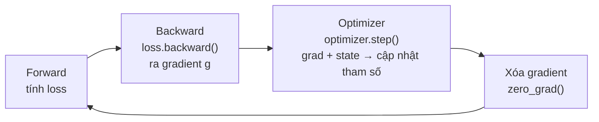

Backpropagation chỉ cho biết tham số nên đi hướng nào. Đi bao xa và đi thế nào là việc của optimizer. Với người làm AI Infra còn một vấn đề thực tế hơn: optimizer lặng lẽ chiếm hơn nửa bộ nhớ GPU khi train. Bài này bắt đầu từ lịch sử optimizer, tính rõ AdamW chiếm bao nhiêu bộ nhớ và vì sao bắt buộc dùng FP32, rồi nói khi nào LAMB/LARS có chỗ trong large batch. Đó là nền trực tiếp để hiểu ZeRO và mixed precision ở các chương sau.

<!-- more -->

## 📑 Mục lục

- [1. Optimizer thực sự làm gì trong training](#1-optimizer-thực-sự-làm-gì-trong-training)
- [2. Tiến hóa optimizer: từ SGD đến AdamW](#2-tiến-hóa-optimizer-từ-sgd-đến-adamw)
- [3. Chi phí bộ nhớ của optimizer state](#3-chi-phí-bộ-nhớ-của-optimizer-state)
- [4. Optimizer cho large batch: LARS và LAMB](#4-optimizer-cho-large-batch-lars-và-lamb)
- [5. Thực hành: mở sổ bộ nhớ của optimizer](#5-thực-hành-mở-sổ-bộ-nhớ-của-optimizer)
- [Tóm tắt](#-tóm-tắt)
- [Checklist tự kiểm](#-checklist-tự-kiểm)
- [Tài liệu tham khảo](#-tài-liệu-tham-khảo)

---

## 1. Optimizer thực sự làm gì trong training

Hãy nghĩ gradient như "bản đồ xuống dốc": nó cho biết hướng dưới chân dốc nhất. Optimizer là người leo núi thực sự bước. Bản đồ chỉ trả lời "đi hướng nào"; bước dài bao nhiêu, có giữ quán tính bước trước không, đoạn trơn có cần bước nhỏ hơn không, toàn bộ là quyết định của optimizer.

Trong vòng lặp training, vị trí của nó cố định, nằm giữa "đã có gradient" và "forward vòng sau":



Trong code đó là vòng lặp bốn dòng này:

```python
for batch in dataloader:
    loss = model(batch)          # Forward: dự đoán và tính loss
    loss.backward()              # Backward: ra gradient từng tham số
    optimizer.step()             # Optimizer: cập nhật tham số bằng grad + state nội bộ
    optimizer.zero_grad()        # Xóa gradient, chuẩn bị vòng sau
```

`optimizer.step()` trông đơn giản nhưng làm ba việc: đọc gradient từng tham số, kết hợp với state nội bộ mà optimizer tự giữ (momentum, moment bậc hai, v.v.) để ra lượng cập nhật, rồi áp dụng lên tham số.

🔑 **Khái niệm cốt lõi**: phần quan trọng là "state nội bộ". State này được **giữ bền** giữa các lần `step()` trong bộ nhớ GPU. Nó không phải biến tạm tính xong là bỏ, mà chiếm bộ nhớ suốt quá trình train. Đó là gốc rễ khiến optimizer thành "ông lớn" về bộ nhớ, và cũng là sổ kế toán mục 3 sẽ tính kỹ.

## 2. Tiến hóa optimizer: từ SGD đến AdamW

Lịch sử optimizer về bản chất là chuyện "cứ thêm thông tin phụ trợ vào bước cập nhật tham số". Mỗi thứ thêm vào giúp hội tụ ổn và thường nhanh hơn, đổi lại mỗi tham số phải lưu thêm một phần state. Hiểu sợi dây này thì chi phí bộ nhớ hiện ra luôn.

- **SGD**: cách thuần nhất, quy tắc $\theta_{t+1} = \theta_t - \eta \cdot g_t$: learning rate nhân gradient rồi trừ. Không có state phụ. Như bịt mắt xuống núi, chỉ bước theo hướng dốc nhất dưới chân: đơn giản, nhưng dễ dao động trái-phải trong thung lũng hẹp dài.

- **Momentum SGD**: thêm "quán tính". Giữ buffer momentum $m_t = \beta m_{t-1} + g_t$ và dùng nó thay gradient thô. Như đổi quả bóng thành quả chì có quán tính: ổ gà nhỏ trên đường không làm nó dừng, dao động cũng được làm mượt. Chi phí: mỗi tham số thêm một first-moment.

- **Adam**: đồng thời nhớ hai thứ: first moment $m_t$ (EMA của gradient; "đi hướng nào") và second moment $v_t$ (EMA của bình phương gradient; "hướng này lịch sử nhiễu thế nào"). Công thức cập nhật cốt lõi:

$$
\begin{aligned}
m_t &= \beta_1 m_{t-1} + (1-\beta_1) g_t
\end{aligned}
$$
$$
\begin{aligned}
v_t &= \beta_2 v_{t-1} + (1-\beta_2) g_t^2
\end{aligned}
$$
$$
\begin{aligned}
\theta_{t+1} &= \theta_t - \eta \cdot \frac{\hat{m}_t}{\sqrt{\hat{v}_t} + \epsilon}
\end{aligned}
$$

Trong đó $\hat{m}_t, \hat{v}_t$ là bản đã bias-correct của $m_t, v_t$ (đầu train $m_0=v_0=0$ làm ước lượng thiên nhỏ, nên chia cho $1-\beta^t$). $\sqrt{\hat{v}_t}$ ở mẫu số là nguồn của "adaptive": tham số có gradient lịch sử lớn thì mẫu số lớn, bước thu lại; tham số vốn nhỏ thì mẫu số nhỏ, bước phóng ra. Chi phí: mỗi tham số lưu hai state $m$ và $v$.

- **AdamW**: một sửa quan trọng của Adam. Adam gốc nhét weight decay vào gradient ($g_t \leftarrow g_t + \lambda \theta_t$), nên nó dính với adaptive learning rate. Mẫu số $\sqrt{\hat{v}_t}$ làm độ mạnh regularization lệch nhau giữa các tham số.

AdamW tách weight decay khỏi gradient, biến thành một bước scale tham số riêng $\theta_{t+1} \leftarrow \theta_{t+1} - \eta \lambda \theta_t$, hoàn toàn tách khỏi cập nhật gradient. Chỉ một thay đổi đó khiến nó thành chuẩn thực tế cho training large model hiện nay.

Một bảng gom lại sợi tiến hóa:

| ⚙️ Optimizer | Thông tin dùng để cập nhật | State thêm mỗi tham số | Tình huống điển hình |
|-----------|--------------|--------------|---------|
| SGD | Gradient hiện tại | 0 bản | Bài convex đơn giản, dạy học |
| Momentum | Gradient + first moment | 1 bản ($m$) | SGD+Momentum trong CV |
| Adam | Gradient + first + second moment | 2 bản ($m, v$) | Mặc định phổ biến |
| AdamW | Như Adam, weight decay tách rời | 2 bản ($m, v$) | Chuẩn training large model |

💡 **Gợi ý**: trên sợi tiến hóa này, "lưu thêm bao nhiêu bản state" là chìa khóa hiểu bộ nhớ: SGD lưu 0, Momentum lưu 1, Adam/AdamW lưu 2. Sổ bộ nhớ ở mục sau về bản chất là đếm số "bản" đó.

## 3. Chi phí bộ nhớ của optimizer state

Đây là trọng tâm của bài. Biết optimizer chiếm bao nhiêu bộ nhớ thì mới hiểu vì sao ZeRO "ưu tiên nhắm vào optimizer state".

Phân tích dưới đây lấy **mixed-precision training** làm tiền đề (xu hướng hiện tại): forward và backward dùng BF16/FP16 để tăng tốc, nhưng bên trong optimizer luôn dùng FP32 để giữ độ chính xác.

### 3.1 Mỗi tham số phải trả optimizer bao nhiêu bộ nhớ

Đếm theo "mỗi tham số lưu thêm bao nhiêu bản FP32" (FP32 mỗi số 4 byte):

| ⚙️ Optimizer | State thêm | Bộ nhớ optimizer mỗi tham số | Chi phí optimizer cho mô hình 7B |
|-----------|---------|-----------------|------------------|
| SGD | Không | 4 B (chỉ bản sao tham số FP32) | ~28 GB |
| Momentum SGD | First moment | 8 B (bản FP32 + momentum FP32) | ~56 GB |
| Adam / AdamW | First + second moment | 12 B (bản FP32 + FP32 $m$ + FP32 $v$) | ~84 GB |

📌 **Điểm then chốt**: AdamW mỗi tham số cần thêm 12 byte. Mô hình 7B có 7 tỷ tham số, chỉ riêng optimizer state đã là $12 \times 7 \times 10^9 \approx 84\ \text{GB}$, vượt xa một A100 80GB.

### 3.2 Trải hết sổ bộ nhớ của một lần train

Lấy ví dụ AdamW + BF16 train mô hình 7B. Sổ tĩnh đầy đủ như sau:

$$
\begin{aligned}
\text{BF16 参数} &= 2 \times 7 \times 10^9 = 14\ \text{GB} \\
\end{aligned}
$$
$$
\begin{aligned}
\text{BF16 梯度} &= 2 \times 7 \times 10^9 = 14\ \text{GB} \\
\end{aligned}
$$
$$
\begin{aligned}
\text{优化器状态} &= 12 \times 7 \times 10^9 = 84\ \text{GB} \\
\end{aligned}
$$
$$
\begin{aligned}
\text{（FP32 主权重 28 + 一阶动量 28 + 二阶动量 28）} \\
\text{合计} &\approx 112\ \text{GB}
\end{aligned}
$$

Nghĩa là chỉ ba mục tĩnh "mô hình + gradient + optimizer" đã cần 112 GB, trong đó **optimizer state một mình chiếm khoảng 75\%** (chưa tính activation). Tách 112GB ra thì tỉ lệ rõ ngay:

| 📦 Thành phần bộ nhớ | Kích thước | Tỉ lệ |
|------------|------|------|
| Optimizer state (FP32 master weights + $m$ + $v$) | 84 GB | 75\% |
| Gradient BF16 | 14 GB | 12.5\% |
| Tham số BF16 | 14 GB | 12.5\% |

Sổ này giải thích trực tiếp động cơ thiết kế ZeRO: ZeRO-1 nhát đầu tiên cắt vào optimizer state vì đó là phần chiếm nhiều nhất, cắt nó hiệu quả nhất. Trong DDP mỗi GPU đều giữ nguyên bản 84GB đó, dư thừa cực đoan; đó chính là vấn đề chương 4 và 5 sẽ giải.

⚠️ **Lưu ý**: 112GB trên chỉ là **bộ nhớ tĩnh** (tham số + gradient + optimizer state), chưa gồm **activation** để lại từ forward. Kích thước activation đổi theo batch, độ dài chuỗi và số tầng; trong train thực tế nó cũng thường là "hung thần" bộ nhớ. Activation Checkpointing ở chương 8 xử lý riêng; ở đây chỉ khóa kết luận "optimizer chiếm ~75\% bộ nhớ tĩnh".

### 3.3 Vì sao optimizer state phải dùng FP32

Câu hỏi hay gặp: forward/backward đã dùng BF16 rồi, sao không để optimizer cũng BF16 để tiết nửa bộ nhớ?

Đáp án nằm ở chỗ "lượng cập nhật quá nhỏ":

- Mỗi bước, lượng cập nhật tham số xấp xỉ learning rate × gradient, thường cỡ $10^{-4}$ hoặc nhỏ hơn. BF16 chỉ có 7 bit phần định (fraction), độ chính xác tương đối thô, không biểu diễn được thay đổi nhỏ như vậy. Cộng vào tham số lớn hơn gần như không có hiệu lực (số lớn "nuốt" số nhỏ).
- Training chạy hàng nghìn đến hàng chục nghìn bước; lỗi làm tròn mỗi bước tích lũy. Giữ tham số ở độ chính xác thấp cuối cùng khiến training phân kỳ.

⚠️ **Lưu ý**: vậy trong mixed-precision training, optimizer phải giữ một bản FP32 của **master weights**. Mỗi bước cập nhật bằng độ chính xác FP32, rồi chuyển kết quả sang BF16 cho forward lần sau. Bản FP32 đó chính là nguồn 28GB trong sổ trên; không cắt được.

## 4. Optimizer cho large batch: LARS và LAMB

Phần trước nói "optimizer chiếm bao nhiêu bộ nhớ". Mục này đổi góc nhìn: **bản thân phân tán cũng tạo khó cho optimizer**.

Data parallelism có tác dụng phụ trực tiếp: effective batch size bị phóng tuyến tính. Dùng $N$ GPU data parallel thì global batch = $N$ lần batch một GPU. Khi có vài chục đến hàng trăm GPU, effective batch dễ lên hàng nghìn thậm chí hàng chục nghìn, và vấn đề kéo theo.

### 4.1 Vì sao large batch làm training không ổn

- Batch càng lớn, gradient là trung bình của càng nhiều mẫu, phương sai nhỏ hơn, hướng "sạch" hơn; về lý thuyết có thể gắn learning rate lớn hơn để hội tụ nhanh.
- Thực tế phóng learning rate tuyến tính thường khiến train dao động hoặc phân kỳ ngay từ đầu.
- Rắc rối hơn: thang đo tham số giữa các tầng lệch rất lớn (Embedding và LayerNorm không cùng bậc độ lớn). Một learning rate toàn cục cho mọi tầng thì chỉnh thế nào cũng mất cân bằng.

Mâu thuẫn cốt lõi nằm ở điểm cuối: **cần learning rate thích nghi theo từng tầng, không phải một nhát cắt**. LARS và LAMB sinh ra vì điều đó.

💡 **Gợi ý**: trước khi dùng LARS/LAMB, trên thực tế hãy thử hai mẹo đơn giản hơn: **quy tắc phóng tuyến tính** (batch phóng $k$ lần thì learning rate cũng phóng $k$ lần), và **learning-rate warmup** (vài trăm đến vài nghìn bước đầu, learning rate leo tuyến tính từ rất nhỏ lên mục tiêu, tránh dao động dữ dội lúc đầu). Hai mẹo này đủ cho hầu hết quy mô vừa. Chỉ khi batch lớn đến mức chúng cũng thất bại thì mới đến lượt LARS/LAMB thích nghi theo tầng.

### 4.2 LARS: mỗi tầng một bước riêng

LARS (Layer-wise Adaptive Rate Scaling) tính cho mỗi tầng một hệ số scale riêng, roughly tỉ lệ với "chuẩn tham số / chuẩn gradient":

$$
\lambda_l = \frac{\lVert \theta_l \rVert}{\lVert g_l \rVert}
$$

Trực giác: tầng tham số lớn nhưng gradient nhỏ là đang cập nhật quá thận trọng, có thể bước dài hơn; ngược lại tầng gradient lớn so với tham số thì phải thu bước kẻo bay. LARS ban đầu thiết kế cho large-batch training ResNet.

### 4.3 LAMB: mang ý tưởng LARS vào Adam

LAMB (Layer-wise Adaptive Moments) có thể hiểu là **Adam + trust-region scaling theo tầng**:

- Lượng cập nhật mỗi tầng trước hết do Adam tính như thường (đã có adaptive learning rate);
- rồi nhân thêm hệ số trust-region theo tầng $\phi(\lVert \theta_l \rVert) / \lVert r_l \rVert$ để giữ biên độ cập nhật tầng đó trong khoảng hợp lý.

Thành tích nổi tiếng nhất của nó là đẩy batch size pretrain BERT lên 65536 mà vẫn hội tụ ổn, rút thời gian train từ 3 ngày xuống 76 phút.

Đặt cạnh nhau thì khác biệt rõ:

| 🔧 Optimizer | Nền | Độ hạt scale | Sân chính |
|-----------|------|---------|---------|
| LARS | SGD + Momentum | Theo tầng (chuẩn tham số / chuẩn gradient) | Large-batch CV như ResNet |
| LAMB | Adam | Theo tầng (trust region × cập nhật Adam) | Large-batch BERT/Transformer |

✅ **Khi nào nên đổi sang LAMB**: chỉ khi số GPU data parallel rất nhiều (64+), effective batch cực lớn, và AdamW đã không kìm nổi train bất ổn. Với số GPU vừa phải và batch trung bình, cứ dùng AdamW. Đừng dùng vì thấy có sẵn.

## 5. Thực hành: mở sổ bộ nhớ của optimizer

Chỉ tính giấy chưa đủ. Tự sờ optimizer state trong PyTorch mới có cảm giác thật với "12 byte/tham số". Đoạn dưới dựng một mô hình nhỏ biết trước số tham số, chạy một bước Adam, rồi đếm optimizer `state` thực sự lưu bao nhiêu số:

```python
import torch
import torch.nn as nn

# Mô hình nhỏ biết trước số tham số: 1000 x 1000 weight + 1000 bias = 1,001,000 tham số
model = nn.Linear(1000, 1000)
n_params = sum(p.numel() for p in model.parameters())
print(f"Số tham số: {n_params:,}")

optimizer = torch.optim.Adam(model.parameters(), lr=1e-3)

# Chạy một step thì Adam mới thực sự cấp phát state m, v
x = torch.randn(8, 1000)
loss = model(x).sum()
loss.backward()
optimizer.step()

# Đếm state nội bộ của optimizer lưu bao nhiêu phần tử
state_elems = 0
for p, st in optimizer.state.items():
    for k, v in st.items():
        if torch.is_tensor(v):
            state_elems += v.numel()
            print(f"  state '{k}': {v.numel():,} phần tử, dtype={v.dtype}")

print(f"Tổng phần tử optimizer state: {state_elems:,}  (≈ 2 × số tham số)")
```

Chạy sẽ thấy Adam lưu `exp_avg` (first moment $m$) và `exp_avg_sq` (second moment $v$), mỗi cái số phần tử bằng số tham số, đúng kết luận "Adam mỗi tham số lưu 2 bản state". Đổi sang `torch.optim.SGD` (không momentum) thì `state` gần như trống: đó là lý do SGD tiết kiệm bộ nhớ.

Biết "lưu mấy bản" rồi thì biến thành công cụ tính nhanh bộ nhớ cho mọi mô hình. Hàm dưới áp trực tiếp công thức sổ ở mục 3:

```python
def estimate_memory_gb(n_params_billion, optimizer="adamw", dtype_bytes=2):
    """Ước lượng bộ nhớ tĩnh (GB) khi mixed-precision training, không gồm activation"""
    P = n_params_billion * 1e9
    param = P * dtype_bytes            # Tham số BF16
    grad = P * dtype_bytes             # Gradient BF16
    # Optimizer state: FP32 master weights (4B) + mỗi bản state (4B)
    state_copies = {"sgd": 0, "momentum": 1, "adamw": 2}[optimizer]
    optim = P * 4 * (1 + state_copies)
    total = (param + grad + optim) / 1e9
    print(f"{optimizer} @ {n_params_billion}B: "
          f"tham số {param/1e9:.0f} + gradient {grad/1e9:.0f} + optimizer {optim/1e9:.0f} "
          f"= {total:.0f} GB, optimizer chiếm {optim/(param+grad+optim):.0%}")
    return total

estimate_memory_gb(7, "adamw")    # → 7B: tham số 14 + gradient 14 + optimizer 84 = 112 GB, optimizer 75%
estimate_memory_gb(70, "adamw")   # → 70B: tham số 140 + gradient 140 + optimizer 840 = 1120 GB
```

📌 **Điểm then chốt**: mô hình 70B chỉ bộ nhớ tĩnh đã cần 1120 GB, tức 14 card A100 80GB, và còn chưa tính activation. Con số đó là lý do trực tiếp nhất cho song song phân tán (nhất là ZeRO và tensor parallelism).

💡 **Gợi ý**: chỉnh nhẹ `estimate_memory_gb` là so được bộ nhớ trước/sau khi ZeRO cắt: chia `optim` cho độ song song $N$ chính là hiệu ứng ZeRO-1. Đó là bài tập cơ bản để phân tích lợi ích sharding ZeRO ở bước sau.

## 📝 Tóm tắt

- Optimizer chịu trách nhiệm "đi thế nào, đi bao xa"; state nội bộ của nó ở lại bộ nhớ GPU giữa các bước, đó là gốc rễ khiến nó thành ông lớn về bộ nhớ.
- Trục tiến hóa là đổi thêm state lấy ổn định: SGD lưu 0 bản, Momentum 1, Adam/AdamW 2; AdamW tách weight decay và là chuẩn training large model hiện nay.
- Trong mixed precision AdamW mỗi tham số chiếm 12 byte; mô hình 7B optimizer state ~84GB, khoảng 75\% bộ nhớ tĩnh "tham số + gradient + optimizer". Đó là lý do ZeRO-1 ưu tiên cắt nó.
- Optimizer state phải dùng FP32 master weights; nếu không, cập nhật nhỏ bị độ chính xác thấp nuốt mất và lỗi tích lũy khiến train phân kỳ.
- Trong large batch (data parallel nhiều GPU), learning rate toàn cục dễ mất ổn định; LARS/LAMB dùng scale thích nghi theo tầng. Chỉ khi số GPU rất nhiều và batch cực lớn mới cần đổi từ AdamW sang LAMB.

📌 **Nối tiếp**: sổ bộ nhớ bài này tính rõ nối thẳng các chương sau. Chương 4 sẽ thấy trong DDP mỗi GPU đều giữ nguyên bản optimizer state; chương 5 ZeRO cắt phần dư thừa 75\% đó xuống $\frac{1}{N}$; chương 8 mixed precision đưa FP32 master weights vào sổ bộ nhớ đầy đủ để hạch toán thống nhất.

## 🎯 Checklist tự kiểm

- Nói được SGD → Momentum → Adam → AdamW mỗi bước giải quyết gì và thêm bao nhiêu bản state
- Tự tính được bộ nhớ optimizer state cho mô hình quy mô bất kỳ dưới AdamW + mixed precision, và giải thích vì sao ~75\% bộ nhớ tĩnh
- Giải thích vì sao mixed-precision training bắt buộc giữ FP32 master weights, không thể chỉ dùng BF16
- Viết được code đếm số phần tử `state` của optimizer PyTorch, xác minh Adam mỗi tham số 2 bản còn SGD 0 bản
- Trả lời được "data parallel phóng batch 10 lần thì xử lý learning rate thế nào", và nói rõ khi nào mới cần LARS/LAMB

## 📚 Tài liệu tham khảo

- [Adam: A Method for Stochastic Optimization](https://arxiv.org/abs/1412.6980)
- [Decoupled Weight Decay Regularization (AdamW)](https://arxiv.org/abs/1711.05101)
- [Large Batch Training of Convolutional Networks (LARS)](https://arxiv.org/abs/1708.03888)
- [Large Batch Optimization for Deep Learning: Training BERT in 76 minutes (LAMB)](https://arxiv.org/abs/1904.00962)
- [Mixed Precision Training](https://arxiv.org/abs/1710.03740)
- [PyTorch torch.optim official docs](https://pytorch.org/docs/stable/optim.html)
- [ZeRO: Memory Optimizations Toward Training Trillion Parameter Models](https://arxiv.org/abs/1910.02054)
