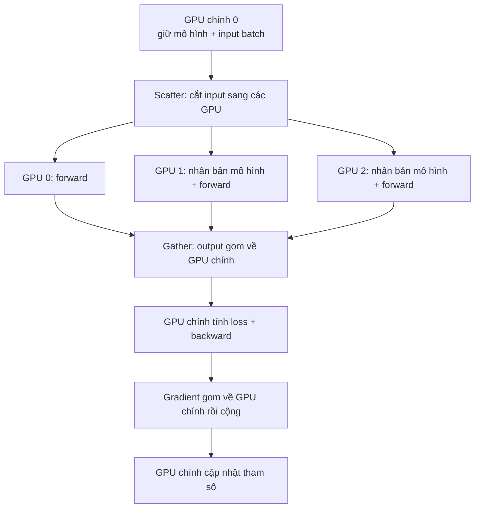
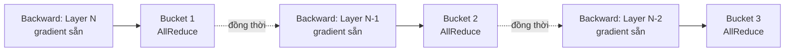
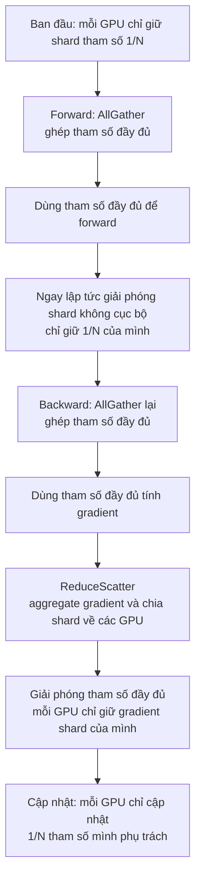
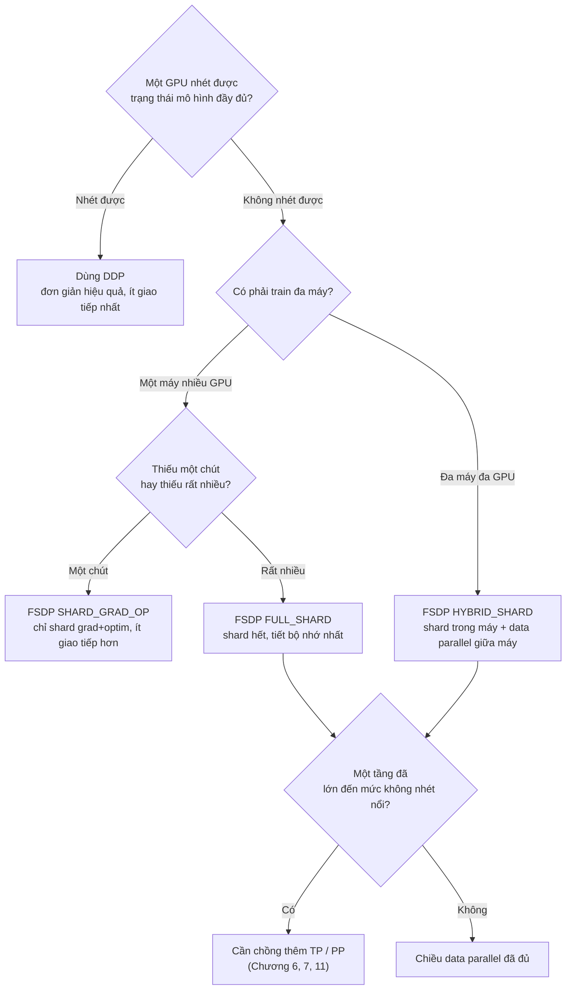

Data parallelism (song song dữ liệu) là thủ thuật phân tán gặp sớm nhất và dùng nhiều nhất: mỗi GPU tính một phần dữ liệu rồi căn chỉnh kết quả. Nghe đơn giản, nhưng từ `DataParallel` sớm đến `FSDP` hôm nay đã qua ba thế hệ, mỗi thế hệ trả lời cùng một câu: làm sao giữ toán học tương đương mà vẫn chạy được nhiều GPU hơn và mô hình lớn hơn. Bài này không viết code (code thực chiến ở **4.2**), mà đào sâu **nguyên lý, cơ chế đồng bộ gradient, lưu lượng giao tiếp và sổ bộ nhớ** của cả ba thế hệ, để biết không chỉ làm gì mà còn vì sao.

<!-- more -->

## 📑 Mục lục

- [1. Data parallelism giải quyết vấn đề gì](#1-data-parallelism-giải-quyết-vấn-đề-gì)
- [2. Nền tảng toán của data parallelism](#2-nền-tảng-toán-của-data-parallelism)
- [3. Thế hệ 1: DataParallel (DP)](#3-thế-hệ-1-dataparalleldp)
- [4. Thế hệ 2: DistributedDataParallel (DDP)](#4-thế-hệ-2-distributeddataparallelddp)
- [5. Suy diễn lưu lượng AllReduce](#5-suy-diễn-lưu-lượng-allreduce)
- [6. Thế hệ 3: FullyShardedDataParallel (FSDP)](#6-thế-hệ-3-fullyshardeddataparallelfsdp)
- [7. Sổ bộ nhớ: so sánh định lượng ba thế hệ](#7-sổ-bộ-nhớ-so-sánh-định-lượng-ba-thế-hệ)
- [8. So sánh giao tiếp: DDP vs FSDP](#8-so-sánh-giao-tiếp-ddp-vs-fsdp)
- [9. Hướng dẫn chọn](#9-hướng-dẫn-chọn)
- [Tóm tắt](#-tóm-tắt)
- [Checklist tự kiểm](#-checklist-tự-kiểm)
- [Tài liệu tham khảo](#-tài-liệu-tham-khảo)

---

## 1. Data parallelism giải quyết vấn đề gì

Trước hết làm rõ: trong distributed training có nhiều kiểu "parallel", mỗi kiểu nhắm một nỗi đau khác. Data parallelism nhắm riêng vào **train quá chậm**: dữ liệu quá lớn, một epoch trên một GPU mất rất lâu.

Ví dụ: một lớp có 6000 bài cần chấm; một giáo viên mất một tuần. Data parallelism là gọi 6 giáo viên, mỗi người 1000 bài, xong trong một ngày. Điều kiện: **mỗi giáo viên phải có bản đầy đủ tiêu chuẩn chấm** (bản sao mô hình đầy đủ), và sau khi chấm mọi người phải **căn chỉnh thang điểm** (đồng bộ gradient) để không xảy ra "thầy A cho điểm lỏng, thầy B cho điểm chặt".

Nói bằng ngôn ngữ kỹ thuật:

1. Mỗi GPU giữ một **bản sao mô hình đầy đủ** (tham số giống hệt nhau)
2. Một batch lớn được **chia đều** cho các GPU; mỗi card chỉ tính phần của mình (local batch)
3. Mỗi GPU **độc lập** forward và backward, ra gradient riêng
4. Qua giao tiếp, gradient mọi card được **lấy trung bình**, mỗi card nhận gradient hoàn toàn giống nhau
5. Mỗi card dùng gradient đồng nhất đó để cập nhật tham số; sau cập nhật mọi bản sao vẫn giống nhau

📌 **Điểm then chốt**: ràng buộc cốt lõi của data parallelism là **mỗi GPU phải nhét được mô hình đầy đủ**. Nó tăng tốc train nhưng không giảm gánh bộ nhớ trên từng card. Đó chính là chỗ FSDP sau này phá vỡ: khi mô hình lớn đến mức một card không nhét nổi, data parallelism thuần không cứu được, phải đưa vào parameter sharding.

💡 **Gợi ý**: distributed training giải hai bài toán trực giao: **chạy không xong** (quá lâu; sân nhà của data parallelism) và **nhét không vừa** (thiếu bộ nhớ; cần ZeRO/FSDP, tensor parallelism, pipeline parallelism). Bài này tập trung vào trục data parallelism, và cách trục đó dần có thêm khả năng giảm áp lực bộ nhớ.

---

## 2. Nền tảng toán của data parallelism

Data parallelism không phải mẹo xấp xỉ "gần đúng là được". Dưới synchronous SGD nó **tương đương chặt** với train một GPU. Hiểu điều đó mới hiểu vì sao gradient phải "lấy trung bình" chứ không "cộng tổng".

Xét loss của một batch, thường định nghĩa là trung bình loss từng mẫu. Gọi kích thước global batch là $B$, hàm loss:

$$
L = \frac{1}{B} \sum_{i=1}^{B} \ell(x_i; \theta)
$$

trong đó $\ell(x_i; \theta)$ là loss mẫu thứ $i$, $\theta$ là tham số mô hình. Gradient theo tham số:

$$
g = \nabla_\theta L = \frac{1}{B} \sum_{i=1}^{B} \nabla_\theta \ell(x_i; \theta)
$$

Chia đều $B$ mẫu cho $N$ GPU, mỗi card $\frac{B}{N}$ mẫu. **Gradient cục bộ** trên GPU thứ $k$ (bên trong đã lấy trung bình) là:

$$
g_k = \frac{N}{B} \sum_{i \in \mathcal{D}\_k} \nabla_\theta \ell(x_i; \theta)
$$

trong đó $\mathcal{D}\_k$ là tập mẫu trên GPU $k$. Lấy trung bình gradient cục bộ mọi card:

$$
\bar{g} = \frac{1}{N} \sum_{k=1}^{N} g_k = \frac{1}{N} \sum_{k=1}^{N} \frac{N}{B} \sum_{i \in \mathcal{D}\_k} \nabla_\theta \ell(x_i; \theta) = \frac{1}{B} \sum_{i=1}^{B} \nabla_\theta \ell(x_i; \theta) = g
$$

🔑 **Khái niệm cốt lõi**: gradient trung bình $\bar{g}$ của data parallelism $N$ GPU **bằng chính xác** gradient $g$ của một GPU trên global batch. Vậy data parallelism = dùng nhiều GPU chia sẻ tính toán, nhưng mỗi bước cập nhật tham số vẫn giống hệt "một GPU chạy batch kích thước $B$".

Hai kết luận thực tế từ suy diễn này:

- **Vì sao AllReduce lấy trung bình gradient chứ không cộng tổng**: vì loss cục bộ mỗi card đã lấy trung bình trong local batch (chia cho $\frac{B}{N}$). Trung bình thêm $N$ gradient cục bộ giữa các card mới khôi phục được gradient trung bình của global batch. Nếu cộng tổng, tương đương phóng learning rate lên $N$ lần.
- **Effective batch size lớn hơn**: effective batch size của data parallelism = local batch một GPU × $N$. Đó là lý do khi tăng số GPU thường phải chỉnh learning rate (xem phần phóng learning rate ở 4.2).

⚠️ **Lưu ý**: "tương đương chặt" chỉ đúng khi đồng bộ gradient và kích thước local batch các card bằng nhau. Nếu số mẫu lệch (batch cuối không đầy) hoặc cập nhật bất đồng bộ, tính tương đương bị phá.

---

## 3. Thế hệ 1: DataParallel (DP)

`torch.nn.DataParallel` (gọi tắt DP) là phương án nhiều GPU sớm nhất của PyTorch. Điểm bán lớn nhất là "đổi một dòng là chạy nhiều GPU": `model = nn.DataParallel(model)`. Nhưng đó là kiến trúc **một process nhiều thread**, nay chính thức không khuyến nghị; hiểu nó chủ yếu để thấy vì sao DDP được thiết kế như vậy.

### 3.1 Luồng làm việc của DP

DP dùng một process quản mọi GPU; mỗi bước train lặp "phân tán–thu thập":

Điểm then chốt: **mỗi iteration**, GPU chính đều phải replicate tham số mô hình sang các card khác, output forward lại Gather về GPU chính để tính loss, gradient lại gom về GPU chính để cập nhật. GPU chính vừa điều phối vừa tính toán, gánh nặng rõ ràng hơn.

### 3.2 Ba khuyết điểm chí mạng của DP

| ❌ Khuyết điểm | 📝 Nguyên nhân |
|---|---|
| **Giới hạn GIL** | Một process nhiều thread; global interpreter lock của Python khiến nhiều thread không thực sự song song trên phía CPU |
| **Tải lệch** | GPU chính thêm Scatter/Gather, tính loss, gom gradient; áp lực bộ nhớ và tính toán lớn hơn các card khác |
| **Giao tiếp kém hiệu quả** | Mỗi bước phải copy lại mô hình; dữ liệu trung chuyển qua GPU chính, dễ kẹt trên PCIe thay vì NVLink tốc độ cao |

⚠️ **Lưu ý**: lỗi DP hay gặp là "GPU chính OOM trong khi các card khác còn trống bộ nhớ", vì gom output và tính loss đều chất lên GPU chính. Môi trường production hãy dùng DDP; DP chỉ phù hợp kiểm nhanh trên một máy xem "có chạy được nhiều GPU không".

📌 **Điểm then chốt**: bệnh gốc của DP là **một process + tập trung vào GPU chính**. Mọi cải tiến của DDP về bản chất là gỡ hai tiền đề đó: nhiều process, phi tập trung.

---

## 4. Thế hệ 2: DistributedDataParallel (DDP)

DDP (DistributedDataParallel) là **chuẩn thực tế** của data parallelism trong production. Đổi cốt lõi: **mỗi GPU một process độc lập**, mỗi process giữ bản sao mô hình đầy đủ của mình, địa vị ngang nhau; không có "GPU chính", đồng bộ gradient đi **AllReduce phi tập trung**.

### 4.1 Từ "tập trung" sang "phi tập trung"

So với DP là thấy DDP tốt ở đâu:

| 📊 Chiều | DataParallel (DP) | DistributedDataParallel (DDP) |
|---|---|---|
| Mô hình process | Một process nhiều thread | Mỗi GPU một process, không tranh GIL |
| Bản sao mô hình | Replicate lại mỗi bước | Chỉ Broadcast một lần lúc init |
| Đồng bộ gradient | Gom về GPU chính rồi cộng | AllReduce phi tập trung, các card ngang nhau |
| Tải | GPU chính nặng hơn | Các card cân bằng |
| Đường giao tiếp | Trung chuyển qua GPU chính | Ring điểm-đến-điểm, tận dụng NVLink |

Vòng đời DDP có thể gói là "broadcast một lần, đồng bộ nhiều lần":

1. **Khởi tạo**: khi dựng DDP, **Broadcast** tham số của rank 0 sang mọi process, bảo đảm mọi bản sao cùng điểm xuất phát
2. **Forward + backward**: mỗi process **độc lập** tính trên shard dữ liệu của mình, không giao tiếp
3. **Đồng bộ gradient**: trong quá trình backward, **AllReduce** lấy trung bình gradient các process; sau đồng bộ gradient mọi card giống nhau
4. **Cập nhật tham số**: mỗi process dùng gradient đồng nhất để cập nhật độc lập; điểm xuất phát giống nhau, gradient giống nhau thì sau cập nhật vẫn giống nhau

🔑 **Khái niệm cốt lõi**: suốt vòng đời DDP chỉ giao tiếp ở hai chỗ: **Broadcast lúc init** và **AllReduce gradient lúc backward**. Forward hoàn toàn không giao tiếp; đó là gốc rễ khiến nó hiệu quả hơn DP.

### 4.2 Cơ chế Bucket: giấu giao tiếp vào tính toán

Đây là tinh túy tối ưu hiệu năng của DDP. Cách mộc nhất: đợi cả backward tính xong mọi gradient rồi mới AllReduce một lần. Vấn đề lớn: **lúc giao tiếp GPU ngồi chờ**, phí công suất tính.

Mẹo của DDP tận dụng đặc tính backward: backward đi **từ tầng cuối về trước**, nên gradient tầng sau sẵn trước. Vậy sao phải đợi hết? Gradient một tầng có thể được thu và đồng bộ trong khi tầng phía trước còn đang tính. Ngay khi backward tầng cuối xong, phần gradient đó có thể AllReduce ngay, đồng thời backward tiếp tục tiến về phía trước.

Vậy DDP đóng gói gradient theo thứ tự tính backward thành một số **Bucket** (mặc định khoảng 25 MB một thùng). Quy tắc:

- Mọi gradient trong một Bucket đã sẵn thì **ngay lập tức** AllReduce Bucket đó
- Đồng thời các tầng phía trước vẫn tiếp tục backward

Như vậy giao tiếp và tính toán **overlap**:

💡 **Gợi ý**: kích thước Bucket chỉnh được (`bucket_cap_mb`). Thùng quá nhỏ → nhiều lần giao tiếp, overhead cố định của AllReduce chiếm tỉ lệ cao; thùng quá lớn → overlap kém (phải đợi lâu mới đầy một thùng). Mặc định đủ cho hầu hết mô hình; chỉ mạng cực đoan mới cần chỉnh.

⚠️ **Lưu ý**: nếu mô hình có tham số **không tham gia forward** (ví dụ nhánh điều kiện bỏ qua một số tầng), gradient của chúng không bao giờ sẵn, Bucket tương ứng không bao giờ đầy, AllReduce treo dẫn đến deadlock. Lúc đó cần `find_unused_parameters=True` để DDP đánh dấu tham số không dùng. Tùy chọn này có chi phí thêm; tránh được thì tránh.

Overlap tính toán–giao tiếp giúp DDP gần như tăng tốc tuyến tính ở quy mô vừa, nhưng khoản lãi đó **mất hiệu lực ở siêu quy mô**. Khi GPU lên đến hàng trăm thậm chí hàng nghìn, chi phí phối hợp và nhu cầu mạng tăng rõ; giao tiếp dần không còn che được tính toán, mỗi card thêm vào càng kém hiệu quả. Một bộ benchmark cho thấy sau một ngưỡng, throughput giảm rõ trong khi bộ nhớ mỗi GPU giữ nguyên dù tăng DP rank (cũng xác nhận câu trước: thêm card chỉ san tính toán, không san bộ nhớ).

💡 **Gợi ý**: ở quy mô 512+ GPU, giao tiếp còn bắt đầu bị giới hạn bởi **ring latency** (thời gian tín hiệu đi một vòng Ring). Giao tiếp DP không còn overlap hết được. Tới điểm đó nên chuyển sang chiều song song khác (TP/PP/ZeRO) thay vì tiếp tục chất thêm DP.

### 4.3 Giới hạn căn bản của DDP

DDP đơn giản, hiệu quả, tương đương toán học chặt, nhưng thừa kế ràng buộc bẩm sinh của data parallelism: **mỗi GPU phải nhét được đầy đủ "tham số + gradient + optimizer state"**.

Với mô hình $\Psi$ tham số, train mixed precision + Adam, mỗi GPU phải chứa (ước lượng cổ điển theo paper ZeRO, đơn vị Byte/tham số):

- Tham số FP16: $2\Psi$
- Gradient FP16: $2\Psi$
- Optimizer state FP32 (master weights + first moment + second moment): $12\Psi$

Tổng khoảng $16\Psi$. Với mô hình 7B khoảng 112 GB: **một H100 80 GB không nhét nổi**. Dù thêm bao nhiêu card, DDP cũng không cứu được con số này, vì sổ trên mỗi card hoàn toàn dư thừa.

📌 **Điểm then chốt**: tăng số card với DDP chỉ **san thời gian tính** (nhanh hơn), không **san bộ nhớ mỗi card** (tiết kiệm hơn). Để phá tường bộ nhớ một card, phải hỏi: phần dư thừa $16\Psi$ này có cắt chia cho các card được không? Đó chính là điểm xuất phát của FSDP.

---

## 5. Suy diễn lưu lượng AllReduce

Nhiều tutorial ném thẳng "mỗi bước DDP giao tiếp $2\Psi$" mà không giải thích nguồn. Hiểu suy diễn này mới hiểu vì sao Ring AllReduce **tối ưu băng thông**, và $3\Psi$ của FSDP sau này được tính thế nào.

### 5.1 AllReduce = ReduceScatter + AllGather

Nhớ một đẳng thức then chốt: **một AllReduce trên thực tế bằng một ReduceScatter cộng một AllGather**.

- **ReduceScatter**: cắt dữ liệu mỗi card thành $N$ khối, cộng (aggregate) các khối cùng vị trí giữa các card; cuối cùng mỗi card nhận **một khối** đã aggregate xong
- **AllGather**: mỗi card broadcast khối của mình; cuối cùng mọi card đều có kết quả aggregate **đầy đủ**

Ví dụ kiểm kê thư viện: $N$ thủ thư mỗi người có một bản kiểm kê toàn thư viện. Giai đoạn ReduceScatter chia kệ thành $N$ khu; thủ thư 1 tổng hợp dữ liệu khu A của mọi người, thủ thư 2 tổng hợp khu B… xong mỗi người chỉ còn tổng cuối của khu mình; giai đoạn AllGather mọi người trao đổi tổng từng khu, cuối cùng ai cũng có tổng toàn thư viện.

### 5.2 Lưu lượng Ring AllReduce

Ring AllReduce xếp $N$ GPU thành một vòng, cắt dữ liệu thành $N$ phần, pipeline truyền trên vòng. Gọi tổng kích thước gradient là $\Psi$ (ở đây dùng số tham số xấp xỉ khối lượng dữ liệu; số byte thực tế còn nhân kích thước dtype).

**Giai đoạn ReduceScatter**: cần $N-1$ bước; mỗi bước mỗi card gửi $\frac{\Psi}{N}$ cho hàng xóm kế tiếp. Tổng gửi mỗi card:

$$
(N-1) \times \frac{\Psi}{N}
$$

**Giai đoạn AllGather**: cũng $N-1$ bước, mỗi bước gửi $\frac{\Psi}{N}$; tổng gửi mỗi card lại là $(N-1) \times \frac{\Psi}{N}$.

Cộng hai giai đoạn, tổng dữ liệu mỗi card **gửi**:

$$
2 \times (N-1) \times \frac{\Psi}{N} = 2\Psi \cdot \frac{N-1}{N}
$$

🔑 **Khái niệm cốt lõi**: khi $N$ lớn, $\frac{N-1}{N} \to 1$, nên lưu lượng mỗi card tiến tới $2\Psi$ và **không phụ thuộc $N$**. Đó là chỗ tinh tế của Ring AllReduce: thêm bao nhiêu card, gánh giao tiếp mỗi card cũng không phình. Đó là nguồn của "mỗi bước DDP giao tiếp $2\Psi$".

### 5.3 Vì sao không dùng cách mộc "gom về một card"

Nếu dùng kiểu tập trung như DP (mọi card gửi gradient về GPU chính cộng rồi broadcast ngược), lượng thu phát của GPU chính là $2(N-1)\Psi$, tăng tuyến tính theo $N$. Băng thông GPU chính ngay lập tức thành nút thắt.

| 📊 Phương án | Lưu lượng mỗi GPU | Có phình theo N? |
|---|---|---|
| Gom tập trung (kiểu DP) | GPU chính $2(N-1)\Psi$ | ❌ GPU chính phình tuyến tính, thành nút thắt |
| Ring AllReduce (DDP) | $2\Psi \cdot \frac{N-1}{N} \approx 2\Psi$ | ✅ Không đổi, độc lập với N |

💡 **Gợi ý**: đó chính là giá trị của collective communication: không chỉ "gửi tin", mà qua mẫu giao tiếp thiết kế kỹ, san áp lực băng thông lên mọi node. Phân tích chi tiết hơn về Ring AllReduce, Halving-Doubling, v.v. xem **Chương 2: Collective communication primitives**.

⚠️ **Lưu ý**: $2\Psi$ là cận dưới băng thông dưới **Ring lý tưởng**. Lưu lượng thực còn phụ thuộc topology (NVLink vs PCIe vs InfiniBand liên máy), kích thước message, và thuật toán NCCL chọn. Train đa máy, băng thông liên máy thường thấp hơn trong máy rất nhiều và hay thành nút thắt tổng thể.

---

## 6. Thế hệ 3: FullyShardedDataParallel (FSDP)

Quay lại nỗi đau của DDP: mỗi card dư thừa lưu một bản $16\Psi$ đầy đủ. Câu trả lời của FSDP đơn giản và triệt để: **đừng dư thừa nữa; cắt tham số, gradient, optimizer state thành $N$ phần, mỗi card chỉ lưu $\frac{1}{N}$, cần dùng thì ghép tạm**. Đó là hiện thực hóa ý tưởng DeepSpeed ZeRO ngay trong PyTorch.

### 6.1 Cách FSDP chạy

Trong DDP mỗi card luôn giữ đầy đủ tham số, gradient và optimizer state, dư thừa hoàn toàn giữa các card. FSDP cắt đều ba loại dữ liệu theo $N$; mỗi card chỉ lưu bền phần $\frac{1}{N}$ của mình. Khi tính một tầng, AllGather thu shard mọi card, ghép thành tham số đầy đủ; xong tính thì giải phóng ngay phần của card khác, bộ nhớ rơi về kích thước shard. Gradient sau backward được ReduceScatter; mỗi card chỉ giữ gradient của shard mình; cập nhật optimizer cũng chỉ trên shard mình.

Theo ngôn ngữ ZeRO, dư thừa được gỡ dần qua ba tầng:

| 📊 Giai đoạn ZeRO | Nội dung shard | Bộ nhớ mỗi GPU ($\Psi$ tham số, $N$ GPU) | Chiến lược FSDP tương ứng |
|---|---|---|---|
| **Stage 1** | Optimizer state | $2\Psi + 2\Psi + \frac{12\Psi}{N}$ | (nằm trong `SHARD_GRAD_OP`) |
| **Stage 2** | + gradient | $2\Psi + \frac{14\Psi}{N}$ | `SHARD_GRAD_OP` |
| **Stage 3** | + tham số | $\frac{16\Psi}{N}$ | `FULL_SHARD` |

🔑 **Khái niệm cốt lõi**: Stage 3 (`FULL_SHARD`) cắt hết $16\Psi$, bộ nhớ mỗi GPU xuống $\frac{16\Psi}{N}$. Ví dụ mô hình 7B, 8 GPU: DDP mỗi card ~112 GB (không nhét nổi), FSDP `FULL_SHARD` mỗi card ~$\frac{112}{8} = 14$ GB (nhét dễ). Đó là lý do FSDP train được "mô hình một card không nhét nổi".

### 6.2 Luồng FSDP: AllGather + ReduceScatter

FSDP phức tạp hơn DDP; cốt lõi quanh mỗi đơn vị shard (FSDP unit, thường một Transformer block) là "ghép khi cần, dùng xong bỏ". Lấy forward + backward của một unit:

Tách hai giao tiếp then chốt:

- **AllGather lúc forward**: trước khi tính một unit, thu shard tham số rải các card, ghép tạm thành tham số đầy đủ. Tính xong bỏ ngay phần không cục bộ.
- **AllGather + ReduceScatter lúc backward**: backward phải ghép lại tham số đầy đủ (vì sau forward đã giải phóng) để ra gradient đầy đủ; rồi dùng **ReduceScatter**, một bước vừa "aggregate gradient" vừa "chia shard về các card". Mỗi card cuối cùng chỉ nhận gradient đã aggregate của đúng shard mình phụ trách.

📌 **Điểm then chốt**: đồng bộ gradient lúc backward dùng **ReduceScatter** chứ không phải AllReduce của DDP. Vì FSDP mỗi card chỉ cần cập nhật shard của mình, nên chỉ cần "miếng của mình" trong gradient đã aggregate là đủ, không cần như DDP để mọi card đều có gradient đầy đủ. Khác biệt này quyết định trực tiếp khác biệt lưu lượng giao tiếp (mục sau suy diễn).

### 6.3 Bốn chiến lược sharding của FSDP

FSDP dùng `sharding_strategy` để kiểm soát cắt đến đâu: một nút cân bằng "bộ nhớ vs giao tiếp":

| 📊 Chiến lược | Nội dung shard | Tiết kiệm bộ nhớ | Chi phí giao tiếp | Tình huống |
|---|---|---|---|---|
| `FULL_SHARD` | Tham số + gradient + optimizer (ZeRO-3) | Cao nhất | Cao nhất | Mô hình lớn, bộ nhớ căng |
| `SHARD_GRAD_OP` | Gradient + optimizer state (ZeRO-2; tham số không shard) | Trung bình | Trung bình | Mô hình vừa, muốn bớt giao tiếp |
| `HYBRID_SHARD` | Trong máy `FULL_SHARD` + giữa máy data parallel | Cao | Giữa máy thấp hơn | Ưu tiên khi train đa máy |
| `NO_SHARD` | Không shard (tương đương DDP) | Không | Thấp nhất | Đối chứng khi debug |

💡 **Gợi ý**: `HYBRID_SHARD` là chiến lược khuyến nghị cho mô hình lớn đa máy. Nhận xét: trong máy có NVLink băng thông cao, phù hợp `FULL_SHARD` dày giao tiếp; giữa máy chỉ có InfiniBand chậm hơn, nên thoái về data parallel ít giao tiếp (AllReduce). Giữ "giao tiếp tần suất cao" trong máy, "giao tiếp tần suất thấp" mới sang máy khác: thỏa hiệp tốt nhất giữa bộ nhớ và giao tiếp.

### 6.4 FSDP2: API thế hệ sau

PyTorch đang đẩy API mới `fully_shard` (thường gọi FSDP2). Khác với FSDP1 "bọc cả module để shard" (module-wrapper), FSDP2 dùng **per-parameter sharding**, nền là trừu tượng `DTensor` (Distributed Tensor). Lợi thế chính:

- Độ hạt shard xuống từng tham số, linh hoạt hơn, tránh lãng phí bộ nhớ/giao tiếp do đóng gói cả khối
- Dựa trên DTensor, khi **kết hợp** với tensor parallelism (TP), sequence parallelism, v.v. giao diện thống nhất hơn; nền tảng cho song song 2D/3D
- Ngữ nghĩa init và checkpoint rõ hơn

💡 **Gợi ý**: tính đến PyTorch 2.x, FSDP2 đã dùng được và là hướng chính thức khuyến nghị, nhưng vẫn iterate nhanh. Dự án mới đáng thử FSDP2 (nhất là khi kết hợp TP); fleet production ổn định vẫn có thể chọn FSDP1. Code cụ thể xem 4.2.

---

## 7. Sổ bộ nhớ: so sánh định lượng ba thế hệ

Tính rõ sổ bộ nhớ thì chọn phương án mới có chỗ dựa. Giữ ước lượng cổ điển mixed precision + Adam. Với mô hình $\Psi$ tham số, "trạng thái mô hình" (không gồm activation) gồm bốn phần:

$$
\underbrace{2\Psi}\_{\text{FP16 参数}} + \underbrace{2\Psi}\_{\text{FP16 梯度}} + \underbrace{4\Psi}\_{\text{FP32 master 权重}} + \underbrace{4\Psi + 4\Psi}\_{\text{Adam 动量}} = 16\Psi
$$

Ba hạng mục sau (master weights + first moment + second moment, tổng $12\Psi$) gọi chung là **optimizer state**. Từ $16\Psi$ đó, bộ nhớ trạng thái mô hình mỗi GPU của ba thế hệ ($N$ là số GPU):

| 📊 Phương án | Tham số | Gradient | Optimizer state | Tổng mỗi GPU | $N=8$ (mô hình 7B) |
|---|---|---|---|---|---|
| **DDP** | $2\Psi$ | $2\Psi$ | $12\Psi$ | $16\Psi$ | ~112 GB |
| **FSDP SHARD_GRAD_OP** (ZeRO-2) | $2\Psi$ | $\frac{2\Psi}{N}$ | $\frac{12\Psi}{N}$ | $2\Psi + \frac{14\Psi}{N}$ | ~26 GB |
| **FSDP FULL_SHARD** (ZeRO-3) | $\frac{2\Psi}{N}$ | $\frac{2\Psi}{N}$ | $\frac{12\Psi}{N}$ | $\frac{16\Psi}{N}$ | ~14 GB |

(7B tức $\Psi = 7\times10^9$, $16\Psi \approx 112$ GB; $N=8$.)

Từ bảng đọc ra vài kết luận:

- **Bộ nhớ DDP không phụ thuộc số GPU**: thêm card không giảm gánh, $16\Psi$ cố định. Đó là trần của nó.
- **Optimizer state là phần lớn nhất** ($12\Psi$, 75\%): nên ZeRO-1/2 chỉ shard optimizer state và gradient đã tiết được phần lớn, tỷ lệ hiệu quả cao.
- **`FULL_SHARD` giảm tuyến tính theo số GPU**: càng nhiều card càng tiết; về lý thuyết train được mô hình tùy lớn (miễn đủ GPU).

⚠️ **Lưu ý**: bảng này chỉ tính **trạng thái mô hình**, chưa tính **activation**. Activation tăng theo batch size, độ dài chuỗi, độ sâu mô hình; train chuỗi dài thường mới là phần chiếm bộ nhớ lớn. FSDP shard trạng thái mô hình, bất lực với activation; cần Activation Checkpointing, sequence parallelism, v.v. (xem **Chương 8, 9**).

💡 **Gợi ý**: khi chọn thực tế, trước hết dùng công thức này ước trạng thái mô hình chiếm bao nhiêu, rồi chừa dư cho activation và phân mảnh (kinh nghiệm nhân đỉnh với 1.2~1.5). Nếu $16\Psi$ của DDP cộng activation vượt dung lượng một GPU thì đi FSDP; ưu tiên thử `SHARD_GRAD_OP` (ít giao tiếp hơn), chưa đủ mới lên `FULL_SHARD`.

---

## 8. So sánh giao tiếp: DDP vs FSDP

Tiết kiệm bộ nhớ không miễn phí: FSDP đổi **nhiều giao tiếp hơn** lấy **ít bộ nhớ hơn**. Tính rõ khoản đó mới hiểu vì sao "một card đã nhét được thì không nên cố lên FSDP".

### 8.1 DDP: mỗi bước $2\Psi$

Mục 5 đã suy diễn: mỗi bước DDP AllReduce đồng bộ gradient một lần, lưu lượng mỗi GPU ≈ $2\Psi$. Đó là đường chuẩn lưu lượng của data parallelism.

### 8.2 FSDP: mỗi bước $3\Psi$

Giao tiếp mỗi bước của FSDP tách thành ba khối (nhớ luồng 6.2):

- **AllGather lúc forward**: ghép tham số đầy đủ. AllGather mỗi GPU ≈ $\Psi$
- **AllGather lúc backward**: trước backward ghép lại tham số (sau forward đã giải phóng). ≈ $\Psi$
- **ReduceScatter lúc backward**: đồng bộ và chia shard gradient. ReduceScatter mỗi GPU ≈ $\Psi$

Tổng ≈ $3\Psi$, **nhiều hơn 50\%** so với $2\Psi$ của DDP.

📌 **Điểm then chốt**: vì sao AllReduce là $2\Psi$ còn AllGather hoặc ReduceScatter mỗi cái chỉ $\Psi$? Vì AllReduce = ReduceScatter + AllGather (đẳng thức mục 5.1), bản thân là tổ hợp hai thao tác $\Psi$. FSDP tách đôi nửa đó ra dùng, rồi thêm một AllGather lúc forward, nên $\Psi + \Psi + \Psi = 3\Psi$.

### 8.3 Bảng tổng hợp

| 📊 Chiều | DDP | FSDP (`FULL_SHARD`) |
|---|---|---|
| Ý tưởng cốt lõi | Mỗi GPU mô hình đầy đủ, AllReduce gradient | Shard tham số, AllGather khi cần |
| Lưu lượng mỗi GPU / bước | $2\Psi$ | $3\Psi$ (nhiều hơn 50\%) |
| Thời điểm giao tiếp | Một AllReduce lúc backward | Mỗi unit: AllGather forward + AllGather + ReduceScatter backward |
| Bộ nhớ mỗi GPU | $16\Psi$ | $\frac{16\Psi}{N}$ |
| Overlap tính–giao tiếp | Cơ chế Bucket | Prefetch tham số tầng kế |

🔑 **Khái niệm cốt lõi**: DDP và FSDP là một cặp **thỏa hiệp đối ngẫu** rõ ràng: DDP tiết giao tiếp ($2\Psi$) nhưng tốn bộ nhớ ($16\Psi$); FSDP tiết bộ nhớ ($\frac{16\Psi}{N}$) nhưng tốn giao tiếp ($3\Psi$). Không có bữa trưa miễn phí; chọn cái nào tùy nút thắt của bạn là bộ nhớ hay giao tiếp/throughput.

⚠️ **Lưu ý**: phần giao tiếp thêm của FSDP có bị tính toán che được không phụ thuộc nhiều vào băng thông mạng và hiệu quả prefetch. Trong máy băng thông cao (NVLink/NVSwitch), giao tiếp thêm $3\Psi$ cơ bản overlap được, mất throughput ít; nhưng đa máy băng thông thấp, giao tiếp FSDP có thể lộ thành nút thắt. Đó chính là lý do tồn tại `HYBRID_SHARD`.

---

## 9. Hướng dẫn chọn

Gộp sổ bộ nhớ và sổ giao tiếp thành một đường quyết định rõ. Câu hỏi cốt lõi chỉ một: **tham số + gradient + optimizer state + activation có nhét vừa một GPU không?**

Rút thành quy tắc một câu:

- ✅ **Một GPU nhét được** → dùng DDP. Đừng vì "trông cao cấp" mà lên FSDP rồi trả thêm 50\% giao tiếp vô ích.
- ✅ **Một GPU thiếu một chút** → ưu tiên FSDP `SHARD_GRAD_OP` (ZeRO-2); ít giao tiếp hơn `FULL_SHARD`.
- ✅ **Một GPU thiếu rất nhiều** → FSDP `FULL_SHARD` (ZeRO-3); tiết bộ nhớ nhất.
- ✅ **Đa máy + mô hình lớn** → FSDP `HYBRID_SHARD`; tránh giao tiếp tần suất cao trên đường liên máy chậm.
- ✅ **Một tầng đã không nhét nổi** (Embedding hoặc FFN siêu lớn) → chiều data parallel đã hết; cần chồng tensor parallelism (TP), pipeline parallelism (PP), đi tới 3D parallelism (xem chương 6, 7, 11).

💡 **Gợi ý**: data parallelism là "chiều thứ nhất" của chiến lược song song, cũng là tầng nền của hầu hết training large model. Train siêu quy mô thật (hàng trăm tỷ tham số trở lên) không bao giờ chỉ dựa data parallelism, mà là tổ hợp DP + TP + PP. Dù tổ hợp phức tạp đến đâu, hiểu hai sợi chỉ của chương này ("đồng bộ gradient" và "parameter sharding") vẫn là tiền đề để chồng thêm chiến lược khác.

---

## 📝 Tóm tắt

Bài này đi theo sợi "vì sao tiến hóa", nói thấu ba thế hệ data parallelism:

- **Bản chất data parallelism**: dùng nhiều GPU chia dữ liệu, tăng tốc train; toán học tương đương chặt với train một GPU (trung bình gradient = gradient global batch một GPU). Ràng buộc cốt lõi: mỗi GPU phải nhét được mô hình đầy đủ.
- **DP → DDP**: DP một process + tập trung GPU chính, bị GIL, tải lệch, giao tiếp kém kéo tụt; DDP đổi thành mỗi GPU một process, AllReduce phi tập trung, và dùng **cơ chế Bucket** giấu giao tiếp vào backward để overlap.
- **AllReduce = ReduceScatter + AllGather**: Ring AllReduce mỗi GPU ≈ $2\Psi$ và độc lập với số GPU; chìa khóa hiểu khác biệt giao tiếp DDP vs FSDP.
- **DDP → FSDP**: DDP mỗi GPU dư thừa $16\Psi$ đụng tường bộ nhớ một card; FSDP mượn ZeRO, shard tham số/gradient/optimizer, AllGather khi cần, bộ nhớ mỗi GPU xuống $\frac{16\Psi}{N}$.
- **Hai sổ**: bộ nhớ DDP cố định $16\Psi$, FSDP `FULL_SHARD` là $\frac{16\Psi}{N}$; giao tiếp DDP $2\Psi$, FSDP $3\Psi$. Một cặp thỏa hiệp "tiết bộ nhớ vs tiết giao tiếp".
- **Chọn**: một GPU nhét được thì DDP; không nhét được thì theo mức thiếu chọn `SHARD_GRAD_OP` / `FULL_SHARD`; đa máy dùng `HYBRID_SHARD`; một tầng đã không nhét nổi thì chồng TP/PP.

Nắm nguyên lý rồi có thể vào **4.2 PyTorch data parallelism từ nguyên lý đến thực chiến**, biến lý thuyết thành code DDP/FSDP chạy được, script khởi động đa máy và soi lỗi thường gặp.

---

## 🎯 Checklist tự kiểm

- Suy diễn được vì sao gradient trung bình của data parallelism bằng chặt gradient global batch một GPU, và giải thích vì sao phải lấy trung bình chứ không cộng tổng
- Nói rõ ba khuyết điểm chí mạng của DP và DDP xử từng cái thế nào
- Giải thích cơ chế Bucket của DDP overlap tính toán với giao tiếp thế nào, và vai trò của `find_unused_parameters`
- Viết được đẳng thức AllReduce = ReduceScatter + AllGather, và suy diễn Ring AllReduce mỗi GPU ≈ $2\Psi$
- Nói được ba giai đoạn ZeRO mỗi giai đoạn shard gì, tương ứng `sharding_strategy` nào của FSDP
- Vẽ được luồng giao tiếp forward + backward của một FSDP unit (AllGather / ReduceScatter xuất hiện ở đâu)
- Giải thích vì sao FSDP lúc backward dùng ReduceScatter chứ không AllReduce
- Tính được bộ nhớ mỗi GPU dưới DDP và từng chiến lược FSDP, giải thích vì sao optimizer state là phần lớn nhất
- Giải thích nguồn gốc $3\Psi$ mỗi bước của FSDP nhiều hơn 50\% so với $2\Psi$ của DDP
- Theo "một GPU có nhét được / có đa máy không" chọn được giữa DDP, `SHARD_GRAD_OP`, `FULL_SHARD`, `HYBRID_SHARD`

---

## 📚 Tài liệu tham khảo

- [PyTorch DistributedDataParallel — API docs](https://docs.pytorch.org/docs/stable/generated/torch.nn.parallel.DistributedDataParallel.html)
- [PyTorch DDP Design Note (Bucket và cơ chế đồng bộ gradient)](https://docs.pytorch.org/docs/stable/notes/ddp.html)
- [PyTorch FSDP — FullyShardedDataParallel](https://docs.pytorch.org/docs/stable/fsdp.html)
- [Getting Started with Fully Sharded Data Parallel (FSDP2)](https://docs.pytorch.org/tutorials/intermediate/FSDP_tutorial.html)
- [ZeRO: Memory Optimizations Toward Training Trillion Parameter Models](https://arxiv.org/abs/1910.02054)
- [PyTorch FSDP: Experiences on Scaling Fully Sharded Data Parallel](https://arxiv.org/abs/2304.11277)
- [Bringing HPC Techniques to Deep Learning (Ring AllReduce)](https://andrew.gibiansky.com/blog/machine-learning/baidu-allreduce/)
- [NCCL Documentation](https://docs.nvidia.com/deeplearning/nccl/user-guide/docs/)
