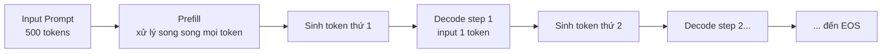
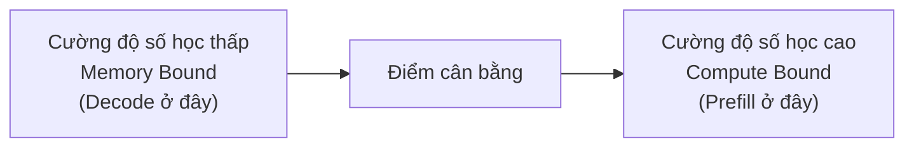
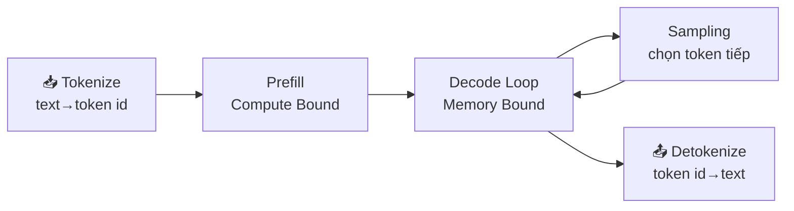

Đưa một mô hình lớn đã huấn luyện lên phục vụ và việc huấn luyện ra nó là hai việc với mục tiêu khác nhau. Huấn luyện nhồi dữ liệu khổng lồ và kéo Loss xuống; suy luận (inference) thì nhắm **sinh càng nhiều Token càng tốt, càng nhanh càng tốt, trong ràng buộc về độ trễ và chi phí**. Mục này không nói kỹ thuật tối ưu nào cả, chỉ làm một việc: làm rõ logic nền của suy luận LLM — chia thành hai giai đoạn nào, vì sao phải cache KV, bộ nhớ GPU tiêu ở đâu, dùng chỉ số gì để đo tốc độ, và câu hỏi cứ quay lại: **vì sao GPU giá hàng chục nghìn đô lại gần như ngồi không khi đang sinh chữ?**

Đọc xong mục này bạn có một hệ tọa độ. Mọi kỹ thuật tối ưu suy luận phía sau (PagedAttention, Continuous Batching, lượng tử hóa, speculative decoding…) đều là một nhát cắt ở đâu đó trong hệ đó. Hiểu nền thì mới thấy từng kỹ thuật đang giải quyết vấn đề gì.

<!-- more -->

## 📑 Mục lục

- [1. Sinh tự hồi quy: Prefill và Decode](#1-sinh-tự-hồi-quy-prefill-và-decode)
- [2. KV Cache: đổi bộ nhớ lấy tính toán](#2-kv-cache-đổi-bộ-nhớ-lấy-tính-toán)
- [3. Chỉ số hiệu năng chính: cách đo "nhanh"](#3-chỉ-số-hiệu-năng-chính-cách-đo-nhanh)
- [4. Phân tích điểm nghẽn: vì sao Decode không đầy sức tính toán](#4-phân-tích-điểm-nghẽn-vì-sao-decode-không-đầy-sức-tính-toán)
- [5. Đi hết luồng suy luận](#5-đi-hết-luồng-suy-luận)
- [Tóm tắt](#-tóm-tắt)
- [Danh sách tự kiểm](#-danh-sách-tự-kiểm)
- [Tài liệu tham khảo](#-tài-liệu-tham-khảo)

---

## 1. Sinh tự hồi quy: Prefill và Decode

### 1.1 Hiểu tự hồi quy như "nối tiếp câu chuyện"

Các mô hình ngôn ngữ lớn phổ biến (GPT, Llama, Qwen, …) đều là **mô hình tự hồi quy (autoregressive) kiểu Decoder-only**. "Tự hồi quy" nghe trừu tượng; thực tế là **mỗi lần chỉ dự đoán từ tiếp theo, nối dự đoán đó vào cuối đầu vào, rồi dự đoán tiếp** — như chơi nối chữ, chữ vừa nói lại thành manh mối cho chữ sau.

Một câu tóm tắt quá trình sinh: cho chuỗi Token đã có $x_1, x_2, \dots, x_t$, mô hình xuất phân bố xác suất của Token tiếp theo, lấy mẫu $x_{t+1}$, rồi nối lại để tiếp tục.

$$
x_{t+1} \sim P(x \mid x_1, x_2, \dots, x_t)
$$

Chuỗi này chạy đến khi mô hình sinh ký hiệu kết thúc (EOS) hoặc đạt độ dài tối đa đã cấu hình.

📌 **Điểm then chốt**: Bản chất tự hồi quy quyết định việc sinh là **tuần tự (serial)** — Token thứ $t+1$ phải đợi Token thứ $t$ xong mới bắt đầu. Phụ thuộc tuần tự đó là gốc của gần như mọi vấn đề độ trễ phía sau.

### 1.2 Hai giai đoạn: Prefill và Decode

Cả hai đều là "chạy mô hình một lần", nhưng suy luận được cắt rõ thành hai giai đoạn với đặc tính tính toán rất khác nhau.

**Prefill (điền trước)**: Xử lý toàn bộ Prompt bạn nhập. Nếu Prompt dài 500 Token, mô hình đưa 500 Token đó vào mạng **một lần, song song**, tính kết quả trung gian mỗi lớp và sinh Token đầu ra đầu tiên. Vì xử lý cùng lúc hàng trăm hay hàng nghìn Token, phép nhân ma trận lớn và dày, sức tính toán của GPU được nuôi no.

**Decode (giải mã)**: Từ Token đầu ra thứ hai trở đi, vào vòng lặp sinh từng cái một. Mỗi bước **chỉ đưa đúng 1 Token vừa sinh**, chạy hết mạng, nhả Token tiếp theo. Sinh 200 Token nghĩa là 200 bước Decode tuần tự.

Ví dụ: Prefill như **đọc đề** — một mạch đọc hết bài, hiểu ý; Decode như **làm bài** — viết từng chữ, mỗi chữ đều phải nhìn lại những gì đã viết. Đọc có thể lướt nhanh; làm bài chỉ từng nét một.

### 1.3 So sánh đặc tính tính toán hai giai đoạn

| 📊 Chiều | Prefill | Decode |
|---|---|---|
| Số Token đầu vào | Cả Prompt (vài chục đến vài nghìn) | Mỗi bước chỉ 1 |
| Độ song song | Cao; các Token có thể song song | Thấp; các bước tuần tự |
| Điểm nghẽn tính toán | Compute Bound (giới hạn bởi sức tính) | Memory Bound (giới hạn bởi truy cập bộ nhớ) |
| Chỉ số nó quyết định | Độ trễ Token đầu (TTFT) | Độ trễ mỗi Token (TPOT) |
| Số lần chạy | 1 lần | Độ dài đầu ra − 1 lần |

Hàng phản trực giác nhất là **điểm nghẽn tính toán**: vì sao Decode mỗi bước chỉ tính 1 Token lại là "giới hạn bởi bộ nhớ" và kém hiệu quả hơn? Mục 4 trả lời thẳng bằng mô hình Roofline. Tạm nhớ kết luận — đây là đường phân thủy để hiểu tối ưu suy luận.

---

## 2. KV Cache: đổi bộ nhớ lấy tính toán

### 2.1 Không cache thì sao

Quay lại tính tuần tự của tự hồi quy. Ở bước Decode thứ $t$, Attention cần Query của Token hiện tại đối với **Key và Value của mọi Token trước đó**. Những Key và Value đó lẽ ra đã được tính ở các bước trước.

Nếu không cache gì cả, mỗi Token mới lại phải cho mọi Token trước chạy lại mạng để tính lại K, V — đến Token thứ 100 phải tính lại 99 cái, đến 200 phải tính lại 199, khối lượng tính phình theo bình phương độ dài chuỗi. Đó rõ ràng là lãng phí lớn.

💡 **Gợi ý**: **Ý tưởng cốt lõi của KV Cache là lưu Key và Value đã tính, bước sau dùng lại luôn, không tính lại.** Điển hình kiểu "đổi không gian lấy thời gian": hy sinh bộ nhớ GPU để bỏ đi lượng tính lặp lại.

Một sự bất đối xứng: Query không cần cache vì mỗi bước chỉ dùng Query của Token hiện tại; Key và Value thì tích lũy theo lịch sử và mỗi bước đều cần toàn bộ, nên cái được cache là K và V — đó cũng là nguồn gốc tên "KV Cache".

### 2.2 Vòng đời của KV Cache

KV Cache của một yêu cầu trải bốn giai đoạn. Hiểu vòng đời này thì mới thấy PagedAttention phía sau đang tối ưu khâu nào:

📥 **Cấp phát** → ✍️ **Điền** → 🔁 **Dùng** → 🗑️ **Giải phóng**

- **Cấp phát**: Yêu cầu vào; engine dành sẵn một vùng bộ nhớ GPU cho KV Cache
- **Điền**: Prefill một lần tính hết K, V của Prompt rồi ghi vào cache; mỗi bước Decode thêm K, V của 1 Token
- **Dùng**: Mỗi bước Decode đọc toàn bộ KV lịch sử để tính Attention
- **Giải phóng**: Sinh xong (EOS hoặc đạt trần độ dài); bộ nhớ trả lại

### 2.3 Sổ kế toán bộ nhớ: KV Cache chiếm bao nhiêu

Đây là phép tính phải làm được bằng tay. Số byte mỗi Token trong KV Cache:

$$
\text{per\_token\_bytes} = 2 \times L \times H_{kv} \times d_{head} \times \text{bytes}
$$

Ý nghĩa từng hạng:

- $2$: lưu riêng Key và Value
- $L$: số lớp Transformer (mỗi lớp có KV Cache riêng)
- $H_{kv}$: số đầu KV (đầu KV, không phải đầu Query)
- $d_{head}$: chiều mỗi đầu
- $\text{bytes}$: số byte theo kiểu dữ liệu; FP16/BF16 là 2, FP8/INT8 là 1

Tổng của một yêu cầu nhân thêm độ dài chuỗi và số yêu cầu đồng thời:

$$
\text{total\_bytes} = \text{per\_token\_bytes} \times \text{seq\_len} \times \text{batch\_size}
$$

**Một ví dụ cụ thể** (32 lớp, multi-head attention chuẩn với 32 đầu KV, $d_{head}=128$, FP16):

$$
\text{per\_token\_bytes} = 2 \times 32 \times 32 \times 128 \times 2 = 524288 \text{ bytes} \approx 0.5\ \text{MB}
$$

Nghĩa là **mỗi Token mới nuốt thêm khoảng 0.5 MB bộ nhớ GPU**. Khi ngữ cảnh dài tới 4096 Token, chỉ riêng KV Cache của một yêu cầu đã khoảng 2 GB. Năm mươi yêu cầu đồng thời kiểu đó là 100 GB KV Cache — một GPU 80 GB nổ ngay. Đó là vì sao quản lý bộ nhớ KV Cache là chiến trường số một của tối ưu suy luận.

📌 **Điểm then chốt**: $H_{kv}$ là hệ số tuyến tính trong công thức, đúng là lý do **GQA (Grouped-Query Attention) / MQA (Multi-Query Attention)** tiết kiệm bộ nhớ mạnh — nhiều đầu Query dùng chung một bộ đầu KV. Ví dụ 32 đầu Query chia sẻ 8 đầu KV (GQA) cắt KV Cache còn $1/4$ mà khả năng biểu đạt gần như không giảm. Hầu hết mô hình lớn hiện đại dùng GQA vì sổ này nói vậy.

### 2.4 Vấn đề phân mảnh

KV Cache còn một hố kín: **bạn không biết trước yêu cầu sẽ sinh dài bao nhiêu**. Cách cũ là dành sẵn một khối liên tục theo "độ dài tối đa có thể", như nhà hàng giữ bàn lớn nhất dù khách đến bao nhiêu người. Kết quả: yêu cầu chỉ sinh 100 Token nhưng đã dành 2048, ghế thừa ngồi không — **phân mảnh nội (internal fragmentation)**; khe giữa các khối dành sẵn không ghép thành một khoảng dùng được — **phân mảnh ngoại (external fragmentation)**.

⚠️ **Lưu ý**: Phân mảnh làm tỷ lệ dùng thực của bộ nhớ KV Cache giảm mạnh; nhiều bộ nhớ bị dành sẵn rồi bỏ phí. Đó đúng là vấn đề cốt lõi PagedAttention của vLLM giải quyết — khối lớn liên tục thành quản lý phân trang kiểu hệ điều hành (chương sau nói kỹ).

---

## 3. Chỉ số hiệu năng chính: cách đo "nhanh"

"Nhanh" của dịch vụ suy luận không phải một con số. Trải nghiệm người dùng, chi phí cụm, cam kết SLA map sang các chỉ số khác nhau. Nhầm chúng thì tối ưu đi lệch.

### 3.1 Chỉ số độ trễ: người dùng đợi bao lâu

**TTFT (Time To First Token, độ trễ đến Token đầu)**: Thời gian từ lúc gửi yêu cầu đến khi nhận Token đầu. Chủ yếu gồm **thời gian xếp hàng + thời gian Prefill + độ trễ mạng**. Prompt càng dài Prefill càng lâu, TTFT càng lớn. Với chat và stream, TTFT quyết định ấn tượng đầu "có phản hồi nhanh không".

**TPOT (Time Per Output Token, độ trễ mỗi Token)**, còn gọi **ITL (Inter-Token Latency, độ trễ giữa các Token)**: Thời gian trung bình mỗi Token đầu ra trong giai đoạn sinh. Nó quyết định tốc độ chữ "nhảy ra" — TPOT 50 ms thì người dùng thấy khoảng 20 chữ mỗi giây.

💡 **Gợi ý**: Trong hầu hết ngữ cảnh TPOT và ITL là từ đồng nghĩa, đều chỉ khoảng cách trung bình giữa các Token Decode. Khác biệt nhỏ chỉ ở chỗ **có tính đoạn Token đầu vào không** — NVIDIA GenAI-Perf loại Token đầu: $\text{ITL} = (\text{e2e\_latency} - \text{TTFT}) / (\text{số Token đầu ra} - 1)$.

**Độ trễ đầu-cuối (E2E Latency)**: Tổng thời gian từ gửi yêu cầu đến nhận đủ phản hồi. Có thể tách thành:

$$
\text{E2E} = \text{TTFT} + \text{TPOT} \times (\text{số Token đầu ra} - 1)
$$

Công thức này rất thực dụng: **đầu ra ngắn thì TTFT chiếm ưu thế; đầu ra dài thì TPOT chiếm ưu thế**. Tối ưu phải nhìn rõ nghiệp vụ nằm phía nào.

**Hai kịch bản** (TTFT $=500\ \text{ms}$, TPOT $=40\ \text{ms}$):

- Đầu ra ngắn (20 Token): $\text{E2E} = 500 + 40 \times 19 = 1260\ \text{ms}$, TTFT chiếm khoảng $40\%$ — chữ đầu chậm là người dùng đã nổi nóng.
- Đầu ra dài (800 Token): $\text{E2E} = 500 + 40 \times 799 \approx 32460\ \text{ms}$, TTFT chỉ khoảng $1.5\%$ — lúc này tối ưu TPOT mới là việc chính.

Cùng một hệ thống, hình thái nghiệp vụ khác nhau thì trọng tâm tối ưu cách xa nhau. Đó là vì sao "đo phân bố độ dài vào/ra trước, rồi mới nói tối ưu" là luật cứng.

### 3.2 Chỉ số thông lượng: máy gánh được bao nhiêu

**Throughput (thông lượng)** thường có hai cách hiểu:

| 📊 Chỉ số | 📝 Ý nghĩa | Góc nhìn phù hợp |
|---|---|---|
| Token/s (hệ thống) | Tổng Token sinh mỗi giây trên toàn hệ thống | Năng lực và chi phí cụm |
| Token/s (một người dùng) | Tốc độ chữ mà một người dùng cảm nhận | Xấp xỉ $1 / \text{TPOT}$ |
| RPS (Requests/s) | Số yêu cầu hoàn thành mỗi giây | Khả năng chịu đồng thời |

Thông lượng hệ thống tăng theo đồng thời đến khi GPU bão hòa rồi phẳng hoặc tụt. **Thông lượng và độ trễ thường là một cặp mâu thuẫn**: nhét thêm yêu cầu vào một Batch nâng thông lượng hệ thống, nhưng mỗi yêu cầu xếp hàng và tính lâu hơn, độ trễ một người dùng xấu đi.

### 3.3 Độ trễ đuôi và Goodput: đừng bị trung bình lừa

Độ trễ trung bình là chỉ số dễ lừa nhất. Dưới traffic thật, một ít yêu cầu có thể chậm kinh khủng, còn trung bình thì giấu chúng đi. Môi trường production nhìn **độ trễ đuôi (tail latency)**:

- **P50**: Trung vị; một nửa yêu cầu nhanh hơn
- **P95 / P99**: 95% / 99% yêu cầu nhanh hơn — đây mới là nguồn khiếu nại

📌 **Điểm then chốt**: **Goodput (thông lượng hữu hiệu)** sát giá trị thật hơn raw QPS. Nó chỉ đếm thông lượng của phần yêu cầu **đạt SLO** (ví dụ TTFT < 1s và TPOT < 50ms). Hệ QPS cao nhưng hầu hết yêu cầu timeout thì Goodput thấp — người dùng chẳng dùng nổi. P/D decoupling và lập lịch nhận biết SLO ở chương 7 nhắm đúng Goodput.

---

## 4. Phân tích điểm nghẽn: vì sao Decode không đầy sức tính toán

Giờ trả lời câu hỏi mục 1 đã chôn. Đây là nguyên lý nền quan trọng nhất của tối ưu suy luận, đáng một mục riêng.

### 4.1 Cường độ số học: tỷ lệ tính / truy cập bộ nhớ

GPU làm cùng lúc hai việc: **chuyển dữ liệu** từ bộ nhớ GPU (HBM) và **tính** bằng đơn vị tính toán. Bên nào chậm hơn là điểm nghẽn. Đo một tác vụ "nghiêng tính hay nghiêng bộ nhớ" dùng **cường độ số học (arithmetic intensity)**:

$$
\text{cường độ số học} = \frac{\text{số phép toán dấu phẩy động (FLOPs)}}{\text{số byte truy cập bộ nhớ (Bytes)}}
$$

Hiểu thẳng: **mỗi byte kéo từ bộ nhớ, được làm thêm bao nhiêu phép tính**. Tỷ lệ cao nghĩa là dữ liệu được dùng kỹ, sức tính no; tỷ lệ thấp nghĩa là ALU ngồi chờ dữ liệu, phần lớn thời gian lãng phí vào chuyển dữ liệu.

### 4.2 Mô hình Roofline: một hình nhìn ra điểm nghẽn

Mô hình Roofline vẽ việc này thành đồ thị: trục ngang là cường độ số học, trục đứng là sức tính đạt được. Có một "đường mái" — nửa trái là dốc bị băng thông bộ nhớ đè (vùng Memory Bound), nửa phải là đường ngang bị đỉnh sức tính đè (vùng Compute Bound). Giao điểm hai đoạn là "điểm cân bằng" cường độ số học của GPU đó.

Tác vụ nằm trên dốc (cường độ dưới điểm cân bằng) thì điểm nghẽn là băng thông bộ nhớ; GPU mạnh đến đâu cũng không dùng hết. Chỉ khi nằm trên đường ngang mới là giới hạn bởi sức tính, mới thật sự vắt GPU.

Điểm cân bằng tính thế nào? Đỉnh sức tính chia băng thông bộ nhớ. Lấy NVIDIA H100 SXM: BF16 dày đặc khoảng $990\ \text{TFLOPS}$ (con số chính thức $1979\ \text{TFLOPS}$ là khi bật sparsity; dày đặc khoảng một nửa), băng thông HBM3 $3.35\ \text{TB/s}$:

$$
\text{điểm cân bằng} = \frac{990 \times 10^{12}\ \text{FLOP/s}}{3.35 \times 10^{12}\ \text{Byte/s}} \approx 295\ \text{FLOP/Byte}
$$

Nghĩa là trên H100, mỗi byte kéo từ bộ nhớ phải kèm khoảng **295 phép FLOP** mới vừa nuôi no sức tính và băng thông. Thấp hơn thì nằm trên dốc — nhớ con số này; mục sau dùng làm thước.

💡 **Gợi ý**: Điểm cân bằng khác nhau giữa các GPU nhưng cùng một bậc (vài trăm FLOP/Byte). Nâng băng thông thường "đáng tiền" hơn nâng sức tính vì hầu hết tải Decode kẹt cứng ở tường băng thông bên trái dốc.

### 4.3 Đặt Prefill và Decode lên đồ thị

- **Prefill**: Một lần xử lý song song hàng trăm hay hàng nghìn Token; trọng số chuyển từ bộ nhớ một lần (mọi Token trong batch dùng chung) nhưng làm lượng matmul khổng lồ — cường độ số học **cao**, nằm vùng Compute Bound, sức tính GPU no.
- **Decode**: Mỗi bước chỉ xử lý **1 Token**, nhưng để tính Token đó phải chuyển **toàn bộ trọng số mô hình** từ bộ nhớ một vòng. Chuyển vài chục đến hàng trăm GB trọng số chỉ để tính một Token — cường độ số học **cực thấp**, kẹt cứng vùng Memory Bound.

Cảm nhận khoảng cách bằng số. Cốt lõi mỗi bước Decode là "ma trận trọng số × vector một Token". Với mô hình trọng số nặng $W$ byte, FP16 mỗi bước: chuyển khoảng $W$ byte trọng số, tức $W/2$ phần tử trọng số, mỗi phần tử tham gia khoảng một phép nhân-cộng, tức khoảng $W/2$ nhân-cộng (tính một nhân-cộng là 2 FLOPs thì khoảng $2 \times W/2 = W$ FLOP). Vậy cường độ Decode một yêu cầu khoảng:

$$
\text{cường độ số học}_{\text{decode}} \approx \frac{W\ \text{FLOP}}{W\ \text{Byte}} \approx 1\ \text{FLOP/Byte}
$$

So với điểm cân bằng H100 khoảng $295\ \text{FLOP/Byte}$, Decode một yêu cầu thấp hơn đúng **hai bậc độ lớn** — tỷ lệ dùng sức tính lý thuyết chưa tới $1\%$. Đó là bằng chứng số trần trụi cho "Decode không đầy sức tính". Gộp $B$ yêu cầu thành một Batch thì trọng số vẫn chuyển một lần nhưng phục vụ $B$ Token, cường độ nhân $B$ lần và tiến gần điểm cân bằng — sức mạnh của Batching đến từ đây.

🔑 **Khái niệm cốt lõi**: **Decode chậm không phải vì tính không kịp, mà vì chuyển dữ liệu không kịp.** Đơn vị tính của GPU phần lớn thời gian ngồi chờ trọng số nạp từ bộ nhớ. Điều đó giải thích hai hiện tượng then chốt:

1. **Vì sao Batch nâng thông lượng mạnh mà gần như không tăng độ trễ**: Gộp Decode của nhiều yêu cầu thành một Batch, trọng số chuyển một lần phục vụ mọi Token trong Batch, cường độ số học tăng gấp bội, sức tính đang nghỉ được dùng — cơ sở lý thuyết của Continuous Batching.
2. **Vì sao lượng tử hóa (nhất là Weight-only) tăng tốc Decode rõ**: Decode nghẽn ở chuyển trọng số; nén trọng số từ FP16 xuống INT4 cắt số byte phải chuyển còn $1/4$, độ trễ giảm theo.

Hiểu điểm này là có "kính xuyên thấu" cho gần như mọi kỹ thuật tối ưu suy luận.

---

## 5. Đi hết luồng suy luận

Cuối cùng đi một vòng yêu cầu từ vào đến ra, đánh dấu đặc tính tính toán từng khâu, để sau này dễ định vị điểm nghẽn đang kẹt ở đâu.

| Khâu | Làm gì | Đặc tính tính toán | Điểm nghẽn tiềm ẩn |
|---|---|---|---|
| Tokenize | Cắt văn bản đầu vào thành chuỗi Token ID | Việc trên CPU | Văn bản dài hoặc đồng thời cao có thể nghẽn CPU |
| Prefill | Xử lý song song mọi Prompt Token; sinh Token đầu và KV Cache ban đầu | GPU, Compute Bound | Prompt rất dài đẩy TTFT lên |
| Decode Loop | Sinh từng Token; mỗi bước đọc hết KV, thêm KV mới | GPU, Memory Bound | Băng thông bộ nhớ; quyết định TPOT |
| Sampling | Lấy mẫu Token tiếp theo từ phân bố đầu ra (Temperature/Top-p, …) | GPU, nhẹ | Sampling phức tạp hoặc constrained decoding hơi tăng chi phí |
| Detokenize | Ghép Token ID thành văn bản đọc được; trả về theo stream | Việc trên CPU | Tranh CPU với vòng chính |

💡 **Gợi ý**: Tokenize / Detokenize là **việc trên CPU**, dễ bị bỏ quên. Khi GPU đã tối ưu xong, các khâu CPU này có thể thành điểm nghẽn mới — đúng là lý do engine vLLM V1 dùng đa tiến trình để chồng chúng lên vòng lõi GPU (chương 3 nói kỹ).

---

## 📝 Tóm tắt

Mục này không nói mẹo tối ưu, mà trải nền của suy luận LLM:

- **Hai giai đoạn**: Prefill đọc đề song song (Compute Bound, quyết định TTFT); Decode làm bài tuần tự (Memory Bound, quyết định TPOT).
- **KV Cache**: Đổi bộ nhớ lấy tính toán, tránh tính lại K/V lịch sử; chi phí bộ nhớ $= 2 \times L \times H_{kv} \times d_{head} \times \text{bytes} \times \text{seq\_len}$. GQA tiết kiệm bộ nhớ nhờ thu nhỏ $H_{kv}$; phân mảnh dẫn tới PagedAttention.
- **Chỉ số**: TTFT / TPOT lần lượt mô tả tốc độ chữ đầu và tốc độ nhả chữ; E2E $=$ TTFT $+$ TPOT $\times$ (độ dài đầu ra $-1$). Production nhìn độ trễ đuôi P95/P99 và Goodput đạt SLO.
- **Bản chất điểm nghẽn**: Decode là Memory Bound — GPU đang chờ chuyển trọng số, không phải tính không kịp. Đó giải thích vì sao Batching nâng thông lượng và lượng tử hóa tăng tốc Decode.

Có hệ tọa độ này, mỗi kỹ thuật tối ưu chương sau đều có chỗ đặt: đang đánh TTFT hay TPOT? Đang tiết kiệm bộ nhớ hay nâng thông lượng? Đang cắt trên dốc hay trên đường ngang?

## 🎯 Danh sách tự kiểm

- Nói rõ Prefill và Decode khác nhau thế nào về quy mô đầu vào, độ song song, điểm nghẽn tính toán
- Giải thích vì sao cần KV Cache, và vì sao chỉ cache K, V chứ không cache Q
- Tính tay chi phí bộ nhớ KV Cache mỗi Token cho một cấu hình mô hình cho trước
- Giải thích vì sao GQA/MQA tiết kiệm KV Cache, và khoảng bao nhiêu
- Phân biệt chính xác TTFT, TPOT/ITL, Throughput, độ trễ đuôi và Goodput cùng ngữ cảnh dùng
- Dùng công thức độ trễ E2E để phán nghiệp vụ là TTFT chiếm ưu thế hay TPOT chiếm ưu thế
- Dùng cường độ số học và Roofline giải thích vì sao Decode là Memory Bound
- Từ "Decode kẹt ở chuyển trọng số" suy ra vì sao Batching nâng thông lượng và lượng tử hóa Weight-only tăng tốc Decode
- Vẽ được luồng suy luận đầy đủ và chỉ ra đặc tính tính toán cùng điểm nghẽn tiềm ẩn từng khâu

## 📚 Tài liệu tham khảo

- [Attention Is All You Need (bài báo gốc Transformer)](https://arxiv.org/abs/1706.03762)
- [Efficient Memory Management for Large Language Model Serving with PagedAttention (bài báo vLLM)](https://arxiv.org/abs/2309.06180)
- [GQA: Training Generalized Multi-Query Transformer Models from Multi-Head Checkpoints](https://arxiv.org/abs/2305.13245)
- [NVIDIA NIM LLM Benchmarking — Metrics](https://docs.nvidia.com/nim/benchmarking/llm/latest/metrics.html)
- [vLLM Documentation](https://docs.vllm.ai/en/latest/)
- [Roofline: An Insightful Visual Performance Model for Multicore Architectures](https://dl.acm.org/doi/10.1145/1498765.1498785)
