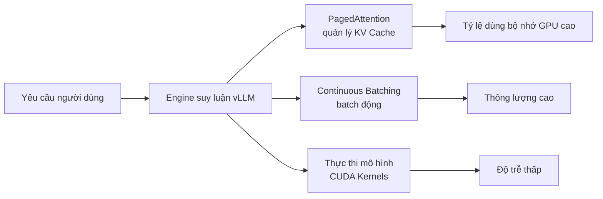

## 📑 Mục lục

- [1. vLLM là gì](#1-vllm-là-gì)
- [2. Nguyên lý cốt lõi: PagedAttention](#2-nguyên-lý-cốt-lõi-pagedattention)
- [3. Cài đặt và chuẩn bị môi trường](#3-cài-đặt-và-chuẩn-bị-môi-trường)
- [4. Suy luận batch offline](#4-suy-luận-batch-offline)
- [5. Triển khai dịch vụ online](#5-triển-khai-dịch-vụ-online)
- [6. Điều chỉnh tham số then chốt](#6-điều-chỉnh-tham-số-then-chốt)
- [7. Suy luận đa GPU và tensor parallelism](#7-suy-luận-đa-gpu-và-tensor-parallelism)
- [8. Vấn đề thường gặp và xử lý lỗi](#8-vấn-đề-thường-gặp-và-xử-lý-lỗi)
- [Tóm tắt](#-tóm-tắt)
- [Danh sách tự kiểm](#-danh-sách-tự-kiểm)
- [Tài liệu tham khảo](#-tài-liệu-tham-khảo)

---

## 1. vLLM là gì

Khi đưa một mô hình ngôn ngữ lớn lên phục vụ, điều đau đầu nhất là gì? — **Không đủ bộ nhớ GPU, thông lượng không lên nổi.** Cách suy luận truyền thống như nhà hàng giao mỗi bàn một phòng riêng: dù khách đến bao nhiêu người, phòng vẫn chiếm hết, khách sau chỉ biết đợi. vLLM ra đời để giải bài toán "lãng phí phòng riêng" đó.

vLLM là **engine suy luận và phục vụ LLM thông lượng cao, độ trễ thấp** do UC Berkeley Sky Computing Lab phát triển. Tính đến v0.19.0 (tháng 4/2026), dự án đã có hơn 76.000 sao trên GitHub và 2.000+ người đóng góp, là một trong những framework suy luận LLM mã nguồn mở phổ biến nhất hiện nay.

### 1.1 Ưu thế cốt lõi của vLLM

| 🏷️ Tính năng | 📝 Giải thích |
|---------|---------|
| **PagedAttention** | Quản lý KV Cache theo ý tưởng phân trang bộ nhớ ảo của hệ điều hành; tỷ lệ dùng bộ nhớ GPU gần tối ưu |
| **Continuous Batching** | Động chèn yêu cầu mới vào batch đang chạy, thay vì đợi cả batch xong mới bắt đầu batch sau |
| **API tương thích OpenAI** | Chỉ đổi `base_url` của client OpenAI, không sửa mã nghiệp vụ |
| **Hỗ trợ 200+ mô hình** | Bao phủ Llama, Qwen, Mistral, DeepSeek và các kiến trúc phổ biến khác, gồm MoE và đa phương thức |
| **Đa phần cứng** | NVIDIA GPU, AMD GPU, Google TPU, Intel Gaudi, CPU, … |
| **Nhiều phương án lượng tử hóa** | FP8, INT8, INT4, GPTQ, AWQ, GGUF dùng được ngay |

### 1.2 Vị trí của vLLM trong hệ sinh thái suy luận



## 2. Nguyên lý cốt lõi: PagedAttention

Trước khi đi sâu vào cách dùng, hãy hiểu vì sao vLLM nhanh — điều đó giúp bạn chỉnh tham số tốt hơn về sau.

### 2.1 Vấn đề của KV Cache truyền thống

Giai đoạn Decode của suy luận LLM cần cache vector Key và Value của mọi token trước đó (tức KV Cache) để tránh tính lại. Cách cũ là **dành sẵn một vùng bộ nhớ GPU liên tục cho mỗi yêu cầu**, kích thước theo độ dài chuỗi tối đa mô hình hỗ trợ.

Điều đó đem lại ba vấn đề:

- **Phân mảnh nội**: Hầu hết yêu cầu không dùng hết độ dài tối đa; không gian dành sẵn lãng phí nhiều
- **Phân mảnh ngoại**: Sau khi yêu cầu kết thúc, vùng giải phóng kích thước không đều, khó để yêu cầu mới dùng lại
- **Không chia sẻ được**: Trong Beam Search và các tình huống tương tự, nhiều chuỗi ứng viên chia sẻ phần tiền tố của KV Cache, nhưng bố cục bộ nhớ liên tục không hỗ trợ chia sẻ

💡 **Gợi ý**: Với mô hình 13B tham số, KV Cache của một yêu cầu ở độ dài chuỗi tối đa có thể chiếm vài GB. Nếu xử lý đồng thời vài chục yêu cầu, điểm nghẽn bộ nhớ có thể nặng hơn cả trọng số mô hình.

### 2.2 Cách PagedAttention giải quyết

Ý tưởng cốt lõi của PagedAttention rất thẳng — mang cách hệ điều hành quản lý bộ nhớ sang quản lý KV Cache:

| 🖥️ Khái niệm hệ điều hành | 🤖 Tương ứng trong PagedAttention |
|----------------|----------------------|
| Trang bộ nhớ ảo (Page) | KV Block (khối KV Cache kích thước cố định) |
| Bảng trang (Page Table) | Block Table (ánh xạ khối logic → khối vật lý) |
| Phân trang theo nhu cầu | Chỉ cấp KV Block mới khi sinh token |
| Copy-on-Write | Chia sẻ KV Block tiền tố trong Beam Search |

Cách hoạt động cụ thể:

1. **Lưu theo khối**: KV Cache không còn đòi bộ nhớ liên tục; bị cắt thành Block kích thước cố định (ví dụ 16 token một Block)
2. **Cấp theo nhu cầu**: Mỗi token mới chỉ ghi thêm vào Block hiện tại khi còn chỗ; đầy rồi mới cấp Block mới
3. **Quản lý bằng bảng ánh xạ**: Mỗi yêu cầu giữ một Block Table ghi quan hệ Block logic → Block vật lý của mình
4. **Chia sẻ bộ nhớ**: Nhiều yêu cầu cùng tiền tố (ví dụ System Prompt) có thể dùng chung một nhóm Block vật lý, tiết kiệm mạnh bộ nhớ GPU

⚠️ **Lưu ý**: Lưu theo khối của PagedAttention nghĩa là KV Cache không liên tục về vật lý; vLLM cần CUDA Kernel chuyên dụng để đọc hiệu quả dữ liệu từ các Block rải rác khi tính Attention.

## 3. Cài đặt và chuẩn bị môi trường

### 3.1 Yêu cầu hệ thống

| 📊 Hạng mục | 📝 Yêu cầu |
|---------|---------|
| Hệ điều hành | Linux (khuyến nghị Ubuntu 20.04+) |
| Python | 3.10 ~ 3.13 |
| CUDA | 12.x (NVIDIA GPU) |
| GPU | Compute Capability 7.0+ (Volta trở lên) |

### 3.2 Cài bằng uv (khuyến nghị)

`uv` là trình quản lý gói Python tốc độ cao viết bằng Rust. Tài liệu vLLM khuyến nghị dùng nó; nó tự phát hiện phiên bản CUDA và chọn PyTorch khớp:

```bash
# Tạo môi trường ảo
uv venv --python 3.12 --seed
source .venv/bin/activate

# Cài vLLM (tự phát hiện phiên bản CUDA)
uv pip install vllm --torch-backend=auto
```

`--torch-backend=auto` chọn bản PyTorch phù hợp theo driver CUDA của hệ thống. Bạn cũng có thể chỉ định tường minh, ví dụ `--torch-backend=cu126`.

### 3.3 Cài bằng conda + pip

```bash
conda create -n vllm-env python=3.12 -y
conda activate vllm-env
pip install --upgrade uv
uv pip install vllm --torch-backend=auto
```

### 3.4 Môi trường AMD ROCm

```bash
uv venv --python 3.12 --seed
source .venv/bin/activate
uv pip install vllm --extra-index-url https://wheels.vllm.ai/rocm/
```

Hiện ROCm hỗ trợ Python 3.12, ROCm 7.0, yêu cầu `glibc >= 2.35`.

### 3.5 Kiểm tra cài đặt

```bash
python -c "import vllm; print(vllm.__version__)"
```

## 4. Suy luận batch offline

Suy luận offline phù hợp các tình huống **không cần phản hồi thời gian thực**, như sinh văn bản hàng loạt, gắn nhãn dữ liệu, chạy điểm đánh giá. vLLM cung cấp lớp `LLM` làm cửa vào chính cho suy luận offline.

### 4.1 Cách dùng cơ bản

```python
from vllm import LLM, SamplingParams

# Định nghĩa tham số sampling
sampling_params = SamplingParams(
    temperature=0.8,
    top_p=0.95,
    max_tokens=256,
)

# Tải mô hình (tự tải từ HuggingFace)
llm = LLM(model="Qwen/Qwen2.5-7B-Instruct")

# Sinh theo batch
prompts = [
    "Giải thích Transformer bằng một câu:",
    "Khác biệt chính giữa Python và C++ là gì?",
    "Gợi ý ba cuốn sách nhập môn deep learning:",
]

outputs = llm.generate(prompts, sampling_params)

for output in outputs:
    prompt = output.prompt
    generated = output.outputs[0].text
    print(f"Prompt: {prompt}")
    print(f"Generated: {generated}\n")
```

📌 **Điểm then chốt**: Khi khởi tạo `LLM`, mô hình được tải một lần vào bộ nhớ GPU. Mặc định vLLM dùng 90% bộ nhớ GPU khả dụng (trọng số mô hình + KV Cache); chỉnh bằng tham số `gpu_memory_utilization`.

### 4.2 Suy luận chế độ Chat

Với mô hình Instruct/Chat cần áp dụng đúng Chat Template. vLLM có hai cách:

**Cách 1: dùng `llm.chat` (khuyến nghị)**

```python
from vllm import LLM, SamplingParams

llm = LLM(model="Qwen/Qwen2.5-7B-Instruct")
sampling_params = SamplingParams(temperature=0.7, max_tokens=512)

messages_list = [
    [
        {"role": "system", "content": "Bạn là chuyên gia AI Infra."},
        {"role": "user", "content": "Giải thích tensor parallelism là gì?"},
    ],
    [
        {"role": "user", "content": "vLLM và TensorRT-LLM khác nhau thế nào?"},
    ],
]

outputs = llm.chat(messages_list, sampling_params)

for output in outputs:
    print(output.outputs[0].text)
```

**Cách 2: áp dụng template thủ công**

```python
from transformers import AutoTokenizer
from vllm import LLM, SamplingParams

model_name = "Qwen/Qwen2.5-7B-Instruct"
tokenizer = AutoTokenizer.from_pretrained(model_name)
llm = LLM(model=model_name)

messages_list = [
    [{"role": "user", "content": "KV Cache là gì?"}],
]

# Áp dụng chat template thủ công
texts = tokenizer.apply_chat_template(
    messages_list,
    tokenize=False,
    add_generation_prompt=True,
)

outputs = llm.generate(texts, SamplingParams(temperature=0.7))
```

⚠️ **Lưu ý**: `llm.generate` không tự áp dụng Chat Template. Đưa văn bản thô thẳng vào mô hình Chat có thể làm chất lượng đầu ra kém hoặc loạn mã. Hãy dùng `llm.chat` hoặc gọi `apply_chat_template` thủ công.

### 4.3 Ảnh hưởng của HuggingFace generation_config

Mặc định vLLM đọc `generation_config.json` trong kho mô hình (nếu có) và ghi đè giá trị mặc định của vLLM bằng các tham số trong đó. Nếu muốn dùng cấu hình sampling mặc định của chính vLLM, hãy đặt tường minh:

```python
llm = LLM(model="Qwen/Qwen2.5-7B-Instruct", generation_config="vllm")
```

## 5. Triển khai dịch vụ online

Dịch vụ online là cách triển khai vLLM dùng nhiều nhất — khởi động một HTTP server, lộ **API tương thích OpenAI**, phía nghiệp vụ chỉ cần đổi `base_url` là chuyển mượt.

### 5.1 Khởi động server

```bash
vllm serve Qwen/Qwen2.5-7B-Instruct
```

Mặc định lắng nghe `http://localhost:8000`; tùy chỉnh bằng `--host` và `--port`:

```bash
vllm serve Qwen/Qwen2.5-7B-Instruct \
    --host 0.0.0.0 \
    --port 8080 \
    --tensor-parallel-size 2
```

💡 **Gợi ý**: Cũng có thể dùng `--generation-config vllm` để tắt generation_config mặc định của HuggingFace.

### 5.2 Chat Completions API

Đây là giao diện dùng nhiều nhất, tương ứng `v1/chat/completions` của OpenAI:

**Dùng curl:**

```bash
curl http://localhost:8000/v1/chat/completions \
    -H "Content-Type: application/json" \
    -d '{
        "model": "Qwen/Qwen2.5-7B-Instruct",
        "messages": [
            {"role": "system", "content": "Bạn là trợ lý hữu ích."},
            {"role": "user", "content": "PagedAttention là gì?"}
        ],
        "temperature": 0.7,
        "max_tokens": 512
    }'
```

**Dùng client Python openai:**

```python
from openai import OpenAI

# Chỉ cần đổi base_url, phần còn lại giữ nguyên
client = OpenAI(
    api_key="EMPTY",  # vLLM mặc định không cần xác thực
    base_url="http://localhost:8000/v1",
)

response = client.chat.completions.create(
    model="Qwen/Qwen2.5-7B-Instruct",
    messages=[
        {"role": "system", "content": "Bạn là chuyên gia hạ tầng AI."},
        {"role": "user", "content": "Giải thích nguyên lý hoạt động của Continuous Batching."},
    ],
    temperature=0.7,
    max_tokens=512,
)

print(response.choices[0].message.content)
```

### 5.3 Completions API

Tương ứng `v1/completions` của OpenAI, dùng cho hoàn thiện văn bản:

```python
from openai import OpenAI

client = OpenAI(api_key="EMPTY", base_url="http://localhost:8000/v1")

completion = client.completions.create(
    model="Qwen/Qwen2.5-7B-Instruct",
    prompt="Ba hướng cốt lõi của tối ưu suy luận LLM là",
    max_tokens=256,
    temperature=0.8,
)

print(completion.choices[0].text)
```

### 5.4 Xác thực API

Trong production nên bật xác thực API Key:

```bash
vllm serve Qwen/Qwen2.5-7B-Instruct --api-key my-secret-key
```

Hoặc đặt qua biến môi trường:

```bash
export VLLM_API_KEY=my-secret-key
vllm serve Qwen/Qwen2.5-7B-Instruct
```

Phía client truyền `api_key` tương ứng:

```python
client = OpenAI(api_key="my-secret-key", base_url="http://localhost:8000/v1")
```

### 5.5 Các endpoint API được hỗ trợ

| 📡 Endpoint | 📝 Giải thích |
|---------|---------|
| `GET /v1/models` | Liệt kê mô hình khả dụng |
| `POST /v1/completions` | Hoàn thiện văn bản |
| `POST /v1/chat/completions` | Hoàn thiện hội thoại |
| `GET /health` | Kiểm tra sức khỏe |

## 6. Điều chỉnh tham số then chốt

### 6.1 Tham số sampling (SamplingParams)

| 📊 Tham số | 📝 Giải thích | Mặc định |
|---------|---------|--------|
| `temperature` | Điều khiển độ ngẫu nhiên; càng cao càng ngẫu nhiên | 1.0 |
| `top_p` | Nucleus sampling; chỉ lấy mẫu từ các token có xác suất tích lũy trong p | 1.0 |
| `top_k` | Chỉ lấy mẫu từ k token có xác suất cao nhất | -1 (không giới hạn) |
| `max_tokens` | Số token sinh tối đa | 16 |
| `repetition_penalty` | Hệ số phạt lặp; >1 giảm lặp | 1.0 |
| `stop` | Gặp chuỗi chỉ định thì dừng sinh | None |
| `n` | Số chuỗi sinh cho mỗi prompt | 1 |
| `seed` | Hạt giống ngẫu nhiên; đặt rồi thì tái hiện được kết quả | None |

💡 **Gợi ý**: Với hầu hết tình huống production, bắt đầu từ `temperature=0.7, top_p=0.9`. Khi cần đầu ra xác định đặt `temperature=0`.

### 6.2 Tham số engine then chốt

| ⚙️ Tham số | 📝 Giải thích | Giá trị khuyến nghị |
|---------|---------|--------|
| `--model` | Định danh mô hình HuggingFace | - |
| `--tensor-parallel-size` | Số GPU cho tensor parallelism | Theo kích thước mô hình |
| `--gpu-memory-utilization` | Tỷ lệ dùng bộ nhớ GPU | 0.9 (mặc định) |
| `--max-model-len` | Độ dài chuỗi tối đa của mô hình | Đặt theo nhu cầu |
| `--dtype` | Độ chính xác trọng số | auto |
| `--quantization` | Phương pháp lượng tử hóa | None |
| `--max-num-seqs` | Số chuỗi đồng thời tối đa | 256 |
| `--enforce-eager` | Tắt CUDA Graph | Dùng khi gỡ lỗi |

### 6.3 Ước lượng bộ nhớ và gpu-memory-utilization

Khi khởi động, vLLM phân bổ bộ nhớ theo cách sau:

```
Tổng bộ nhớ GPU × gpu_memory_utilization = trọng số mô hình + KV Cache + bộ đệm tạm
```

Không gian KV Cache khả dụng = hạn mức tổng − trọng số mô hình − chi phí cố định. KV Cache càng lớn thì càng xử lý được nhiều yêu cầu đồng thời, thông lượng càng cao.

```bash
# Nếu bộ nhớ căng, hạ tỷ lệ dùng một chút
vllm serve Qwen/Qwen2.5-7B-Instruct --gpu-memory-utilization 0.85

# Hoặc giới hạn độ dài chuỗi tối đa để tiết kiệm không gian KV Cache
vllm serve Qwen/Qwen2.5-7B-Instruct --max-model-len 4096
```

⚠️ **Lưu ý**: Nếu sau khi tải mô hình khởi động báo OOM, thường cần hạ `--gpu-memory-utilization` hoặc `--max-model-len`, hoặc tăng `--tensor-parallel-size` để chia sang nhiều card.

### 6.4 Chọn Attention Backend

vLLM tự chọn Attention backend nhanh nhất trên nền tảng hiện tại; bạn cũng có thể chỉ định thủ công:

```bash
# Dùng FlashAttention
vllm serve Qwen/Qwen2.5-7B-Instruct --attention-backend FLASH_ATTN

# Dùng FlashInfer
vllm serve Qwen/Qwen2.5-7B-Instruct --attention-backend FLASHINFER
```

| 🖥️ Nền tảng | 📝 Backend khả dụng |
|---------|------------|
| NVIDIA CUDA | `FLASH_ATTN`, `FLASHINFER` |
| AMD ROCm | `TRITON_ATTN`, `ROCM_ATTN`, … |

## 7. Suy luận đa GPU và tensor parallelism

Khi một card không chứa nổi mô hình, cần Tensor Parallelism để cắt mô hình sang nhiều GPU.

### 7.1 Cách dùng cơ bản

```bash
# Tensor parallelism 2 card
vllm serve Qwen/Qwen2.5-72B-Instruct --tensor-parallel-size 2

# Tensor parallelism 4 card (phù hợp mô hình 70B+)
vllm serve Qwen/Qwen2.5-72B-Instruct --tensor-parallel-size 4
```

Suy luận offline cũng hỗ trợ:

```python
from vllm import LLM, SamplingParams

llm = LLM(
    model="Qwen/Qwen2.5-72B-Instruct",
    tensor_parallel_size=4,
)

outputs = llm.generate(["Giải thích kiến trúc của vLLM"], SamplingParams(max_tokens=256))
```

### 7.2 Tham chiếu kích thước mô hình và số GPU

Ước lượng nhu cầu bộ nhớ ở độ chính xác FP16 cho các kích thước mô hình phổ biến:

| 🤖 Quy mô mô hình | 💾 Kích thước trọng số (FP16) | 📝 Cấu hình GPU tối thiểu khuyến nghị |
|------------|-------------------|---------------------|
| 7B | ~14 GB | 1× A100 80G / 1× L40S 48G |
| 13B | ~26 GB | 1× A100 80G |
| 34B | ~68 GB | 1× A100 80G (cần hạ max_model_len) hoặc 2× A100 |
| 70B | ~140 GB | 2× A100 80G |
| 405B | ~810 GB | 16× A100 80G hoặc 8× H100 80G |

💡 **Gợi ý**: Bộ nhớ thực cần = trọng số mô hình + KV Cache + chi phí runtime. Dùng lượng tử hóa (ví dụ AWQ INT4) có thể giảm kích thước trọng số khoảng 4 lần, từ đó phục vụ mô hình lớn hơn với ít GPU hơn.

### 7.3 Các cách song song vLLM hỗ trợ

vLLM hỗ trợ năm chiến lược song song:

- **Tensor Parallelism**: Cắt ma trận trọng số từng lớp theo cột/hàng sang nhiều GPU
- **Pipeline Parallelism**: Gán các lớp khác nhau cho các GPU khác nhau
- **Data Parallelism**: Nhiều bản sao xử lý độc lập các yêu cầu khác nhau
- **Expert Parallelism**: Trong mô hình MoE, gán các expert khác nhau cho các GPU khác nhau
- **Context Parallelism**: Phân tán ngữ cảnh của chuỗi dài sang nhiều GPU

Với hầu hết tình huống, **tensor parallelism là lựa chọn đầu**: cấu hình đơn giản nhất và hiệu quả thường tốt nhất.

## 8. Vấn đề thường gặp và xử lý lỗi

### 8.1 OOM khi khởi động

```
torch.cuda.OutOfMemoryError: CUDA out of memory.
```

✅ **Cách xử lý**:

```bash
# Cách 1: hạ tỷ lệ dùng bộ nhớ
vllm serve model_name --gpu-memory-utilization 0.8

# Cách 2: rút ngắn độ dài chuỗi tối đa
vllm serve model_name --max-model-len 2048

# Cách 3: tăng tensor parallelism
vllm serve model_name --tensor-parallel-size 2

# Cách 4: dùng mô hình lượng tử hóa
vllm serve model_name --quantization awq
```

### 8.2 Đầu ra loạn mã từ mô hình Chat

Nếu dùng `llm.generate` đưa văn bản thẳng vào mô hình Chat, đầu ra có thể không như kỳ vọng.

✅ **Cách xử lý**: Đổi sang `llm.chat` hoặc gọi thủ công `tokenizer.apply_chat_template`, bảo đảm định dạng đầu vào khớp Chat Template của mô hình.

### 8.3 Tải mô hình từ ModelScope

Ở môi trường trong nước tải mô hình HuggingFace thường chậm; có thể chuyển sang ModelScope:

```bash
export VLLM_USE_MODELSCOPE=True
vllm serve Qwen/Qwen2.5-7B-Instruct
```

### 8.4 Tin cậy mã từ xa

Một số mô hình cần chạy mã tùy chỉnh:

```bash
vllm serve model_name --trust-remote-code
```

## 📝 Tóm tắt

vLLM nhờ hai kỹ thuật cốt lõi **PagedAttention** và **Continuous Batching** nâng tỷ lệ dùng bộ nhớ GPU và thông lượng của suy luận LLM lên mức mới. Bài này đi hết đường từ số không đến dùng vLLM:

1. **Hiểu nguyên lý**: PagedAttention quản lý KV Cache theo khối, mượn ý tưởng phân trang bộ nhớ ảo của OS để giải phân mảnh
2. **Suy luận offline**: Dùng lớp `LLM` và `SamplingParams` để sinh văn bản hàng loạt nhanh
3. **Triển khai online**: Một lệnh khởi động server API tương thích OpenAI; phía nghiệp vụ chuyển với chi phí gần bằng không
4. **Thực hành chỉnh tham số**: Nắm `gpu-memory-utilization`, `max-model-len`, `tensor-parallel-size` và các tham số then chốt khác
5. **Mở rộng đa GPU**: Phục vụ mô hình 70B+ bằng tensor parallelism

## 🎯 Danh sách tự kiểm

- Giải thích ý tưởng cốt lõi của PagedAttention và bài toán phân mảnh bộ nhớ nó giải quyết
- Dùng `LLM` và `SamplingParams` để hoàn thành suy luận batch offline
- Dùng đúng `llm.chat` cho suy luận chế độ Chat và hiểu tầm quan trọng của Chat Template
- Dùng `vllm serve` khởi động dịch vụ suy luận online tương thích OpenAI
- Gọi dịch vụ vLLM bằng client Python openai
- Chọn `tensor-parallel-size` phù hợp theo kích thước mô hình và bộ nhớ GPU
- Giải quyết OOM bằng cách chỉnh `gpu-memory-utilization` và `max-model-len`
- Nói được khác biệt cốt lõi giữa vLLM và cách suy luận truyền thống về quản lý bộ nhớ GPU

## 📚 Tài liệu tham khảo

- [Tài liệu chính thức vLLM — Quickstart](https://docs.vllm.ai/en/stable/getting_started/quickstart.html)
- [Kho GitHub vLLM](https://github.com/vllm-project/vllm)
- [Efficient Memory Management for Large Language Model Serving with PagedAttention (Kwon et al., 2023)](https://arxiv.org/abs/2309.06180)
- [Tổng quan kiến trúc vLLM](https://docs.vllm.ai/en/stable/design/arch_overview.html)
- [Ma trận tương thích tính năng vLLM](https://docs.vllm.ai/en/stable/features/index.html)
