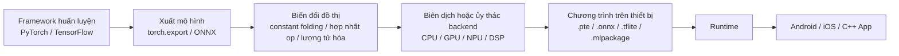
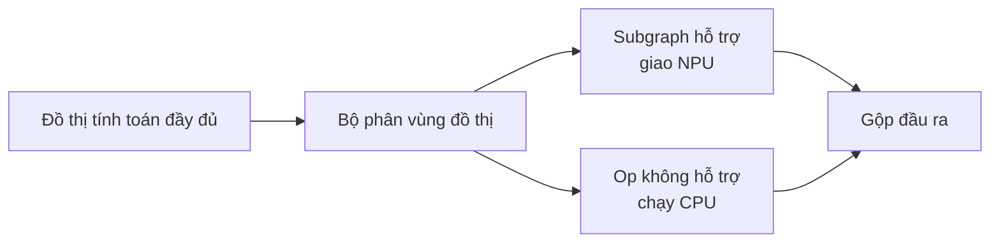
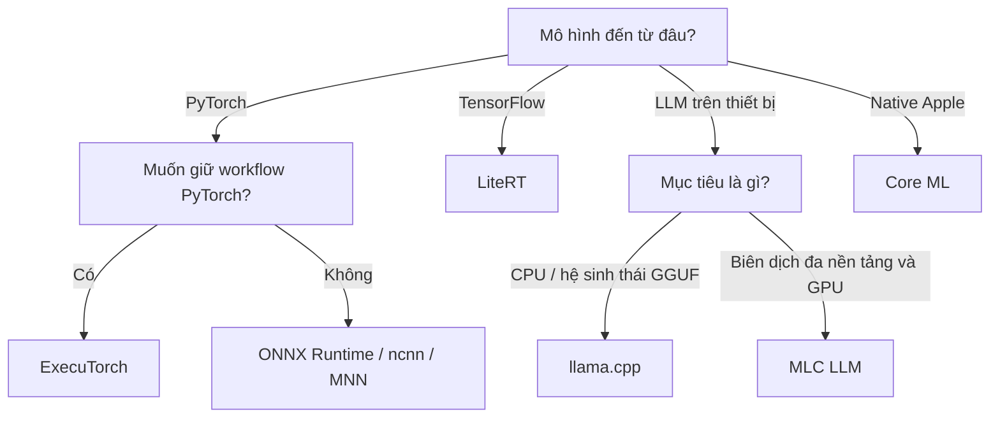

Khi deploy mô hình ở data center, câu hỏi đầu thường là: **một GPU chạy được bao nhiêu request?**

Sang điện thoại, ô tô, camera và thiết bị nhúng, câu hỏi đổi thành: mô hình có nhét vừa bộ nhớ không? Lần khởi động đầu mất bao lâu? Chạy liên tục mười phút rồi có bị giảm xung vì nóng không? Một toán tử NPU không hỗ trợ thì hệ thống báo lỗi, hay lặng lẽ fallback về CPU?

Những câu hỏi đó tạo nên **suy luận trên thiết bị (on-device inference)**. Không phải biên dịch chéo chương trình phía server, mà thiết kế lại cả đường suy luận quanh tài nguyên hạn chế, phần cứng dị thể và nền tảng phân mảnh.

Đọc xong bài này, bạn sẽ có một hệ tọa độ đầy đủ về suy luận trên thiết bị: mô hình biến thành chương trình thiết bị chạy được như thế nào, CPU/GPU/NPU/DSP mỗi cái đảm nhiệm gì, runtime quan hệ thế nào với backend phần cứng, và làm sao dùng thí nghiệm tái lập được để biết một tối ưu có thực sự hiệu quả.

<!-- more -->

## 📑 Mục lục

- [1. Suy luận trên thiết bị là gì](#1-suy-luận-trên-thiết-bị-là-gì)
- [2. Bốn ràng buộc của thiết bị đầu cuối](#2-bốn-ràng-buộc-của-thiết-bị-đầu-cuối)
- [3. Đường đi đầy đủ từ mô hình đến App](#3-đường-đi-đầy-đủ-từ-mô-hình-đến-app)
- [4. CPU, GPU, NPU và DSP](#4-cpu-gpu-npu-và-dsp)
- [5. Cách chọn runtime trên thiết bị](#5-cách-chọn-runtime-trên-thiết-bị)
- [6. Bốn đòn bẩy tối ưu trên thiết bị](#6-bốn-đòn-bẩy-tối-ưu-trên-thiết-bị)
- [7. Cách làm Benchmark trên thiết bị đáng tin](#7-cách-làm-benchmark-trên-thiết-bị-đáng-tin)
- [8. Ví dụ tối thiểu ExecuTorch và XNNPACK](#8-ví-dụ-tối-thiểu-executorch-và-xnnpack)
- [9. Lỗi thường gặp và thứ tự kiểm tra](#9-lỗi-thường-gặp-và-thứ-tự-kiểm-tra)
- [10. Gợi ý chọn công cụ](#10-gợi-ý-chọn-công-cụ)
- [Tóm tắt](#-tóm-tắt)
- [Checklist tự kiểm](#-checklist-tự-kiểm)
- [Tài liệu tham khảo](#-tài-liệu-tham-khảo)

---

## 1. Suy luận trên thiết bị là gì

Suy luận trên thiết bị nghĩa là mô hình chạy trên thiết bị người dùng cầm hoặc nằm gần nguồn dữ liệu: điện thoại, máy tính bảng, PC, ô tô, robot, camera, thiết bị đeo và đầu cuối IoT.

Người ta hay lẫn với suy luận biên (edge inference), nhưng phạm vi không trùng hết:

- **Thiết bị đầu cuối (Device)** nhấn mạnh thiết bị cuối, ràng buộc tài nguyên thường nặng nhất;
- **Biên (Edge)** còn có thể gồm trạm gốc, server cửa hàng và gateway biên;
- **Đám mây (Cloud)** thường có nhiều compute, bộ nhớ và điều kiện tản nhiệt hơn.

Vì sao đưa mô hình xuống thiết bị? Bốn lý do phổ biến:

1. **Độ trễ thấp**: phát hiện camera, đánh thức giọng nói và hỗ trợ lái xe không chờ được vòng mạng;
2. **Chạy offline**: vẫn hoạt động khi mạng yếu hoặc mất mạng;
3. **Riêng tư**: ảnh, giọng nói và văn bản gốc có thể giữ ở máy;
4. **Chi phí**: request nhẹ, tần suất cao xử lý local sẽ giảm compute và băng thông đám mây.

Cái giá là ràng buộc kỹ thuật mở rộng từ "chủ yếu throughput và chi phí" sang "cùng lúc tính độ trễ, bộ nhớ, kích thước gói, công suất, nhiệt độ, độ chính xác và tương thích".

---

## 2. Bốn ràng buộc của thiết bị đầu cuối

### 2.1 Bộ nhớ và lưu trữ

Mô hình trên thiết bị chiếm đồng thời file mô hình, trọng số, activation, vùng làm việc tạm và chính runtime. Hệ điều hành còn giới hạn bộ nhớ một App được dùng, nên "RAM vật lý 8 GB" không có nghĩa mô hình dùng hết 8 GB.

Chỉ riêng trọng số có thể ước lượng bước đầu bằng:

$$
M_{weights} \approx P \times \frac{b}{8}
$$

trong đó $P$ là số tham số, $b$ là số bit mỗi tham số. Một mô hình 3B chỉ riêng trọng số khoảng:

| Độ chính xác | Kích thước trọng số lý thuyết |
|---|---:|
| FP16/BF16 | 6 GB |
| INT8 | 3 GB |
| INT4 | 1.5 GB |

Đó chỉ là cận dưới lý thuyết; thực tế còn cộng scale lượng tử hóa, căn chỉnh file, KV Cache, activation và workspace.

Với LLM decoder-only, KV Cache có thể xấp xỉ:

$$
M_{KV} \approx 2 \times L \times B \times T \times H_{kv} \times D \times s
$$

trong đó $L$ là số tầng, $B$ là Batch Size, $T$ là số Token đang cache, $H_{kv}$ là số KV Head, $D$ là chiều mỗi Head, $s$ là số byte mỗi phần tử. Hệ số 2 lần lượt là Key và Value.

Điều này giải thích một hiện tượng hay gặp: trọng số nạp được chưa có nghĩa mô hình chạy ổn với ngữ cảnh dài.

### 2.2 Công suất và tản nhiệt

Thiết bị đầu cuối không chỉ nhìn tốc độ đỉnh của một lần suy luận. CPU hoặc GPU có thể nhanh trong thời gian ngắn, rồi giảm xung vì nhiệt và giới hạn công suất. Ứng dụng realtime đáng tin nên quan tâm hiệu năng ổn định, không chỉ lần chạy đẹp nhất ngay sau khi mở app.

### 2.3 Phân mảnh phần cứng

Hai điện thoại cùng Android có thể khác nhau về tập lệnh CPU, driver GPU và toolchain NPU. Cùng một đồ thị tính toán, trên thiết bị A có thể ủy thác hết cho NPU, trên thiết bị B lại có vài toán tử fallback về CPU.

### 2.4 Vòng đời ứng dụng

Suy luận trên thiết bị gắn với vòng đời App. Nạp mô hình có chặn UI không? Chuyển nền có giải phóng bộ nhớ không? Cập nhật mô hình thất bại có rollback được không? Những câu này không thuộc cấu trúc mô hình, nhưng quyết định tính năng có lên production được hay không.

---

## 3. Đường đi đầy đủ từ mô hình đến App

Suy luận trên thiết bị thường qua các giai đoạn sau:



Có ba khái niệm dễ lẫn:

- **Định dạng mô hình hoặc biểu diễn trung gian (IR)** mô tả đồ thị tính toán và trọng số, ví dụ ONNX;
- **Runtime** chịu trách nhiệm nạp mô hình, quản lý bộ nhớ và khởi chạy, ví dụ ExecuTorch, ONNX Runtime hoặc ncnn;
- **Backend/Delegate** thực sự chạy một phần tính toán, ví dụ XNNPACK, Core ML, Vulkan hoặc Qualcomm QNN.

Runtime không nhất thiết tự tính mọi toán tử. Nó có thể giao subgraph được hỗ trợ cho backend phần cứng, còn lại để Kernel CPU mặc định. Cơ chế đó gọi là **phân vùng đồ thị (partitioning)** hoặc **ủy thác (delegation)**.



Vì vậy "đã bật NPU" không đồng nghĩa "cả mô hình chạy trên NPU". Tối ưu trên thiết bị trước hết phải kiểm tra kết quả phân vùng thực tế.

---

## 4. CPU, GPU, NPU và DSP

### 4.1 CPU: baseline đáng tin nhất

CPU thường có độ phủ toán tử và trải nghiệm debug tốt nhất, đồng thời là đường dự phòng tương thích mạnh nhất. Trọng tâm tối ưu gồm:

- lệnh SIMD như ARM NEON, SVE;
- số luồng và lịch big.LITTLE;
- tỷ lệ trúng cache và bố cục bộ nhớ;
- Kernel tối ưu như XNNPACK, oneDNN;
- tránh quá nhiều luồng gây tranh chấp và tăng công suất.

### 4.2 GPU: song song cao, nhưng chuyển dữ liệu có giá

GPU di động phù hợp tác vụ song song cao, khối lượng tính lớn. Giao diện phổ biến gồm Vulkan, Metal và OpenCL. Cần lưu ý:

- op nhỏ có thể không đủ để khấu hao chi phí lịch;
- chuyển đổi và đồng bộ dữ liệu giữa CPU và GPU tốn thời gian;
- chất lượng driver và độ chính xác hỗ trợ khác nhau giữa thiết bị;
- tăng tốc GPU không bảo đảm nhanh hơn ARM CPU đã tối ưu kỹ.

### 4.3 NPU: hiệu năng năng lượng cao, biên toán tử chặt

NPU tối ưu cho nhân ma trận, convolution và suy luận độ chính xác thấp, thường có hiệu năng năng lượng tốt. Ràng buộc chính là độ phủ op, Tensor Layout, hình dạng động và quy tắc lượng tử hóa. Chỉ cần đồ thị có nút không hỗ trợ là có thể bị cắt đồ thị và đổi backend.

### 4.4 DSP: hợp tác vụ tín hiệu chạy liên tục

DSP thường dùng cho âm thanh, cảm biến và tác vụ luôn bật công suất thấp. Sức tính không nhất thiết cao nhất, nhưng xử lý được luồng dữ liệu đều đặn với công suất thấp.

Chọn phần cứng trên thiết bị không có câu trả lời "luôn nhanh nhất". Cách đúng là dựng baseline độ chính xác trên CPU trước, rồi đo riêng độ phủ, độ trễ đầu-cuối và công suất ổn định của GPU/NPU/DSP.

---

## 5. Cách chọn runtime trên thiết bị

| Runtime | Lối vào chính | Mục tiêu thường gặp | Phù hợp khi |
|---|---|---|---|
| ExecuTorch | PyTorch / `torch.export` | XNNPACK, Vulkan, Core ML, QNN, v.v. | Muốn giữ workflow PyTorch, hoặc cần nhiều backend phần cứng |
| ONNX Runtime Mobile | ONNX | Android, iOS, nhiều Execution Provider | Nguồn mô hình đa dạng, coi trọng tương tác liên framework |
| LiteRT | TFLite/LiteRT | Android, iOS, GPU/NPU Delegate | Hệ sinh thái TensorFlow / Google AI Edge |
| Core ML | Core ML Model | Apple CPU, GPU, Neural Engine | App native iOS/macOS |
| ncnn | chuyển đổi pnnx / ONNX | ARM CPU, Vulkan | C++ phụ thuộc nhẹ, thị giác di động và deploy nhúng |
| MNN | chuyển đổi ONNX/TFLite, v.v. | CPU, GPU, LLM trên thiết bị | Mobile trong nước, deploy cả mô hình truyền thống và LLM |
| llama.cpp | GGUF | CPU, Metal, Vulkan, v.v. | Suy luận LLM local và trên thiết bị |
| MLC LLM | biên dịch ra thư viện mô hình đích | Android, iOS, WebGPU, Vulkan, v.v. | Đa nền tảng, deploy LLM theo hướng compiler |

Bảng này để định vị, không phải bảng xếp hạng hiệu năng. Kết quả runtime phụ thuộc cấu trúc mô hình, thiết bị, độ chính xác, độ phủ backend và phiên bản. Khi chọn, hãy cố định mô hình và giao thức đo trước, rồi đo thực trên thiết bị mục tiêu.

---

## 6. Bốn đòn bẩy tối ưu trên thiết bị

### 6.1 Nén mô hình

Phương pháp phổ biến gồm pruning có cấu trúc, distillation, phân tích hạng thấp và chọn kiến trúc nhỏ hơn. Nén mô hình không chỉ giảm tính toán mà còn có thể đổi cấu trúc op, nên cần đánh giá cùng với Kernel mà phần cứng đích hỗ trợ.

### 6.2 Lượng tử hóa (quantization)

Lượng tử hóa chuyển trọng số hoặc activation từ FP32/FP16 sang biểu diễn độ chính xác thấp như INT8, INT4. Cần nắm các khác biệt sau:

- **PTQ (post-training quantization)**: chi phí thấp, hợp deploy nhanh;
- **QAT (quantization-aware training)**: mô phỏng sai số lượng tử hóa khi huấn luyện, thường giữ độ chính xác tốt hơn;
- **Weight-only**: chỉ lượng tử hóa trọng số, thường dùng cho LLM;
- **Lượng tử hóa trọng số và activation**: nén mạnh hơn, phụ thuộc hỗ trợ phần cứng nhiều hơn;
- **Per-tensor / Per-channel**: dùng tham số lượng tử hóa cho cả Tensor hoặc theo từng kênh.

Lượng tử hóa không đồng nghĩa chắc chắn nhanh hơn. Nếu phần cứng không có Kernel độ chính xác thấp tương ứng, hoặc đồ thị liên tục quantize/dequantize, độ trễ có thể tăng. Đánh giá lượng tử hóa phải báo cáo cùng lúc kích thước mô hình, độ trễ, bộ nhớ và thay đổi độ chính xác.

### 6.3 Tối ưu đồ thị và toán tử

Các thao tác tối ưu đồ thị thường gặp:

- constant folding;
- hợp nhất op như Conv-BN, Linear-Activation;
- xóa Cast, Transpose và Reshape thừa;
- chuyển Layout NCHW/NHWC;
- chuyên biệt hóa hình dạng tĩnh;
- custom op hoặc thay op không được hỗ trợ.

Trọng tâm không phải càng ít nút càng tốt, mà là giảm truy cập bộ nhớ, chi phí lịch và việc đổi backend.

### 6.4 Lập kế hoạch bộ nhớ

Tối ưu bộ nhớ trên thiết bị gồm:

- tái sử dụng Buffer activation có vòng đời không chồng;
- memory-map để nạp trọng số mô hình lớn theo nhu cầu;
- kiểm soát độ dài ngữ cảnh LLM và độ chính xác KV Cache;
- tránh copy Tensor trùng giữa preprocess, Runtime và tầng UI;
- nạp theo phân mảnh và có chiến lược hạ cấp rõ khi cấp phát bộ nhớ thất bại.

---

## 7. Cách làm Benchmark trên thiết bị đáng tin

Chỉ báo một lần "thời gian trung bình" gần như vô nghĩa. Một Benchmark trên thiết bị tái lập được ít nhất phải ghi:

### 7.1 Thông tin môi trường

- model thiết bị, SoC, bộ nhớ và phiên bản hệ thống;
- phiên bản Runtime, mô hình và driver;
- độ chính xác mô hình và phương pháp lượng tử hóa;
- backend thực thi thực tế và kết quả phân vùng đồ thị;
- số luồng, kích thước đầu vào, Batch Size và phạm vi hình dạng động.

### 7.2 Chỉ số hiệu năng

- thời gian cold start và thời gian nạp mô hình;
- độ trễ P50, P90, P99 sau warmup;
- throughput;
- bộ nhớ đỉnh và bộ nhớ khi chạy ổn định;
- kích thước file mô hình và gói Runtime;
- công suất, nhiệt độ và thay đổi hiệu năng sau chạy liên tục;
- độ chính xác tác vụ và sai số so với mô hình gốc.

Với LLM còn thêm:

- **TTFT**: độ trễ đến Token đầu;
- **TPOT**: thời gian trung bình giữa các Token đầu ra liền kề;
- tokens/s riêng của Prefill và Decode;
- độ dài ngữ cảnh ổn định tối đa;
- bộ nhớ đỉnh và việc hệ thống có thu hồi bộ nhớ hay không.

### 7.3 Giao thức thí nghiệm khuyến nghị

1. Cố định mẫu đầu vào và seed ngẫu nhiên;
2. Chạy kết quả framework gốc trước, lưu baseline độ chính xác;
3. Đo riêng thời gian nạp mô hình và suy luận;
4. Warmup vài lần, rồi thu ít nhất vài chục lần suy luận;
5. Báo cáo cùng lúc trung vị và độ trễ đuôi;
6. Chạy liên tục một lúc, quan sát nhiệt độ và giảm xung;
7. Kiểm tra backend thực sự dùng cho từng subgraph;
8. Lưu script, cấu hình và kết quả thô, không chỉ kết luận cuối.

📌 **Điểm then chốt**: so sánh Benchmark trên thiết bị phải kiểm soát biến. Số liệu từ kích thước đầu vào, số luồng, độ chính xác lượng tử hóa hoặc độ phủ backend khác nhau không đem so ngang trực tiếp được.

Nên lưu điều kiện then chốt và kết quả mỗi lần thí nghiệm cùng nhau, tối thiểu gồm các trường sau:

```yaml
device: "model thiết bị / SoC / bộ nhớ"
os: "hệ thống và phiên bản"
model: "tên mô hình, phiên bản và hash file"
runtime: "runtime, phiên bản và backend thực thi"
precision: "FP16 / INT8 / INT4 ..."
input: "kích thước đầu vào, Batch Size, độ dài ngữ cảnh"
threads: 4
warmup_runs: 10
measured_runs: 100
delegate_coverage: "tỷ lệ subgraph ủy thác hoặc op không hỗ trợ"
latency_ms: "P50 / P90 / P99"
peak_memory_mb: 0
power_and_temperature: "công cụ đo, giá trị ban đầu, giá trị ổn định"
accuracy: "chỉ số tác vụ hoặc sai số lớn nhất so với baseline"
```

Hash file mô hình, phiên bản Runtime và độ phủ backend đặc biệt quan trọng: chúng tránh hai kiểu hiểu nhầm — "cùng tên mô hình nhưng khác file" và "nói dùng NPU nhưng thực tế fallback CPU nhiều".

---

## 8. Ví dụ tối thiểu ExecuTorch và XNNPACK

ExecuTorch xuất mô hình PyTorch thành chương trình `.pte` nhẹ và dùng Delegate để giao tính toán cho các backend như XNNPACK, Core ML, Vulkan, Qualcomm QNN. Dưới đây lấy backend CPU đa nền tảng XNNPACK làm ví dụ, đi hết đường xuất tối thiểu.

> API thay đổi theo phiên bản. Ví dụ dưới dựa trên giao diện xuất trong tài liệu ExecuTorch 1.3; khi thực hành hãy cố định phiên bản PyTorch, ExecuTorch và backend đích.

Cài trong môi trường Python riêng và ghi lại phiên bản:

```bash
python -m pip install executorch
python -m pip show torch executorch
```

Lần luyện đầu nên dùng XNNPACK để dựng baseline CPU. Nó không cần SDK của hãng chip thêm, nên tách được "lỗi xuất mô hình" khỏi "lỗi toolchain NPU".

### 8.1 Định nghĩa một mô hình nhỏ

```python
import torch


class TinyClassifier(torch.nn.Module):
    def __init__(self) -> None:
        super().__init__()
        self.features = torch.nn.Sequential(
            torch.nn.Conv2d(3, 8, kernel_size=3, stride=2, padding=1),
            torch.nn.ReLU(),
            torch.nn.Conv2d(8, 16, kernel_size=3, stride=2, padding=1),
            torch.nn.ReLU(),
            torch.nn.AdaptiveAvgPool2d((1, 1)),
        )
        self.classifier = torch.nn.Linear(16, 10)

    def forward(self, x: torch.Tensor) -> torch.Tensor:
        x = self.features(x)
        x = torch.flatten(x, 1)
        return self.classifier(x)


model = TinyClassifier().eval()
example_inputs = (torch.randn(1, 3, 224, 224),)
```

Trước khi xuất lên thiết bị hãy gọi `eval()`, tránh Dropout và BatchNorm vẫn ở hành vi huấn luyện. Đầu vào ví dụ đồng thời cố định hình dạng và kiểu đầu vào của đồ thị.

### 8.2 Xuất và ủy thác cho XNNPACK

```python
import torch
from executorch.backends.xnnpack.partition.xnnpack_partitioner import (
    XnnpackPartitioner,
)
from executorch.exir import to_edge_transform_and_lower


exported_program = torch.export.export(model, example_inputs)

edge_program = to_edge_transform_and_lower(
    exported_program,
    partitioner=[XnnpackPartitioner()],
)

executorch_program = edge_program.to_executorch()

with open("tiny_classifier_xnnpack.pte", "wb") as file:
    file.write(executorch_program.buffer)
```

Đoạn chương trình này làm ba việc:

1. `torch.export.export` bắt đồ thị tính toán PyTorch;
2. `XnnpackPartitioner` đánh dấu và hạ subgraph mà XNNPACK hỗ trợ;
3. `to_executorch` sinh file `.pte` để Runtime trên thiết bị nạp.

### 8.3 Cần kiểm chứng gì

Sinh file chưa phải deploy xong. Ít nhất còn phải kiểm:

- sai số đầu ra trước/sau xuất có trong ngưỡng cho phép không;
- toán tử nào được ủy thác cho XNNPACK, toán tử nào vẫn chạy Kernel mặc định;
- kích thước gói cuối của file `.pte` và Runtime;
- thời gian nạp, độ trễ và bộ nhớ trên thiết bị Android/iOS thật;
- độ ổn định khi chạy nhiều lần và chạy liên tục.

Nếu đích là Qualcomm NPU, Apple Neural Engine hoặc Vulkan GPU, luồng tổng thể không đổi, nhưng cần đổi Partitioner và chuẩn bị SDK, tùy chọn biên dịch cùng môi trường thiết bị theo tài liệu backend tương ứng.

---

## 9. Lỗi thường gặp và thứ tự kiểm tra

### 9.1 Xuất thất bại

Trước hết định vị control flow Python không hỗ trợ, hình dạng động hoặc custom op, rồi thử viết lại mô hình hoặc đăng ký custom op. Đừng liên tục đổi opset hay phiên bản Runtime khi chưa biết nút nào thất bại.

### 9.2 Độ chính xác đầu ra không khớp

Thu hẹp phạm vi theo thứ tự:

1. Căn chỉnh preprocess và postprocess;
2. So sánh đầu ra FP32 trước và sau xuất;
3. Rồi so sánh trước và sau lượng tử hóa;
4. Cuối cùng so sánh các backend phần cứng khác nhau;
5. Khi cần, lưu Tensor trung gian để tìm toán tử đầu tiên xuất hiện sai số rõ.

Nhiều "lỗi độ chính xác Runtime" thực ra đến từ RGB/BGR, chuẩn hóa, Resize hoặc NCHW/NHWC không khớp.

### 9.3 NPU chậm hơn CPU

Ưu tiên kiểm:

- NPU thực sự phủ bao nhiêu toán tử;
- có chuyển dữ liệu qua lại CPU–NPU thường xuyên không;
- quy mô đầu vào có quá nhỏ, không khấu hao được chi phí biên dịch và lịch không;
- Benchmark có gộp nạp mô hình, lần biên dịch đầu hoặc warmup vào thời gian suy luận không;
- kiểu lượng tử hóa có thực sự trúng Kernel NPU không.

### 9.4 Lần chạy đầu đặc biệt chậm

Nguyên nhân có thể gồm giải tuần tự hóa mô hình, sắp xếp lại trọng số, biên dịch đồ thị và tạo GPU Pipeline. Cold start và warm start nên đo riêng, và cache kết quả biên dịch tái dùng được theo khả năng của Runtime.

### 9.5 Chạy liên tục càng lúc càng chậm

Quan sát nhiệt độ, tần số CPU/GPU, lịch luồng và chế độ pin. Nếu độ trễ xấu đi khi nhiệt tăng, mục tiêu tối ưu nên chuyển từ tốc độ đỉnh sang hiệu năng năng lượng và tốc độ ổn định.

---

## 10. Gợi ý chọn công cụ

Có thể bắt đầu từ nguồn mô hình và nền tảng đích:



Đây chỉ là cách thu hẹp ứng viên. Lựa chọn cuối vẫn phải dựa trên đúng đắn, độ phủ backend, độ trễ, bộ nhớ, công suất và kích thước gói đo trên thiết bị đích.

---

## 🎯 Tóm tắt

Bản chất của suy luận trên thiết bị là, trên tài nguyên phần cứng hạn chế và dị thể, biến mô hình thành năng lực sản phẩm đáng tin:

1. Trên thiết bị không chỉ quan tâm tốc độ, còn quan tâm bộ nhớ, công suất, nhiệt độ, kích thước gói và tương thích;
2. Định dạng mô hình, Runtime và Backend là ba tầng khác nhau;
3. Delegate phân vùng đồ thị; op không hỗ trợ có thể fallback về CPU;
4. Lượng tử hóa có tăng tốc hay không phụ thuộc Kernel phần cứng và cách chạy cả đồ thị;
5. Hiệu năng trên thiết bị phải đo trên thiết bị thật theo giao thức thống nhất;
6. Dựng baseline đúng trên CPU rồi dần bật GPU/NPU là đường tối ưu đáng tin hơn.

---

## ✅ Checklist tự kiểm

- [ ] Giải thích được khác biệt giữa suy luận trên thiết bị, biên và đám mây
- [ ] Phân biệt được định dạng mô hình, Runtime và Backend/Delegate
- [ ] Nêu được đặc điểm chính của CPU, GPU, NPU, DSP
- [ ] Ước lượng được bộ nhớ chiếm bởi trọng số mô hình và KV Cache của LLM
- [ ] Giải thích được vì sao lượng tử hóa chưa chắc nhanh hơn
- [ ] Nhận diện được fallback backend và vấn đề chuyển dữ liệu trong thực thi dị thể
- [ ] Thiết kế được Benchmark gồm cold start, độ trễ đuôi, bộ nhớ, công suất và độ chính xác
- [ ] Mô tả được luồng cơ bản xuất mô hình PyTorch thành ExecuTorch `.pte`

---

## 📚 Tài liệu tham khảo

1. [ExecuTorch Documentation](https://docs.pytorch.org/executorch/stable/)
2. [ExecuTorch Architecture and Components](https://docs.pytorch.org/executorch/stable/getting-started-architecture)
3. [ExecuTorch Quick Start Pathway](https://docs.pytorch.org/executorch/stable/pathway-quickstart.html)
4. [ONNX Runtime Mobile](https://onnxruntime.ai/docs/tutorials/mobile/)
5. [Google AI Edge LiteRT](https://ai.google.dev/edge/litert)
6. [Apple Core ML](https://developer.apple.com/documentation/coreml)
7. [Tencent ncnn](https://github.com/Tencent/ncnn)
8. [Alibaba MNN](https://github.com/alibaba/MNN)
9. [llama.cpp Android Guide](https://github.com/ggml-org/llama.cpp/blob/master/docs/android.md)
10. [MLC LLM Documentation](https://llm.mlc.ai/docs/)
11. [Qualcomm AI Engine Direct SDK](https://www.qualcomm.com/developer/software/qualcomm-ai-engine-direct-sdk)
12. [MLPerf Inference: Mobile](https://mlcommons.org/benchmarks/inference-mobile/)
