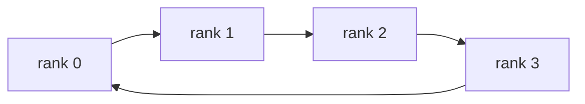
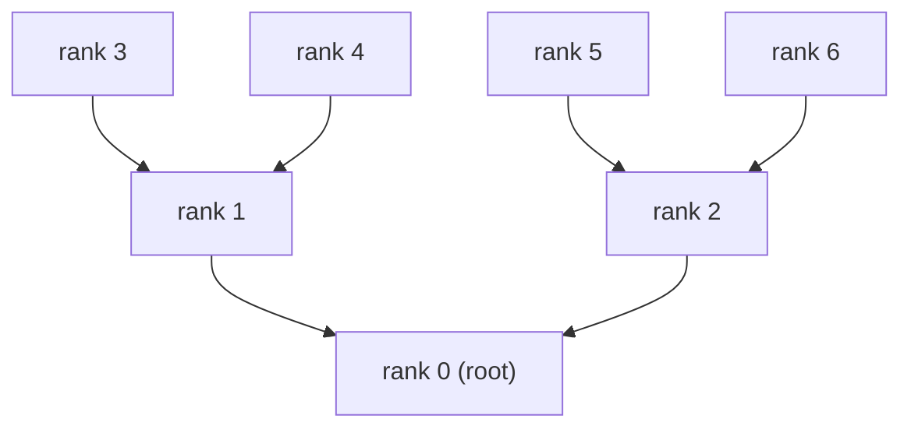
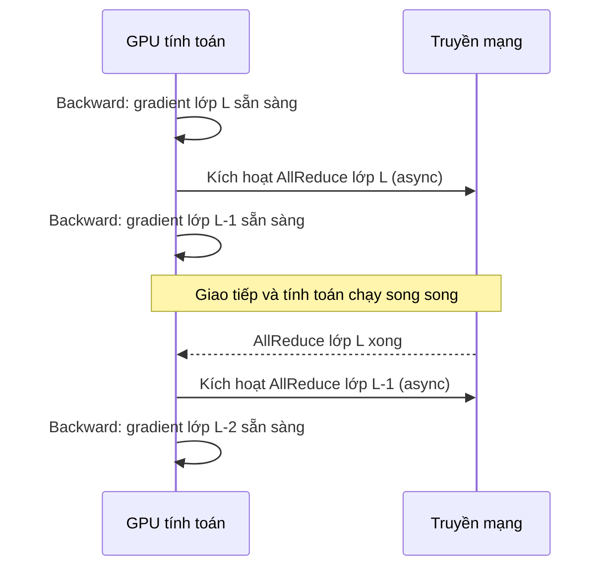

GPU đơn dù mạnh đến đâu cũng có trần. Huấn luyện và suy luận mô hình lớn buộc phải dùng nhiều card, thậm chí nhiều máy. Lúc đó, GPU "nói chuyện với nhau thế nào và nhanh ra sao" trở thành yếu tố quyết định hiệu năng tổng thể. Bài này đi từ NVLink trong một máy sang InfiniBand giữa các máy, rồi tới primitive giao tiếp tập thể (collective), thuật toán Ring/Tree AllReduce, overlap giao tiếp–tính toán, và thư viện NCCL, để dựng lại toàn bộ chuỗi kiến thức về giao tiếp cụm AI.

<!-- more -->

## Mục lục

- [1. Giao tiếp giữa các card trong một máy: NVLink và NVSwitch](#1-giao-tiếp-giữa-các-card-trong-một-máy-nvlink-và-nvswitch)
- [2. Giao tiếp giữa các máy: InfiniBand và RoCE](#2-giao-tiếp-giữa-các-máy-infiniband-và-roce)
- [3. Giao tiếp điểm-điểm: viên gạch cơ bản nhất](#3-giao-tiếp-điểm-điểm-viên-gạch-cơ-bản-nhất)
- [4. Các primitive giao tiếp tập thể](#4-các-primitive-giao-tiếp-tập-thể)
- [5. Ring AllReduce: hiện thực tối ưu băng thông](#5-ring-allreduce-hiện-thực-tối-ưu-băng-thông)
- [6. Tree AllReduce: hướng tiếp cận khác cho độ trễ thấp](#6-tree-allreduce-hướng-tiếp-cận-khác-cho-độ-trễ-thấp)
- [7. Overlap giao tiếp và tính toán](#7-overlap-giao-tiếp-và-tính-toán)
- [8. NCCL: thư viện giao tiếp tập thể cho GPU](#8-nccl-thư-viện-giao-tiếp-tập-thể-cho-gpu)
- [9. Nhìn chiến lược song song phân tán từ góc giao tiếp](#9-nhìn-chiến-lược-song-song-phân-tán-từ-góc-giao-tiếp)
- [Tóm tắt](#-tóm-tắt)
- [Checklist tự kiểm](#-checklist-tự-kiểm)
- [Tài liệu tham khảo](#-tài-liệu-tham-khảo)


## 1. Giao tiếp giữa các card trong một máy: NVLink và NVSwitch

Khi một mô hình cần nhiều GPU tính cùng nhau, tốc độ chuyển dữ liệu giữa các card quyết định trực tiếp hiệu quả song song.

### 1.1 PCIe: điểm khởi đầu nhưng chưa đủ

PCIe là kênh liên kết cơ bản nhất giữa GPU với CPU, và giữa các GPU với nhau. Có thể hình dung như đường phố thường nối hai tòa nhà: xe nào cũng đi được, nhưng làn hẹp, đèn đỏ nhiều.

| Phiên bản PCIe | Băng thông một chiều (x16) | Băng thông hai chiều (x16) |
|-----------|:-------------:|:-------------:|
| PCIe 4.0 | 32 GB/s | 64 GB/s |
| PCIe 5.0 | 64 GB/s | 128 GB/s |

Với tensor parallelism của mô hình lớn, mỗi lớp trong forward và backward đều phải AllReduce. Dù là PCIe 5.0 mới nhất, 128 GB/s hai chiều vẫn xa mới đủ: giờ cao điểm mà mọi xe chen vào cùng một đường.

### 1.2 NVLink: cao tốc dành riêng giữa các GPU

NVLink là giao thức liên kết tốc độ cao NVIDIA thiết kế riêng cho giao tiếp GPU–GPU. Nó bỏ qua bus PCIe và dựng đường thẳng giữa các GPU. Nếu PCIe là đường nội đô giới hạn 60, NVLink là cao tốc liên thành không đèn đỏ: nhiều làn, tốc độ cao, không giao cắt.

**Tiến hóa các thế hệ NVLink**:

| Phiên bản NVLink | Kiến trúc | Băng thông mỗi link (hai chiều) | Số link mỗi GPU | Tổng băng thông mỗi GPU (hai chiều) |
|------------|---------|:---------:|:-----------:|:------------:|
| NVLink 3.0 | Ampere (A100) | 50 GB/s | 12 | 600 GB/s |
| NVLink 4.0 | Hopper (H100) | 50 GB/s | 18 | 900 GB/s |
| NVLink 5.0 | Blackwell (B200) | 100 GB/s | 18 | 1,800 GB/s |

So với băng thông PCIe 5.0 x16 (cùng quy ước hai chiều; PCIe 5.0 x16 hai chiều là 128 GB/s; nếu so một chiều thì hệ số vẫn thế):
- NVLink 4.0 (H100): 900 vs 128 GB/s, khoảng **\~7 lần** PCIe 5.0
- NVLink 5.0 (B200): 1,800 vs 128 GB/s, khoảng **\~14 lần** PCIe 5.0

Khoảng cách này dẫn thẳng tới một quy tắc kỹ thuật quan trọng: **chiến lược song song cần giao tiếp tần suất cao (như tensor parallelism) phải nằm trong phạm vi liên kết NVLink**.

### 1.3 NVSwitch: hub chuyển mạch full-mesh

Trên máy chủ 8 GPU, nếu mỗi cặp card đều nối thẳng bằng NVLink thì độ phức tạp đi dây sẽ nổ tung. NVSwitch là chip chuyển mạch giải bài này: giống nút giao cao tốc, mọi GPU nối qua nó, mọi cặp card đều có thể chạy hết băng thông mà không cần kéo dây từng cặp.

Giá trị cốt lõi của NVSwitch là **xóa nút thắt topology**: cặp card nào giao tiếp cũng full bandwidth. Điều này quan trọng với tensor parallelism. TP AllReduce ở mọi lớp; nếu một số cặp card băng thông thấp hơn các cặp khác, hiệu năng tổng thể bị kéo bởi link chậm nhất.

### 1.4 Xem topology thực tế

Trên máy chủ GPU, chạy lệnh sau để xem cách các card liên kết:

```bash
nvidia-smi topo -m
```

Ví dụ output:

```
        GPU0  GPU1  GPU2  GPU3  GPU4  GPU5  GPU6  GPU7
GPU0     X    NV18  NV18  NV18  NV18  NV18  NV18  NV18
GPU1    NV18   X    NV18  NV18  NV18  NV18  NV18  NV18
GPU2    NV18  NV18   X    NV18  NV18  NV18  NV18  NV18
...
```

Ý nghĩa các ký hiệu thường gặp:
- `NV18`: nối qua 18 link NVLink (đầy đủ NVLink 4.0)
- `PHB`: nối qua PCIe Host Bridge
- `SYS`: khác NUMA node, phải qua system bus
- `NODE`: cùng NUMA node, nối qua PCIe

Khi lên kế hoạch song song, hãy đặt các GPU trong nhóm TP trên các card liên kết NVLink, và giao PP hoặc DP (lưu lượng nhỏ hơn) cho link qua PCIe hoặc liên máy.

---

## 2. Giao tiếp giữa các máy: InfiniBand và RoCE

Một máy 8 card là đơn vị cơ bản của huấn luyện AI, nhưng để train mô hình hàng chục đến hàng trăm tỷ tham số thường cần hàng chục, thậm chí hàng trăm máy. Lúc đó mạng giữa các máy trở thành nút then chốt.

### 2.1 Giới hạn của Ethernet truyền thống

Ethernet thường (TCP/IP) rẻ và có mặt khắp nơi, nhưng dùng cho huấn luyện mô hình lớn thì có vài điểm yếu cứng:

- **Độ trễ cao**: dữ liệu phải qua protocol stack của kernel hệ điều hành; độ trễ đầu-cuối khoảng 50-100 micro giây
- **Tốn CPU**: copy dữ liệu và xử lý protocol chiếm nhiều CPU, tranh tài nguyên với tiền xử lý dữ liệu
- **Băng thông hữu ích bị hạn**: overhead protocol khiến dù phần cứng là 100GbE cũng thường không đầy băng thông

Đồng bộ gradient trong huấn luyện mô hình lớn là thao tác tần suất cao (mỗi training step). Độ trễ cao và băng thông thấp sẽ kéo tốc độ train rất mạnh.

### 2.2 RDMA: bỏ qua CPU, vào thẳng bộ nhớ

RDMA (Remote Direct Memory Access, truy cập bộ nhớ trực tiếp từ xa) là công nghệ cốt lõi để giải bài trên. Nó cho phép một máy **đọc/ghi bộ nhớ máy khác trực tiếp, hoàn toàn bỏ qua kernel hệ điều hành và CPU**.

Ví dụ: TCP/IP cổ điển giống gửi chuyển phát giữa hai công ty: tiếp nhận ở lễ tân, ghi sổ nhập kho, soi an ninh, phân loại, kiện hàng xếp hàng ở từng khâu. RDMA giống đặt một băng chuyền riêng giữa hai tòa nhà: hàng đi thẳng từ kho A sang kho B, không ai phải cầm tay.

Ba lợi thế của RDMA:
- **Zero-Copy**: dữ liệu không phải đi lại giữa user space và kernel space
- **Kernel Bypass**: bỏ qua kernel hệ điều hành, loại overhead chuyển ngữ cảnh
- **Độ trễ micro giây**: độ trễ đầu-cuối xuống 1-2 micro giây, nhanh hơn TCP/IP khoảng 50-100 lần

### 2.3 InfiniBand: lựa chọn chủ đạo của cụm AI

InfiniBand (gọi tắt IB) hiện là giải pháp mạng hiệu năng cao chủ đạo trong các cụm huấn luyện AI quy mô lớn, hỗ trợ RDMA nguyên sinh.

**Tiến hóa tốc độ**:

| Chuẩn | Tốc độ mỗi link | Băng thông 4x (cấu hình thường dùng) | Băng thông byte tương đương |
|------|:---------:|:------------------:|:-----------:|
| HDR | 50 Gb/s | 200 Gb/s | 25 GB/s |
| NDR | 100 Gb/s | 400 Gb/s | 50 GB/s |
| XDR | 200 Gb/s | 800 Gb/s | 100 GB/s |

Các cụm AI lớn hiện nay phổ biến dùng **NDR 400Gb/s** hoặc **XDR 800Gb/s** mới hơn.

Đặc điểm chính của InfiniBand:
- RDMA nguyên sinh, protocol stack rất hiệu quả
- Điều khiển tắc nghẽn do phần cứng đảm nhiệm; ổn định trong kịch bản giao tiếp tập thể quy mô lớn
- Cần switch và HCA chuyên dụng; chi phí cao hơn
- NVIDIA (sau khi mua Mellanox) là nhà cung cấp chính, gắn chặt với hệ sinh thái GPU

### 2.4 RoCE: RDMA trên Ethernet

RoCE (RDMA over Converged Ethernet) cho phép phần cứng Ethernet chuẩn cũng hỗ trợ RDMA, là lựa chọn khác ngoài InfiniBand.

| Phiên bản | Tầng giao thức | Khả năng định tuyến |
|------|--------|---------|
| RoCE v1 | Ethernet lớp 2 | Không định tuyến qua subnet |
| RoCE v2 | UDP/IP lớp 3 | Có thể định tuyến, phổ quát hơn |

**So sánh InfiniBand và RoCE v2**:

| Chiều | InfiniBand | RoCE v2 |
|------|-----------|---------|
| Độ trễ | \~1 μs | \~2-5 μs |
| Băng thông | 400-800 Gb/s | 100-400 Gb/s |
| Điều khiển tắc nghẽn | Phần cứng nguyên sinh | Phụ thuộc cấu hình phần mềm ECN/PFC |
| Chi phí | Cao (thiết bị chuyên dụng) | Trung bình (tái dùng hạ tầng Ethernet) |
| Ổn định quy mô lớn | Trưởng thành | Cần tinh chỉnh kỹ |
| Đối tượng phù hợp | AI Lab lớn, cụm vạn card | Nhà cung cấp đám mây, cụm quy mô vừa |

Gợi ý chọn:
- Đuổi hiệu năng cực đại và ổn định quy mô lớn (train vạn card) → **InfiniBand**
- Ngân sách hạn hoặc cần tái dùng mạng hiện có → **RoCE v2**
- Cả hai đều trong suốt với mã train phía trên (PyTorch / DeepSpeed); NCCL tự chọn transport khả dụng

---

## 3. Giao tiếp điểm-điểm: viên gạch cơ bản nhất

Trước khi vào primitive tập thể, hãy hiểu mô hình giao tiếp cơ bản nhất: **Send / Recv**. Một process gửi, một process nhận. Như hai người gọi điện: một-một, truyền có hướng.

```python
import torch
import torch.distributed as dist

# Giả sử đã gọi dist.init_process_group(backend="nccl")
if dist.get_rank() == 0:
    tensor = torch.tensor([1.0, 2.0, 3.0]).cuda()
    dist.send(tensor, dst=1)          # rank 0 gửi cho rank 1
else:
    tensor = torch.zeros(3).cuda()
    dist.recv(tensor, src=0)          # rank 1 nhận dữ liệu từ rank 0
    print(f"rank 1 received: {tensor}")
```

Giao tiếp điểm-điểm đủ linh hoạt: pipeline parallelism (PP) chuyển activation của micro-batch qua máy nhờ nó. Nhưng khi cần "nhiều bên phối hợp cùng lúc", gọi Send/Recv lần lượt vừa rối vừa kém hiệu quả. Lúc đó cần primitive giao tiếp tập thể.

---

## 4. Các primitive giao tiếp tập thể

Bản chất của huấn luyện phân tán là nhiều GPU cùng hoàn thành một việc lớn. Trao đổi dữ liệu giữa các GPU không tùy tiện mà theo một bộ **primitive giao tiếp tập thể** chuẩn hóa. Nắm các primitive này thì hiểu được "dữ liệu thật sự chảy thế nào" trong từng chiến lược song song.

### 4.1 Năm primitive cốt lõi

**Broadcast (phát sóng)**: gửi một-nhiều

Một GPU gửi dữ liệu cho mọi GPU khác. Ứng dụng điển hình: phát tham số mô hình ban đầu.

```
Trước:               Sau Broadcast:
GPU0: [ABCD]         GPU0: [ABCD]
GPU1: [    ]         GPU1: [ABCD]
GPU2: [    ]         GPU2: [ABCD]
GPU3: [    ]         GPU3: [ABCD]
```

**Reduce (qui ước)**: gom nhiều-một

Dữ liệu mọi GPU được gom theo phần tử (thường là tổng), kết quả về một GPU.

```
Trước:               Reduce(sum) về GPU0:
GPU0: [1,2,3]        GPU0: [10,20,30]
GPU1: [2,4,6]        GPU1: [2,4,6]    (không đổi)
GPU2: [3,6,9]        GPU2: [3,6,9]    (không đổi)
GPU3: [4,8,12]       GPU3: [4,8,12]   (không đổi)
```

**AllReduce (toàn qui ước)**: mọi người gom rồi mọi người đều nhận kết quả

Tương đương Reduce + Broadcast, nhưng hiện thực thực tế hiệu quả hơn cách đó. Nói đời thường: cả lớp gom đáp án rồi lấy trung bình, rồi gửi đáp án cuối cho từng người.

```
Trước:               Sau AllReduce(sum):
GPU0: [1,2,3]        GPU0: [10,20,30]
GPU1: [2,4,6]        GPU1: [10,20,30]
GPU2: [3,6,9]        GPU2: [10,20,30]
GPU3: [4,8,12]       GPU3: [10,20,30]
```

Công dụng chính: **đồng bộ gradient trong data parallelism**. Mỗi card tính gradient riêng; sau AllReduce mọi card có cùng gradient trung bình.

**AllGather (thu thập toàn bộ)**: mỗi người giữ một mảnh, cuối cùng ai cũng có đủ

```
Trước:            Sau AllGather:
GPU0: [A]         GPU0: [A,B,C,D]
GPU1: [B]         GPU1: [A,B,C,D]
GPU2: [C]         GPU2: [A,B,C,D]
GPU3: [D]         GPU3: [A,B,C,D]
```

Công dụng chính: ZeRO-3 dùng AllGather trước forward để gom đủ tham số mô hình.

**ReduceScatter (qui ước rồi phân tán)**: mỗi người nhận một shard của kết quả đã gom

```
Trước:                 Sau ReduceScatter(sum):
GPU0: [1,2,3,4]        GPU0: [4]    (kết quả qui ước shard 0)
GPU1: [1,2,3,4]        GPU1: [8]    (kết quả qui ước shard 1)
GPU2: [1,2,3,4]        GPU2: [12]   (kết quả qui ước shard 2)
GPU3: [1,2,3,4]        GPU3: [16]   (kết quả qui ước shard 3)
```

Công dụng chính: trong họ ZeRO, lưu các shard gradient đã qui ước trên từng card.

💡 **Gợi ý**: `AllReduce = ReduceScatter + AllGather`. Phép tách này chính là ý tưởng cốt lõi của thuật toán Ring AllReduce.

### 4.2 So sánh lượng giao tiếp

| 🔧 Primitive | 📤 Lượng gửi mỗi rank | 📥 Lượng nhận mỗi rank | Công dụng điển hình |
|--------|----------------|----------------|---------|
| Broadcast | $M$（root）/ 0 | 0（root）/ $M$ | Broadcast tham số lúc khởi tạo |
| Reduce | 0（root）/ $M$ | $M$（root）/ 0 | Gom loss |
| AllReduce | $\approx 2M$ | $\approx 2M$ | Đồng bộ gradient DDP |
| AllGather | $(N-1)M/N$ | $(N-1)M/N$ | Gom tham số ZeRO-3 |
| ReduceScatter | $(N-1)M/N$ | $(N-1)M/N$ | Phân mảnh gradient ZeRO |

Trong đó $M$ là tổng lượng dữ liệu, $N$ là số node tham gia.

### 4.3 Ánh xạ giữa giao tiếp tập thể và chiến lược song song

Các chiến lược song song khác nhau dựa vào primitive khác nhau. Biết ánh xạ này giúp phân tích chi phí giao tiếp:

| Chiến lược song song | Primitive chính | Tần suất | Lượng dữ liệu |
|---------|------------|---------|-----------|
| Data parallel (DDP) | AllReduce | Sau backward mỗi lớp | Kích thước gradient |
| ZeRO-1/2 | ReduceScatter + AllGather | Sau backward + sau cập nhật tham số | Kích thước gradient |
| ZeRO-3 | AllGather + ReduceScatter | Mỗi lớp forward + backward | Kích thước tham số |
| Tensor parallel (TP) | AllReduce / AllGather | Mỗi lớp forward + backward | Kích thước activation |
| Pipeline parallel (PP) | Điểm-điểm Send/Recv | Mỗi micro-batch | Kích thước activation |

📌 **Điểm then chốt**: TP có tần suất giao tiếp cao nhất (mọi lớp), và lượng dữ liệu gắn với kích thước activation. Đó là lý do TP phải nằm trên các card liên kết NVLink. PP dù qua máy nhưng tần suất và lượng đều nhỏ hơn, mạng IB gánh được.

---

## 5. Ring AllReduce: hiện thực tối ưu băng thông

### 5.1 Nút thắt của cách làm ngây thơ

Cách AllReduce trực giác nhất là "qui ước tập trung": mọi GPU gửi gradient về rank 0, rank 0 cộng rồi broadcast lại. Giống mọi kiện hàng phải về kho tổng rồi mới phân phối. Số node tăng lên, rank 0 thành nút thắt giao tiếp, các link khác ngồi không, tận dụng băng thông rất thấp.

### 5.2 Topology vòng: để mọi link đều bận

Ring AllReduce xếp mọi node thành một **vòng logic**. Mỗi node vừa gửi cho node kế, vừa nhận từ node trước, nên mọi link làm việc cùng lúc.



Toàn bộ quá trình gồm hai giai đoạn. Ví dụ 4 node, mỗi node giữ $[a, b, c, d]$ (mỗi node phụ trách một mảnh):

**Bước 1: ReduceScatter (N-1 vòng)**

Chia đều dữ liệu mỗi rank thành $N$ khối, chạy $N-1$ vòng truyền vòng. Mỗi vòng, mỗi rank gửi một khối cho rank kế và nhận khối từ rank trước rồi cộng vào khối cục bộ tương ứng. Sau $N-1$ vòng, mỗi rank giữ $\frac{1}{N}$ dữ liệu đã qui ước đầy đủ.

**Bước 2: AllGather (N-1 vòng)**

Thêm $N-1$ vòng nữa: mỗi rank đẩy khối đã qui ước của mình quanh vòng, cuối cùng mọi rank đều có kết quả qui ước đầy đủ.

### 5.3 Công thức lượng giao tiếp

Mỗi rank trong ReduceScatter gửi $N-1$ lần, mỗi lần $M/N$ byte; AllGather tương tự. Vì vậy tổng lượng giao tiếp mỗi rank là:

$$
\text{通信量} = 2 \times (N-1) \times \frac{M}{N} = \frac{2(N-1)}{N} \times M
$$

Khi $N$ lớn, $\frac{N-1}{N} \to 1$, lượng giao tiếp tiến gần $2M$, **gần như không phụ thuộc số node**. Nghĩa là Ring AllReduce **tối ưu băng thông (bandwidth-optimal)**, mở rộng tuyến tính rất tốt.

⚠️ **Lưu ý**: Ring AllReduce tối ưu băng thông, nhưng không tối ưu độ trễ. $2(N-1)$ vòng truyền nghĩa là độ trễ tăng tuyến tính theo số node. Khi số node nhiều mà lượng dữ liệu rất nhỏ, độ trễ sẽ thành nút thắt.

---

## 6. Tree AllReduce: hướng tiếp cận khác cho độ trễ thấp

Độ trễ Ring AllReduce là $O(N)$. Khi lượng dữ liệu rất nhỏ (đồng bộ một scalar loss), độ trễ chứ không phải băng thông mới là nút thắt. Tree AllReduce tổ chức giao tiếp theo topology cây, hạ độ trễ xuống $O(\log N)$.



**Giai đoạn Reduce** (lá → gốc): qui ước từng tầng từ lá lên gốc, tổng $\lceil \log_2 N \rceil$ bước.
**Giai đoạn Broadcast** (gốc → lá): phát từng tầng từ gốc xuống lá, cũng $\lceil \log_2 N \rceil$ bước.

| 📊 Mục so sánh | Ring AllReduce | Tree AllReduce |
|---------|--------------|--------------|
| Độ trễ đầu-cuối | $O(N)$ | $O(\log N)$ |
| Tận dụng băng thông | Gần 100\% (payload lớn) | Thấp hơn (root là nút thắt) |
| Kịch bản phù hợp nhất | Đồng bộ gradient (tensor lớn) | Đồng bộ chỉ số scalar (loss, step) |

💡 **Gợi ý**: NCCL tự chuyển giữa Ring và Tree theo kích thước dữ liệu (cũng có thể ép bằng `NCCL_ALGO=Ring` hoặc `NCCL_ALGO=Tree`). Quyết định này trong suốt với framework phía trên.

---

## 7. Overlap giao tiếp và tính toán

Trần lý thuyết của hiệu năng train là tính toán và giao tiếp chạy hoàn toàn song song, độ trễ giao tiếp bị "giấu" trong thời gian tính. Ý tưởng cốt lõi: **trong lúc GPU tính gradient các lớp sau ở backward, song song truyền gradient các lớp trước đã sẵn sàng**.



Trong PyTorch DDP, overlap này được **cơ chế bucket** làm tự động: tham số mô hình được nhóm thành nhiều bucket; khi mọi tham số trong một bucket đã có gradient, AllReduce async được kích hoạt ngay, không cần chờ cả mô hình sẵn sàng.

```python
from torch.nn.parallel import DistributedDataParallel as DDP

model = DDP(
    model,
    device_ids=[local_rank],
    bucket_cap_mb=25,    # mặc định 25MB, điều khiển độ mịn overlap
)
```

⚠️ **Lưu ý**: `bucket_cap_mb` cần cân bằng. Quá lớn thì phải đợi lâu (gom nhiều gradient mới kích hoạt). Quá nhỏ thì số lần giao tiếp tăng (mỗi lần có chi phí khởi động cố định). Thường 25MB là điểm bắt đầu tốt; chỉnh theo kích thước lớp mô hình.

---

## 8. NCCL: thư viện giao tiếp tập thể cho GPU

### 8.1 NCCL là gì

NCCL (NVIDIA Collective Communications Library, đọc "Nickel") là thư viện giao tiếp tập thể GPU do NVIDIA phát triển. Giao tiếp đa card dưới PyTorch, DeepSpeed, Megatron-LM và hầu hết framework train chủ đạo đều do NCCL điều khiển. Nó giống một "trung tâm điều phối thông minh": bạn chỉ cần nói "làm AllReduce giúp tôi", NCCL tự dò topology phần cứng, chọn thuật toán và đường truyền tối ưu.

Khả năng cốt lõi của NCCL:
- **Nhận biết topology tự động**: phát hiện quan hệ nối NVLink, PCIe, IB, chọn đường giao tiếp tối ưu
- **Đủ bộ giao tiếp tập thể**: AllReduce, AllGather, ReduceScatter, Broadcast, Reduce, v.v.
- **Một máy nhiều card và nhiều máy nhiều card**: hỗ trợ trong suốt, mã phía trên không cần phân biệt
- **Overlap giao tiếp–tính toán**: phối hợp với CUDA Stream để tính trong lúc giao tiếp, che độ trễ

### 8.2 Chọn backend truyền tải

NCCL tự chọn cách truyền tầng dưới theo môi trường phần cứng:

| Cách truyền | Kịch bản | Ghi chú |
|---------|---------|------|
| NVLink / NVSwitch | Giữa card trong máy | Băng thông cao nhất, ưu tiên dùng |
| PCIe P2P | Giữa card trong máy (không NVLink) | Băng thông thấp hơn |
| InfiniBand Verbs | Giữa các máy | Truyền RDMA, trễ thấp băng thông cao |
| RoCE | Giữa các máy | RDMA trên Ethernet |
| Socket (TCP) | Phương án dự phòng | Hiệu năng kém nhất, chỉ để tương thích |

### 8.3 Dùng NCCL trong PyTorch

NCCL là backend giao tiếp mặc định của huấn luyện phân tán PyTorch, dùng rất gọn:

```python
import os
import torch
import torch.distributed as dist

def setup(rank, world_size):
    os.environ["MASTER_ADDR"] = "localhost"
    os.environ["MASTER_PORT"] = "12355"
    dist.init_process_group(backend="nccl", rank=rank, world_size=world_size)
    torch.cuda.set_device(rank)

def cleanup():
    dist.destroy_process_group()

# AllReduce: cộng tensor mọi card, kết quả mỗi card đều có
tensor = torch.ones(1024, 1024, device=f"cuda:{dist.get_rank()}")
dist.all_reduce(tensor, op=dist.ReduceOp.SUM)

# AllGather: gom tensor mọi card thành dữ liệu đầy đủ
world_size = dist.get_world_size()
local_chunk = torch.randn(256, device=f"cuda:{dist.get_rank()}")
gathered = [torch.zeros(256, device=f"cuda:{dist.get_rank()}") for _ in range(world_size)]
dist.all_gather(gathered, local_chunk)

# ReduceScatter: qui ước rồi phân mảnh; mỗi card chỉ giữ phần thuộc về mình trong kết quả
chunk_size = 1024 // world_size
output = torch.zeros(chunk_size, 1024, device=f"cuda:{dist.get_rank()}")
input_chunks = list(tensor.chunk(world_size))
dist.reduce_scatter(output, input_chunks, op=dist.ReduceOp.SUM)
```

### 8.4 Các biến môi trường quan trọng

Khi debug và tinh chỉnh giao tiếp đa card, các biến sau gần như không thể thiếu:

**Debug và chẩn đoán**

| Biến | Ý nghĩa | Giá trị thường dùng |
|------|------|--------|
| `NCCL_DEBUG` | Mức log debug | `VERSION` / `WARN` / `INFO` / `TRACE` |
| `NCCL_DEBUG_SUBSYS` | Lọc log theo subsystem | `ALL` / `NET` / `INIT` |
| `NCCL_TOPO_DUMP_FILE` | Xuất topology phát hiện được ra XML | `/tmp/nccl_topo.xml` |

**Thuật toán và protocol**

| Biến | Ý nghĩa | Giá trị tùy chọn |
|------|------|--------|
| `NCCL_ALGO` | Ép thuật toán giao tiếp | `Ring` / `Tree` |
| `NCCL_PROTO` | Ép protocol truyền | `LL` / `LL128` / `Simple` |

**Cấu hình mạng**

| Biến | Ý nghĩa | Ví dụ |
|------|------|------|
| `NCCL_SOCKET_IFNAME` | Chỉ định giao diện mạng TCP/IP | `eth0` / `^lo` (loại trừ loopback) |
| `NCCL_IB_HCA` | Chỉ định thiết bị InfiniBand HCA | `mlx5_0` |
| `NCCL_NET_GDR_LEVEL` | Mức topology GPUDirect RDMA | `0` (tắt) ~ `5` |
| `NCCL_P2P_DISABLE` | Tắt P2P (NVLink/PCIe) | `1` |
| `NCCL_SHM_DISABLE` | Tắt truyền shared memory | `1` |
| `NCCL_BUFFSIZE` | Kích thước buffer giao tiếp (mặc định 4MB) | `16777216` (16MB) |

```bash
# Xem kết quả nhận biết topology và lựa chọn thuật toán của NCCL
NCCL_DEBUG=INFO python train.py

# Trên cụm InfiniBand: chỉ định NIC và bật GPUDirect
NCCL_IB_HCA=mlx5_0 NCCL_NET_GDR_LEVEL=2 python train.py

# Ép dùng thuật toán Ring (để so sánh)
NCCL_ALGO=Ring NCCL_DEBUG=INFO python train.py
```

### 8.5 Đo băng thông giao tiếp thực tế bằng nccl-tests

NVIDIA cung cấp công cụ `nccl-tests` để đo băng thông giao tiếp đa card thực tế; đây là cách chuẩn để kiểm chứng hiệu năng mạng cụm:

```bash
# Lấy mã và biên dịch
git clone https://github.com/NVIDIA/nccl-tests.git
cd nccl-tests
make MPI=1 MPI_HOME=/usr/local/mpi CUDA_HOME=/usr/local/cuda NCCL_HOME=/usr/local/nccl

# Test băng thông AllReduce 8 card một máy
./build/all_reduce_perf -b 8 -e 256M -f 2 -g 8

# Test nhiều máy (khởi chạy qua MPI)
mpirun -np 16 --hostfile hosts \
  -x NCCL_DEBUG=INFO \
  -x NCCL_IB_HCA=mlx5_0 \
  ./build/all_reduce_perf -b 8 -e 256M -f 2 -g 8
```

Các chỉ số then chốt trong output:

```
#  size(B)    count   type    redop    time(us)  algbw(GB/s)  busbw(GB/s)
   8388608  2097152   float     sum      285.4       29.4         51.5
  67108864 16777216   float     sum     1823.0       36.8         64.4
 268435456 67108864   float     sum     5210.0       51.5         90.1
```

- **algbw** (algorithm bandwidth) = lượng dữ liệu / thời gian; throughput mà tầng ứng dụng nhìn thấy
- **busbw** (bus bandwidth) = algbw $\times \frac{2(N-1)}{N}$; hiệu chỉnh hệ số truyền của thuật toán, phản ánh mức tận dụng link phần cứng thực tế

💡 **Gợi ý**: Khi đối chiếu băng thông lý thuyết của phần cứng hãy nhìn `busbw`, không phải `algbw`. **Giá trị tham chiếu kinh nghiệm** (AllReduce một máy 8× H100 SXM): so busbw với **một chiều** 450 GB/s của NVLink 4.0 (không phải hai chiều 900 GB/s). Đo thực tế thường khoảng \~360–480 GB/s (bật NVLS có thể hơi cao hơn 450 GB/s). Nếu đo thấp hơn nhiều, topology NVLink hoặc cấu hình NCCL đang có vấn đề.

---

## 9. Nhìn chiến lược song song phân tán từ góc giao tiếp

Đã nắm giao tiếp phần cứng và giao tiếp tập thể, ta có thể giải thích vài lựa chọn kiến trúc phổ biến trong huấn luyện phân tán dưới góc "chuyển dữ liệu".

### 9.1 Vì sao tensor parallelism chỉ nên ở trong máy

Tensor parallelism thực hiện AllReduce trong mọi lớp Transformer:

```
Một lớp forward: input → Linear1 → AllReduce → activation → Linear2 → AllReduce → output
Một lớp backward: gradient → AllReduce → ... → AllReduce → ...
```

Mỗi lớp Transformer có hai submodule Attention và MLP; mỗi cái forward và backward mỗi lần, tổng 4 AllReduce. Mô hình 80 lớp nghĩa là 320 lần AllReduce.

Ước lượng thời gian đơn giản, giả sử mỗi AllReduce chuyển 1GB (tính theo băng thông một chiều):
- Qua NVLink 4.0 (một chiều 450 GB/s): mỗi lần khoảng 2.2 ms, 320 lần tổng \~0.71 giây
- Qua IB NDR (400 Gb/s, một chiều 50 GB/s): mỗi lần khoảng 20 ms, 320 lần tổng \~6.4 giây

Chênh khoảng **9 lần**, tốc độ train sẽ tụt dốc. Đó là lý do vật lý của "TP không qua máy".

### 9.2 Chi phí giao tiếp của data parallelism

Trong data parallelism, lượng dữ liệu AllReduce bằng kích thước gradient mô hình:

| Tham số mô hình | Kích thước gradient FP16 | Lượng giao tiếp mỗi card Ring AllReduce 8 card | Thời gian trên NVLink 4.0 |
|---------|:------------:|:----------------------------:|:--------------:|
| 7B | 14 GB | \~28 GB | \~31 ms |
| 70B | 140 GB | \~280 GB | \~311 ms |

Nếu qua máy trên IB (50 GB/s), AllReduce mô hình 70B mất khoảng **5.6 giây**. Đó chính là động lực để họ ZeRO cắt nhỏ gradient và tham số: thay một lần giao tiếp lớn bằng nhiều lần giao tiếp nhỏ.

### 9.3 Vấn đề bubble của pipeline parallelism

Pipeline parallelism cắt mô hình theo lớp sang các máy khác nhau; giữa máy truyền activation bằng Send/Recv điểm-điểm. Lượng giao tiếp nhỏ hơn nhiều so với TP và DP, mạng IB đủ sức, nhưng cái giá là **pipeline bubble** (khoảng thời gian GPU ngồi chờ).

Công thức tỷ lệ bubble:

$$
\text{气泡占比} = \frac{P-1}{P-1+M}
$$

Trong đó $P$ là số bậc pipeline, $M$ là số micro-batch. Tăng $M$ thu nhỏ bubble nhưng tăng chiếm dụng bộ nhớ.

### 9.4 Checklist debug nút thắt giao tiếp thường gặp

| Hiện tượng | Nguyên nhân có thể | Cách kiểm |
|------|---------|---------|
| Thời gian mỗi training step cao hơn kỳ vọng rất nhiều | Băng thông giao tiếp không đủ | Đo băng thông thực bằng `nccl-tests` |
| GPU utilization thấp kéo dài | Data loading hoặc tiền xử lý CPU kéo chân | Nsight Systems xem tương tác CPU-GPU |
| Các card chạy không đều tốc độ | Topology NVLink bất đối xứng | `nvidia-smi topo -m` |
| Hiệu quả mở rộng nhiều máy kém | Cấu hình mạng IB có vấn đề | `NCCL_DEBUG=INFO` xem đường truyền |
| Băng thông giao tiếp thấp hơn lý thuyết rất nhiều | Chọn thuật toán kém hoặc buffer quá nhỏ | Ép đổi thuật toán bằng `NCCL_ALGO` |
| OOM bộ nhớ | KV Cache / activation / trạng thái optimizer vượt hạn | Tính từng hạng mục chiếm dụng |

---

## 📝 Tóm tắt

Giao tiếp cụm là "hệ mạch máu" của huấn luyện phân tán. GPU mạnh đến đâu, dữ liệu không kịp tới cũng vô ích. Các điểm chính của bài:

1. **Trong máy dùng NVLink, qua máy dùng IB/RoCE**: băng thông NVLink gấp 14-28 lần PCIe; giao tiếp tần suất cao như TP phải nằm trong phạm vi NVLink
2. **Hiểu phân công điểm-điểm và giao tiếp tập thể**: Send/Recv cho truyền có hướng (activation PP); năm primitive tập thể mỗi cái phục vụ chiến lược song song khác nhau
3. **Ring AllReduce tối ưu băng thông**: lượng mỗi rank $\frac{2(N-1)}{N} \times M$; khi số node tăng, tận dụng băng thông tiến gần 100\%. Tree AllReduce độ trễ $O(\log N)$, phù hợp payload nhỏ
4. **Overlap giao tiếp–tính toán là tối ưu then chốt**: cơ chế bucket của DDP để giao tiếp gradient chạy song song với backward, che độ trễ hiệu quả
5. **NCCL là hộp số tự động**: nó dò topology và chọn thuật toán giúp bạn, nhưng bạn cần đọc được log debug, dùng nccl-tests kiểm chứng, và phân biệt algbw với busbw

---

## 🎯 Checklist tự kiểm

- Nói được so sánh băng thông NVLink 4.0 với PCIe 5.0 x16 (hai chiều 900 GB/s vs 128 GB/s, hoặc một chiều 450 GB/s vs 64 GB/s, khoảng 7 lần), và giải thích ảnh hưởng tới tensor parallelism
- Trên máy 8 card, dùng `nvidia-smi topo -m` đọc được output topology, biết card nào đi NVLink, card nào đi PCIe
- Vẽ được sơ đồ luồng dữ liệu AllReduce, AllGather, ReduceScatter; nói được công dụng điển hình và công thức lượng giao tiếp
- Viết được mã AllReduce / AllGather / Send/Recv bằng API `torch.distributed` của PyTorch
- Viết được công thức lượng giao tiếp Ring AllReduce $\frac{2(N-1)}{N} \times M$, và giải thích vì sao gần như không phụ thuộc số GPU
- So sánh được độ trễ và tận dụng băng thông của Ring AllReduce với Tree AllReduce, nói được kịch bản phù hợp của từng cái
- Giải thích được bucket của DDP thực hiện overlap giao tiếp–tính toán thế nào, và nguyên tắc tradeoff khi chỉnh `bucket_cap_mb`
- Giải thích được khác biệt InfiniBand và RoCE, đưa được kịch bản phù hợp của từng cái
- Dùng `nccl-tests` đo được băng thông AllReduce 8 card, phân biệt `algbw` và `busbw`, và phán được kết quả có bình thường không
- Dùng `NCCL_DEBUG=INFO` và `NCCL_ALGO` để debug vấn đề giao tiếp khi train đa card
- Từ góc giao tiếp giải thích được "vì sao TP giới hạn trong máy còn PP có thể qua máy"

## 📚 Tài liệu tham khảo

- [NVIDIA NCCL Documentation](https://docs.nvidia.com/deeplearning/nccl/user-guide/docs/)
- [NCCL Collective Operations API](https://docs.nvidia.com/deeplearning/nccl/user-guide/docs/api/colls.html)
- [NCCL Tests - GitHub](https://github.com/NVIDIA/nccl-tests)
- [NVIDIA H100 Tensor Core GPU Architecture Whitepaper](https://resources.nvidia.com/en-us-tensor-core/gtc22-whitepaper-hopper)
- [NVIDIA Deep Learning Performance Guide](https://docs.nvidia.com/deeplearning/performance/index.html)
- [Bringing HPC Techniques to Deep Learning - Baidu Research (Ring AllReduce)](https://andrew.gibiansky.com/blog/machine-learning/baidu-allreduce/)
- [PyTorch Distributed Overview](https://pytorch.org/docs/stable/distributed.html)
- [PyTorch torch.distributed API](https://pytorch.org/docs/stable/distributed.html)
- [InfiniBand Trade Association](https://www.infinibandta.org/)
