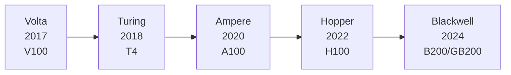
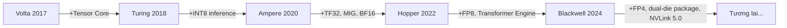

## Mục lục

- [1. Vì sao cần hiểu tiến hóa kiến trúc GPU](#1-vì-sao-cần-hiểu-tiến-hóa-kiến-trúc-gpu)
- [2. Toàn cảnh tiến hóa kiến trúc](#2-toàn-cảnh-tiến-hóa-kiến-trúc)
- [3. Kiến trúc Volta (2017): khởi đầu tăng tốc AI](#3-kiến-trúc-volta-2017-khởi-đầu-tăng-tốc-ai)
- [4. Kiến trúc Turing (2018): RT Core và tăng tốc suy luận](#4-kiến-trúc-turing-2018-rt-core-và-tăng-tốc-suy-luận)
- [5. Kiến trúc Ampere (2020): bước ngoặt AI trung tâm dữ liệu](#5-kiến-trúc-ampere-2020-bước-ngoặt-ai-trung-tâm-dữ-liệu)
- [6. Kiến trúc Hopper (2022): sinh ra cho mô hình lớn](#6-kiến-trúc-hopper-2022-sinh-ra-cho-mô-hình-lớn)
- [7. Kiến trúc Blackwell (2024): nền tảng kỷ nguyên nghìn tỷ tham số](#7-kiến-trúc-blackwell-2024-nền-tảng-kỷ-nguyên-nghìn-tỷ-tham-số)
- [8. So sánh dọc các công nghệ cốt lõi](#8-so-sánh-dọc-các-công-nghệ-cốt-lõi)
- [9. Cách chọn GPU phù hợp](#9-cách-chọn-gpu-phù-hợp)
- [Tóm tắt](#tóm-tắt)
- [Checklist tự kiểm](#checklist-tự-kiểm)
- [Tài liệu tham khảo](#tài-liệu-tham-khảo)

---

## 1. Vì sao cần hiểu tiến hóa kiến trúc GPU

Làm AI Infra, bạn hay gặp những câu hỏi kiểu: training chạy không nổi thì nâng card nào? Latency suy luận cao là kẹt ở đâu? FP8 với BF16 chọn cái nào? Câu trả lời thường nằm ngay trong các quyết định thiết kế của kiến trúc GPU.

Hiểu tiến hóa từng thế hệ GPU NVIDIA về bản chất là hiểu **phần cứng AI và thuật toán AI cùng tiến hóa**. Mỗi thế hệ trả lời nút thắt lộ ra từ thế hệ trước, và mỗi tính năng mới đều nhắm tới một loại workload cụ thể. Nắm được mạch đó thì mới phán được vững khi chọn phần cứng, tinh chỉnh hiệu năng và thiết kế hệ thống.

## 2. Toàn cảnh tiến hóa kiến trúc

Nhìn toàn cục trước. Từ 2017 đến nay NVIDIA đã ra năm thế hệ kiến trúc GPU hướng AI. Có thể hình dung chúng như một cao tốc ngày càng rộng và nhanh: mỗi thế hệ mở thêm làn (compute), nâng chất lượng mặt đường (hỗ trợ precision) và xây nút giao tốt hơn (băng thông interconnect).



| Kiến trúc | Năm | Sản phẩm đại diện | Đột phá cốt lõi |
|---------|---------|-------------|------------|
| Volta | 2017 | V100 | Lần đầu có Tensor Core |
| Turing | 2018 | T4 | Tăng tốc suy luận INT8/INT4, RT Core |
| Ampere | 2020 | A100 | Tensor Core thế hệ 3, MIG, TF32, BF16 |
| Hopper | 2022 | H100 | FP8, Transformer Engine, NVLink 4.0 |
| Blackwell | 2024 | B200 / GB200 | Tensor Core thế hệ 5, NVLink 5.0, dual-die package |

Dưới đây đi từng thế hệ, tập trung vào **mỗi thế hệ giải quyết vấn đề gì** và **đưa vào những công nghệ then chốt nào**.

## 3. Kiến trúc Volta (2017): khởi đầu tăng tốc AI

### 3.1 Bối cảnh: vì sao GPU làm được AI?

Trước Volta, huấn luyện deep learning chủ yếu dựa vào CUDA Core của GPU để làm phép toán floating-point tổng quát. CUDA Core là "dao đa năng": tính gì cũng được, nhưng không tối ưu riêng cho phép toán cốt lõi của deep learning (nhân ma trận). Giống cắt bánh mì bằng dao đầu bếp: dùng được, nhưng kém xa dao cắt bánh.

### 3.2 Đột phá chính: Tensor Core

Đóng góp quan trọng nhất của Volta là **Tensor Core**, một đơn vị phần cứng thiết kế riêng cho matrix multiply-accumulate (MMA).

CUDA Core truyền thống mỗi chu kỳ xung nhịp làm một phép nhân-cộng vô hướng (FMA). Một Tensor Core mỗi chu kỳ có thể hoàn thành một phép nhân-cộng ma trận mixed precision $4 \times 4 \times 4$:

$$
D = A \times B + C
$$

trong đó $A$, $B$ là ma trận FP16, $C$, $D$ là FP16 hoặc FP32. Nghĩa là một thao tác làm xong 64 phép nhân-cộng, hiệu quả cao hơn khoảng một bậc so với tính từng phần tử trên CUDA Core.

### 3.3 Thông số then chốt của V100

| Tham số | Thông số |
|------|------|
| Số Tensor Core | 640 |
| Compute Tensor FP16 | 125 TFLOPS |
| Compute CUDA FP32 | 15.7 TFLOPS |
| Memory | 16 GB / 32 GB HBM2 |
| Băng thông memory | 900 GB/s |
| NVLink | NVLink 2.0, 300 GB/s (hai chiều) |

💡 **Gợi ý**: V100 là card "huấn luyện AI" đúng nghĩa đầu tiên. Đến hôm nay, hiểu thiết kế Tensor Core của V100 vẫn là nền để học các kiến trúc sau.

### 3.4 Ý nghĩa thực tế

Volta mở ra một thay đổi trong cách lập trình: muốn tận dụng Tensor Core, kích thước ma trận cần là bội số của 8 (các kiến trúc sau nới lỏng hơn), và kiểu dữ liệu cần dùng mixed precision (tính FP16 + cộng dồn FP32). Đó cũng là nền phần cứng cho huấn luyện mixed precision (AMP) của NVIDIA.

```python
# Huấn luyện mixed precision trong PyTorch (hưởng lợi từ thời Volta)
import torch
from torch.cuda.amp import autocast, GradScaler

scaler = GradScaler()
for data, target in dataloader:
    optimizer.zero_grad()
    with autocast():  # tự chọn FP16/FP32
        output = model(data)
        loss = criterion(output, target)
    scaler.scale(loss).backward()
    scaler.step(optimizer)
    scaler.update()
```

## 4. Kiến trúc Turing (2018): RT Core và tăng tốc suy luận

### 4.1 Vấn đề được giải quyết

Volta chủ yếu nhắm tới training. Đến giai đoạn deploy, inference đòi hỏi latency và throughput khắt khe hơn, và thường không cần precision cao như FP16: nhiều mô hình dùng INT8 vẫn giữ đủ accuracy. Tensor Core của Volta chỉ hỗ trợ FP16, nên ở suy luận compute chưa được tận dụng hết.

### 4.2 Đột phá chính

- **Hỗ trợ Tensor Core INT8 / INT4**: Tensor Core thế hệ 2 thêm khả năng tính số nguyên; throughput suy luận có thể tăng gấp đôi nữa so với FP16
- **RT Core**: đơn vị tăng tốc ray tracing (chủ yếu cho đồ họa; ít đụng tới trong AI Infra)
- **Định vị suy luận hiệu quả hơn**: TDP của T4 chỉ 70W, hợp triển khai trên inference server

### 4.3 Thông số then chốt của T4

| Tham số | Thông số |
|------|------|
| Số Tensor Core | 320 |
| Compute Tensor FP16 | 65 TFLOPS |
| Compute Tensor INT8 | 130 TOPS |
| Memory | 16 GB GDDR6 |
| Băng thông memory | 320 GB/s |
| TDP | 70W |

📌 **Điểm then chốt**: T4 yếu hơn V100 về compute tuyệt đối, nhưng công suất thấp cộng throughput INT8 cao khiến nó thành lựa chọn suy luận kinh điển. Nhiều cloud vẫn dùng T4 cho inference instance.

### 4.4 Ý nghĩa thực tế

Turing đẩy **quantization (lượng tử hóa mô hình)** lan rộng trong công nghiệp. Pipeline lượng tử hóa INT8 của TensorRT được thiết kế với Turing làm mục tiêu:

```bash
# Luồng suy luận lượng tử hóa INT8 điển hình với TensorRT
# 1. Xuất mô hình ONNX
python export_onnx.py --model resnet50 --output model.onnx

# 2. Dùng trtexec dựng INT8 engine (cần calibration dataset)
trtexec --onnx=model.onnx --int8 --calib=calibration_cache.bin --saveEngine=model_int8.engine
```

## 5. Kiến trúc Ampere (2020): bước ngoặt AI trung tâm dữ liệu

### 5.1 Vấn đề được giải quyết

Tới 2020, quy mô mô hình AI phình rất nhanh (GPT-3 có 175 tỷ tham số), compute và memory cần cho training tăng theo. Hai điểm đau từ thời Volta/Turing trở nên rõ:

1. **Định dạng precision chưa linh hoạt**: FP16 đôi khi tràn số trên một số mô hình; FP32 lại quá chậm
2. **Tỷ lệ tận dụng một card thấp**: một GPU chỉ chạy một job; multi-tenant lãng phí tài nguyên nặng

### 5.2 Đột phá chính

#### TF32: tăng tốc không cần sửa code

Ampere đưa vào **TF32 (TensorFloat-32)**. TF32 dùng 8 bit mũ của FP32 (giữ cùng dải số) cộng 10 bit phần định trị của FP16, tự tăng tốc phép toán FP32 mà không cần sửa code:

| Định dạng | Bit dấu | Bit mũ | Bit định trị | Tổng bit |
|------|--------|--------|--------|--------|
| FP32 | 1 | 8 | 23 | 32 |
| TF32 | 1 | 8 | 10 | 19 |
| FP16 | 1 | 5 | 10 | 16 |
| BF16 | 1 | 8 | 7 | 16 |

💡 **Gợi ý**: TF32 mặc định bật trên Ampere. Khi bạn chạy `torch.matmul` trên A100 với input FP32, Tensor Core tự dùng TF32 tăng tốc; không cần bật mixed precision thủ công.

#### MIG: một card, nhiều tenant

**MIG (Multi-Instance GPU)** cho phép tách một A100 thành tối đa 7 GPU instance độc lập về mặt vật lý, mỗi instance có memory, cache và compute riêng. Giống chia một căn nhà lớn thành nhiều căn hộ, mỗi hộ có đồng hồ điện nước riêng, không đụng nhau.

```bash
# Xem các cấu hình MIG mà A100 hỗ trợ
nvidia-smi mig -lgip

# Tạo MIG instance (ví dụ 3g.20gb: 3 Compute Slice + 20GB memory)
sudo nvidia-smi mig -cgi 9,9 -C

# Xem các instance đã tạo
nvidia-smi mig -lgi
```

Tình huống dùng MIG điển hình:
- ✅ Nhiều dịch vụ suy luận chia sẻ một A100, cách ly lẫn nhau
- ✅ Giai đoạn dev/debug, nhiều người dùng chung một card
- ❌ Không phù hợp huấn luyện mô hình lớn cần đủ compute của cả GPU

#### Tensor Core thế hệ 3

Ma trận precision được hỗ trợ mở rộng mạnh: FP16, **BF16**, TF32, INT8, INT4, Binary (1-bit), phủ từ training đến inference.

### 5.3 Thông số then chốt của A100

| Tham số | Thông số |
|------|------|
| Số Tensor Core | 432 (thế hệ 3) |
| Compute Tensor FP16 / BF16 | 312 TFLOPS |
| Compute Tensor TF32 | 156 TFLOPS |
| Compute CUDA FP32 | 19.5 TFLOPS |
| Memory | 40 GB / 80 GB HBM2e |
| Băng thông memory | 2.0 TB/s |
| NVLink | NVLink 3.0, 600 GB/s (hai chiều) |

### 5.4 Ý nghĩa thực tế

Ampere khiến **huấn luyện mixed precision BF16** trở thành mainstream. BF16 có cùng dải số với FP32 (8 bit mũ), tránh overflow thường gặp ở FP16, đồng thời giảm memory và lượng giao tiếp còn một nửa. Phần lớn LLM training từ thời Ampere dùng BF16 làm precision mặc định:

```python
# Huấn luyện BF16 trên A100 (PyTorch hỗ trợ sẵn)
model = model.to(dtype=torch.bfloat16, device="cuda")

# hoặc dùng autocast của PyTorch
with torch.autocast(device_type="cuda", dtype=torch.bfloat16):
    output = model(input_ids)
    loss = criterion(output, labels)
```

## 6. Kiến trúc Hopper (2022): sinh ra cho mô hình lớn

### 6.1 Vấn đề được giải quyết

Khi kỷ nguyên LLM tới, training chịu áp lực kép:

1. **Khát compute**: huấn luyện mô hình hàng chục đến hàng trăm tỷ tham số cần hàng trăm, hàng nghìn GPU chạy song song
2. **Nút thắt giao tiếp**: trong multi-GPU training, đồng bộ dữ liệu giữa các GPU (All-Reduce, All-to-All) trở thành bottleneck lớn

Hầu như mọi tính năng quan trọng của Hopper đều trả lời hai thách thức đó.

### 6.2 Đột phá chính

#### Huấn luyện FP8: ép precision thêm một nấc

Tensor Core thế hệ 4 của Hopper hỗ trợ **FP8** (hai định dạng E4M3 và E5M2), nén precision huấn luyện từ 16 bit của BF16 xuống 8 bit.

| Định dạng | Bit dấu | Bit mũ | Bit định trị | Phù hợp |
|------|--------|--------|--------|----------|
| E4M3 | 1 | 4 | 3 | Forward (ưu tiên độ chính xác) |
| E5M2 | 1 | 5 | 2 | Backward (ưu tiên dải số) |

Compute lý thuyết của FP8 gấp đôi BF16. Nhưng precision giảm rồi, chất lượng mô hình có bị tổn không? Đó chính là chỗ dẫn tới công nghệ cốt lõi khác của Hopper.

#### Transformer Engine: quản lý precision kiểu "số tự động"

**Transformer Engine** là cơ chế phối hợp phần mềm–phần cứng: trước khi tính mỗi layer, nó phân tích phân bố giá trị của tensor rồi tự quyết định layer đó dùng FP8 hay BF16/FP16. Có thể hiểu như hộp số tự động: đường thẳng (layer ổn định số) thì để số cao (FP8), vào cua (layer nhạy số) thì tự xuống số (BF16).

```python
# Huấn luyện FP8 với Transformer Engine
import transformer_engine.pytorch as te

# Thay Linear chuẩn bằng phiên bản FP8 của TE
model.layer = te.Linear(hidden_size, hidden_size)

# Bật FP8 automatic mixed precision
with te.fp8_autocast(enabled=True):
    output = model(input_data)
```

#### NVLink 4.0 và NVSwitch

| Chỉ số | Ampere (A100) | Hopper (H100) | Tăng |
|---------|---------------|---------------|------|
| Băng thông NVLink (hai chiều) | 600 GB/s | 900 GB/s | 1.5x |
| Băng thông All-Reduce | 600 GB/s | 900 GB/s | 1.5x |
| Hỗ trợ NVSwitch | 8 card trong node | 8 card trong node + NVLink Network xuyên node | Mới hoàn toàn |

⚠️ **Lưu ý**: H100 có hai bản: PCIe và SXM. Bản SXM qua NVSwitch hỗ trợ full interconnect 8 card, tổng băng thông NVLink 4.0 là 900 GB/s; bản PCIe cũng có NVLink 4.0 nhưng chỉ bridge 2 card. Chọn hàng nhớ phân biệt điểm này.

#### Các tính năng quan trọng khác

- **Thread Block Cluster**: CUDA programming model thêm một tầng hierarchy, cho nhiều Thread Block hợp tác và tận dụng shared memory giữa các SM tốt hơn
- **TMA (Tensor Memory Accelerator)**: đơn vị copy memory bất đồng bộ bằng phần cứng, tách việc chuyển dữ liệu khỏi pipeline tính toán, giảm SM ngồi chờ

### 6.3 Thông số then chốt của H100

| Tham số | Thông số |
|------|------|
| Số Tensor Core | 528 (thế hệ 4) |
| Compute Tensor FP8 | 1,979 TFLOPS (Dense) / 3,958 TFLOPS (sparse) |
| Compute Tensor FP16 / BF16 | 989 TFLOPS (Dense) / 1,979 TFLOPS (sparse) |
| Compute Tensor TF32 | 495 TFLOPS (Dense) / 989 TFLOPS (sparse) |
| Memory | 80 GB HBM3 |
| Băng thông memory | 3.35 TB/s |
| NVLink | NVLink 4.0, 900 GB/s (hai chiều, bản SXM) |

💡 **Gợi ý**: Từ Ampere trở đi NVIDIA hỗ trợ 2:4 structured sparsity, có thể nhân đôi throughput Tensor Core. Nhưng bật sparsity cần weight đã được prune riêng; thực tế hầu hết workload dùng số liệu Dense.

### 6.4 Ý nghĩa thực tế

Hopper là kiến trúc chủ lực cho huấn luyện mô hình lớn hiện nay. Trong cluster nghìn card, các tính năng sau đáng giá nhất:

1. **FP8 + Transformer Engine** nâng throughput training khoảng 30%–60% (tùy cấu trúc mô hình)
2. **NVLink 4.0** giảm mạnh latency All-Reduce đa card
3. **Băng thông HBM3 3.35 TB/s** giảm nút thắt truy cập memory của Attention

```bash
# Xem topology NVLink của H100
nvidia-smi topo -m

# Xem trạng thái NVLink của GPU hiện tại
nvidia-smi nvlink -s
```

## 7. Kiến trúc Blackwell (2024): nền tảng kỷ nguyên nghìn tỷ tham số

### 7.1 Vấn đề được giải quyết

Vào kỷ nguyên mô hình nghìn tỷ tham số, tăng compute của một GPU đơn không còn kịp tốc độ phình của mô hình. Triết lý thiết kế của Blackwell: thay vì chỉ chất transistor để nâng một die, hãy đột phá ở tầng chip interconnect.

### 7.2 Đột phá chính

#### Dual-die package (đóng gói hai die)

Core của B200 gồm **hai die được đóng gói trên cùng một chip, nối với nhau bằng interconnect giữa die 10 TB/s**. Bên ngoài nhìn như một GPU hoàn chỉnh, thực tế có compute của hai die. Giống buộc hai con ngựa kéo một xe: người đánh xe vẫn điều khiển như cũ, nhưng lực kéo nhân đôi.

#### Tensor Core thế hệ 5

Compute FP8 Dense cao hơn H100 khoảng 14% (nhờ dual die); bật sparsity đạt 4,500 TFLOPS. **FP4 lần đầu có hỗ trợ phần cứng**: Dense 4,500 TOPS, bật sparsity đạt 9,000 TOPS. FP4 mang lại mật độ compute cực đoan hơn cho suy luận.

#### NVLink 5.0

| Chỉ số | Hopper (H100) | Blackwell (B200) | Tăng |
|---------|---------------|------------------|------|
| Băng thông NVLink (hai chiều) | 900 GB/s | 1,800 GB/s | 2x |
| Số GPU nối bằng NVLink | 8 | 72 (qua NVLink Switch) | 9x |

Băng thông interconnect 1.8 TB/s nghĩa là giao tiếp giữa các GPU đã gần với băng thông memory của một GPU. Điều đó đổi cục diện giao tiếp trong distributed training: những bottleneck từng phải thiết kế topology quanh co để né, giờ thường có thể "đè" bằng băng thông thô.

#### Điểm nổi bật khác

- **Memory HBM3e**: tối đa 192 GB/card, băng thông memory 8 TB/s
- **Transformer Engine thế hệ 2**: lập lịch precision động FP8/FP4 thông minh hơn
- **Confidential Computing**: GPU TEE cấp phần cứng, bảo vệ privacy dữ liệu huấn luyện

### 7.3 Thông số then chốt của B200 / GB200

| Tham số | B200 | GB200 (Grace-Blackwell) |
|------|------|--------------------------|
| Compute Tensor FP8 | 2,250 TFLOPS (Dense) / 4,500 TFLOPS (sparse) | Như cột trái (phần GPU) |
| Compute Tensor FP4 | 4,500 TOPS (Dense) / 9,000 TOPS (sparse) | Như cột trái (phần GPU) |
| Memory | 192 GB HBM3e | 192 GB HBM3e + 480 GB LPDDR5x (CPU) |
| Băng thông memory | 8 TB/s | 8 TB/s (phần GPU) |
| NVLink | NVLink 5.0, 1,800 GB/s | NVLink 5.0, 1,800 GB/s |
| Thiết kế chip | Dual-die package | Grace CPU + Blackwell GPU gắn chặt |

📌 **Điểm then chốt**: GB200 là một **CPU–GPU superchip**, đóng gói Grace ARM CPU tự phát triển của NVIDIA với Blackwell GPU qua NVLink-C2C tốc độ cao. Thiết kế này loại bỏ bottleneck giao tiếp CPU–GPU kiểu PCIe truyền thống.

## 8. So sánh dọc các công nghệ cốt lõi

### 8.1 Tiến hóa compute Tensor Core

Bảng dưới thống nhất dùng compute **Dense (không sparse)**. Ampere trở đi hỗ trợ tăng tốc 2:4 structured sparsity; bật lên thì throughput có thể nhân đôi. V100 / T4 không hỗ trợ sparsity.

| Precision | V100 | T4 | A100 | H100 | B200 |
|------|------|----|------|------|------|
| FP16 / BF16 | 125 TFLOPS | 65 TFLOPS | 312 TFLOPS | 989 TFLOPS | ~1,125 TFLOPS |
| TF32 | — | — | 156 TFLOPS | 495 TFLOPS | ~563 TFLOPS |
| FP8 | — | — | — | 1,979 TFLOPS | ~2,250 TFLOPS |
| INT8 | — | 130 TOPS | 624 TOPS | 1,979 TOPS | ~2,250 TOPS |
| FP4 | — | — | — | — | ~4,500 TOPS |

### 8.2 Tiến hóa memory và băng thông

| Chỉ số | V100 | A100 | H100 | B200 |
|---------|------|------|------|------|
| Dung lượng memory | 32 GB | 80 GB | 80 GB | 192 GB |
| Loại memory | HBM2 | HBM2e | HBM3 | HBM3e |
| Băng thông memory | 900 GB/s | 2.0 TB/s | 3.35 TB/s | 8 TB/s |
| Băng thông NVLink | 300 GB/s | 600 GB/s | 900 GB/s | 1,800 GB/s |

Có một xu hướng rõ: **băng thông memory tăng chậm hơn compute**. Điều đó phản ánh tính **memory-bound** của workload AI (đặc biệt suy luận LLM): khi mô hình đủ lớn, nút thắt không còn ở tính toán mà ở truy cập memory.

### 8.3 Timeline các tính năng then chốt



## 9. Cách chọn GPU phù hợp

Chọn GPU không phải cứ mới và đắt là thắng. Phải theo workload cụ thể:

### Kịch bản training

| Kịch bản | Gợi ý | Lý do |
|------|------|------|
| Training mô hình vừa/nhỏ (< 10B) | A100 80GB | Cost/performance tốt, hệ sinh thái chín |
| Training mô hình lớn (10B–100B) | H100 SXM | FP8 + NVLink 4.0 nâng hiệu quả multi-GPU mạnh |
| Training mô hình siêu lớn (> 100B) | B200 / GB200 | 192GB memory + NVLink 1.8TB/s chống đỡ nghìn tỷ tham số |

### Kịch bản inference

| Kịch bản | Gợi ý | Lý do |
|------|------|------|
| Suy luận online chi phí thấp | T4 | 70W, INT8 đủ dùng |
| Suy luận LLM quy mô vừa | A100 / L40S | Memory đủ lớn, hỗ trợ hệ sinh thái tốt |
| Suy luận LLM quy mô lớn | H100 / H200 | Throughput FP8 cao, băng thông HBM3 đủ |
| Hiệu năng suy luận cực đoan | B200 | Hỗ trợ FP4, 192GB memory cho mô hình lớn hơn |

⚠️ **Lưu ý**: Ngoài hiệu năng một card, còn phải cân topology mạng cluster (NVLink vs PCIe vs InfiniBand), công suất/làm mát, và chu kỳ giao hàng chuỗi cung ứng. Chọn phần cứng chưa bao giờ là bài toán thuần kỹ thuật.

## Tóm tắt

Nhìn lại năm thế hệ, có thể rút ba mạch chính:

1. **Định dạng precision ngày càng thấp hơn**: FP32 → FP16 → BF16/TF32 → FP8 → FP4. Mỗi lần nén một bậc, compute lý thuyết gần như nhân đôi, và cần kèm giải pháp ổn định số (AMP, Transformer Engine)
2. **Băng thông interconnect liên tục nhân đôi**: NVLink từ 300 GB/s leo lên 1,800 GB/s, phạm vi kết nối từ 8 card trong node mở ra 72 card xuyên node. Đây là nền phần cứng để nâng hiệu quả distributed training
3. **Phối hợp phần mềm–phần cứng sâu hơn**: từ tăng tốc phần cứng Tensor Core, tới lập lịch precision tự động của Transformer Engine, tới ảo hóa cách ly MIG. Thời chỉ chất FLOPS đã qua; phối hợp hệ thống mới là chỗ cạnh tranh

Hiểu các xu hướng này không chỉ giúp chọn phần cứng tốt hơn, mà còn đặt nền nhận thức phần cứng cần có trước khi học CUDA, distributed training và tối ưu suy luận.

## Checklist tự kiểm

- Nói được tên, năm và sản phẩm đại diện của năm thế hệ GPU AI NVIDIA
- Giải thích được khác biệt bản chất giữa Tensor Core và CUDA Core
- Nói được bit width và tình huống dùng của FP32, TF32, BF16, FP16, FP8
- Giải thích được vai trò và tình huống dùng của MIG, dùng `nvidia-smi` để xem/tạo MIG instance
- Giải thích được nguyên lý Transformer Engine (chuyển động FP8/BF16)
- So sánh được khác biệt băng thông các thế hệ NVLink và ý nghĩa với distributed training
- Theo nhu cầu training/inference khác nhau mà gợi ý được model GPU phù hợp
- Giải thích được giá trị dual-die package của Blackwell và thiết kế CPU–GPU gắn chặt của GB200

## Tài liệu tham khảo

- [NVIDIA V100 Tensor Core GPU Architecture Whitepaper](https://images.nvidia.com/content/volta-architecture/pdf/volta-architecture-whitepaper.pdf)
- [NVIDIA A100 Tensor Core GPU Architecture Whitepaper](https://images.nvidia.com/aem-dam/en-zz/Solutions/data-center/nvidia-ampere-architecture-whitepaper.pdf)
- [NVIDIA H100 Tensor Core GPU Architecture Whitepaper](https://resources.nvidia.com/en-us-tensor-core/gtc22-whitepaper-hopper)
- [NVIDIA Blackwell Architecture Technical Brief](https://www.nvidia.com/en-us/data-center/technologies/blackwell-architecture/)
- [NVIDIA Transformer Engine Documentation](https://docs.nvidia.com/deeplearning/transformer-engine/user-guide/index.html)
- [NVIDIA Multi-Instance GPU User Guide](https://docs.nvidia.com/datacenter/tesla/mig-user-guide/)
- [NVIDIA NVLink and NVSwitch](https://www.nvidia.com/en-us/data-center/nvlink/)
