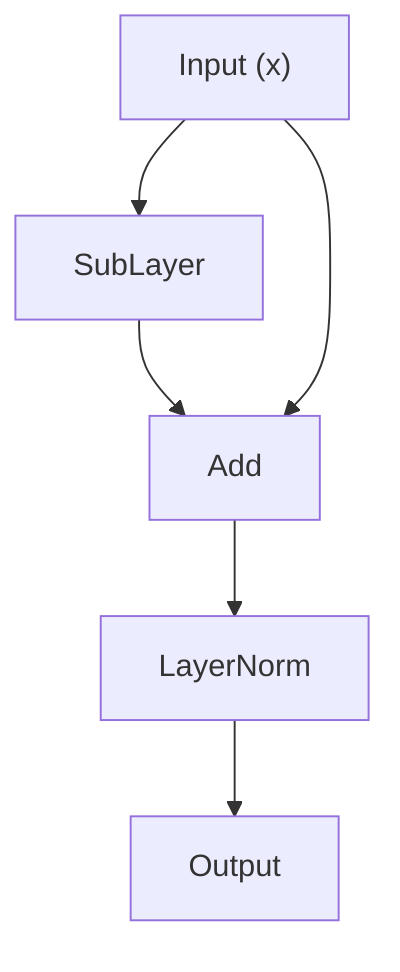
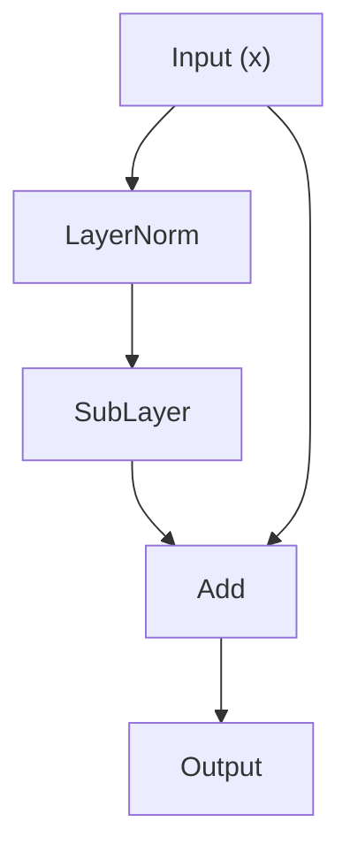

Trong kiến trúc Transformer, Self-Attention và FFN quyết định "học cái gì", còn LayerNorm và residual connection quyết định "có học được hay không". Một mạng 100 tầng không có residual connection gần như không train được. Một mạng sâu không có normalization giống xe tải mất phanh -- hoặc lao khỏi đường (gradient explosion), hoặc tắt máy giữa đường (gradient vanishing). Bài này xuất phát từ khó khăn gốc của việc train mạng sâu, lần lượt tháo rời nguyên lý, triển khai và tối ưu kỹ thuật của residual connection cùng các kỹ thuật normalization, giúp bạn dựng nhận thức có hệ thống về hai "người hùng phía sau".

<!-- more -->

## 📑 Mục lục

- [1. Thách thức gốc khi train mạng sâu](#1-thách-thức-gốc-khi-train-mạng-sâu)
- [2. Residual connection: đường cao tốc của gradient](#2-residual-connection-đường-cao-tốc-của-gradient)
- [3. Toàn cảnh các phương pháp normalization](#3-toàn-cảnh-các-phương-pháp-normalization)
- [4. Pre-Norm vs Post-Norm: một lựa chọn thiết kế ảnh hưởng lâu dài](#4-pre-norm-vs-post-norm-một-lựa-chọn-thiết-kế-ảnh-hưởng-lâu-dài)
- [5. Góc nhìn tối ưu CUDA: điều quan trọng khi đưa vào thực tế](#5-góc-nhìn-tối-ưu-cuda-điều-quan-trọng-khi-đưa-vào-thực-tế)
- [6. Tổng quan lựa chọn normalization của large model](#6-tổng-quan-lựa-chọn-normalization-của-large-model)
- [Danh sách tự kiểm](#-danh-sách-tự-kiểm)
- [Tài liệu tham khảo](#-tài-liệu-tham-khảo)

---

## 1. Thách thức gốc khi train mạng sâu

Trước khi bàn residual connection và normalization, phải hiểu vấn đề cốt lõi chúng giải quyết: **vì sao mạng sâu khó train?**

### 1.1 Gradient vanishing và gradient explosion

Train mạng neural dựa vào backpropagation, bản chất là áp dụng đệ quy quy tắc chuỗi (chain rule). Giả sử mạng $L$ tầng, mỗi tầng biến đổi $f_l$, thì gradient của Loss theo tham số tầng 1 liên quan tới tích liên tiếp các đạo hàm riêng từ tầng $L$ xuống tầng 1:

$$
\frac{\partial \text{Loss}}{\partial W_1} = \frac{\partial \text{Loss}}{\partial f_L} \cdot \frac{\partial f_L}{\partial f_{L-1}} \cdots \frac{\partial f_2}{\partial f_1} \cdot \frac{\partial f_1}{\partial W_1}
$$

Đó là một chuỗi phép nhân. Tưởng tượng trò "truyền tin": tin đi từ cuối hàng lên đầu hàng, mỗi người "scale" tin rồi mới chuyển tiếp. Nếu ai cũng giảm âm lượng 10%, sau 50 người tin gần như không nghe được -- đó là **gradient vanishing**. Ngược lại, nếu ai cũng tăng 10%, sau 50 người thành tiếng ồn chát tai -- đó là **gradient explosion**.

Nói bằng toán, giả sử spectral norm (singular value lớn nhất) của Jacobian mỗi tầng là $\sigma$. Sau $L$ tầng nhân liên tiếp:

- Nếu $\sigma < 1$, gradient suy giảm theo $\sigma^L$, tham số tầng sâu gần như không nhận được tín hiệu cập nhật có nghĩa
- Nếu $\sigma > 1$, gradient tăng theo $\sigma^L$, cập nhật tham số dao động mạnh thậm chí thành NaN
- Chỉ khi $\sigma$ đúng bằng 1, gradient mới lan truyền ổn định -- nhưng trong train thực tế điều đó gần như không tự xảy ra

Vấn đề xấu đi nhanh khi độ sâu tăng. Trước Transformer, LSTM giảm phần nào gradient vanishing bằng cơ chế cổng; còn với Transformer động dễ vài chục đến trăm tầng, ta cần giải pháp gốc và trực tiếp hơn.

### 1.2 Vấn đề suy giảm (Degradation Problem)

Năm 2015, Kaiming He và cộng sự khi train CNN sâu phát hiện hiện tượng phản trực giác: **mạng sâu hơn lại kém hơn mạng nông** -- không phải vì overfitting (sai số train cũng cao hơn), mà vì bản thân tối ưu bị lỗi. Về lý thuyết, mạng 56 tầng ít nhất không nên kém mạng 20 tầng, vì 36 tầng thừa chỉ cần học thành identity mapping là giữ được hiệu quả 20 tầng. Nhưng khi train thật, dạy mạng "học cách không làm gì" khó hơn nhiều so với tưởng tượng.

Quan sát đó trực tiếp dẫn tới sự ra đời của residual connection.

---

## 2. Residual connection: đường cao tốc của gradient

### 2.1 Từ ResNet đến Transformer: lịch sử ngắn

Cuối 2015, Kaiming He et al. đề xuất ResNet (Residual Network), dùng một cấu trúc cực gọn để giải quyết degradation:

$$
\text{output} = x + F(x)
$$

Trong đó $x$ là đầu vào tầng, $F(x)$ là biến đổi cần học (gọi là "residual function"). Dấu cộng trông tầm thường, nhưng đã đổi cục diện deep learning -- ResNet đẩy mạng từ vài chục tầng lên 152 tầng thậm chí hàng nghìn tầng, và đoạt quán quân ImageNet 2015.

**Vì sao học "phần dư" dễ hơn học "ánh xạ đầy đủ"?**

Đổi sang một ẩn dụ khác. Bạn là kiến trúc sư. Chủ đầu tư đưa bản thảo và yêu cầu bản cuối. Có hai cách làm:

- **Cách A** (không residual): vẽ lại toàn bộ bản cuối từ đầu. Mọi chi tiết đều phải nghĩ lại, áp lực rất lớn.
- **Cách B** (có residual): đánh dấu chỉnh sửa bằng bút đỏ trên bản thảo. Bạn chỉ cần quan tâm "chỗ nào cần đổi", phần còn lại tự giữ nguyên.

Rõ ràng cách B nhẹ gánh nhận thức hơn nhiều. Khi một tầng thực sự không cần biến đổi nhiều, $F(x)$ chỉ cần tiến về không -- và học một hàm gần không dễ hơn nhiều so với học identity. Ở giai đoạn khởi tạo, trọng số thường được đặt gần không, nghĩa là $F(x)$ tự nhiên gần không, output gần $x$, mạng sẵn có khả năng "không làm gì" làm điểm xuất phát, rồi từ đó mới học dần các biến đổi có nghĩa.

Năm 2017, Vaswani et al. khi thiết kế Transformer dùng thẳng residual connection. Trong mỗi Decoder Block của Transformer, sublayer Attention và sublayer FFN mỗi cái có một residual:

$$
\begin{aligned}
h &= x + \text{Attention}(x)
\end{aligned}
$$
$$
\begin{aligned}
\text{output} &= h + \text{FFN}(h)
\end{aligned}
$$

Với LLaMA-7B gồm 32 Block, tín hiệu từ tầng 1 đến tầng 32 phải qua 64 sublayer. Không có residual connection, gradient gần như không thể xuyên qua nhiều tầng như vậy mà không biến mất.

### 2.2 Phân tích toán: vì sao residual connection giữ được dòng gradient

Nhìn từ góc backpropagation, xem chặt vì sao residual hiệu quả.

**Không có residual:**

Giả sử mỗi tầng tính $x_{l+1} = f_l(x_l)$, thì gradient của loss $L$ theo một tầng trung gian $x_l$ là:

$$
\frac{\partial L}{\partial x_l} = \frac{\partial L}{\partial x_L} \cdot \frac{\partial f_{L-1}}{\partial x_{L-1}} \cdot \frac{\partial f_{L-2}}{\partial x_{L-2}} \cdots \frac{\partial f_l}{\partial x_l}
$$

Đó là **tích** liên tiếp các Jacobian. Spectral norm của bất kỳ thừa số nào lệch khỏi 1, sau nhiều tầng nhân sẽ dẫn tới vanishing hoặc exploding.

**Có residual:**

Mỗi tầng trở thành $x_{l+1} = x_l + F_l(x_l)$. Đạo hàm theo $x_l$:

$$
\frac{\partial x_{l+1}}{\partial x_l} = I + \frac{\partial F_l}{\partial x_l}
$$

trong đó $I$ là ma trận đơn vị. Khai triển gradient từ tầng $L$ về tầng $l$:

$$
\frac{\partial L}{\partial x_l} = \frac{\partial L}{\partial x_L} \cdot \left(I + \frac{\partial F_{L-1}}{\partial x_{L-1}}\right) \cdot \left(I + \frac{\partial F_{L-2}}{\partial x_{L-2}}\right) \cdots \left(I + \frac{\partial F_l}{\partial x_l}\right)
$$

Sau khi khai triển tích này, **nhất định có một hạng tử luôn bằng $I^{(L-l)} = I$** (tức chọn $I$ ở mọi ngoặc). Nghĩa là:

$$
\frac{\partial L}{\partial x_l} = \frac{\partial L}{\partial x_L} \cdot (I + \text{các hạng tử chéo khác})
$$

Điểm then chốt là $I$ đó. Dù $\partial F_l / \partial x_l$ của các tầng giữa nhỏ đến đâu thậm chí tiến về không, gradient $\partial L / \partial x_L$ vẫn có thể truyền **nguyên vẹn** tới tầng $l$ theo "kênh đồng nhất" này. Đó là lý do residual connection được gọi là "đường cao tốc gradient" -- nó mở một đường tắt trong đồ thị tính backpropagation, gradient không bị buộc phải đi con đường gập ghềnh qua mọi biến đổi phi tuyến, mà có thể thẳng tới đích.

Nhìn cách khác, residual biến chuỗi "nhân thuần" trong backpropagation thành cấu trúc hỗn hợp "cộng + nhân". Chuỗi nhân thuần cực nhạy với số (hãy nghĩ nhân liên tiếp 0.9 năm mươi lần), còn phép cộng cho gradient một "sàn tối thiểu", nâng mạnh độ ổn định số.

### 2.3 PyTorch: sublayer Transformer có residual

Dưới đây là ví dụ sublayer Transformer có residual (phong cách Pre-Norm: normalize trước rồi vào sublayer, residual bọc bên ngoài):

```python
import torch
import torch.nn as nn

class ResidualSubLayer(nn.Module):
    """
    Wrapper residual sublayer dùng chung.
    Bọc mọi sublayer (Attention hoặc FFN) thành: output = x + SubLayer(LayerNorm(x))
    """

    def __init__(self, d_model: int, sublayer: nn.Module, dropout: float = 0.1):
        super().__init__()
        self.norm = nn.LayerNorm(d_model)
        self.sublayer = sublayer
        self.dropout = nn.Dropout(dropout)

    def forward(self, x: torch.Tensor) -> torch.Tensor:
        # Pre-Norm: normalize trước, rồi đưa vào sublayer
        normed = self.norm(x)
        # Tính sublayer
        sub_output = self.sublayer(normed)
        # Dropout regularization
        sub_output = self.dropout(sub_output)
        # Residual: cộng thẳng đầu vào gốc
        return x + sub_output

class SimpleFeedForward(nn.Module):
    """FFN hai tầng đơn giản để minh họa"""

    def __init__(self, d_model: int, d_ff: int):
        super().__init__()
        self.w1 = nn.Linear(d_model, d_ff)
        self.w2 = nn.Linear(d_ff, d_model)
        self.activation = nn.GELU()

    def forward(self, x: torch.Tensor) -> torch.Tensor:
        return self.w2(self.activation(self.w1(x)))

# Ví dụ dùng
d_model = 512
d_ff = 2048
ffn = SimpleFeedForward(d_model, d_ff)
residual_ffn = ResidualSubLayer(d_model, ffn)

# Đầu vào giả: batch_size=2, seq_len=10, d_model=512
x = torch.randn(2, 10, d_model)
output = residual_ffn(x)
print(output.shape)  # torch.Size([2, 10, 512])

# Kiểm tra: hiệu output trừ input là "phần dư" sublayer học được
residual = output - x
print(f"trung bình residual: {residual.mean().item():.6f}")
print(f"độ lệch chuẩn residual: {residual.std().item():.6f}")
```

Đoạn mã này thể hiện rõ pattern cốt lõi của residual: `return x + sub_output`. Dù bên trong `sublayer` phức tạp đến đâu, phép cộng ngoài cùng bảo đảm gradient đi thẳng tới đầu vào.

---

## 3. Toàn cảnh các phương pháp normalization

Residual connection giải quyết việc gradient có truyền ngược được hay không, nhưng còn một thách thức cũng gay gắt: **trôi phân bố đặc trưng (Internal Covariate Shift)**. Khi train tiến hành, phân bố đầu vào mỗi tầng liên tục đổi, các tầng sau phải liên tục thích nghi với "tính khí mới" của tầng trước, khiến train không ổn định và hội tụ chậm. Mục tiêu của normalization là kéo đầu vào mỗi tầng về một khoảng phân bố ổn định, để từng tầng yên tâm học tham số của mình.

### 3.1 BatchNorm: công trình mở đường, nhưng không hợp NLP

$$\text{BatchNorm}(x) = \gamma \cdot \frac{x - \mu}{\sqrt{\sigma^2 + \epsilon}} + \beta$$

**✳️ Nguyên lý:**

BatchNorm (Batch Normalization, Ioffe và Szegedy đề xuất năm 2015) chuẩn hóa mỗi đặc trưng theo chiều batch. Với đầu vào hình dạng $(B, d)$ ($B$ là batch size, $d$ là chiều đặc trưng), với mỗi chiều đặc trưng $j$:

$$
\begin{aligned}
\mu_j &= \frac{1}{B} \sum\_{i=1}^{B} x_{i,j}
\end{aligned}
$$
$$
\begin{aligned}
\sigma_j^2 &= \frac{1}{B} \sum\_{i=1}^{B} (x\_{i,j} - \mu_j)^2
\end{aligned}
$$
$$
\begin{aligned}
y\_{i,j} &= \gamma_j \cdot \frac{x\_{i,j} - \mu_j}{\sqrt{\sigma_j^2 + \epsilon}} + \beta_j
\end{aligned}
$$

Tức: với mỗi kênh đặc trưng, thống kê mean và variance của mọi mẫu trong batch trên kênh đó, rồi chuẩn hóa. $\gamma$ và $\beta$ là tham số học được, dùng để khôi phục khả năng biểu đạt.

BatchNorm thành công lớn trong CV -- giúp tốc độ và độ ổn định train CNN nhảy vọt. Nhưng khi mang sang NLP và Transformer sẽ gặp vài khó khăn gốc:

**❓ Vì sao BatchNorm không hợp NLP?**

1. **Độ dài chuỗi không đều**: trong NLP, câu trong cùng một batch thường khác độ dài. Dù đã padding, giá trị đặc trưng ở vị trí padding của câu ngắn vô nghĩa; đưa chúng vào tính mean/variance sẽ đưa nhiễu vào.
2. **Thống kê theo batch không ổn định**: khi train large model, bị giới hạn VRAM, micro batch size trên một card có thể rất nhỏ (ví dụ 1-4). Ước lượng thống kê batch từ quá ít mẫu thì bản thân variance đã lớn, hiệu quả normalization rất không đáng tin.
3. **Không nhất quán train/inference**: lúc train dùng thống kê batch, lúc inference dùng trung bình động mũ (running mean/variance); hai phân bố có thể không khớp hoàn toàn, gây lệch train-inference.
4. **Không thân thiện với sinh tự hồi quy**: mô hình Decoder lúc inference sinh từng token, batch size = 1, thống kê batch hoàn toàn vô nghĩa.

### 3.2 LayerNorm: cấu hình chuẩn của Transformer

$$\text{LayerNorm}(x) = \gamma \cdot \frac{x - \mu}{\sqrt{\sigma^2 + \epsilon}} + \beta$$

**✳️ Nguyên lý:**

LayerNorm (Layer Normalization, Jimmy Ba et al. đề xuất năm 2016) đổi hướng chuẩn hóa: không theo chiều batch, mà theo **chiều đặc trưng**, độc lập trên từng mẫu. Với đầu vào hình dạng $(B, N, d)$ ($B$ batch size, $N$ độ dài chuỗi, $d$ chiều đặc trưng), mỗi token được chuẩn hóa độc lập trên vector đặc trưng $d$ chiều. Với token ở vị trí $(b, n)$, vector đặc trưng $x$ có chiều $d$:

$$
\begin{aligned}
\mu &= \frac{1}{d} \sum_{j=1}^{d} x_j
\end{aligned}
$$
$$
\begin{aligned}
\sigma^2 &= \frac{1}{d} \sum_{j=1}^{d} (x_j - \mu)^2
\end{aligned}
$$
$$
\begin{aligned}
y_j &= \gamma_j \cdot \frac{x_j - \mu}{\sqrt{\sigma^2 + \epsilon}} + \beta_j
\end{aligned}
$$

**❓ Vì sao LayerNorm hợp Transformer?**

1. **Hoàn toàn độc lập với batch**: normalization của mỗi token chỉ phụ thuộc $d$ đặc trưng của chính nó, không liên quan mẫu khác trong batch, tránh mọi vấn đề của BatchNorm.
2. **Không bị ảnh hưởng bởi độ dài chuỗi**: token trong câu độ dài khác nhau tự chuẩn hóa độc lập; độ dài không đều không còn là vấn đề.
3. **Hành vi train và inference nhất quán**: không có running mean/variance; logic tính toán lúc train và inference giống hệt.
4. **Thân thiện với tự hồi quy**: khi sinh từng token, mỗi token chuẩn hóa độc lập, không cần phụ thuộc token khác.

**LayerNorm viết tay bằng PyTorch**

```python
import torch
import torch.nn as nn

class ManualLayerNorm(nn.Module):
    """
    LayerNorm viết tay, hành vi khớp nn.LayerNorm.
    Mục đích là để bạn thấy rõ từng bước đang làm gì.
    """

    def __init__(self, normalized_shape: int, eps: float = 1e-5):
        super().__init__()
        self.eps = eps
        # Tham số scale học được gamma, khởi tạo bằng 1
        self.gamma = nn.Parameter(torch.ones(normalized_shape))
        # Tham số lệch học được beta, khởi tạo bằng 0
        self.beta = nn.Parameter(torch.zeros(normalized_shape))

    def forward(self, x: torch.Tensor) -> torch.Tensor:
        # Hình dạng x: (..., normalized_shape)
        # Mean theo chiều cuối
        mean = x.mean(dim=-1, keepdim=True)
        # Variance theo chiều cuối (ước lượng không chệch không quan trọng; ở đây dùng có chệch)
        var = x.var(dim=-1, keepdim=True, unbiased=False)
        # Chuẩn hóa: trừ mean, chia độ lệch chuẩn
        x_norm = (x - mean) / torch.sqrt(var + self.eps)
        # Biến đổi affine: dùng tham số học được để khôi phục khả năng biểu đạt
        return self.gamma * x_norm + self.beta

# Kiểm tra: so với triển khai chính thức của PyTorch
d_model = 768
manual_ln = ManualLayerNorm(d_model)
official_ln = nn.LayerNorm(d_model)

# Cho hai bên dùng cùng tham số
with torch.no_grad():
    manual_ln.gamma.copy_(official_ln.weight)
    manual_ln.beta.copy_(official_ln.bias)

x = torch.randn(2, 10, d_model)
out_manual = manual_ln(x)
out_official = official_ln(x)
print(f"chênh lệch lớn nhất: {(out_manual - out_official).abs().max().item():.2e}")
# Đầu ra khoảng 1e-7, đến từ sai số dấu chấm động
```

### 3.3 RMSNorm: lựa chọn được ưa chuộng trong kỷ nguyên large model

$$\text{RMSNorm}(x) = \gamma \cdot \frac{x}{\text{RMS}(x)}$$

**✳️ Động cơ và nguyên lý**

Năm 2019, Biao Zhang và Rico Sennrich đề xuất RMSNorm (Root Mean Square Layer Normalization). Họ đưa ra giả thuyết táo bạo: **hiệu quả của LayerNorm chủ yếu đến từ "re-scaling" chứ không phải "re-centering"**. Nghĩa là bước trừ mean có lẽ không bắt buộc.

RMSNorm bỏ tính mean, chỉ giữ scale dựa trên Root Mean Square:

$$
\begin{aligned}
\text{RMS}(x) &= \sqrt{\frac{1}{d} \sum_{j=1}^{d} x_j^2}
\end{aligned}
$$
$$
\begin{aligned}
y_j &= \gamma_j \cdot \frac{x_j}{\text{RMS}(x)}
\end{aligned}
$$

Hai đơn giản hóa quan trọng:

1. **Bỏ tính mean**: không re-centering, chuẩn hóa thẳng bằng RMS
2. **Thường bỏ tham số $\beta$**: không re-centering thì cũng không cần hạng lệch

Về toán, quan hệ giữa $\text{RMS}(x)$ và $\text{std}(x)$ là:

$$
\text{RMS}(x)^2 = \text{mean}(x^2) = \text{Var}(x) + \text{mean}(x)^2
$$

Khi $\text{mean}(x)$ gần 0, $\text{RMS}(x)$ xấp xỉ $\text{std}(x)$, hành vi RMSNorm và LayerNorm gần như giống nhau. Thực nghiệm cho thấy trong Transformer sâu, mean của vector đặc trưng các tầng thường gần không (đặc biệt trong kiến trúc Pre-Norm, vì residual connection liên tục cộng dồn và trọng số tương đối của mean ngày càng nhỏ), điều này cung cấp trực giác cho hiệu quả của RMSNorm.

**❓ Vì sao hiệu quả tương đương?**

Lý do cốt lõi: tác dụng bản chất của normalization là **kiểm soát scale của activation**, ngăn một số chiều quá lớn hoặc quá nhỏ làm gradient không ổn định. Mục tiêu đó về cơ bản đã đạt khi chia cho RMS. Hiệu ứng "bỏ thành phần một chiều" của re-centering trong ngữ cảnh mạng sâu không phải không thể thiếu -- tham số học được của mỗi tầng đã đủ để xử lý lệch mean một cách ẩn.

**Lợi thế lượng tính toán**

RMSNorm tiết kiệm lượng tính so với LayerNorm trông không nhiều (bớt một lần tính mean và một lần trừ), nhưng trong kỹ thuật thật sự khác biệt này không thể bỏ qua:

- LayerNorm cần **hai lượt quét** vector đặc trưng: lượt một tính mean, lượt hai dùng mean tính variance, lượt ba dùng mean và variance để chuẩn hóa (triển khai thực tế thường gộp thành hai lượt: lượt một vừa tính $\sum x$ vừa $\sum x^2$, lượt hai chuẩn hóa)
- RMSNorm tự nhiên chỉ cần **một lượt quét** tính $\sum x^2$, rồi một lượt chuẩn hóa

Trên GPU, các phép này là memory-bound (nút thắt ở băng thông VRAM chứ không phải khả năng tính). Bớt một lần quét toàn cục nghĩa là bớt một lần đọc HBM, cải thiện hiệu năng thật sự.

**RMSNorm viết tay bằng PyTorch**

```python
import torch
import torch.nn as nn

class ManualRMSNorm(nn.Module):
    """
    RMSNorm viết tay.
    So với LayerNorm: bỏ tính mean và tham số beta.
    """

    def __init__(self, normalized_shape: int, eps: float = 1e-6):
        super().__init__()
        self.eps = eps
        # Chỉ có tham số scale gamma (thường gọi là weight), không có lệch beta
        self.weight = nn.Parameter(torch.ones(normalized_shape))

    def forward(self, x: torch.Tensor) -> torch.Tensor:
        # RMS(x) = sqrt(mean(x^2))
        rms = torch.sqrt(x.pow(2).mean(dim=-1, keepdim=True) + self.eps)
        # Chuẩn hóa
        x_norm = x / rms
        # Scale
        return self.weight * x_norm

# Ví dụ dùng
d_model = 4096
rms_norm = ManualRMSNorm(d_model)

x = torch.randn(2, 128, d_model)
output = rms_norm(x)
print(output.shape)  # torch.Size([2, 128, 4096])

# Kiểm tra hiệu quả chuẩn hóa: RMS đầu ra nên gần 1 (bị ảnh hưởng bởi weight)
rms_after = torch.sqrt(output.pow(2).mean(dim=-1))
print(f"trung bình RMS sau chuẩn hóa: {rms_after.mean().item():.4f}")
# Lúc khởi tạo weight toàn 1, nên RMS khoảng 1.0
```

### 3.4 So sánh ba phương pháp normalization

| Chiều so sánh | BatchNorm | LayerNorm | RMSNorm |
|---------|-----------|-----------|---------|
| **Chiều chuẩn hóa** | Chiều batch (mỗi kênh đặc trưng thống kê qua các mẫu) | Chiều đặc trưng (mỗi mẫu thống kê độc lập) | Chiều đặc trưng (mỗi mẫu thống kê độc lập) |
| **Có Mean Shift (trừ mean) không** | Có | Có | Không |
| **Tham số học được** | $\gamma$ + $\beta$ | $\gamma$ + $\beta$ | Chỉ $\gamma$ |
| **Phụ thuộc batch** | Phụ thuộc mạnh; batch nhỏ không ổn định | Không phụ thuộc | Không phụ thuộc |
| **Nhất quán train/inference** | Không nhất quán (cần running stats) | Hoàn toàn nhất quán | Hoàn toàn nhất quán |
| **Lượng tính (tương đối)** | Cao hơn (cần giao tiếp qua batch) | Trung bình (hai lượt quét) | Thấp hơn (có thể một lượt quét) |
| **Kịch bản chính** | CV (CNN + batch lớn) | NLP / Transformer | LLM quy mô lớn |
| **Người dùng đại diện** | ResNet, EfficientNet | GPT-2, GPT-3, BERT | LLaMA, Mistral, Qwen |

---

## 4. Pre-Norm vs Post-Norm: một lựa chọn thiết kế ảnh hưởng lâu dài

LayerNorm đặt trước hay sau sublayer trông chỉ là điều chỉnh thứ tự nhỏ, nhưng ảnh hưởng quyết định tới độ ổn định train của large model.

### 4.1 So sánh luồng dữ liệu của hai kiến trúc

**Post-Norm (bài Transformer gốc, Vaswani et al. 2017)**


Công thức: `output = LayerNorm(x + SubLayer(x))`

**Pre-Norm (bắt đầu từ GPT-2, nay đã thành mainstream)**



Công thức: `output = x + SubLayer(LayerNorm(x))`

### 4.2 Phân tích dòng gradient: vì sao Pre-Norm ổn định hơn

Khác biệt gốc của hai kiến trúc nằm ở chỗ **đường residual có còn "sạch" hay không**.

**🍎 Dòng gradient của Post-Norm**

Trong Post-Norm, kết quả cộng residual còn phải qua thêm một LayerNorm. Nhìn từ backpropagation, khi gradient từ tầng $L$ truyền về tầng $l$, mỗi lần qua một Block đều bị Jacobian của LayerNorm "điều biến" một lần:

$$
\frac{\partial L}{\partial x_l} = \frac{\partial L}{\partial x_L} \prod_{k=l}^{L-1} \left[\frac{\partial \text{LN}_k}{\partial(x_k + F_k)} \cdot \left(I + \frac{\partial F_k}{\partial x_k}\right)\right]
$$

Jacobian của LayerNorm không phải ma trận đơn vị -- nó liên quan gradient của mean và variance, và áp một biến đổi tuyến tính không tầm thường lên gradient truyền ngược. Các biến đổi đó nhân chồng theo độ sâu có thể làm hướng và độ lớn gradient đổi rõ. Trong mạng sâu (ví dụ GPT-3 96 tầng), hiệu ứng tích lũy này có thể gây gradient explosion, cần thiết kế warmup learning rate cẩn thận để kiềm chế.

**🍎 Dòng gradient của Pre-Norm**

Trong Pre-Norm, sau phép cộng residual **không** còn thao tác nào, đầu ra đi thẳng vào tầng tiếp. Gradient từ tầng $L$ đến tầng $l$ là:

$$
\frac{\partial L}{\partial x_l} = \frac{\partial L}{\partial x_L} \prod_{k=l}^{L-1} \left[I + \frac{\partial\big(F_k(\text{LN}_k(x_k))\big)}{\partial x_k}\right]
$$

Lưu ý mỗi thừa số đều dạng "$I$ + cái gì đó". Giống phân tích mục 2.2, khai triển tích này nhất định chứa hạng tử $I$ -- gradient có thể đi đường đồng nhất thẳng tới mọi tầng nông, không qua bất kỳ LayerNorm nào. Jacobian của LayerNorm chỉ xuất hiện trong "hạng tử chéo", không chặn đường gradient chính.

✳️ Tóm một câu: **Pre-Norm giữ đường residual "tinh khiết"**, gradient xuyên qua bao nhiêu tầng cũng không mất, train tự nhiên ổn định hơn.

### 4.3 Độ ổn định train: bằng chứng thực nghiệm

Kết quả nhiều bài báo chỉ cùng một hướng:

1. **Pre-Norm bền hơn với learning rate**: Xiong et al. (2020, "On Layer Normalization in the Transformer Architecture") chứng minh bằng lý thuyết rằng ở Post-Norm, variance đầu ra các tầng lúc khởi tạo tăng tuyến tính theo độ sâu, phải dùng learning rate nhỏ và warmup dài để kiềm; còn Pre-Norm thì variance các tầng tự giữ ổn định, có thể bỏ warmup và dùng learning rate lớn hơn.
2. **Ưu thế lý thuyết của Post-Norm khó hiện thực**: một số nghiên cứu cho thấy khi train hội tụ đủ, Post-Norm hơi tốt hơn Pre-Norm (khoảng 0.1-0.5 BLEU), nhưng cần tinh chỉnh siêu tham số cực kỳ tinh. Khi mô hình lên tới hàng tỷ tham số trở lên, Post-Norm thường gặp loss spike (loss đột ngột nhảy) thậm chí phân kỳ, còn Pre-Norm thì vững.
3. **Train quy mô lớn không dung nạp bất ổn**: train một mô hình 175B tham số có thể tốn hàng triệu đô chi phí tính toán. Một lần phân kỳ nghĩa là công cốc, phải làm lại. Trong ràng buộc đó, bảo đảm ổn định của Pre-Norm có giá trị kỹ thuật lớn hơn nhiều so với mức cải thiện hiệu quả nhỏ mà Post-Norm có thể mang lại.

### 4.4 Vì sao kỷ nguyên large model mặc định chọn Pre-Norm

Tóm các phân tích trên, chuỗi logic giúp Pre-Norm thắng là:

```
Large model → nhiều tầng (64-128) → đường gradient dài
→ cần lan truyền gradient cực ổn định → đường residual phải sạch
→ Pre-Norm không đặt LayerNorm trên đường residual → gradient đi thẳng
→ train ổn định hơn, siêu tham số dễ chỉnh hơn → thân thiện kỹ thuật → trở thành mặc định
```

Từ GPT-2 (2019) đến GPT-3, PaLM, LLaMA, Mistral, Qwen và gần như mọi large model chủ đạo, Pre-Norm đều là cấu hình chuẩn.

### 4.5 DeepNorm: một phương án lai

Dù Pre-Norm đã là mainstream, nhà nghiên cứu vẫn tìm cách lấy ưu điểm của cả hai. Năm 2022, DeepNorm của Microsoft là phương án lai đáng chú ý:

$$
\text{output} = \text{LayerNorm}(\alpha \cdot x + \text{SubLayer}(x))
$$

Trong đó $\alpha$ là hằng số phụ thuộc độ sâu mạng (lớn hơn 1), dùng để phóng đóng góp của đường residual. Thiết kế then chốt:

- Nhân đường residual với $\alpha$ để phóng đại
- Tham số SubLayer khởi tạo nhỏ hơn theo quy tắc (nhân $\beta$, $\beta < 1$)
- Giá trị $\alpha$ và $\beta$ do độ sâu mô hình $L$ quyết định

Hiệu ứng: về hình thức dùng cấu trúc Post-Norm (có thể đạt hiệu quả cuối tốt hơn), nhưng bằng cách phóng đường residual và thu nhỏ đầu ra sublayer, đạt độ ổn định gradient gần Pre-Norm. Microsoft dùng DeepNorm train thành công Transformer 1000 tầng.

Nhưng trong large model mã nguồn mở thực tế, tỷ lệ dùng DeepNorm thấp hơn nhiều so với Pre-Norm. Lý do đơn giản: Pre-Norm đủ tốt, triển khai dễ, cộng đồng kiểm chứng đầy đủ, không cần thêm siêu tham số thừa.

---

## 5. Góc nhìn tối ưu CUDA: điều quan trọng khi đưa vào thực tế

Với kỹ sư AI Infra, hiểu LayerNorm và residual connection không chỉ là biết "làm gì", mà còn biết "làm hiệu quả trên GPU như thế nào".

### 5.1 Thách thức triển khai LayerNorm kernel

Tính toán LayerNorm về toán không phức tạp, nhưng triển khai hiệu quả trên GPU thì có chỗ phải cân nhắc. Thách thức cốt lõi là đây là phép **reduction** -- phải cộng trên toàn bộ chiều đặc trưng (tính mean và variance), trong khi GPU giỏi nhất ở tính song song theo phần tử quy mô lớn.

**🔴 Vấn đề hai lượt quét**

Triển khai LayerNorm sơ đẳng nhất cần hai lượt quét dữ liệu đầu vào:

```
Lượt 1: duyệt d phần tử, tính sum(x) và sum(x²), rồi suy ra mean và variance
Lượt 2: duyệt lại d phần tử, dùng mean và variance chuẩn hóa từng phần tử
```

Nghĩa là dữ liệu vector đặc trưng phải được đọc từ HBM (bộ nhớ băng thông cao) **hai lần**. Với large model $d_{model} = 4096$ thậm chí 8192, vector đặc trưng mỗi token có 4096-8192 phần tử float16; kích thước tuyệt đối không lớn (8-16 KB), nhưng LayerNorm được gọi hai lần trong mỗi Transformer Block (một lần trước Attention, một lần trước FFN), mô hình có vài chục Block, cộng thêm batch và độ dài chuỗi, tổng lượng truy cập HBM tích lũy khá đáng kể.

**🔵 Thuật toán Welford và tính online**

Một tối ưu là dùng thuật toán Welford online: một lượt quét vừa tính mean vừa variance, tránh công thức kém ổn định số $\frac{1}{N}\sum x_i^2 - \left(\frac{1}{N}\sum x_i\right)^2$ (*trung bình bình phương trừ bình phương trung bình*). Nhưng phép cộng dồn kiểu này là tuần tự, triển khai trong khung reduction song song của GPU cần xử lý cẩn thận.


**✳️ Lợi thế của RMSNorm hiện rõ ở đây**

RMSNorm bỏ tính mean, chỉ cần $\sum x^2$. Điều đó **không chỉ giảm lượng tính**, quan trọng hơn là đơn giản hóa phép reduction -- chỉ cần một reduction (sum of squares) thay vì hai (sum và sum of squares). Kernel đơn giản hơn, **vấn đề ổn định số cũng ít hơn**.

### 5.2 Fuse Residual Add + LayerNorm

Trong kiến trúc Pre-Norm, residual add và LayerNorm gắn sát nhau trên luồng dữ liệu:

```
h = x + SubLayer_output    # Residual Add
next_input = LayerNorm(h)  # đầu vào sublayer tiếp theo cần chuẩn hóa trước
```

Nếu triển khai riêng, `h` phải ghi về HBM trước, rồi LayerNorm kernel mới đọc `h` từ HBM. Nghĩa là dữ liệu `h` bị ghi một lần, đọc một lần -- hai lần truy cập HBM hoàn toàn có thể tránh.

**Ý tưởng fused kernel:**

Gộp Residual Add và LayerNorm thành một kernel (fused kernel), trong thanh ghi hoặc shared memory của GPU hoàn thành phép cộng rồi chuẩn hóa ngay, bỏ chi phí ghi kết quả trung gian về HBM:

```
Bên trong một fused kernel:
1. Đọc x và SubLayer_output từ HBM
2. Trong thanh ghi tính h = x + SubLayer_output
3. Trong thanh ghi/shared memory reduction trên h (tính mean và var)
4. Chuẩn hóa h để được LayerNorm(h)
5. Ghi h (dùng cho residual sau) và LayerNorm(h) (dùng cho sublayer tiếp) về HBM
```

Kiểu fuse này là tối ưu chuẩn trong các framework như NVIDIA Apex, Megatron-LM. Đo thực tế cho thấy fuse Residual Add + LayerNorm có thể mang lại khoảng 5-10% tăng tốc inference đầu cuối cho cả Transformer.

### 5.3 Vấn đề độ chính xác số dưới FP16/BF16

Train và inference large model phổ biến dùng số dấu chấm động nửa độ chính xác (FP16 hoặc BF16) để tiết kiệm VRAM và tăng thông lượng. Nhưng phép normalization đặc biệt nhạy với độ chính xác số:

**Bẫy độ chính xác của FP16**

FP16 có độ chính xác hữu hiệu khoảng 3.3 chữ số thập phân (11 bit phần định trị), số dương nhỏ nhất khoảng 6e-8, lớn nhất khoảng 65504. Trong tính normalization:

1. **Mất độ chính xác khi cộng**: khi $d_{model} = 4096$, $\sum x$ cộng 4096 số. Nếu các số cùng bậc và cùng dấu, tổng có thể lớn hơn nhiều so với từng phần tử, dẫn tới thiếu độ chính xác. Nghiêm trọng hơn, phép bình phương trong $\sum x^2$ phóng khoảng giá trị, có thể tràn phạm vi biểu diễn của FP16 (65504).
2. **Hủy diệt thảm họa khi tính variance**: $\text{Var}(x) = \text{mean}(x^2) - \text{mean}(x)^2$; khi variance nhỏ, đây là phép "số lớn trừ số lớn", gây mất độ chính xác thảm họa.

**Giải pháp kỹ thuật**

Cách làm mainstream là khi reduction (tính mean và variance) **nâng lên độ chính xác FP32** để cộng dồn, tính xong mean và variance rồi mới chuyển về FP16/BF16 để chuẩn hóa. Trong triển khai CUDA kernel thường trông như:

```cpp
// Pseudocode
float sum = 0.0f;      // Bộ tích lũy FP32
float sum_sq = 0.0f;   // Bộ tích lũy FP32
for (int i = 0; i < d; i++) {
    float val = (float)input[i];   // FP16 → FP32
    sum += val;
    sum_sq += val * val;
}
float mean = sum / d;
float var = sum_sq / d - mean * mean;
float inv_std = rsqrtf(var + eps);
for (int i = 0; i < d; i++) {
    float val = (float)input[i];
    output[i] = (half)((val - mean) * inv_std * gamma[i] + beta[i]);  // FP32 → FP16
}
```

Chiến lược độ chính xác hỗn hợp "I/O nửa độ chính xác, tính trung gian đầy đủ độ chính xác" này là cách làm chuẩn của mọi framework mainstream.

**BF16 vs FP16**

BF16 (Brain Floating Point 16) có nhiều bit mũ hơn (8 bit so với 5 bit của FP16), dải động khớp FP32, giảm mạnh rủi ro tràn. Cái giá là ít bit phần định trị hơn (7 so với 10 của FP16), độ chính xác từng số hơi thấp hơn. Trong kịch bản normalization, lợi thế của BF16 rất rõ -- khó tràn hơn, giảm nhu cầu fallback sang FP32. Đó cũng là lý do ngày càng nhiều train large model chọn BF16 thay vì FP16.

---

## 6. Tổng quan lựa chọn normalization của large model

Các large model khác nhau chọn phương án normalization khác nhau, phản ánh cân bằng kỹ thuật riêng. Cấu hình của các mô hình mainstream:

| Mô hình | Phương pháp normalization | Vị trí Norm | Ghi chú |
|------|-----------|----------|------|
| **Transformer gốc** (2017) | LayerNorm | Post-Norm | Thiết kế gốc trong bài báo |
| **BERT** (2018) | LayerNorm | Post-Norm | Theo thiết kế gốc |
| **GPT-2** (2019) | LayerNorm | Pre-Norm | Large model đầu tiên chuyển sang Pre-Norm |
| **GPT-3** (2020) | LayerNorm | Pre-Norm | Theo thiết kế GPT-2 |
| **PaLM** (2022) | LayerNorm | Pre-Norm | Attention + FFN song song |
| **LLaMA / LLaMA-2** (2023) | RMSNorm | Pre-Norm | Chuẩn mực mã nguồn mở; khẳng định vị thế mainstream của RMSNorm |
| **Mistral** (2023) | RMSNorm | Pre-Norm | Theo kiến trúc LLaMA |
| **Qwen** (2023) | RMSNorm | Pre-Norm | Theo kiến trúc LLaMA |
| **DeepSeek** (2024) | RMSNorm | Pre-Norm | Theo kiến trúc LLaMA |
| **Gemma** (2024) | RMSNorm | Pre-Norm | Mô hình mã nguồn mở của Google |

Có thể thấy một xu hướng tiến hóa rõ:

1. **2017-2018**: Post-Norm + LayerNorm (thiết kế gốc)
2. **2019-2022**: Pre-Norm + LayerNorm (chuyển đổi do độ ổn định train)
3. **2023 đến nay**: Pre-Norm + RMSNorm (đơn giản hóa thêm do hiệu năng)

Dòng LLaMA đóng vai trò then chốt trong tiến hóa này. Meta trong bài LLaMA kiểm chứng có hệ thống hiệu quả của RMSNorm trên mô hình quy mô lớn, cộng với hiệu ứng mẫu mã nguồn mở, khiến RMSNorm + Pre-Norm nhanh chóng trở thành chuẩn thực tế.

Ngoài ra, đáng chú ý là một số mô hình còn thêm một LayerNorm/RMSNorm phụ sau Decoder Block cuối, trước language-model head (gọi là Final Norm). Final Norm ổn định phân bố lần cuối trước đầu ra cuối cùng, bảo đảm logits trước softmax nằm trong khoảng số hợp lý.

---

## 🎯 Danh sách tự kiểm

### Danh sách tự kiểm

Sau bài này, bạn nên trả lời được các câu sau:

- **Khái niệm cơ bản**: Nguyên nhân gốc của gradient vanishing và gradient explosion là gì? Vì sao độ sâu càng làm vấn đề nặng hơn?
- **Residual connection**: Viết công thức backpropagation của residual connection, giải thích vì sao nó chứa một "đường tắt đồng nhất".
- **So sánh normalization**: BatchNorm và LayerNorm khác nhau thế nào về chiều chuẩn hóa? Vì sao BatchNorm không hợp Transformer?
- **RMSNorm**: RMSNorm bỏ gì so với LayerNorm? Vì sao trong large model hiệu quả không bị ảnh hưởng?
- **Pre-Norm vs Post-Norm**: Vẽ luồng dữ liệu hai kiến trúc, giải thích vì sao dòng gradient của Pre-Norm ổn định hơn.
- **Thực hành kỹ thuật**: Vì sao Residual Add và LayerNorm thường được fuse thành một kernel? Dưới FP16 cần lưu ý gì khi chuẩn hóa?

### Bài tập thực hành

1. Dùng mã `ManualLayerNorm` và `ManualRMSNorm` trong bài, so sánh khác biệt đầu ra trên cùng một đầu vào, quan sát mức xấp xỉ khi mean đầu vào gần 0.
2. Triển khai một Pre-Norm Transformer Block đầy đủ (Attention + FFN + hai residual), chạy một lần forward và backward trên dữ liệu ngẫu nhiên, in gradient norm từng tầng.
3. Đổi bài 2 sang kiến trúc Post-Norm, so sánh xu hướng biến thiên gradient norm khi xếp chồng mạng sâu (ví dụ 48 tầng).

## 📚 Tài liệu tham khảo

- **Deep Residual Learning for Image Recognition** (He et al., 2016)：[https://arxiv.org/abs/1512.03385](https://arxiv.org/abs/1512.03385) -- bài ResNet gốc
- **Layer Normalization** (Ba et al., 2016)：[https://arxiv.org/abs/1607.06450](https://arxiv.org/abs/1607.06450) -- bài LayerNorm gốc
- **Root Mean Square Layer Normalization** (Zhang & Sennrich, 2019)：[https://arxiv.org/abs/1910.07467](https://arxiv.org/abs/1910.07467) -- bài RMSNorm gốc
- **On Layer Normalization in the Transformer Architecture** (Xiong et al., 2020)：[https://arxiv.org/abs/2002.04745](https://arxiv.org/abs/2002.04745) -- phân tích lý thuyết Pre-Norm vs Post-Norm
- **DeepNet: Scaling Transformers to 1,000 Layers** (Wang et al., 2022)：[https://arxiv.org/abs/2203.00555](https://arxiv.org/abs/2203.00555) -- phương án DeepNorm
- **LLaMA: Open and Efficient Foundation Language Models** (Touvron et al., 2023)：[https://arxiv.org/abs/2302.13971](https://arxiv.org/abs/2302.13971) -- lựa chọn kiến trúc LLaMA
- **Batch Normalization: Accelerating Deep Network Training** (Ioffe & Szegedy, 2015)：[https://arxiv.org/abs/1502.03167](https://arxiv.org/abs/1502.03167) -- bài BatchNorm gốc
- **Attention Is All You Need** (Vaswani et al., 2017)：[https://arxiv.org/abs/1706.03762](https://arxiv.org/abs/1706.03762) -- bài Transformer gốc
